# Code map: how the code fits together

*A guided tour of the v2 code (`src/`, `server/`), for a programmer who is new to it. It follows real call paths from a tap on the phone down to the engine and the database, naming every file and function on the way. Status: describes the code at P2.5 (vertical slice and cloud saves).*

There are two halves to the code map:

| Half | What it is | Use it for |
|---|---|---|
| **This page** (hand-written) | The runtime objects, how they're wired, and step-by-step traces of the main flows, with diagrams and lookup tables | Understanding *how things happen* |
| **[The generated reference](../reference/code-map/README.md)** | Every file, every declaration, and every "uses / used by / implemented by / tested by" edge, generated from the TypeScript program by [tools/codemap.ts](../../tools/codemap.ts) | Answering *"who calls this?"* and *"what does this touch?"* for any function |

Links in the form [`runBattle`](../reference/code-map/app.md#src-app-battlecontroller-ts--runbattle) jump to a function's entry in the reference, which lists everything it calls and everything that calls it. Links to `src/…` files open the source.

The other architecture pages explain *why* things are built this way. This page links to them instead of repeating them: [core and engine](core-and-engine.md), [content model](content-model.md), [narrative runtime](narrative-runtime.md), [UI](ui.md), [state and saves](state-and-saves.md), [server](server.md).

## Contents

1. [The map in one picture](#1-the-map-in-one-picture)
2. [Where things live](#2-where-things-live)
3. [The runtime objects and their wiring](#3-the-runtime-objects-and-their-wiring)
4. [The one rule: state down, commands up](#4-the-one-rule-state-down-commands-up)
5. [Flow: boot](#5-flow-boot)
6. [Flow: new game to the prologue](#6-flow-new-game-to-the-prologue)
7. [Flow: one line of story (the promise handshake)](#7-flow-one-line-of-story-the-promise-handshake)
8. [Flow: districts, places and options](#8-flow-districts-places-and-options)
9. [Flow: a street fight, end to end](#9-flow-a-street-fight-end-to-end)
10. [Flow: a boss](#10-flow-a-boss)
11. [Inside the combat engine](#11-inside-the-combat-engine)
12. [How content plugs into the engine](#12-how-content-plugs-into-the-engine)
13. [Flow: a save reaches PostgreSQL](#13-flow-a-save-reaches-postgresql)
14. [Flow: loading, continuing, importing](#14-flow-loading-continuing-importing)
15. [Flow: cloud sync on boot, and conflicts](#15-flow-cloud-sync-on-boot-and-conflicts)
16. [The server](#16-the-server)
17. [Randomness: which stream is used where](#17-randomness-which-stream-is-used-where)
18. [Test seams: the same code, headless](#18-test-seams-the-same-code-headless)
19. [Lookup tables](#19-lookup-tables)
20. [Game words and their code names](#20-game-words-and-their-code-names)
21. [Keeping the code map current](#21-keeping-the-code-map-current)

---

## 1. The map in one picture

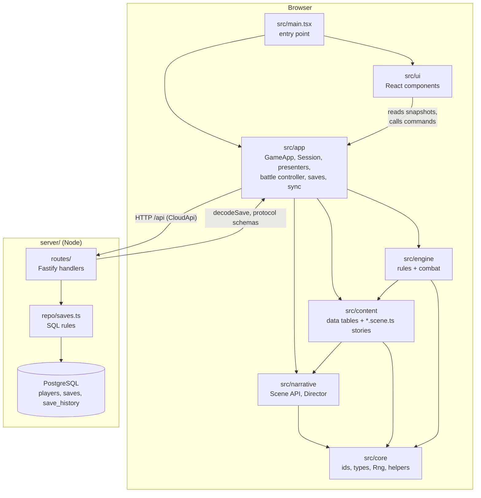

- **Layers point down only.** `core ← narrative ← content ← engine ← app ← ui`, enforced by `npm run depcruise` ([ADR-0002](../adr/0002-layering.md); the rules are listed in the [reference index](../reference/code-map/README.md#boundary-rules)).
- **The server shares exactly two game files**: [src/app/save/format.ts](../../src/app/save/format.ts) (the save schema and `decodeSave`) and [src/app/save/protocol.ts](../../src/app/save/protocol.ts) (the API's Zod schemas), plus the core ids they use. The arrow from `routes` to `app` above is that import.
- **The engine never waits.** It's plain functions over plain objects. Everything that waits for the player (taps, timing bars, dialogs) is in `app/` and `ui/`.

## 2. Where things live

| Folder | Files | One line | Start reading at |
|---|---|---|---|
| [src/core/](../../src/core/) | 16 | Every id list (`as const`), the shared types (`GameState`, `Battle`, `Actor`, content defs, effects), the seeded `Rng`, pure helpers | [types/state.ts](../../src/core/types/state.ts), [types/battle.ts](../../src/core/types/battle.ts), [rng.ts](../../src/core/rng.ts) |
| [src/narrative/](../../src/narrative/) | 3 | The scene API (`Scene`, `SceneContext`, `Presenter`), the `Director`, `definePlace`/`defineEvent` | [types.ts](../../src/narrative/types.ts), [director.ts](../../src/narrative/director.ts) |
| [src/content/](../../src/content/) | 71 | Typed data (classes, skills, enemies, bosses with their AI, items, gear, districts, acts) and story scripts (`*.scene.ts`) | [data.ts](../../src/content/data.ts), [index.ts](../../src/content/index.ts) |
| [src/engine/](../../src/engine/) | 22 | Rules as functions: stats, progression, inventory, shops, encounters, aftermath, and the combat loop in `combat/` | [index.ts](../../src/engine/index.ts), [combat/turns.ts](../../src/engine/combat/turns.ts) |
| [src/app/](../../src/app/) | 16 | Runs the game without React: `GameApp`, `Session`, the `SceneContext` implementation, the battle controller, presenters, the view store, saves and sync | [game.ts](../../src/app/game.ts), [session.ts](../../src/app/session.ts) |
| [src/ui/](../../src/ui/) | 35 (with main.tsx) | React components: screens, layers (action bar, sheets, popups, toast), the battle view | [App.tsx](../../src/ui/App.tsx), [GameContext.tsx](../../src/ui/GameContext.tsx) |
| [server/](../../server/) | 15 | The cloud-save API: Fastify app, routes, repository, Drizzle schema, migrations, auth | [index.ts](../../server/index.ts), [app.ts](../../server/app.ts) |
| [tools/](../../tools/) | 19 | Parity oracles against v1, balance sim and fight trace, content validator, layer check, this code map | [parity/driver.ts](../../tools/parity/driver.ts), [sim.ts](../../tools/sim.ts) |
| [tests/](../../tests/) | 5 | Headless playthrough (`integration/`), Playwright at 360px (`e2e/`), Playwright against Docker (`e2e/stack/`) | [integration/slice.test.ts](../../tests/integration/slice.test.ts) |

Unit tests sit next to the code they test (`*.test.ts`). The [tests page of the reference](../reference/code-map/tests.md) lists every test file and what it covers.

### Import aliases and barrels

- **Aliases** (in `tsconfig.json`): `@core/*`, `@narrative/*`, `@content/*`, `@engine/*`, `@app/*`, `@ui/*` map to the matching `src/` folder.
- **Barrels** are the public face of a layer. Code in other layers imports the barrel; files inside a layer import each other directly (no cycles).

| Barrel | Exports | Who may import it |
|---|---|---|
| [engine/index.ts](../../src/engine/index.ts) | The engine's public API | app, ui (read-only queries), tools, tests |
| [content/data.ts](../../src/content/data.ts) | Data tables and rules constants (`SKILLS`, `BOSSES`, `ITEMS`, `LOOT`…), **no scenes** | engine, app, ui, tools |
| [content/index.ts](../../src/content/index.ts) | Everything in `data.ts` **plus** the scenes and scene registries (`PLACE_SCENES`, `BOSS_SCENES`, `ARRIVALS`, `prologue`, `hitTheStreets`…) | app, ui. Never the engine: that keeps story prose out of the engine's module graph |
| [core/types/index.ts](../../src/core/types/index.ts) | Every shared type | everyone |

## 3. The runtime objects and their wiring

In the browser there is exactly one of each of these, all created by `new GameApp()` in [src/main.tsx](../../src/main.tsx):

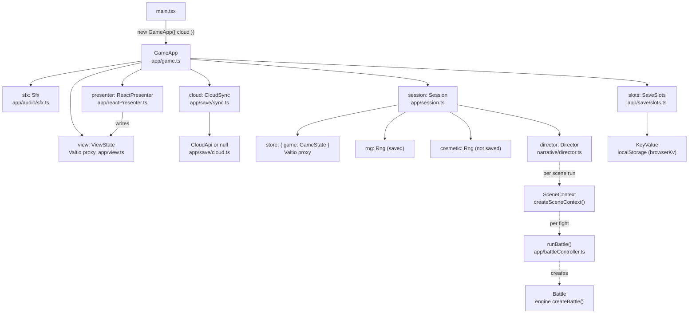

Solid arrows are fields that live for the whole app. Dotted arrows are made fresh each time: a `SceneContext` per Director run, a `runBattle` call per fight, a `Battle` object per fight.

### Who owns what

| Object | Created in | Owns / holds | Talks to |
|---|---|---|---|
| [`GameApp`](../reference/code-map/app.md#src-app-game-ts--gameapp) | `main.tsx` | `view`, `sfx`, `presenter`, `session`, `slots`, `cloud`, `turbo`, the dev menu (`dev`) | Everything. It is the only object React talks to. |
| [`Session`](../reference/code-map/app.md#src-app-session-ts--session) | `GameApp` constructor | `store.game` (the save), `rng`, `cosmetic`, `route`, `director` | The engine, `content/index.ts`, its `Presenter` and `SaveStorage` (both injected) |
| [`Director`](../reference/code-map/narrative.md#src-narrative-director-ts--director) | `Session` constructor | The running scene ("flight") and its `AbortController` | Only its `DirectorConfig` callbacks |
| [`SceneContext`](../reference/code-map/narrative.md#src-narrative-types-ts--scenecontext) | [`createSceneContext`](../reference/code-map/app.md#src-app-scenecontext-ts--createscenecontext), once per run | Nothing; closures over the session, presenter and signal | The engine, the presenter, `runBattle` |
| [`ReactPresenter`](../reference/code-map/app.md#src-app-reactpresenter-ts--reactpresenter) | `GameApp` constructor | The pending waits (`Map<id, resolve>`) | Writes `view`; plays sounds through `sfx` |
| [`SaveSlots`](../reference/code-map/app.md#src-app-save-slots-ts--saveslots) | `GameApp` constructor | `active` slot, listeners | `KeyValue` (localStorage) |
| [`CloudSync`](../reference/code-map/app.md#src-app-save-sync-ts--cloudsync) | `GameApp` constructor | The device's player secret, open conflicts, timers | `SaveSlots`, `CloudClient` |

### The callbacks that tie them together

Most wiring happens in the `GameApp` and `Session` constructors, through callbacks. When something "just happens" (a sync starts, an ambient line rotates, the screen goes back to the place), it's one of these:

| Callback | Set in | Fires when | Does |
|---|---|---|---|
| `ReactPresenterOptions.onRoute` | `GameApp` constructor | the presenter shows a route | rotates the district's ambient line (`GameApp.nextAmbient`); settles any waiting cloud conflict (`settleConflicts`) |
| `SessionDeps.onBusy` | `GameApp` constructor | a scene starts or ends | sets `view.busy` (the district and place action bars hide while a scene runs) |
| `DirectorConfig.makeContext` | `Session` constructor | each run starts | `createSceneContext(session, signal)` |
| `DirectorConfig.onSettled` | `Session` constructor | any run ends (done, aborted, interrupted, failed) | `Session.showRoute()`, which calls `presenter.route(session.route)` |
| `DirectorConfig.onInterrupt.cut` | `Session` constructor | a scene throws `SceneInterrupt('cut')` (lost a street fight) | `Session.afterCut()` then the `wakeUpAtClub` scene |
| `DirectorConfig.onError` | `Session` constructor | a scene throws anything else | logs, toasts `TEXT.somethingBroke`, routes to the district |
| `SaveSlots.subscribe` (GameApp) | `GameApp` constructor | any slot is written, cleared or adopted | `GameApp.refreshSlot(slot)` mirrors it into `view.saves` |
| `SaveSlots.subscribe` (CloudSync) | `CloudSync` constructor | same | `CloudSync.schedule()` if the slot is dirty |
| `SyncDeps.onChange` | `GameApp` constructor | sync state changes | `GameApp.refreshCloud()` mirrors it into `view.cloud` and `view.saves` |
| `SyncDeps.onConflict` | `GameApp` constructor | the server has a different copy of a slot this device changed | `GameApp.settleConflicts()` |
| `SyncDeps.isPlaying` | `GameApp` constructor | sync asks before replacing a slot | true if that slot is the running game's (it then becomes a conflict instead) |

### Why `SessionPort` exists

[`sessionPort.ts`](../../src/app/sessionPort.ts) is an interface with the parts of `Session` that `sceneContext.ts` and `battleController.ts` need (`game`, `rng`, `cosmetic`, `route`, `deps.presenter`, `save`). `Session` imports those two modules, so they can't import `Session` back without a cycle. They import `SessionPort` instead.

## 4. The one rule: state down, commands up

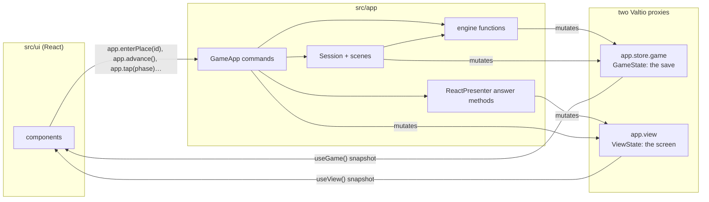

- Components read **frozen snapshots** through [`useGame()` and `useView()`](../../src/ui/GameContext.tsx). Writing to a snapshot throws in development.
- Components change things only by calling **commands** on `GameApp` (`useApp()`). See [the UI → command table](#ui-components--gameapp-commands).
- Components may call **read-only engine queries** on a snapshot for display: `derivedStats`, `currentStep`, `displayStats`, `shopRow`, `sellables`, `gearForSlot`, `questProgress`, `xpToNext`, `scoreBlues`, `bluesLabel`.
- Valtio notices every mutation of the proxies and re-renders the components that read the changed fields.

The full rules are in [ui.md](ui.md#the-one-rule).

## 5. Flow: boot

What happens between loading the page and seeing the title screen.

1. **[src/main.tsx](../../src/main.tsx)** creates the app: `new GameApp({ cloud: VITE_CLOUD === 'off' ? null : new CloudApi() })`. A null cloud makes a local-only game (the e2e test build and static hosting).
2. **The [`GameApp` constructor](../reference/code-map/app.md#src-app-game-ts--gameapp-constructor)** builds, in order: `SaveSlots(kv)`, `Sfx`, `ReactPresenter(view, …)`, `Session({ presenter, storage: slots.current, onBusy })`, `CloudSync({ slots, api, kv, … })`, then subscribes to slot changes. The `Session` constructor creates the `cosmetic` Rng and the `Director` ([callbacks above](#the-callbacks-that-tie-them-together)). No game is loaded yet: `session.store.game` is `null`.
3. **[`GameApp.start()`](../reference/code-map/app.md#src-app-game-ts--gameapp-start)**:
   - `refreshCloud()` fills `view.saves` from `SaveSlots.info(slot)` for slots 1–3. `info` runs `decodeSave` on each stored save and `summarize`s it (name, class, level, district) for the slot picker and the title's Continue button.
   - `cloud.start()` (not awaited) checks `/api/health`, pulls and pushes ([§15](#15-flow-cloud-sync-on-boot-and-conflicts)), and listens for `online` and `visibilitychange` to sync again.
4. **Back in main.tsx**: the OS's reduce-motion preference goes into `view.titleSettings`; in dev and test builds the app is exposed as `window.CF` (the dev menu, Playwright and the Playwright MCP drive the game through it).
5. **React renders** `<App app={app}>` ([App.tsx](../../src/ui/App.tsx)): it puts the app in `GameContext`, and `Shell` picks the screen from `view.screen`. [`createView()`](../../src/app/view.ts) starts at `'title'`, so it shows [`TitleScreen`](../../src/ui/screens/Title.tsx) and `TitleActions` in the action bar.

```
Shell ([App.tsx])
├── Topbar            (in a game, not on title or battle)
├── <main>  Screen    switch (view.screen): Title | Create | Story | District | Place | Battle
├── <footer> ActionBar switch (view.screen): TitleActions | CreateActions | StoryActions | DistrictActions | PlaceActions | BattleActions
├── TimingOverlay     view.timing (On the One bar, Play the Blues)
├── SheetLayer        view.sheet  (menus, shop, saves, settings…)
├── PopupLayer        view.popups (confirm, level-up, lexicon, status)
└── Toast             view.toast
```

Anything behind an open sheet or popup is made `inert`, so it can't be focused or tapped.

## 6. Flow: new game to the prologue

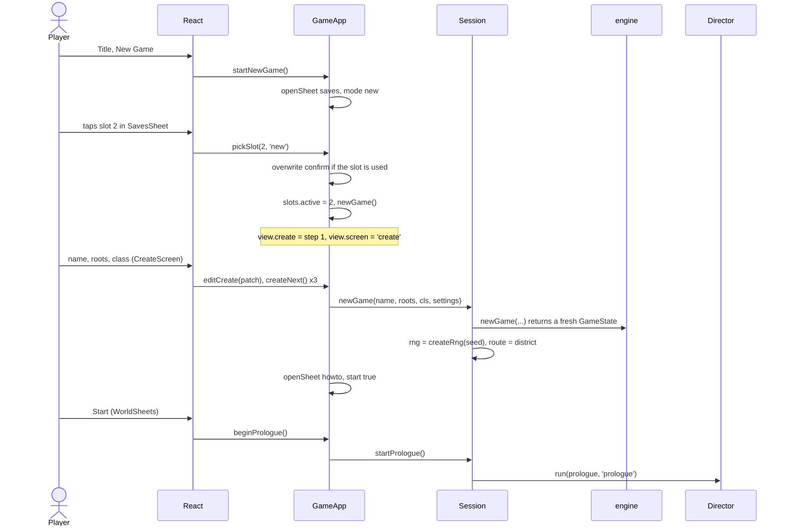

- [`GameApp.pickSlot`](../reference/code-map/app.md#src-app-game-ts--gameapp-pickslot) handles all three slot-picker modes (`continue`, `new`, `import`). It first settles a cloud conflict on that slot, if there is one.
- [`GameApp.createNext`](../reference/code-map/app.md#src-app-game-ts--gameapp-createnext) gives a blank name a random nickname from `session.cosmetic` (presentation randomness, not the game's stream).
- [`Session.newGame`](../reference/code-map/app.md#src-app-session-ts--session-newgame) calls the engine's [`newGame`](../reference/code-map/engine.md#src-engine-state-ts--newgame) ([engine/state.ts](../../src/engine/state.ts)), which builds the starting `GameState` from `content/rules.ts` `NEW_GAME` and the class.
- Nothing is written to the slot until the first checkpoint inside the prologue (`s.save()` in [prologue.scene.ts](../../src/content/story/prologue.scene.ts)).

## 7. Flow: one line of story (the promise handshake)

This is the core pattern of the whole app. A scene `await`s something; the presenter puts a request (with an id) into the view; React renders it; the player's tap calls a command with that id; the presenter resolves the promise; the scene continues.

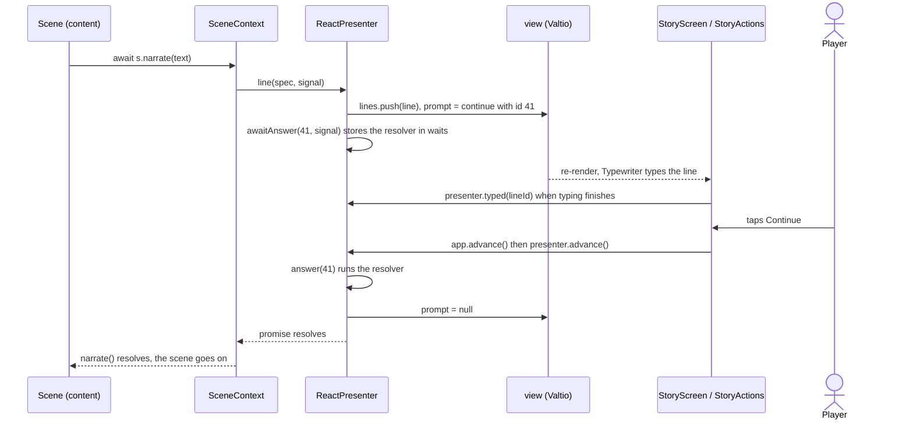

- **Code**: [`createSceneContext`](../../src/app/sceneContext.ts) turns `s.narrate(text)` into `P.line({ who: null, text }, signal)`. [`ReactPresenter.line`](../reference/code-map/app.md#src-app-reactpresenter-ts--reactpresenter-line) pushes a `StoryLine` into `view.lines`, sets `view.prompt = { id, kind: 'continue', lineId }`, and waits in `awaitAnswer(id, signal)`.
- **First tap finishes the typewriter**, second tap continues: [`ReactPresenter.advance`](../reference/code-map/app.md#src-app-reactpresenter-ts--reactpresenter-advance) checks `line.typed` first.
- **Ids make stale taps harmless.** Every wait has a fresh numeric id. `pick(promptId, key)` is ignored unless `view.prompt.id === promptId`, so a double tap or a tap on an old button can't answer the next prompt.
- **Abort unwinds the scene.** `awaitAnswer` listens to the run's `AbortSignal`. When the Director aborts (back to title, loading a save), every pending wait rejects with an `AbortError`, the scene's `await` throws, and [`Director.fly`](../../src/narrative/director.ts) returns `{ status: 'aborted' }`.

### The same pattern for every kind of wait

| Scene calls | Presenter method | Puts into `view` | Rendered by | Answered by (UI → GameApp → presenter) |
|---|---|---|---|---|
| `s.narrate`, `s.say`, `s.speak` | `line` | `lines[]`, `prompt: continue` | [Story.tsx](../../src/ui/screens/Story.tsx), [Typewriter.tsx](../../src/ui/components/Typewriter.tsx) | `app.advance()` → `presenter.advance()` |
| `s.choose(options, prompt?)` | `promptLine`, `choose`, then `echo` | `lines[]`, `prompt: choice` | `StoryActions` in Story.tsx | `app.pick(promptId, key)` → `presenter.pick` |
| `s.confirm(…)` | `confirm` | `popups[]: confirm` | [PopupLayer.tsx](../../src/ui/layers/PopupLayer.tsx) | `app.answerPopup(id, value)` |
| `s.xp(n)` with level-ups | `levelUps` | `popups[]: levelup`, one at a time | PopupLayer.tsx | `app.answerPopup(id)` |
| `s.sheet({ kind: 'shop' … })` | `sheet` | `sheet` with `awaited: true` | [SheetLayer.tsx](../../src/ui/layers/SheetLayer.tsx), [ShopSheet.tsx](../../src/ui/sheets/ShopSheet.tsx) | `app.closeSheet()` → `presenter.closeSheet()` |
| `s.wait(ms)` | `wait` | nothing | — | a timer (honors the signal) |
| `s.toast(text)` | `toast` | `toast` (cleared after 1.8 s) | [Toast.tsx](../../src/ui/layers/Toast.tsx) | nothing to answer |
| `s.title(text)` | `story` | `screen: 'story'`, `title`, clears `lines` | Story.tsx | — |
| battle waits | `battle.*` | `battle`, `timing`, `prompt: outcome` | [§9](#9-flow-a-street-fight-end-to-end) | `app.chooseIntent`, `app.tap`, `app.bluesDone` |

Menus the player opens on their own (bag, gear, journal, settings…) use `presenter.openSheet`, which is **not** awaited by any scene. `GameApp.openSheet` refuses to replace a sheet a scene is waiting on.

## 8. Flow: districts, places and options

Between scenes the player is on a **route** (`Session.route`): the district screen or a place screen. A route is state, not a running scene ([narrative-runtime.md](narrative-runtime.md#routes-not-hub-scenes)).

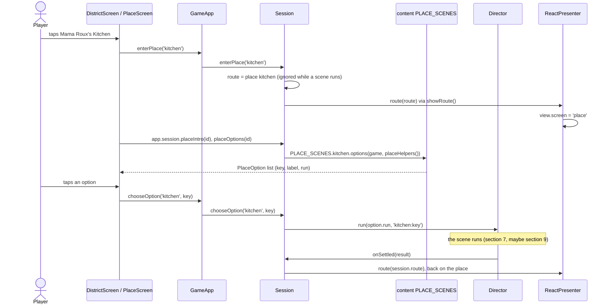

- **Options are computed every time** the place is shown, from `PLACE_SCENES[id].options(game, helpers)` ([`definePlace`](../../src/narrative/define.ts)). Content can't import the engine, so it gets [`PlaceHelpers`](../reference/code-map/narrative.md#src-narrative-define-ts--placehelpers) built by [`Session.placeHelpers`](../reference/code-map/app.md#src-app-session-ts--session-placehelpers): `price` → engine `priceFor`, `is` → `storyIs`, `reached` → `storyReached`.
- **Option keys are stable.** They become test ids (`opt:<key>`) and the scene's name in the Director.
- **Places without scenes** (districts still listed in [content/pending.ts](../../src/content/pending.ts)) show `TEXT.placeNotBuilt` ("Closed tonight…") and Back. The registry is `PLACE_SCENES` in [content/index.ts](../../src/content/index.ts); `tools/completeness.test.ts` and `tests/integration/explore.test.ts` fail if a place outside a pending district has no scenes or no options.
- **The "!" hint** on the district screen comes from [`GameApp.hintPlace`](../reference/code-map/app.md#src-app-game-ts--gameapp-hintplace): `currentStep(g).def.hintPlace`, from the act table in [content/story/acts.ts](../../src/content/story/acts.ts).

### The other district actions

| Button | Command chain | Scene ([streets.scene.ts](../../src/content/world/streets.scene.ts)) |
|---|---|---|
| Hit the Streets | `app.hitTheStreets()` → `Session.hitTheStreets()` → `run(hitTheStreets)` | `hitTheStreets`: 60% a fight (`s.fight({ enemies: 'random' })`), 20% a street event (`runEvent` picks from `STREET_EVENTS` in [streetEvents.scene.ts](../../src/content/world/streetEvents.scene.ts)), 15% something found, 5% the elite or the Praline Lady |
| Track bounty | `app.trackBounty()` → `Session.trackBounty()` → `run(trackBounty)` | `trackBounty`: a `context: 'bounty'`, no-flee fight against the district's elite |
| Travel (sheet) | `app.travel(to)` → `Session.travel(to)` → `run(travel(to))` | `travel(to)`: a streetcar (or airboat) line, then `s.goto(to)` |

[`s.goto(district)`](../../src/app/sceneContext.ts) sets `game.district`, unlocks it, clears `inTower`, **autosaves**, sets the route to the district, and on the first visit plays the district's intro and its `ARRIVALS[id]` scene ([arrivals.scene.ts](../../src/content/world/arrivals.scene.ts)).

## 9. Flow: a street fight, end to end

A scene calls `await s.fight({ enemies: 'random', context: 'street' })`. Here is everything that happens until that promise resolves.

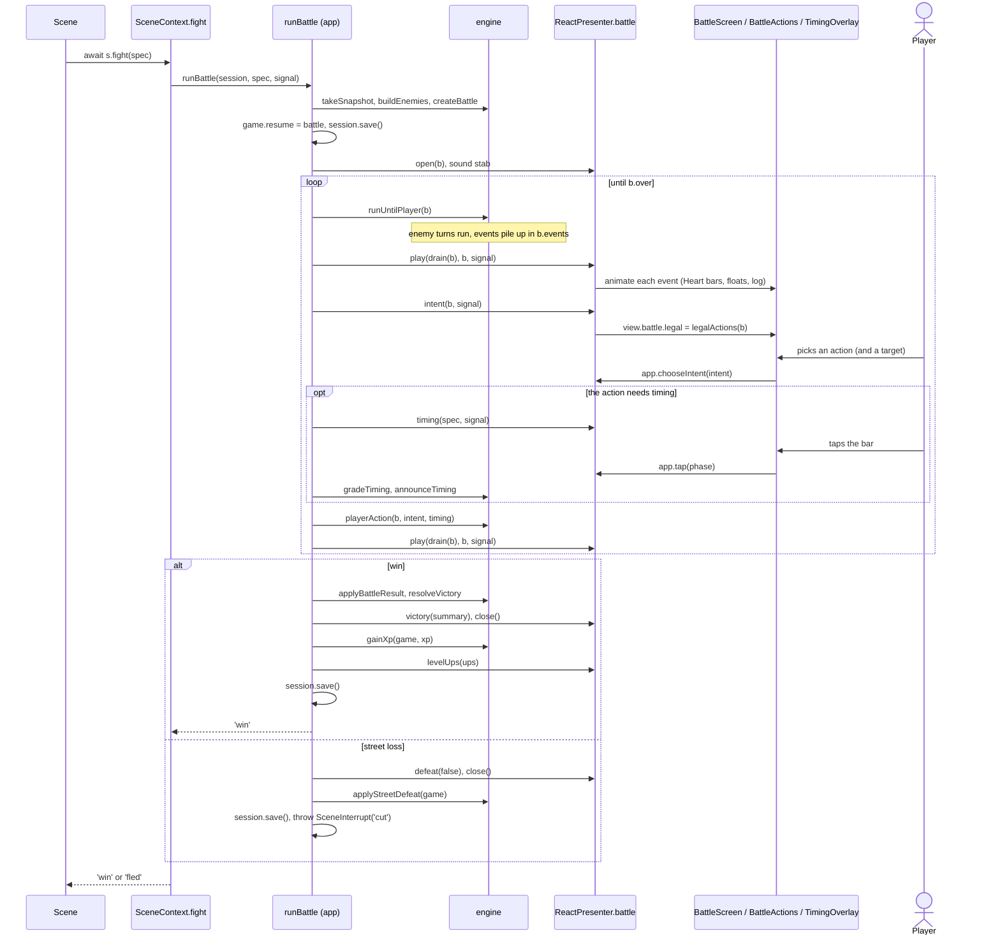

Step by step, in [battleController.ts](../../src/app/battleController.ts) [`runBattle`](../reference/code-map/app.md#src-app-battlecontroller-ts--runbattle):

1. **Snapshot** the parts of the save a lost boss fight puts back: [`takeSnapshot`](../reference/code-map/engine.md#src-engine-aftermath-ts--takesnapshot) ([engine/aftermath.ts](../../src/engine/aftermath.ts)).
2. **Build the enemies.**
   - A boss: `makeEnemy(rng, g, bossId)`.
   - Fixed rivals with `levels: 'own'`: `makeEnemy` for each.
   - Otherwise [`buildEnemies`](../reference/code-map/engine.md#src-engine-encounters-ts--buildenemies) ([engine/encounters.ts](../../src/engine/encounters.ts)), which calls `randomStreetGroup` for `'random'`.
3. **Create the battle**: [`createBattle(rng, g, enemies, opts)`](../reference/code-map/engine.md#src-engine-combat-battle-ts--createbattle). It builds the player's `Actor` from the save (`makePlayerActor` → `derivedStats`), uses up `game.nextFight` bonuses, raises the Click's Perfect Silence in its final phase, records every enemy in the Blue Book, and logs a boss's intro line. **The `Battle` holds `rng` (the session's game stream) and `state` (the live save).**
4. **Checkpoint**: `game.resume = { kind: 'battle', context }`, then `session.save()`. If the app dies mid-fight, the next load knows a fight was interrupted ([§14](#14-flow-loading-continuing-importing)).
5. **Open the battle screen**: `P.battle.open(b)` sets `view.screen = 'battle'` and builds `view.battle` (an `ActorView` per actor).
6. **The pull loop** (at most 400 iterations, a safety net):
   - [`runUntilPlayer(b)`](../reference/code-map/engine.md#src-engine-combat-turns-ts--rununtilplayer) advances rounds and enemy turns until the player must act. It returns `true` when waiting for the player, `false` when the battle ended.
   - `P.battle.play(drain(b), b, signal)` takes the queued events and animates them one by one ([event table below](#battle-events-and-how-they-animate)).
   - `P.battle.intent(b, signal)` computes [`legalActions(b)`](../reference/code-map/engine.md#src-engine-combat-legal-ts--legalactions) into `view.battle.legal` and waits. [BattleActions.tsx](../../src/ui/combat/BattleActions.tsx) shows only legal actions; [targeting.ts](../../src/ui/combat/targeting.ts) `withTarget` acts at once if one enemy stands, otherwise waits for a tap on an enemy card. Both end in `app.chooseIntent(intent)`.
   - **Timing.** If [`needsTiming(intent)`](../reference/code-map/engine.md#src-engine-combat-timing-ts--needstiming) (riffs, damaging skills, solos):
     - auto rhythm (a setting): `rollAutoTiming(rng)`, then `P.battle.autoTiming` shows the grade;
     - manual: `timingSpec(b, center)` with a center from `session.cosmetic`, then `P.battle.timing(spec)` shows the bar ([TimingOverlay.tsx](../../src/ui/combat/TimingOverlay.tsx)), the tap comes back through `app.tap(phase)`, and `gradeTiming(spec, phase)` grades it;
     - either way, `announceTiming(b, grade)` logs it.
   - **Play the Blues** (the finale): `P.battle.blues` runs the six pads, `app.bluesDone(taps, label)` returns the tap times, and `scoreBlues(taps).accuracy` goes into the intent.
   - [`playerAction(b, intent, timing)`](../reference/code-map/engine.md#src-engine-combat-player-ts--playeraction) applies the action ([§11](#11-inside-the-combat-engine)), then the new events are played.
7. **After the loop**: `game.resume = null`, and the result is `b.result` (`win`, `fled` or `lose`).
8. **Aftermath.**

| Result | What runs | Returns |
|---|---|---|
| `win` | [`applyBattleResult(b)`](../reference/code-map/engine.md#src-engine-combat-rewards-ts--applybattleresult) writes Heart and Funk back (+10% / +20% on a win) and ticks meal and dream buffs. [`resolveVictory(b)`](../reference/code-map/engine.md#src-engine-aftermath-ts--resolvevictory) adds gold and drops and advances story counters, quest kill counters and the bounty. Then the victory card, [`gainXp`](../reference/code-map/engine.md#src-engine-progression-ts--gainxp), level-up popups, the step's `completeToast`, and a save. | `'win'` |
| `fled` | `applyBattleResult`, close, save, then a "you got away" line (mentions stolen Doubloons) | `'fled'` |
| `lose`, boss | the defeat card offers a retry; [`restoreSnapshot`](../reference/code-map/engine.md#src-engine-aftermath-ts--restoresnapshot) puts the save back; save | `'retry'` or `'lose'` (only `bossFlow` sees these) |
| `lose`, street | the defeat card; [`applyStreetDefeat`](../reference/code-map/engine.md#src-engine-aftermath-ts--applystreetdefeat) takes the cost; save; **throws `SceneInterrupt('cut')`** | never returns |

### Losing a street fight

The thrown `SceneInterrupt('cut')` unwinds the scene that called `s.fight`, whatever it was. [`Director.fly`](../../src/narrative/director.ts) catches it and runs `onInterrupt.cut` in the same flight: [`Session.afterCut()`](../../src/app/session.ts) moves the player to Tremé, clamps Heart and Funk, saves and routes to the district; then the `wakeUpAtClub` scene plays. The run ends as `{ status: 'interrupted', kind: 'cut' }`, and `onSettled` shows the district.

### Battle events and how they animate

The engine never touches the UI. It pushes `BattleEvent`s onto `b.events` ([core/types/battle.ts](../../src/core/types/battle.ts)), and [`ReactPresenter.applyEvent`](../../src/app/reactPresenter.ts) turns each one into view changes and a pause. Heart (`hp`) steps with `dmg`/`heal` events, so bars move in sync with the log. Everything else (Funk, Groove, statuses, guard) is mirrored from the live battle by `syncActors`.

| Event | View change | Sound | Pause (ms, before speed scaling) |
|---|---|---|---|
| `log` | a battle-log line | — | 420 for boss/telegraph/solo lines, else 230 |
| `dmg` | target's `hp`; a floating number (✦ crit, WEAK!, resisted); screen shake on crits | `crit` or `hit(tone)` | 300 |
| `heal` | target's `hp`; a pink float | — | 220 |
| `revive` | target's `hp` | — | 0 |
| `dodge` | a "dodge" float | — | 200 |
| `death` | actor greyed out | — | 260 |
| `round` | "— Round N —" in the log | — | 140 |
| `turn` | highlights the active actor | — | 0 |
| `status`, `summon` | resync actors (a summon adds a card) | — | 0 |
| `shatter` | screen flash (Perfect Silence breaks) | — | 300 |
| `assist` | — | — | 120 |

Speed scaling: ×0.02 in turbo (tests), ×0.5 with reduce motion, ×1 otherwise.

## 10. Flow: a boss

`await s.boss('captain_hush')` runs the whole boss sequence: [`bossFlow`](../../src/app/sceneContext.ts), inside `createSceneContext`.

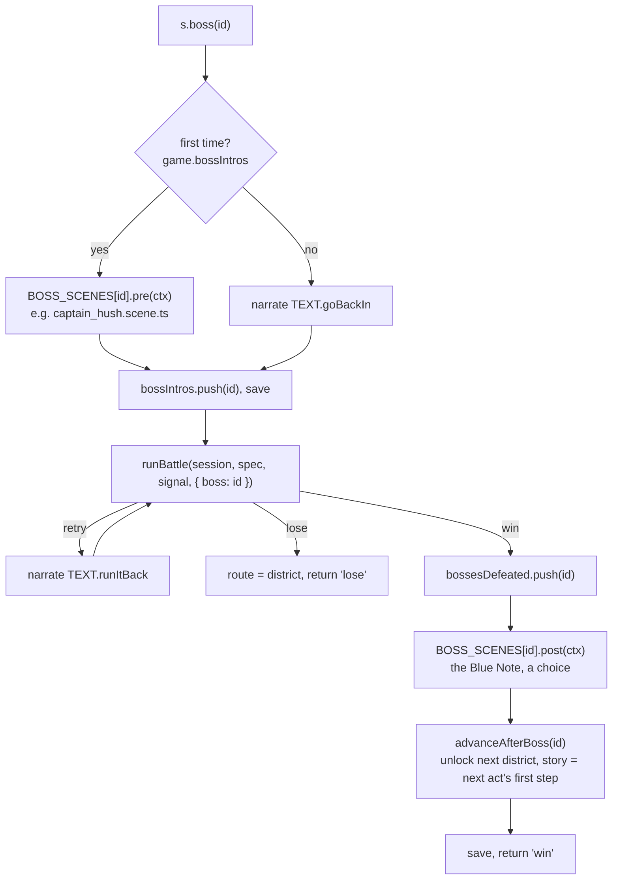

- A boss's **data and AI** are in [`content/bosses/<id>.ts`](../../src/content/bosses/captain_hush.ts) (a `BossDef`). Its **story** is in `content/bosses/<id>.scene.ts`, registered in `BOSS_SCENES` ([content/index.ts](../../src/content/index.ts)).
- `BossDef.next` says what opens after the win (`{ unlock: 'quarter', act: 'quarter' }`). `advanceAfterBoss` applies it and toasts the unlock.
- The dev menu's boss jump ([`GameApp.dev.boss`](../../src/app/game.ts)) sets the story to the boss's step (`bossStep`), levels you up if needed, and calls `session.run(s => s.boss(id))`.

## 11. Inside the combat engine

All of combat is in [src/engine/combat/](../../src/engine/combat/). It's a transliteration of v1, so statement order and every random draw match the legacy engine exactly ([ADR-0003](../adr/0003-determinism-and-parity.md)); `// PARITY:` comments mark oddities that must stay until after cutover.

| File | What's in it | Main functions |
|---|---|---|
| [battle.ts](../../src/engine/combat/battle.ts) | Starting a battle | `createBattle` |
| [actors.ts](../../src/engine/combat/actors.ts) | Building actors from content and the save | `makeActor`, `makeEnemy` (enemies, bosses, rivals, summons, scaled by level and difficulty), `makePlayerActor`, `isBossId` |
| [turns.ts](../../src/engine/combat/turns.ts) | Rounds, turn order, assists, start/end-of-turn ticks, enemy turns, **the pull loop** | `runUntilPlayer`, `startRound`, `runAssists`, `beginTurn`, `endTurn`, `enemyAct` |
| [player.ts](../../src/engine/combat/player.ts) | The player's side | `playerAction`, `finishPlayerTurn`, `playTheBlues`, `playerCanSolo` |
| [resolve.ts](../../src/engine/combat/resolve.ts) | **The effect resolver** and everything it recurses through | `resolveSkill`, `dealHit`, `pickTargets`, `healActor`, `checkDeath`, `bossHpHooks`, `makeOps`, `bossCtx`, `rollAutoTiming`, `critChance`, `dodgeChance` |
| [statuses.ts](../../src/engine/combat/statuses.ts) | Status effects and effective stats | `applyStatus` (chance, boss alternative, immunity), `applyStatusRaw`, `removeStatus`, `cleanse`, `stripBuffs`, `effStat` |
| [events.ts](../../src/engine/combat/events.ts) | Small shared helpers | `logLine`, `endBattle`, `recordSeen`, `actorById` |
| [rewards.ts](../../src/engine/combat/rewards.ts) | XP, gold, drops; writing vitals back | `battleRewards`, `applyBattleResult` |
| [legal.ts](../../src/engine/combat/legal.ts) | What the player may do now (the UI shows only these) | `legalActions`, `skillNeedsTarget` |
| [timing.ts](../../src/engine/combat/timing.ts) | On the One and Play the Blues math | `needsTiming`, `timingSpec`, `gradeTiming`, `announceTiming`, `scoreBlues`, `bluesLabel` |

### The call graph

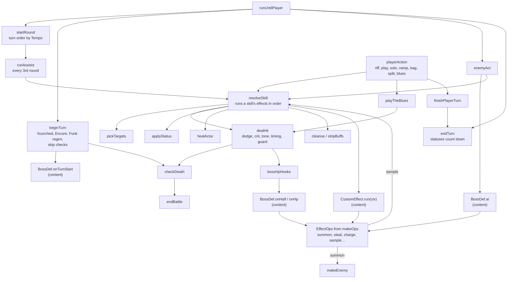

### The effect resolver

Every skill, boss move, bandmate assist and item is a list of effects ([core/types/effects.ts](../../src/core/types/effects.ts)). [`resolveSkill(b, actor, skill, chosen, timing, ctx)`](../reference/code-map/engine.md#src-engine-combat-resolve-ts--resolveskill) runs them in order and stops early if the battle ends. It doesn't care who the actor is, which is how rivals, Session Clones and Vox's Sample reuse player skills.

| `kind` | What it does |
|---|---|
| `dmg` | One or more hits through `dealHit`, at targets from `pickTargets` (or the same target as the last hit); an optional status on a hit; optional recoil |
| `status` | `applyStatus` on the targets (with a chance and a boss alternative) |
| `heal` | `healActor` by a flat amount or a percentage of max Heart |
| `funk` | restore Funk |
| `cleanse` | remove bad statuses |
| `strip` | remove good statuses |
| `guard` | set a guard (damage reduction, optional reflect) |
| `groove` | change the player's Groove |
| `custom` | call content's `run(ctx)`, which acts through `ctx.ops` |

Any effect may have a `cond(ctx)` that skips it.

### The player's actions

[`playerAction`](../../src/engine/combat/player.ts) handles each `PlayerIntent` ([core/types/battle.ts](../../src/core/types/battle.ts)):

| Intent | Effect |
|---|---|
| `riff` | the class's free attack; +2 Funk, +20 Groove (plus the timing's bonus) |
| `play` | a skill: checks Muted, once-per-battle and Funk, pays Funk, resolves; +10 Groove |
| `solo` | at 100 Groove: the class's solo; Groove back to 0 |
| `vamp` | half damage until your next turn, +15% Funk, +10 Groove |
| `bag` | use an item (its effects go through `resolveSkill`); Second Line Smoke flees |
| `split` | try to flee: 50% ± 2% per point of Tempo difference, 25–90%; never from bosses or elites |
| `blues` | the finale's Play the Blues |

An illegal action logs why and still uses the turn (v1 behavior). The UI prevents it by showing only `legalActions`.

## 12. How content plugs into the engine

Content never imports the engine ([content-model.md](content-model.md)). There are three ways content code runs, and each gets exactly the powers it needs as arguments:

| Content code | Where | Called by | Gets |
|---|---|---|---|
| **Boss hooks**: `ai`, `onTurnStart`, `onHalf`, `onHp` on a `BossDef` | `content/bosses/<id>.ts` | `enemyAct`, `beginTurn`, `bossHpHooks` | [`BossCtx`](../reference/code-map/core.md#src-core-types-content-ts--bossctx) `{ battle, self, ops, rng }` from `bossCtx(b, self)` |
| **Effect functions**: `cond` on any effect, `run` on a `custom` effect | skill and item tables (`content/classes/*`, `content/combat/*Skills.ts`, `content/items.ts`) | `resolveSkill` | [`EffectCtx`](../reference/code-map/core.md#src-core-types-effects-ts--effectctx) `{ battle, actor, target, ops, rng }` |
| **Scenes** | `*.scene.ts` | the Director, through `SceneContext` | [`SceneContext`](../reference/code-map/narrative.md#src-narrative-types-ts--scenecontext) only |

`ops` is an [`EffectOps`](../reference/code-map/core.md#src-core-types-effects-ts--effectops) built by [`makeOps(b, actor)`](../reference/code-map/engine.md#src-engine-combat-resolve-ts--makeops). It's the list of battle-changing things content may do: `log`, `applyStatus`, `steal`, `stealFunk`, `copyBuff`, `charge`, `summon` (at most 6 per battle), `sample`, `pitchShield`, `fermata`, `permStat`, `cutLooseReady`, `flee`. A new mechanic that content needs is a new member here, implemented in `makeOps`.

### The tables

Each id kind has an `as const` list in [src/core/ids/](../../src/core/ids/), and each table is checked against it with `satisfies Record<Id, Def>`. A typo in an id doesn't compile. [tools/validate-content.ts](../../tools/validate-content.ts) catches what types can't (for example, a district pool naming an enemy outside its level range).

| Table | Built in | Made of |
|---|---|---|
| `SKILLS` | [content/combat/skills.ts](../../src/content/combat/skills.ts) | `CLASS_SKILLS` (from each `content/classes/*.ts`) + `ENEMY_SKILLS` + `BOSS_SKILLS` + `ASSIST_SKILLS` |
| `CLASSES` | [content/classes/index.ts](../../src/content/classes/index.ts) | one file per instrument |
| `ENEMIES` | [content/enemies/index.ts](../../src/content/enemies/index.ts) | street enemies, `rivals.ts`, `summons.ts` |
| `BOSSES` | [content/bosses/index.ts](../../src/content/bosses/index.ts) | one file per boss |
| `GEAR` | [content/gear/index.ts](../../src/content/gear/index.ts) | instruments, threads, charms, mods |
| `DISTRICTS` | [content/districts/index.ts](../../src/content/districts/index.ts) | one folder per district |
| `ACTS` | [content/story/acts.ts](../../src/content/story/acts.ts) | the main-quest steps, with hint places and progress goals |
| others | `items.ts`, `places.ts`, `npcs.ts`, `quests.ts`, `glossary.ts`, `notes.ts`, `roots.ts`, `sheetMusic.ts`, `band/*`, `combat/statuses.ts`, `combat/tones.ts`, `combat/timing.ts`, `rules.ts` | — |

### The scene registries

| Registry | In | Read by |
|---|---|---|
| `PLACE_SCENES` | [content/index.ts](../../src/content/index.ts) | `Session.placeIntro`, `placeOptions`, `chooseOption` |
| `BOSS_SCENES` | content/index.ts | `bossFlow` (`pre`, `post`) |
| `ARRIVALS` | [world/arrivals.scene.ts](../../src/content/world/arrivals.scene.ts) | `SceneContext.goto` (first visit) |
| `STREET_EVENTS` | [world/streetEvents.scene.ts](../../src/content/world/streetEvents.scene.ts) | `runEvent` in streets.scene.ts |
| `prologue`, `resumeTutorial`, `wakeUpAtClub`, `hitTheStreets`, `trackBounty`, `travel` | story and world scenes | `Session` |

How to write a scene: [guides/writing-scenes.md](../guides/writing-scenes.md).

## 13. Flow: a save reaches PostgreSQL

The game saves at **checkpoints**, always to the device first and synchronously. Uploading happens later, in the background.

### Where the game saves

| Call site | When |
|---|---|
| [`SceneContext.goto`](../../src/app/sceneContext.ts) | entering a district |
| [`runBattle`](../../src/app/battleController.ts) | at the start of every fight (with `game.resume` set) and at every ending |
| `bossFlow` | after a boss's intro, and after a win |
| [`Session.afterCut`](../../src/app/session.ts) | after losing a street fight |
| [prologue.scene.ts](../../src/content/story/prologue.scene.ts) | two checkpoints in the opening |
| [places.scene.ts](../../src/content/districts/treme/places.scene.ts) | resting at the club; "Save game" (manual) |
| [`GameApp.save`](../../src/app/game.ts) (manual), `setSetting`, `loadInto` | from menus |

### From `save()` to a database row

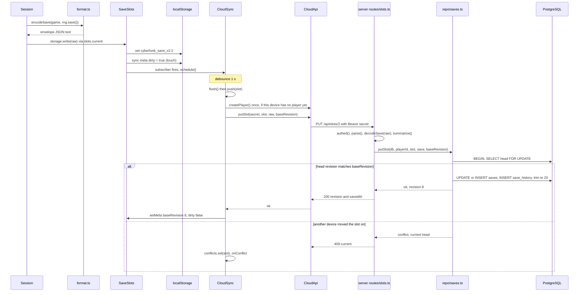

The pieces, in order:

1. [`Session.save(manual)`](../reference/code-map/app.md#src-app-session-ts--session-save) → `serialize()` → [`encodeSave(game, rng.save())`](../reference/code-map/app.md#src-app-save-format-ts--encodesave) builds the **envelope** `{ format, version, savedAt, rng, game }`. The Rng state is saved with the game, so a reload continues the same random stream.
2. `deps.storage.write(raw)`. In the browser, `deps.storage` is [`SaveSlots.current`](../../src/app/save/slots.ts), which writes the **active** slot's key `cyberfunk_save_v2:<slot>` and marks the slot dirty in `cyberfunk_sync_v2:<slot>` (`{ baseRevision, dirty }`). `SaveStorage` is synchronous on purpose: the game never waits on a network ([storage.ts](../../src/app/save/storage.ts)). If localStorage fails, a manual save toasts "use Export Save".
3. The slot's listeners run: `GameApp.refreshSlot` updates the slot picker, and `CloudSync` calls [`schedule()`](../reference/code-map/app.md#src-app-save-sync-ts--cloudsync-schedule) (1 s debounce).
4. [`CloudSync.flush()`](../reference/code-map/app.md#src-app-save-sync-ts--cloudsync-flush) pushes each dirty slot in turn. Concurrent flushes coalesce. If the connection fails, `retryLater()` backs off (2 s, doubling, up to 5 min).
5. `push(slot)` gets the device's player ([`ensurePlayer`](../../src/app/save/sync.ts), which calls `POST /api/players` the first time and stores `{ id, secret }` under `cyberfunk_player`), then [`CloudApi.putSlot`](../reference/code-map/app.md#src-app-save-cloud-ts--cloudapi-putslot) (or `deleteSlot` for a cleared slot). `CloudApi` methods never throw: a network failure is `{ kind: 'offline' }`.
6. **Server**: [`slotRoutes`](../reference/code-map/server.md#server-routes-slots-ts--slotroutes) `PUT /slots/:slot` → [`authed`](../reference/code-map/server.md#server-routes-http-ts--authed) (Bearer secret → SHA-256 → `findPlayer`) → `parse` with the shared protocol schemas → **[`decodeSave`](../reference/code-map/app.md#src-app-save-format-ts--decodesave), the same function the game uses to load**, so the database only ever holds saves the game can read (422 if not) → `summarize` for the summary columns.
7. [`putSlot`](../reference/code-map/server.md#server-repo-saves-ts--putslot) (repo) runs one transaction: lock the slot's head row; if another device has written since `baseRevision`, answer `conflict` with the current head; otherwise bump `revision`, write the head, add a `save_history` row, and trim history to `HISTORY_LIMIT` (20).
8. **Back on the device**: `ok` → `setMeta(slot, { baseRevision: revision, dirty: changed })` (dirty again if another save landed while the request was out). `conflict` → the slot goes into `CloudSync.conflicts` and `GameApp.settleConflicts` asks the player ([§15](#15-flow-cloud-sync-on-boot-and-conflicts)). `rejected` (422) stops retrying that slot until it changes. `unauthorized` forgets the player and makes a new one.

The rules for the format and changing it: [state-and-saves.md](state-and-saves.md#changing-the-save-format). The server's rules: [server.md](server.md#sync-rules).

## 14. Flow: loading, continuing, importing

### Continue

1. Title → Continue → `app.continueGame()` opens the slot picker in `continue` mode.
2. Tapping a slot → [`GameApp.pickSlot(slot, 'continue')`](../reference/code-map/app.md#src-app-game-ts--gameapp-pickslot) → `slots.active = slot` → [`Session.load()`](../reference/code-map/app.md#src-app-session-ts--session-load).
3. `Session.load` reads `deps.storage.read()` and calls [`decodeSave(raw)`](../reference/code-map/app.md#src-app-save-format-ts--decodesave): JSON parse, envelope schema, version check (`too-new`), `MIGRATIONS` from older v2 versions, then the `gameStateSchema` (Zod). It returns `{ game, rng, savedAt }` or a `LoadError` (`empty`, `corrupt`, `too-new`, `invalid`). On success `store.game = game` and `rng = restoreRng(r.rng)`.
4. [`Session.resume()`](../reference/code-map/app.md#src-app-session-ts--session-resume) decides where to put the player:

| Saved state | Resume |
|---|---|
| `game.resume.kind === 'tutorial'` | `resumeTutorial(step)` |
| at `treme/meet_roux` without having met Roux or got the cassette | the prologue again |
| anything else | `s.goto(game.district)` (Tremé if the district isn't valid or unlocked); if a fight was interrupted (`game.resume` was a battle, not on the street), toast "the fight restarts" |

### Export and import codes

- **Export**: `app.exportSave()` → `session.serialize()` → [`exportCode(raw)`](../../src/app/save/format.ts): `CF2:` + base64 of the UTF-8 envelope.
- **Import**: `app.importSave(code)` → `importCode` → `decodeSave` check → from the title, the slot picker in `import` mode; in a game, [`loadInto(activeSlot, raw)`](../../src/app/game.ts): abort the running scene, load, save, resume.

### Back to the title

[`GameApp.toTitle()`](../reference/code-map/app.md#src-app-game-ts--gameapp-totitle) closes sheets, cancels a conflict prompt, `session.quit()` (aborts the running scene through `Director.abort('title')` and waits for it to unwind, then `store.game = null`), resets the view to the title, and syncs.

## 15. Flow: cloud sync on boot, and conflicts

[`CloudSync.sync()`](../reference/code-map/app.md#src-app-save-sync-ts--cloudsync-sync) runs at boot, when the browser comes back online, when the tab becomes visible, and after returning to the title:

1. `api.health()` sets the mode: `online` or `offline` (offline schedules a retry).
2. If the device has a player: [`pull()`](../reference/code-map/app.md#src-app-save-sync-ts--cloudsync-pull) lists the server's slots and **reconciles** each one.
3. `flush()` uploads whatever is dirty.

`reconcile(slot, remote)` compares the server's revision with the device's `baseRevision` and `dirty` flag:

| Server | Device | Outcome |
|---|---|---|
| has never seen the slot | anything | the local copy counts as new (dirty if there is one) |
| revision = base | anything | nothing to fetch; upload if dirty |
| moved on | clean, slot not being played | take the server's copy (`SaveSlots.adopt`, which doesn't mark it dirty) |
| moved on, deleted it | clean, playing it | keep playing |
| moved on, deleted it | dirty, has a save | the device wins (a write beats a deletion) |
| moved on, deleted it | no save | deleted on both; adopt the revision |
| moved on | dirty, or playing it | **conflict**: `conflicts.set(slot, remote)`, `onConflict(slot)` |

[`GameApp.settleConflicts()`](../../src/app/game.ts) asks about each conflicted slot with `presenter.confirm`, one at a time, **never during a battle** (a conflict found mid-battle waits for the next `onRoute`). The answer calls `cloud.keepLocal(slot)` (upload ours over theirs on the next flush) or `cloud.takeRemote(slot)` (download theirs; if it's the running game, abort the scene, load and resume).

Player codes: the secret is shown as `CFP-XXXX-…` ([`formatPlayerCode`](../../src/app/save/protocol.ts)). Entering one on another device (`app.linkCode` → `CloudSync.link`) switches that device to the same player.

## 16. The server

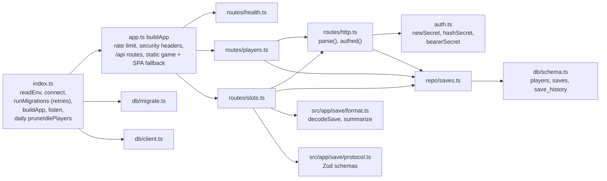

| Endpoint | Handler | Repository | Tables |
|---|---|---|---|
| `GET /api/health` | [routes/health.ts](../../server/routes/health.ts) | a `select 1` | — |
| `POST /api/players` | [routes/players.ts](../../server/routes/players.ts) (10 per hour per IP) | `createPlayer(db, hashSecret(secret))` | `players` |
| `GET /api/players/me` | routes/players.ts | `findPlayer` (through `authed`) | `players` |
| `GET /api/slots` | [routes/slots.ts](../../server/routes/slots.ts) | `listSlots` | `saves` |
| `GET /api/slots/:slot` | routes/slots.ts | `getSlot` | `saves` |
| `PUT /api/slots/:slot` | routes/slots.ts | `putSlot` | `saves`, `save_history` |
| `DELETE /api/slots/:slot?baseRevision=n` | routes/slots.ts | `deleteSlot` (leaves a tombstone: `data` null) | `saves` |
| `GET /api/slots/:slot/history` | routes/slots.ts | `slotHistory` | `save_history` |
| `POST /api/slots/:slot/restore` | routes/slots.ts | `restoreCheckpoint` (an old checkpoint becomes the newest revision) | `saves`, `save_history` |

- Request and response shapes are the Zod schemas in [protocol.ts](../../src/app/save/protocol.ts), used by both [cloud.ts](../../src/app/save/cloud.ts) and the routes. A change there is checked on both sides by the compiler.
- Saves are stored as `json`, not `jsonb`, so the text comes back exactly as written ([db/schema.ts](../../server/db/schema.ts)).
- Schema changes: edit `db/schema.ts`, run `npm run db:generate`, commit the migration. Never edit a shipped migration.
- Server tests drive `buildApp({ db })` with `app.inject` against a real Postgres ([server/testing/db.ts](../../server/testing/db.ts)).

## 17. Randomness: which stream is used where

| Stream | Lives in | Saved? | Used by |
|---|---|---|---|
| **game** `session.rng` | `Session.rng`, and `b.rng` in every battle | yes (the envelope's `rng`) | the whole engine (encounters, enemy building, every combat roll, auto-rhythm timing), scenes (`s.rng`, `s.check`), `useFieldItem` |
| **cosmetic** `session.cosmetic` | `Session.cosmetic` | no | presentation only: the default nickname, where the timing bar's sweet spot sits |
| `Math.random` | — | — | allowed only in `ui/` and `app/audio/` (noise buffers). ESLint forbids it everywhere else |

All game randomness goes through [core/rng.ts](../../src/core/rng.ts) (mulberry32, with v1's exact helper formulas). Functions that consume randomness take the `Rng` as an argument. That's what makes a fight replayable from a seed, the sim's output exact, and the parity oracles possible.

## 18. Test seams: the same code, headless

Every outside dependency is injected, so the real game logic runs in Node without a browser:

| Seam (interface) | In the browser | In tests |
|---|---|---|
| [`Presenter`](../reference/code-map/narrative.md#src-narrative-types-ts--presenter) | `ReactPresenter` | [`ScriptedPresenter`](../../src/app/testing/scriptedPresenter.ts): answers every prompt by a policy and records a transcript |
| [`SaveStorage`](../reference/code-map/app.md#src-app-save-storage-ts--savestorage), [`KeyValue`](../reference/code-map/app.md#src-app-save-storage-ts--keyvalue) | `SaveSlots` over `browserKv` (localStorage) | `memorySaveStorage()`, `memoryKv()` |
| [`SessionDeps`](../reference/code-map/app.md#src-app-session-ts--sessiondeps) `.seed` | crypto randomness | a fixed seed |
| `SessionDeps.battle` | real `runBattle` | a stub that wins every fight (the transcript oracle) |
| [`CloudClient`](../reference/code-map/app.md#src-app-save-cloud-ts--cloudclient) | `CloudApi` (fetch) | a fake in [sync.test.ts](../../src/app/save/sync.test.ts); the real server in [server/sync.test.ts](../../server/sync.test.ts) |
| `buildApp({ db })` | the real database | a test database, driven with `app.inject` |
| [`EngineAdapter`](../reference/code-map/tools.md#tools-parity-driver-ts--engineadapter) | — | `tsAdapter` (v2) and `legacyAdapter` (v1 in a Node vm) in [tools/parity/](../../tools/parity/) |
| `window.CF` + `turbo` | dev and test builds only | Playwright and the Playwright MCP drive and speed up the game |

| Suite | Where | Runs |
|---|---|---|
| Unit | `src/**/*.test.ts` | `npm test` |
| Headless playthrough | [tests/integration/slice.test.ts](../../tests/integration/slice.test.ts): new game → prologue → Tremé → three wins → Captain Hush, with a real `Session` and `ScriptedPresenter` | `npm test` |
| Parity oracles | [tools/parity/](../../tools/parity/): engine traces, sim output, rules, content and scene transcripts compared with v1 | `npm test`, `npm run parity:coverage` |
| Code map freshness | [tools/codemap.test.ts](../../tools/codemap.test.ts) | `npm test` |
| Server | `server/**/*.test.ts` against Postgres | `npm run test:server` |
| e2e | [tests/e2e/](../../tests/e2e/) at 360×740, fails on horizontal overflow | `npm run e2e` |
| Stack e2e | [tests/e2e/stack/](../../tests/e2e/stack/) against the Docker stack | `E2E_STACK_URL=… npx playwright test` |

Details: [guides/testing.md](../guides/testing.md).

## 19. Lookup tables

### UI components → GameApp commands

What each component can make happen. Components call nothing else that changes state.

| Component | Commands it calls |
|---|---|
| [Title.tsx](../../src/ui/screens/Title.tsx) | `continueGame`, `startNewGame`, `openSheet` (how to play, settings, the dev menu) |
| [Create.tsx](../../src/ui/screens/Create.tsx) | `editCreate`, `createNext`, `createBack` |
| [Story.tsx](../../src/ui/screens/Story.tsx) | `advance`, `pick` (also `presenter.pick` for outcome buttons) |
| [Typewriter.tsx](../../src/ui/components/Typewriter.tsx) | `presenter.typed`, `sawTerms` |
| [LexText.tsx](../../src/ui/components/LexText.tsx) | `showTerm` |
| [Chips.tsx](../../src/ui/components/Chips.tsx) | `showStatus` |
| [District.tsx](../../src/ui/screens/District.tsx) | `enterPlace`, `hitTheStreets`, `trackBounty`, `hintPlace`, `openSheet` (travel, menu) |
| [Place.tsx](../../src/ui/screens/Place.tsx) | `chooseOption`, `leavePlace`, `openSheet` (menu); reads `session.placeIntro` and `session.placeOptions` |
| [Topbar.tsx](../../src/ui/layers/Topbar.tsx) | `openSheet` (status) |
| [BattleActions.tsx](../../src/ui/combat/BattleActions.tsx), [targeting.ts](../../src/ui/combat/targeting.ts) | `chooseIntent`, `openSheet` (bag in battle) |
| [TimingOverlay.tsx](../../src/ui/combat/TimingOverlay.tsx) | `tap`, `bluesDone` |
| [PopupLayer.tsx](../../src/ui/layers/PopupLayer.tsx) | `answerPopup` |
| [MenuSheets.tsx](../../src/ui/sheets/MenuSheets.tsx) | `useItem`, `equip`, `unequip`, `toggleBandmate`, `save`, `confirmToTitle`, `openSheet`, `closeSheet` |
| [ShopSheet.tsx](../../src/ui/sheets/ShopSheet.tsx) | `buy`, `sell`, `shopTab` |
| [WorldSheets.tsx](../../src/ui/sheets/WorldSheets.tsx) | `travel`, `takeBounty`, `beginPrologue`, the `dev.*` menu |
| [SavesSheet.tsx](../../src/ui/sheets/SavesSheet.tsx) | `pickSlot`, `confirmDeleteSlot`, `openHistory` |
| [HistorySheet.tsx](../../src/ui/sheets/HistorySheet.tsx) | `confirmRestore` |
| [SettingsSheet.tsx](../../src/ui/sheets/SettingsSheet.tsx) | `setSetting`, `exportSave`, `confirmReset`, `linkCode`, `confirmUnlink` |
| [Sheet.tsx](../../src/ui/sheets/Sheet.tsx) | `closeSheet`, `openSheet` |

### GameApp commands → what they call

| Command | Goes to |
|---|---|
| `advance`, `pick`, `answerPopup`, `chooseIntent`, `tap`, `bluesDone`, `closeSheet` | `ReactPresenter` answer methods (resolve a waiting scene or battle) |
| `enterPlace`, `leavePlace`, `chooseOption`, `hitTheStreets`, `trackBounty`, `travel` | `Session` navigation, which starts scenes through the `Director` |
| `createCharacter`, `beginPrologue`, `pickSlot`, `toTitle`, `importSave` | `Session` lifecycle: `newGame`, `startPrologue`, `load`, `resume`, `quit` |
| `useItem` (outside battle), `equip`, `unequip`, `toggleBandmate`, `buy`, `sell` | engine functions on `session.game`: `useFieldItem`, `equip`, `unequip`, `toggleBandmate`, `buy`, `sell` |
| `useItem` (in battle) | `chooseIntent({ type: 'bag', itemId })` |
| `save`, `setSetting`, `exportSave` | `Session.save`, `Session.serialize` |
| `linkCode`, `confirmUnlink`, `openHistory`, `confirmRestore`, conflicts | `CloudSync` |
| `confirmDeleteSlot`, `resetGame` | `SaveSlots.storage(slot).clear()` |
| `showTerm`, `showStatus`, `sawTerms`, `takeBounty`, `shopTab`, `newGame`, `editCreate`… | small direct writes to `view` or `store.game` |

### SceneContext → implementation

What each scene helper really does ([app/sceneContext.ts](../../src/app/sceneContext.ts)).

| Helper | Implementation |
|---|---|
| `title`, `narrate`, `say`, `speak` | `P.story`, `P.line` (`say` looks up the name and color in `NPCS`) |
| `choose`, `confirm`, `toast`, `sheet`, `wait` | `P.choose` (+ `promptLine`, `echo`), `P.confirm`, `P.toast`, `P.sheet`, `P.wait` |
| `goto(district)` | sets district and unlocks, autosaves, sets the route, first-visit intro + `ARRIVALS` |
| `returnTo(route)` | sets `session.route` |
| `give`, `take`, `count` | engine `addItem` (+ toast), `removeItem`, `countItem` |
| `gold(n)` | changes `doubloons` (fails if it would go negative; toasts gains) |
| `xp(n)` | engine `gainXp`, toast, `P.levelUps` |
| `heal`, `funk`, `rest` | engine `healPct`, `funkPct`, `fullRest` |
| `check(stat, base, yat?)` | `derivedStats`, then `rng.chance(clamp(base + 1.5% × stat (+15% Yat), 10%, 95%))` |
| `scaleXp`, `scaleGold` | +35% / +30% per level |
| `nextFight`, `bookHint`, `permStat`, `flags`, `story`, `quest`, `setQuest`, `counter`, `choice`, `keyItem`, `gainGear`, `recruit` | direct writes to the save (`story.is` / `reached` use engine `storyIs` / `storyReached`) |
| `giveNote(id)` | adds the Blue Note, plays its chime, narrates its quote |
| `save(manual?)` | `session.save` |
| `fight(spec)` | `runBattle` (or `deps.battle` in tests); `'fled'` or `'win'` |
| `boss(id)` | `bossFlow` ([§10](#10-flow-a-boss)) |

### Where do I change…

| I want to… | Change | Then |
|---|---|---|
| tune damage, HP, XP curve | [engine/balance.ts](../../src/engine/balance.ts) (`BALANCE`, `xpToNext`, `enemyBaseStats`) | `npm run sim` ([balancing](../guides/balancing.md)) |
| add or change a skill | the class file in `content/classes/`, or `content/combat/*Skills.ts`; the id in `core/ids/combat.ts` | `npm run validate`, `npm test` |
| add an enemy | `content/enemies/`, its id in `core/ids/enemies.ts`, a district pool in `content/districts/` | `npm run validate` |
| change a boss's pattern | `ai` / hooks in `content/bosses/<id>.ts` | `npm run trace` |
| add a mechanic content can trigger | a member on `EffectOps` ([core/types/effects.ts](../../src/core/types/effects.ts)) and its implementation in `makeOps` ([engine/combat/resolve.ts](../../src/engine/combat/resolve.ts)) | — |
| add an effect kind | `core/types/effects.ts` and a branch in `resolveSkill` | — |
| write a place, NPC talk or event | `content/districts/<d>/*.scene.ts` with `definePlace`, register in `PLACE_SCENES` | [writing scenes](../guides/writing-scenes.md) |
| add a scene helper (`s.something`) | `SceneContext` in [narrative/types.ts](../../src/narrative/types.ts) and [app/sceneContext.ts](../../src/app/sceneContext.ts) | ADR-0004 freezes this API after the P2 playtest |
| add something the player can tap | a component in `src/ui/`, a command on `GameApp`, the rule in the engine | [ui.md](ui.md#adding-a-screen-sheet-or-popup) |
| add a sheet or popup kind | `SheetView` / `Popup` in [app/view.ts](../../src/app/view.ts), a case in `SheetLayer` / `PopupLayer` | — |
| animate a new battle event | `BattleEvent` in core/types/battle.ts, a case in `ReactPresenter.applyEvent` | — |
| add a field to the save | `GameState`, `newGame`, the Zod schema in [app/save/format.ts](../../src/app/save/format.ts) (and a migration if old saves need it) | [state and saves](state-and-saves.md#changing-the-save-format) |
| change the cloud API | [app/save/protocol.ts](../../src/app/save/protocol.ts), [cloud.ts](../../src/app/save/cloud.ts), `server/routes/` | `npm run test:server` |
| change a database table | [server/db/schema.ts](../../server/db/schema.ts) | `npm run db:generate`, commit the migration |

## 20. Game words and their code names

| In the game | In the code |
|---|---|
| Heart | `hp`, `maxHp` |
| Funk (skill points) | `fp`, `maxFp` |
| Groove (0–100; SOLO at 100) | `groove` |
| Chops, Grit, Tempo, Mojo | stat keys `chops`, `grit`, `tempo`, `mojo` (`STAT_KEYS` also has `heart`, `funk`) |
| Doubloons (Ð) | `doubloons` |
| Class (the instrument) | `cls`, `ClassId`, `CLASSES` |
| Roots (background) | `roots`, `RootsId`, `ROOTS` |
| Tone (damage type) | `ToneId`: `HOT`, `LOW`, `BLUE`, `FUNK`, `SWEET` |
| On the One (timing grade) | `TimingId`: `one`, `pocket`, `loose`, `clams` |
| Riff / Play / Solo / Vamp / Bag / Split | `PlayerIntent.type`: `riff`, `play`, `solo`, `vamp`, `bag`, `split` |
| Big Four (Bass Drum beat) | `bigFour`, `beat` |
| Blue Notes | `notes`, `NoteId`, `NOTES` |
| Blue Book (bestiary) | `book` |
| Lexicon | `lexicon`, `GLOSSARY`, `[[term]]` markup in text |
| Bandmates (assist every 3rd round) | `band.recruited`, `band.active`, `BANDMATES` |
| Second Line (the finale's marchers) | `secondLine`, `SECOND_LINE` |
| Getting cut (losing) | `SceneInterrupt('cut')`, `applyStreetDefeat` |
| The Click (final boss) | `the_click`, `clickPhase`, `bluesTarget` |
| Play the Blues | intent `blues`, `playTheBlues`, `scoreBlues` |

## 21. Keeping the code map current

- **This page** is hand-written. Update it when a flow changes shape (a new runtime object, a new callback, a new step in a battle or a save).
- **[The generated reference](../reference/code-map/README.md)** is written by [tools/codemap.ts](../../tools/codemap.ts) from the TypeScript program: files, declarations, signatures, the first sentence of each doc comment, and every edge. Run `npm run docs:codemap` after changing code, and commit the pages with the change. [tools/codemap.test.ts](../../tools/codemap.test.ts) fails in `npm test` when they're stale.
- The reference's one-line descriptions come from file header comments and TSDoc. A clear first sentence in the source is the best way to improve them.
