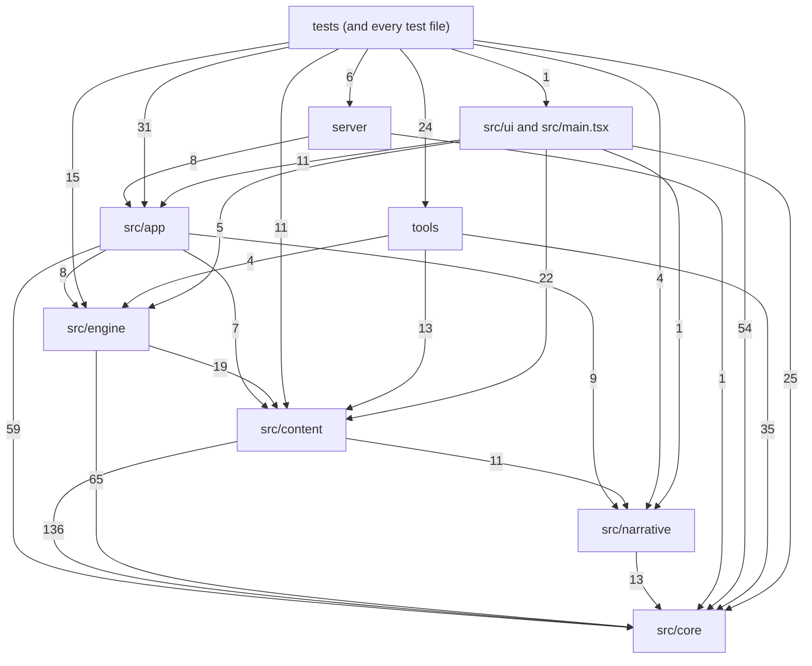

<!-- Generated by tools/codemap.ts. Do not edit by hand: run `npm run docs:codemap`. -->

# Code map: generated reference

Every source file in `src/`, `server/`, `tools/` and `tests/`, with its declarations and who uses what, generated from the TypeScript program by [tools/codemap.ts](../../../tools/codemap.ts). **Don't edit these pages:** run `npm run docs:codemap` after changing code. A test (`tools/codemap.test.ts`) fails when they are out of date. `legacy/` (the v1 oracle) is not mapped.

For how the pieces work together (boot, a story line, a battle, a save reaching Postgres), read the hand-written [guide](../../architecture/code-map.md) first.

**224** source files · **27** test files · **988** top-level declarations · **402** members · **2530** "uses" edges

## Pages

| Page | Files | What lives there |
|---|---|---|
| [src/core](core.md) | 18 | The floor layer: every id list, the shared types (GameState, Battle, Actor, content defs, effects), the seeded Rng and pure helpers. |
| [src/narrative](narrative.md) | 3 | The scene API that story content is written against (Scene, SceneContext, Presenter), the Director that runs one scene at a time, and the place/event authoring helpers. |
| [src/content](content.md) | 88 | Typed game data and story scripts: classes, skills, statuses, enemies, bosses (with their AI), items, gear, districts, acts, and the *.scene.ts files. |
| [src/engine](engine.md) | 22 | The game rules as plain functions over GameState and Battle: stats, progression, inventory, shops, encounters, aftermath, and the combat loop. |
| [src/app](app.md) | 18 | Runs the game without React: GameApp (every command the UI can issue), Session, the SceneContext implementation, the battle controller, the presenters, the view store, saves, and cloud sync. |
| [src/ui and src/main.tsx](ui.md) | 37 | React components that render the two stores (game and view) and call GameApp commands, plus the browser entry point src/main.tsx. |
| [server](server.md) | 15 | The cloud-save API: the Fastify app, its routes, the PostgreSQL repository and Drizzle schema, migrations and player-code auth. |
| [tools](tools.md) | 21 | Node scripts: the parity oracles against v1, the balance sim and fight trace, the content validator, the layer check, the one-time migration codegen, and this generator. |
| [tests (and every test file)](tests.md) | 29 | The integration and e2e suites in tests/, plus every co-located *.test.ts and *.spec.ts file in the repo, each listed with what it covers. |

## Layers

Import counts between areas (file-level imports, test files counted under tests). Arrows point from the importer to what it imports; in `src/` they only point down, which `npm run depcruise` enforces.



## Boundary rules

The forbidden imports in [.dependency-cruiser.cjs](../../../.dependency-cruiser.cjs), checked by `npm run depcruise` (test files are excluded from the check).

| Rule | From | Must not import | Why |
|---|---|---|---|
| `no-circular` | anything | a cycle |  |
| `core-is-the-floor` | `^src/core/` | `^src/(narrative\|content\|engine\|app\|ui)/` | core/ must not import any other layer. |
| `narrative-only-core` | `^src/narrative/` | `^src/(content\|engine\|app\|ui)/` |  |
| `content-below-engine` | `^src/content/` | `^src/(engine\|app\|ui)/` |  |
| `content-data-has-no-prose-runtime` | `^src/content/` except `(\.scene\.ts$)\|(^src/content/index\.ts$)` | `^src/narrative/` | Only *.scene.ts files (and the content/index.ts scene registry) may import narrative/. Data and rules stay scene-free. |
| `content-no-barrel-inside` | `^src/content/` except `^src/content/(index\|data)\.ts$` | `^src/content/(index\|data)\.ts$` | Files inside content/ import each other directly, never the barrels (avoids cycles). |
| `sprites-ui-and-tools-only` | `^src/(core\|narrative\|engine\|app)/\|^src/content/(?!sprites/)` | `^src/content/sprites/` | Character art is for the UI and tools. The engine, app, scenes and other content never load it (docs/adr/0007-character-sprites.md). |
| `engine-no-scenes` | `^src/engine/` | `(^src/(narrative\|app\|ui)/)\|(\.scene\.ts$)\|(^src/content/index\.ts$)` |  |
| `app-has-no-react` | `^src/app/` | `(^src/ui/)\|(^node_modules/(react\|react-dom)/)` |  |
| `src-does-not-import-tooling` | `^src/` | `^(tools\|tests\|legacy)/` |  |
| `src-does-not-import-server` | `^src/` | `^server/` |  |
| `server-shares-only-the-save-format` | `^server/` | `^src/` except `^src/(core/\|app/save/(format\|protocol)\.ts$)` | The server may use core and the save format/protocol, nothing else from the game. |
| `save-format-stays-portable` | `^src/app/save/(format\|protocol)\.ts$` | `(^src/(?!core/\|app/save/(format\|protocol)\.ts$))\|(^node_modules/(?!zod/))` | format.ts and protocol.ts run in the browser and on the server: core and Zod only. |
| `tools-headless` | `^tools/` | `^src/ui/` | Tools (sim, validators) run in Node and never load the React UI. |

## Capability interfaces (the seams)

Interfaces with methods are where one part of the code calls into another without importing it. Each member on the detail pages lists what **implements** it (classes, or object literals checked against it) and where it is **called from**.

| Interface | Members | Implemented in | Called from |
|---|---|---|---|
| [ReactPresenterOptions](app.md#src-app-reactpresenter-ts--reactpresenteroptions) (app/reactPresenter) | 4 | [app/game](app.md#src-app-game-ts) | [app/reactPresenter](app.md#src-app-reactpresenter-ts) |
| [CloudClient](app.md#src-app-save-cloud-ts--cloudclient) (app/save/cloud) | 9 | [app/save/cloud](app.md#src-app-save-cloud-ts), [app/save/sync.test](tests.md#src-app-save-sync-test-ts) | [app/save/sync](app.md#src-app-save-sync-ts) |
| [KeyValue](app.md#src-app-save-storage-ts--keyvalue) (app/save/storage) | 3 | [app/save/storage](app.md#src-app-save-storage-ts) | [app/save/slots](app.md#src-app-save-slots-ts), [app/save/sync](app.md#src-app-save-sync-ts) |
| [SaveStorage](app.md#src-app-save-storage-ts--savestorage) (app/save/storage) | 3 | [app/save/slots](app.md#src-app-save-slots-ts), [app/save/storage](app.md#src-app-save-storage-ts) | [app/game](app.md#src-app-game-ts), [app/save/slots](app.md#src-app-save-slots-ts), [app/save/sync](app.md#src-app-save-sync-ts), [app/session](app.md#src-app-session-ts) |
| [SyncDeps](app.md#src-app-save-sync-ts--syncdeps) (app/save/sync) | 3 | [server/sync.test](tests.md#server-sync-test-ts), [app/game](app.md#src-app-game-ts), [app/save/sync.test](tests.md#src-app-save-sync-test-ts) | [app/save/sync](app.md#src-app-save-sync-ts) |
| [SessionDeps](app.md#src-app-session-ts--sessiondeps) (app/session) | 4 | [app/game](app.md#src-app-game-ts), [tests/integration/slice.test](tests.md#tests-integration-slice-test-ts), [tests/integration/support/crawl](tests.md#tests-integration-support-crawl-ts), [tools/parity/transcripts.test](tests.md#tools-parity-transcripts-test-ts) | [app/session](app.md#src-app-session-ts) |
| [SessionPort](app.md#src-app-sessionport-ts--sessionport) (app/sessionPort) | 1 | [app/session](app.md#src-app-session-ts) | [app/battleController](app.md#src-app-battlecontroller-ts), [app/sceneContext](app.md#src-app-scenecontext-ts) |
| [ScriptPolicy](app.md#src-app-testing-scriptedpresenter-ts--scriptpolicy) (app/testing/scriptedPresenter) | 6 | [tests/integration/slice.test](tests.md#tests-integration-slice-test-ts), [tests/integration/support/crawl](tests.md#tests-integration-support-crawl-ts) | [app/testing/scriptedPresenter](app.md#src-app-testing-scriptedpresenter-ts) |
| [Rng](core.md#src-core-rng-ts--rng) (core/rng) | 7 | [app/testing/rng](app.md#src-app-testing-rng-ts), [core/rng](core.md#src-core-rng-ts) | [app/battleController](app.md#src-app-battlecontroller-ts), [app/game](app.md#src-app-game-ts), [app/sceneContext](app.md#src-app-scenecontext-ts), [app/session](app.md#src-app-session-ts), [content/bosses/captain_hush](content.md#src-content-bosses-captain-hush-ts), [content/bosses/rougarou](content.md#src-content-bosses-rougarou-ts) … +17 |
| [BossDef](core.md#src-core-types-content-ts--bossdef) (core/types/content) | 4 | [content/bosses/archivist](content.md#src-content-bosses-archivist-ts), [content/bosses/captain_hush](content.md#src-content-bosses-captain-hush-ts), [content/bosses/conductor](content.md#src-content-bosses-conductor-ts), [content/bosses/isolde](content.md#src-content-bosses-isolde-ts), [content/bosses/mr_ledger](content.md#src-content-bosses-mr-ledger-ts), [content/bosses/rougarou](content.md#src-content-bosses-rougarou-ts) … +2 | [engine/combat/resolve](engine.md#src-engine-combat-resolve-ts), [engine/combat/turns](engine.md#src-engine-combat-turns-ts) |
| [SecondLineMemberDef](core.md#src-core-types-content-ts--secondlinememberdef) (core/types/content) | 1 | [content/band/secondLine](content.md#src-content-band-secondline-ts) | [tools/parity/tsAdapter](tools.md#tools-parity-tsadapter-ts) |
| [CustomEffect](core.md#src-core-types-effects-ts--customeffect) (core/types/effects) | 1 | [content/classes/bassdrum](content.md#src-content-classes-bassdrum-ts), [content/classes/trombone](content.md#src-content-classes-trombone-ts), [content/combat/bossSkills](content.md#src-content-combat-bossskills-ts), [content/combat/enemySkills](content.md#src-content-combat-enemyskills-ts), [content/items](content.md#src-content-items-ts) | [engine/combat/resolve](engine.md#src-engine-combat-resolve-ts) |
| [DamageEffect](core.md#src-core-types-effects-ts--damageeffect) (core/types/effects) | 1 | [content/classes/trombone](content.md#src-content-classes-trombone-ts) | [engine/combat/resolve](engine.md#src-engine-combat-resolve-ts), [tools/sim](tools.md#tools-sim-ts) |
| [EffectBase](core.md#src-core-types-effects-ts--effectbase) (core/types/effects) | 1 | [content/classes/trombone](content.md#src-content-classes-trombone-ts) | [engine/combat/resolve](engine.md#src-engine-combat-resolve-ts) |
| [EffectOps](core.md#src-core-types-effects-ts--effectops) (core/types/effects) | 13 | [engine/combat/resolve](engine.md#src-engine-combat-resolve-ts) | [content/bosses/captain_hush](content.md#src-content-bosses-captain-hush-ts), [content/bosses/mr_ledger](content.md#src-content-bosses-mr-ledger-ts), [content/bosses/rougarou](content.md#src-content-bosses-rougarou-ts), [content/bosses/the_click](content.md#src-content-bosses-the-click-ts), [content/bosses/vox_perfecta](content.md#src-content-bosses-vox-perfecta-ts), [content/classes/trombone](content.md#src-content-classes-trombone-ts) … +3 |
| [EventOption](narrative.md#src-narrative-define-ts--eventoption) (narrative/define) | 1 | [content/world/streetEvents.scene](content.md#src-content-world-streetevents-scene-ts) | [content/world/streets.scene](content.md#src-content-world-streets-scene-ts) |
| [PlaceHelpers](narrative.md#src-narrative-define-ts--placehelpers) (narrative/define) | 3 | [app/session](app.md#src-app-session-ts), [tests/integration/explore.test](tests.md#tests-integration-explore-test-ts) | [content/districts/treme/places.scene](content.md#src-content-districts-treme-places-scene-ts) |
| [PlaceScenes](narrative.md#src-narrative-define-ts--placescenes) (narrative/define) | 2 | [content/districts/treme/places.scene](content.md#src-content-districts-treme-places-scene-ts) | [app/session](app.md#src-app-session-ts) |
| [DirectorConfig](narrative.md#src-narrative-director-ts--directorconfig) (narrative/director) | 4 | [app/session](app.md#src-app-session-ts), [narrative/director.test](tests.md#src-narrative-director-test-ts) | [narrative/director](narrative.md#src-narrative-director-ts) |
| [BattlePresenter](narrative.md#src-narrative-types-ts--battlepresenter) (narrative/types) | 10 | [app/reactPresenter](app.md#src-app-reactpresenter-ts) | [app/battleController](app.md#src-app-battlecontroller-ts) |
| [Presenter](narrative.md#src-narrative-types-ts--presenter) (narrative/types) | 12 | [app/reactPresenter](app.md#src-app-reactpresenter-ts), [app/testing/scriptedPresenter](app.md#src-app-testing-scriptedpresenter-ts) | [app/battleController](app.md#src-app-battlecontroller-ts), [app/sceneContext](app.md#src-app-scenecontext-ts), [app/session](app.md#src-app-session-ts) |
| [SceneContext](narrative.md#src-narrative-types-ts--scenecontext) (narrative/types) | 36 | [app/sceneContext](app.md#src-app-scenecontext-ts) | [app/game](app.md#src-app-game-ts), [app/sceneContext](app.md#src-app-scenecontext-ts), [app/session](app.md#src-app-session-ts), [content/bosses/captain_hush.scene](content.md#src-content-bosses-captain-hush-scene-ts), [content/bosses/vox_perfecta.scene](content.md#src-content-bosses-vox-perfecta-scene-ts), [content/districts/quarter/cutting.scene](content.md#src-content-districts-quarter-cutting-scene-ts) … +5 |
| [SerializeOptions](tools.md#tools-migrate-serialize-ts--serializeoptions) (tools/migrate/serialize) | 3 | [tools/migrate/codegen-content](tools.md#tools-migrate-codegen-content-ts) | [tools/migrate/serialize](tools.md#tools-migrate-serialize-ts) |
| [EngineAdapter](tools.md#tools-parity-driver-ts--engineadapter) (tools/parity/driver) | 17 | [tools/parity/legacyAdapter](tools.md#tools-parity-legacyadapter-ts), [tools/parity/properties.test](tests.md#tools-parity-properties-test-ts), [tools/parity/tsAdapter](tools.md#tools-parity-tsadapter-ts) | [tools/parity/driver](tools.md#tools-parity-driver-ts) |
| [LegacyRuntime](tools.md#tools-parity-legacy-ts--legacyruntime) (tools/parity/legacy) | 2 | [tools/parity/legacy](tools.md#tools-parity-legacy-ts) | [tools/parity/legacyAdapter](tools.md#tools-parity-legacyadapter-ts) |
| [LegacyDom](tools.md#tools-parity-legacydom-ts--legacydom) (tools/parity/legacyDom) | 3 | [tools/parity/legacyDom](tools.md#tools-parity-legacydom-ts) | — |

## How to read an entry

```
### src/engine/combat/player.ts             one section per file, in path order
<purpose>                                    the file header comment
- Imports / Imported by / Tested by          file-level links, grouped by area
- Types used                                 types from other files that the code mentions
Declarations:
- playerAction · function `(b, intent, timing): void` — first sentence of its doc comment
  - uses: here finishPlayerTurn · engine/combat/resolve resolveSkill
  - used by: app/battleController runBattle · tests: combat.test
```

- **uses** lists functions, constants, classes and members the declaration refers to (calls, reads, JSX tags). Same-file names come first, after "here".
- **used by** is the reverse. **tests:** lists test files that refer to it (directly or through a barrel).
- **implemented by / called from** appear on capability-interface members: the classes or object literals that implement the member, and the code that calls it through the interface.
- *internal* means not exported. *no references found* means nothing in `src/`, `server/`, `tools/` or `tests/` refers to it (it may be dead code, or used only from outside TypeScript).
- Signatures show parameters as written. Inferred return types come from the checker and are shortened.
- Barrels (`engine/index.ts`, `core/types/index.ts`, `content/data.ts`, `content/index.ts`) are shown as files with their re-exports, but edges always point at the real declaration.
