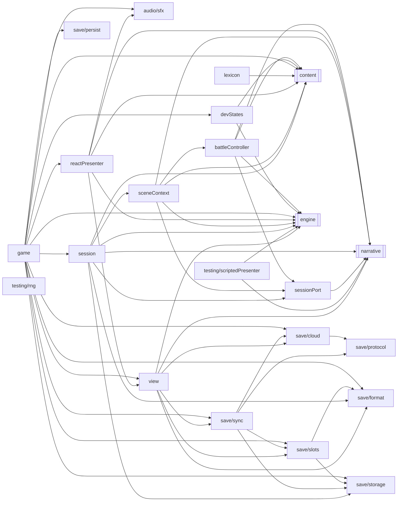

<!-- Generated by tools/codemap.ts. Do not edit by hand: run `npm run docs:codemap`. -->

# Code map: src/app

Runs the game without React: GameApp (every command the UI can issue), Session, the SceneContext implementation, the battle controller, the presenters, the view store, saves, and cloud sync.

Generated reference. Start with the [guide](../../architecture/code-map.md) for the flows, and the [index](README.md) for how to read these entries.

## Imports inside this area

*Imports of src/core are left out: nearly every file has them. Double-bordered boxes are other areas.*

## Files

| File | Purpose |
|---|---|
| [src/app/audio/sfx.ts](#src-app-audio-sfx-ts) | Synthesized sound effects (Web Audio; no audio files). |
| [src/app/battleController.ts](#src-app-battlecontroller-ts) | Runs one battle: the engine's pull loop wired to the presenter. |
| [src/app/devStates.ts](#src-app-devstates-ts) | Shortcuts that put a save at a point in the story: the start of an act, or the step a boss is fought at. |
| [src/app/game.ts](#src-app-game-ts) | The browser game: one Session, the view store, the React presenter and the synth, plus every command the UI can issue. |
| [src/app/lexicon.ts](#src-app-lexicon-ts) | Lexicon linking: turns narration into text and term segments. |
| [src/app/reactPresenter.ts](#src-app-reactpresenter-ts) | The browser Presenter: turns scene and battle requests into view state that React renders, and resolves them when the player acts. |
| [src/app/save/cloud.ts](#src-app-save-cloud-ts) | The browser's client for the cloud-save API (server/routes). |
| [src/app/save/format.ts](#src-app-save-format-ts) | The save format, v2: an envelope `{format, version, savedAt, rng, game}`, validated with Zod on every load, import and upload. |
| [src/app/save/persist.ts](#src-app-save-persist-ts) | — |
| [src/app/save/protocol.ts](#src-app-save-protocol-ts) | The cloud-save API contract, shared by the browser (cloud.ts) and the server (server/routes). |
| [src/app/save/slots.ts](#src-app-save-slots-ts) | The three save slots on this device. |
| [src/app/save/storage.ts](#src-app-save-storage-ts) | Where save text lives on the device. |
| [src/app/save/sync.ts](#src-app-save-sync-ts) | Cloud sync for the save slots: offline-first. |
| [src/app/sceneContext.ts](#src-app-scenecontext-ts) | The SceneContext implementation: the scene API (narrative/types.ts) on top of the engine, the session and a Presenter. |
| [src/app/session.ts](#src-app-session-ts) | A play session: the live save (a Valtio proxy the UI renders from), the random streams, the Director that runs scenes, the current route, and the commands the… |
| [src/app/sessionPort.ts](#src-app-sessionport-ts) | What the scene context and battle controller need from a Session. |
| [src/app/testing/rng.ts](#src-app-testing-rng-ts) | Random streams for tests. |
| [src/app/testing/scriptedPresenter.ts](#src-app-testing-scriptedpresenter-ts) | A Presenter for tests and headless runs: answers every prompt instantly according to a policy and records a transcript of what the player would have seen. |
| [src/app/view.ts](#src-app-view-ts) | Presentation state: everything React renders that isn't the save. |

## Details

### src/app/audio/sfx.ts

Synthesized sound effects (Web Audio; no audio files). A port of v1's SFX with two changes: every sound goes through one master gain node (one place for volume, ducking or a limiter later), and `enabled` is read from whichever settings are current, so the title-screen mute works (v1 ignored it until a game existed).

- Source: [src/app/audio/sfx.ts](../../../src/app/audio/sfx.ts)
- Imported by: app: [game](#src-app-game-ts), [reactPresenter](#src-app-reactpresenter-ts)
- Tested by: [reactPresenter.test](tests.md#src-app-reactpresenter-test-ts)

Declarations:

- **Sfx** · *class* — A tiny synth.
  - used by: **[app/game](#src-app-game-ts)** [GameApp.constructor](#src-app-game-ts--gameapp-constructor), [GameApp.sfx](#src-app-game-ts--gameapp-sfx) · **[app/reactPresenter](#src-app-reactpresenter-ts)** [ReactPresenterOptions](#src-app-reactpresenter-ts--reactpresenteroptions) · tests: [reactPresenter.test](tests.md#src-app-reactpresenter-test-ts)
  - **ctx** · *property, private* `: AudioContext | null`
  - **master** · *property, private* `: GainNode | null`
  - **supported** · *property, private*
  - **constructor** · *constructor* `(private readonly enabled: () => boolean)`
  - **unlock** · *method* `(): void` — Create or resume the audio context.
    - used by: **[ui/App](ui.md#src-ui-app-tsx)** [Shell](ui.md#src-ui-app-tsx--shell)
  - **on** · *method, private* `(): boolean`
    - used by: here [Sfx.levelUp](#src-app-audio-sfx-ts--sfx-levelup), [Sfx.noise](#src-app-audio-sfx-ts--sfx-noise), [Sfx.tone](#src-app-audio-sfx-ts--sfx-tone)
  - **tone** · *method, private* `(freq: number, dur: number, type: OscillatorType = 'sine', vol = 0.12, when?: number, slide?: number): void`
    - uses: here [Sfx.on](#src-app-audio-sfx-ts--sfx-on)
    - used by: here [Sfx.coin](#src-app-audio-sfx-ts--sfx-coin), [Sfx.crit](#src-app-audio-sfx-ts--sfx-crit), [Sfx.hit](#src-app-audio-sfx-ts--sfx-hit), [Sfx.levelUp](#src-app-audio-sfx-ts--sfx-levelup), [Sfx.note](#src-app-audio-sfx-ts--sfx-note), [Sfx.stab](#src-app-audio-sfx-ts--sfx-stab), [Sfx.tap](#src-app-audio-sfx-ts--sfx-tap)
  - **noise** · *method, private* `(dur: number, vol = 0.15): void`
    - uses: here [Sfx.on](#src-app-audio-sfx-ts--sfx-on)
    - used by: here [Sfx.crit](#src-app-audio-sfx-ts--sfx-crit), [Sfx.stab](#src-app-audio-sfx-ts--sfx-stab)
  - **stab** · *method* `(cls: string): void` — The class's battle-start stab.
    - uses: here [Sfx.noise](#src-app-audio-sfx-ts--sfx-noise), [Sfx.tone](#src-app-audio-sfx-ts--sfx-tone)
    - used by: **[app/reactPresenter](#src-app-reactpresenter-ts)** [ReactPresenter.sound](#src-app-reactpresenter-ts--reactpresenter-sound)
  - **hit** · *method* `(tone: string): void` — A hit in a tone.
    - uses: here [Sfx.tone](#src-app-audio-sfx-ts--sfx-tone)
    - used by: **[app/reactPresenter](#src-app-reactpresenter-ts)** [ReactPresenter.applyEvent](#src-app-reactpresenter-ts--reactpresenter-applyevent)
  - **crit** · *method* `(): void` — A critical hit.
    - uses: here [Sfx.noise](#src-app-audio-sfx-ts--sfx-noise), [Sfx.tone](#src-app-audio-sfx-ts--sfx-tone)
    - used by: **[app/reactPresenter](#src-app-reactpresenter-ts)** [ReactPresenter.applyEvent](#src-app-reactpresenter-ts--reactpresenter-applyevent)
  - **coin** · *method* `(): void` — Coins.
    - uses: here [Sfx.tone](#src-app-audio-sfx-ts--sfx-tone)
    - used by: **[app/game](#src-app-game-ts)** [GameApp.buy](#src-app-game-ts--gameapp-buy) · **[app/reactPresenter](#src-app-reactpresenter-ts)** [ReactPresenter.sound](#src-app-reactpresenter-ts--reactpresenter-sound)
  - **tap** · *method* `(result: string): void` — The timing-bar tap result.
    - uses: here [Sfx.tone](#src-app-audio-sfx-ts--sfx-tone)
    - used by: **[app/reactPresenter](#src-app-reactpresenter-ts)** [ReactPresenter.battle](#src-app-reactpresenter-ts--reactpresenter-battle)
  - **note** · *method* `(freq: number, dur = 0.4): void` — A sustained note (Blue Notes, Blues pads).
    - uses: here [Sfx.tone](#src-app-audio-sfx-ts--sfx-tone)
    - used by: **[app/reactPresenter](#src-app-reactpresenter-ts)** [ReactPresenter.sound](#src-app-reactpresenter-ts--reactpresenter-sound) · **[ui/combat/TimingOverlay](ui.md#src-ui-combat-timingoverlay-tsx)** [BluesPads](ui.md#src-ui-combat-timingoverlay-tsx--bluespads)
  - **levelUp** · *method* `(): void` — The level-up arpeggio (the blues scale, up).
    - uses: here [Sfx.on](#src-app-audio-sfx-ts--sfx-on), [Sfx.tone](#src-app-audio-sfx-ts--sfx-tone)
    - used by: **[app/reactPresenter](#src-app-reactpresenter-ts)** [ReactPresenter.levelUps](#src-app-reactpresenter-ts--reactpresenter-levelups)

### src/app/battleController.ts

Runs one battle: the engine's pull loop wired to the presenter. (v1: legacy/src/07_ui_combat.js runBattle.)

- Source: [src/app/battleController.ts](../../../src/app/battleController.ts)
- Imports: core: [ids/enemies](core.md#src-core-ids-enemies-ts), [types/index](core.md#src-core-types-index-ts) · narrative: [types](narrative.md#src-narrative-types-ts) · content: [index](content.md#src-content-index-ts) · engine: [index](engine.md#src-engine-index-ts) · app: [sessionPort](#src-app-sessionport-ts)
- Imported by: app: [sceneContext](#src-app-scenecontext-ts)
- Types used: **[app/sessionPort](#src-app-sessionport-ts)** [BattleOutcome](#src-app-sessionport-ts--battleoutcome), [SessionPort](#src-app-sessionport-ts--sessionport) · **[core/ids/enemies](core.md#src-core-ids-enemies-ts)** [BossId](core.md#src-core-ids-enemies-ts--bossid) · **[core/types/battle](core.md#src-core-types-battle-ts)** [Battle](core.md#src-core-types-battle-ts--battle), [BattleEvent](core.md#src-core-types-battle-ts--battleevent) · **[core/types/content](core.md#src-core-types-content-ts)** [StepDef](core.md#src-core-types-content-ts--stepdef), [TimingGradeDef](core.md#src-core-types-content-ts--timinggradedef) · **[narrative/types](narrative.md#src-narrative-types-ts)** [FightSpec](narrative.md#src-narrative-types-ts--fightspec)

Declarations:

- **drain** · *function, internal* `(b: Battle): BattleEvent[]` — Take the battle's queued events.
  - used by: here [runBattle](#src-app-battlecontroller-ts--runbattle)
- **runBattle** · *function* `(session: SessionPort, spec: FightSpec, signal: AbortSignal, opts: { boss?: BossId; clickPhase?: boolean } = {}): Promise<BattleOutcome>` — Run a battle to its end.
  - uses: here [drain](#src-app-battlecontroller-ts--drain) · **[app/sessionPort](#src-app-sessionport-ts)** [SessionPort.save](#src-app-sessionport-ts--sessionport-save) · **[content/story/acts](content.md#src-content-story-acts-ts)** [ACTS](content.md#src-content-story-acts-ts--acts) · **[content/text](content.md#src-content-text-ts)** [TEXT](content.md#src-content-text-ts--text) · **[core/rng](core.md#src-core-rng-ts)** [Rng.next](core.md#src-core-rng-ts--rng-next) · **[engine/aftermath](engine.md#src-engine-aftermath-ts)** [applyStreetDefeat](engine.md#src-engine-aftermath-ts--applystreetdefeat), [resolveVictory](engine.md#src-engine-aftermath-ts--resolvevictory), [restoreSnapshot](engine.md#src-engine-aftermath-ts--restoresnapshot), [takeSnapshot](engine.md#src-engine-aftermath-ts--takesnapshot) · **[engine/combat/actors](engine.md#src-engine-combat-actors-ts)** [makeEnemy](engine.md#src-engine-combat-actors-ts--makeenemy) · **[engine/combat/battle](engine.md#src-engine-combat-battle-ts)** [createBattle](engine.md#src-engine-combat-battle-ts--createbattle) · **[engine/combat/events](engine.md#src-engine-combat-events-ts)** [logLine](engine.md#src-engine-combat-events-ts--logline) · **[engine/combat/player](engine.md#src-engine-combat-player-ts)** [playerAction](engine.md#src-engine-combat-player-ts--playeraction) · **[engine/combat/resolve](engine.md#src-engine-combat-resolve-ts)** [rollAutoTiming](engine.md#src-engine-combat-resolve-ts--rollautotiming) · **[engine/combat/rewards](engine.md#src-engine-combat-rewards-ts)** [applyBattleResult](engine.md#src-engine-combat-rewards-ts--applybattleresult) · **[engine/combat/timing](engine.md#src-engine-combat-timing-ts)** [announceTiming](engine.md#src-engine-combat-timing-ts--announcetiming) · … +23 more
  - used by: **[app/sceneContext](#src-app-scenecontext-ts)** [createSceneContext](#src-app-scenecontext-ts--createscenecontext)

### src/app/devStates.ts

Shortcuts that put a save at a point in the story: the start of an act, or the step a boss is fought at. The dev menu uses them, and so do the tests that crawl every district.

- Source: [src/app/devStates.ts](../../../src/app/devStates.ts)
- Imports: core: [ids/enemies](core.md#src-core-ids-enemies-ts), [ids/story](core.md#src-core-ids-story-ts), [ids/world](core.md#src-core-ids-world-ts), [types/index](core.md#src-core-types-index-ts) · content: [data](content.md#src-content-data-ts) · engine: [index](engine.md#src-engine-index-ts)
- Imported by: app: [game](#src-app-game-ts) · tests: [integration/support/crawl](tests.md#tests-integration-support-crawl-ts)
- Tested by: [session.test](tests.md#src-app-session-test-ts), [playthrough.test](tests.md#tests-integration-playthrough-test-ts)
- Types used: **[core/ids/enemies](core.md#src-core-ids-enemies-ts)** [BossId](core.md#src-core-ids-enemies-ts--bossid) · **[core/ids/story](core.md#src-core-ids-story-ts)** [ActId](core.md#src-core-ids-story-ts--actid), [StoryPosition](core.md#src-core-ids-story-ts--storyposition) · **[core/ids/world](core.md#src-core-ids-world-ts)** [DistrictId](core.md#src-core-ids-world-ts--districtid) · **[core/types/content](core.md#src-core-types-content-ts)** [StepDef](core.md#src-core-types-content-ts--stepdef) · **[core/types/state](core.md#src-core-types-state-ts)** [GameState](core.md#src-core-types-state-ts--gamestate)

Declarations:

- **setupAct** · *function* `(g: GameState, act: ActId): DistrictId` — Jump to the start of an act, as if every earlier boss were beaten: unlock the districts so far, set the story, record earlier bosses and their Blue Notes, and raise the level to the act's floor.
  - uses: **[content/bosses/index](content.md#src-content-bosses-index-ts)** [BOSSES](content.md#src-content-bosses-index-ts--bosses) · **[content/districts/index](content.md#src-content-districts-index-ts)** [DISTRICTS](content.md#src-content-districts-index-ts--districts) · **[core/ids/story](core.md#src-core-ids-story-ts)** [ACT_ORDER](core.md#src-core-ids-story-ts--act-order), [ACT_STEPS](core.md#src-core-ids-story-ts--act-steps) · **[engine/stats](engine.md#src-engine-stats-ts)** [fullRest](engine.md#src-engine-stats-ts--fullrest)
  - used by: **[app/game](#src-app-game-ts)** [GameApp.dev](#src-app-game-ts--gameapp-dev) · **[tests/integration/support/crawl](tests.md#tests-integration-support-crawl-ts)** [buildState](tests.md#tests-integration-support-crawl-ts--buildstate) · tests: [session.test](tests.md#src-app-session-test-ts)
- **bossStep** · *function* `(id: BossId): StoryPosition` — The story step a boss is fought at: the last step whose hint place is the boss's place (Isolde's manor hosts both the Ball and the duel; the duel is the later step, as in v1's dev menu).
  - uses: **[content/bosses/index](content.md#src-content-bosses-index-ts)** [BOSSES](content.md#src-content-bosses-index-ts--bosses) · **[content/places](content.md#src-content-places-ts)** [PLACES](content.md#src-content-places-ts--places) · **[content/story/acts](content.md#src-content-story-acts-ts)** [ACTS](content.md#src-content-story-acts-ts--acts) · **[core/ids/story](core.md#src-core-ids-story-ts)** [ACT_STEPS](core.md#src-core-ids-story-ts--act-steps)
  - used by: **[app/game](#src-app-game-ts)** [GameApp.dev](#src-app-game-ts--gameapp-dev) · tests: [session.test](tests.md#src-app-session-test-ts), [playthrough.test](tests.md#tests-integration-playthrough-test-ts)
- **towerBossSetup** · *function* `(g: GameState, id: 'conductor' | 'the_click'): void` — Put the climb at a Tower boss's floor (v1's dev menu, 10_main.js:136): the second line formed (whoever qualifies) if it hasn't been, Gus freed, the floor set, and for the Click the Conductor beaten.
  - uses: **[content/band/secondLine](content.md#src-content-band-secondline-ts)** [SECOND_LINE](content.md#src-content-band-secondline-ts--second-line) · **[core/types/content](core.md#src-core-types-content-ts)** [SecondLineMemberDef.when](core.md#src-core-types-content-ts--secondlinememberdef-when)
  - used by: **[app/game](#src-app-game-ts)** [GameApp.dev](#src-app-game-ts--gameapp-dev)

### src/app/game.ts

The browser game: one Session, the view store, the React presenter and the synth, plus every command the UI can issue. React components call these; they never change state themselves.

- Source: [src/app/game.ts](../../../src/app/game.ts)
- Imports: core: [ids/band](core.md#src-core-ids-band-ts), [ids/characters](core.md#src-core-ids-characters-ts), [ids/combat](core.md#src-core-ids-combat-ts), [ids/enemies](core.md#src-core-ids-enemies-ts), [ids/items](core.md#src-core-ids-items-ts), [ids/saves](core.md#src-core-ids-saves-ts), [ids/story](core.md#src-core-ids-story-ts), [ids/world](core.md#src-core-ids-world-ts), [types/index](core.md#src-core-types-index-ts) · content: [index](content.md#src-content-index-ts) · engine: [index](engine.md#src-engine-index-ts) · app: [audio/sfx](#src-app-audio-sfx-ts), [devStates](#src-app-devstates-ts), [reactPresenter](#src-app-reactpresenter-ts), [save/cloud](#src-app-save-cloud-ts), [save/format](#src-app-save-format-ts), [save/persist](#src-app-save-persist-ts), [save/slots](#src-app-save-slots-ts), [save/storage](#src-app-save-storage-ts), [save/sync](#src-app-save-sync-ts), [session](#src-app-session-ts), [view](#src-app-view-ts)
- Imported by: ui: [src/main](ui.md#src-main-tsx), [App](ui.md#src-ui-app-tsx), [GameContext](ui.md#src-ui-gamecontext-tsx), [combat/targeting](ui.md#src-ui-combat-targeting-ts)
- Types used: **[app/audio/sfx](#src-app-audio-sfx-ts)** [Sfx](#src-app-audio-sfx-ts--sfx) · **[app/reactPresenter](#src-app-reactpresenter-ts)** [ReactPresenter](#src-app-reactpresenter-ts--reactpresenter) · **[app/save/cloud](#src-app-save-cloud-ts)** [CloudClient](#src-app-save-cloud-ts--cloudclient) · **[app/save/format](#src-app-save-format-ts)** [SaveSummary](#src-app-save-format-ts--savesummary) · **[app/save/slots](#src-app-save-slots-ts)** [SaveSlots](#src-app-save-slots-ts--saveslots) · **[app/save/storage](#src-app-save-storage-ts)** [KeyValue](#src-app-save-storage-ts--keyvalue) · **[app/save/sync](#src-app-save-sync-ts)** [CloudSync](#src-app-save-sync-ts--cloudsync) · **[app/session](#src-app-session-ts)** [Session](#src-app-session-ts--session) · **[app/view](#src-app-view-ts)** [SheetSpec](#src-app-view-ts--sheetspec), [SlotPick](#src-app-view-ts--slotpick), [ViewState](#src-app-view-ts--viewstate) · **[core/ids/band](core.md#src-core-ids-band-ts)** [BandmateId](core.md#src-core-ids-band-ts--bandmateid) · **[core/ids/characters](core.md#src-core-ids-characters-ts)** [ClassId](core.md#src-core-ids-characters-ts--classid), [RootsId](core.md#src-core-ids-characters-ts--rootsid) · **[core/ids/combat](core.md#src-core-ids-combat-ts)** [StatusId](core.md#src-core-ids-combat-ts--statusid) · **[core/ids/enemies](core.md#src-core-ids-enemies-ts)** [BossId](core.md#src-core-ids-enemies-ts--bossid) · **[core/ids/items](core.md#src-core-ids-items-ts)** [GearId](core.md#src-core-ids-items-ts--gearid), [GearSlot](core.md#src-core-ids-items-ts--gearslot), [ItemId](core.md#src-core-ids-items-ts--itemid), [ShopItemId](core.md#src-core-ids-items-ts--shopitemid) · **[core/ids/saves](core.md#src-core-ids-saves-ts)** [SaveSlotId](core.md#src-core-ids-saves-ts--saveslotid) · **[core/ids/story](core.md#src-core-ids-story-ts)** [ActId](core.md#src-core-ids-story-ts--actid) · **[core/ids/world](core.md#src-core-ids-world-ts)** [DistrictId](core.md#src-core-ids-world-ts--districtid), [GlossaryId](core.md#src-core-ids-world-ts--glossaryid) · … +3 more

Declarations:

- **DEFAULT_NAMES** · *const, internal* `= [ … ] as const (5 entries)` — Nicknames for a player who leaves the name blank.
  - used by: here [GameApp.createNext](#src-app-game-ts--gameapp-createnext)
- **GameApp** · *class* — The whole client-side game.
  - used by: **[main](ui.md#src-main-tsx)** [app](ui.md#src-main-tsx--app) · **[ui/App](ui.md#src-ui-app-tsx)** [App](ui.md#src-ui-app-tsx--app) · **[ui/GameContext](ui.md#src-ui-gamecontext-tsx)** [GameContext](ui.md#src-ui-gamecontext-tsx--gamecontext), [useApp](ui.md#src-ui-gamecontext-tsx--useapp) · **[ui/combat/targeting](ui.md#src-ui-combat-targeting-ts)** [withTarget](ui.md#src-ui-combat-targeting-ts--withtarget)
  - **view** · *property* `: ViewState`
    - uses: **[app/view](#src-app-view-ts)** [createView](#src-app-view-ts--createview)
    - used by: **[main](ui.md#src-main-tsx)** [(top level)](ui.md#src-main-tsx--top-level) · **[ui/GameContext](ui.md#src-ui-gamecontext-tsx)** [useView](ui.md#src-ui-gamecontext-tsx--useview) · **[ui/sheets/Sheet](ui.md#src-ui-sheets-sheet-tsx)** [Sheet](ui.md#src-ui-sheets-sheet-tsx--sheet)
  - **sfx** · *property* `: Sfx`
    - used by: **[ui/App](ui.md#src-ui-app-tsx)** [Shell](ui.md#src-ui-app-tsx--shell) · **[ui/combat/TimingOverlay](ui.md#src-ui-combat-timingoverlay-tsx)** [BluesPads](ui.md#src-ui-combat-timingoverlay-tsx--bluespads)
  - **presenter** · *property* `: ReactPresenter`
    - used by: **[ui/combat/BattleActions](ui.md#src-ui-combat-battleactions-tsx)** [BattleActions](ui.md#src-ui-combat-battleactions-tsx--battleactions) · **[ui/components/Typewriter](ui.md#src-ui-components-typewriter-tsx)** [Typewriter](ui.md#src-ui-components-typewriter-tsx--typewriter) · **[ui/screens/Story](ui.md#src-ui-screens-story-tsx)** [StoryActions](ui.md#src-ui-screens-story-tsx--storyactions) · **[ui/sheets/SettingsSheet](ui.md#src-ui-sheets-settingssheet-tsx)** [SettingsSheet](ui.md#src-ui-sheets-settingssheet-tsx--settingssheet)
  - **session** · *property* `: Session`
    - used by: **[ui/screens/Place](ui.md#src-ui-screens-place-tsx)** [PlaceScreen](ui.md#src-ui-screens-place-tsx--placescreen)
  - **slots** · *property* `: SaveSlots` — The device's save slots.
    - used by: **[ui/sheets/SavesSheet](ui.md#src-ui-sheets-savessheet-tsx)** [SlotRow](ui.md#src-ui-sheets-savessheet-tsx--slotrow)
  - **cloud** · *property* `: CloudSync` — Background sync of the slots with the cloud-save server.
  - **turbo** · *property* — Test speed-up (Playwright and the dev menu set it).
  - **settling** · *property, private* — A conflict prompt is showing.
  - **conflictPrompt** · *property, private* `: AbortController | null` — Cancels the conflict prompt (leaving for the title clears dialogs).
  - **constructor** · *constructor* `(opts: { kv?: KeyValue; cloud?: CloudClient | null } = {})` — `kv` is where saves live (localStorage by default).
    - uses: here [GameApp.nextAmbient](#src-app-game-ts--gameapp-nextambient), [GameApp.refreshCloud](#src-app-game-ts--gameapp-refreshcloud), [GameApp.refreshSlot](#src-app-game-ts--gameapp-refreshslot), [GameApp.settings](#src-app-game-ts--gameapp-settings), [GameApp.settleConflicts](#src-app-game-ts--gameapp-settleconflicts) · **[app/audio/sfx](#src-app-audio-sfx-ts)** [Sfx](#src-app-audio-sfx-ts--sfx) · **[app/reactPresenter](#src-app-reactpresenter-ts)** [ReactPresenter](#src-app-reactpresenter-ts--reactpresenter) · **[app/save/slots](#src-app-save-slots-ts)** [SaveSlots](#src-app-save-slots-ts--saveslots), [SaveSlots.active](#src-app-save-slots-ts--saveslots-active), [SaveSlots.current](#src-app-save-slots-ts--saveslots-current), [SaveSlots.subscribe](#src-app-save-slots-ts--saveslots-subscribe) · **[app/save/storage](#src-app-save-storage-ts)** [browserKv](#src-app-save-storage-ts--browserkv) · **[app/save/sync](#src-app-save-sync-ts)** [CloudSync](#src-app-save-sync-ts--cloudsync), [CloudSync.conflicts](#src-app-save-sync-ts--cloudsync-conflicts) · **[app/session](#src-app-session-ts)** [Session](#src-app-session-ts--session), [Session.store](#src-app-session-ts--session-store)
  - **start** · *method* `(): void` — Boot: show what the save slots hold, then catch up with the cloud in the background.
    - uses: here [GameApp.refreshCloud](#src-app-game-ts--gameapp-refreshcloud) · **[app/save/sync](#src-app-save-sync-ts)** [CloudSync.start](#src-app-save-sync-ts--cloudsync-start)
    - used by: **[main](ui.md#src-main-tsx)** [(top level)](ui.md#src-main-tsx--top-level)
  - **refreshSlot** · *method, private* `(slot: SaveSlotId): void` — Mirror one slot into the view (the slot picker and the title's Continue button read it).
    - uses: **[app/save/slots](#src-app-save-slots-ts)** [SaveSlots.info](#src-app-save-slots-ts--saveslots-info) · **[app/save/sync](#src-app-save-sync-ts)** [CloudSync.slotState](#src-app-save-sync-ts--cloudsync-slotstate)
    - used by: here [GameApp.constructor](#src-app-game-ts--gameapp-constructor), [GameApp.refreshCloud](#src-app-game-ts--gameapp-refreshcloud)
  - **refreshCloud** · *method, private* `(): void` — Mirror the cloud's state into the view.
    - uses: here [GameApp.refreshSlot](#src-app-game-ts--gameapp-refreshslot) · **[app/save/sync](#src-app-save-sync-ts)** [CloudSync.code](#src-app-save-sync-ts--cloudsync-code), [CloudSync.linked](#src-app-save-sync-ts--cloudsync-linked), [CloudSync.mode](#src-app-save-sync-ts--cloudsync-mode), [CloudSync.pending](#src-app-save-sync-ts--cloudsync-pending) · **[core/ids/saves](core.md#src-core-ids-saves-ts)** [SAVE_SLOT_IDS](core.md#src-core-ids-saves-ts--save-slot-ids)
    - used by: here [GameApp.constructor](#src-app-game-ts--gameapp-constructor), [GameApp.start](#src-app-game-ts--gameapp-start)
  - **store** · *getter* `: { game: GameState | null; }` — The live save proxy (render snapshots of `store`).
    - uses: **[app/session](#src-app-session-ts)** [Session.store](#src-app-session-ts--session-store)
    - used by: **[ui/GameContext](ui.md#src-ui-gamecontext-tsx)** [useGame](ui.md#src-ui-gamecontext-tsx--usegame)
  - **settings** · *method* `(): Settings` — Settings in effect: the save's, or the title screen's before a game exists.
    - uses: **[app/session](#src-app-session-ts)** [Session.store](#src-app-session-ts--session-store)
    - used by: here [GameApp.constructor](#src-app-game-ts--gameapp-constructor), [GameApp.setSetting](#src-app-game-ts--gameapp-setsetting) · **[ui/components/Typewriter](ui.md#src-ui-components-typewriter-tsx)** [Typewriter](ui.md#src-ui-components-typewriter-tsx--typewriter)
  - **hasSave** · *method* `(): boolean` — Is there a save to continue?
    - *no references found*
  - **continueGame** · *method* `(): void` — Title → Continue: pick the slot to load.
    - uses: here [GameApp.openSheet](#src-app-game-ts--gameapp-opensheet)
    - used by: **[ui/screens/Title](ui.md#src-ui-screens-title-tsx)** [TitleActions](ui.md#src-ui-screens-title-tsx--titleactions)
  - **startNewGame** · *method* `(): void` — Title → New Game: pick the slot to start in.
    - uses: here [GameApp.openSheet](#src-app-game-ts--gameapp-opensheet)
    - used by: **[ui/screens/Title](ui.md#src-ui-screens-title-tsx)** [TitleActions](ui.md#src-ui-screens-title-tsx--titleactions)
  - **pickSlot** · *method* `(slot: SaveSlotId, mode: SlotPick, raw?: string): Promise<void>` — A slot was tapped in the slot picker.
    - uses: here [GameApp.loadInto](#src-app-game-ts--gameapp-loadinto), [GameApp.newGame](#src-app-game-ts--gameapp-newgame), [GameApp.settleConflicts](#src-app-game-ts--gameapp-settleconflicts) · **[app/reactPresenter](#src-app-reactpresenter-ts)** [ReactPresenter.closeSheet](#src-app-reactpresenter-ts--reactpresenter-closesheet), [ReactPresenter.confirm](#src-app-reactpresenter-ts--reactpresenter-confirm), [ReactPresenter.toast](#src-app-reactpresenter-ts--reactpresenter-toast) · **[app/save/persist](#src-app-save-persist-ts)** [requestPersistentStorage](#src-app-save-persist-ts--requestpersistentstorage) · **[app/save/slots](#src-app-save-slots-ts)** [SaveSlots.active](#src-app-save-slots-ts--saveslots-active), [SaveSlots.info](#src-app-save-slots-ts--saveslots-info) · **[app/save/sync](#src-app-save-sync-ts)** [CloudSync.conflicts](#src-app-save-sync-ts--cloudsync-conflicts) · **[app/session](#src-app-session-ts)** [Session.load](#src-app-session-ts--session-load), [Session.resume](#src-app-session-ts--session-resume) · **[content/classes/index](content.md#src-content-classes-index-ts)** [CLASSES](content.md#src-content-classes-index-ts--classes)
    - used by: **[ui/sheets/SavesSheet](ui.md#src-ui-sheets-savessheet-tsx)** [SlotRow](ui.md#src-ui-sheets-savessheet-tsx--slotrow)
  - **confirmDeleteSlot** · *method* `(slot: SaveSlotId): Promise<void>` — Slot picker → Delete, after a confirm.
    - uses: **[app/reactPresenter](#src-app-reactpresenter-ts)** [ReactPresenter.confirm](#src-app-reactpresenter-ts--reactpresenter-confirm), [ReactPresenter.toast](#src-app-reactpresenter-ts--reactpresenter-toast) · **[app/save/slots](#src-app-save-slots-ts)** [SaveSlots.active](#src-app-save-slots-ts--saveslots-active), [SaveSlots.info](#src-app-save-slots-ts--saveslots-info), [SaveSlots.storage](#src-app-save-slots-ts--saveslots-storage) · **[app/save/storage](#src-app-save-storage-ts)** [SaveStorage.clear](#src-app-save-storage-ts--savestorage-clear)
    - used by: **[ui/sheets/SavesSheet](ui.md#src-ui-sheets-savessheet-tsx)** [SlotRow](ui.md#src-ui-sheets-savessheet-tsx--slotrow)
  - **newGame** · *method* `(): void` — Go to character creation.
    - used by: here [GameApp.pickSlot](#src-app-game-ts--gameapp-pickslot)
  - **editCreate** · *method* `(patch: Partial<Pick<ViewState['create'], 'name' | 'roots' | 'cls'>>): void` — Edit the character being created.
    - used by: **[ui/screens/Create](ui.md#src-ui-screens-create-tsx)** [CreateScreen](ui.md#src-ui-screens-create-tsx--createscreen)
  - **createBack** · *method* `(): void` — Creation: back a step (or to the title).
    - uses: here [GameApp.toTitle](#src-app-game-ts--gameapp-totitle)
    - used by: **[ui/screens/Create](ui.md#src-ui-screens-create-tsx)** [CreateActions](ui.md#src-ui-screens-create-tsx--createactions)
  - **createNext** · *method* `(): void` — Creation: next step; an empty name gets a random nickname (v1 behavior).
    - uses: here [DEFAULT_NAMES](#src-app-game-ts--default-names), [GameApp.createCharacter](#src-app-game-ts--gameapp-createcharacter) · **[app/session](#src-app-session-ts)** [Session.cosmetic](#src-app-session-ts--session-cosmetic) · **[core/rng](core.md#src-core-rng-ts)** [Rng.pick](core.md#src-core-rng-ts--rng-pick)
    - used by: **[ui/screens/Create](ui.md#src-ui-screens-create-tsx)** [CreateActions](ui.md#src-ui-screens-create-tsx--createactions)
  - **createCharacter** · *method* `(name: string, roots: RootsId, cls: ClassId): void` — Create the character, then show How to Play with a start button.
    - uses: **[app/reactPresenter](#src-app-reactpresenter-ts)** [ReactPresenter.openSheet](#src-app-reactpresenter-ts--reactpresenter-opensheet) · **[app/save/persist](#src-app-save-persist-ts)** [requestPersistentStorage](#src-app-save-persist-ts--requestpersistentstorage) · **[app/session](#src-app-session-ts)** [Session.newGame](#src-app-session-ts--session-newgame)
    - used by: here [GameApp.createNext](#src-app-game-ts--gameapp-createnext)
  - **installUpdate** · *property, private* `: (() => Promise<void>) | null`
  - **offerUpdate** · *method* `(install: () => Promise<void>): void` — A new version is downloaded and waiting: the hub screens offer it (main.tsx wires this).
    - used by: **[main](ui.md#src-main-tsx)** [(top level)](ui.md#src-main-tsx--top-level)
  - **applyUpdate** · *method* `(): Promise<void>` — Install the waiting version: save the game, then reload into it.
    - uses: **[app/session](#src-app-session-ts)** [Session.save](#src-app-session-ts--session-save)
    - used by: **[ui/components/UpdateBanner](ui.md#src-ui-components-updatebanner-tsx)** [UpdateBanner](ui.md#src-ui-components-updatebanner-tsx--updatebanner)
  - **beginPrologue** · *method* `(): void` — Walk the dirge: start the prologue.
    - uses: **[app/reactPresenter](#src-app-reactpresenter-ts)** [ReactPresenter.closeSheet](#src-app-reactpresenter-ts--reactpresenter-closesheet) · **[app/session](#src-app-session-ts)** [Session.startPrologue](#src-app-session-ts--session-startprologue)
    - used by: **[ui/sheets/WorldSheets](ui.md#src-ui-sheets-worldsheets-tsx)** [HowToSheet](ui.md#src-ui-sheets-worldsheets-tsx--howtosheet)
  - **toTitle** · *method* `(): Promise<void>` — Back to the title screen (the save stays).
    - uses: here [GameApp.settleConflicts](#src-app-game-ts--gameapp-settleconflicts) · **[app/reactPresenter](#src-app-reactpresenter-ts)** [ReactPresenter.closeSheet](#src-app-reactpresenter-ts--reactpresenter-closesheet) · **[app/save/sync](#src-app-save-sync-ts)** [CloudSync.sync](#src-app-save-sync-ts--cloudsync-sync) · **[app/session](#src-app-session-ts)** [Session.quit](#src-app-session-ts--session-quit)
    - used by: here [GameApp.confirmToTitle](#src-app-game-ts--gameapp-confirmtotitle), [GameApp.createBack](#src-app-game-ts--gameapp-createback), [GameApp.resetGame](#src-app-game-ts--gameapp-resetgame)
  - **confirmToTitle** · *method* `(): Promise<void>` — Menu → Title Screen, after a confirm.
    - uses: here [GameApp.toTitle](#src-app-game-ts--gameapp-totitle) · **[app/reactPresenter](#src-app-reactpresenter-ts)** [ReactPresenter.closeSheet](#src-app-reactpresenter-ts--reactpresenter-closesheet), [ReactPresenter.confirm](#src-app-reactpresenter-ts--reactpresenter-confirm)
    - used by: **[ui/sheets/MenuSheets](ui.md#src-ui-sheets-menusheets-tsx)** [MenuSheet](ui.md#src-ui-sheets-menusheets-tsx--menusheet)
  - **advance** · *method* `(): void` — Continue (or tap the story to skip typing).
    - uses: **[app/reactPresenter](#src-app-reactpresenter-ts)** [ReactPresenter.advance](#src-app-reactpresenter-ts--reactpresenter-advance)
    - used by: **[ui/screens/Story](ui.md#src-ui-screens-story-tsx)** [StoryActions](ui.md#src-ui-screens-story-tsx--storyactions), [StoryScreen](ui.md#src-ui-screens-story-tsx--storyscreen)
  - **pick** · *method* `(promptId: number, key: string): void` — Pick a choice.
    - uses: **[app/reactPresenter](#src-app-reactpresenter-ts)** [ReactPresenter.pick](#src-app-reactpresenter-ts--reactpresenter-pick)
    - used by: **[ui/screens/Story](ui.md#src-ui-screens-story-tsx)** [StoryActions](ui.md#src-ui-screens-story-tsx--storyactions)
  - **answerPopup** · *method* `(id: number, value?: unknown): void` — Answer a dialog.
    - uses: **[app/reactPresenter](#src-app-reactpresenter-ts)** [ReactPresenter.answerPopup](#src-app-reactpresenter-ts--reactpresenter-answerpopup)
    - used by: **[ui/layers/PopupLayer](ui.md#src-ui-layers-popuplayer-tsx)** [PopupLayer](ui.md#src-ui-layers-popuplayer-tsx--popuplayer)
  - **showTerm** · *method* `(term: GlossaryId): void` — Show a lexicon term (and remember it in the Lexicon).
    - used by: **[ui/components/LexText](ui.md#src-ui-components-lextext-tsx)** [LexText](ui.md#src-ui-components-lextext-tsx--lextext)
  - **sawTerms** · *method* `(terms: GlossaryId[]): void` — Record terms the player saw in narration.
    - used by: **[ui/components/Typewriter](ui.md#src-ui-components-typewriter-tsx)** [Typewriter](ui.md#src-ui-components-typewriter-tsx--typewriter)
  - **showStatus** · *method* `(status: StatusId): void` — Explain a status chip.
    - used by: **[ui/components/Chips](ui.md#src-ui-components-chips-tsx)** [StatusChips](ui.md#src-ui-components-chips-tsx--statuschips)
  - **openSheet** · *method* `(sheet: SheetSpec): void` — Open a menu sheet (ignored while a scene waits on one).
    - uses: **[app/reactPresenter](#src-app-reactpresenter-ts)** [ReactPresenter.openSheet](#src-app-reactpresenter-ts--reactpresenter-opensheet)
    - used by: here [GameApp.continueGame](#src-app-game-ts--gameapp-continuegame), [GameApp.openHistory](#src-app-game-ts--gameapp-openhistory), [GameApp.startNewGame](#src-app-game-ts--gameapp-startnewgame) · **[ui/combat/BattleActions](ui.md#src-ui-combat-battleactions-tsx)** [BattleActions](ui.md#src-ui-combat-battleactions-tsx--battleactions) · **[ui/layers/Topbar](ui.md#src-ui-layers-topbar-tsx)** [Topbar](ui.md#src-ui-layers-topbar-tsx--topbar) · **[ui/screens/District](ui.md#src-ui-screens-district-tsx)** [DistrictActions](ui.md#src-ui-screens-district-tsx--districtactions) · **[ui/screens/Place](ui.md#src-ui-screens-place-tsx)** [PlaceActions](ui.md#src-ui-screens-place-tsx--placeactions) · **[ui/screens/Title](ui.md#src-ui-screens-title-tsx)** [TitleActions](ui.md#src-ui-screens-title-tsx--titleactions), [TitleScreen](ui.md#src-ui-screens-title-tsx--titlescreen) · **[ui/sheets/MenuSheets](ui.md#src-ui-sheets-menusheets-tsx)** [GearSheet](ui.md#src-ui-sheets-menusheets-tsx--gearsheet), [MenuSheet](ui.md#src-ui-sheets-menusheets-tsx--menusheet) · **[ui/sheets/Sheet](ui.md#src-ui-sheets-sheet-tsx)** [Sheet](ui.md#src-ui-sheets-sheet-tsx--sheet) · **[ui/sheets/WorldSheets](ui.md#src-ui-sheets-worldsheets-tsx)** [DevSheet](ui.md#src-ui-sheets-worldsheets-tsx--devsheet)
  - **closeSheet** · *method* `(): void` — Close the sheet.
    - uses: **[app/reactPresenter](#src-app-reactpresenter-ts)** [ReactPresenter.closeSheet](#src-app-reactpresenter-ts--reactpresenter-closesheet)
    - used by: **[ui/sheets/MenuSheets](ui.md#src-ui-sheets-menusheets-tsx)** [MenuSheet](ui.md#src-ui-sheets-menusheets-tsx--menusheet) · **[ui/sheets/Sheet](ui.md#src-ui-sheets-sheet-tsx)** [Sheet](ui.md#src-ui-sheets-sheet-tsx--sheet)
  - **nextAmbient** · *method* `(d: DistrictId): number` — Next ambient line for a district (rotates on every visit).
    - uses: **[content/districts/index](content.md#src-content-districts-index-ts)** [DISTRICTS](content.md#src-content-districts-index-ts--districts)
    - used by: here [GameApp.constructor](#src-app-game-ts--gameapp-constructor)
  - **enterPlace** · *method* `(id: PlaceId): void`
    - uses: **[app/session](#src-app-session-ts)** [Session.enterPlace](#src-app-session-ts--session-enterplace)
    - used by: **[ui/screens/District](ui.md#src-ui-screens-district-tsx)** [DistrictScreen](ui.md#src-ui-screens-district-tsx--districtscreen)
  - **leavePlace** · *method* `(): void`
    - uses: **[app/session](#src-app-session-ts)** [Session.leavePlace](#src-app-session-ts--session-leaveplace)
    - used by: **[ui/screens/Place](ui.md#src-ui-screens-place-tsx)** [PlaceActions](ui.md#src-ui-screens-place-tsx--placeactions)
  - **chooseOption** · *method* `(place: PlaceId, key: string): void`
    - uses: **[app/session](#src-app-session-ts)** [Session.chooseOption](#src-app-session-ts--session-chooseoption)
    - used by: **[ui/screens/Place](ui.md#src-ui-screens-place-tsx)** [PlaceScreen](ui.md#src-ui-screens-place-tsx--placescreen)
  - **hitTheStreets** · *method* `(): void`
    - uses: **[app/session](#src-app-session-ts)** [Session.hitTheStreets](#src-app-session-ts--session-hitthestreets)
    - used by: **[ui/screens/District](ui.md#src-ui-screens-district-tsx)** [DistrictActions](ui.md#src-ui-screens-district-tsx--districtactions)
  - **trackBounty** · *method* `(): void`
    - uses: **[app/session](#src-app-session-ts)** [Session.trackBounty](#src-app-session-ts--session-trackbounty)
    - used by: **[ui/screens/District](ui.md#src-ui-screens-district-tsx)** [DistrictActions](ui.md#src-ui-screens-district-tsx--districtactions)
  - **travel** · *method* `(to: DistrictId): void`
    - uses: **[app/reactPresenter](#src-app-reactpresenter-ts)** [ReactPresenter.closeSheet](#src-app-reactpresenter-ts--reactpresenter-closesheet) · **[app/session](#src-app-session-ts)** [Session.travel](#src-app-session-ts--session-travel)
    - used by: **[ui/sheets/WorldSheets](ui.md#src-ui-sheets-worldsheets-tsx)** [TravelSheet](ui.md#src-ui-sheets-worldsheets-tsx--travelsheet)
  - **hintPlace** · *method* `(): PlaceId | null` — The place on the district screen that gets the "!" hint.
    - uses: **[engine/story](engine.md#src-engine-story-ts)** [currentStep](engine.md#src-engine-story-ts--currentstep)
    - used by: **[ui/screens/District](ui.md#src-ui-screens-district-tsx)** [DistrictScreen](ui.md#src-ui-screens-district-tsx--districtscreen)
  - **chooseIntent** · *method* `(intent: PlayerIntent): void`
    - uses: **[app/reactPresenter](#src-app-reactpresenter-ts)** [ReactPresenter.chooseIntent](#src-app-reactpresenter-ts--reactpresenter-chooseintent)
    - used by: here [GameApp.useItem](#src-app-game-ts--gameapp-useitem) · **[ui/combat/BattleActions](ui.md#src-ui-combat-battleactions-tsx)** [BattleActions](ui.md#src-ui-combat-battleactions-tsx--battleactions) · **[ui/combat/targeting](ui.md#src-ui-combat-targeting-ts)** [useTargeting](ui.md#src-ui-combat-targeting-ts--usetargeting), [withTarget](ui.md#src-ui-combat-targeting-ts--withtarget)
  - **tap** · *method* `(phase: number | null): void`
    - uses: **[app/reactPresenter](#src-app-reactpresenter-ts)** [ReactPresenter.tap](#src-app-reactpresenter-ts--reactpresenter-tap)
    - used by: **[ui/combat/TimingOverlay](ui.md#src-ui-combat-timingoverlay-tsx)** [TimingBar](ui.md#src-ui-combat-timingoverlay-tsx--timingbar)
  - **bluesDone** · *method* `(taps: number[], label: string): void`
    - uses: **[app/reactPresenter](#src-app-reactpresenter-ts)** [ReactPresenter.bluesDone](#src-app-reactpresenter-ts--reactpresenter-bluesdone), [ReactPresenter.bluesResult](#src-app-reactpresenter-ts--reactpresenter-bluesresult)
    - used by: **[ui/combat/TimingOverlay](ui.md#src-ui-combat-timingoverlay-tsx)** [BluesPads](ui.md#src-ui-combat-timingoverlay-tsx--bluespads)
  - **useItem** · *method* `(id: ItemId): void` — Use an item from the bag (in battle it becomes the turn's action).
    - uses: here [GameApp.chooseIntent](#src-app-game-ts--gameapp-chooseintent) · **[app/reactPresenter](#src-app-reactpresenter-ts)** [ReactPresenter.closeSheet](#src-app-reactpresenter-ts--reactpresenter-closesheet), [ReactPresenter.toast](#src-app-reactpresenter-ts--reactpresenter-toast) · **[app/session](#src-app-session-ts)** [Session.game](#src-app-session-ts--session-game), [Session.rng](#src-app-session-ts--session-rng) · **[engine/items](engine.md#src-engine-items-ts)** [useFieldItem](engine.md#src-engine-items-ts--usefielditem)
    - used by: **[ui/sheets/MenuSheets](ui.md#src-ui-sheets-menusheets-tsx)** [BagSheet](ui.md#src-ui-sheets-menusheets-tsx--bagsheet)
  - **equip** · *method* `(id: GearId): void`
    - uses: here [GameApp.gearName](#src-app-game-ts--gameapp-gearname) · **[app/reactPresenter](#src-app-reactpresenter-ts)** [ReactPresenter.openSheet](#src-app-reactpresenter-ts--reactpresenter-opensheet), [ReactPresenter.toast](#src-app-reactpresenter-ts--reactpresenter-toast) · **[app/session](#src-app-session-ts)** [Session.game](#src-app-session-ts--session-game) · **[engine/band](engine.md#src-engine-band-ts)** [equip](engine.md#src-engine-band-ts--equip)
    - used by: **[ui/sheets/MenuSheets](ui.md#src-ui-sheets-menusheets-tsx)** [SlotSheet](ui.md#src-ui-sheets-menusheets-tsx--slotsheet)
  - **unequip** · *method* `(slot: Exclude<GearSlot, 'instrument'>): void`
    - uses: **[app/reactPresenter](#src-app-reactpresenter-ts)** [ReactPresenter.openSheet](#src-app-reactpresenter-ts--reactpresenter-opensheet) · **[app/session](#src-app-session-ts)** [Session.game](#src-app-session-ts--session-game) · **[engine/band](engine.md#src-engine-band-ts)** [unequip](engine.md#src-engine-band-ts--unequip)
    - used by: **[ui/sheets/MenuSheets](ui.md#src-ui-sheets-menusheets-tsx)** [SlotSheet](ui.md#src-ui-sheets-menusheets-tsx--slotsheet)
  - **gearName** · *method, private* `(id: GearId): string`
    - uses: **[content/gear/index](content.md#src-content-gear-index-ts)** [GEAR](content.md#src-content-gear-index-ts--gear)
    - used by: here [GameApp.equip](#src-app-game-ts--gameapp-equip)
  - **toggleBandmate** · *method* `(id: BandmateId): void`
    - uses: **[app/reactPresenter](#src-app-reactpresenter-ts)** [ReactPresenter.toast](#src-app-reactpresenter-ts--reactpresenter-toast) · **[app/session](#src-app-session-ts)** [Session.game](#src-app-session-ts--session-game) · **[engine/band](engine.md#src-engine-band-ts)** [toggleBandmate](engine.md#src-engine-band-ts--togglebandmate)
    - used by: **[ui/sheets/MenuSheets](ui.md#src-ui-sheets-menusheets-tsx)** [BandSheet](ui.md#src-ui-sheets-menusheets-tsx--bandsheet)
  - **buy** · *method* `(id: ShopItemId, price: number): void`
    - uses: **[app/audio/sfx](#src-app-audio-sfx-ts)** [Sfx.coin](#src-app-audio-sfx-ts--sfx-coin) · **[app/reactPresenter](#src-app-reactpresenter-ts)** [ReactPresenter.toast](#src-app-reactpresenter-ts--reactpresenter-toast) · **[app/session](#src-app-session-ts)** [Session.game](#src-app-session-ts--session-game) · **[engine/items](engine.md#src-engine-items-ts)** [buy](engine.md#src-engine-items-ts--buy)
    - used by: **[ui/sheets/ShopSheet](ui.md#src-ui-sheets-shopsheet-tsx)** [ShopSheet](ui.md#src-ui-sheets-shopsheet-tsx--shopsheet)
  - **sell** · *method* `(id: ItemId | GearId): void`
    - uses: **[app/session](#src-app-session-ts)** [Session.game](#src-app-session-ts--session-game) · **[engine/items](engine.md#src-engine-items-ts)** [sell](engine.md#src-engine-items-ts--sell)
    - used by: **[ui/sheets/ShopSheet](ui.md#src-ui-sheets-shopsheet-tsx)** [SellList](ui.md#src-ui-sheets-shopsheet-tsx--selllist)
  - **takeBounty** · *method* `(d: DistrictId): void` — Take a bounty from the board.
    - uses: **[app/reactPresenter](#src-app-reactpresenter-ts)** [ReactPresenter.toast](#src-app-reactpresenter-ts--reactpresenter-toast) · **[app/session](#src-app-session-ts)** [Session.game](#src-app-session-ts--session-game) · **[content/districts/index](content.md#src-content-districts-index-ts)** [DISTRICTS](content.md#src-content-districts-index-ts--districts) · **[content/enemies/index](content.md#src-content-enemies-index-ts)** [ENEMIES](content.md#src-content-enemies-index-ts--enemies)
    - used by: **[ui/sheets/WorldSheets](ui.md#src-ui-sheets-worldsheets-tsx)** [BountySheet](ui.md#src-ui-sheets-worldsheets-tsx--bountysheet)
  - **shopTab** · *method* `(tab: 'buy' | 'sell'): void`
    - used by: **[ui/sheets/ShopSheet](ui.md#src-ui-sheets-shopsheet-tsx)** [ShopSheet](ui.md#src-ui-sheets-shopsheet-tsx--shopsheet)
  - **setSetting** · *method* `<K extends keyof Settings>(key: K, value: Settings[K]): void` — Change a setting (the save's in a game, the title's otherwise).
    - uses: here [GameApp.settings](#src-app-game-ts--gameapp-settings) · **[app/session](#src-app-session-ts)** [Session.save](#src-app-session-ts--session-save)
    - used by: **[ui/sheets/SettingsSheet](ui.md#src-ui-sheets-settingssheet-tsx)** [Row](ui.md#src-ui-sheets-settingssheet-tsx--row)
  - **save** · *method* `(): void` — Save by hand.
    - uses: **[app/reactPresenter](#src-app-reactpresenter-ts)** [ReactPresenter.toast](#src-app-reactpresenter-ts--reactpresenter-toast) · **[app/session](#src-app-session-ts)** [Session.save](#src-app-session-ts--session-save)
    - used by: **[ui/sheets/MenuSheets](ui.md#src-ui-sheets-menusheets-tsx)** [MenuSheet](ui.md#src-ui-sheets-menusheets-tsx--menusheet)
  - **exportSave** · *method* `(): string | null` — The save as a CF2: code.
    - uses: **[app/save/format](#src-app-save-format-ts)** [exportCode](#src-app-save-format-ts--exportcode) · **[app/session](#src-app-session-ts)** [Session.serialize](#src-app-session-ts--session-serialize)
    - used by: **[ui/sheets/SettingsSheet](ui.md#src-ui-sheets-settingssheet-tsx)** [SettingsSheet](ui.md#src-ui-sheets-settingssheet-tsx--settingssheet)
  - **importSave** · *method* `(code: string): Promise<boolean>` — Load a CF2: code.
    - uses: here [GameApp.loadInto](#src-app-game-ts--gameapp-loadinto) · **[app/reactPresenter](#src-app-reactpresenter-ts)** [ReactPresenter.openSheet](#src-app-reactpresenter-ts--reactpresenter-opensheet) · **[app/save/format](#src-app-save-format-ts)** [decodeSave](#src-app-save-format-ts--decodesave), [importCode](#src-app-save-format-ts--importcode) · **[app/save/slots](#src-app-save-slots-ts)** [SaveSlots.active](#src-app-save-slots-ts--saveslots-active)
    - used by: **[ui/sheets/SettingsSheet](ui.md#src-ui-sheets-settingssheet-tsx)** [SettingsSheet](ui.md#src-ui-sheets-settingssheet-tsx--settingssheet)
  - **loadInto** · *method, private* `(slot: SaveSlotId, raw: string): Promise<boolean>` — Make `raw` the save in `slot` and play it.
    - uses: **[app/reactPresenter](#src-app-reactpresenter-ts)** [ReactPresenter.closeSheet](#src-app-reactpresenter-ts--reactpresenter-closesheet), [ReactPresenter.toast](#src-app-reactpresenter-ts--reactpresenter-toast) · **[app/save/persist](#src-app-save-persist-ts)** [requestPersistentStorage](#src-app-save-persist-ts--requestpersistentstorage) · **[app/save/slots](#src-app-save-slots-ts)** [SaveSlots.active](#src-app-save-slots-ts--saveslots-active) · **[app/session](#src-app-session-ts)** [Session.director](#src-app-session-ts--session-director), [Session.load](#src-app-session-ts--session-load), [Session.resume](#src-app-session-ts--session-resume), [Session.save](#src-app-session-ts--session-save) · **[narrative/director](narrative.md#src-narrative-director-ts)** [Director.abort](narrative.md#src-narrative-director-ts--director-abort)
    - used by: here [GameApp.importSave](#src-app-game-ts--gameapp-importsave), [GameApp.pickSlot](#src-app-game-ts--gameapp-pickslot)
  - **confirmReset** · *method* `(): Promise<void>` — Settings → Delete Save, after a confirm.
    - uses: here [GameApp.resetGame](#src-app-game-ts--gameapp-resetgame) · **[app/reactPresenter](#src-app-reactpresenter-ts)** [ReactPresenter.closeSheet](#src-app-reactpresenter-ts--reactpresenter-closesheet), [ReactPresenter.confirm](#src-app-reactpresenter-ts--reactpresenter-confirm) · **[app/save/slots](#src-app-save-slots-ts)** [SaveSlots.active](#src-app-save-slots-ts--saveslots-active)
    - used by: **[ui/sheets/SettingsSheet](ui.md#src-ui-sheets-settingssheet-tsx)** [SettingsSheet](ui.md#src-ui-sheets-settingssheet-tsx--settingssheet)
  - **resetGame** · *method* `(): Promise<void>` — Erase the current slot and go to the title.
    - uses: here [GameApp.toTitle](#src-app-game-ts--gameapp-totitle) · **[app/reactPresenter](#src-app-reactpresenter-ts)** [ReactPresenter.toast](#src-app-reactpresenter-ts--reactpresenter-toast) · **[app/save/slots](#src-app-save-slots-ts)** [SaveSlots.current](#src-app-save-slots-ts--saveslots-current) · **[app/save/storage](#src-app-save-storage-ts)** [SaveStorage.clear](#src-app-save-storage-ts--savestorage-clear)
    - used by: here [GameApp.confirmReset](#src-app-game-ts--gameapp-confirmreset)
  - **settleConflicts** · *method, private* `(): Promise<void>` — Ask about each slot another device changed, one at a time, never during a battle.
    - uses: here [describe](#src-app-game-ts--describe) · **[app/reactPresenter](#src-app-reactpresenter-ts)** [ReactPresenter.confirm](#src-app-reactpresenter-ts--reactpresenter-confirm), [ReactPresenter.toast](#src-app-reactpresenter-ts--reactpresenter-toast) · **[app/save/slots](#src-app-save-slots-ts)** [SaveSlots.active](#src-app-save-slots-ts--saveslots-active), [SaveSlots.info](#src-app-save-slots-ts--saveslots-info) · **[app/save/sync](#src-app-save-sync-ts)** [CloudSync.conflicts](#src-app-save-sync-ts--cloudsync-conflicts), [CloudSync.keepLocal](#src-app-save-sync-ts--cloudsync-keeplocal), [CloudSync.takeRemote](#src-app-save-sync-ts--cloudsync-takeremote) · **[app/session](#src-app-session-ts)** [Session.director](#src-app-session-ts--session-director), [Session.load](#src-app-session-ts--session-load), [Session.resume](#src-app-session-ts--session-resume) · **[narrative/director](narrative.md#src-narrative-director-ts)** [Director.abort](narrative.md#src-narrative-director-ts--director-abort)
    - used by: here [GameApp.constructor](#src-app-game-ts--gameapp-constructor), [GameApp.pickSlot](#src-app-game-ts--gameapp-pickslot), [GameApp.toTitle](#src-app-game-ts--gameapp-totitle)
  - **linkCode** · *method* `(code: string): Promise<boolean>` — Settings → Use a player code.
    - uses: **[app/reactPresenter](#src-app-reactpresenter-ts)** [ReactPresenter.toast](#src-app-reactpresenter-ts--reactpresenter-toast) · **[app/save/sync](#src-app-save-sync-ts)** [CloudSync.link](#src-app-save-sync-ts--cloudsync-link)
    - used by: **[ui/sheets/SettingsSheet](ui.md#src-ui-sheets-settingssheet-tsx)** [CloudSection](ui.md#src-ui-sheets-settingssheet-tsx--cloudsection)
  - **confirmUnlink** · *method* `(): Promise<void>` — Settings → Unlink this device, after a confirm.
    - uses: **[app/reactPresenter](#src-app-reactpresenter-ts)** [ReactPresenter.confirm](#src-app-reactpresenter-ts--reactpresenter-confirm), [ReactPresenter.toast](#src-app-reactpresenter-ts--reactpresenter-toast) · **[app/save/sync](#src-app-save-sync-ts)** [CloudSync.unlink](#src-app-save-sync-ts--cloudsync-unlink)
    - used by: **[ui/sheets/SettingsSheet](ui.md#src-ui-sheets-settingssheet-tsx)** [CloudSection](ui.md#src-ui-sheets-settingssheet-tsx--cloudsection)
  - **openHistory** · *method* `(slot: SaveSlotId): Promise<void>` — Slot picker → History: the slot's checkpoints on the server.
    - uses: here [GameApp.openSheet](#src-app-game-ts--gameapp-opensheet) · **[app/save/sync](#src-app-save-sync-ts)** [CloudSync.history](#src-app-save-sync-ts--cloudsync-history)
    - used by: **[ui/sheets/SavesSheet](ui.md#src-ui-sheets-savessheet-tsx)** [SlotRow](ui.md#src-ui-sheets-savessheet-tsx--slotrow)
  - **confirmRestore** · *method* `(slot: SaveSlotId, revision: number, summary: SaveSummary, savedAt: string): Promise<void>` — History → Restore, after a confirm.
    - uses: here [describe](#src-app-game-ts--describe) · **[app/reactPresenter](#src-app-reactpresenter-ts)** [ReactPresenter.confirm](#src-app-reactpresenter-ts--reactpresenter-confirm), [ReactPresenter.openSheet](#src-app-reactpresenter-ts--reactpresenter-opensheet), [ReactPresenter.toast](#src-app-reactpresenter-ts--reactpresenter-toast) · **[app/save/sync](#src-app-save-sync-ts)** [CloudSync.restore](#src-app-save-sync-ts--cloudsync-restore)
    - used by: **[ui/sheets/HistorySheet](ui.md#src-ui-sheets-historysheet-tsx)** [HistorySheet](ui.md#src-ui-sheets-historysheet-tsx--historysheet)
  - **dev** · *property* `= { … } (13 keys)`
    - uses: **[app/devStates](#src-app-devstates-ts)** [bossStep](#src-app-devstates-ts--bossstep), [setupAct](#src-app-devstates-ts--setupact), [towerBossSetup](#src-app-devstates-ts--towerbosssetup) · **[app/reactPresenter](#src-app-reactpresenter-ts)** [ReactPresenter.closeSheet](#src-app-reactpresenter-ts--reactpresenter-closesheet), [ReactPresenter.levelUps](#src-app-reactpresenter-ts--reactpresenter-levelups), [ReactPresenter.toast](#src-app-reactpresenter-ts--reactpresenter-toast) · **[app/session](#src-app-session-ts)** [Session.run](#src-app-session-ts--session-run) · **[content/bosses/index](content.md#src-content-bosses-index-ts)** [BOSSES](content.md#src-content-bosses-index-ts--bosses) · **[content/districts/index](content.md#src-content-districts-index-ts)** [DISTRICTS](content.md#src-content-districts-index-ts--districts) · **[content/districts/quarter/cutting.scene](content.md#src-content-districts-quarter-cutting-scene-ts)** [cuttingContest](content.md#src-content-districts-quarter-cutting-scene-ts--cuttingcontest) · **[content/districts/tower/climb.scene](content.md#src-content-districts-tower-climb-scene-ts)** [towerFlow](content.md#src-content-districts-tower-climb-scene-ts--towerflow) · **[core/ids/band](core.md#src-core-ids-band-ts)** [BANDMATE_IDS](core.md#src-core-ids-band-ts--bandmate-ids) · **[core/ids/enemies](core.md#src-core-ids-enemies-ts)** [BOSS_IDS](core.md#src-core-ids-enemies-ts--boss-ids), [NOTE_IDS](core.md#src-core-ids-enemies-ts--note-ids) · **[core/ids/story](core.md#src-core-ids-story-ts)** [ACT_ORDER](core.md#src-core-ids-story-ts--act-order) · **[engine/band](engine.md#src-engine-band-ts)** [equip](engine.md#src-engine-band-ts--equip) · … +5 more
    - used by: **[ui/sheets/WorldSheets](ui.md#src-ui-sheets-worldsheets-tsx)** [DevSheet](ui.md#src-ui-sheets-worldsheets-tsx--devsheet)
  - **defaults** · *method, static* `(): Settings` — New-game settings defaults (for tests).
    - uses: **[engine/state](engine.md#src-engine-state-ts)** [defaultSettings](engine.md#src-engine-state-ts--defaultsettings)
    - *no references found*
- **describe** · *function, internal* `(s: SaveSummary, savedAt?: string): string` — "Dawlin (Trumpet, Lv 4) in Tremé, Oct 31 10:42": a save in one line, for dialogs.
  - uses: **[content/classes/index](content.md#src-content-classes-index-ts)** [CLASSES](content.md#src-content-classes-index-ts--classes) · **[content/districts/index](content.md#src-content-districts-index-ts)** [DISTRICTS](content.md#src-content-districts-index-ts--districts)
  - used by: here [GameApp.confirmRestore](#src-app-game-ts--gameapp-confirmrestore), [GameApp.settleConflicts](#src-app-game-ts--gameapp-settleconflicts)

### src/app/lexicon.ts

Lexicon linking: turns narration into text and term segments. Explicit [[key]] / [[key|display]] markup links to a glossary entry; plain words that match a glossary key link automatically (longest match first, once per text) unless the entry is `noauto`. Behavior matches v1's parseLex.

- Source: [src/app/lexicon.ts](../../../src/app/lexicon.ts)
- Imports: core: [ids/world](core.md#src-core-ids-world-ts) · content: [index](content.md#src-content-index-ts)
- Imported by: ui: [components/LexText](ui.md#src-ui-components-lextext-tsx), [components/Typewriter](ui.md#src-ui-components-typewriter-tsx), [layers/Announcer](ui.md#src-ui-layers-announcer-tsx), [screens/Story](ui.md#src-ui-screens-story-tsx)
- Types used: **[core/ids/world](core.md#src-core-ids-world-ts)** [GlossaryId](core.md#src-core-ids-world-ts--glossaryid)

Declarations:

- **LexPart** · *interface* — A run of text, linked to a lexicon term or not.
  - used by: here [auto](#src-app-lexicon-ts--auto), [parseLex](#src-app-lexicon-ts--parselex) · **[ui/components/LexText](ui.md#src-ui-components-lextext-tsx)** [LexText](ui.md#src-ui-components-lextext-tsx--lextext)
- **autoRe** · *let, internal* `: RegExp | null`
  - used by: here [autoRegex](#src-app-lexicon-ts--autoregex)
- **autoRegex** · *function, internal* `(): RegExp`
  - uses: here [autoRe](#src-app-lexicon-ts--autore) · **[content/glossary](content.md#src-content-glossary-ts)** [GLOSSARY](content.md#src-content-glossary-ts--glossary)
  - used by: here [auto](#src-app-lexicon-ts--auto)
- **auto** · *function, internal* `(text: string, seen: Set<string>, out: LexPart[]): void`
  - uses: here [autoRegex](#src-app-lexicon-ts--autoregex) · **[content/glossary](content.md#src-content-glossary-ts)** [GLOSSARY](content.md#src-content-glossary-ts--glossary)
  - used by: here [parseLex](#src-app-lexicon-ts--parselex)
- **parseLex** · *function* `(text: string): LexPart[]` — Split text into plain and linked parts.
  - uses: here [auto](#src-app-lexicon-ts--auto) · **[content/glossary](content.md#src-content-glossary-ts)** [GLOSSARY](content.md#src-content-glossary-ts--glossary)
  - used by: **[ui/components/LexText](ui.md#src-ui-components-lextext-tsx)** [LexText](ui.md#src-ui-components-lextext-tsx--lextext) · **[ui/components/Typewriter](ui.md#src-ui-components-typewriter-tsx)** [Typewriter](ui.md#src-ui-components-typewriter-tsx--typewriter)
- **plainText** · *function* `(text: string): string` — Text with markup removed (button labels).
  - used by: **[ui/components/Typewriter](ui.md#src-ui-components-typewriter-tsx)** [Typewriter](ui.md#src-ui-components-typewriter-tsx--typewriter) · **[ui/layers/Announcer](ui.md#src-ui-layers-announcer-tsx)** [Announcer](ui.md#src-ui-layers-announcer-tsx--announcer) · **[ui/screens/Story](ui.md#src-ui-screens-story-tsx)** [StoryActions](ui.md#src-ui-screens-story-tsx--storyactions)

### src/app/reactPresenter.ts

The browser Presenter: turns scene and battle requests into view state that React renders, and resolves them when the player acts. React components never resolve promises themselves; they call the answer methods here (advance, pick, answerPopup, closeSheet, chooseIntent, tap, bluesDone…).

- Source: [src/app/reactPresenter.ts](../../../src/app/reactPresenter.ts)
- Imports: core: [ids/enemies](core.md#src-core-ids-enemies-ts), [types/index](core.md#src-core-types-index-ts) · narrative: [types](narrative.md#src-narrative-types-ts) · content: [index](content.md#src-content-index-ts) · engine: [index](engine.md#src-engine-index-ts) · app: [audio/sfx](#src-app-audio-sfx-ts), [view](#src-app-view-ts)
- Imported by: app: [game](#src-app-game-ts)
- Tested by: [reactPresenter.test](tests.md#src-app-reactpresenter-test-ts)
- Types used: **[app/audio/sfx](#src-app-audio-sfx-ts)** [Sfx](#src-app-audio-sfx-ts--sfx) · **[app/view](#src-app-view-ts)** [ActorView](#src-app-view-ts--actorview), [BattleView](#src-app-view-ts--battleview), [Float](#src-app-view-ts--float), [SheetSpec](#src-app-view-ts--sheetspec), [SheetView](#src-app-view-ts--sheetview), [ViewState](#src-app-view-ts--viewstate) · **[core/ids/enemies](core.md#src-core-ids-enemies-ts)** [BossId](core.md#src-core-ids-enemies-ts--bossid), [EnemyId](core.md#src-core-ids-enemies-ts--enemyid) · **[core/types/battle](core.md#src-core-types-battle-ts)** [Battle](core.md#src-core-types-battle-ts--battle), [BattleEvent](core.md#src-core-types-battle-ts--battleevent), [LevelUp](core.md#src-core-types-battle-ts--levelup), [PlayerIntent](core.md#src-core-types-battle-ts--playerintent), [TimingSpec](core.md#src-core-types-battle-ts--timingspec), [VictorySummary](core.md#src-core-types-battle-ts--victorysummary) · **[core/types/content](core.md#src-core-types-content-ts)** [TimingGradeDef](core.md#src-core-types-content-ts--timinggradedef) · **[core/types/state](core.md#src-core-types-state-ts)** [GameState](core.md#src-core-types-state-ts--gamestate), [Settings](core.md#src-core-types-state-ts--settings) · **[narrative/types](narrative.md#src-narrative-types-ts)** [BattlePresenter](narrative.md#src-narrative-types-ts--battlepresenter), [CardStyle](narrative.md#src-narrative-types-ts--cardstyle), [ChoiceView](narrative.md#src-narrative-types-ts--choiceview), [Presenter](narrative.md#src-narrative-types-ts--presenter), [Route](narrative.md#src-narrative-types-ts--route), [SheetRequest](narrative.md#src-narrative-types-ts--sheetrequest) · … +3 more

Declarations:

- **ReactPresenterOptions** · *interface, capability* — Options for the presenter.
  - used by: here [ReactPresenter.constructor](#src-app-reactpresenter-ts--reactpresenter-constructor)
  - **settings** · *interface member* `(): Settings` — The settings in effect (the save's, or the title screen's).
    - implemented by: **[app/game](#src-app-game-ts)** [GameApp.constructor](#src-app-game-ts--gameapp-constructor) · **[app/reactPresenter.test](tests.md#src-app-reactpresenter-test-ts)**
    - called from: here [ReactPresenter.applyEvent](#src-app-reactpresenter-ts--reactpresenter-applyevent), [ReactPresenter.line](#src-app-reactpresenter-ts--reactpresenter-line), [ReactPresenter.speed](#src-app-reactpresenter-ts--reactpresenter-speed)
  - **game** · *interface member* `(): GameState | null` — The current save, if any.
    - implemented by: **[app/game](#src-app-game-ts)** [GameApp.constructor](#src-app-game-ts--gameapp-constructor) · **[app/reactPresenter.test](tests.md#src-app-reactpresenter-test-ts)**
    - called from: here [ReactPresenter.echo](#src-app-reactpresenter-ts--reactpresenter-echo)
  - **turbo** · *interface member* `(): boolean` — Test speed-up: animations nearly instant.
    - implemented by: **[app/game](#src-app-game-ts)** [GameApp.constructor](#src-app-game-ts--gameapp-constructor) · **[app/reactPresenter.test](tests.md#src-app-reactpresenter-test-ts)**
    - called from: here [ReactPresenter.battle](#src-app-reactpresenter-ts--reactpresenter-battle), [ReactPresenter.speed](#src-app-reactpresenter-ts--reactpresenter-speed)
  - **onRoute** · *interface member* `(r: Route): void` — Called whenever a route is shown.
    - implemented by: **[app/game](#src-app-game-ts)** [GameApp.constructor](#src-app-game-ts--gameapp-constructor)
    - called from: here [ReactPresenter.route](#src-app-reactpresenter-ts--reactpresenter-route)
- **BATTLE_LOG_LINES** · *const, internal*
  - used by: here [ReactPresenter.pushLog](#src-app-reactpresenter-ts--reactpresenter-pushlog)
- **ReactPresenter** · *class* `implements Presenter`
  - used by: **[app/game](#src-app-game-ts)** [GameApp.constructor](#src-app-game-ts--gameapp-constructor), [GameApp.presenter](#src-app-game-ts--gameapp-presenter) · tests: [reactPresenter.test](tests.md#src-app-reactpresenter-test-ts)
  - **seq** · *property, private*
  - **waits** · *property, private* `= new Map(…)`
  - **constructor** · *constructor* `(readonly view: ViewState, private readonly o: ReactPresenterOptions)`
  - **nextId** · *method, private* `(): number`
    - used by: here [ReactPresenter.applyEvent](#src-app-reactpresenter-ts--reactpresenter-applyevent), [ReactPresenter.battle](#src-app-reactpresenter-ts--reactpresenter-battle), [ReactPresenter.board](#src-app-reactpresenter-ts--reactpresenter-board), [ReactPresenter.cards](#src-app-reactpresenter-ts--reactpresenter-cards), [ReactPresenter.choose](#src-app-reactpresenter-ts--reactpresenter-choose), [ReactPresenter.confirm](#src-app-reactpresenter-ts--reactpresenter-confirm), [ReactPresenter.echo](#src-app-reactpresenter-ts--reactpresenter-echo), [ReactPresenter.levelUps](#src-app-reactpresenter-ts--reactpresenter-levelups), [ReactPresenter.line](#src-app-reactpresenter-ts--reactpresenter-line), [ReactPresenter.openSheet](#src-app-reactpresenter-ts--reactpresenter-opensheet), [ReactPresenter.outcomePrompt](#src-app-reactpresenter-ts--reactpresenter-outcomeprompt), [ReactPresenter.promptLine](#src-app-reactpresenter-ts--reactpresenter-promptline), [ReactPresenter.pushLog](#src-app-reactpresenter-ts--reactpresenter-pushlog), [ReactPresenter.sheet](#src-app-reactpresenter-ts--reactpresenter-sheet), [ReactPresenter.toast](#src-app-reactpresenter-ts--reactpresenter-toast)
  - **awaitAnswer** · *method, private* `<T>(id: number, signal: AbortSignal): Promise<T>` — Wait for `id` to be answered, or reject when the scene is aborted.
    - used by: here [ReactPresenter.battle](#src-app-reactpresenter-ts--reactpresenter-battle), [ReactPresenter.choose](#src-app-reactpresenter-ts--reactpresenter-choose), [ReactPresenter.confirm](#src-app-reactpresenter-ts--reactpresenter-confirm), [ReactPresenter.levelUps](#src-app-reactpresenter-ts--reactpresenter-levelups), [ReactPresenter.line](#src-app-reactpresenter-ts--reactpresenter-line), [ReactPresenter.outcomePrompt](#src-app-reactpresenter-ts--reactpresenter-outcomeprompt), [ReactPresenter.sheet](#src-app-reactpresenter-ts--reactpresenter-sheet)
  - **answer** · *method, private* `(id: number, value?: unknown): void`
    - used by: here [ReactPresenter.advance](#src-app-reactpresenter-ts--reactpresenter-advance), [ReactPresenter.answerPopup](#src-app-reactpresenter-ts--reactpresenter-answerpopup), [ReactPresenter.bluesDone](#src-app-reactpresenter-ts--reactpresenter-bluesdone), [ReactPresenter.chooseIntent](#src-app-reactpresenter-ts--reactpresenter-chooseintent), [ReactPresenter.closeSheet](#src-app-reactpresenter-ts--reactpresenter-closesheet), [ReactPresenter.pick](#src-app-reactpresenter-ts--reactpresenter-pick), [ReactPresenter.tap](#src-app-reactpresenter-ts--reactpresenter-tap)
  - **speed** · *method, private* `(): number` — Animation time multiplier.
    - uses: here [ReactPresenterOptions.settings](#src-app-reactpresenter-ts--reactpresenteroptions-settings), [ReactPresenterOptions.turbo](#src-app-reactpresenter-ts--reactpresenteroptions-turbo)
    - used by: here [ReactPresenter.battle](#src-app-reactpresenter-ts--reactpresenter-battle)
  - **story** · *method* `(title: string | null): void` — Start a new story screen.
    - used by: here [ReactPresenter.battle](#src-app-reactpresenter-ts--reactpresenter-battle), [ReactPresenter.line](#src-app-reactpresenter-ts--reactpresenter-line) · tests: [reactPresenter.test](tests.md#src-app-reactpresenter-test-ts)
  - **line** · *method* `(l: StoryLineSpec, signal: AbortSignal): Promise<void>` — Type a line, then wait for Continue.
    - uses: here [ReactPresenter.awaitAnswer](#src-app-reactpresenter-ts--reactpresenter-awaitanswer), [ReactPresenter.nextId](#src-app-reactpresenter-ts--reactpresenter-nextid), [ReactPresenter.story](#src-app-reactpresenter-ts--reactpresenter-story), [ReactPresenterOptions.settings](#src-app-reactpresenter-ts--reactpresenteroptions-settings)
    - *no references found*
  - **advance** · *method* `(): void` — Continue: finish the typewriter first, then advance.
    - uses: here [ReactPresenter.answer](#src-app-reactpresenter-ts--reactpresenter-answer)
    - used by: **[app/game](#src-app-game-ts)** [GameApp.advance](#src-app-game-ts--gameapp-advance)
  - **typed** · *method* `(lineId: number): void` — The typewriter finished a line.
    - used by: **[ui/components/Typewriter](ui.md#src-ui-components-typewriter-tsx)** [Typewriter](ui.md#src-ui-components-typewriter-tsx--typewriter)
  - **cards** · *method* `(style: CardStyle, items: readonly StoryCard[]): void` — Show a block of cards in the story (see SceneContext.cards).
    - uses: here [ReactPresenter.nextId](#src-app-reactpresenter-ts--reactpresenter-nextid)
    - *no references found*
  - **board** · *method* `(text: string): void` — Show or redraw the fixed-width board in the story (see SceneContext.board).
    - uses: here [ReactPresenter.nextId](#src-app-reactpresenter-ts--reactpresenter-nextid)
    - used by: tests: [reactPresenter.test](tests.md#src-app-reactpresenter-test-ts)
  - **promptLine** · *method* `(text: string): void` — Show a prompt line above choices (not typed, no Continue).
    - uses: here [ReactPresenter.nextId](#src-app-reactpresenter-ts--reactpresenter-nextid)
    - used by: tests: [reactPresenter.test](tests.md#src-app-reactpresenter-test-ts)
  - **echo** · *method* `(text: string): void` — Echo the player's choice as their line.
    - uses: here [ReactPresenter.nextId](#src-app-reactpresenter-ts--reactpresenter-nextid), [ReactPresenterOptions.game](#src-app-reactpresenter-ts--reactpresenteroptions-game)
    - *no references found*
  - **choose** · *method* `(options: readonly ChoiceView[], signal: AbortSignal): Promise<string>` — Wait for a choice; resolves with its key.
    - uses: here [ReactPresenter.awaitAnswer](#src-app-reactpresenter-ts--reactpresenter-awaitanswer), [ReactPresenter.nextId](#src-app-reactpresenter-ts--reactpresenter-nextid)
    - *no references found*
  - **pick** · *method* `(promptId: number, key: string): void` — The player picked a choice.
    - uses: here [ReactPresenter.answer](#src-app-reactpresenter-ts--reactpresenter-answer)
    - used by: **[app/game](#src-app-game-ts)** [GameApp.pick](#src-app-game-ts--gameapp-pick) · **[ui/screens/Story](ui.md#src-ui-screens-story-tsx)** [StoryActions](ui.md#src-ui-screens-story-tsx--storyactions)
  - **confirm** · *method* `(title: string, body: string, yes: string, no: string, signal: AbortSignal): Promise<boolean>` — A yes/no dialog.
    - uses: here [ReactPresenter.awaitAnswer](#src-app-reactpresenter-ts--reactpresenter-awaitanswer), [ReactPresenter.nextId](#src-app-reactpresenter-ts--reactpresenter-nextid), [ReactPresenter.removePopup](#src-app-reactpresenter-ts--reactpresenter-removepopup)
    - used by: **[app/game](#src-app-game-ts)** [GameApp.confirmDeleteSlot](#src-app-game-ts--gameapp-confirmdeleteslot), [GameApp.confirmReset](#src-app-game-ts--gameapp-confirmreset), [GameApp.confirmRestore](#src-app-game-ts--gameapp-confirmrestore), [GameApp.confirmToTitle](#src-app-game-ts--gameapp-confirmtotitle), [GameApp.confirmUnlink](#src-app-game-ts--gameapp-confirmunlink), [GameApp.pickSlot](#src-app-game-ts--gameapp-pickslot), [GameApp.settleConflicts](#src-app-game-ts--gameapp-settleconflicts)
  - **answerPopup** · *method* `(id: number, value?: unknown): void` — A dialog was answered (or dismissed).
    - uses: here [ReactPresenter.answer](#src-app-reactpresenter-ts--reactpresenter-answer), [ReactPresenter.removePopup](#src-app-reactpresenter-ts--reactpresenter-removepopup)
    - used by: **[app/game](#src-app-game-ts)** [GameApp.answerPopup](#src-app-game-ts--gameapp-answerpopup)
  - **removePopup** · *method, private* `(id: number): void`
    - used by: here [ReactPresenter.answerPopup](#src-app-reactpresenter-ts--reactpresenter-answerpopup), [ReactPresenter.confirm](#src-app-reactpresenter-ts--reactpresenter-confirm), [ReactPresenter.levelUps](#src-app-reactpresenter-ts--reactpresenter-levelups)
  - **sheet** · *method* `(req: SheetRequest, signal: AbortSignal): Promise<void>` — Open a sheet and wait until it's closed.
    - uses: here [ReactPresenter.awaitAnswer](#src-app-reactpresenter-ts--reactpresenter-awaitanswer), [ReactPresenter.nextId](#src-app-reactpresenter-ts--reactpresenter-nextid), [ReactPresenter.sheetFor](#src-app-reactpresenter-ts--reactpresenter-sheetfor)
    - *no references found*
  - **sheetFor** · *method, private* `(req: SheetRequest, id: number): SheetView`
    - used by: here [ReactPresenter.sheet](#src-app-reactpresenter-ts--reactpresenter-sheet)
  - **openSheet** · *method* `(sheet: SheetSpec): void` — Open a sheet from the UI (menus).
    - uses: here [ReactPresenter.nextId](#src-app-reactpresenter-ts--reactpresenter-nextid)
    - used by: **[app/game](#src-app-game-ts)** [GameApp.confirmRestore](#src-app-game-ts--gameapp-confirmrestore), [GameApp.createCharacter](#src-app-game-ts--gameapp-createcharacter), [GameApp.equip](#src-app-game-ts--gameapp-equip), [GameApp.importSave](#src-app-game-ts--gameapp-importsave), [GameApp.openSheet](#src-app-game-ts--gameapp-opensheet), [GameApp.unequip](#src-app-game-ts--gameapp-unequip)
  - **closeSheet** · *method* `(): void` — Close the open sheet; a scene waiting on it continues.
    - uses: here [ReactPresenter.answer](#src-app-reactpresenter-ts--reactpresenter-answer)
    - used by: **[app/game](#src-app-game-ts)** [GameApp.beginPrologue](#src-app-game-ts--gameapp-beginprologue), [GameApp.closeSheet](#src-app-game-ts--gameapp-closesheet), [GameApp.confirmReset](#src-app-game-ts--gameapp-confirmreset), [GameApp.confirmToTitle](#src-app-game-ts--gameapp-confirmtotitle), [GameApp.dev](#src-app-game-ts--gameapp-dev), [GameApp.loadInto](#src-app-game-ts--gameapp-loadinto), [GameApp.pickSlot](#src-app-game-ts--gameapp-pickslot), [GameApp.toTitle](#src-app-game-ts--gameapp-totitle), [GameApp.travel](#src-app-game-ts--gameapp-travel), [GameApp.useItem](#src-app-game-ts--gameapp-useitem)
  - **levelUps** · *method* `(ups: readonly LevelUp[], signal: AbortSignal): Promise<void>` — Show level-up popups one by one.
    - uses: here [ReactPresenter.awaitAnswer](#src-app-reactpresenter-ts--reactpresenter-awaitanswer), [ReactPresenter.nextId](#src-app-reactpresenter-ts--reactpresenter-nextid), [ReactPresenter.removePopup](#src-app-reactpresenter-ts--reactpresenter-removepopup) · **[app/audio/sfx](#src-app-audio-sfx-ts)** [Sfx.levelUp](#src-app-audio-sfx-ts--sfx-levelup)
    - used by: **[app/game](#src-app-game-ts)** [GameApp.dev](#src-app-game-ts--gameapp-dev)
  - **toast** · *method* `(text: string): void` — A brief message.
    - uses: here [ReactPresenter.nextId](#src-app-reactpresenter-ts--reactpresenter-nextid)
    - used by: **[app/game](#src-app-game-ts)** [GameApp.buy](#src-app-game-ts--gameapp-buy), [GameApp.confirmDeleteSlot](#src-app-game-ts--gameapp-confirmdeleteslot), [GameApp.confirmRestore](#src-app-game-ts--gameapp-confirmrestore), [GameApp.confirmUnlink](#src-app-game-ts--gameapp-confirmunlink), [GameApp.dev](#src-app-game-ts--gameapp-dev), [GameApp.equip](#src-app-game-ts--gameapp-equip), [GameApp.linkCode](#src-app-game-ts--gameapp-linkcode), [GameApp.loadInto](#src-app-game-ts--gameapp-loadinto), [GameApp.pickSlot](#src-app-game-ts--gameapp-pickslot), [GameApp.resetGame](#src-app-game-ts--gameapp-resetgame), [GameApp.save](#src-app-game-ts--gameapp-save), [GameApp.settleConflicts](#src-app-game-ts--gameapp-settleconflicts), [GameApp.takeBounty](#src-app-game-ts--gameapp-takebounty), [GameApp.toggleBandmate](#src-app-game-ts--gameapp-togglebandmate), [GameApp.useItem](#src-app-game-ts--gameapp-useitem) · **[ui/combat/BattleActions](ui.md#src-ui-combat-battleactions-tsx)** [BattleActions](ui.md#src-ui-combat-battleactions-tsx--battleactions) · … +1 more
  - **sound** · *method* `(cue: SoundCue): void` — Play a sound cue.
    - uses: **[app/audio/sfx](#src-app-audio-sfx-ts)** [Sfx.coin](#src-app-audio-sfx-ts--sfx-coin), [Sfx.note](#src-app-audio-sfx-ts--sfx-note), [Sfx.stab](#src-app-audio-sfx-ts--sfx-stab)
    - *no references found*
  - **wait** · *method* `(ms: number, signal: AbortSignal): Promise<void>` — Pause (honoring speed settings and the signal).
    - used by: here [ReactPresenter.battle](#src-app-reactpresenter-ts--reactpresenter-battle)
  - **route** · *method* `(r: Route): void` — Show a route (district or place screen).
    - uses: here [ReactPresenterOptions.onRoute](#src-app-reactpresenter-ts--reactpresenteroptions-onroute)
    - *no references found*
  - **intentId** · *property, private* `: number | null`
  - **timingId** · *property, private* `: number | null`
  - **battle** · *property* `: BattlePresenter` — Battle presentation.
    - uses: here [ReactPresenter.applyEvent](#src-app-reactpresenter-ts--reactpresenter-applyevent), [ReactPresenter.awaitAnswer](#src-app-reactpresenter-ts--reactpresenter-awaitanswer), [ReactPresenter.nextId](#src-app-reactpresenter-ts--reactpresenter-nextid), [ReactPresenter.outcomePrompt](#src-app-reactpresenter-ts--reactpresenter-outcomeprompt), [ReactPresenter.speed](#src-app-reactpresenter-ts--reactpresenter-speed), [ReactPresenter.story](#src-app-reactpresenter-ts--reactpresenter-story), [ReactPresenter.wait](#src-app-reactpresenter-ts--reactpresenter-wait), [ReactPresenterOptions.turbo](#src-app-reactpresenter-ts--reactpresenteroptions-turbo), [actorView](#src-app-reactpresenter-ts--actorview), [syncActors](#src-app-reactpresenter-ts--syncactors) · **[app/audio/sfx](#src-app-audio-sfx-ts)** [Sfx.tap](#src-app-audio-sfx-ts--sfx-tap) · **[content/format](content.md#src-content-format-ts)** [fmtDoubloons](content.md#src-content-format-ts--fmtdoubloons) · **[content/items](content.md#src-content-items-ts)** [ITEMS](content.md#src-content-items-ts--items) · **[content/text](content.md#src-content-text-ts)** [TEXT](content.md#src-content-text-ts--text) · **[engine/combat/legal](engine.md#src-engine-combat-legal-ts)** [legalActions](engine.md#src-engine-combat-legal-ts--legalactions)
  - **outcomePrompt** · *method, private* `(buttons: { key: string; label: string; primary?: boolean }[], signal: AbortSignal): Promise<string>`
    - uses: here [ReactPresenter.awaitAnswer](#src-app-reactpresenter-ts--reactpresenter-awaitanswer), [ReactPresenter.nextId](#src-app-reactpresenter-ts--reactpresenter-nextid)
    - used by: here [ReactPresenter.battle](#src-app-reactpresenter-ts--reactpresenter-battle)
  - **chooseIntent** · *method* `(intent: PlayerIntent): void` — The player chose a battle action.
    - uses: here [ReactPresenter.answer](#src-app-reactpresenter-ts--reactpresenter-answer)
    - used by: **[app/game](#src-app-game-ts)** [GameApp.chooseIntent](#src-app-game-ts--gameapp-chooseintent)
  - **tap** · *method* `(phase: number | null): void` — The player tapped the timing bar (phase 0–1), or it ran out (null).
    - uses: here [ReactPresenter.answer](#src-app-reactpresenter-ts--reactpresenter-answer)
    - used by: **[app/game](#src-app-game-ts)** [GameApp.tap](#src-app-game-ts--gameapp-tap)
  - **bluesDone** · *method* `(tapsMs: number[]): void` — Play the Blues finished.
    - uses: here [ReactPresenter.answer](#src-app-reactpresenter-ts--reactpresenter-answer)
    - used by: **[app/game](#src-app-game-ts)** [GameApp.bluesDone](#src-app-game-ts--gameapp-bluesdone)
  - **bluesResult** · *method* `(label: string): void` — Show the Blues result label briefly (the component calls this before bluesDone).
    - used by: **[app/game](#src-app-game-ts)** [GameApp.bluesDone](#src-app-game-ts--gameapp-bluesdone)
  - **applyEvent** · *method, private* `(ev: BattleEvent, b: Battle): number` — Apply one event to the battle view.
    - uses: here [ReactPresenter.nextId](#src-app-reactpresenter-ts--reactpresenter-nextid), [ReactPresenter.pushLog](#src-app-reactpresenter-ts--reactpresenter-pushlog), [ReactPresenterOptions.settings](#src-app-reactpresenter-ts--reactpresenteroptions-settings), [syncActors](#src-app-reactpresenter-ts--syncactors) · **[app/audio/sfx](#src-app-audio-sfx-ts)** [Sfx.crit](#src-app-audio-sfx-ts--sfx-crit), [Sfx.hit](#src-app-audio-sfx-ts--sfx-hit) · **[content/combat/tones](content.md#src-content-combat-tones-ts)** [TONES](content.md#src-content-combat-tones-ts--tones)
    - used by: here [ReactPresenter.battle](#src-app-reactpresenter-ts--reactpresenter-battle)
  - **pushLog** · *method, private* `(bv: BattleView, text: string, cls: BattleView['log'][number]['cls']): void`
    - uses: here [BATTLE_LOG_LINES](#src-app-reactpresenter-ts--battle-log-lines), [ReactPresenter.nextId](#src-app-reactpresenter-ts--reactpresenter-nextid)
    - used by: here [ReactPresenter.applyEvent](#src-app-reactpresenter-ts--reactpresenter-applyevent)
- **actorView** · *function, internal* `(_b: Battle, a: Battle['player']): ActorView` — A fresh view of an actor.
  - uses: **[content/bosses/index](content.md#src-content-bosses-index-ts)** [BOSSES](content.md#src-content-bosses-index-ts--bosses) · **[content/enemies/index](content.md#src-content-enemies-index-ts)** [ENEMIES](content.md#src-content-enemies-index-ts--enemies)
  - used by: here [ReactPresenter.battle](#src-app-reactpresenter-ts--reactpresenter-battle), [syncActors](#src-app-reactpresenter-ts--syncactors)
- **syncActors** · *function, internal* `(bv: BattleView, b: Battle): void` — Mirror everything but Heart and life from the live battle (those step with events).
  - uses: here [actorView](#src-app-reactpresenter-ts--actorview)
  - used by: here [ReactPresenter.applyEvent](#src-app-reactpresenter-ts--reactpresenter-applyevent), [ReactPresenter.battle](#src-app-reactpresenter-ts--reactpresenter-battle)

### src/app/save/cloud.ts

The browser's client for the cloud-save API (server/routes). Every call resolves, never throws: a network failure or a timeout is `{ kind: 'offline' }`, so the sync loop can treat "no signal" as an ordinary state. Responses are parsed with the shared protocol schemas.

- Source: [src/app/save/cloud.ts](../../../src/app/save/cloud.ts)
- Imports: core: [ids/saves](core.md#src-core-ids-saves-ts) · app: [save/protocol](#src-app-save-protocol-ts)
- Packages: `zod`
- Imported by: app: [game](#src-app-game-ts), [save/sync](#src-app-save-sync-ts), [view](#src-app-view-ts) · ui: [src/main](ui.md#src-main-tsx)
- Tested by: [sync.test](tests.md#server-sync-test-ts), [sync.test](tests.md#src-app-save-sync-test-ts)
- Types used: **[app/save/protocol](#src-app-save-protocol-ts)** [RemoteSlot](#src-app-save-protocol-ts--remoteslot), [createPlayerResponse](#src-app-save-protocol-ts--createplayerresponse), [getSlotResponse](#src-app-save-protocol-ts--getslotresponse), [healthResponse](#src-app-save-protocol-ts--healthresponse), [historyResponse](#src-app-save-protocol-ts--historyresponse), [meResponse](#src-app-save-protocol-ts--meresponse), [rejectedResponse](#src-app-save-protocol-ts--rejectedresponse), [writeOkResponse](#src-app-save-protocol-ts--writeokresponse) · **[core/ids/saves](core.md#src-core-ids-saves-ts)** [SaveSlotId](core.md#src-core-ids-saves-ts--saveslotid)

Declarations:

- **CloudResult** · *type* `= union of 7` — What a call came back with.
  - used by: here [CloudApi.call](#src-app-save-cloud-ts--cloudapi-call), [CloudApi.history](#src-app-save-cloud-ts--cloudapi-history), [CloudApi.listSlots](#src-app-save-cloud-ts--cloudapi-listslots), [CloudClient](#src-app-save-cloud-ts--cloudclient) · tests: [sync.test](tests.md#src-app-save-sync-test-ts)
- **SlotHead** · *type* `= z.infer<typeof getSlotResponse>` — A slot's head with its save text.
  - used by: here [CloudClient](#src-app-save-cloud-ts--cloudclient) · tests: [sync.test](tests.md#src-app-save-sync-test-ts)
- **WriteOk** · *type* `= z.infer<typeof writeOkResponse>` — A new slot head after a write.
  - used by: here [CloudClient](#src-app-save-cloud-ts--cloudclient) · tests: [sync.test](tests.md#src-app-save-sync-test-ts)
- **HistoryEntry** · *type* `= z.infer<typeof historyResponse>['entries'][number]` — A checkpoint in a slot's history.
  - used by: here [CloudApi.history](#src-app-save-cloud-ts--cloudapi-history), [CloudClient](#src-app-save-cloud-ts--cloudclient) · **[app/save/sync](#src-app-save-sync-ts)** [CloudSync.history](#src-app-save-sync-ts--cloudsync-history) · **[app/view](#src-app-view-ts)** [HistoryView](#src-app-view-ts--historyview) · tests: [sync.test](tests.md#src-app-save-sync-test-ts)
- **CloudClient** · *interface, capability* — The cloud-save API (CloudApi talks HTTP; tests substitute a fake).
  - used by: here [CloudApi](#src-app-save-cloud-ts--cloudapi) · **[app/game](#src-app-game-ts)** [GameApp.constructor](#src-app-game-ts--gameapp-constructor) · **[app/save/sync](#src-app-save-sync-ts)** [SyncDeps](#src-app-save-sync-ts--syncdeps) · tests: [sync.test](tests.md#src-app-save-sync-test-ts)
  - **health** · *interface member* `(): Promise<CloudResult<z.infer<typeof healthResponse>>>` — Is the server up?
    - implemented by: here [CloudApi.health](#src-app-save-cloud-ts--cloudapi-health) · **[app/save/sync.test](tests.md#src-app-save-sync-test-ts)** [FakeCloud](tests.md#src-app-save-sync-test-ts)
    - called from: **[app/save/sync](#src-app-save-sync-ts)** [CloudSync.sync](#src-app-save-sync-ts--cloudsync-sync)
  - **createPlayer** · *interface member* `(): Promise<CloudResult<z.infer<typeof createPlayerResponse>>>` — Create an anonymous player.
    - implemented by: here [CloudApi.createPlayer](#src-app-save-cloud-ts--cloudapi-createplayer) · **[app/save/sync.test](tests.md#src-app-save-sync-test-ts)** [FakeCloud](tests.md#src-app-save-sync-test-ts)
    - called from: **[app/save/sync](#src-app-save-sync-ts)** [CloudSync.ensurePlayer](#src-app-save-sync-ts--cloudsync-ensureplayer)
  - **me** · *interface member* `(secret: string): Promise<CloudResult<z.infer<typeof meResponse>>>` — Check a secret.
    - implemented by: here [CloudApi.me](#src-app-save-cloud-ts--cloudapi-me) · **[app/save/sync.test](tests.md#src-app-save-sync-test-ts)** [FakeCloud](tests.md#src-app-save-sync-test-ts)
    - called from: **[app/save/sync](#src-app-save-sync-ts)** [CloudSync.link](#src-app-save-sync-ts--cloudsync-link)
  - **listSlots** · *interface member* `(secret: string): Promise<CloudResult<RemoteSlot[]>>` — Every slot the player has used.
    - implemented by: here [CloudApi.listSlots](#src-app-save-cloud-ts--cloudapi-listslots) · **[app/save/sync.test](tests.md#src-app-save-sync-test-ts)** [FakeCloud](tests.md#src-app-save-sync-test-ts)
    - called from: **[app/save/sync](#src-app-save-sync-ts)** [CloudSync.pull](#src-app-save-sync-ts--cloudsync-pull)
  - **getSlot** · *interface member* `(secret: string, slot: SaveSlotId): Promise<CloudResult<SlotHead>>` — One slot with its save text.
    - implemented by: here [CloudApi.getSlot](#src-app-save-cloud-ts--cloudapi-getslot) · **[app/save/sync.test](tests.md#src-app-save-sync-test-ts)** [FakeCloud](tests.md#src-app-save-sync-test-ts)
    - called from: **[app/save/sync](#src-app-save-sync-ts)** [CloudSync.restore](#src-app-save-sync-ts--cloudsync-restore), [CloudSync.takeServerCopy](#src-app-save-sync-ts--cloudsync-takeservercopy)
  - **putSlot** · *interface member* `(secret: string, slot: SaveSlotId, raw: string, baseRevision: number | null): Promise<CloudResult<WriteOk>>` — Write a slot, based on `baseRevision`.
    - implemented by: here [CloudApi.putSlot](#src-app-save-cloud-ts--cloudapi-putslot) · **[app/save/sync.test](tests.md#src-app-save-sync-test-ts)** [FakeCloud](tests.md#src-app-save-sync-test-ts)
    - called from: **[app/save/sync](#src-app-save-sync-ts)** [CloudSync.push](#src-app-save-sync-ts--cloudsync-push)
  - **deleteSlot** · *interface member* `(secret: string, slot: SaveSlotId, baseRevision: number): Promise<CloudResult<WriteOk>>` — Delete a slot, based on `baseRevision`.
    - implemented by: here [CloudApi.deleteSlot](#src-app-save-cloud-ts--cloudapi-deleteslot) · **[app/save/sync.test](tests.md#src-app-save-sync-test-ts)** [FakeCloud](tests.md#src-app-save-sync-test-ts)
    - called from: **[app/save/sync](#src-app-save-sync-ts)** [CloudSync.push](#src-app-save-sync-ts--cloudsync-push)
  - **history** · *interface member* `(secret: string, slot: SaveSlotId): Promise<CloudResult<HistoryEntry[]>>` — A slot's recent checkpoints, newest first.
    - implemented by: here [CloudApi.history](#src-app-save-cloud-ts--cloudapi-history) · **[app/save/sync.test](tests.md#src-app-save-sync-test-ts)** [FakeCloud](tests.md#src-app-save-sync-test-ts)
    - called from: **[app/save/sync](#src-app-save-sync-ts)** [CloudSync.history](#src-app-save-sync-ts--cloudsync-history)
  - **restore** · *interface member* `(secret: string, slot: SaveSlotId, revision: number): Promise<CloudResult<WriteOk>>` — Make a checkpoint the slot's newest revision.
    - implemented by: here [CloudApi.restore](#src-app-save-cloud-ts--cloudapi-restore) · **[app/save/sync.test](tests.md#src-app-save-sync-test-ts)** [FakeCloud](tests.md#src-app-save-sync-test-ts)
    - called from: **[app/save/sync](#src-app-save-sync-ts)** [CloudSync.restore](#src-app-save-sync-ts--cloudsync-restore)
- **CloudApiOptions** · *interface* — Options for the HTTP client.
  - used by: here [CloudApi.constructor](#src-app-save-cloud-ts--cloudapi-constructor)
- **CloudApi** · *class* `implements CloudClient` — The cloud-save API over HTTP.
  - used by: **[main](ui.md#src-main-tsx)** [app](ui.md#src-main-tsx--app) · tests: [sync.test](tests.md#server-sync-test-ts)
  - **base** · *property, private* `: string`
  - **fetchFn** · *property, private* `: typeof fetch`
  - **timeoutMs** · *property, private* `: number`
  - **constructor** · *constructor* `(opts: CloudApiOptions = {})`
  - **health** · *method* `(): Promise<CloudResult<{ ok: boolean; db: boolean; version: string; }>>` — Is the server up?
    - uses: here [CloudApi.call](#src-app-save-cloud-ts--cloudapi-call) · **[app/save/protocol](#src-app-save-protocol-ts)** [healthResponse](#src-app-save-protocol-ts--healthresponse)
    - *no references found*
  - **createPlayer** · *method* `(): Promise<CloudResult<{ playerId: string; secret: string; }>>` — Create an anonymous player.
    - uses: here [CloudApi.call](#src-app-save-cloud-ts--cloudapi-call) · **[app/save/protocol](#src-app-save-protocol-ts)** [createPlayerResponse](#src-app-save-protocol-ts--createplayerresponse)
    - *no references found*
  - **me** · *method* `(secret: string): Promise<CloudResult<{ playerId: string; createdAt: string; }>>` — Check a secret.
    - uses: here [CloudApi.call](#src-app-save-cloud-ts--cloudapi-call) · **[app/save/protocol](#src-app-save-protocol-ts)** [meResponse](#src-app-save-protocol-ts--meresponse)
    - *no references found*
  - **listSlots** · *method* `(secret: string): Promise<CloudResult<RemoteSlot[]>>` — Every slot the player has used.
    - uses: here [CloudApi.call](#src-app-save-cloud-ts--cloudapi-call) · **[app/save/protocol](#src-app-save-protocol-ts)** [listSlotsResponse](#src-app-save-protocol-ts--listslotsresponse)
    - *no references found*
  - **getSlot** · *method* `(secret: string, slot: SaveSlotId): Promise<CloudResult<{ revision: number; savedAt: string; raw: string | null; }>>` — One slot with its save text.
    - uses: here [CloudApi.call](#src-app-save-cloud-ts--cloudapi-call) · **[app/save/protocol](#src-app-save-protocol-ts)** [getSlotResponse](#src-app-save-protocol-ts--getslotresponse)
    - *no references found*
  - **putSlot** · *method* `(secret: string, slot: SaveSlotId, raw: string, baseRevision: number | null): Promise<CloudResult<{ revision: number; savedAt: string; }>>` — Write a slot, based on `baseRevision`.
    - uses: here [CloudApi.call](#src-app-save-cloud-ts--cloudapi-call) · **[app/save/protocol](#src-app-save-protocol-ts)** [writeOkResponse](#src-app-save-protocol-ts--writeokresponse)
    - *no references found*
  - **deleteSlot** · *method* `(secret: string, slot: SaveSlotId, baseRevision: number): Promise<CloudResult<{ revision: number; savedAt: string; }>>` — Delete a slot, based on `baseRevision`.
    - uses: here [CloudApi.call](#src-app-save-cloud-ts--cloudapi-call) · **[app/save/protocol](#src-app-save-protocol-ts)** [writeOkResponse](#src-app-save-protocol-ts--writeokresponse)
    - *no references found*
  - **history** · *method* `(secret: string, slot: SaveSlotId): Promise<CloudResult<HistoryEntry[]>>` — A slot's recent checkpoints, newest first.
    - uses: here [CloudApi.call](#src-app-save-cloud-ts--cloudapi-call) · **[app/save/protocol](#src-app-save-protocol-ts)** [historyResponse](#src-app-save-protocol-ts--historyresponse)
    - *no references found*
  - **restore** · *method* `(secret: string, slot: SaveSlotId, revision: number): Promise<CloudResult<{ revision: number; savedAt: string; }>>` — Make a checkpoint the slot's newest revision.
    - uses: here [CloudApi.call](#src-app-save-cloud-ts--cloudapi-call) · **[app/save/protocol](#src-app-save-protocol-ts)** [writeOkResponse](#src-app-save-protocol-ts--writeokresponse)
    - *no references found*
  - **call** · *method, private* `<S extends z.ZodType>(method: string, path: string, secret: string | null, body: unknown, ok: S): Promise<CloudResult<z.output<S>>>`
    - uses: **[app/save/protocol](#src-app-save-protocol-ts)** [conflictResponse](#src-app-save-protocol-ts--conflictresponse), [rejectedResponse](#src-app-save-protocol-ts--rejectedresponse)
    - used by: here [CloudApi.createPlayer](#src-app-save-cloud-ts--cloudapi-createplayer), [CloudApi.deleteSlot](#src-app-save-cloud-ts--cloudapi-deleteslot), [CloudApi.getSlot](#src-app-save-cloud-ts--cloudapi-getslot), [CloudApi.health](#src-app-save-cloud-ts--cloudapi-health), [CloudApi.history](#src-app-save-cloud-ts--cloudapi-history), [CloudApi.listSlots](#src-app-save-cloud-ts--cloudapi-listslots), [CloudApi.me](#src-app-save-cloud-ts--cloudapi-me), [CloudApi.putSlot](#src-app-save-cloud-ts--cloudapi-putslot), [CloudApi.restore](#src-app-save-cloud-ts--cloudapi-restore)

### src/app/save/format.ts

The save format, v2: an envelope `{format, version, savedAt, rng, game}`, validated with Zod on every load, import and upload. This module is DOM-free because the server validates uploads with the same `decodeSave` (see docs/adr/0006-server-and-cloud-saves.md). Where saves are kept is storage.ts and slots.ts; the v1 localStorage key is ignored and left in place (v2 starts fresh).

- Source: [src/app/save/format.ts](../../../src/app/save/format.ts)
- Imports: core: [ids/band](core.md#src-core-ids-band-ts), [ids/characters](core.md#src-core-ids-characters-ts), [ids/combat](core.md#src-core-ids-combat-ts), [ids/enemies](core.md#src-core-ids-enemies-ts), [ids/flags](core.md#src-core-ids-flags-ts), [ids/items](core.md#src-core-ids-items-ts), [ids/story](core.md#src-core-ids-story-ts), [ids/world](core.md#src-core-ids-world-ts), [rng](core.md#src-core-rng-ts), [types/index](core.md#src-core-types-index-ts)
- Packages: `zod`
- Imported by: app: [game](#src-app-game-ts), [save/slots](#src-app-save-slots-ts), [session](#src-app-session-ts), [view](#src-app-view-ts) · server: [db/schema](server.md#server-db-schema-ts), [repo/saves](server.md#server-repo-saves-ts), [routes/slots](server.md#server-routes-slots-ts) · tests: [integration/support/crawl](tests.md#tests-integration-support-crawl-ts)
- Tested by: [app.test](tests.md#server-app-test-ts), [sync.test](tests.md#server-sync-test-ts), [format.test](tests.md#src-app-save-format-test-ts), [slots.test](tests.md#src-app-save-slots-test-ts), [sync.test](tests.md#src-app-save-sync-test-ts), [cloud.spec](tests.md#tests-e2e-stack-cloud-spec-ts), [pwa.spec](tests.md#tests-e2e-stack-pwa-spec-ts), [playthrough.test](tests.md#tests-integration-playthrough-test-ts)
- Types used: **[core/ids/characters](core.md#src-core-ids-characters-ts)** [ClassId](core.md#src-core-ids-characters-ts--classid) · **[core/ids/items](core.md#src-core-ids-items-ts)** [GearId](core.md#src-core-ids-items-ts--gearid) · **[core/ids/story](core.md#src-core-ids-story-ts)** [ActId](core.md#src-core-ids-story-ts--actid), [StoryPosition](core.md#src-core-ids-story-ts--storyposition) · **[core/ids/world](core.md#src-core-ids-world-ts)** [DistrictId](core.md#src-core-ids-world-ts--districtid) · **[core/rng](core.md#src-core-rng-ts)** [RngState](core.md#src-core-rng-ts--rngstate) · **[core/types/state](core.md#src-core-types-state-ts)** [GameState](core.md#src-core-types-state-ts--gamestate)

Declarations:

- **SAVE_VERSION** · *const* — The current save format.
  - used by: here [decodeSave](#src-app-save-format-ts--decodesave), [encodeSave](#src-app-save-format-ts--encodesave) · tests: [app.test](tests.md#server-app-test-ts), [format.test](tests.md#src-app-save-format-test-ts)
- **CODE_PREFIX** · *const* — Prefix of exported save codes.
  - used by: here [exportCode](#src-app-save-format-ts--exportcode), [importCode](#src-app-save-format-ts--importcode) · tests: [format.test](tests.md#src-app-save-format-test-ts)
- **instrumentIds** · *const, internal*
  - uses: **[core/ids/characters](core.md#src-core-ids-characters-ts)** [CLASS_IDS](core.md#src-core-ids-characters-ts--class-ids) · **[core/ids/items](core.md#src-core-ids-items-ts)** [INSTRUMENT_TIER_IDS](core.md#src-core-ids-items-ts--instrument-tier-ids)
  - used by: here [gearId](#src-app-save-format-ts--gearid)
- **gearId** · *const, internal*
  - uses: here [instrumentIds](#src-app-save-format-ts--instrumentids) · **[core/ids/items](core.md#src-core-ids-items-ts)** [CHARM_IDS](core.md#src-core-ids-items-ts--charm-ids), [MOD_IDS](core.md#src-core-ids-items-ts--mod-ids), [THREADS_IDS](core.md#src-core-ids-items-ts--threads-ids)
  - used by: here [gameStateSchema](#src-app-save-format-ts--gamestateschema)
- **itemId** · *const, internal*
  - uses: **[core/ids/items](core.md#src-core-ids-items-ts)** [ITEM_IDS](core.md#src-core-ids-items-ts--item-ids)
  - used by: here [gameStateSchema](#src-app-save-format-ts--gamestateschema)
- **districtId** · *const, internal*
  - uses: **[core/ids/world](core.md#src-core-ids-world-ts)** [DISTRICT_IDS](core.md#src-core-ids-world-ts--district-ids)
  - used by: here [gameStateSchema](#src-app-save-format-ts--gamestateschema)
- **opponentId** · *const, internal*
  - uses: **[core/ids/enemies](core.md#src-core-ids-enemies-ts)** [BOSS_IDS](core.md#src-core-ids-enemies-ts--boss-ids), [ENEMY_IDS](core.md#src-core-ids-enemies-ts--enemy-ids)
  - used by: here [gameStateSchema](#src-app-save-format-ts--gamestateschema)
- **count** · *const, internal*
  - used by: here [gameStateSchema](#src-app-save-format-ts--gamestateschema)
- **story** · *const, internal*
  - uses: **[core/ids/story](core.md#src-core-ids-story-ts)** [ACT_ORDER](core.md#src-core-ids-story-ts--act-order), [ACT_STEPS](core.md#src-core-ids-story-ts--act-steps)
  - used by: here [gameStateSchema](#src-app-save-format-ts--gamestateschema)
- **settings** · *const, internal*
  - used by: here [gameStateSchema](#src-app-save-format-ts--gamestateschema)
- **stats** · *const, internal*
  - used by: here [gameStateSchema](#src-app-save-format-ts--gamestateschema)
- **resume** · *const, internal*
  - uses: **[core/ids/enemies](core.md#src-core-ids-enemies-ts)** [BOSS_IDS](core.md#src-core-ids-enemies-ts--boss-ids)
  - used by: here [gameStateSchema](#src-app-save-format-ts--gamestateschema)
- **gameStateSchema** · *const* — The save schema.
  - uses: here [count](#src-app-save-format-ts--count), [districtId](#src-app-save-format-ts--districtid), [gearId](#src-app-save-format-ts--gearid), [itemId](#src-app-save-format-ts--itemid), [opponentId](#src-app-save-format-ts--opponentid), [resume](#src-app-save-format-ts--resume), [settings](#src-app-save-format-ts--settings), [stats](#src-app-save-format-ts--stats), [story](#src-app-save-format-ts--story) · **[core/ids/band](core.md#src-core-ids-band-ts)** [BANDMATE_IDS](core.md#src-core-ids-band-ts--bandmate-ids), [SECOND_LINE_IDS](core.md#src-core-ids-band-ts--second-line-ids) · **[core/ids/characters](core.md#src-core-ids-characters-ts)** [CLASS_IDS](core.md#src-core-ids-characters-ts--class-ids), [ROOTS_IDS](core.md#src-core-ids-characters-ts--roots-ids) · **[core/ids/combat](core.md#src-core-ids-combat-ts)** [STATUS_IDS](core.md#src-core-ids-combat-ts--status-ids) · **[core/ids/enemies](core.md#src-core-ids-enemies-ts)** [BOSS_IDS](core.md#src-core-ids-enemies-ts--boss-ids), [NOTE_IDS](core.md#src-core-ids-enemies-ts--note-ids) · … +4 more
  - used by: here [_schemaCoversState](#src-app-save-format-ts--schemacoversstate), [decodeSave](#src-app-save-format-ts--decodesave)
- **_schemaCoversState** · *function, internal* `(x: z.infer<typeof gameStateSchema>): GameState`
  - used by: here [(top level)](#src-app-save-format-ts--top-level)
- **(top level)** · *module* — Statements that run when the module loads.
  - uses: here [_schemaCoversState](#src-app-save-format-ts--schemacoversstate)
- **envelopeSchema** · *const, internal*
  - used by: here [decodeSave](#src-app-save-format-ts--decodesave)
- **LoadedSave** · *interface* — A loaded save.
  - used by: here [decodeSave](#src-app-save-format-ts--decodesave)
- **MIGRATIONS** · *const, internal* `: Record<number, (game: Record<string, unknown>) => Record<string, unknown>>` — Migrations from older v2+ formats, keyed by the version they upgrade *from*.
  - used by: here [decodeSave](#src-app-save-format-ts--decodesave)
- **LoadError** · *type* `= 'empty' | 'corrupt' | 'too-new' | 'invalid'` — Why a save couldn't be read.
  - used by: here [decodeSave](#src-app-save-format-ts--decodesave) · **[app/save/slots](#src-app-save-slots-ts)** [SlotInfo](#src-app-save-slots-ts--slotinfo) · **[app/session](#src-app-session-ts)** [Session.load](#src-app-session-ts--session-load)
- **encodeSave** · *function* `(game: GameState, rng: RngState, now = new Date()): string` — Encode a save.
  - uses: here [SAVE_VERSION](#src-app-save-format-ts--save-version)
  - used by: **[app/session](#src-app-session-ts)** [Session.serialize](#src-app-session-ts--session-serialize) · tests: [app.test](tests.md#server-app-test-ts), [sync.test](tests.md#server-sync-test-ts), [format.test](tests.md#src-app-save-format-test-ts), [slots.test](tests.md#src-app-save-slots-test-ts), [sync.test](tests.md#src-app-save-sync-test-ts), [cloud.spec](tests.md#tests-e2e-stack-cloud-spec-ts), [pwa.spec](tests.md#tests-e2e-stack-pwa-spec-ts)
- **decodeSave** · *function* `(raw: string | null): LoadedSave | LoadError` — Decode and validate a save.
  - uses: here [MIGRATIONS](#src-app-save-format-ts--migrations), [SAVE_VERSION](#src-app-save-format-ts--save-version), [envelopeSchema](#src-app-save-format-ts--envelopeschema), [gameStateSchema](#src-app-save-format-ts--gamestateschema)
  - used by: **[server/routes/slots](server.md#server-routes-slots-ts)** [slotRoutes](server.md#server-routes-slots-ts--slotroutes) · **[app/game](#src-app-game-ts)** [GameApp.importSave](#src-app-game-ts--gameapp-importsave) · **[app/save/slots](#src-app-save-slots-ts)** [SaveSlots.info](#src-app-save-slots-ts--saveslots-info) · **[app/session](#src-app-session-ts)** [Session.load](#src-app-session-ts--session-load) · **[tests/integration/support/crawl](tests.md#tests-integration-support-crawl-ts)** [runOnce](tests.md#tests-integration-support-crawl-ts--runonce) · tests: [format.test](tests.md#src-app-save-format-test-ts), [sync.test](tests.md#src-app-save-sync-test-ts), [playthrough.test](tests.md#tests-integration-playthrough-test-ts)
- **exportCode** · *function* `(raw: string): string` — A save as a shareable text code (CF2:…).
  - uses: here [CODE_PREFIX](#src-app-save-format-ts--code-prefix)
  - used by: **[app/game](#src-app-game-ts)** [GameApp.exportSave](#src-app-game-ts--gameapp-exportsave) · tests: [format.test](tests.md#src-app-save-format-test-ts)
- **importCode** · *function* `(code: string): string | null` — Read a CF2: code back into raw save text (null if it isn't one).
  - uses: here [CODE_PREFIX](#src-app-save-format-ts--code-prefix)
  - used by: **[app/game](#src-app-game-ts)** [GameApp.importSave](#src-app-game-ts--gameapp-importsave) · tests: [format.test](tests.md#src-app-save-format-test-ts)
- **SaveSummary** · *interface* — What a save slot shows without loading the game: who, how far, where.
  - used by: here [summarize](#src-app-save-format-ts--summarize) · **[server/db/schema](server.md#server-db-schema-ts)** [saveHistory](server.md#server-db-schema-ts--savehistory) · **[server/repo/saves](server.md#server-repo-saves-ts)** [IncomingSave](server.md#server-repo-saves-ts--incomingsave), [remote](server.md#server-repo-saves-ts--remote), [slotHistory](server.md#server-repo-saves-ts--slothistory) · **[app/game](#src-app-game-ts)** [GameApp.confirmRestore](#src-app-game-ts--gameapp-confirmrestore), [describe](#src-app-game-ts--describe) · **[app/save/slots](#src-app-save-slots-ts)** [SlotInfo](#src-app-save-slots-ts--slotinfo) · **[app/view](#src-app-view-ts)** [SlotView](#src-app-view-ts--slotview)
- **summarize** · *function* `(game: GameState): SaveSummary` — The summary of a game (slot pickers on the client, summary columns on the server).
  - used by: **[server/routes/slots](server.md#server-routes-slots-ts)** [slotRoutes](server.md#server-routes-slots-ts--slotroutes) · **[app/save/slots](#src-app-save-slots-ts)** [SaveSlots.info](#src-app-save-slots-ts--saveslots-info) · tests: [format.test](tests.md#src-app-save-format-test-ts), [sync.test](tests.md#src-app-save-sync-test-ts)

### src/app/save/persist.ts

- Source: [src/app/save/persist.ts](../../../src/app/save/persist.ts)
- Imported by: app: [game](#src-app-game-ts)
- Tested by: [persist.test](tests.md#src-app-save-persist-test-ts)

Declarations:

- **asked** · *let, internal* — Ask the browser to keep this site's storage (the saves) when the device runs low on space.
  - used by: here [requestPersistentStorage](#src-app-save-persist-ts--requestpersistentstorage), [resetPersistRequest](#src-app-save-persist-ts--resetpersistrequest)
- **requestPersistentStorage** · *function* `(nav: Pick<Navigator, 'storage'> | undefined = globalThis.navigator): void` — Request persistent storage, once.
  - uses: here [asked](#src-app-save-persist-ts--asked)
  - used by: **[app/game](#src-app-game-ts)** [GameApp.createCharacter](#src-app-game-ts--gameapp-createcharacter), [GameApp.loadInto](#src-app-game-ts--gameapp-loadinto), [GameApp.pickSlot](#src-app-game-ts--gameapp-pickslot) · tests: [persist.test](tests.md#src-app-save-persist-test-ts)
- **resetPersistRequest** · *function* `(): void` — Tests: forget that it was asked.
  - uses: here [asked](#src-app-save-persist-ts--asked)
  - used by: tests: [persist.test](tests.md#src-app-save-persist-test-ts)

### src/app/save/protocol.ts

The cloud-save API contract, shared by the browser (cloud.ts) and the server (server/routes). Both sides parse with these schemas, so a change here is a change to both, checked by the compiler. Like format.ts, this module is DOM-free and imports only core and Zod.

- Source: [src/app/save/protocol.ts](../../../src/app/save/protocol.ts)
- Imports: core: [ids/characters](core.md#src-core-ids-characters-ts), [ids/saves](core.md#src-core-ids-saves-ts), [ids/story](core.md#src-core-ids-story-ts), [ids/world](core.md#src-core-ids-world-ts)
- Packages: `zod`
- Imported by: app: [save/cloud](#src-app-save-cloud-ts), [save/sync](#src-app-save-sync-ts) · server: [auth](server.md#server-auth-ts), [repo/saves](server.md#server-repo-saves-ts), [routes/health](server.md#server-routes-health-ts), [routes/players](server.md#server-routes-players-ts), [routes/slots](server.md#server-routes-slots-ts)
- Tested by: [app.test](tests.md#server-app-test-ts), [sync.test](tests.md#src-app-save-sync-test-ts)
- Types used: **[core/ids/saves](core.md#src-core-ids-saves-ts)** [SaveSlotId](core.md#src-core-ids-saves-ts--saveslotid) · **[core/ids/story](core.md#src-core-ids-story-ts)** [ActId](core.md#src-core-ids-story-ts--actid)

Declarations:

- **ALPHABET** · *const, internal* — Crockford base32: no I, L, O or U, so a code survives being read aloud or handwritten.
  - used by: here [encodeSecret](#src-app-save-protocol-ts--encodesecret), [parsePlayerCode](#src-app-save-protocol-ts--parseplayercode)
- **SECRET_BYTES** · *const* — Bytes in a player secret (120 bits).
  - used by: here [SECRET_LENGTH](#src-app-save-protocol-ts--secret-length) · **[server/auth](server.md#server-auth-ts)** [newSecret](server.md#server-auth-ts--newsecret)
- **SECRET_LENGTH** · *const* — Characters in a player secret (base32 of SECRET_BYTES).
  - uses: here [SECRET_BYTES](#src-app-save-protocol-ts--secret-bytes)
  - used by: here [createPlayerResponse](#src-app-save-protocol-ts--createplayerresponse), [parsePlayerCode](#src-app-save-protocol-ts--parseplayercode)
- **PLAYER_CODE_PREFIX** · *const* — Prefix of a player code as shown to the player.
  - used by: here [formatPlayerCode](#src-app-save-protocol-ts--formatplayercode), [parsePlayerCode](#src-app-save-protocol-ts--parseplayercode)
- **encodeSecret** · *function* `(bytes: Uint8Array): string` — Base32-encode random bytes into a secret.
  - uses: here [ALPHABET](#src-app-save-protocol-ts--alphabet)
  - used by: **[server/auth](server.md#server-auth-ts)** [newSecret](server.md#server-auth-ts--newsecret)
- **formatPlayerCode** · *function* `(secret: string): string` — The player code for a secret: CFP-XXXX-XXXX-XXXX-XXXX-XXXX-XXXX.
  - uses: here [PLAYER_CODE_PREFIX](#src-app-save-protocol-ts--player-code-prefix)
  - used by: **[app/save/sync](#src-app-save-sync-ts)** [CloudSync.code](#src-app-save-sync-ts--cloudsync-code) · tests: [app.test](tests.md#server-app-test-ts)
- **parsePlayerCode** · *function* `(text: string): string | null` — The secret in a typed or pasted player code, or null if it isn't one.
  - uses: here [ALPHABET](#src-app-save-protocol-ts--alphabet), [PLAYER_CODE_PREFIX](#src-app-save-protocol-ts--player-code-prefix), [SECRET_LENGTH](#src-app-save-protocol-ts--secret-length)
  - used by: **[server/auth](server.md#server-auth-ts)** [bearerSecret](server.md#server-auth-ts--bearersecret) · **[app/save/sync](#src-app-save-sync-ts)** [CloudSync.link](#src-app-save-sync-ts--cloudsync-link)
- **slotIdSchema** · *const* — A slot number.
  - uses: **[core/ids/saves](core.md#src-core-ids-saves-ts)** [isSaveSlot](core.md#src-core-ids-saves-ts--issaveslot)
  - used by: here [remoteSlotSchema](#src-app-save-protocol-ts--remoteslotschema), [slotParamSchema](#src-app-save-protocol-ts--slotparamschema)
- **slotParamSchema** · *const* — A slot number in a URL.
  - uses: here [slotIdSchema](#src-app-save-protocol-ts--slotidschema)
  - used by: **[server/routes/slots](server.md#server-routes-slots-ts)** [slotRoutes](server.md#server-routes-slots-ts--slotroutes)
- **saveSummarySchema** · *const* — A save's summary (see format.ts `summarize`).
  - uses: **[core/ids/characters](core.md#src-core-ids-characters-ts)** [CLASS_IDS](core.md#src-core-ids-characters-ts--class-ids) · **[core/ids/story](core.md#src-core-ids-story-ts)** [ACT_ORDER](core.md#src-core-ids-story-ts--act-order) · **[core/ids/world](core.md#src-core-ids-world-ts)** [DISTRICT_IDS](core.md#src-core-ids-world-ts--district-ids)
  - used by: here [historyResponse](#src-app-save-protocol-ts--historyresponse), [remoteSlotSchema](#src-app-save-protocol-ts--remoteslotschema)
- **remoteSlotSchema** · *const* — One slot as the server has it.
  - uses: here [saveSummarySchema](#src-app-save-protocol-ts--savesummaryschema), [slotIdSchema](#src-app-save-protocol-ts--slotidschema)
  - used by: here [RemoteSlot](#src-app-save-protocol-ts--remoteslot), [conflictResponse](#src-app-save-protocol-ts--conflictresponse), [listSlotsResponse](#src-app-save-protocol-ts--listslotsresponse)
- **RemoteSlot** · *type* `= z.infer<typeof remoteSlotSchema>` — A slot on the server.
  - used by: **[server/repo/saves](server.md#server-repo-saves-ts)** [WriteResult](server.md#server-repo-saves-ts--writeresult), [listSlots](server.md#server-repo-saves-ts--listslots), [remote](server.md#server-repo-saves-ts--remote) · **[app/save/cloud](#src-app-save-cloud-ts)** [CloudApi.listSlots](#src-app-save-cloud-ts--cloudapi-listslots), [CloudClient](#src-app-save-cloud-ts--cloudclient), [CloudResult](#src-app-save-cloud-ts--cloudresult) · **[app/save/sync](#src-app-save-sync-ts)** [CloudSync.conflicts](#src-app-save-sync-ts--cloudsync-conflicts), [CloudSync.reconcile](#src-app-save-sync-ts--cloudsync-reconcile), [CloudSync.takeServerCopy](#src-app-save-sync-ts--cloudsync-takeservercopy) · tests: [sync.test](tests.md#src-app-save-sync-test-ts)
- **createPlayerResponse** · *const* — POST /api/players: a new anonymous player.
  - uses: here [SECRET_LENGTH](#src-app-save-protocol-ts--secret-length)
  - used by: **[server/routes/players](server.md#server-routes-players-ts)** [playerRoutes](server.md#server-routes-players-ts--playerroutes) · **[app/save/cloud](#src-app-save-cloud-ts)** [CloudApi.createPlayer](#src-app-save-cloud-ts--cloudapi-createplayer), [CloudClient](#src-app-save-cloud-ts--cloudclient)
- **meResponse** · *const* — GET /api/players/me.
  - used by: **[server/routes/players](server.md#server-routes-players-ts)** [playerRoutes](server.md#server-routes-players-ts--playerroutes) · **[app/save/cloud](#src-app-save-cloud-ts)** [CloudApi.me](#src-app-save-cloud-ts--cloudapi-me), [CloudClient](#src-app-save-cloud-ts--cloudclient)
- **listSlotsResponse** · *const* — GET /api/slots: every slot the player has used (deleted ones included, so devices learn of it).
  - uses: here [remoteSlotSchema](#src-app-save-protocol-ts--remoteslotschema)
  - used by: **[server/routes/slots](server.md#server-routes-slots-ts)** [slotRoutes](server.md#server-routes-slots-ts--slotroutes) · **[app/save/cloud](#src-app-save-cloud-ts)** [CloudApi.listSlots](#src-app-save-cloud-ts--cloudapi-listslots)
- **getSlotResponse** · *const* — GET /api/slots/:slot.
  - used by: **[server/routes/slots](server.md#server-routes-slots-ts)** [slotRoutes](server.md#server-routes-slots-ts--slotroutes) · **[app/save/cloud](#src-app-save-cloud-ts)** [CloudApi.getSlot](#src-app-save-cloud-ts--cloudapi-getslot), [SlotHead](#src-app-save-cloud-ts--slothead)
- **putSlotRequest** · *const* — PUT /api/slots/:slot.
  - used by: **[server/routes/slots](server.md#server-routes-slots-ts)** [slotRoutes](server.md#server-routes-slots-ts--slotroutes)
- **deleteSlotQuery** · *const* — DELETE /api/slots/:slot?baseRevision=n.
  - used by: **[server/routes/slots](server.md#server-routes-slots-ts)** [slotRoutes](server.md#server-routes-slots-ts--slotroutes)
- **writeOkResponse** · *const* — 200 from PUT, DELETE and restore: the slot's new head.
  - used by: **[server/routes/slots](server.md#server-routes-slots-ts)** [sendWrite](server.md#server-routes-slots-ts--sendwrite) · **[app/save/cloud](#src-app-save-cloud-ts)** [CloudApi.deleteSlot](#src-app-save-cloud-ts--cloudapi-deleteslot), [CloudApi.putSlot](#src-app-save-cloud-ts--cloudapi-putslot), [CloudApi.restore](#src-app-save-cloud-ts--cloudapi-restore), [WriteOk](#src-app-save-cloud-ts--writeok)
- **conflictResponse** · *const* — 409 from PUT and DELETE: another device moved the slot on; here is what it holds now.
  - uses: here [remoteSlotSchema](#src-app-save-protocol-ts--remoteslotschema)
  - used by: **[server/routes/slots](server.md#server-routes-slots-ts)** [sendWrite](server.md#server-routes-slots-ts--sendwrite) · **[app/save/cloud](#src-app-save-cloud-ts)** [CloudApi.call](#src-app-save-cloud-ts--cloudapi-call)
- **rejectedResponse** · *const* — 422 from PUT: the save isn't one this server's game version can load (format.ts LoadError).
  - used by: **[server/routes/slots](server.md#server-routes-slots-ts)** [slotRoutes](server.md#server-routes-slots-ts--slotroutes) · **[app/save/cloud](#src-app-save-cloud-ts)** [CloudApi.call](#src-app-save-cloud-ts--cloudapi-call), [CloudResult](#src-app-save-cloud-ts--cloudresult)
- **historyResponse** · *const* — GET /api/slots/:slot/history: the newest checkpoints first.
  - uses: here [saveSummarySchema](#src-app-save-protocol-ts--savesummaryschema)
  - used by: **[server/routes/slots](server.md#server-routes-slots-ts)** [slotRoutes](server.md#server-routes-slots-ts--slotroutes) · **[app/save/cloud](#src-app-save-cloud-ts)** [CloudApi.history](#src-app-save-cloud-ts--cloudapi-history), [HistoryEntry](#src-app-save-cloud-ts--historyentry)
- **restoreRequest** · *const* — POST /api/slots/:slot/restore: make an old checkpoint the slot's newest revision.
  - used by: **[server/routes/slots](server.md#server-routes-slots-ts)** [slotRoutes](server.md#server-routes-slots-ts--slotroutes)
- **healthResponse** · *const* — GET /api/health.
  - used by: **[server/routes/health](server.md#server-routes-health-ts)** [healthRoutes](server.md#server-routes-health-ts--healthroutes) · **[app/save/cloud](#src-app-save-cloud-ts)** [CloudApi.health](#src-app-save-cloud-ts--cloudapi-health), [CloudClient](#src-app-save-cloud-ts--cloudclient)
- **HISTORY_LIMIT** · *const* — Most checkpoints the server keeps per slot.
  - used by: **[server/repo/saves](server.md#server-repo-saves-ts)** [slotHistory](server.md#server-repo-saves-ts--slothistory), [trimHistory](server.md#server-repo-saves-ts--trimhistory) · tests: [app.test](tests.md#server-app-test-ts)

### src/app/save/slots.ts

The three save slots on this device. Each slot is one localStorage key holding a save envelope, plus sync bookkeeping for the cloud: the server revision this device's copy is based on, and whether the device has changes the server hasn't seen. A dirty slot with no save is a delete waiting to sync.

- Source: [src/app/save/slots.ts](../../../src/app/save/slots.ts)
- Imports: core: [ids/saves](core.md#src-core-ids-saves-ts) · app: [save/format](#src-app-save-format-ts), [save/storage](#src-app-save-storage-ts)
- Imported by: app: [game](#src-app-game-ts), [save/sync](#src-app-save-sync-ts), [view](#src-app-view-ts)
- Tested by: [sync.test](tests.md#server-sync-test-ts), [slots.test](tests.md#src-app-save-slots-test-ts), [sync.test](tests.md#src-app-save-sync-test-ts)
- Types used: **[app/save/format](#src-app-save-format-ts)** [LoadError](#src-app-save-format-ts--loaderror), [SaveSummary](#src-app-save-format-ts--savesummary) · **[app/save/storage](#src-app-save-storage-ts)** [KeyValue](#src-app-save-storage-ts--keyvalue), [SaveStorage](#src-app-save-storage-ts--savestorage) · **[core/ids/saves](core.md#src-core-ids-saves-ts)** [SaveSlotId](core.md#src-core-ids-saves-ts--saveslotid)

Declarations:

- **slotKey** · *function* `(slot: SaveSlotId): string` — localStorage key of a slot's save.
  - used by: here [SaveSlots.adopt](#src-app-save-slots-ts--saveslots-adopt), [SaveSlots.forgetRevisions](#src-app-save-slots-ts--saveslots-forgetrevisions), [SaveSlots.info](#src-app-save-slots-ts--saveslots-info), [SaveSlots.meta](#src-app-save-slots-ts--saveslots-meta), [SaveSlots.storage](#src-app-save-slots-ts--saveslots-storage) · tests: [slots.test](tests.md#src-app-save-slots-test-ts)
- **syncKey** · *function* `(slot: SaveSlotId): string` — localStorage key of a slot's sync bookkeeping.
  - used by: here [SaveSlots.meta](#src-app-save-slots-ts--saveslots-meta), [SaveSlots.setMeta](#src-app-save-slots-ts--saveslots-setmeta) · tests: [slots.test](tests.md#src-app-save-slots-test-ts)
- **SyncMeta** · *interface* — Sync bookkeeping for one slot.
  - used by: here [SaveSlots.meta](#src-app-save-slots-ts--saveslots-meta), [SaveSlots.setMeta](#src-app-save-slots-ts--saveslots-setmeta)
- **SlotInfo** · *interface* — What a slot holds.
  - used by: here [SaveSlots.all](#src-app-save-slots-ts--saveslots-all), [SaveSlots.info](#src-app-save-slots-ts--saveslots-info) · **[app/view](#src-app-view-ts)** [SlotView](#src-app-view-ts--slotview)
- **SaveSlots** · *class* — The device's save slots.
  - used by: **[app/game](#src-app-game-ts)** [GameApp.constructor](#src-app-game-ts--gameapp-constructor), [GameApp.slots](#src-app-game-ts--gameapp-slots) · **[app/save/sync](#src-app-save-sync-ts)** [SyncDeps](#src-app-save-sync-ts--syncdeps) · tests: [sync.test](tests.md#server-sync-test-ts), [slots.test](tests.md#src-app-save-slots-test-ts), [sync.test](tests.md#src-app-save-sync-test-ts)
  - **active** · *property* `: SaveSlotId` — The slot the running game saves to.
    - used by: **[app/game](#src-app-game-ts)** [GameApp.confirmDeleteSlot](#src-app-game-ts--gameapp-confirmdeleteslot), [GameApp.confirmReset](#src-app-game-ts--gameapp-confirmreset), [GameApp.constructor](#src-app-game-ts--gameapp-constructor), [GameApp.importSave](#src-app-game-ts--gameapp-importsave), [GameApp.loadInto](#src-app-game-ts--gameapp-loadinto), [GameApp.pickSlot](#src-app-game-ts--gameapp-pickslot), [GameApp.settleConflicts](#src-app-game-ts--gameapp-settleconflicts) · **[ui/sheets/SavesSheet](ui.md#src-ui-sheets-savessheet-tsx)** [SlotRow](ui.md#src-ui-sheets-savessheet-tsx--slotrow) · tests: [slots.test](tests.md#src-app-save-slots-test-ts)
  - **listeners** · *property, private* `= new Set(…)`
  - **constructor** · *constructor* `(readonly kv: KeyValue = browserKv)`
    - uses: **[app/save/storage](#src-app-save-storage-ts)** [browserKv](#src-app-save-storage-ts--browserkv)
  - **storage** · *method* `(slot: SaveSlotId): SaveStorage` — Storage for one slot.
    - uses: here [SaveSlots.touch](#src-app-save-slots-ts--saveslots-touch), [slotKey](#src-app-save-slots-ts--slotkey) · **[app/save/storage](#src-app-save-storage-ts)** [KeyValue.get](#src-app-save-storage-ts--keyvalue-get), [KeyValue.remove](#src-app-save-storage-ts--keyvalue-remove), [KeyValue.set](#src-app-save-storage-ts--keyvalue-set)
    - used by: here [SaveSlots.current](#src-app-save-slots-ts--saveslots-current) · **[app/game](#src-app-game-ts)** [GameApp.confirmDeleteSlot](#src-app-game-ts--gameapp-confirmdeleteslot) · **[app/save/sync](#src-app-save-sync-ts)** [CloudSync.push](#src-app-save-sync-ts--cloudsync-push), [CloudSync.reconcile](#src-app-save-sync-ts--cloudsync-reconcile), [CloudSync.slotState](#src-app-save-sync-ts--cloudsync-slotstate) · tests: [sync.test](tests.md#server-sync-test-ts), [slots.test](tests.md#src-app-save-slots-test-ts), [sync.test](tests.md#src-app-save-sync-test-ts)
  - **current** · *property* `: SaveStorage` — The active slot's storage: what the Session saves through.
    - uses: here [SaveSlots.storage](#src-app-save-slots-ts--saveslots-storage) · **[app/save/storage](#src-app-save-storage-ts)** [SaveStorage.clear](#src-app-save-storage-ts--savestorage-clear), [SaveStorage.read](#src-app-save-storage-ts--savestorage-read), [SaveStorage.write](#src-app-save-storage-ts--savestorage-write)
    - used by: **[app/game](#src-app-game-ts)** [GameApp.constructor](#src-app-game-ts--gameapp-constructor), [GameApp.resetGame](#src-app-game-ts--gameapp-resetgame) · tests: [slots.test](tests.md#src-app-save-slots-test-ts)
  - **info** · *method* `(slot: SaveSlotId): SlotInfo` — What a slot holds.
    - uses: here [slotKey](#src-app-save-slots-ts--slotkey) · **[app/save/format](#src-app-save-format-ts)** [decodeSave](#src-app-save-format-ts--decodesave), [summarize](#src-app-save-format-ts--summarize) · **[app/save/storage](#src-app-save-storage-ts)** [KeyValue.get](#src-app-save-storage-ts--keyvalue-get)
    - used by: here [SaveSlots.all](#src-app-save-slots-ts--saveslots-all) · **[app/game](#src-app-game-ts)** [GameApp.confirmDeleteSlot](#src-app-game-ts--gameapp-confirmdeleteslot), [GameApp.pickSlot](#src-app-game-ts--gameapp-pickslot), [GameApp.refreshSlot](#src-app-game-ts--gameapp-refreshslot), [GameApp.settleConflicts](#src-app-game-ts--gameapp-settleconflicts) · tests: [sync.test](tests.md#server-sync-test-ts), [slots.test](tests.md#src-app-save-slots-test-ts), [sync.test](tests.md#src-app-save-sync-test-ts)
  - **all** · *method* `(): SlotInfo[]` — Every slot, in order.
    - uses: here [SaveSlots.info](#src-app-save-slots-ts--saveslots-info) · **[core/ids/saves](core.md#src-core-ids-saves-ts)** [SAVE_SLOT_IDS](core.md#src-core-ids-saves-ts--save-slot-ids)
    - used by: tests: [slots.test](tests.md#src-app-save-slots-test-ts)
  - **meta** · *method* `(slot: SaveSlotId): SyncMeta` — Sync bookkeeping.
    - uses: here [slotKey](#src-app-save-slots-ts--slotkey), [syncKey](#src-app-save-slots-ts--synckey) · **[app/save/storage](#src-app-save-storage-ts)** [KeyValue.get](#src-app-save-storage-ts--keyvalue-get)
    - used by: here [SaveSlots.forgetRevisions](#src-app-save-slots-ts--saveslots-forgetrevisions), [SaveSlots.touch](#src-app-save-slots-ts--saveslots-touch) · **[app/save/sync](#src-app-save-sync-ts)** [CloudSync.constructor](#src-app-save-sync-ts--cloudsync-constructor), [CloudSync.push](#src-app-save-sync-ts--cloudsync-push), [CloudSync.reconcile](#src-app-save-sync-ts--cloudsync-reconcile), [CloudSync.slotState](#src-app-save-sync-ts--cloudsync-slotstate) · tests: [sync.test](tests.md#server-sync-test-ts), [slots.test](tests.md#src-app-save-slots-test-ts), [sync.test](tests.md#src-app-save-sync-test-ts)
  - **setMeta** · *method* `(slot: SaveSlotId, meta: SyncMeta): void` — Update sync bookkeeping.
    - uses: here [syncKey](#src-app-save-slots-ts--synckey) · **[app/save/storage](#src-app-save-storage-ts)** [KeyValue.set](#src-app-save-storage-ts--keyvalue-set)
    - used by: here [SaveSlots.adopt](#src-app-save-slots-ts--saveslots-adopt), [SaveSlots.forgetRevisions](#src-app-save-slots-ts--saveslots-forgetrevisions), [SaveSlots.touch](#src-app-save-slots-ts--saveslots-touch) · **[app/save/sync](#src-app-save-sync-ts)** [CloudSync.keepLocal](#src-app-save-sync-ts--cloudsync-keeplocal), [CloudSync.push](#src-app-save-sync-ts--cloudsync-push), [CloudSync.reconcile](#src-app-save-sync-ts--cloudsync-reconcile)
  - **adopt** · *method* `(slot: SaveSlotId, raw: string | null, revision: number | null): void` — Take the server's copy (null: the server has none).
    - uses: here [SaveSlots.emit](#src-app-save-slots-ts--saveslots-emit), [SaveSlots.setMeta](#src-app-save-slots-ts--saveslots-setmeta), [slotKey](#src-app-save-slots-ts--slotkey) · **[app/save/storage](#src-app-save-storage-ts)** [KeyValue.remove](#src-app-save-storage-ts--keyvalue-remove), [KeyValue.set](#src-app-save-storage-ts--keyvalue-set)
    - used by: **[app/save/sync](#src-app-save-sync-ts)** [CloudSync.restore](#src-app-save-sync-ts--cloudsync-restore), [CloudSync.takeServerCopy](#src-app-save-sync-ts--cloudsync-takeservercopy) · tests: [slots.test](tests.md#src-app-save-slots-test-ts), [sync.test](tests.md#src-app-save-sync-test-ts)
  - **forgetRevisions** · *method* `(): void` — Forget every slot's server revision (unlinking this device from a player).
    - uses: here [SaveSlots.meta](#src-app-save-slots-ts--saveslots-meta), [SaveSlots.setMeta](#src-app-save-slots-ts--saveslots-setmeta), [slotKey](#src-app-save-slots-ts--slotkey) · **[app/save/storage](#src-app-save-storage-ts)** [KeyValue.get](#src-app-save-storage-ts--keyvalue-get) · **[core/ids/saves](core.md#src-core-ids-saves-ts)** [SAVE_SLOT_IDS](core.md#src-core-ids-saves-ts--save-slot-ids)
    - used by: **[app/save/sync](#src-app-save-sync-ts)** [CloudSync.forgetPlayer](#src-app-save-sync-ts--cloudsync-forgetplayer), [CloudSync.link](#src-app-save-sync-ts--cloudsync-link)
  - **subscribe** · *method* `(fn: (slot: SaveSlotId) => void): () => void` — Hear about any change to a slot.
    - used by: **[app/game](#src-app-game-ts)** [GameApp.constructor](#src-app-game-ts--gameapp-constructor) · **[app/save/sync](#src-app-save-sync-ts)** [CloudSync.constructor](#src-app-save-sync-ts--cloudsync-constructor) · tests: [slots.test](tests.md#src-app-save-slots-test-ts)
  - **touch** · *method, private* `(slot: SaveSlotId): void`
    - uses: here [SaveSlots.emit](#src-app-save-slots-ts--saveslots-emit), [SaveSlots.meta](#src-app-save-slots-ts--saveslots-meta), [SaveSlots.setMeta](#src-app-save-slots-ts--saveslots-setmeta)
    - used by: here [SaveSlots.storage](#src-app-save-slots-ts--saveslots-storage)
  - **emit** · *method, private* `(slot: SaveSlotId): void`
    - used by: here [SaveSlots.adopt](#src-app-save-slots-ts--saveslots-adopt), [SaveSlots.touch](#src-app-save-slots-ts--saveslots-touch)

### src/app/save/storage.ts

Where save text lives on the device. `SaveStorage` is synchronous on purpose: the game saves at checkpoints in the middle of scenes and must never wait on a network. Cloud sync (sync.ts) runs behind it, reading what slots.ts wrote.

- Source: [src/app/save/storage.ts](../../../src/app/save/storage.ts)
- Imported by: app: [game](#src-app-game-ts), [save/slots](#src-app-save-slots-ts), [save/sync](#src-app-save-sync-ts), [session](#src-app-session-ts) · tests: [integration/support/crawl](tests.md#tests-integration-support-crawl-ts), [integration/support/transcriptCases](tests.md#tests-integration-support-transcriptcases-ts)
- Tested by: [sync.test](tests.md#server-sync-test-ts), [slots.test](tests.md#src-app-save-slots-test-ts), [sync.test](tests.md#src-app-save-sync-test-ts), [session.test](tests.md#src-app-session-test-ts), [playthrough.test](tests.md#tests-integration-playthrough-test-ts), [slice.test](tests.md#tests-integration-slice-test-ts)

Declarations:

- **SaveStorage** · *interface, capability* — One save's text.
  - used by: here [memorySaveStorage](#src-app-save-storage-ts--memorysavestorage) · **[app/save/slots](#src-app-save-slots-ts)** [SaveSlots.current](#src-app-save-slots-ts--saveslots-current), [SaveSlots.storage](#src-app-save-slots-ts--saveslots-storage) · **[app/session](#src-app-session-ts)** [SessionDeps](#src-app-session-ts--sessiondeps)
  - **read** · *interface member* `(): string | null` — Read the raw save (null if none or unavailable).
    - implemented by: here [memorySaveStorage](#src-app-save-storage-ts--memorysavestorage) · **[app/save/slots](#src-app-save-slots-ts)** [SaveSlots.current](#src-app-save-slots-ts--saveslots-current), [SaveSlots.storage](#src-app-save-slots-ts--saveslots-storage)
    - called from: **[app/save/slots](#src-app-save-slots-ts)** [SaveSlots.current](#src-app-save-slots-ts--saveslots-current) · **[app/save/sync](#src-app-save-sync-ts)** [CloudSync.push](#src-app-save-sync-ts--cloudsync-push), [CloudSync.reconcile](#src-app-save-sync-ts--cloudsync-reconcile), [CloudSync.slotState](#src-app-save-sync-ts--cloudsync-slotstate) · **[app/session](#src-app-session-ts)** [Session.load](#src-app-session-ts--session-load) · tests: [slots.test](tests.md#src-app-save-slots-test-ts), [sync.test](tests.md#src-app-save-sync-test-ts), [session.test](tests.md#src-app-session-test-ts)
  - **write** · *interface member* `(raw: string): boolean` — Write; false if storage is unavailable.
    - implemented by: here [memorySaveStorage](#src-app-save-storage-ts--memorysavestorage) · **[app/save/slots](#src-app-save-slots-ts)** [SaveSlots.current](#src-app-save-slots-ts--saveslots-current), [SaveSlots.storage](#src-app-save-slots-ts--saveslots-storage)
    - called from: **[app/save/slots](#src-app-save-slots-ts)** [SaveSlots.current](#src-app-save-slots-ts--saveslots-current) · **[app/session](#src-app-session-ts)** [Session.save](#src-app-session-ts--session-save) · **[tests/integration/support/crawl](tests.md#tests-integration-support-crawl-ts)** [runOnce](tests.md#tests-integration-support-crawl-ts--runonce) · tests: [sync.test](tests.md#server-sync-test-ts), [slots.test](tests.md#src-app-save-slots-test-ts), [sync.test](tests.md#src-app-save-sync-test-ts), [playthrough.test](tests.md#tests-integration-playthrough-test-ts)
  - **clear** · *interface member* `(): void` — Delete.
    - implemented by: here [memorySaveStorage](#src-app-save-storage-ts--memorysavestorage) · **[app/save/slots](#src-app-save-slots-ts)** [SaveSlots.current](#src-app-save-slots-ts--saveslots-current), [SaveSlots.storage](#src-app-save-slots-ts--saveslots-storage)
    - called from: **[app/game](#src-app-game-ts)** [GameApp.confirmDeleteSlot](#src-app-game-ts--gameapp-confirmdeleteslot), [GameApp.resetGame](#src-app-game-ts--gameapp-resetgame) · **[app/save/slots](#src-app-save-slots-ts)** [SaveSlots.current](#src-app-save-slots-ts--saveslots-current) · tests: [slots.test](tests.md#src-app-save-slots-test-ts), [sync.test](tests.md#src-app-save-sync-test-ts)
- **KeyValue** · *interface, capability* — A string key-value store: browser localStorage, or a Map in tests.
  - used by: here [browserKv](#src-app-save-storage-ts--browserkv), [memoryKv](#src-app-save-storage-ts--memorykv) · **[app/game](#src-app-game-ts)** [GameApp.constructor](#src-app-game-ts--gameapp-constructor) · **[app/save/slots](#src-app-save-slots-ts)** [SaveSlots.constructor](#src-app-save-slots-ts--saveslots-constructor) · **[app/save/sync](#src-app-save-sync-ts)** [SyncDeps](#src-app-save-sync-ts--syncdeps), [readPlayer](#src-app-save-sync-ts--readplayer), [writePlayer](#src-app-save-sync-ts--writeplayer)
  - **get** · *interface member* `(key: string): string | null` — Read (null if missing or unavailable).
    - implemented by: here [browserKv](#src-app-save-storage-ts--browserkv), [memoryKv](#src-app-save-storage-ts--memorykv)
    - called from: **[app/save/slots](#src-app-save-slots-ts)** [SaveSlots.forgetRevisions](#src-app-save-slots-ts--saveslots-forgetrevisions), [SaveSlots.info](#src-app-save-slots-ts--saveslots-info), [SaveSlots.meta](#src-app-save-slots-ts--saveslots-meta), [SaveSlots.storage](#src-app-save-slots-ts--saveslots-storage) · **[app/save/sync](#src-app-save-sync-ts)** [readPlayer](#src-app-save-sync-ts--readplayer) · tests: [sync.test](tests.md#server-sync-test-ts), [sync.test](tests.md#src-app-save-sync-test-ts)
  - **set** · *interface member* `(key: string, value: string): boolean` — Write; false if storage is unavailable or full.
    - implemented by: here [browserKv](#src-app-save-storage-ts--browserkv), [memoryKv](#src-app-save-storage-ts--memorykv)
    - called from: **[app/save/slots](#src-app-save-slots-ts)** [SaveSlots.adopt](#src-app-save-slots-ts--saveslots-adopt), [SaveSlots.setMeta](#src-app-save-slots-ts--saveslots-setmeta), [SaveSlots.storage](#src-app-save-slots-ts--saveslots-storage) · **[app/save/sync](#src-app-save-sync-ts)** [writePlayer](#src-app-save-sync-ts--writeplayer)
  - **remove** · *interface member* `(key: string): void` — Delete.
    - implemented by: here [browserKv](#src-app-save-storage-ts--browserkv), [memoryKv](#src-app-save-storage-ts--memorykv)
    - called from: **[app/save/slots](#src-app-save-slots-ts)** [SaveSlots.adopt](#src-app-save-slots-ts--saveslots-adopt), [SaveSlots.storage](#src-app-save-slots-ts--saveslots-storage) · **[app/save/sync](#src-app-save-sync-ts)** [CloudSync.forgetPlayer](#src-app-save-sync-ts--cloudsync-forgetplayer)
- **browserKv** · *const* `: KeyValue` — Browser localStorage.
  - used by: **[app/game](#src-app-game-ts)** [GameApp.constructor](#src-app-game-ts--gameapp-constructor) · **[app/save/slots](#src-app-save-slots-ts)** [SaveSlots.constructor](#src-app-save-slots-ts--saveslots-constructor)
- **memoryKv** · *function* `(initial: Record<string, string> = {}): KeyValue & { data: Map<string, string> }` — An in-memory key-value store for tests and headless runs.
  - used by: tests: [sync.test](tests.md#server-sync-test-ts), [slots.test](tests.md#src-app-save-slots-test-ts), [sync.test](tests.md#src-app-save-sync-test-ts)
- **memorySaveStorage** · *function* `(initial: string | null = null): SaveStorage & { raw: string | null }` — In-memory storage for one save (headless sessions and the transcript cases).
  - used by: **[tests/integration/support/crawl](tests.md#tests-integration-support-crawl-ts)** [runOnce](tests.md#tests-integration-support-crawl-ts--runonce) · **[tests/integration/support/transcriptCases](tests.md#tests-integration-support-transcriptcases-ts)** [runTs](tests.md#tests-integration-support-transcriptcases-ts--runts) · tests: [session.test](tests.md#src-app-session-test-ts), [playthrough.test](tests.md#tests-integration-playthrough-test-ts), [slice.test](tests.md#tests-integration-slice-test-ts)

### src/app/save/sync.ts

Cloud sync for the save slots: offline-first. The game always saves to the device (slots.ts) and never waits on the network; this class uploads changed slots in the background, downloads what other devices saved, and reports conflicts for the player to settle.

- Source: [src/app/save/sync.ts](../../../src/app/save/sync.ts)
- Imports: core: [ids/saves](core.md#src-core-ids-saves-ts) · app: [save/cloud](#src-app-save-cloud-ts), [save/protocol](#src-app-save-protocol-ts), [save/slots](#src-app-save-slots-ts), [save/storage](#src-app-save-storage-ts)
- Imported by: app: [game](#src-app-game-ts), [view](#src-app-view-ts)
- Tested by: [sync.test](tests.md#server-sync-test-ts), [sync.test](tests.md#src-app-save-sync-test-ts)
- Types used: **[app/save/cloud](#src-app-save-cloud-ts)** [CloudClient](#src-app-save-cloud-ts--cloudclient), [HistoryEntry](#src-app-save-cloud-ts--historyentry) · **[app/save/protocol](#src-app-save-protocol-ts)** [RemoteSlot](#src-app-save-protocol-ts--remoteslot) · **[app/save/slots](#src-app-save-slots-ts)** [SaveSlots](#src-app-save-slots-ts--saveslots) · **[app/save/storage](#src-app-save-storage-ts)** [KeyValue](#src-app-save-storage-ts--keyvalue) · **[core/ids/saves](core.md#src-core-ids-saves-ts)** [SaveSlotId](core.md#src-core-ids-saves-ts--saveslotid)

Declarations:

- **PLAYER_KEY** · *const* — localStorage key of this device's player.
  - used by: here [CloudSync.forgetPlayer](#src-app-save-sync-ts--cloudsync-forgetplayer), [readPlayer](#src-app-save-sync-ts--readplayer), [writePlayer](#src-app-save-sync-ts--writeplayer) · tests: [sync.test](tests.md#server-sync-test-ts), [sync.test](tests.md#src-app-save-sync-test-ts)
- **Player** · *interface, internal* — This device's anonymous player.
  - used by: here [CloudSync.creating](#src-app-save-sync-ts--cloudsync-creating), [CloudSync.ensurePlayer](#src-app-save-sync-ts--cloudsync-ensureplayer), [CloudSync.player](#src-app-save-sync-ts--cloudsync-player), [readPlayer](#src-app-save-sync-ts--readplayer), [writePlayer](#src-app-save-sync-ts--writeplayer)
- **CloudMode** · *type* `= 'off' | 'checking' | 'online' | 'offline'` — Connection state.
  - used by: here [CloudSync.mode](#src-app-save-sync-ts--cloudsync-mode), [CloudSync.setMode](#src-app-save-sync-ts--cloudsync-setmode) · **[app/view](#src-app-view-ts)** [CloudView](#src-app-view-ts--cloudview)
- **SlotSyncState** · *type* `= 'local' | 'synced' | 'pending' | 'conflict'` — How a slot stands with the cloud.
  - used by: here [CloudSync.slotState](#src-app-save-sync-ts--cloudsync-slotstate) · **[app/view](#src-app-view-ts)** [SlotSync](#src-app-view-ts--slotsync)
- **SyncDeps** · *interface, capability* — What CloudSync needs.
  - used by: here [CloudSync.constructor](#src-app-save-sync-ts--cloudsync-constructor)
  - **isPlaying** · *interface member* `(slot: SaveSlotId) => boolean` — Is the running game saving to this slot?
    - implemented by: **[server/sync.test](tests.md#server-sync-test-ts)** · **[app/game](#src-app-game-ts)** [GameApp.constructor](#src-app-game-ts--gameapp-constructor) · **[app/save/sync.test](tests.md#src-app-save-sync-test-ts)**
    - called from: here [CloudSync.reconcile](#src-app-save-sync-ts--cloudsync-reconcile)
  - **onChange** · *interface member* `() => void` — Something about sync changed (status, conflicts, the player).
    - implemented by: **[server/sync.test](tests.md#server-sync-test-ts)** · **[app/game](#src-app-game-ts)** [GameApp.constructor](#src-app-game-ts--gameapp-constructor) · **[app/save/sync.test](tests.md#src-app-save-sync-test-ts)**
    - called from: here [CloudSync.ensurePlayer](#src-app-save-sync-ts--cloudsync-ensureplayer), [CloudSync.flush](#src-app-save-sync-ts--cloudsync-flush), [CloudSync.forgetPlayer](#src-app-save-sync-ts--cloudsync-forgetplayer), [CloudSync.keepLocal](#src-app-save-sync-ts--cloudsync-keeplocal), [CloudSync.pull](#src-app-save-sync-ts--cloudsync-pull), [CloudSync.restore](#src-app-save-sync-ts--cloudsync-restore), [CloudSync.setMode](#src-app-save-sync-ts--cloudsync-setmode), [CloudSync.takeRemote](#src-app-save-sync-ts--cloudsync-takeremote)
  - **onConflict** · *interface member* `(slot: SaveSlotId) => void` — A slot needs the player to choose between this device's copy and the server's.
    - implemented by: **[server/sync.test](tests.md#server-sync-test-ts)** · **[app/game](#src-app-game-ts)** [GameApp.constructor](#src-app-game-ts--gameapp-constructor) · **[app/save/sync.test](tests.md#src-app-save-sync-test-ts)**
    - called from: here [CloudSync.push](#src-app-save-sync-ts--cloudsync-push), [CloudSync.reconcile](#src-app-save-sync-ts--cloudsync-reconcile)
- **MAX_BACKOFF** · *const, internal* — Longest wait between retries while offline.
  - used by: here [CloudSync.retryLater](#src-app-save-sync-ts--cloudsync-retrylater)
- **CloudSync** · *class* — The sync engine.
  - used by: **[app/game](#src-app-game-ts)** [GameApp.cloud](#src-app-game-ts--gameapp-cloud), [GameApp.constructor](#src-app-game-ts--gameapp-constructor) · tests: [sync.test](tests.md#server-sync-test-ts), [sync.test](tests.md#src-app-save-sync-test-ts)
  - **mode** · *property* `: CloudMode` — Connection state.
    - used by: **[app/game](#src-app-game-ts)** [GameApp.refreshCloud](#src-app-game-ts--gameapp-refreshcloud) · tests: [sync.test](tests.md#server-sync-test-ts), [sync.test](tests.md#src-app-save-sync-test-ts)
  - **conflicts** · *property* `= new Map(…)` — Slots waiting for the player to choose, with what the server holds.
    - used by: **[app/game](#src-app-game-ts)** [GameApp.constructor](#src-app-game-ts--gameapp-constructor), [GameApp.pickSlot](#src-app-game-ts--gameapp-pickslot), [GameApp.settleConflicts](#src-app-game-ts--gameapp-settleconflicts) · tests: [sync.test](tests.md#server-sync-test-ts), [sync.test](tests.md#src-app-save-sync-test-ts)
  - **rejected** · *property, private* `= new Set(…)` — Slots the server refused (a save it can't load); not retried until they change.
  - **player** · *property, private* `: Player | null`
  - **creating** · *property, private* `: Promise<Player | null> | null`
  - **flushTimer** · *property, private* `: ReturnType<typeof setTimeout> | null`
  - **retryTimer** · *property, private* `: ReturnType<typeof setTimeout> | null`
  - **backoff** · *property, private*
  - **flushing** · *property, private* `: Promise<void> | null`
  - **again** · *property, private*
  - **constructor** · *constructor* `(private readonly deps: SyncDeps)`
    - uses: here [CloudSync.schedule](#src-app-save-sync-ts--cloudsync-schedule), [readPlayer](#src-app-save-sync-ts--readplayer) · **[app/save/slots](#src-app-save-slots-ts)** [SaveSlots.meta](#src-app-save-slots-ts--saveslots-meta), [SaveSlots.subscribe](#src-app-save-slots-ts--saveslots-subscribe)
  - **enabled** · *getter* `: boolean` — Cloud saves exist in this build.
  - **linked** · *getter* `: boolean` — This device is linked to a player.
    - used by: **[app/game](#src-app-game-ts)** [GameApp.refreshCloud](#src-app-game-ts--gameapp-refreshcloud) · tests: [sync.test](tests.md#server-sync-test-ts), [sync.test](tests.md#src-app-save-sync-test-ts)
  - **code** · *getter* `: string | null` — The player code to show, once this device has a player.
    - uses: **[app/save/protocol](#src-app-save-protocol-ts)** [formatPlayerCode](#src-app-save-protocol-ts--formatplayercode)
    - used by: **[app/game](#src-app-game-ts)** [GameApp.refreshCloud](#src-app-game-ts--gameapp-refreshcloud) · tests: [sync.test](tests.md#server-sync-test-ts), [sync.test](tests.md#src-app-save-sync-test-ts)
  - **pending** · *getter* `: number` — Slots with changes the server hasn't seen.
    - uses: here [CloudSync.slotState](#src-app-save-sync-ts--cloudsync-slotstate) · **[core/ids/saves](core.md#src-core-ids-saves-ts)** [SAVE_SLOT_IDS](core.md#src-core-ids-saves-ts--save-slot-ids)
    - used by: **[app/game](#src-app-game-ts)** [GameApp.refreshCloud](#src-app-game-ts--gameapp-refreshcloud)
  - **slotState** · *method* `(slot: SaveSlotId): SlotSyncState` — How a slot stands with the cloud.
    - uses: **[app/save/slots](#src-app-save-slots-ts)** [SaveSlots.meta](#src-app-save-slots-ts--saveslots-meta), [SaveSlots.storage](#src-app-save-slots-ts--saveslots-storage) · **[app/save/storage](#src-app-save-storage-ts)** [SaveStorage.read](#src-app-save-storage-ts--savestorage-read)
    - used by: here [CloudSync.pending](#src-app-save-sync-ts--cloudsync-pending) · **[app/game](#src-app-game-ts)** [GameApp.refreshSlot](#src-app-game-ts--gameapp-refreshslot) · tests: [sync.test](tests.md#src-app-save-sync-test-ts)
  - **start** · *method* `(): Promise<void>` — Boot: see if the server is there, then catch up.
    - uses: here [CloudSync.sync](#src-app-save-sync-ts--cloudsync-sync)
    - used by: **[app/game](#src-app-game-ts)** [GameApp.start](#src-app-game-ts--gameapp-start) · tests: [sync.test](tests.md#server-sync-test-ts), [sync.test](tests.md#src-app-save-sync-test-ts)
  - **sync** · *method* `(): Promise<void>` — Pull what other devices saved, then push this device's changes.
    - uses: here [CloudSync.flush](#src-app-save-sync-ts--cloudsync-flush), [CloudSync.pull](#src-app-save-sync-ts--cloudsync-pull), [CloudSync.retryLater](#src-app-save-sync-ts--cloudsync-retrylater), [CloudSync.setMode](#src-app-save-sync-ts--cloudsync-setmode) · **[app/save/cloud](#src-app-save-cloud-ts)** [CloudClient.health](#src-app-save-cloud-ts--cloudclient-health)
    - used by: here [CloudSync.retryLater](#src-app-save-sync-ts--cloudsync-retrylater), [CloudSync.start](#src-app-save-sync-ts--cloudsync-start) · **[app/game](#src-app-game-ts)** [GameApp.toTitle](#src-app-game-ts--gameapp-totitle) · tests: [sync.test](tests.md#server-sync-test-ts), [sync.test](tests.md#src-app-save-sync-test-ts)
  - **pull** · *method* `(): Promise<void>` — Download the server's view of every slot and reconcile (see the table at the top).
    - uses: here [CloudSync.forgetPlayer](#src-app-save-sync-ts--cloudsync-forgetplayer), [CloudSync.reconcile](#src-app-save-sync-ts--cloudsync-reconcile), [CloudSync.retryLater](#src-app-save-sync-ts--cloudsync-retrylater), [CloudSync.setMode](#src-app-save-sync-ts--cloudsync-setmode), [SyncDeps.onChange](#src-app-save-sync-ts--syncdeps-onchange) · **[app/save/cloud](#src-app-save-cloud-ts)** [CloudClient.listSlots](#src-app-save-cloud-ts--cloudclient-listslots) · **[core/ids/saves](core.md#src-core-ids-saves-ts)** [SAVE_SLOT_IDS](core.md#src-core-ids-saves-ts--save-slot-ids)
    - used by: here [CloudSync.link](#src-app-save-sync-ts--cloudsync-link), [CloudSync.sync](#src-app-save-sync-ts--cloudsync-sync)
  - **reconcile** · *method, private* `(slot: SaveSlotId, rs: RemoteSlot | null): Promise<void>`
    - uses: here [CloudSync.takeServerCopy](#src-app-save-sync-ts--cloudsync-takeservercopy), [SyncDeps.isPlaying](#src-app-save-sync-ts--syncdeps-isplaying), [SyncDeps.onConflict](#src-app-save-sync-ts--syncdeps-onconflict) · **[app/save/slots](#src-app-save-slots-ts)** [SaveSlots.meta](#src-app-save-slots-ts--saveslots-meta), [SaveSlots.setMeta](#src-app-save-slots-ts--saveslots-setmeta), [SaveSlots.storage](#src-app-save-slots-ts--saveslots-storage) · **[app/save/storage](#src-app-save-storage-ts)** [SaveStorage.read](#src-app-save-storage-ts--savestorage-read)
    - used by: here [CloudSync.pull](#src-app-save-sync-ts--cloudsync-pull)
  - **takeServerCopy** · *method, private* `(slot: SaveSlotId, rs: RemoteSlot): Promise<boolean>`
    - uses: **[app/save/cloud](#src-app-save-cloud-ts)** [CloudClient.getSlot](#src-app-save-cloud-ts--cloudclient-getslot) · **[app/save/slots](#src-app-save-slots-ts)** [SaveSlots.adopt](#src-app-save-slots-ts--saveslots-adopt)
    - used by: here [CloudSync.reconcile](#src-app-save-sync-ts--cloudsync-reconcile), [CloudSync.takeRemote](#src-app-save-sync-ts--cloudsync-takeremote)
  - **schedule** · *method* `(): void` — Upload soon (debounced).
    - uses: here [CloudSync.flush](#src-app-save-sync-ts--cloudsync-flush)
    - used by: here [CloudSync.constructor](#src-app-save-sync-ts--cloudsync-constructor)
  - **flush** · *method* `(): Promise<void>` — Upload every slot with changes, one at a time.
    - uses: here [CloudSync.push](#src-app-save-sync-ts--cloudsync-push), [CloudSync.retryLater](#src-app-save-sync-ts--cloudsync-retrylater), [SyncDeps.onChange](#src-app-save-sync-ts--syncdeps-onchange) · **[core/ids/saves](core.md#src-core-ids-saves-ts)** [SAVE_SLOT_IDS](core.md#src-core-ids-saves-ts--save-slot-ids)
    - used by: here [CloudSync.keepLocal](#src-app-save-sync-ts--cloudsync-keeplocal), [CloudSync.link](#src-app-save-sync-ts--cloudsync-link), [CloudSync.schedule](#src-app-save-sync-ts--cloudsync-schedule), [CloudSync.sync](#src-app-save-sync-ts--cloudsync-sync) · tests: [sync.test](tests.md#server-sync-test-ts), [sync.test](tests.md#src-app-save-sync-test-ts)
  - **push** · *method, private* `(slot: SaveSlotId): Promise<boolean>` — Upload one slot if it has changes.
    - uses: here [CloudSync.ensurePlayer](#src-app-save-sync-ts--cloudsync-ensureplayer), [CloudSync.forgetPlayer](#src-app-save-sync-ts--cloudsync-forgetplayer), [CloudSync.setMode](#src-app-save-sync-ts--cloudsync-setmode), [SyncDeps.onConflict](#src-app-save-sync-ts--syncdeps-onconflict) · **[app/save/cloud](#src-app-save-cloud-ts)** [CloudClient.deleteSlot](#src-app-save-cloud-ts--cloudclient-deleteslot), [CloudClient.putSlot](#src-app-save-cloud-ts--cloudclient-putslot) · **[app/save/slots](#src-app-save-slots-ts)** [SaveSlots.meta](#src-app-save-slots-ts--saveslots-meta), [SaveSlots.setMeta](#src-app-save-slots-ts--saveslots-setmeta), [SaveSlots.storage](#src-app-save-slots-ts--saveslots-storage) · **[app/save/storage](#src-app-save-storage-ts)** [SaveStorage.read](#src-app-save-storage-ts--savestorage-read)
    - used by: here [CloudSync.flush](#src-app-save-sync-ts--cloudsync-flush)
  - **ensurePlayer** · *method, private* `(): Promise<Player | null>`
    - uses: here [CloudSync.setMode](#src-app-save-sync-ts--cloudsync-setmode), [SyncDeps.onChange](#src-app-save-sync-ts--syncdeps-onchange), [writePlayer](#src-app-save-sync-ts--writeplayer) · **[app/save/cloud](#src-app-save-cloud-ts)** [CloudClient.createPlayer](#src-app-save-cloud-ts--cloudclient-createplayer)
    - used by: here [CloudSync.push](#src-app-save-sync-ts--cloudsync-push)
  - **retryLater** · *method, private* `(): void`
    - uses: here [CloudSync.sync](#src-app-save-sync-ts--cloudsync-sync), [MAX_BACKOFF](#src-app-save-sync-ts--max-backoff)
    - used by: here [CloudSync.flush](#src-app-save-sync-ts--cloudsync-flush), [CloudSync.pull](#src-app-save-sync-ts--cloudsync-pull), [CloudSync.sync](#src-app-save-sync-ts--cloudsync-sync)
  - **setMode** · *method, private* `(mode: CloudMode): void`
    - uses: here [SyncDeps.onChange](#src-app-save-sync-ts--syncdeps-onchange)
    - used by: here [CloudSync.ensurePlayer](#src-app-save-sync-ts--cloudsync-ensureplayer), [CloudSync.pull](#src-app-save-sync-ts--cloudsync-pull), [CloudSync.push](#src-app-save-sync-ts--cloudsync-push), [CloudSync.sync](#src-app-save-sync-ts--cloudsync-sync)
  - **keepLocal** · *method* `(slot: SaveSlotId): Promise<void>` — Settle a conflict for this device's copy: it becomes the newest revision.
    - uses: here [CloudSync.flush](#src-app-save-sync-ts--cloudsync-flush), [SyncDeps.onChange](#src-app-save-sync-ts--syncdeps-onchange) · **[app/save/slots](#src-app-save-slots-ts)** [SaveSlots.setMeta](#src-app-save-slots-ts--saveslots-setmeta)
    - used by: **[app/game](#src-app-game-ts)** [GameApp.settleConflicts](#src-app-game-ts--gameapp-settleconflicts) · tests: [sync.test](tests.md#server-sync-test-ts), [sync.test](tests.md#src-app-save-sync-test-ts)
  - **takeRemote** · *method* `(slot: SaveSlotId): Promise<boolean>` — Settle a conflict for the server's copy: it replaces this device's.
    - uses: here [CloudSync.takeServerCopy](#src-app-save-sync-ts--cloudsync-takeservercopy), [SyncDeps.onChange](#src-app-save-sync-ts--syncdeps-onchange)
    - used by: **[app/game](#src-app-game-ts)** [GameApp.settleConflicts](#src-app-game-ts--gameapp-settleconflicts) · tests: [sync.test](tests.md#src-app-save-sync-test-ts)
  - **link** · *method* `(code: string): Promise<'ok' | 'bad-code' | 'offline'>` — Link this device to the player behind a code.
    - uses: here [CloudSync.flush](#src-app-save-sync-ts--cloudsync-flush), [CloudSync.pull](#src-app-save-sync-ts--cloudsync-pull), [writePlayer](#src-app-save-sync-ts--writeplayer) · **[app/save/cloud](#src-app-save-cloud-ts)** [CloudClient.me](#src-app-save-cloud-ts--cloudclient-me) · **[app/save/protocol](#src-app-save-protocol-ts)** [parsePlayerCode](#src-app-save-protocol-ts--parseplayercode) · **[app/save/slots](#src-app-save-slots-ts)** [SaveSlots.forgetRevisions](#src-app-save-slots-ts--saveslots-forgetrevisions)
    - used by: **[app/game](#src-app-game-ts)** [GameApp.linkCode](#src-app-game-ts--gameapp-linkcode) · tests: [sync.test](tests.md#server-sync-test-ts), [sync.test](tests.md#src-app-save-sync-test-ts)
  - **unlink** · *method* `(): void` — Forget the player on this device.
    - uses: here [CloudSync.forgetPlayer](#src-app-save-sync-ts--cloudsync-forgetplayer)
    - used by: **[app/game](#src-app-game-ts)** [GameApp.confirmUnlink](#src-app-game-ts--gameapp-confirmunlink)
  - **forgetPlayer** · *method, private* `(): void`
    - uses: here [PLAYER_KEY](#src-app-save-sync-ts--player-key), [SyncDeps.onChange](#src-app-save-sync-ts--syncdeps-onchange) · **[app/save/slots](#src-app-save-slots-ts)** [SaveSlots.forgetRevisions](#src-app-save-slots-ts--saveslots-forgetrevisions) · **[app/save/storage](#src-app-save-storage-ts)** [KeyValue.remove](#src-app-save-storage-ts--keyvalue-remove)
    - used by: here [CloudSync.pull](#src-app-save-sync-ts--cloudsync-pull), [CloudSync.push](#src-app-save-sync-ts--cloudsync-push), [CloudSync.unlink](#src-app-save-sync-ts--cloudsync-unlink)
  - **history** · *method* `(slot: SaveSlotId): Promise<HistoryEntry[] | null>` — A slot's checkpoints on the server, newest first (null if they can't be fetched).
    - uses: **[app/save/cloud](#src-app-save-cloud-ts)** [CloudClient.history](#src-app-save-cloud-ts--cloudclient-history)
    - used by: **[app/game](#src-app-game-ts)** [GameApp.openHistory](#src-app-game-ts--gameapp-openhistory) · tests: [sync.test](tests.md#server-sync-test-ts)
  - **restore** · *method* `(slot: SaveSlotId, revision: number): Promise<boolean>` — Roll a slot back to a checkpoint, on the server and then on this device.
    - uses: here [SyncDeps.onChange](#src-app-save-sync-ts--syncdeps-onchange) · **[app/save/cloud](#src-app-save-cloud-ts)** [CloudClient.getSlot](#src-app-save-cloud-ts--cloudclient-getslot), [CloudClient.restore](#src-app-save-cloud-ts--cloudclient-restore) · **[app/save/slots](#src-app-save-slots-ts)** [SaveSlots.adopt](#src-app-save-slots-ts--saveslots-adopt)
    - used by: **[app/game](#src-app-game-ts)** [GameApp.confirmRestore](#src-app-game-ts--gameapp-confirmrestore) · tests: [sync.test](tests.md#server-sync-test-ts)
- **readPlayer** · *function, internal* `(kv: KeyValue): Player | null`
  - uses: here [PLAYER_KEY](#src-app-save-sync-ts--player-key) · **[app/save/storage](#src-app-save-storage-ts)** [KeyValue.get](#src-app-save-storage-ts--keyvalue-get)
  - used by: here [CloudSync.constructor](#src-app-save-sync-ts--cloudsync-constructor)
- **writePlayer** · *function, internal* `(kv: KeyValue, p: Player): void`
  - uses: here [PLAYER_KEY](#src-app-save-sync-ts--player-key) · **[app/save/storage](#src-app-save-storage-ts)** [KeyValue.set](#src-app-save-storage-ts--keyvalue-set)
  - used by: here [CloudSync.ensurePlayer](#src-app-save-sync-ts--cloudsync-ensureplayer), [CloudSync.link](#src-app-save-sync-ts--cloudsync-link)

### src/app/sceneContext.ts

The SceneContext implementation: the scene API (narrative/types.ts) on top of the engine, the session and a Presenter. Every helper's behavior (toasts, level-ups, autosaves) matches v1's equivalent (`G` and the UI helpers in legacy/src/06_ui_core.js and 08_world.js).

- Source: [src/app/sceneContext.ts](../../../src/app/sceneContext.ts)
- Imports: core: [helpers](core.md#src-core-helpers-ts), [ids/combat](core.md#src-core-ids-combat-ts), [ids/enemies](core.md#src-core-ids-enemies-ts), [ids/story](core.md#src-core-ids-story-ts), [ids/world](core.md#src-core-ids-world-ts) · narrative: [types](narrative.md#src-narrative-types-ts) · content: [index](content.md#src-content-index-ts) · engine: [index](engine.md#src-engine-index-ts) · app: [battleController](#src-app-battlecontroller-ts), [sessionPort](#src-app-sessionport-ts)
- Imported by: app: [session](#src-app-session-ts)
- Types used: **[app/sessionPort](#src-app-sessionport-ts)** [SessionPort](#src-app-sessionport-ts--sessionport) · **[core/ids/combat](core.md#src-core-ids-combat-ts)** [StatKey](core.md#src-core-ids-combat-ts--statkey) · **[core/ids/enemies](core.md#src-core-ids-enemies-ts)** [BossId](core.md#src-core-ids-enemies-ts--bossid) · **[core/ids/story](core.md#src-core-ids-story-ts)** [StoryPosition](core.md#src-core-ids-story-ts--storyposition) · **[core/ids/world](core.md#src-core-ids-world-ts)** [DistrictId](core.md#src-core-ids-world-ts--districtid) · **[narrative/types](narrative.md#src-narrative-types-ts)** [BossFightOutcome](narrative.md#src-narrative-types-ts--bossfightoutcome), [ChoiceOption](narrative.md#src-narrative-types-ts--choiceoption), [SceneContext](narrative.md#src-narrative-types-ts--scenecontext)

Declarations:

- **plainLabel** · *function, internal* `(s: string): string` — Strip [[lexicon]] markup from button labels (v1 did the same).
  - used by: here [createSceneContext](#src-app-scenecontext-ts--createscenecontext)
- **gotoDistrict** · *function* `(session: SessionPort, ctx: SceneContext, id: DistrictId, opts: { keepClimb?: boolean } = {}): Promise<void>` — Go to a district (v1: goDistrict): autosave, then the first-visit narration and arrival, then the district screen.
  - uses: **[app/sessionPort](#src-app-sessionport-ts)** [SessionPort.save](#src-app-sessionport-ts--sessionport-save) · **[content/districts/index](content.md#src-content-districts-index-ts)** [DISTRICTS](content.md#src-content-districts-index-ts--districts) · **[content/world/arrivals.scene](content.md#src-content-world-arrivals-scene-ts)** [ARRIVALS](content.md#src-content-world-arrivals-scene-ts--arrivals) · **[engine/stats](engine.md#src-engine-stats-ts)** [capVitals](engine.md#src-engine-stats-ts--capvitals) · **[narrative/types](narrative.md#src-narrative-types-ts)** [Presenter.story](narrative.md#src-narrative-types-ts--presenter-story), [SceneContext.narrate](narrative.md#src-narrative-types-ts--scenecontext-narrate)
  - used by: here [createSceneContext](#src-app-scenecontext-ts--createscenecontext) · **[app/session](#src-app-session-ts)** [Session.resume](#src-app-session-ts--session-resume)
- **createSceneContext** · *function* `(session: SessionPort, signal: AbortSignal): SceneContext` — Build the scene API for one Director run.
  - uses: here [finishBoss](#src-app-scenecontext-ts--finishboss), [gotoDistrict](#src-app-scenecontext-ts--gotodistrict), [plainLabel](#src-app-scenecontext-ts--plainlabel) · **[app/battleController](#src-app-battlecontroller-ts)** [runBattle](#src-app-battlecontroller-ts--runbattle) · **[app/sessionPort](#src-app-sessionport-ts)** [SessionPort.replaceGame](#src-app-sessionport-ts--sessionport-replacegame), [SessionPort.save](#src-app-sessionport-ts--sessionport-save) · **[content/bosses/index](content.md#src-content-bosses-index-ts)** [BOSSES](content.md#src-content-bosses-index-ts--bosses) · **[content/format](content.md#src-content-format-ts)** [fmtDoubloons](content.md#src-content-format-ts--fmtdoubloons) · **[content/gear/index](content.md#src-content-gear-index-ts)** [GEAR](content.md#src-content-gear-index-ts--gear) · **[content/index](content.md#src-content-index-ts)** [BOSS_SCENES](content.md#src-content-index-ts--boss-scenes) · **[content/items](content.md#src-content-items-ts)** [ITEMS](content.md#src-content-items-ts--items) · **[content/notes](content.md#src-content-notes-ts)** [NOTES](content.md#src-content-notes-ts--notes) · **[content/npcs](content.md#src-content-npcs-ts)** [NPCS](content.md#src-content-npcs-ts--npcs) · **[content/places](content.md#src-content-places-ts)** [PLACES](content.md#src-content-places-ts--places) · **[content/text](content.md#src-content-text-ts)** [TEXT](content.md#src-content-text-ts--text) · **[core/helpers](core.md#src-core-helpers-ts)** [clamp](core.md#src-core-helpers-ts--clamp) · … +37 more
  - used by: **[app/session](#src-app-session-ts)** [Session.constructor](#src-app-session-ts--session-constructor)
- **finishBoss** · *function* `(session: SessionPort, ctx: SceneContext, id: BossId): Promise<void>` — After a boss win (v1: the tail of bossFlow): its post-fight scene, the next act, then clear the `afterBoss` checkpoint and save.
  - uses: here [advanceAfterBoss](#src-app-scenecontext-ts--advanceafterboss) · **[app/sessionPort](#src-app-sessionport-ts)** [SessionPort.save](#src-app-sessionport-ts--sessionport-save) · **[content/index](content.md#src-content-index-ts)** [BOSS_SCENES](content.md#src-content-index-ts--boss-scenes) · **[narrative/types](narrative.md#src-narrative-types-ts)** [Presenter.story](narrative.md#src-narrative-types-ts--presenter-story)
  - used by: here [createSceneContext](#src-app-scenecontext-ts--createscenecontext) · **[app/session](#src-app-session-ts)** [Session.resume](#src-app-session-ts--session-resume)
- **advanceAfterBoss** · *function, internal* `(session: SessionPort, id: BossId): void` — Open the next act (v1: advanceAfterBoss).
  - uses: **[content/bosses/index](content.md#src-content-bosses-index-ts)** [BOSSES](content.md#src-content-bosses-index-ts--bosses) · **[content/districts/index](content.md#src-content-districts-index-ts)** [DISTRICTS](content.md#src-content-districts-index-ts--districts) · **[content/text](content.md#src-content-text-ts)** [TEXT](content.md#src-content-text-ts--text) · **[core/ids/story](core.md#src-core-ids-story-ts)** [ACT_STEPS](core.md#src-core-ids-story-ts--act-steps) · **[narrative/types](narrative.md#src-narrative-types-ts)** [Presenter.toast](narrative.md#src-narrative-types-ts--presenter-toast)
  - used by: here [finishBoss](#src-app-scenecontext-ts--finishboss)

### src/app/session.ts

A play session: the live save (a Valtio proxy the UI renders from), the random streams, the Director that runs scenes, the current route, and the commands the UI calls.

- Source: [src/app/session.ts](../../../src/app/session.ts)
- Imports: core: [ids/characters](core.md#src-core-ids-characters-ts), [ids/enemies](core.md#src-core-ids-enemies-ts), [ids/world](core.md#src-core-ids-world-ts), [rng](core.md#src-core-rng-ts), [types/index](core.md#src-core-types-index-ts) · narrative: [define](narrative.md#src-narrative-define-ts), [director](narrative.md#src-narrative-director-ts), [types](narrative.md#src-narrative-types-ts) · content: [index](content.md#src-content-index-ts) · engine: [index](engine.md#src-engine-index-ts) · app: [save/format](#src-app-save-format-ts), [save/storage](#src-app-save-storage-ts), [sceneContext](#src-app-scenecontext-ts), [sessionPort](#src-app-sessionport-ts)
- Packages: `valtio`
- Imported by: app: [game](#src-app-game-ts) · tests: [integration/support/crawl](tests.md#tests-integration-support-crawl-ts), [integration/support/transcriptCases](tests.md#tests-integration-support-transcriptcases-ts)
- Tested by: [session.test](tests.md#src-app-session-test-ts), [playthrough.test](tests.md#tests-integration-playthrough-test-ts), [slice.test](tests.md#tests-integration-slice-test-ts)
- Types used: **[app/save/format](#src-app-save-format-ts)** [LoadError](#src-app-save-format-ts--loaderror) · **[app/save/storage](#src-app-save-storage-ts)** [SaveStorage](#src-app-save-storage-ts--savestorage) · **[app/sessionPort](#src-app-sessionport-ts)** [BattleOutcome](#src-app-sessionport-ts--battleoutcome), [SessionPort](#src-app-sessionport-ts--sessionport) · **[core/ids/characters](core.md#src-core-ids-characters-ts)** [ClassId](core.md#src-core-ids-characters-ts--classid), [RootsId](core.md#src-core-ids-characters-ts--rootsid) · **[core/ids/enemies](core.md#src-core-ids-enemies-ts)** [BossId](core.md#src-core-ids-enemies-ts--bossid) · **[core/ids/world](core.md#src-core-ids-world-ts)** [DistrictId](core.md#src-core-ids-world-ts--districtid), [PlaceId](core.md#src-core-ids-world-ts--placeid) · **[core/rng](core.md#src-core-rng-ts)** [Rng](core.md#src-core-rng-ts--rng) · **[core/types/state](core.md#src-core-types-state-ts)** [GameState](core.md#src-core-types-state-ts--gamestate), [Settings](core.md#src-core-types-state-ts--settings) · **[narrative/define](narrative.md#src-narrative-define-ts)** [PlaceHelpers](narrative.md#src-narrative-define-ts--placehelpers), [PlaceIntro](narrative.md#src-narrative-define-ts--placeintro), [PlaceOption](narrative.md#src-narrative-define-ts--placeoption) · **[narrative/director](narrative.md#src-narrative-director-ts)** [Director](narrative.md#src-narrative-director-ts--director) · **[narrative/types](narrative.md#src-narrative-types-ts)** [FightSpec](narrative.md#src-narrative-types-ts--fightspec), [Presenter](narrative.md#src-narrative-types-ts--presenter), [Route](narrative.md#src-narrative-types-ts--route), [RunResult](narrative.md#src-narrative-types-ts--runresult), [Scene](narrative.md#src-narrative-types-ts--scene)

Declarations:

- **SessionDeps** · *interface, capability* — What a session needs from its environment.
  - used by: here [Session.constructor](#src-app-session-ts--session-constructor)
  - **seed** · *interface member* `() => number` — Seed source for new games and cosmetic randomness (defaults to crypto randomness).
    - implemented by: **[app/session.test](tests.md#src-app-session-test-ts)** · **[tests/integration/playthrough.test](tests.md#tests-integration-playthrough-test-ts)** · **[tests/integration/slice.test](tests.md#tests-integration-slice-test-ts)** · **[tests/integration/support/crawl](tests.md#tests-integration-support-crawl-ts)** [runOnce](tests.md#tests-integration-support-crawl-ts--runonce) · **[tests/integration/support/transcriptCases](tests.md#tests-integration-support-transcriptcases-ts)** [runTs](tests.md#tests-integration-support-transcriptcases-ts--runts)
    - called from: here [Session.constructor](#src-app-session-ts--session-constructor), [Session.newGame](#src-app-session-ts--session-newgame)
  - **onError** · *interface member* `(e: unknown) => void` — Report unexpected errors (defaults to console.error).
    - implemented by: **[tests/integration/support/crawl](tests.md#tests-integration-support-crawl-ts)** [runOnce](tests.md#tests-integration-support-crawl-ts--runonce) · **[tests/integration/support/transcriptCases](tests.md#tests-integration-support-transcriptcases-ts)** [runTs](tests.md#tests-integration-support-transcriptcases-ts--runts)
    - called from: here [Session.constructor](#src-app-session-ts--session-constructor)
  - **onBusy** · *interface member* `(busy: boolean) => void` — A scene started or finished (for a busy indicator).
    - implemented by: **[app/game](#src-app-game-ts)** [GameApp.constructor](#src-app-game-ts--gameapp-constructor)
    - called from: here [Session.constructor](#src-app-session-ts--session-constructor)
  - **battle** · *interface member* `(spec: FightSpec, opts: { boss?: BossId }) => Promise<BattleOutcome>` — Replace real battles (tests only): the transcript cases script every fight's outcome so a scene's transcript has no battle noise.
    - implemented by: **[app/session.test](tests.md#src-app-session-test-ts)** · **[tests/integration/support/crawl](tests.md#tests-integration-support-crawl-ts)** [runOnce](tests.md#tests-integration-support-crawl-ts--runonce) · **[tests/integration/support/transcriptCases](tests.md#tests-integration-support-transcriptcases-ts)** [runTs](tests.md#tests-integration-support-transcriptcases-ts--runts)
- **randomSeed** · *function* `(): number` — A random 31-bit seed from the platform's crypto source.
  - used by: here [Session.constructor](#src-app-session-ts--session-constructor), [Session.newGame](#src-app-session-ts--session-newgame)
- **Session** · *class* `implements SessionPort` — The live session.
  - used by: **[app/game](#src-app-game-ts)** [GameApp.constructor](#src-app-game-ts--gameapp-constructor), [GameApp.session](#src-app-game-ts--gameapp-session) · **[tests/integration/support/crawl](tests.md#tests-integration-support-crawl-ts)** [runOnce](tests.md#tests-integration-support-crawl-ts--runonce) · **[tests/integration/support/transcriptCases](tests.md#tests-integration-support-transcriptcases-ts)** [Case](tests.md#tests-integration-support-transcriptcases-ts--case), [cases](tests.md#tests-integration-support-transcriptcases-ts--cases), [runTs](tests.md#tests-integration-support-transcriptcases-ts--runts), [setupTs](tests.md#tests-integration-support-transcriptcases-ts--setupts) · tests: [session.test](tests.md#src-app-session-test-ts), [playthrough.test](tests.md#tests-integration-playthrough-test-ts), [slice.test](tests.md#tests-integration-slice-test-ts)
  - **store** · *property* — The save, as a Valtio proxy: the engine mutates it, React renders snapshots of it.
    - used by: **[app/game](#src-app-game-ts)** [GameApp.constructor](#src-app-game-ts--gameapp-constructor), [GameApp.settings](#src-app-game-ts--gameapp-settings), [GameApp.store](#src-app-game-ts--gameapp-store) · **[tests/integration/support/crawl](tests.md#tests-integration-support-crawl-ts)** [runOnce](tests.md#tests-integration-support-crawl-ts--runonce)
  - **rng** · *property* `: Rng` — The game's random stream (saved with the game).
    - uses: **[core/rng](core.md#src-core-rng-ts)** [createRng](core.md#src-core-rng-ts--createrng)
    - used by: **[app/game](#src-app-game-ts)** [GameApp.useItem](#src-app-game-ts--gameapp-useitem) · **[tests/integration/support/crawl](tests.md#tests-integration-support-crawl-ts)** [runOnce](tests.md#tests-integration-support-crawl-ts--runonce) · **[tests/integration/support/transcriptCases](tests.md#tests-integration-support-transcriptcases-ts)** [runTs](tests.md#tests-integration-support-transcriptcases-ts--runts)
  - **cosmetic** · *property* `: Rng` — Randomness that only affects presentation (timing-bar placement).
    - used by: **[app/game](#src-app-game-ts)** [GameApp.createNext](#src-app-game-ts--gameapp-createnext)
  - **route** · *property* `: Route` — Where the player is when no scene runs.
    - used by: **[tests/integration/support/crawl](tests.md#tests-integration-support-crawl-ts)** [runOnce](tests.md#tests-integration-support-crawl-ts--runonce)
  - **director** · *property* `: Director` — Runs scenes one at a time.
    - used by: **[app/game](#src-app-game-ts)** [GameApp.loadInto](#src-app-game-ts--gameapp-loadinto), [GameApp.settleConflicts](#src-app-game-ts--gameapp-settleconflicts)
  - **constructor** · *constructor* `(readonly deps: SessionDeps)`
    - uses: here [Session.afterCut](#src-app-session-ts--session-aftercut), [Session.showRoute](#src-app-session-ts--session-showroute), [SessionDeps.onBusy](#src-app-session-ts--sessiondeps-onbusy), [SessionDeps.onError](#src-app-session-ts--sessiondeps-onerror), [SessionDeps.seed](#src-app-session-ts--sessiondeps-seed), [randomSeed](#src-app-session-ts--randomseed) · **[app/sceneContext](#src-app-scenecontext-ts)** [createSceneContext](#src-app-scenecontext-ts--createscenecontext) · **[content/text](content.md#src-content-text-ts)** [TEXT](content.md#src-content-text-ts--text) · **[content/world/streets.scene](content.md#src-content-world-streets-scene-ts)** [wakeUpAtClub](content.md#src-content-world-streets-scene-ts--wakeupatclub) · **[core/rng](core.md#src-core-rng-ts)** [createRng](core.md#src-core-rng-ts--createrng) · **[narrative/director](narrative.md#src-narrative-director-ts)** [Director](narrative.md#src-narrative-director-ts--director) · **[narrative/types](narrative.md#src-narrative-types-ts)** [SceneContext.toast](narrative.md#src-narrative-types-ts--scenecontext-toast)
  - **game** · *getter* `: GameState` — The current save.
    - used by: **[app/game](#src-app-game-ts)** [GameApp.buy](#src-app-game-ts--gameapp-buy), [GameApp.equip](#src-app-game-ts--gameapp-equip), [GameApp.sell](#src-app-game-ts--gameapp-sell), [GameApp.takeBounty](#src-app-game-ts--gameapp-takebounty), [GameApp.toggleBandmate](#src-app-game-ts--gameapp-togglebandmate), [GameApp.unequip](#src-app-game-ts--gameapp-unequip), [GameApp.useItem](#src-app-game-ts--gameapp-useitem) · **[tests/integration/support/crawl](tests.md#tests-integration-support-crawl-ts)** [runOnce](tests.md#tests-integration-support-crawl-ts--runonce) · **[tests/integration/support/transcriptCases](tests.md#tests-integration-support-transcriptcases-ts)** [runTs](tests.md#tests-integration-support-transcriptcases-ts--runts), [setupTs](tests.md#tests-integration-support-transcriptcases-ts--setupts) · tests: [session.test](tests.md#src-app-session-test-ts), [playthrough.test](tests.md#tests-integration-playthrough-test-ts), [slice.test](tests.md#tests-integration-slice-test-ts)
  - **newGame** · *method* `(name: string, roots: RootsId, cls: ClassId, settings?: Settings): void` — Start a new character (does not start the prologue).
    - uses: here [SessionDeps.seed](#src-app-session-ts--sessiondeps-seed), [randomSeed](#src-app-session-ts--randomseed) · **[core/rng](core.md#src-core-rng-ts)** [createRng](core.md#src-core-rng-ts--createrng) · **[engine/state](engine.md#src-engine-state-ts)** [newGame](engine.md#src-engine-state-ts--newgame)
    - used by: **[app/game](#src-app-game-ts)** [GameApp.createCharacter](#src-app-game-ts--gameapp-createcharacter) · **[tests/integration/support/transcriptCases](tests.md#tests-integration-support-transcriptcases-ts)** [setupTs](tests.md#tests-integration-support-transcriptcases-ts--setupts) · tests: [session.test](tests.md#src-app-session-test-ts), [playthrough.test](tests.md#tests-integration-playthrough-test-ts), [slice.test](tests.md#tests-integration-slice-test-ts)
  - **replaceGame** · *method* `(next: GameState): void` — Make `next` the current save (New Game+).
    - *no references found*
  - **load** · *method* `(raw: string | null = this.deps.storage.read()): LoadError | null` — Load the saved game.
    - uses: **[app/save/format](#src-app-save-format-ts)** [decodeSave](#src-app-save-format-ts--decodesave) · **[app/save/storage](#src-app-save-storage-ts)** [SaveStorage.read](#src-app-save-storage-ts--savestorage-read) · **[core/rng](core.md#src-core-rng-ts)** [restoreRng](core.md#src-core-rng-ts--restorerng)
    - used by: **[app/game](#src-app-game-ts)** [GameApp.loadInto](#src-app-game-ts--gameapp-loadinto), [GameApp.pickSlot](#src-app-game-ts--gameapp-pickslot), [GameApp.settleConflicts](#src-app-game-ts--gameapp-settleconflicts) · tests: [session.test](tests.md#src-app-session-test-ts), [playthrough.test](tests.md#tests-integration-playthrough-test-ts), [slice.test](tests.md#tests-integration-slice-test-ts)
  - **serialize** · *method* `(): string | null` — The current save as text (for export codes).
    - uses: **[app/save/format](#src-app-save-format-ts)** [encodeSave](#src-app-save-format-ts--encodesave) · **[core/rng](core.md#src-core-rng-ts)** [Rng.save](core.md#src-core-rng-ts--rng-save)
    - used by: here [Session.save](#src-app-session-ts--session-save) · **[app/game](#src-app-game-ts)** [GameApp.exportSave](#src-app-game-ts--gameapp-exportsave) · **[tests/integration/support/crawl](tests.md#tests-integration-support-crawl-ts)** [runOnce](tests.md#tests-integration-support-crawl-ts--runonce) · tests: [session.test](tests.md#src-app-session-test-ts), [playthrough.test](tests.md#tests-integration-playthrough-test-ts)
  - **save** · *method* `(manual = false): boolean` — Write the save.
    - uses: here [Session.serialize](#src-app-session-ts--session-serialize) · **[app/save/storage](#src-app-save-storage-ts)** [SaveStorage.write](#src-app-save-storage-ts--savestorage-write) · **[narrative/types](narrative.md#src-narrative-types-ts)** [Presenter.toast](narrative.md#src-narrative-types-ts--presenter-toast)
    - used by: here [Session.afterCut](#src-app-session-ts--session-aftercut) · **[app/game](#src-app-game-ts)** [GameApp.applyUpdate](#src-app-game-ts--gameapp-applyupdate), [GameApp.loadInto](#src-app-game-ts--gameapp-loadinto), [GameApp.save](#src-app-game-ts--gameapp-save), [GameApp.setSetting](#src-app-game-ts--gameapp-setsetting)
  - **quit** · *method* `(): Promise<void>` — Leave the current game: abort any scene.
    - uses: **[narrative/director](narrative.md#src-narrative-director-ts)** [Director.abort](narrative.md#src-narrative-director-ts--director-abort)
    - used by: **[app/game](#src-app-game-ts)** [GameApp.toTitle](#src-app-game-ts--gameapp-totitle)
  - **run** · *method* `(scene: Scene, name: string): Promise<RunResult>` — Run a scene (single flight; refused while another runs).
    - uses: **[narrative/director](narrative.md#src-narrative-director-ts)** [Director.run](narrative.md#src-narrative-director-ts--director-run)
    - used by: here [Session.chooseOption](#src-app-session-ts--session-chooseoption), [Session.hitTheStreets](#src-app-session-ts--session-hitthestreets), [Session.resume](#src-app-session-ts--session-resume), [Session.startPrologue](#src-app-session-ts--session-startprologue), [Session.trackBounty](#src-app-session-ts--session-trackbounty), [Session.travel](#src-app-session-ts--session-travel) · **[app/game](#src-app-game-ts)** [GameApp.dev](#src-app-game-ts--gameapp-dev) · **[tests/integration/support/crawl](tests.md#tests-integration-support-crawl-ts)** [runOnce](tests.md#tests-integration-support-crawl-ts--runonce) · **[tests/integration/support/transcriptCases](tests.md#tests-integration-support-transcriptcases-ts)** [cases](tests.md#tests-integration-support-transcriptcases-ts--cases), [finaleCases](tests.md#tests-integration-support-transcriptcases-ts--finalecases), [towerCases](tests.md#tests-integration-support-transcriptcases-ts--towercases) · tests: [session.test](tests.md#src-app-session-test-ts), [playthrough.test](tests.md#tests-integration-playthrough-test-ts), [slice.test](tests.md#tests-integration-slice-test-ts)
  - **startPrologue** · *method* `(): Promise<RunResult>` — The opening.
    - uses: here [Session.run](#src-app-session-ts--session-run) · **[content/story/prologue.scene](content.md#src-content-story-prologue-scene-ts)** [prologue](content.md#src-content-story-prologue-scene-ts--prologue)
    - used by: here [Session.resume](#src-app-session-ts--session-resume) · **[app/game](#src-app-game-ts)** [GameApp.beginPrologue](#src-app-game-ts--gameapp-beginprologue) · **[tests/integration/support/transcriptCases](tests.md#tests-integration-support-transcriptcases-ts)** [cases](tests.md#tests-integration-support-transcriptcases-ts--cases) · tests: [playthrough.test](tests.md#tests-integration-playthrough-test-ts), [slice.test](tests.md#tests-integration-slice-test-ts)
  - **resume** · *method* `(): Promise<RunResult>` — Continue a loaded game where it left off (v1: resumeGame).
    - uses: here [Session.run](#src-app-session-ts--session-run), [Session.startPrologue](#src-app-session-ts--session-startprologue) · **[app/sceneContext](#src-app-scenecontext-ts)** [finishBoss](#src-app-scenecontext-ts--finishboss), [gotoDistrict](#src-app-scenecontext-ts--gotodistrict) · **[content/districts/index](content.md#src-content-districts-index-ts)** [DISTRICTS](content.md#src-content-districts-index-ts--districts) · **[content/story/prologue.scene](content.md#src-content-story-prologue-scene-ts)** [resumeTutorial](content.md#src-content-story-prologue-scene-ts--resumetutorial) · **[content/text](content.md#src-content-text-ts)** [TEXT](content.md#src-content-text-ts--text) · **[engine/story](engine.md#src-engine-story-ts)** [storyIs](engine.md#src-engine-story-ts--storyis) · **[narrative/types](narrative.md#src-narrative-types-ts)** [SceneContext.toast](narrative.md#src-narrative-types-ts--scenecontext-toast)
    - used by: **[app/game](#src-app-game-ts)** [GameApp.loadInto](#src-app-game-ts--gameapp-loadinto), [GameApp.pickSlot](#src-app-game-ts--gameapp-pickslot), [GameApp.settleConflicts](#src-app-game-ts--gameapp-settleconflicts) · tests: [session.test](tests.md#src-app-session-test-ts)
  - **afterCut** · *method, private* `(): void` — After losing on the streets: back to the club (before the wake-up scene).
    - uses: here [Session.save](#src-app-session-ts--session-save) · **[engine/stats](engine.md#src-engine-stats-ts)** [clampVitals](engine.md#src-engine-stats-ts--clampvitals)
    - used by: here [Session.constructor](#src-app-session-ts--session-constructor)
  - **showRoute** · *method* `(): void` — Show the current route.
    - uses: **[narrative/types](narrative.md#src-narrative-types-ts)** [Presenter.route](narrative.md#src-narrative-types-ts--presenter-route)
    - used by: here [Session.constructor](#src-app-session-ts--session-constructor), [Session.enterPlace](#src-app-session-ts--session-enterplace), [Session.leavePlace](#src-app-session-ts--session-leaveplace)
  - **placeHelpers** · *method* `(): PlaceHelpers` — Read-only rules places need for their options.
    - uses: **[engine/economy](engine.md#src-engine-economy-ts)** [priceFor](engine.md#src-engine-economy-ts--pricefor) · **[engine/story](engine.md#src-engine-story-ts)** [storyIs](engine.md#src-engine-story-ts--storyis), [storyReached](engine.md#src-engine-story-ts--storyreached)
    - used by: here [Session.placeIntro](#src-app-session-ts--session-placeintro), [Session.placeOptions](#src-app-session-ts--session-placeoptions)
  - **placeIntro** · *method* `(id: PlaceId): PlaceIntro | null` — A place's intro right now.
    - uses: here [Session.placeHelpers](#src-app-session-ts--session-placehelpers) · **[content/index](content.md#src-content-index-ts)** [PLACE_SCENES](content.md#src-content-index-ts--place-scenes) · **[narrative/define](narrative.md#src-narrative-define-ts)** [PlaceScenes.intro](narrative.md#src-narrative-define-ts--placescenes-intro)
    - used by: **[ui/screens/Place](ui.md#src-ui-screens-place-tsx)** [PlaceScreen](ui.md#src-ui-screens-place-tsx--placescreen)
  - **placeOptions** · *method* `(id: PlaceId): PlaceOption[]` — The options at a place right now.
    - uses: here [Session.placeHelpers](#src-app-session-ts--session-placehelpers) · **[content/index](content.md#src-content-index-ts)** [PLACE_SCENES](content.md#src-content-index-ts--place-scenes) · **[narrative/define](narrative.md#src-narrative-define-ts)** [PlaceScenes.options](narrative.md#src-narrative-define-ts--placescenes-options)
    - used by: here [Session.chooseOption](#src-app-session-ts--session-chooseoption) · **[ui/screens/Place](ui.md#src-ui-screens-place-tsx)** [PlaceScreen](ui.md#src-ui-screens-place-tsx--placescreen) · **[tests/integration/support/transcriptCases](tests.md#tests-integration-support-transcriptcases-ts)** [placeCase](tests.md#tests-integration-support-transcriptcases-ts--placecase) · tests: [playthrough.test](tests.md#tests-integration-playthrough-test-ts), [slice.test](tests.md#tests-integration-slice-test-ts)
  - **enterPlace** · *method* `(id: PlaceId): void` — Walk into a place.
    - uses: here [Session.showRoute](#src-app-session-ts--session-showroute) · **[narrative/director](narrative.md#src-narrative-director-ts)** [Director.busy](narrative.md#src-narrative-director-ts--director-busy)
    - used by: **[app/game](#src-app-game-ts)** [GameApp.enterPlace](#src-app-game-ts--gameapp-enterplace) · tests: [playthrough.test](tests.md#tests-integration-playthrough-test-ts), [slice.test](tests.md#tests-integration-slice-test-ts)
  - **leavePlace** · *method* `(): void` — Back to the district screen.
    - uses: here [Session.showRoute](#src-app-session-ts--session-showroute) · **[narrative/director](narrative.md#src-narrative-director-ts)** [Director.busy](narrative.md#src-narrative-director-ts--director-busy)
    - used by: **[app/game](#src-app-game-ts)** [GameApp.leavePlace](#src-app-game-ts--gameapp-leaveplace)
  - **chooseOption** · *method* `(place: PlaceId, key: string): Promise<RunResult> | null` — Choose an option at the current place.
    - uses: here [Session.placeOptions](#src-app-session-ts--session-placeoptions), [Session.run](#src-app-session-ts--session-run)
    - used by: **[app/game](#src-app-game-ts)** [GameApp.chooseOption](#src-app-game-ts--gameapp-chooseoption) · **[tests/integration/support/crawl](tests.md#tests-integration-support-crawl-ts)** [runOnce](tests.md#tests-integration-support-crawl-ts--runonce) · **[tests/integration/support/transcriptCases](tests.md#tests-integration-support-transcriptcases-ts)** [placeCase](tests.md#tests-integration-support-transcriptcases-ts--placecase) · tests: [playthrough.test](tests.md#tests-integration-playthrough-test-ts), [slice.test](tests.md#tests-integration-slice-test-ts)
  - **hitTheStreets** · *method* `(): Promise<RunResult>` — Hit the Streets.
    - uses: here [Session.run](#src-app-session-ts--session-run) · **[content/world/streets.scene](content.md#src-content-world-streets-scene-ts)** [hitTheStreets](content.md#src-content-world-streets-scene-ts--hitthestreets)
    - used by: **[app/game](#src-app-game-ts)** [GameApp.hitTheStreets](#src-app-game-ts--gameapp-hitthestreets) · **[tests/integration/support/transcriptCases](tests.md#tests-integration-support-transcriptcases-ts)** [cases](tests.md#tests-integration-support-transcriptcases-ts--cases) · tests: [playthrough.test](tests.md#tests-integration-playthrough-test-ts), [slice.test](tests.md#tests-integration-slice-test-ts)
  - **trackBounty** · *method* `(): Promise<RunResult>` — Hunt the district bounty.
    - uses: here [Session.run](#src-app-session-ts--session-run) · **[content/world/streets.scene](content.md#src-content-world-streets-scene-ts)** [trackBounty](content.md#src-content-world-streets-scene-ts--trackbounty)
    - used by: **[app/game](#src-app-game-ts)** [GameApp.trackBounty](#src-app-game-ts--gameapp-trackbounty)
  - **travel** · *method* `(to: DistrictId): Promise<RunResult>` — Ride to another district.
    - uses: here [Session.run](#src-app-session-ts--session-run) · **[content/world/streets.scene](content.md#src-content-world-streets-scene-ts)** [travel](content.md#src-content-world-streets-scene-ts--travel)
    - used by: **[app/game](#src-app-game-ts)** [GameApp.travel](#src-app-game-ts--gameapp-travel) · **[tests/integration/support/transcriptCases](tests.md#tests-integration-support-transcriptcases-ts)** [cases](tests.md#tests-integration-support-transcriptcases-ts--cases) · tests: [session.test](tests.md#src-app-session-test-ts), [playthrough.test](tests.md#tests-integration-playthrough-test-ts)

### src/app/sessionPort.ts

What the scene context and battle controller need from a Session. A separate interface so those modules don't import the Session class (which imports them), keeping the module graph acyclic.

- Source: [src/app/sessionPort.ts](../../../src/app/sessionPort.ts)
- Imports: core: [ids/enemies](core.md#src-core-ids-enemies-ts), [rng](core.md#src-core-rng-ts), [types/index](core.md#src-core-types-index-ts) · narrative: [types](narrative.md#src-narrative-types-ts)
- Imported by: app: [battleController](#src-app-battlecontroller-ts), [sceneContext](#src-app-scenecontext-ts), [session](#src-app-session-ts)
- Types used: **[core/ids/enemies](core.md#src-core-ids-enemies-ts)** [BossId](core.md#src-core-ids-enemies-ts--bossid) · **[core/rng](core.md#src-core-rng-ts)** [Rng](core.md#src-core-rng-ts--rng) · **[core/types/state](core.md#src-core-types-state-ts)** [GameState](core.md#src-core-types-state-ts--gamestate) · **[narrative/types](narrative.md#src-narrative-types-ts)** [FightSpec](narrative.md#src-narrative-types-ts--fightspec), [Presenter](narrative.md#src-narrative-types-ts--presenter), [Route](narrative.md#src-narrative-types-ts--route)

Declarations:

- **BattleOutcome** · *type* `= 'win' | 'fled' | 'retry' | 'lose'` — A battle's full outcome (scenes see only win/fled; bosses also retry/lose).
  - used by: here [SessionPort](#src-app-sessionport-ts--sessionport) · **[app/battleController](#src-app-battlecontroller-ts)** [runBattle](#src-app-battlecontroller-ts--runbattle) · **[app/session](#src-app-session-ts)** [SessionDeps](#src-app-session-ts--sessiondeps)
- **SessionPort** · *interface, capability* — The session, as scenes and battles see it.
  - used by: **[app/battleController](#src-app-battlecontroller-ts)** [runBattle](#src-app-battlecontroller-ts--runbattle) · **[app/sceneContext](#src-app-scenecontext-ts)** [advanceAfterBoss](#src-app-scenecontext-ts--advanceafterboss), [createSceneContext](#src-app-scenecontext-ts--createscenecontext), [finishBoss](#src-app-scenecontext-ts--finishboss), [gotoDistrict](#src-app-scenecontext-ts--gotodistrict) · **[app/session](#src-app-session-ts)** [Session](#src-app-session-ts--session)
  - **save** · *interface member* `(manual?: boolean): boolean` — Autosave (manual saves report failure).
    - implemented by: **[app/session](#src-app-session-ts)** [Session.save](#src-app-session-ts--session-save)
    - called from: **[app/battleController](#src-app-battlecontroller-ts)** [runBattle](#src-app-battlecontroller-ts--runbattle) · **[app/sceneContext](#src-app-scenecontext-ts)** [createSceneContext](#src-app-scenecontext-ts--createscenecontext), [finishBoss](#src-app-scenecontext-ts--finishboss), [gotoDistrict](#src-app-scenecontext-ts--gotodistrict)
  - **replaceGame** · *interface member* `(next: GameState): void` — Make `next` the current save (New Game+); the random stream carries on.
    - implemented by: **[app/session](#src-app-session-ts)** [Session.replaceGame](#src-app-session-ts--session-replacegame)
    - called from: **[app/sceneContext](#src-app-scenecontext-ts)** [createSceneContext](#src-app-scenecontext-ts--createscenecontext)

### src/app/testing/rng.ts

Random streams for tests. Game code takes an `Rng`; these let a test decide exactly which way every draw lands, so each branch of a scene can be reached on purpose.

- Source: [src/app/testing/rng.ts](../../../src/app/testing/rng.ts)
- Imports: core: [rng](core.md#src-core-rng-ts)
- Imported by: tests: [integration/support/crawl](tests.md#tests-integration-support-crawl-ts), [integration/support/transcriptCases](tests.md#tests-integration-support-transcriptcases-ts)
- Types used: **[core/rng](core.md#src-core-rng-ts)** [Rng](core.md#src-core-rng-ts--rng)

Declarations:

- **constantRng** · *function* `(c: number): Rng` — A random stream that always returns `c`, so every pick/chance lands the same way (the transcript cases run at 0, 0.5 and 0.99).
  - used by: **[tests/integration/support/transcriptCases](tests.md#tests-integration-support-transcriptcases-ts)** [runTs](tests.md#tests-integration-support-transcriptcases-ts--runts)
- **PickRecord** · *interface* — One `pick` call seen by a scripted stream: the pool it chose from and the index it took.
  - used by: here [scriptedRng](#src-app-testing-rng-ts--scriptedrng) · **[tests/integration/support/crawl](tests.md#tests-integration-support-crawl-ts)** [RunOutcome](tests.md#tests-integration-support-crawl-ts--runoutcome), [runOnce](tests.md#tests-integration-support-crawl-ts--runonce)
- **scriptedRng** · *function* `(values: readonly number[], picks?: PickRecord[]): Rng` — A stream that returns `values` in order, then repeats the last one.
  - used by: **[tests/integration/support/crawl](tests.md#tests-integration-support-crawl-ts)** [runOnce](tests.md#tests-integration-support-crawl-ts--runonce)

### src/app/testing/scriptedPresenter.ts

A Presenter for tests and headless runs: answers every prompt instantly according to a policy and records a transcript of what the player would have seen. With it, scenes, battles and whole playthroughs run in Vitest in milliseconds.

- Source: [src/app/testing/scriptedPresenter.ts](../../../src/app/testing/scriptedPresenter.ts)
- Imports: core: [helpers](core.md#src-core-helpers-ts), [ids/world](core.md#src-core-ids-world-ts), [types/index](core.md#src-core-types-index-ts) · narrative: [types](narrative.md#src-narrative-types-ts) · engine: [index](engine.md#src-engine-index-ts)
- Imported by: tests: [integration/support/crawl](tests.md#tests-integration-support-crawl-ts), [integration/support/transcriptCases](tests.md#tests-integration-support-transcriptcases-ts)
- Tested by: [session.test](tests.md#src-app-session-test-ts), [playthrough.test](tests.md#tests-integration-playthrough-test-ts), [slice.test](tests.md#tests-integration-slice-test-ts)
- Types used: **[core/ids/world](core.md#src-core-ids-world-ts)** [NpcId](core.md#src-core-ids-world-ts--npcid) · **[core/types/battle](core.md#src-core-types-battle-ts)** [Battle](core.md#src-core-types-battle-ts--battle), [LevelUp](core.md#src-core-types-battle-ts--levelup), [PlayerIntent](core.md#src-core-types-battle-ts--playerintent), [TimingSpec](core.md#src-core-types-battle-ts--timingspec), [VictorySummary](core.md#src-core-types-battle-ts--victorysummary) · **[core/types/content](core.md#src-core-types-content-ts)** [TimingGradeDef](core.md#src-core-types-content-ts--timinggradedef) · **[narrative/types](narrative.md#src-narrative-types-ts)** [CardStyle](narrative.md#src-narrative-types-ts--cardstyle), [ChoiceView](narrative.md#src-narrative-types-ts--choiceview), [Presenter](narrative.md#src-narrative-types-ts--presenter), [Route](narrative.md#src-narrative-types-ts--route), [SheetRequest](narrative.md#src-narrative-types-ts--sheetrequest), [SoundCue](narrative.md#src-narrative-types-ts--soundcue), [StoryCard](narrative.md#src-narrative-types-ts--storycard), [StoryLineSpec](narrative.md#src-narrative-types-ts--storylinespec)

Declarations:

- **TranscriptEntry** · *type* `= union of 15` — One thing the player saw or did.
  - used by: here [ScriptedPresenter.transcript](#src-app-testing-scriptedpresenter-ts--scriptedpresenter-transcript) · **[tests/integration/support/crawl](tests.md#tests-integration-support-crawl-ts)** [RunOutcome](tests.md#tests-integration-support-crawl-ts--runoutcome), [transcriptText](tests.md#tests-integration-support-crawl-ts--transcripttext) · **[tests/integration/support/transcriptCases](tests.md#tests-integration-support-transcriptcases-ts)** [tsTranscript](tests.md#tests-integration-support-transcriptcases-ts--tstranscript)
- **ScriptPolicy** · *interface, capability* — How the scripted player decides.
  - used by: here [ScriptedPresenter.constructor](#src-app-testing-scriptedpresenter-ts--scriptedpresenter-constructor) · tests: [playthrough.test](tests.md#tests-integration-playthrough-test-ts)
  - **choose** · *interface member* `(options: readonly ChoiceView[]): string` — Pick a choice key (default: the first option).
    - implemented by: **[app/session.test](tests.md#src-app-session-test-ts)** · **[tests/integration/playthrough.test](tests.md#tests-integration-playthrough-test-ts)** · **[tests/integration/slice.test](tests.md#tests-integration-slice-test-ts)** · **[tests/integration/support/crawl](tests.md#tests-integration-support-crawl-ts)** [runOnce](tests.md#tests-integration-support-crawl-ts--runonce) · **[tests/integration/support/transcriptCases](tests.md#tests-integration-support-transcriptcases-ts)** [runTs](tests.md#tests-integration-support-transcriptcases-ts--runts)
    - called from: here [ScriptedPresenter.choose](#src-app-testing-scriptedpresenter-ts--scriptedpresenter-choose)
  - **intent** · *interface member* `(b: Battle): PlayerIntent` — Pick a battle action (default: a simple competent player).
    - implemented by: **[tests/integration/slice.test](tests.md#tests-integration-slice-test-ts)**
    - called from: here [ScriptedPresenter.battle](#src-app-testing-scriptedpresenter-ts--scriptedpresenter-battle)
  - **timing** · *interface member* `(spec: TimingSpec): number | null` — Where to tap the timing bar (default: dead center = ON THE ONE).
    - called from: here [ScriptedPresenter.battle](#src-app-testing-scriptedpresenter-ts--scriptedpresenter-battle)
  - **confirm** · *interface member* `(title: string): boolean` — Answer yes/no dialogs (default: yes).
    - implemented by: **[tests/integration/support/crawl](tests.md#tests-integration-support-crawl-ts)** [runOnce](tests.md#tests-integration-support-crawl-ts--runonce) · **[tests/integration/support/transcriptCases](tests.md#tests-integration-support-transcriptcases-ts)** [runTs](tests.md#tests-integration-support-transcriptcases-ts--runts)
    - called from: here [ScriptedPresenter.confirm](#src-app-testing-scriptedpresenter-ts--scriptedpresenter-confirm)
  - **sheet** · *interface member* `(req: SheetRequest): void` — Act inside a sheet before closing it (e.g.
    - implemented by: **[tests/integration/support/crawl](tests.md#tests-integration-support-crawl-ts)** [runOnce](tests.md#tests-integration-support-crawl-ts--runonce)
    - called from: here [ScriptedPresenter.sheet](#src-app-testing-scriptedpresenter-ts--scriptedpresenter-sheet)
  - **defeat** · *interface member* `(): 'retry' | 'leave'` — After a lost boss fight: retry or leave (default: retry up to 3 times).
    - called from: here [ScriptedPresenter.battle](#src-app-testing-scriptedpresenter-ts--scriptedpresenter-battle)
- **abortable** · *function, internal* `(signal: AbortSignal): void`
  - used by: here [ScriptedPresenter.battle](#src-app-testing-scriptedpresenter-ts--scriptedpresenter-battle), [ScriptedPresenter.choose](#src-app-testing-scriptedpresenter-ts--scriptedpresenter-choose), [ScriptedPresenter.confirm](#src-app-testing-scriptedpresenter-ts--scriptedpresenter-confirm), [ScriptedPresenter.levelUps](#src-app-testing-scriptedpresenter-ts--scriptedpresenter-levelups), [ScriptedPresenter.line](#src-app-testing-scriptedpresenter-ts--scriptedpresenter-line), [ScriptedPresenter.sheet](#src-app-testing-scriptedpresenter-ts--scriptedpresenter-sheet), [ScriptedPresenter.wait](#src-app-testing-scriptedpresenter-ts--scriptedpresenter-wait)
- **defaultIntent** · *function* `(b: Battle): PlayerIntent` — A competent default: Blues when possible, SOLO when ready, the priciest affordable damaging skill, else RIFF.
  - uses: **[core/helpers](core.md#src-core-helpers-ts)** [livingEnemies](core.md#src-core-helpers-ts--livingenemies) · **[engine/combat/legal](engine.md#src-engine-combat-legal-ts)** [legalActions](engine.md#src-engine-combat-legal-ts--legalactions)
  - used by: here [ScriptedPresenter.battle](#src-app-testing-scriptedpresenter-ts--scriptedpresenter-battle)
- **ScriptedPresenter** · *class* `implements Presenter` — The scripted presenter.
  - used by: **[tests/integration/support/crawl](tests.md#tests-integration-support-crawl-ts)** [runOnce](tests.md#tests-integration-support-crawl-ts--runonce) · **[tests/integration/support/transcriptCases](tests.md#tests-integration-support-transcriptcases-ts)** [runTs](tests.md#tests-integration-support-transcriptcases-ts--runts), [tsTranscript](tests.md#tests-integration-support-transcriptcases-ts--tstranscript) · tests: [session.test](tests.md#src-app-session-test-ts), [playthrough.test](tests.md#tests-integration-playthrough-test-ts), [slice.test](tests.md#tests-integration-slice-test-ts)
  - **transcript** · *property* `: TranscriptEntry[]`
    - used by: **[tests/integration/support/crawl](tests.md#tests-integration-support-crawl-ts)** [runOnce](tests.md#tests-integration-support-crawl-ts--runonce) · **[tests/integration/support/transcriptCases](tests.md#tests-integration-support-transcriptcases-ts)** [runTs](tests.md#tests-integration-support-transcriptcases-ts--runts), [tsTranscript](tests.md#tests-integration-support-transcriptcases-ts--tstranscript) · tests: [session.test](tests.md#src-app-session-test-ts), [playthrough.test](tests.md#tests-integration-playthrough-test-ts), [slice.test](tests.md#tests-integration-slice-test-ts)
  - **retries** · *property, private*
  - **constructor** · *constructor* `(private readonly policy: ScriptPolicy = {})`
  - **story** · *method* `(title: string | null): void` — Start a new story screen.
    - *no references found*
  - **line** · *method* `(l: StoryLineSpec, signal: AbortSignal): Promise<void>` — Type a line, then wait for Continue.
    - uses: here [abortable](#src-app-testing-scriptedpresenter-ts--abortable)
    - *no references found*
  - **promptLine** · *method* `(text: string): void` — Show a prompt line above choices (not typed, no Continue).
    - *no references found*
  - **cards** · *method* `(style: CardStyle, items: readonly StoryCard[]): void` — Show a block of cards in the story (see SceneContext.cards).
    - *no references found*
  - **board** · *method* `(text: string): void` — Show or redraw the fixed-width board in the story (see SceneContext.board).
    - *no references found*
  - **echo** · *method* `(): void` — Echo the player's choice as their line.
    - *no references found*
  - **choose** · *method* `(options: readonly ChoiceView[], signal: AbortSignal): Promise<string>` — Wait for a choice; resolves with its key.
    - uses: here [ScriptPolicy.choose](#src-app-testing-scriptedpresenter-ts--scriptpolicy-choose), [abortable](#src-app-testing-scriptedpresenter-ts--abortable)
    - *no references found*
  - **confirm** · *method* `(title: string, _b: string, _y: string, _n: string, signal: AbortSignal): Promise<boolean>` — A yes/no dialog.
    - uses: here [ScriptPolicy.confirm](#src-app-testing-scriptedpresenter-ts--scriptpolicy-confirm), [abortable](#src-app-testing-scriptedpresenter-ts--abortable)
    - *no references found*
  - **sheet** · *method* `(req: SheetRequest, signal: AbortSignal): Promise<void>` — Open a sheet and wait until it's closed.
    - uses: here [ScriptPolicy.sheet](#src-app-testing-scriptedpresenter-ts--scriptpolicy-sheet), [abortable](#src-app-testing-scriptedpresenter-ts--abortable)
    - *no references found*
  - **levelUps** · *method* `(ups: readonly LevelUp[], signal: AbortSignal): Promise<void>` — Show level-up popups one by one.
    - uses: here [abortable](#src-app-testing-scriptedpresenter-ts--abortable)
    - *no references found*
  - **toast** · *method* `(text: string): void` — A brief message.
    - *no references found*
  - **sound** · *method* `(_cue: SoundCue): void` — Play a sound cue.
    - *no references found*
  - **wait** · *method* `(_ms: number, signal: AbortSignal): Promise<void>` — Pause (honoring speed settings and the signal).
    - uses: here [abortable](#src-app-testing-scriptedpresenter-ts--abortable)
    - *no references found*
  - **route** · *method* `(route: Route): void` — Show a route (district or place screen).
    - *no references found*
  - **battle** · *property* `= { … } (10 keys)` — Battle presentation.
    - uses: here [ScriptPolicy.defeat](#src-app-testing-scriptedpresenter-ts--scriptpolicy-defeat), [ScriptPolicy.intent](#src-app-testing-scriptedpresenter-ts--scriptpolicy-intent), [ScriptPolicy.timing](#src-app-testing-scriptedpresenter-ts--scriptpolicy-timing), [abortable](#src-app-testing-scriptedpresenter-ts--abortable), [defaultIntent](#src-app-testing-scriptedpresenter-ts--defaultintent) · **[engine/combat/timing](engine.md#src-engine-combat-timing-ts)** [BLUES_STEP_MS](engine.md#src-engine-combat-timing-ts--blues-step-ms)
  - **lines** · *method* `(): string[]` — Just the story text, for readable assertions.
    - used by: tests: [playthrough.test](tests.md#tests-integration-playthrough-test-ts), [slice.test](tests.md#tests-integration-slice-test-ts)

### src/app/view.ts

Presentation state: everything React renders that isn't the save. Serializable data only; the promises that scenes wait on live in the ReactPresenter, keyed by the ids stored here.

- Source: [src/app/view.ts](../../../src/app/view.ts)
- Imports: core: [ids/characters](core.md#src-core-ids-characters-ts), [ids/combat](core.md#src-core-ids-combat-ts), [ids/enemies](core.md#src-core-ids-enemies-ts), [ids/items](core.md#src-core-ids-items-ts), [ids/saves](core.md#src-core-ids-saves-ts), [ids/sprites](core.md#src-core-ids-sprites-ts), [ids/world](core.md#src-core-ids-world-ts), [types/index](core.md#src-core-types-index-ts) · narrative: [types](narrative.md#src-narrative-types-ts) · engine: [index](engine.md#src-engine-index-ts) · app: [save/cloud](#src-app-save-cloud-ts), [save/format](#src-app-save-format-ts), [save/slots](#src-app-save-slots-ts), [save/sync](#src-app-save-sync-ts)
- Packages: `valtio`
- Imported by: app: [game](#src-app-game-ts), [reactPresenter](#src-app-reactpresenter-ts) · ui: [combat/BattleScreen](ui.md#src-ui-combat-battlescreen-tsx), [screens/Story](ui.md#src-ui-screens-story-tsx), [sheets/SavesSheet](ui.md#src-ui-sheets-savessheet-tsx)
- Tested by: [reactPresenter.test](tests.md#src-app-reactpresenter-test-ts)
- Types used: **[app/save/cloud](#src-app-save-cloud-ts)** [HistoryEntry](#src-app-save-cloud-ts--historyentry) · **[app/save/format](#src-app-save-format-ts)** [SaveSummary](#src-app-save-format-ts--savesummary) · **[app/save/slots](#src-app-save-slots-ts)** [SlotInfo](#src-app-save-slots-ts--slotinfo) · **[app/save/sync](#src-app-save-sync-ts)** [CloudMode](#src-app-save-sync-ts--cloudmode), [SlotSyncState](#src-app-save-sync-ts--slotsyncstate) · **[core/ids/characters](core.md#src-core-ids-characters-ts)** [ClassId](core.md#src-core-ids-characters-ts--classid), [RootsId](core.md#src-core-ids-characters-ts--rootsid) · **[core/ids/combat](core.md#src-core-ids-combat-ts)** [StatusId](core.md#src-core-ids-combat-ts--statusid), [TimingId](core.md#src-core-ids-combat-ts--timingid), [ToneId](core.md#src-core-ids-combat-ts--toneid) · **[core/ids/enemies](core.md#src-core-ids-enemies-ts)** [OpponentId](core.md#src-core-ids-enemies-ts--opponentid) · **[core/ids/items](core.md#src-core-ids-items-ts)** [GearSlot](core.md#src-core-ids-items-ts--gearslot) · **[core/ids/saves](core.md#src-core-ids-saves-ts)** [SaveSlotId](core.md#src-core-ids-saves-ts--saveslotid) · **[core/ids/sprites](core.md#src-core-ids-sprites-ts)** [SpriteId](core.md#src-core-ids-sprites-ts--spriteid) · **[core/ids/world](core.md#src-core-ids-world-ts)** [DistrictId](core.md#src-core-ids-world-ts--districtid), [GlossaryId](core.md#src-core-ids-world-ts--glossaryid), [NpcId](core.md#src-core-ids-world-ts--npcid) · **[core/types/battle](core.md#src-core-types-battle-ts)** [LevelUp](core.md#src-core-types-battle-ts--levelup), [LogClass](core.md#src-core-types-battle-ts--logclass), [TimingSpec](core.md#src-core-types-battle-ts--timingspec) · **[core/types/content](core.md#src-core-types-content-ts)** [TimingGradeDef](core.md#src-core-types-content-ts--timinggradedef) · **[core/types/state](core.md#src-core-types-state-ts)** [Settings](core.md#src-core-types-state-ts--settings) · **[engine/combat/legal](engine.md#src-engine-combat-legal-ts)** [LegalActions](engine.md#src-engine-combat-legal-ts--legalactions) · **[narrative/types](narrative.md#src-narrative-types-ts)** [CardStyle](narrative.md#src-narrative-types-ts--cardstyle) · … +4 more

Declarations:

- **Screen** · *type* `= 'title' | 'create' | 'story' | 'district' | 'place' | 'battle'` — Which screen fills the middle of the app.
  - used by: here [ViewState](#src-app-view-ts--viewstate)
- **StoryLine** · *interface* — A line in the story transcript.
  - used by: here [ViewState](#src-app-view-ts--viewstate) · **[ui/screens/Story](ui.md#src-ui-screens-story-tsx)** [portraitOf](ui.md#src-ui-screens-story-tsx--portraitof)
- **Prompt** · *type* `= union of 3` — What the action bar is waiting for in a story.
  - used by: here [ViewState](#src-app-view-ts--viewstate)
- **Outcome** · *type* `= union of 2` — The victory or defeat card shown after a battle.
  - used by: here [ViewState](#src-app-view-ts--viewstate)
- **Popup** · *type* `= union of 4` — Modal dialogs, shown one at a time in order.
  - used by: here [ViewState](#src-app-view-ts--viewstate)
- **SheetView** · *type* — Bottom sheets.
  - used by: here [SheetSpec](#src-app-view-ts--sheetspec), [ViewState](#src-app-view-ts--viewstate) · **[app/reactPresenter](#src-app-reactpresenter-ts)** [ReactPresenter.openSheet](#src-app-reactpresenter-ts--reactpresenter-opensheet), [ReactPresenter.sheetFor](#src-app-reactpresenter-ts--reactpresenter-sheetfor)
- **SlotPick** · *type* `= 'continue' | 'new' | 'import'` — Why the slot picker is open: load a game, start one, or import a save code into a slot.
  - used by: here [SheetView](#src-app-view-ts--sheetview) · **[app/game](#src-app-game-ts)** [GameApp.pickSlot](#src-app-game-ts--gameapp-pickslot) · **[ui/sheets/SavesSheet](ui.md#src-ui-sheets-savessheet-tsx)** [SavesSheet](ui.md#src-ui-sheets-savessheet-tsx--savessheet), [SlotRow](ui.md#src-ui-sheets-savessheet-tsx--slotrow), [TITLES](ui.md#src-ui-sheets-savessheet-tsx--titles)
- **SlotSync** · *type* `= SlotSyncState` — How a save slot stands with the cloud.
  - used by: here [SlotView](#src-app-view-ts--slotview)
- **CloudView** · *interface* — Cloud saves as Settings shows them.
  - used by: here [ViewState](#src-app-view-ts--viewstate)
- **HistoryView** · *interface* — A slot's checkpoints on the server (the history sheet).
  - used by: here [ViewState](#src-app-view-ts--viewstate)
- **SlotView** · *interface* — A save slot as the slot picker shows it.
  - used by: here [ViewState](#src-app-view-ts--viewstate) · **[ui/sheets/SavesSheet](ui.md#src-ui-sheets-savessheet-tsx)** [SYNC_LABEL](ui.md#src-ui-sheets-savessheet-tsx--sync-label), [SlotRow](ui.md#src-ui-sheets-savessheet-tsx--slotrow)
- **SheetSpec** · *type* `= SheetView extends infer T ? (T extends unknown ? Omit<T, 'id'> : never) : never` — A sheet to open (a SheetView without its id).
  - used by: **[app/game](#src-app-game-ts)** [GameApp.openSheet](#src-app-game-ts--gameapp-opensheet) · **[app/reactPresenter](#src-app-reactpresenter-ts)** [ReactPresenter.openSheet](#src-app-reactpresenter-ts--reactpresenter-opensheet)
- **ActorView** · *interface* — An actor as the battle screen shows it.
  - used by: here [BattleView](#src-app-view-ts--battleview) · **[app/reactPresenter](#src-app-reactpresenter-ts)** [actorView](#src-app-reactpresenter-ts--actorview), [syncActors](#src-app-reactpresenter-ts--syncactors) · **[ui/combat/BattleScreen](ui.md#src-ui-combat-battlescreen-tsx)** [EnemyCard](ui.md#src-ui-combat-battlescreen-tsx--enemycard), [PlayerPanel](ui.md#src-ui-combat-battlescreen-tsx--playerpanel)
- **Float** · *interface* — A number floating up from an actor.
  - used by: here [BattleView](#src-app-view-ts--battleview) · **[app/reactPresenter](#src-app-reactpresenter-ts)** [ReactPresenter.applyEvent](#src-app-reactpresenter-ts--reactpresenter-applyevent)
- **BattleView** · *interface* — The battle screen.
  - used by: here [ViewState](#src-app-view-ts--viewstate) · **[app/reactPresenter](#src-app-reactpresenter-ts)** [ReactPresenter.pushLog](#src-app-reactpresenter-ts--reactpresenter-pushlog), [syncActors](#src-app-reactpresenter-ts--syncactors)
- **TimingView** · *type* `= union of 3` — The timing overlay.
  - used by: here [ViewState](#src-app-view-ts--viewstate)
- **ViewState** · *interface* — Everything the UI renders besides the save.
  - used by: here [createView](#src-app-view-ts--createview) · **[app/game](#src-app-game-ts)** [GameApp.editCreate](#src-app-game-ts--gameapp-editcreate), [GameApp.view](#src-app-game-ts--gameapp-view) · **[app/reactPresenter](#src-app-reactpresenter-ts)** [ReactPresenter.constructor](#src-app-reactpresenter-ts--reactpresenter-constructor)
- **createView** · *function* `(): ViewState` — A fresh view.
  - uses: **[core/ids/saves](core.md#src-core-ids-saves-ts)** [SAVE_SLOT_IDS](core.md#src-core-ids-saves-ts--save-slot-ids) · **[engine/state](engine.md#src-engine-state-ts)** [defaultSettings](engine.md#src-engine-state-ts--defaultsettings)
  - used by: **[app/game](#src-app-game-ts)** [GameApp.view](#src-app-game-ts--gameapp-view) · tests: [reactPresenter.test](tests.md#src-app-reactpresenter-test-ts)
