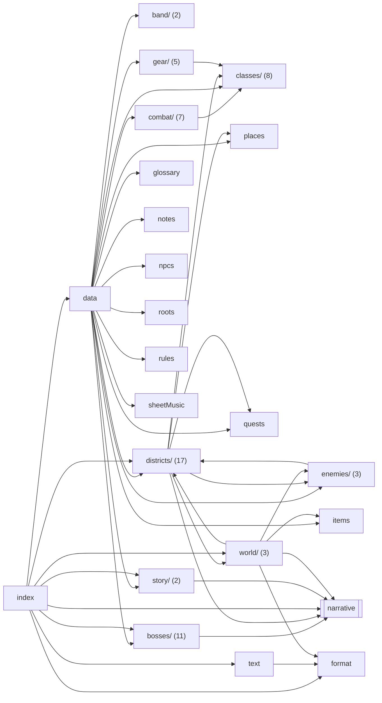

<!-- Generated by tools/codemap.ts. Do not edit by hand: run `npm run docs:codemap`. -->

# Code map: src/content

Typed game data and story scripts: classes, skills, statuses, enemies, bosses (with their AI), items, gear, districts, acts, and the *.scene.ts files. Content never imports the engine; it gets engine powers through EffectOps and BossCtx arguments.

Generated reference. Start with the [guide](../../architecture/code-map.md) for the flows, and the [index](README.md) for how to read these entries.

## Imports inside this area

*Folders are collapsed into one box (file count in brackets). Imports of src/core are left out: nearly every file has them. Double-bordered boxes are other areas.*

## Files

| File | Purpose |
|---|---|
| [src/content/band/bandmates.ts](#src-content-band-bandmates-ts) | Bandmates you can recruit. |
| [src/content/band/secondLine.ts](#src-content-band-secondline-ts) | Who marches in the second line on the Tower, in order. |
| [src/content/bosses/archivist.ts](#src-content-bosses-archivist-ts) | The Archivist, Act 5 (Cities of the Dead, the Data Mausoleum). |
| [src/content/bosses/captain_hush.scene.ts](#src-content-bosses-captain-hush-scene-ts) | Captain Hush: before and after the fight in Congo Square. |
| [src/content/bosses/captain_hush.ts](#src-content-bosses-captain-hush-ts) | Captain Hush, Act 1 (Tremé, Congo Square). |
| [src/content/bosses/conductor.ts](#src-content-bosses-conductor-ts) | The Conductor (Maestro Aurelius Quant), Act 7 (Metronome Tower, the Booth). |
| [src/content/bosses/index.ts](#src-content-bosses-index-ts) | Every boss, in story order. |
| [src/content/bosses/isolde.ts](#src-content-bosses-isolde-ts) | Lady Concertmaster Isolde Vane, Act 6 (Garden District, the Vane Manor ballroom). |
| [src/content/bosses/mr_ledger.ts](#src-content-bosses-mr-ledger-ts) | Mr. |
| [src/content/bosses/rougarou.ts](#src-content-bosses-rougarou-ts) | Le Rougarou Chromé (Lucien), Act 4 (Manchac Swamp, Pump Station 13). |
| [src/content/bosses/the_click.ts](#src-content-bosses-the-click-ts) | THE CLICK, the finale (Metronome Tower, the Crown). |
| [src/content/bosses/vox_perfecta.scene.ts](#src-content-bosses-vox-perfecta-scene-ts) | Vox Perfecta: before and after the fight on the Bourbon Strip, and the first big choice. |
| [src/content/bosses/vox_perfecta.ts](#src-content-bosses-vox-perfecta-ts) | Vox Perfecta, Act 2 (French Quarter, the Bourbon Strip main stage). |
| [src/content/classes/bassdrum.ts](#src-content-classes-bassdrum-ts) | Bass Drum: The Heartbeat. |
| [src/content/classes/clarinet.ts](#src-content-classes-clarinet-ts) | Clarinet: Licorice Stick. |
| [src/content/classes/index.ts](#src-content-classes-index-ts) | The seven instrument classes and all of their skills. |
| [src/content/classes/saxophone.ts](#src-content-classes-saxophone-ts) | Saxophone: Honker. |
| [src/content/classes/snare.ts](#src-content-classes-snare-ts) | Snare Drum: Snare Line. |
| [src/content/classes/sousaphone.ts](#src-content-classes-sousaphone-ts) | Sousaphone: Low End. |
| [src/content/classes/trombone.ts](#src-content-classes-trombone-ts) | Trombone: Tailgate. |
| [src/content/classes/trumpet.ts](#src-content-classes-trumpet-ts) | Trumpet: Lead Horn. |
| [src/content/combat/assistSkills.ts](#src-content-combat-assistskills-ts) | Bandmate assists, used every third round by each active bandmate. |
| [src/content/combat/bossSkills.ts](#src-content-combat-bossskills-ts) | Boss moves. |
| [src/content/combat/enemySkills.ts](#src-content-combat-enemyskills-ts) | Normal-enemy attacks and signature moves. |
| [src/content/combat/skills.ts](#src-content-combat-skills-ts) | Every skill in one table: class skills (from content/classes), enemy, boss and assist moves. |
| [src/content/combat/statuses.ts](#src-content-combat-statuses-ts) | Status effects. |
| [src/content/combat/timing.ts](#src-content-combat-timing-ts) | On the One timing grades. |
| [src/content/combat/tones.ts](#src-content-combat-tones-ts) | The five tones. |
| [src/content/data.ts](#src-content-data-ts) | — |
| [src/content/districts/bayou/district.ts](#src-content-districts-bayou-district-ts) | Manchac Swamp. |
| [src/content/districts/bayou/enemies.ts](#src-content-districts-bayou-enemies-ts) | Manchac Swamp: street enemies and the district elite. |
| [src/content/districts/cemetery/district.ts](#src-content-districts-cemetery-district-ts) | Cities of the Dead. |
| [src/content/districts/cemetery/enemies.ts](#src-content-districts-cemetery-enemies-ts) | Cities of the Dead: street enemies and the district elite. |
| [src/content/districts/garden/district.ts](#src-content-districts-garden-district-ts) | Garden District. |
| [src/content/districts/garden/enemies.ts](#src-content-districts-garden-enemies-ts) | Garden District: street enemies and the district elite. |
| [src/content/districts/index.ts](#src-content-districts-index-ts) | The districts of Neon Orleans, in travel and story order. |
| [src/content/districts/quarter/cutting.scene.ts](#src-content-districts-quarter-cutting-scene-ts) | The Cutting Contest at Club Feu Follet: three rivals back to back. |
| [src/content/districts/quarter/district.ts](#src-content-districts-quarter-district-ts) | French Quarter & Frenchmen. |
| [src/content/districts/quarter/enemies.ts](#src-content-districts-quarter-enemies-ts) | French Quarter & Frenchmen: street enemies and the district elite. |
| [src/content/districts/storyville/district.ts](#src-content-districts-storyville-district-ts) | Storyville. |
| [src/content/districts/storyville/enemies.ts](#src-content-districts-storyville-enemies-ts) | Storyville: street enemies and the district elite. |
| [src/content/districts/tower/district.ts](#src-content-districts-tower-district-ts) | Central Business District. |
| [src/content/districts/tower/enemies.ts](#src-content-districts-tower-enemies-ts) | Central Business District: street enemies and the district elite. |
| [src/content/districts/treme/district.ts](#src-content-districts-treme-district-ts) | Tremé. |
| [src/content/districts/treme/enemies.ts](#src-content-districts-treme-enemies-ts) | Tremé: street enemies and the district elite. |
| [src/content/districts/treme/places.scene.ts](#src-content-districts-treme-places-scene-ts) | Tremé's places: the Lagniappe club, Mama Roux's kitchen, Ti-Jacques' pawn shop, Congo Square. |
| [src/content/enemies/index.ts](#src-content-enemies-index-ts) | Every non-boss enemy. |
| [src/content/enemies/rivals.ts](#src-content-enemies-rivals-ts) | Cutting Contest rivals at Club Feu Follet. |
| [src/content/enemies/summons.ts](#src-content-enemies-summons-ts) | Enemies that only appear when a boss calls them in. |
| [src/content/format.ts](#src-content-format-ts) | Number formatting shared by content and UI. |
| [src/content/gear/charms.ts](#src-content-gear-charms-ts) | Charms: luck, protection and odd powers. |
| [src/content/gear/index.ts](#src-content-gear-index-ts) | All gear, in v1 order: generated instruments, then threads, charms, mods. |
| [src/content/gear/instruments.ts](#src-content-gear-instruments-ts) | Instruments: every class gets one per tier, generated here (not hand-written rows). |
| [src/content/gear/mods.ts](#src-content-gear-mods-ts) | Cyber mods: chrome upgrades. |
| [src/content/gear/threads.ts](#src-content-gear-threads-ts) | Threads: the body slot. |
| [src/content/glossary.ts](#src-content-glossary-ts) | The Lagniappe Lexicon. |
| [src/content/index.ts](#src-content-index-ts) | All content as the app sees it: the data (content/data.ts) plus every scene. |
| [src/content/items.ts](#src-content-items-ts) | Consumables and key items. |
| [src/content/notes.ts](#src-content-notes-ts) | The six Blue Notes of the blues scale, in scale order. |
| [src/content/npcs.ts](#src-content-npcs-ts) | Everyone who speaks in scenes, with the color their name shows in. |
| [src/content/places.ts](#src-content-places-ts) | Places inside districts. |
| [src/content/quests.ts](#src-content-quests-ts) | Side quests as the journal shows them. |
| [src/content/roots.ts](#src-content-roots-ts) | Character roots: where you grew up. |
| [src/content/rules.ts](#src-content-rules-ts) | Game rules that are content decisions rather than engine mechanics: level cap, skill unlock levels, the basic enemy attack, loot, and quest-item drops. |
| [src/content/sheetMusic.ts](#src-content-sheetmusic-ts) | Sheet music: techniques bought once and always on. |
| [src/content/story/acts.ts](#src-content-story-acts-ts) | The main quest, step by step: what the journal says, which place gets the "!" hint, and how a step completes on its own after battles. |
| [src/content/story/prologue.scene.ts](#src-content-story-prologue-scene-ts) | Prologue: The Dirge. |
| [src/content/text.ts](#src-content-text-ts) | The game's system copy: lines the app shows around scenes and battles (recovering a Blue Note, unlocking a district, escaping, victory and defeat screens). |
| [src/content/world/arrivals.scene.ts](#src-content-world-arrivals-scene-ts) | What you see the first time you arrive in a district, after its intro text. |
| [src/content/world/streetEvents.scene.ts](#src-content-world-streetevents-scene-ts) | Street events: the non-fight encounters of Hit the Streets. |
| [src/content/world/streets.scene.ts](#src-content-world-streets-scene-ts) | The streets: what happens when you Hit the Streets, the Praline Lady, bounty hunts, travel, and waking up at the club after getting cut. |

## Details

### src/content/band/bandmates.ts

Bandmates you can recruit. Two can be active: each assists every third round and adds a passive.

- Source: [src/content/band/bandmates.ts](../../../src/content/band/bandmates.ts)
- Imports: core: [ids/band](core.md#src-core-ids-band-ts), [types/index](core.md#src-core-types-index-ts)
- Imported by: content: [data](#src-content-data-ts)
- Tested by: [content.test](tests.md#tools-parity-content-test-ts)
- Types used: **[core/ids/band](core.md#src-core-ids-band-ts)** [BandmateId](core.md#src-core-ids-band-ts--bandmateid) · **[core/types/content](core.md#src-core-types-content-ts)** [BandmateDef](core.md#src-core-types-content-ts--bandmatedef), [Table](core.md#src-core-types-content-ts--table)

Declarations:

- **BANDMATES** · *const* `: Table<BandmateId, BandmateDef>`
  - used by: **[engine/combat/turns](engine.md#src-engine-combat-turns-ts)** [runAssists](engine.md#src-engine-combat-turns-ts--runassists) · **[engine/stats](engine.md#src-engine-stats-ts)** [activePassives](engine.md#src-engine-stats-ts--activepassives) · **[ui/sheets/MenuSheets](ui.md#src-ui-sheets-menusheets-tsx)** [BandSheet](ui.md#src-ui-sheets-menusheets-tsx--bandsheet) · **[tools/validate-content](tools.md#tools-validate-content-ts)** [validateContent](tools.md#tools-validate-content-ts--validatecontent) · tests: [content.test](tests.md#tools-parity-content-test-ts)

### src/content/band/secondLine.ts

Who marches in the second line on the Tower, in order. `when` decides if they've joined.

- Source: [src/content/band/secondLine.ts](../../../src/content/band/secondLine.ts)
- Imports: core: [types/index](core.md#src-core-types-index-ts)
- Imported by: content: [data](#src-content-data-ts)
- Tested by: [content.test](tests.md#tools-parity-content-test-ts)
- Types used: **[core/types/content](core.md#src-core-types-content-ts)** [SecondLineMemberDef](core.md#src-core-types-content-ts--secondlinememberdef)

Declarations:

- **SECOND_LINE** · *const* `: readonly SecondLineMemberDef[]`
  - used by: **[tools/parity/tsAdapter](tools.md#tools-parity-tsadapter-ts)** [tsAdapter](tools.md#tools-parity-tsadapter-ts--tsadapter) · **[tools/validate-content](tools.md#tools-validate-content-ts)** [validateContent](tools.md#tools-validate-content-ts--validatecontent) · tests: [content.test](tests.md#tools-parity-content-test-ts)

### src/content/bosses/archivist.ts

The Archivist, Act 5 (Cities of the Dead, the Data Mausoleum). Guards the flat seventh (B♭). Pattern: telegraphed Playback summons Ghost Tracks (two at a time at most), Erase strips buffs, Overdub heals when below 70%.

- Source: [src/content/bosses/archivist.ts](../../../src/content/bosses/archivist.ts)
- Imports: core: [types/index](core.md#src-core-types-index-ts)
- Imported by: content: [bosses/index](#src-content-bosses-index-ts)
- Types used: **[core/types/content](core.md#src-core-types-content-ts)** [BossDef](core.md#src-core-types-content-ts--bossdef)

Declarations:

- **archivist** · *const* `satisfies BossDef`
  - used by: **[content/bosses/index](#src-content-bosses-index-ts)** [BOSSES](#src-content-bosses-index-ts--bosses)

### src/content/bosses/captain_hush.scene.ts

Captain Hush: before and after the fight in Congo Square. (v1: BOSS_PRE / BOSS_POST.)

- Source: [src/content/bosses/captain_hush.scene.ts](../../../src/content/bosses/captain_hush.scene.ts)
- Imports: narrative: [types](narrative.md#src-narrative-types-ts)
- Imported by: content: [index](#src-content-index-ts)
- Types used: **[narrative/types](narrative.md#src-narrative-types-ts)** [Scene](narrative.md#src-narrative-types-ts--scene)

Declarations:

- **pre** · *function* `(s): Promise<void>`
  - uses: **[narrative/types](narrative.md#src-narrative-types-ts)** [SceneContext.narrate](narrative.md#src-narrative-types-ts--scenecontext-narrate), [SceneContext.say](narrative.md#src-narrative-types-ts--scenecontext-say)
  - *no references found*
- **post** · *function* `(s): Promise<void>`
  - uses: **[narrative/types](narrative.md#src-narrative-types-ts)** [SceneContext.giveNote](narrative.md#src-narrative-types-ts--scenecontext-givenote), [SceneContext.narrate](narrative.md#src-narrative-types-ts--scenecontext-narrate), [SceneContext.say](narrative.md#src-narrative-types-ts--scenecontext-say)
  - *no references found*

### src/content/bosses/captain_hush.ts

Captain Hush, Act 1 (Tremé, Congo Square). Guards the Root (C). Pattern: every 4th turn a telegraphed Baton Strike; the turn after, Noise Cancel (Muted 2 turns). At half Heart a Hush Patrolman joins.

- Source: [src/content/bosses/captain_hush.ts](../../../src/content/bosses/captain_hush.ts)
- Imports: core: [types/index](core.md#src-core-types-index-ts)
- Imported by: content: [bosses/index](#src-content-bosses-index-ts)
- Types used: **[core/types/content](core.md#src-core-types-content-ts)** [BossDef](core.md#src-core-types-content-ts--bossdef)

Declarations:

- **captainHush** · *const* `satisfies BossDef`
  - uses: **[core/rng](core.md#src-core-rng-ts)** [Rng.next](core.md#src-core-rng-ts--rng-next) · **[core/types/effects](core.md#src-core-types-effects-ts)** [EffectOps.summon](core.md#src-core-types-effects-ts--effectops-summon)
  - used by: **[content/bosses/index](#src-content-bosses-index-ts)** [BOSSES](#src-content-bosses-index-ts--bosses)

### src/content/bosses/conductor.ts

The Conductor (Maestro Aurelius Quant), Act 7 (Metronome Tower, the Booth). Pattern: a charged Crescendo on turn 3 and every 5 turns after (VAMP halves it), a telegraphed Fermata that steals your turn, Tempo Lock when your Groove is high, Ritardando, Downbeat.

- Source: [src/content/bosses/conductor.ts](../../../src/content/bosses/conductor.ts)
- Imports: core: [types/index](core.md#src-core-types-index-ts)
- Imported by: content: [bosses/index](#src-content-bosses-index-ts)
- Types used: **[core/types/content](core.md#src-core-types-content-ts)** [BossDef](core.md#src-core-types-content-ts--bossdef)

Declarations:

- **conductor** · *const* `satisfies BossDef`
  - used by: **[content/bosses/index](#src-content-bosses-index-ts)** [BOSSES](#src-content-bosses-index-ts--bosses)

### src/content/bosses/index.ts

Every boss, in story order.

- Source: [src/content/bosses/index.ts](../../../src/content/bosses/index.ts)
- Imports: core: [ids/enemies](core.md#src-core-ids-enemies-ts), [types/index](core.md#src-core-types-index-ts) · content: [bosses/archivist](#src-content-bosses-archivist-ts), [bosses/captain_hush](#src-content-bosses-captain-hush-ts), [bosses/conductor](#src-content-bosses-conductor-ts), [bosses/isolde](#src-content-bosses-isolde-ts), [bosses/mr_ledger](#src-content-bosses-mr-ledger-ts), [bosses/rougarou](#src-content-bosses-rougarou-ts), [bosses/the_click](#src-content-bosses-the-click-ts), [bosses/vox_perfecta](#src-content-bosses-vox-perfecta-ts)
- Imported by: content: [data](#src-content-data-ts)
- Tested by: [content.test](tests.md#tools-parity-content-test-ts)
- Types used: **[core/ids/enemies](core.md#src-core-ids-enemies-ts)** [BossId](core.md#src-core-ids-enemies-ts--bossid) · **[core/types/content](core.md#src-core-types-content-ts)** [BossDef](core.md#src-core-types-content-ts--bossdef), [Table](core.md#src-core-types-content-ts--table)

Declarations:

- **BOSSES** · *const* `: Table<BossId, BossDef>`
  - uses: **[content/bosses/archivist](#src-content-bosses-archivist-ts)** [archivist](#src-content-bosses-archivist-ts--archivist) · **[content/bosses/captain_hush](#src-content-bosses-captain-hush-ts)** [captainHush](#src-content-bosses-captain-hush-ts--captainhush) · **[content/bosses/conductor](#src-content-bosses-conductor-ts)** [conductor](#src-content-bosses-conductor-ts--conductor) · **[content/bosses/isolde](#src-content-bosses-isolde-ts)** [isolde](#src-content-bosses-isolde-ts--isolde) · **[content/bosses/mr_ledger](#src-content-bosses-mr-ledger-ts)** [mrLedger](#src-content-bosses-mr-ledger-ts--mrledger) · **[content/bosses/rougarou](#src-content-bosses-rougarou-ts)** [rougarou](#src-content-bosses-rougarou-ts--rougarou) · **[content/bosses/the_click](#src-content-bosses-the-click-ts)** [theClick](#src-content-bosses-the-click-ts--theclick) · **[content/bosses/vox_perfecta](#src-content-bosses-vox-perfecta-ts)** [voxPerfecta](#src-content-bosses-vox-perfecta-ts--voxperfecta)
  - used by: **[app/game](app.md#src-app-game-ts)** [GameApp.dev](app.md#src-app-game-ts--gameapp-dev), [bossStep](app.md#src-app-game-ts--bossstep) · **[app/reactPresenter](app.md#src-app-reactpresenter-ts)** [actorView](app.md#src-app-reactpresenter-ts--actorview) · **[app/sceneContext](app.md#src-app-scenecontext-ts)** [createSceneContext](app.md#src-app-scenecontext-ts--createscenecontext) · **[engine/aftermath](engine.md#src-engine-aftermath-ts)** [resolveVictory](engine.md#src-engine-aftermath-ts--resolvevictory) · **[engine/combat/actors](engine.md#src-engine-combat-actors-ts)** [isBossId](engine.md#src-engine-combat-actors-ts--isbossid), [makeEnemy](engine.md#src-engine-combat-actors-ts--makeenemy) · **[engine/combat/battle](engine.md#src-engine-combat-battle-ts)** [createBattle](engine.md#src-engine-combat-battle-ts--createbattle) · **[engine/combat/legal](engine.md#src-engine-combat-legal-ts)** [legalActions](engine.md#src-engine-combat-legal-ts--legalactions) · **[engine/combat/player](engine.md#src-engine-combat-player-ts)** [playTheBlues](engine.md#src-engine-combat-player-ts--playtheblues) · **[engine/combat/resolve](engine.md#src-engine-combat-resolve-ts)** [bossHpHooks](engine.md#src-engine-combat-resolve-ts--bosshphooks), [checkDeath](engine.md#src-engine-combat-resolve-ts--checkdeath) · **[engine/combat/turns](engine.md#src-engine-combat-turns-ts)** [beginTurn](engine.md#src-engine-combat-turns-ts--beginturn), [enemyAct](engine.md#src-engine-combat-turns-ts--enemyact) · **[ui/sheets/MenuSheets](ui.md#src-ui-sheets-menusheets-tsx)** [BookSheet](ui.md#src-ui-sheets-menusheets-tsx--booksheet) · **[ui/sheets/WorldSheets](ui.md#src-ui-sheets-worldsheets-tsx)** [DevSheet](ui.md#src-ui-sheets-worldsheets-tsx--devsheet) · … +4 more · tests: [content.test](tests.md#tools-parity-content-test-ts)

### src/content/bosses/isolde.ts

Lady Concertmaster Isolde Vane, Act 6 (Garden District, the Vane Manor ballroom). Guards the blue note itself (G♭). Pattern: a telegraphed Perfect Pitch Shield every third turn (only ON THE ONE or a SOLO shatters it), Pizzicato Barrages and Bow Blades. Below 40% Heart she charges a Cadenza (VAMP through it), then again every sixth turn.

- Source: [src/content/bosses/isolde.ts](../../../src/content/bosses/isolde.ts)
- Imports: core: [types/index](core.md#src-core-types-index-ts)
- Imported by: content: [bosses/index](#src-content-bosses-index-ts)
- Types used: **[core/types/content](core.md#src-core-types-content-ts)** [BossDef](core.md#src-core-types-content-ts--bossdef)

Declarations:

- **isolde** · *const* `satisfies BossDef`
  - used by: **[content/bosses/index](#src-content-bosses-index-ts)** [BOSSES](#src-content-bosses-index-ts--bosses)

### src/content/bosses/mr_ledger.ts

Mr. Ledger, Act 3 (Storyville, the vault under Ledger & Sons). Guards the fourth (F). Pattern: Compound Interest: +8% Chops at the start of every turn, so kill him fast. Foreclose and a telegraphed Audit. At 30% Heart, Hostile Takeover summons a Repo Drone.

- Source: [src/content/bosses/mr_ledger.ts](../../../src/content/bosses/mr_ledger.ts)
- Imports: core: [types/index](core.md#src-core-types-index-ts)
- Imported by: content: [bosses/index](#src-content-bosses-index-ts)
- Types used: **[core/types/content](core.md#src-core-types-content-ts)** [BossDef](core.md#src-core-types-content-ts--bossdef)

Declarations:

- **mrLedger** · *const* `satisfies BossDef`
  - uses: **[core/types/effects](core.md#src-core-types-effects-ts)** [EffectOps.log](core.md#src-core-types-effects-ts--effectops-log), [EffectOps.summon](core.md#src-core-types-effects-ts--effectops-summon)
  - used by: **[content/bosses/index](#src-content-bosses-index-ts)** [BOSSES](#src-content-bosses-index-ts--bosses)

### src/content/bosses/rougarou.ts

Le Rougarou Chromé (Lucien), Act 4 (Manchac Swamp, Pump Station 13). Guards the fifth (G). Pattern: Claw Rakes, and a telegraphed Howl of the Click (Muted) at most every four rounds while you aren't already Muted. At half Heart, Full Moon Overclock: Up-Tempo, Hyped, two actions a round.

- Source: [src/content/bosses/rougarou.ts](../../../src/content/bosses/rougarou.ts)
- Imports: core: [helpers](core.md#src-core-helpers-ts), [types/index](core.md#src-core-types-index-ts)
- Imported by: content: [bosses/index](#src-content-bosses-index-ts)
- Types used: **[core/types/content](core.md#src-core-types-content-ts)** [BossDef](core.md#src-core-types-content-ts--bossdef)

Declarations:

- **rougarou** · *const* `satisfies BossDef`
  - uses: **[core/helpers](core.md#src-core-helpers-ts)** [hasStatus](core.md#src-core-helpers-ts--hasstatus) · **[core/rng](core.md#src-core-rng-ts)** [Rng.next](core.md#src-core-rng-ts--rng-next) · **[core/types/effects](core.md#src-core-types-effects-ts)** [EffectOps.applyStatus](core.md#src-core-types-effects-ts--effectops-applystatus), [EffectOps.log](core.md#src-core-types-effects-ts--effectops-log)
  - used by: **[content/bosses/index](#src-content-bosses-index-ts)** [BOSSES](#src-content-bosses-index-ts--bosses)

### src/content/bosses/the_click.ts

THE CLICK, the finale (Metronome Tower, the Crown). Behind Perfect Silence it takes no damage; only Playing the Blues (all six Blue Notes) breaks it. At half Heart the Silence slams back down once. Pattern: Click Track (Muted), Quantize, Perfect Time (heal), Silence of the Spheres.

- Source: [src/content/bosses/the_click.ts](../../../src/content/bosses/the_click.ts)
- Imports: core: [types/index](core.md#src-core-types-index-ts)
- Imported by: content: [bosses/index](#src-content-bosses-index-ts)
- Types used: **[core/types/content](core.md#src-core-types-content-ts)** [BossDef](core.md#src-core-types-content-ts--bossdef)

Declarations:

- **theClick** · *const* `satisfies BossDef`
  - uses: **[core/types/effects](core.md#src-core-types-effects-ts)** [EffectOps.applyStatus](core.md#src-core-types-effects-ts--effectops-applystatus), [EffectOps.log](core.md#src-core-types-effects-ts--effectops-log)
  - used by: **[content/bosses/index](#src-content-bosses-index-ts)** [BOSSES](#src-content-bosses-index-ts--bosses)

### src/content/bosses/vox_perfecta.scene.ts

Vox Perfecta: before and after the fight on the Bourbon Strip, and the first big choice.

- Source: [src/content/bosses/vox_perfecta.scene.ts](../../../src/content/bosses/vox_perfecta.scene.ts)
- Imports: narrative: [types](narrative.md#src-narrative-types-ts)
- Imported by: content: [index](#src-content-index-ts)
- Types used: **[narrative/types](narrative.md#src-narrative-types-ts)** [Scene](narrative.md#src-narrative-types-ts--scene)

Declarations:

- **pre** · *function* `(s): Promise<void>`
  - uses: **[narrative/types](narrative.md#src-narrative-types-ts)** [SceneContext.narrate](narrative.md#src-narrative-types-ts--scenecontext-narrate), [SceneContext.say](narrative.md#src-narrative-types-ts--scenecontext-say)
  - *no references found*
- **post** · *function* `(s): Promise<void>`
  - uses: **[narrative/types](narrative.md#src-narrative-types-ts)** [SceneContext.choice](narrative.md#src-narrative-types-ts--scenecontext-choice), [SceneContext.choose](narrative.md#src-narrative-types-ts--scenecontext-choose), [SceneContext.gainGear](narrative.md#src-narrative-types-ts--scenecontext-gaingear), [SceneContext.giveNote](narrative.md#src-narrative-types-ts--scenecontext-givenote), [SceneContext.narrate](narrative.md#src-narrative-types-ts--scenecontext-narrate), [SceneContext.say](narrative.md#src-narrative-types-ts--scenecontext-say)
  - *no references found*

### src/content/bosses/vox_perfecta.ts

Vox Perfecta, Act 2 (French Quarter, the Bourbon Strip main stage). Guards the flat third (E♭). Pattern: Samples your last skill back at you, Pitch Correction for Foundation, and a telegraphed Perfect Pitch (Muted). Hyped at half Heart.

- Source: [src/content/bosses/vox_perfecta.ts](../../../src/content/bosses/vox_perfecta.ts)
- Imports: core: [types/index](core.md#src-core-types-index-ts)
- Imported by: content: [bosses/index](#src-content-bosses-index-ts)
- Types used: **[core/types/content](core.md#src-core-types-content-ts)** [BossDef](core.md#src-core-types-content-ts--bossdef)

Declarations:

- **voxPerfecta** · *const* `satisfies BossDef`
  - uses: **[core/types/effects](core.md#src-core-types-effects-ts)** [EffectOps.applyStatus](core.md#src-core-types-effects-ts--effectops-applystatus)
  - used by: **[content/bosses/index](#src-content-bosses-index-ts)** [BOSSES](#src-content-bosses-index-ts--bosses)

### src/content/classes/bassdrum.ts

Bass Drum: The Heartbeat. Heavy hitter, Big Four counter.

- Source: [src/content/classes/bassdrum.ts](../../../src/content/classes/bassdrum.ts)
- Imports: core: [ids/combat](core.md#src-core-ids-combat-ts), [types/index](core.md#src-core-types-index-ts)
- Imported by: content: [classes/index](#src-content-classes-index-ts)
- Types used: **[core/ids/combat](core.md#src-core-ids-combat-ts)** [SkillId](core.md#src-core-ids-combat-ts--skillid) · **[core/types/content](core.md#src-core-types-content-ts)** [ClassDef](core.md#src-core-types-content-ts--classdef), [SkillDef](core.md#src-core-types-content-ts--skilldef), [Table](core.md#src-core-types-content-ts--table)

Declarations:

- **bassdrum** · *const* `satisfies ClassDef`
  - used by: **[content/classes/index](#src-content-classes-index-ts)** [CLASSES](#src-content-classes-index-ts--classes)
- **bassdrumSkills** · *const* `satisfies Partial<Table<SkillId, SkillDef>>` — Bass Drum skills: riff, six unlockable skills (levels 1, 3, 5, 7, 10, 13) and the solo.
  - used by: **[content/classes/index](#src-content-classes-index-ts)** [CLASS_SKILLS](#src-content-classes-index-ts--class-skills)

### src/content/classes/clarinet.ts

Clarinet: Licorice Stick. Healer, buffer, agile.

- Source: [src/content/classes/clarinet.ts](../../../src/content/classes/clarinet.ts)
- Imports: core: [ids/combat](core.md#src-core-ids-combat-ts), [types/index](core.md#src-core-types-index-ts)
- Imported by: content: [classes/index](#src-content-classes-index-ts)
- Types used: **[core/ids/combat](core.md#src-core-ids-combat-ts)** [SkillId](core.md#src-core-ids-combat-ts--skillid) · **[core/types/content](core.md#src-core-types-content-ts)** [ClassDef](core.md#src-core-types-content-ts--classdef), [SkillDef](core.md#src-core-types-content-ts--skilldef), [Table](core.md#src-core-types-content-ts--table)

Declarations:

- **clarinet** · *const* `satisfies ClassDef`
  - used by: **[content/classes/index](#src-content-classes-index-ts)** [CLASSES](#src-content-classes-index-ts--classes)
- **clarinetSkills** · *const* `satisfies Partial<Table<SkillId, SkillDef>>` — Clarinet skills: riff, six unlockable skills (levels 1, 3, 5, 7, 10, 13) and the solo.
  - used by: **[content/classes/index](#src-content-classes-index-ts)** [CLASS_SKILLS](#src-content-classes-index-ts--class-skills)

### src/content/classes/index.ts

The seven instrument classes and all of their skills.

- Source: [src/content/classes/index.ts](../../../src/content/classes/index.ts)
- Imports: core: [ids/characters](core.md#src-core-ids-characters-ts), [types/index](core.md#src-core-types-index-ts) · content: [classes/bassdrum](#src-content-classes-bassdrum-ts), [classes/clarinet](#src-content-classes-clarinet-ts), [classes/saxophone](#src-content-classes-saxophone-ts), [classes/snare](#src-content-classes-snare-ts), [classes/sousaphone](#src-content-classes-sousaphone-ts), [classes/trombone](#src-content-classes-trombone-ts), [classes/trumpet](#src-content-classes-trumpet-ts)
- Imported by: content: [combat/skills](#src-content-combat-skills-ts), [data](#src-content-data-ts), [districts/treme/places.scene](#src-content-districts-treme-places-scene-ts), [gear/instruments](#src-content-gear-instruments-ts)
- Tested by: [content.test](tests.md#tools-parity-content-test-ts)
- Types used: **[core/ids/characters](core.md#src-core-ids-characters-ts)** [ClassId](core.md#src-core-ids-characters-ts--classid) · **[core/types/content](core.md#src-core-types-content-ts)** [ClassDef](core.md#src-core-types-content-ts--classdef), [Table](core.md#src-core-types-content-ts--table)

Declarations:

- **CLASSES** · *const* `: Table<ClassId, ClassDef>`
  - uses: **[content/classes/bassdrum](#src-content-classes-bassdrum-ts)** [bassdrum](#src-content-classes-bassdrum-ts--bassdrum) · **[content/classes/clarinet](#src-content-classes-clarinet-ts)** [clarinet](#src-content-classes-clarinet-ts--clarinet) · **[content/classes/saxophone](#src-content-classes-saxophone-ts)** [saxophone](#src-content-classes-saxophone-ts--saxophone) · **[content/classes/snare](#src-content-classes-snare-ts)** [snare](#src-content-classes-snare-ts--snare) · **[content/classes/sousaphone](#src-content-classes-sousaphone-ts)** [sousaphone](#src-content-classes-sousaphone-ts--sousaphone) · **[content/classes/trombone](#src-content-classes-trombone-ts)** [trombone](#src-content-classes-trombone-ts--trombone) · **[content/classes/trumpet](#src-content-classes-trumpet-ts)** [trumpet](#src-content-classes-trumpet-ts--trumpet)
  - used by: **[app/game](app.md#src-app-game-ts)** [GameApp.pickSlot](app.md#src-app-game-ts--gameapp-pickslot), [describe](app.md#src-app-game-ts--describe) · **[content/districts/treme/places.scene](#src-content-districts-treme-places-scene-ts)** [instrumentStock](#src-content-districts-treme-places-scene-ts--instrumentstock), [pawn](#src-content-districts-treme-places-scene-ts--pawn) · **[content/gear/instruments](#src-content-gear-instruments-ts)** [makeInstruments](#src-content-gear-instruments-ts--makeinstruments) · **[engine/combat/actors](engine.md#src-engine-combat-actors-ts)** [makeEnemy](engine.md#src-engine-combat-actors-ts--makeenemy), [makePlayerActor](engine.md#src-engine-combat-actors-ts--makeplayeractor) · **[engine/progression](engine.md#src-engine-progression-ts)** [gainXp](engine.md#src-engine-progression-ts--gainxp) · **[engine/stats](engine.md#src-engine-stats-ts)** [classBase](engine.md#src-engine-stats-ts--classbase), [unlockedSkills](engine.md#src-engine-stats-ts--unlockedskills) · **[ui/combat/BattleScreen](ui.md#src-ui-combat-battlescreen-tsx)** [BattleScreen](ui.md#src-ui-combat-battlescreen-tsx--battlescreen) · **[ui/screens/Create](ui.md#src-ui-screens-create-tsx)** [CreateScreen](ui.md#src-ui-screens-create-tsx--createscreen) · **[ui/sheets/HistorySheet](ui.md#src-ui-sheets-historysheet-tsx)** [HistorySheet](ui.md#src-ui-sheets-historysheet-tsx--historysheet) · **[ui/sheets/MenuSheets](ui.md#src-ui-sheets-menusheets-tsx)** [StatusSheet](ui.md#src-ui-sheets-menusheets-tsx--statussheet) · **[ui/sheets/SavesSheet](ui.md#src-ui-sheets-savessheet-tsx)** [SlotRow](ui.md#src-ui-sheets-savessheet-tsx--slotrow) · **[tools/validate-content](tools.md#tools-validate-content-ts)** [validateContent](tools.md#tools-validate-content-ts--validatecontent) · tests: [content.test](tests.md#tools-parity-content-test-ts)
- **CLASS_SKILLS** · *const* `= { … } (7 keys)` — Every class skill, in class order.
  - uses: **[content/classes/bassdrum](#src-content-classes-bassdrum-ts)** [bassdrumSkills](#src-content-classes-bassdrum-ts--bassdrumskills) · **[content/classes/clarinet](#src-content-classes-clarinet-ts)** [clarinetSkills](#src-content-classes-clarinet-ts--clarinetskills) · **[content/classes/saxophone](#src-content-classes-saxophone-ts)** [saxophoneSkills](#src-content-classes-saxophone-ts--saxophoneskills) · **[content/classes/snare](#src-content-classes-snare-ts)** [snareSkills](#src-content-classes-snare-ts--snareskills) · **[content/classes/sousaphone](#src-content-classes-sousaphone-ts)** [sousaphoneSkills](#src-content-classes-sousaphone-ts--sousaphoneskills) · **[content/classes/trombone](#src-content-classes-trombone-ts)** [tromboneSkills](#src-content-classes-trombone-ts--tromboneskills) · **[content/classes/trumpet](#src-content-classes-trumpet-ts)** [trumpetSkills](#src-content-classes-trumpet-ts--trumpetskills)
  - used by: **[content/combat/skills](#src-content-combat-skills-ts)** [SKILLS](#src-content-combat-skills-ts--skills)

### src/content/classes/saxophone.ts

Saxophone: Honker. Control and charm.

- Source: [src/content/classes/saxophone.ts](../../../src/content/classes/saxophone.ts)
- Imports: core: [ids/combat](core.md#src-core-ids-combat-ts), [types/index](core.md#src-core-types-index-ts)
- Imported by: content: [classes/index](#src-content-classes-index-ts)
- Types used: **[core/ids/combat](core.md#src-core-ids-combat-ts)** [SkillId](core.md#src-core-ids-combat-ts--skillid) · **[core/types/content](core.md#src-core-types-content-ts)** [ClassDef](core.md#src-core-types-content-ts--classdef), [SkillDef](core.md#src-core-types-content-ts--skilldef), [Table](core.md#src-core-types-content-ts--table)

Declarations:

- **saxophone** · *const* `satisfies ClassDef`
  - used by: **[content/classes/index](#src-content-classes-index-ts)** [CLASSES](#src-content-classes-index-ts--classes)
- **saxophoneSkills** · *const* `satisfies Partial<Table<SkillId, SkillDef>>` — Saxophone skills: riff, six unlockable skills (levels 1, 3, 5, 7, 10, 13) and the solo.
  - used by: **[content/classes/index](#src-content-classes-index-ts)** [CLASS_SKILLS](#src-content-classes-index-ts--class-skills)

### src/content/classes/snare.ts

Snare Drum: Snare Line. Speed, multi-hit, stun.

- Source: [src/content/classes/snare.ts](../../../src/content/classes/snare.ts)
- Imports: core: [ids/combat](core.md#src-core-ids-combat-ts), [types/index](core.md#src-core-types-index-ts)
- Imported by: content: [classes/index](#src-content-classes-index-ts)
- Types used: **[core/ids/combat](core.md#src-core-ids-combat-ts)** [SkillId](core.md#src-core-ids-combat-ts--skillid) · **[core/types/content](core.md#src-core-types-content-ts)** [ClassDef](core.md#src-core-types-content-ts--classdef), [SkillDef](core.md#src-core-types-content-ts--skilldef), [Table](core.md#src-core-types-content-ts--table)

Declarations:

- **snare** · *const* `satisfies ClassDef`
  - used by: **[content/classes/index](#src-content-classes-index-ts)** [CLASSES](#src-content-classes-index-ts--classes)
- **snareSkills** · *const* `satisfies Partial<Table<SkillId, SkillDef>>` — Snare Drum skills: riff, six unlockable skills (levels 1, 3, 5, 7, 10, 13) and the solo.
  - used by: **[content/classes/index](#src-content-classes-index-ts)** [CLASS_SKILLS](#src-content-classes-index-ts--class-skills)

### src/content/classes/sousaphone.ts

Sousaphone: Low End. Tank, armor shred.

- Source: [src/content/classes/sousaphone.ts](../../../src/content/classes/sousaphone.ts)
- Imports: core: [ids/combat](core.md#src-core-ids-combat-ts), [types/index](core.md#src-core-types-index-ts)
- Imported by: content: [classes/index](#src-content-classes-index-ts)
- Types used: **[core/ids/combat](core.md#src-core-ids-combat-ts)** [SkillId](core.md#src-core-ids-combat-ts--skillid) · **[core/types/content](core.md#src-core-types-content-ts)** [ClassDef](core.md#src-core-types-content-ts--classdef), [SkillDef](core.md#src-core-types-content-ts--skilldef), [Table](core.md#src-core-types-content-ts--table)

Declarations:

- **sousaphone** · *const* `satisfies ClassDef`
  - used by: **[content/classes/index](#src-content-classes-index-ts)** [CLASSES](#src-content-classes-index-ts--classes)
- **sousaphoneSkills** · *const* `satisfies Partial<Table<SkillId, SkillDef>>` — Sousaphone skills: riff, six unlockable skills (levels 1, 3, 5, 7, 10, 13) and the solo.
  - used by: **[content/classes/index](#src-content-classes-index-ts)** [CLASS_SKILLS](#src-content-classes-index-ts--class-skills)

### src/content/classes/trombone.ts

Trombone: Tailgate. Drain bruiser, debuffs.

- Source: [src/content/classes/trombone.ts](../../../src/content/classes/trombone.ts)
- Imports: core: [ids/combat](core.md#src-core-ids-combat-ts), [types/index](core.md#src-core-types-index-ts)
- Imported by: content: [classes/index](#src-content-classes-index-ts)
- Types used: **[core/ids/combat](core.md#src-core-ids-combat-ts)** [SkillId](core.md#src-core-ids-combat-ts--skillid) · **[core/types/content](core.md#src-core-types-content-ts)** [ClassDef](core.md#src-core-types-content-ts--classdef), [SkillDef](core.md#src-core-types-content-ts--skilldef), [Table](core.md#src-core-types-content-ts--table)

Declarations:

- **trombone** · *const* `satisfies ClassDef`
  - used by: **[content/classes/index](#src-content-classes-index-ts)** [CLASSES](#src-content-classes-index-ts--classes)
- **tromboneSkills** · *const* `satisfies Partial<Table<SkillId, SkillDef>>` — Trombone skills: riff, six unlockable skills (levels 1, 3, 5, 7, 10, 13) and the solo.
  - uses: **[core/types/effects](core.md#src-core-types-effects-ts)** [EffectOps.cutLooseReady](core.md#src-core-types-effects-ts--effectops-cutlooseready)
  - used by: **[content/classes/index](#src-content-classes-index-ts)** [CLASS_SKILLS](#src-content-classes-index-ts--class-skills)

### src/content/classes/trumpet.ts

Trumpet: Lead Horn. Burst damage, glass cannon.

- Source: [src/content/classes/trumpet.ts](../../../src/content/classes/trumpet.ts)
- Imports: core: [ids/combat](core.md#src-core-ids-combat-ts), [types/index](core.md#src-core-types-index-ts)
- Imported by: content: [classes/index](#src-content-classes-index-ts)
- Types used: **[core/ids/combat](core.md#src-core-ids-combat-ts)** [SkillId](core.md#src-core-ids-combat-ts--skillid) · **[core/types/content](core.md#src-core-types-content-ts)** [ClassDef](core.md#src-core-types-content-ts--classdef), [SkillDef](core.md#src-core-types-content-ts--skilldef), [Table](core.md#src-core-types-content-ts--table)

Declarations:

- **trumpet** · *const* `satisfies ClassDef`
  - used by: **[content/classes/index](#src-content-classes-index-ts)** [CLASSES](#src-content-classes-index-ts--classes)
- **trumpetSkills** · *const* `satisfies Partial<Table<SkillId, SkillDef>>` — Trumpet skills: riff, six unlockable skills (levels 1, 3, 5, 7, 10, 13) and the solo.
  - used by: **[content/classes/index](#src-content-classes-index-ts)** [CLASS_SKILLS](#src-content-classes-index-ts--class-skills)

### src/content/combat/assistSkills.ts

Bandmate assists, used every third round by each active bandmate.

- Source: [src/content/combat/assistSkills.ts](../../../src/content/combat/assistSkills.ts)
- Imports: core: [ids/combat](core.md#src-core-ids-combat-ts), [types/index](core.md#src-core-types-index-ts)
- Imported by: content: [combat/skills](#src-content-combat-skills-ts)
- Types used: **[core/ids/combat](core.md#src-core-ids-combat-ts)** [SkillId](core.md#src-core-ids-combat-ts--skillid) · **[core/types/content](core.md#src-core-types-content-ts)** [SkillDef](core.md#src-core-types-content-ts--skilldef), [Table](core.md#src-core-types-content-ts--table)

Declarations:

- **ASSIST_SKILLS** · *const* `satisfies Partial<Table<SkillId, SkillDef>>`
  - used by: **[content/combat/skills](#src-content-combat-skills-ts)** [SKILLS](#src-content-combat-skills-ts--skills)

### src/content/combat/bossSkills.ts

Boss moves. Which one a boss uses each turn is decided by its AI (content/bosses).

- Source: [src/content/combat/bossSkills.ts](../../../src/content/combat/bossSkills.ts)
- Imports: core: [ids/combat](core.md#src-core-ids-combat-ts), [types/index](core.md#src-core-types-index-ts)
- Imported by: content: [combat/skills](#src-content-combat-skills-ts)
- Types used: **[core/ids/combat](core.md#src-core-ids-combat-ts)** [SkillId](core.md#src-core-ids-combat-ts--skillid) · **[core/types/content](core.md#src-core-types-content-ts)** [SkillDef](core.md#src-core-types-content-ts--skilldef), [Table](core.md#src-core-types-content-ts--table)

Declarations:

- **BOSS_SKILLS** · *const* `satisfies Partial<Table<SkillId, SkillDef>>`
  - uses: **[core/types/effects](core.md#src-core-types-effects-ts)** [EffectOps.charge](core.md#src-core-types-effects-ts--effectops-charge), [EffectOps.fermata](core.md#src-core-types-effects-ts--effectops-fermata), [EffectOps.pitchShield](core.md#src-core-types-effects-ts--effectops-pitchshield), [EffectOps.sample](core.md#src-core-types-effects-ts--effectops-sample), [EffectOps.summon](core.md#src-core-types-effects-ts--effectops-summon)
  - used by: **[content/combat/skills](#src-content-combat-skills-ts)** [SKILLS](#src-content-combat-skills-ts--skills)

### src/content/combat/enemySkills.ts

Normal-enemy attacks and signature moves.

- Source: [src/content/combat/enemySkills.ts](../../../src/content/combat/enemySkills.ts)
- Imports: core: [ids/combat](core.md#src-core-ids-combat-ts), [types/index](core.md#src-core-types-index-ts)
- Imported by: content: [combat/skills](#src-content-combat-skills-ts)
- Types used: **[core/ids/combat](core.md#src-core-ids-combat-ts)** [SkillId](core.md#src-core-ids-combat-ts--skillid) · **[core/types/content](core.md#src-core-types-content-ts)** [SkillDef](core.md#src-core-types-content-ts--skilldef), [Table](core.md#src-core-types-content-ts--table)

Declarations:

- **ENEMY_SKILLS** · *const* `satisfies Partial<Table<SkillId, SkillDef>>`
  - uses: **[core/types/effects](core.md#src-core-types-effects-ts)** [EffectOps.charge](core.md#src-core-types-effects-ts--effectops-charge), [EffectOps.copyBuff](core.md#src-core-types-effects-ts--effectops-copybuff), [EffectOps.steal](core.md#src-core-types-effects-ts--effectops-steal), [EffectOps.stealFunk](core.md#src-core-types-effects-ts--effectops-stealfunk)
  - used by: **[content/combat/skills](#src-content-combat-skills-ts)** [SKILLS](#src-content-combat-skills-ts--skills)

### src/content/combat/skills.ts

Every skill in one table: class skills (from content/classes), enemy, boss and assist moves. The resolver doesn't care who owns a skill, which is how rivals and clones reuse player skills.

- Source: [src/content/combat/skills.ts](../../../src/content/combat/skills.ts)
- Imports: core: [ids/combat](core.md#src-core-ids-combat-ts), [types/index](core.md#src-core-types-index-ts) · content: [classes/index](#src-content-classes-index-ts), [combat/assistSkills](#src-content-combat-assistskills-ts), [combat/bossSkills](#src-content-combat-bossskills-ts), [combat/enemySkills](#src-content-combat-enemyskills-ts)
- Imported by: content: [data](#src-content-data-ts)
- Tested by: [content.test](tests.md#tools-parity-content-test-ts)
- Types used: **[core/ids/combat](core.md#src-core-ids-combat-ts)** [SkillId](core.md#src-core-ids-combat-ts--skillid) · **[core/types/content](core.md#src-core-types-content-ts)** [SkillDef](core.md#src-core-types-content-ts--skilldef), [Table](core.md#src-core-types-content-ts--table)

Declarations:

- **SKILLS** · *const* `: Table<SkillId, SkillDef>`
  - uses: **[content/classes/index](#src-content-classes-index-ts)** [CLASS_SKILLS](#src-content-classes-index-ts--class-skills) · **[content/combat/assistSkills](#src-content-combat-assistskills-ts)** [ASSIST_SKILLS](#src-content-combat-assistskills-ts--assist-skills) · **[content/combat/bossSkills](#src-content-combat-bossskills-ts)** [BOSS_SKILLS](#src-content-combat-bossskills-ts--boss-skills) · **[content/combat/enemySkills](#src-content-combat-enemyskills-ts)** [ENEMY_SKILLS](#src-content-combat-enemyskills-ts--enemy-skills)
  - used by: **[engine/combat/actors](engine.md#src-engine-combat-actors-ts)** [makeEnemy](engine.md#src-engine-combat-actors-ts--makeenemy), [riffTone](engine.md#src-engine-combat-actors-ts--rifftone) · **[engine/combat/legal](engine.md#src-engine-combat-legal-ts)** [legalActions](engine.md#src-engine-combat-legal-ts--legalactions), [skillNeedsTarget](engine.md#src-engine-combat-legal-ts--skillneedstarget) · **[engine/combat/player](engine.md#src-engine-combat-player-ts)** [playerAction](engine.md#src-engine-combat-player-ts--playeraction) · **[engine/combat/resolve](engine.md#src-engine-combat-resolve-ts)** [makeOps](engine.md#src-engine-combat-resolve-ts--makeops) · **[engine/combat/timing](engine.md#src-engine-combat-timing-ts)** [needsTiming](engine.md#src-engine-combat-timing-ts--needstiming) · **[engine/combat/turns](engine.md#src-engine-combat-turns-ts)** [enemyAct](engine.md#src-engine-combat-turns-ts--enemyact), [runAssists](engine.md#src-engine-combat-turns-ts--runassists) · **[ui/combat/BattleActions](ui.md#src-ui-combat-battleactions-tsx)** [BattleActions](ui.md#src-ui-combat-battleactions-tsx--battleactions) · **[ui/layers/PopupLayer](ui.md#src-ui-layers-popuplayer-tsx)** [PopupLayer](ui.md#src-ui-layers-popuplayer-tsx--popuplayer) · **[ui/screens/Create](ui.md#src-ui-screens-create-tsx)** [CreateScreen](ui.md#src-ui-screens-create-tsx--createscreen) · **[ui/sheets/MenuSheets](ui.md#src-ui-sheets-menusheets-tsx)** [BandSheet](ui.md#src-ui-sheets-menusheets-tsx--bandsheet), [SkillRow](ui.md#src-ui-sheets-menusheets-tsx--skillrow) · **[tools/parity/tsAdapter](tools.md#tools-parity-tsadapter-ts)** [tsAdapter](tools.md#tools-parity-tsadapter-ts--tsadapter) · **[tools/sim](tools.md#tools-sim-ts)** [chooseAction](tools.md#tools-sim-ts--chooseaction) · … +2 more · tests: [content.test](tests.md#tools-parity-content-test-ts)

### src/content/combat/statuses.ts

Status effects. Simple stat changes are data (`mod`); everything else (Scorched's burn, Muted, Countermelody, Silence…) is a mechanic the engine implements by id. See docs/systems/combat.md.

- Source: [src/content/combat/statuses.ts](../../../src/content/combat/statuses.ts)
- Imports: core: [ids/combat](core.md#src-core-ids-combat-ts), [types/index](core.md#src-core-types-index-ts)
- Imported by: content: [data](#src-content-data-ts)
- Tested by: [content.test](tests.md#tools-parity-content-test-ts)
- Types used: **[core/ids/combat](core.md#src-core-ids-combat-ts)** [StatusId](core.md#src-core-ids-combat-ts--statusid) · **[core/types/content](core.md#src-core-types-content-ts)** [StatusDef](core.md#src-core-types-content-ts--statusdef), [Table](core.md#src-core-types-content-ts--table)

Declarations:

- **STATUSES** · *const* `: Table<StatusId, StatusDef>`
  - used by: **[engine/combat/resolve](engine.md#src-engine-combat-resolve-ts)** [makeOps](engine.md#src-engine-combat-resolve-ts--makeops) · **[engine/combat/statuses](engine.md#src-engine-combat-statuses-ts)** [applyStatus](engine.md#src-engine-combat-statuses-ts--applystatus), [applyStatusRaw](engine.md#src-engine-combat-statuses-ts--applystatusraw), [cleanse](engine.md#src-engine-combat-statuses-ts--cleanse), [effStat](engine.md#src-engine-combat-statuses-ts--effstat), [stripBuffs](engine.md#src-engine-combat-statuses-ts--stripbuffs) · **[engine/combat/turns](engine.md#src-engine-combat-turns-ts)** [endTurn](engine.md#src-engine-combat-turns-ts--endturn) · **[engine/items](engine.md#src-engine-items-ts)** [useFieldItem](engine.md#src-engine-items-ts--usefielditem) · **[ui/components/Chips](ui.md#src-ui-components-chips-tsx)** [StatusChips](ui.md#src-ui-components-chips-tsx--statuschips) · **[ui/layers/PopupLayer](ui.md#src-ui-layers-popuplayer-tsx)** [PopupLayer](ui.md#src-ui-layers-popuplayer-tsx--popuplayer) · **[ui/sheets/MenuSheets](ui.md#src-ui-sheets-menusheets-tsx)** [StatusSheet](ui.md#src-ui-sheets-menusheets-tsx--statussheet) · **[tools/validate-content](tools.md#tools-validate-content-ts)** [validateContent](tools.md#tools-validate-content-ts--validatecontent) · tests: [content.test](tests.md#tools-parity-content-test-ts)

### src/content/combat/timing.ts

On the One timing grades. The grade multiplies every hit of the action.

- Source: [src/content/combat/timing.ts](../../../src/content/combat/timing.ts)
- Imports: core: [ids/combat](core.md#src-core-ids-combat-ts), [types/index](core.md#src-core-types-index-ts)
- Imported by: content: [data](#src-content-data-ts)
- Tested by: [combat.test](tests.md#src-engine-combat-combat-test-ts), [rules.test](tests.md#src-engine-rules-test-ts), [content.test](tests.md#tools-parity-content-test-ts)
- Types used: **[core/ids/combat](core.md#src-core-ids-combat-ts)** [TimingId](core.md#src-core-ids-combat-ts--timingid) · **[core/types/content](core.md#src-core-types-content-ts)** [Table](core.md#src-core-types-content-ts--table), [TimingGradeDef](core.md#src-core-types-content-ts--timinggradedef)

Declarations:

- **TIMING** · *const* `: Table<TimingId, TimingGradeDef>`
  - used by: **[engine/combat/player](engine.md#src-engine-combat-player-ts)** [playTheBlues](engine.md#src-engine-combat-player-ts--playtheblues) · **[engine/combat/resolve](engine.md#src-engine-combat-resolve-ts)** [rollAutoTiming](engine.md#src-engine-combat-resolve-ts--rollautotiming) · **[engine/combat/timing](engine.md#src-engine-combat-timing-ts)** [gradeTiming](engine.md#src-engine-combat-timing-ts--gradetiming) · **[engine/combat/turns](engine.md#src-engine-combat-turns-ts)** [runAssists](engine.md#src-engine-combat-turns-ts--runassists) · **[tools/parity/tsAdapter](tools.md#tools-parity-tsadapter-ts)** [tsAdapter](tools.md#tools-parity-tsadapter-ts--tsadapter) · **[tools/sim](tools.md#tools-sim-ts)** [timingRoll](tools.md#tools-sim-ts--timingroll) · tests: [combat.test](tests.md#src-engine-combat-combat-test-ts), [rules.test](tests.md#src-engine-rules-test-ts), [content.test](tests.md#tools-parity-content-test-ts)

### src/content/combat/tones.ts

The five tones. Every enemy is weak to one and may resist one; SWEET is healing-only.

- Source: [src/content/combat/tones.ts](../../../src/content/combat/tones.ts)
- Imports: core: [ids/combat](core.md#src-core-ids-combat-ts), [types/index](core.md#src-core-types-index-ts)
- Imported by: content: [data](#src-content-data-ts)
- Tested by: [content.test](tests.md#tools-parity-content-test-ts)
- Types used: **[core/ids/combat](core.md#src-core-ids-combat-ts)** [ToneId](core.md#src-core-ids-combat-ts--toneid) · **[core/types/content](core.md#src-core-types-content-ts)** [Table](core.md#src-core-types-content-ts--table), [ToneDef](core.md#src-core-types-content-ts--tonedef)

Declarations:

- **TONES** · *const* `: Table<ToneId, ToneDef>`
  - used by: **[app/reactPresenter](app.md#src-app-reactpresenter-ts)** [ReactPresenter.applyEvent](app.md#src-app-reactpresenter-ts--reactpresenter-applyevent) · tests: [content.test](tests.md#tools-parity-content-test-ts)

### src/content/data.ts

- Source: [src/content/data.ts](../../../src/content/data.ts)
- Imports: content: [band/bandmates](#src-content-band-bandmates-ts), [band/secondLine](#src-content-band-secondline-ts), [bosses/index](#src-content-bosses-index-ts), [classes/index](#src-content-classes-index-ts), [combat/skills](#src-content-combat-skills-ts), [combat/statuses](#src-content-combat-statuses-ts), [combat/timing](#src-content-combat-timing-ts), [combat/tones](#src-content-combat-tones-ts), [districts/index](#src-content-districts-index-ts), [enemies/index](#src-content-enemies-index-ts), [gear/index](#src-content-gear-index-ts), [gear/instruments](#src-content-gear-instruments-ts), [glossary](#src-content-glossary-ts), [items](#src-content-items-ts), [notes](#src-content-notes-ts), [npcs](#src-content-npcs-ts), [places](#src-content-places-ts), [quests](#src-content-quests-ts), [roots](#src-content-roots-ts), [rules](#src-content-rules-ts), [sheetMusic](#src-content-sheetmusic-ts), [story/acts](#src-content-story-acts-ts)
- Re-exports: `{ TONES } from './combat/tones'`, `{ STATUSES } from './combat/statuses'`, `{ TIMING } from './combat/timing'`, `{ SKILLS } from './combat/skills'`, `{ CLASSES } from './classes'`, `{ ROOTS } from './roots'`, `{ ENEMIES } from './enemies'`, `{ BOSSES } from './bosses'`, `{ NOTES } from './notes'`, `{ ITEMS } from './items'`, `{ GEAR } from './gear'`, `{ INSTRUMENT_TIERS } from './gear/instruments'`, `{ SHEET_MUSIC } from './sheetMusic'`, `{ BANDMATES } from './band/bandmates'`, `{ SECOND_LINE } from './band/secondLine'`, `{ DISTRICTS } from './districts'`, `{ ACTS } from './story/acts'`, `{ PLACES } from './places'`, `{ NPCS } from './npcs'`, `{ QUESTS } from './quests'`, `{ GLOSSARY } from './glossary'`, `{ LEVEL_CAP, SKILL_LEVELS, BASIC_ATTACK, LOOT, QUEST_DROPS, QUEST_KILL_COUNTERS, ENCOUNTER_RIGS, SELL_RATE, STREET_DEFEAT_DOUBLOON_LOSS, ACTIVE_BAND_SIZE, NEW_GAME } from './rules'`
- Imported by: content: [index](#src-content-index-ts) · engine: [aftermath](engine.md#src-engine-aftermath-ts), [band](engine.md#src-engine-band-ts), [combat/actors](engine.md#src-engine-combat-actors-ts), [combat/battle](engine.md#src-engine-combat-battle-ts), [combat/legal](engine.md#src-engine-combat-legal-ts), [combat/player](engine.md#src-engine-combat-player-ts), [combat/resolve](engine.md#src-engine-combat-resolve-ts), [combat/rewards](engine.md#src-engine-combat-rewards-ts), [combat/statuses](engine.md#src-engine-combat-statuses-ts), [combat/timing](engine.md#src-engine-combat-timing-ts), [combat/turns](engine.md#src-engine-combat-turns-ts), [economy](engine.md#src-engine-economy-ts), [encounters](engine.md#src-engine-encounters-ts), [inventory](engine.md#src-engine-inventory-ts), [items](engine.md#src-engine-items-ts), [progression](engine.md#src-engine-progression-ts), [state](engine.md#src-engine-state-ts), [stats](engine.md#src-engine-stats-ts), [story](engine.md#src-engine-story-ts) · tools: [parity/tsAdapter](tools.md#tools-parity-tsadapter-ts), [sim](tools.md#tools-sim-ts), [trace](tools.md#tools-trace-ts), [validate-content](tools.md#tools-validate-content-ts)
- Tested by: [combat.test](tests.md#src-engine-combat-combat-test-ts), [rules.test](tests.md#src-engine-rules-test-ts), [content.test](tests.md#tools-parity-content-test-ts), [rules.test](tests.md#tools-parity-rules-test-ts)

### src/content/districts/bayou/district.ts

Manchac Swamp.

- Source: [src/content/districts/bayou/district.ts](../../../src/content/districts/bayou/district.ts)
- Imports: core: [types/index](core.md#src-core-types-index-ts)
- Imported by: content: [districts/index](#src-content-districts-index-ts)
- Types used: **[core/types/content](core.md#src-core-types-content-ts)** [DistrictDef](core.md#src-core-types-content-ts--districtdef)

Declarations:

- **bayou** · *const* `satisfies DistrictDef`
  - used by: **[content/districts/index](#src-content-districts-index-ts)** [DISTRICTS](#src-content-districts-index-ts--districts)

### src/content/districts/bayou/enemies.ts

Manchac Swamp: street enemies and the district elite.

- Source: [src/content/districts/bayou/enemies.ts](../../../src/content/districts/bayou/enemies.ts)
- Imports: core: [ids/enemies](core.md#src-core-ids-enemies-ts), [types/index](core.md#src-core-types-index-ts)
- Imported by: content: [enemies/index](#src-content-enemies-index-ts)
- Types used: **[core/ids/enemies](core.md#src-core-ids-enemies-ts)** [EnemyId](core.md#src-core-ids-enemies-ts--enemyid) · **[core/types/content](core.md#src-core-types-content-ts)** [EnemyDef](core.md#src-core-types-content-ts--enemydef), [Table](core.md#src-core-types-content-ts--table)

Declarations:

- **bayouEnemies** · *const* `satisfies Partial<Table<EnemyId, EnemyDef>>`
  - used by: **[content/enemies/index](#src-content-enemies-index-ts)** [ENEMIES](#src-content-enemies-index-ts--enemies)

### src/content/districts/cemetery/district.ts

Cities of the Dead.

- Source: [src/content/districts/cemetery/district.ts](../../../src/content/districts/cemetery/district.ts)
- Imports: core: [types/index](core.md#src-core-types-index-ts)
- Imported by: content: [districts/index](#src-content-districts-index-ts)
- Types used: **[core/types/content](core.md#src-core-types-content-ts)** [DistrictDef](core.md#src-core-types-content-ts--districtdef)

Declarations:

- **cemetery** · *const* `satisfies DistrictDef`
  - used by: **[content/districts/index](#src-content-districts-index-ts)** [DISTRICTS](#src-content-districts-index-ts--districts)

### src/content/districts/cemetery/enemies.ts

Cities of the Dead: street enemies and the district elite.

- Source: [src/content/districts/cemetery/enemies.ts](../../../src/content/districts/cemetery/enemies.ts)
- Imports: core: [ids/enemies](core.md#src-core-ids-enemies-ts), [types/index](core.md#src-core-types-index-ts)
- Imported by: content: [enemies/index](#src-content-enemies-index-ts)
- Types used: **[core/ids/enemies](core.md#src-core-ids-enemies-ts)** [EnemyId](core.md#src-core-ids-enemies-ts--enemyid) · **[core/types/content](core.md#src-core-types-content-ts)** [EnemyDef](core.md#src-core-types-content-ts--enemydef), [Table](core.md#src-core-types-content-ts--table)

Declarations:

- **cemeteryEnemies** · *const* `satisfies Partial<Table<EnemyId, EnemyDef>>`
  - used by: **[content/enemies/index](#src-content-enemies-index-ts)** [ENEMIES](#src-content-enemies-index-ts--enemies)

### src/content/districts/garden/district.ts

Garden District.

- Source: [src/content/districts/garden/district.ts](../../../src/content/districts/garden/district.ts)
- Imports: core: [types/index](core.md#src-core-types-index-ts)
- Imported by: content: [districts/index](#src-content-districts-index-ts)
- Types used: **[core/types/content](core.md#src-core-types-content-ts)** [DistrictDef](core.md#src-core-types-content-ts--districtdef)

Declarations:

- **garden** · *const* `satisfies DistrictDef`
  - used by: **[content/districts/index](#src-content-districts-index-ts)** [DISTRICTS](#src-content-districts-index-ts--districts)

### src/content/districts/garden/enemies.ts

Garden District: street enemies and the district elite.

- Source: [src/content/districts/garden/enemies.ts](../../../src/content/districts/garden/enemies.ts)
- Imports: core: [ids/enemies](core.md#src-core-ids-enemies-ts), [types/index](core.md#src-core-types-index-ts)
- Imported by: content: [enemies/index](#src-content-enemies-index-ts)
- Types used: **[core/ids/enemies](core.md#src-core-ids-enemies-ts)** [EnemyId](core.md#src-core-ids-enemies-ts--enemyid) · **[core/types/content](core.md#src-core-types-content-ts)** [EnemyDef](core.md#src-core-types-content-ts--enemydef), [Table](core.md#src-core-types-content-ts--table)

Declarations:

- **gardenEnemies** · *const* `satisfies Partial<Table<EnemyId, EnemyDef>>`
  - used by: **[content/enemies/index](#src-content-enemies-index-ts)** [ENEMIES](#src-content-enemies-index-ts--enemies)

### src/content/districts/index.ts

The districts of Neon Orleans, in travel and story order.

- Source: [src/content/districts/index.ts](../../../src/content/districts/index.ts)
- Imports: core: [ids/world](core.md#src-core-ids-world-ts), [types/index](core.md#src-core-types-index-ts) · content: [districts/bayou/district](#src-content-districts-bayou-district-ts), [districts/cemetery/district](#src-content-districts-cemetery-district-ts), [districts/garden/district](#src-content-districts-garden-district-ts), [districts/quarter/district](#src-content-districts-quarter-district-ts), [districts/storyville/district](#src-content-districts-storyville-district-ts), [districts/tower/district](#src-content-districts-tower-district-ts), [districts/treme/district](#src-content-districts-treme-district-ts)
- Imported by: content: [data](#src-content-data-ts), [world/streets.scene](#src-content-world-streets-scene-ts)
- Tested by: [content.test](tests.md#tools-parity-content-test-ts), [rules.test](tests.md#tools-parity-rules-test-ts)
- Types used: **[core/ids/world](core.md#src-core-ids-world-ts)** [DistrictId](core.md#src-core-ids-world-ts--districtid) · **[core/types/content](core.md#src-core-types-content-ts)** [DistrictDef](core.md#src-core-types-content-ts--districtdef), [Table](core.md#src-core-types-content-ts--table)

Declarations:

- **DISTRICTS** · *const* `: Table<DistrictId, DistrictDef>`
  - uses: **[content/districts/bayou/district](#src-content-districts-bayou-district-ts)** [bayou](#src-content-districts-bayou-district-ts--bayou) · **[content/districts/cemetery/district](#src-content-districts-cemetery-district-ts)** [cemetery](#src-content-districts-cemetery-district-ts--cemetery) · **[content/districts/garden/district](#src-content-districts-garden-district-ts)** [garden](#src-content-districts-garden-district-ts--garden) · **[content/districts/quarter/district](#src-content-districts-quarter-district-ts)** [quarter](#src-content-districts-quarter-district-ts--quarter) · **[content/districts/storyville/district](#src-content-districts-storyville-district-ts)** [storyville](#src-content-districts-storyville-district-ts--storyville) · **[content/districts/tower/district](#src-content-districts-tower-district-ts)** [tower](#src-content-districts-tower-district-ts--tower) · **[content/districts/treme/district](#src-content-districts-treme-district-ts)** [treme](#src-content-districts-treme-district-ts--treme)
  - used by: **[app/game](app.md#src-app-game-ts)** [GameApp.dev](app.md#src-app-game-ts--gameapp-dev), [GameApp.nextAmbient](app.md#src-app-game-ts--gameapp-nextambient), [GameApp.takeBounty](app.md#src-app-game-ts--gameapp-takebounty), [describe](app.md#src-app-game-ts--describe) · **[app/sceneContext](app.md#src-app-scenecontext-ts)** [createSceneContext](app.md#src-app-scenecontext-ts--createscenecontext) · **[app/session](app.md#src-app-session-ts)** [Session.resume](app.md#src-app-session-ts--session-resume) · **[content/world/streets.scene](#src-content-world-streets-scene-ts)** [hitTheStreets](#src-content-world-streets-scene-ts--hitthestreets), [trackBounty](#src-content-world-streets-scene-ts--trackbounty) · **[engine/aftermath](engine.md#src-engine-aftermath-ts)** [resolveVictory](engine.md#src-engine-aftermath-ts--resolvevictory) · **[engine/encounters](engine.md#src-engine-encounters-ts)** [buildEnemies](engine.md#src-engine-encounters-ts--buildenemies), [randomStreetGroup](engine.md#src-engine-encounters-ts--randomstreetgroup) · **[ui/screens/District](ui.md#src-ui-screens-district-tsx)** [DistrictScreen](ui.md#src-ui-screens-district-tsx--districtscreen) · **[ui/sheets/HistorySheet](ui.md#src-ui-sheets-historysheet-tsx)** [HistorySheet](ui.md#src-ui-sheets-historysheet-tsx--historysheet) · **[ui/sheets/MenuSheets](ui.md#src-ui-sheets-menusheets-tsx)** [JournalSheet](ui.md#src-ui-sheets-menusheets-tsx--journalsheet) · **[ui/sheets/SavesSheet](ui.md#src-ui-sheets-savessheet-tsx)** [SlotRow](ui.md#src-ui-sheets-savessheet-tsx--slotrow) · **[ui/sheets/WorldSheets](ui.md#src-ui-sheets-worldsheets-tsx)** [BountySheet](ui.md#src-ui-sheets-worldsheets-tsx--bountysheet) · … +3 more · tests: [content.test](tests.md#tools-parity-content-test-ts), [rules.test](tests.md#tools-parity-rules-test-ts)

### src/content/districts/quarter/cutting.scene.ts

The Cutting Contest at Club Feu Follet: three rivals back to back. Winning the first time recruits Sugar; after that it's exhibition rounds for Doubloons. (v1: 08_world.js cuttingContest.)

- Source: [src/content/districts/quarter/cutting.scene.ts](../../../src/content/districts/quarter/cutting.scene.ts)
- Imports: core: [ids/enemies](core.md#src-core-ids-enemies-ts) · narrative: [types](narrative.md#src-narrative-types-ts) · content: [quests](#src-content-quests-ts), [world/streets.scene](#src-content-world-streets-scene-ts)
- Imported by: content: [index](#src-content-index-ts)
- Tested by: [transcripts.test](tests.md#tools-parity-transcripts-test-ts)
- Types used: **[core/ids/enemies](core.md#src-core-ids-enemies-ts)** [EnemyId](core.md#src-core-ids-enemies-ts--enemyid) · **[narrative/types](narrative.md#src-narrative-types-ts)** [Scene](narrative.md#src-narrative-types-ts--scene)

Declarations:

- **RIVALS** · *const, internal* `: readonly EnemyId[]`
  - used by: here [cuttingContest](#src-content-districts-quarter-cutting-scene-ts--cuttingcontest)
- **INTROS** · *const, internal* `= [ … ] (3 entries)`
  - used by: here [cuttingContest](#src-content-districts-quarter-cutting-scene-ts--cuttingcontest)
- **BETWEEN** · *const, internal* `= [ … ] (2 entries)`
  - used by: here [cuttingContest](#src-content-districts-quarter-cutting-scene-ts--cuttingcontest)
- **cuttingContest** · *function* `(s): Promise<void>`
  - uses: here [BETWEEN](#src-content-districts-quarter-cutting-scene-ts--between), [INTROS](#src-content-districts-quarter-cutting-scene-ts--intros), [RIVALS](#src-content-districts-quarter-cutting-scene-ts--rivals) · **[content/quests](#src-content-quests-ts)** [QUESTS](#src-content-quests-ts--quests) · **[content/world/streets.scene](#src-content-world-streets-scene-ts)** [fmtD](#src-content-world-streets-scene-ts--fmtd) · **[narrative/types](narrative.md#src-narrative-types-ts)** [SceneContext.choose](narrative.md#src-narrative-types-ts--scenecontext-choose), [SceneContext.fight](narrative.md#src-narrative-types-ts--scenecontext-fight), [SceneContext.funk](narrative.md#src-narrative-types-ts--scenecontext-funk), [SceneContext.gold](narrative.md#src-narrative-types-ts--scenecontext-gold), [SceneContext.heal](narrative.md#src-narrative-types-ts--scenecontext-heal), [SceneContext.narrate](narrative.md#src-narrative-types-ts--scenecontext-narrate), [SceneContext.quest](narrative.md#src-narrative-types-ts--scenecontext-quest), [SceneContext.recruit](narrative.md#src-narrative-types-ts--scenecontext-recruit), [SceneContext.say](narrative.md#src-narrative-types-ts--scenecontext-say), [SceneContext.scaleGold](narrative.md#src-narrative-types-ts--scenecontext-scalegold), [SceneContext.setQuest](narrative.md#src-narrative-types-ts--scenecontext-setquest) · … +2 more
  - used by: **[app/game](app.md#src-app-game-ts)** [GameApp.dev](app.md#src-app-game-ts--gameapp-dev) · tests: [transcripts.test](tests.md#tools-parity-transcripts-test-ts)

### src/content/districts/quarter/district.ts

French Quarter & Frenchmen.

- Source: [src/content/districts/quarter/district.ts](../../../src/content/districts/quarter/district.ts)
- Imports: core: [types/index](core.md#src-core-types-index-ts)
- Imported by: content: [districts/index](#src-content-districts-index-ts)
- Types used: **[core/types/content](core.md#src-core-types-content-ts)** [DistrictDef](core.md#src-core-types-content-ts--districtdef)

Declarations:

- **quarter** · *const* `satisfies DistrictDef`
  - used by: **[content/districts/index](#src-content-districts-index-ts)** [DISTRICTS](#src-content-districts-index-ts--districts)

### src/content/districts/quarter/enemies.ts

French Quarter & Frenchmen: street enemies and the district elite.

- Source: [src/content/districts/quarter/enemies.ts](../../../src/content/districts/quarter/enemies.ts)
- Imports: core: [ids/enemies](core.md#src-core-ids-enemies-ts), [types/index](core.md#src-core-types-index-ts)
- Imported by: content: [enemies/index](#src-content-enemies-index-ts)
- Types used: **[core/ids/enemies](core.md#src-core-ids-enemies-ts)** [EnemyId](core.md#src-core-ids-enemies-ts--enemyid) · **[core/types/content](core.md#src-core-types-content-ts)** [EnemyDef](core.md#src-core-types-content-ts--enemydef), [Table](core.md#src-core-types-content-ts--table)

Declarations:

- **quarterEnemies** · *const* `satisfies Partial<Table<EnemyId, EnemyDef>>`
  - used by: **[content/enemies/index](#src-content-enemies-index-ts)** [ENEMIES](#src-content-enemies-index-ts--enemies)

### src/content/districts/storyville/district.ts

Storyville.

- Source: [src/content/districts/storyville/district.ts](../../../src/content/districts/storyville/district.ts)
- Imports: core: [types/index](core.md#src-core-types-index-ts)
- Imported by: content: [districts/index](#src-content-districts-index-ts)
- Types used: **[core/types/content](core.md#src-core-types-content-ts)** [DistrictDef](core.md#src-core-types-content-ts--districtdef)

Declarations:

- **storyville** · *const* `satisfies DistrictDef`
  - used by: **[content/districts/index](#src-content-districts-index-ts)** [DISTRICTS](#src-content-districts-index-ts--districts)

### src/content/districts/storyville/enemies.ts

Storyville: street enemies and the district elite.

- Source: [src/content/districts/storyville/enemies.ts](../../../src/content/districts/storyville/enemies.ts)
- Imports: core: [ids/enemies](core.md#src-core-ids-enemies-ts), [types/index](core.md#src-core-types-index-ts)
- Imported by: content: [enemies/index](#src-content-enemies-index-ts)
- Types used: **[core/ids/enemies](core.md#src-core-ids-enemies-ts)** [EnemyId](core.md#src-core-ids-enemies-ts--enemyid) · **[core/types/content](core.md#src-core-types-content-ts)** [EnemyDef](core.md#src-core-types-content-ts--enemydef), [Table](core.md#src-core-types-content-ts--table)

Declarations:

- **storyvilleEnemies** · *const* `satisfies Partial<Table<EnemyId, EnemyDef>>`
  - used by: **[content/enemies/index](#src-content-enemies-index-ts)** [ENEMIES](#src-content-enemies-index-ts--enemies)

### src/content/districts/tower/district.ts

Central Business District.

- Source: [src/content/districts/tower/district.ts](../../../src/content/districts/tower/district.ts)
- Imports: core: [types/index](core.md#src-core-types-index-ts)
- Imported by: content: [districts/index](#src-content-districts-index-ts)
- Types used: **[core/types/content](core.md#src-core-types-content-ts)** [DistrictDef](core.md#src-core-types-content-ts--districtdef)

Declarations:

- **tower** · *const* `satisfies DistrictDef`
  - used by: **[content/districts/index](#src-content-districts-index-ts)** [DISTRICTS](#src-content-districts-index-ts--districts)

### src/content/districts/tower/enemies.ts

Central Business District: street enemies and the district elite.

- Source: [src/content/districts/tower/enemies.ts](../../../src/content/districts/tower/enemies.ts)
- Imports: core: [ids/enemies](core.md#src-core-ids-enemies-ts), [types/index](core.md#src-core-types-index-ts)
- Imported by: content: [enemies/index](#src-content-enemies-index-ts)
- Types used: **[core/ids/enemies](core.md#src-core-ids-enemies-ts)** [EnemyId](core.md#src-core-ids-enemies-ts--enemyid) · **[core/types/content](core.md#src-core-types-content-ts)** [EnemyDef](core.md#src-core-types-content-ts--enemydef), [Table](core.md#src-core-types-content-ts--table)

Declarations:

- **towerEnemies** · *const* `satisfies Partial<Table<EnemyId, EnemyDef>>`
  - used by: **[content/enemies/index](#src-content-enemies-index-ts)** [ENEMIES](#src-content-enemies-index-ts--enemies)

### src/content/districts/treme/district.ts

Tremé.

- Source: [src/content/districts/treme/district.ts](../../../src/content/districts/treme/district.ts)
- Imports: core: [types/index](core.md#src-core-types-index-ts)
- Imported by: content: [districts/index](#src-content-districts-index-ts)
- Types used: **[core/types/content](core.md#src-core-types-content-ts)** [DistrictDef](core.md#src-core-types-content-ts--districtdef)

Declarations:

- **treme** · *const* `satisfies DistrictDef`
  - used by: **[content/districts/index](#src-content-districts-index-ts)** [DISTRICTS](#src-content-districts-index-ts--districts)

### src/content/districts/treme/enemies.ts

Tremé: street enemies and the district elite.

- Source: [src/content/districts/treme/enemies.ts](../../../src/content/districts/treme/enemies.ts)
- Imports: core: [ids/enemies](core.md#src-core-ids-enemies-ts), [types/index](core.md#src-core-types-index-ts)
- Imported by: content: [enemies/index](#src-content-enemies-index-ts)
- Types used: **[core/ids/enemies](core.md#src-core-ids-enemies-ts)** [EnemyId](core.md#src-core-ids-enemies-ts--enemyid) · **[core/types/content](core.md#src-core-types-content-ts)** [EnemyDef](core.md#src-core-types-content-ts--enemydef), [Table](core.md#src-core-types-content-ts--table)

Declarations:

- **tremeEnemies** · *const* `satisfies Partial<Table<EnemyId, EnemyDef>>`
  - used by: **[content/enemies/index](#src-content-enemies-index-ts)** [ENEMIES](#src-content-enemies-index-ts--enemies)

### src/content/districts/treme/places.scene.ts

Tremé's places: the Lagniappe club, Mama Roux's kitchen, Ti-Jacques' pawn shop, Congo Square. (v1: legacy/src/08_world.js PLACE_FLOWS club/kitchen/pawn/congo and mamaRouxTalk.)

- Source: [src/content/districts/treme/places.scene.ts](../../../src/content/districts/treme/places.scene.ts)
- Imports: core: [ids/items](core.md#src-core-ids-items-ts) · narrative: [define](narrative.md#src-narrative-define-ts), [types](narrative.md#src-narrative-types-ts) · content: [classes/index](#src-content-classes-index-ts), [enemies/index](#src-content-enemies-index-ts), [places](#src-content-places-ts), [quests](#src-content-quests-ts), [world/streets.scene](#src-content-world-streets-scene-ts)
- Imported by: content: [index](#src-content-index-ts)
- Types used: **[content/classes/index](#src-content-classes-index-ts)** [CLASSES](#src-content-classes-index-ts--classes) · **[core/ids/items](core.md#src-core-ids-items-ts)** [InstrumentTierId](core.md#src-core-ids-items-ts--instrumenttierid) · **[narrative/types](narrative.md#src-narrative-types-ts)** [Scene](narrative.md#src-narrative-types-ts--scene), [SceneContext](narrative.md#src-narrative-types-ts--scenecontext)

Declarations:

- **instrumentStock** · *function, internal* `(cls: keyof typeof CLASSES, maxTier: number): { id: "inst_trumpet_pawnshop" | "inst_trumpet_street" | "inst_trumpet_neon" | "inst_trumpet_chrome" | "inst_trumpet_legend"…` — Instruments a shop stocks for the player's class, up to a tier.
  - used by: here [pawn](#src-content-districts-treme-places-scene-ts--pawn)
- **club** · *const*
  - uses: **[core/rng](core.md#src-core-rng-ts)** [Rng.pick](core.md#src-core-rng-ts--rng-pick) · **[narrative/define](narrative.md#src-narrative-define-ts)** [definePlace](narrative.md#src-narrative-define-ts--defineplace) · **[narrative/types](narrative.md#src-narrative-types-ts)** [SceneContext.rest](narrative.md#src-narrative-types-ts--scenecontext-rest), [SceneContext.save](narrative.md#src-narrative-types-ts--scenecontext-save), [SceneContext.say](narrative.md#src-narrative-types-ts--scenecontext-say), [SceneContext.sheet](narrative.md#src-narrative-types-ts--scenecontext-sheet), [SceneContext.title](narrative.md#src-narrative-types-ts--scenecontext-title), [SceneContext.toast](narrative.md#src-narrative-types-ts--scenecontext-toast)
  - used by: **[content/index](#src-content-index-ts)** [PLACE_SCENES](#src-content-index-ts--place-scenes)
- **mamaRouxTalk** · *function* `(s): Promise<void>` — Talking to Mama Roux.
  - uses: **[core/rng](core.md#src-core-rng-ts)** [Rng.pick](core.md#src-core-rng-ts--rng-pick) · **[narrative/types](narrative.md#src-narrative-types-ts)** [SceneContext.choose](narrative.md#src-narrative-types-ts--scenecontext-choose), [SceneContext.quest](narrative.md#src-narrative-types-ts--scenecontext-quest), [SceneContext.say](narrative.md#src-narrative-types-ts--scenecontext-say), [SceneContext.setQuest](narrative.md#src-narrative-types-ts--scenecontext-setquest)
  - used by: here [kitchen](#src-content-districts-treme-places-scene-ts--kitchen)
- **kitchen** · *const*
  - uses: here [mamaRouxTalk](#src-content-districts-treme-places-scene-ts--mamarouxtalk) · **[content/places](#src-content-places-ts)** [PLACES](#src-content-places-ts--places) · **[content/quests](#src-content-quests-ts)** [QUESTS](#src-content-quests-ts--quests) · **[content/world/streets.scene](#src-content-world-streets-scene-ts)** [fmtD](#src-content-world-streets-scene-ts--fmtd) · **[narrative/define](narrative.md#src-narrative-define-ts)** [PlaceHelpers.price](narrative.md#src-narrative-define-ts--placehelpers-price), [definePlace](narrative.md#src-narrative-define-ts--defineplace) · **[narrative/types](narrative.md#src-narrative-types-ts)** [SceneContext.gold](narrative.md#src-narrative-types-ts--scenecontext-gold), [SceneContext.rest](narrative.md#src-narrative-types-ts--scenecontext-rest), [SceneContext.say](narrative.md#src-narrative-types-ts--scenecontext-say), [SceneContext.setQuest](narrative.md#src-narrative-types-ts--scenecontext-setquest), [SceneContext.sheet](narrative.md#src-narrative-types-ts--scenecontext-sheet), [SceneContext.take](narrative.md#src-narrative-types-ts--scenecontext-take), [SceneContext.title](narrative.md#src-narrative-types-ts--scenecontext-title), [SceneContext.toast](narrative.md#src-narrative-types-ts--scenecontext-toast), [SceneContext.xp](narrative.md#src-narrative-types-ts--scenecontext-xp)
  - used by: **[content/index](#src-content-index-ts)** [PLACE_SCENES](#src-content-index-ts--place-scenes)
- **pawn** · *const*
  - uses: here [instrumentStock](#src-content-districts-treme-places-scene-ts--instrumentstock) · **[content/classes/index](#src-content-classes-index-ts)** [CLASSES](#src-content-classes-index-ts--classes) · **[content/places](#src-content-places-ts)** [PLACES](#src-content-places-ts--places) · **[content/world/streets.scene](#src-content-world-streets-scene-ts)** [fmtD](#src-content-world-streets-scene-ts--fmtd) · **[core/rng](core.md#src-core-rng-ts)** [Rng.pick](core.md#src-core-rng-ts--rng-pick) · **[narrative/define](narrative.md#src-narrative-define-ts)** [definePlace](narrative.md#src-narrative-define-ts--defineplace) · **[narrative/types](narrative.md#src-narrative-types-ts)** [SceneContext.bookHint](narrative.md#src-narrative-types-ts--scenecontext-bookhint), [SceneContext.gainGear](narrative.md#src-narrative-types-ts--scenecontext-gaingear), [SceneContext.give](narrative.md#src-narrative-types-ts--scenecontext-give), [SceneContext.narrate](narrative.md#src-narrative-types-ts--scenecontext-narrate), [SceneContext.say](narrative.md#src-narrative-types-ts--scenecontext-say), [SceneContext.sheet](narrative.md#src-narrative-types-ts--scenecontext-sheet), [SceneContext.title](narrative.md#src-narrative-types-ts--scenecontext-title), [SceneContext.toast](narrative.md#src-narrative-types-ts--scenecontext-toast)
  - used by: **[content/index](#src-content-index-ts)** [PLACE_SCENES](#src-content-index-ts--place-scenes)
- **spar** · *function, internal* `(bonus: number): Scene` — The sparring circle: two random enemies at your level (or +2).
  - uses: **[content/enemies/index](#src-content-enemies-index-ts)** [ENEMIES](#src-content-enemies-index-ts--enemies) · **[core/rng](core.md#src-core-rng-ts)** [Rng.pick](core.md#src-core-rng-ts--rng-pick) · **[narrative/types](narrative.md#src-narrative-types-ts)** [SceneContext.fight](narrative.md#src-narrative-types-ts--scenecontext-fight), [SceneContext.narrate](narrative.md#src-narrative-types-ts--scenecontext-narrate), [SceneContext.title](narrative.md#src-narrative-types-ts--scenecontext-title)
  - used by: here [congo](#src-content-districts-treme-places-scene-ts--congo)
- **congo** · *const*
  - uses: here [spar](#src-content-districts-treme-places-scene-ts--spar) · **[content/places](#src-content-places-ts)** [PLACES](#src-content-places-ts--places) · **[narrative/define](narrative.md#src-narrative-define-ts)** [PlaceHelpers.is](narrative.md#src-narrative-define-ts--placehelpers-is), [definePlace](narrative.md#src-narrative-define-ts--defineplace) · **[narrative/types](narrative.md#src-narrative-types-ts)** [SceneContext.boss](narrative.md#src-narrative-types-ts--scenecontext-boss), [SceneContext.narrate](narrative.md#src-narrative-types-ts--scenecontext-narrate), [SceneContext.nextFight](narrative.md#src-narrative-types-ts--scenecontext-nextfight), [SceneContext.title](narrative.md#src-narrative-types-ts--scenecontext-title)
  - used by: **[content/index](#src-content-index-ts)** [PLACE_SCENES](#src-content-index-ts--place-scenes)

### src/content/enemies/index.ts

Every non-boss enemy. Key order matters (spar pools iterate it), so keep this merge order.

- Source: [src/content/enemies/index.ts](../../../src/content/enemies/index.ts)
- Imports: core: [ids/enemies](core.md#src-core-ids-enemies-ts), [types/index](core.md#src-core-types-index-ts) · content: [districts/bayou/enemies](#src-content-districts-bayou-enemies-ts), [districts/cemetery/enemies](#src-content-districts-cemetery-enemies-ts), [districts/garden/enemies](#src-content-districts-garden-enemies-ts), [districts/quarter/enemies](#src-content-districts-quarter-enemies-ts), [districts/storyville/enemies](#src-content-districts-storyville-enemies-ts), [districts/tower/enemies](#src-content-districts-tower-enemies-ts), [districts/treme/enemies](#src-content-districts-treme-enemies-ts), [enemies/rivals](#src-content-enemies-rivals-ts), [enemies/summons](#src-content-enemies-summons-ts)
- Imported by: content: [data](#src-content-data-ts), [districts/treme/places.scene](#src-content-districts-treme-places-scene-ts), [world/streets.scene](#src-content-world-streets-scene-ts)
- Tested by: [content.test](tests.md#tools-parity-content-test-ts), [rules.test](tests.md#tools-parity-rules-test-ts)
- Types used: **[core/ids/enemies](core.md#src-core-ids-enemies-ts)** [EnemyId](core.md#src-core-ids-enemies-ts--enemyid) · **[core/types/content](core.md#src-core-types-content-ts)** [EnemyDef](core.md#src-core-types-content-ts--enemydef), [Table](core.md#src-core-types-content-ts--table)

Declarations:

- **ENEMIES** · *const* `: Table<EnemyId, EnemyDef>`
  - uses: **[content/districts/bayou/enemies](#src-content-districts-bayou-enemies-ts)** [bayouEnemies](#src-content-districts-bayou-enemies-ts--bayouenemies) · **[content/districts/cemetery/enemies](#src-content-districts-cemetery-enemies-ts)** [cemeteryEnemies](#src-content-districts-cemetery-enemies-ts--cemeteryenemies) · **[content/districts/garden/enemies](#src-content-districts-garden-enemies-ts)** [gardenEnemies](#src-content-districts-garden-enemies-ts--gardenenemies) · **[content/districts/quarter/enemies](#src-content-districts-quarter-enemies-ts)** [quarterEnemies](#src-content-districts-quarter-enemies-ts--quarterenemies) · **[content/districts/storyville/enemies](#src-content-districts-storyville-enemies-ts)** [storyvilleEnemies](#src-content-districts-storyville-enemies-ts--storyvilleenemies) · **[content/districts/tower/enemies](#src-content-districts-tower-enemies-ts)** [towerEnemies](#src-content-districts-tower-enemies-ts--towerenemies) · **[content/districts/treme/enemies](#src-content-districts-treme-enemies-ts)** [tremeEnemies](#src-content-districts-treme-enemies-ts--tremeenemies) · **[content/enemies/rivals](#src-content-enemies-rivals-ts)** [RIVALS](#src-content-enemies-rivals-ts--rivals) · **[content/enemies/summons](#src-content-enemies-summons-ts)** [SUMMONS](#src-content-enemies-summons-ts--summons)
  - used by: **[app/game](app.md#src-app-game-ts)** [GameApp.takeBounty](app.md#src-app-game-ts--gameapp-takebounty) · **[app/reactPresenter](app.md#src-app-reactpresenter-ts)** [actorView](app.md#src-app-reactpresenter-ts--actorview) · **[content/districts/treme/places.scene](#src-content-districts-treme-places-scene-ts)** [spar](#src-content-districts-treme-places-scene-ts--spar) · **[content/world/streets.scene](#src-content-world-streets-scene-ts)** [hitTheStreets](#src-content-world-streets-scene-ts--hitthestreets), [trackBounty](#src-content-world-streets-scene-ts--trackbounty) · **[engine/aftermath](engine.md#src-engine-aftermath-ts)** [resolveVictory](engine.md#src-engine-aftermath-ts--resolvevictory) · **[engine/combat/actors](engine.md#src-engine-combat-actors-ts)** [makeEnemy](engine.md#src-engine-combat-actors-ts--makeenemy) · **[engine/encounters](engine.md#src-engine-encounters-ts)** [buildEnemies](engine.md#src-engine-encounters-ts--buildenemies), [randomStreetGroup](engine.md#src-engine-encounters-ts--randomstreetgroup) · **[ui/sheets/MenuSheets](ui.md#src-ui-sheets-menusheets-tsx)** [BookSheet](ui.md#src-ui-sheets-menusheets-tsx--booksheet), [JournalSheet](ui.md#src-ui-sheets-menusheets-tsx--journalsheet) · **[ui/sheets/WorldSheets](ui.md#src-ui-sheets-worldsheets-tsx)** [BountySheet](ui.md#src-ui-sheets-worldsheets-tsx--bountysheet) · **[tools/sim](tools.md#tools-sim-ts)** [runSim](tools.md#tools-sim-ts--runsim) · **[tools/validate-content](tools.md#tools-validate-content-ts)** [validateContent](tools.md#tools-validate-content-ts--validatecontent) · tests: [content.test](tests.md#tools-parity-content-test-ts), [rules.test](tests.md#tools-parity-rules-test-ts)

### src/content/enemies/rivals.ts

Cutting Contest rivals at Club Feu Follet. They fight with real class skills.

- Source: [src/content/enemies/rivals.ts](../../../src/content/enemies/rivals.ts)
- Imports: core: [ids/enemies](core.md#src-core-ids-enemies-ts), [types/index](core.md#src-core-types-index-ts)
- Imported by: content: [enemies/index](#src-content-enemies-index-ts) · tools: [validate-content](tools.md#tools-validate-content-ts)
- Types used: **[core/ids/enemies](core.md#src-core-ids-enemies-ts)** [EnemyId](core.md#src-core-ids-enemies-ts--enemyid) · **[core/types/content](core.md#src-core-types-content-ts)** [EnemyDef](core.md#src-core-types-content-ts--enemydef), [Table](core.md#src-core-types-content-ts--table)

Declarations:

- **RIVALS** · *const* `satisfies Partial<Table<EnemyId, EnemyDef>>`
  - used by: **[content/enemies/index](#src-content-enemies-index-ts)** [ENEMIES](#src-content-enemies-index-ts--enemies) · **[tools/validate-content](tools.md#tools-validate-content-ts)** [validateContent](tools.md#tools-validate-content-ts--validatecontent)

### src/content/enemies/summons.ts

Enemies that only appear when a boss calls them in.

- Source: [src/content/enemies/summons.ts](../../../src/content/enemies/summons.ts)
- Imports: core: [ids/enemies](core.md#src-core-ids-enemies-ts), [types/index](core.md#src-core-types-index-ts)
- Imported by: content: [enemies/index](#src-content-enemies-index-ts) · tools: [validate-content](tools.md#tools-validate-content-ts)
- Types used: **[core/ids/enemies](core.md#src-core-ids-enemies-ts)** [EnemyId](core.md#src-core-ids-enemies-ts--enemyid) · **[core/types/content](core.md#src-core-types-content-ts)** [EnemyDef](core.md#src-core-types-content-ts--enemydef), [Table](core.md#src-core-types-content-ts--table)

Declarations:

- **SUMMONS** · *const* `satisfies Partial<Table<EnemyId, EnemyDef>>`
  - used by: **[content/enemies/index](#src-content-enemies-index-ts)** [ENEMIES](#src-content-enemies-index-ts--enemies) · **[tools/validate-content](tools.md#tools-validate-content-ts)** [validateContent](tools.md#tools-validate-content-ts--validatecontent)

### src/content/format.ts

Number formatting shared by content and UI.

- Source: [src/content/format.ts](../../../src/content/format.ts)
- Imported by: content: [index](#src-content-index-ts), [text](#src-content-text-ts), [world/streets.scene](#src-content-world-streets-scene-ts)

Declarations:

- **fmtDoubloons** · *function* `(n: number): string` — Doubloons as the game prints them: Ð1,250.
  - used by: **[app/reactPresenter](app.md#src-app-reactpresenter-ts)** [ReactPresenter.battle](app.md#src-app-reactpresenter-ts--reactpresenter-battle) · **[app/sceneContext](app.md#src-app-scenecontext-ts)** [createSceneContext](app.md#src-app-scenecontext-ts--createscenecontext) · **[content/text](#src-content-text-ts)** [TEXT](#src-content-text-ts--text) · **[content/world/streets.scene](#src-content-world-streets-scene-ts)** [fmtD](#src-content-world-streets-scene-ts--fmtd) · **[ui/layers/Topbar](ui.md#src-ui-layers-topbar-tsx)** [Topbar](ui.md#src-ui-layers-topbar-tsx--topbar) · **[ui/sheets/MenuSheets](ui.md#src-ui-sheets-menusheets-tsx)** [JournalSheet](ui.md#src-ui-sheets-menusheets-tsx--journalsheet) · **[ui/sheets/ShopSheet](ui.md#src-ui-sheets-shopsheet-tsx)** [SellList](ui.md#src-ui-sheets-shopsheet-tsx--selllist), [ShopSheet](ui.md#src-ui-sheets-shopsheet-tsx--shopsheet) · **[ui/sheets/WorldSheets](ui.md#src-ui-sheets-worldsheets-tsx)** [BountySheet](ui.md#src-ui-sheets-worldsheets-tsx--bountysheet)

### src/content/gear/charms.ts

Charms: luck, protection and odd powers.

- Source: [src/content/gear/charms.ts](../../../src/content/gear/charms.ts)
- Imports: core: [ids/items](core.md#src-core-ids-items-ts), [types/index](core.md#src-core-types-index-ts)
- Imported by: content: [gear/index](#src-content-gear-index-ts)
- Types used: **[core/ids/items](core.md#src-core-ids-items-ts)** [CharmId](core.md#src-core-ids-items-ts--charmid) · **[core/types/content](core.md#src-core-types-content-ts)** [GearDef](core.md#src-core-types-content-ts--geardef), [Table](core.md#src-core-types-content-ts--table)

Declarations:

- **CHARMS** · *const* `: Table<CharmId, GearDef>`
  - used by: **[content/gear/index](#src-content-gear-index-ts)** [GEAR](#src-content-gear-index-ts--gear)

### src/content/gear/index.ts

All gear, in v1 order: generated instruments, then threads, charms, mods.

- Source: [src/content/gear/index.ts](../../../src/content/gear/index.ts)
- Imports: core: [ids/items](core.md#src-core-ids-items-ts), [types/index](core.md#src-core-types-index-ts) · content: [gear/charms](#src-content-gear-charms-ts), [gear/instruments](#src-content-gear-instruments-ts), [gear/mods](#src-content-gear-mods-ts), [gear/threads](#src-content-gear-threads-ts)
- Imported by: content: [data](#src-content-data-ts)
- Tested by: [content.test](tests.md#tools-parity-content-test-ts), [rules.test](tests.md#tools-parity-rules-test-ts)
- Types used: **[core/ids/items](core.md#src-core-ids-items-ts)** [GearId](core.md#src-core-ids-items-ts--gearid) · **[core/types/content](core.md#src-core-types-content-ts)** [GearDef](core.md#src-core-types-content-ts--geardef), [Table](core.md#src-core-types-content-ts--table)

Declarations:

- **GEAR** · *const* `: Table<GearId, GearDef>`
  - uses: **[content/gear/charms](#src-content-gear-charms-ts)** [CHARMS](#src-content-gear-charms-ts--charms) · **[content/gear/instruments](#src-content-gear-instruments-ts)** [INSTRUMENTS](#src-content-gear-instruments-ts--instruments) · **[content/gear/mods](#src-content-gear-mods-ts)** [MODS](#src-content-gear-mods-ts--mods) · **[content/gear/threads](#src-content-gear-threads-ts)** [THREADS](#src-content-gear-threads-ts--threads)
  - used by: **[app/game](app.md#src-app-game-ts)** [GameApp.gearName](app.md#src-app-game-ts--gameapp-gearname) · **[app/sceneContext](app.md#src-app-scenecontext-ts)** [createSceneContext](app.md#src-app-scenecontext-ts--createscenecontext) · **[engine/band](engine.md#src-engine-band-ts)** [equip](engine.md#src-engine-band-ts--equip), [gearForSlot](engine.md#src-engine-band-ts--gearforslot) · **[engine/items](engine.md#src-engine-items-ts)** [buy](engine.md#src-engine-items-ts--buy), [sell](engine.md#src-engine-items-ts--sell), [sellables](engine.md#src-engine-items-ts--sellables), [shopKind](engine.md#src-engine-items-ts--shopkind), [shopRow](engine.md#src-engine-items-ts--shoprow) · **[engine/state](engine.md#src-engine-state-ts)** [newGame](engine.md#src-engine-state-ts--newgame) · **[engine/stats](engine.md#src-engine-stats-ts)** [gearList](engine.md#src-engine-stats-ts--gearlist) · **[ui/sheets/MenuSheets](ui.md#src-ui-sheets-menusheets-tsx)** [GearSheet](ui.md#src-ui-sheets-menusheets-tsx--gearsheet), [SlotSheet](ui.md#src-ui-sheets-menusheets-tsx--slotsheet) · **[ui/sheets/ShopSheet](ui.md#src-ui-sheets-shopsheet-tsx)** [ShopSheet](ui.md#src-ui-sheets-shopsheet-tsx--shopsheet) · tests: [content.test](tests.md#tools-parity-content-test-ts), [rules.test](tests.md#tools-parity-rules-test-ts)

### src/content/gear/instruments.ts

Instruments: every class gets one per tier, generated here (not hand-written rows). The legendary tier takes the class's `legendary` name.

- Source: [src/content/gear/instruments.ts](../../../src/content/gear/instruments.ts)
- Imports: core: [ids/characters](core.md#src-core-ids-characters-ts), [ids/items](core.md#src-core-ids-items-ts), [types/index](core.md#src-core-types-index-ts) · content: [classes/index](#src-content-classes-index-ts)
- Imported by: content: [data](#src-content-data-ts), [gear/index](#src-content-gear-index-ts)
- Tested by: [content.test](tests.md#tools-parity-content-test-ts)
- Types used: **[core/ids/items](core.md#src-core-ids-items-ts)** [InstrumentId](core.md#src-core-ids-items-ts--instrumentid), [InstrumentTierId](core.md#src-core-ids-items-ts--instrumenttierid) · **[core/types/content](core.md#src-core-types-content-ts)** [GearDef](core.md#src-core-types-content-ts--geardef), [InstrumentTierDef](core.md#src-core-types-content-ts--instrumenttierdef), [Table](core.md#src-core-types-content-ts--table)

Declarations:

- **INSTRUMENT_TIERS** · *const* `: Table<InstrumentTierId, InstrumentTierDef>`
  - used by: here [makeInstruments](#src-content-gear-instruments-ts--makeinstruments) · tests: [content.test](tests.md#tools-parity-content-test-ts)
- **makeInstruments** · *function, internal* `(): Table<InstrumentId, GearDef>`
  - uses: here [INSTRUMENT_TIERS](#src-content-gear-instruments-ts--instrument-tiers) · **[content/classes/index](#src-content-classes-index-ts)** [CLASSES](#src-content-classes-index-ts--classes) · **[core/ids/characters](core.md#src-core-ids-characters-ts)** [CLASS_IDS](core.md#src-core-ids-characters-ts--class-ids) · **[core/ids/items](core.md#src-core-ids-items-ts)** [INSTRUMENT_TIER_IDS](core.md#src-core-ids-items-ts--instrument-tier-ids)
  - used by: here [INSTRUMENTS](#src-content-gear-instruments-ts--instruments)
- **INSTRUMENTS** · *const* — Every instrument, class-major then tier order (matches v1's generation order).
  - uses: here [makeInstruments](#src-content-gear-instruments-ts--makeinstruments)
  - used by: **[content/gear/index](#src-content-gear-index-ts)** [GEAR](#src-content-gear-index-ts--gear)

### src/content/gear/mods.ts

Cyber mods: chrome upgrades.

- Source: [src/content/gear/mods.ts](../../../src/content/gear/mods.ts)
- Imports: core: [ids/items](core.md#src-core-ids-items-ts), [types/index](core.md#src-core-types-index-ts)
- Imported by: content: [gear/index](#src-content-gear-index-ts)
- Types used: **[core/ids/items](core.md#src-core-ids-items-ts)** [ModId](core.md#src-core-ids-items-ts--modid) · **[core/types/content](core.md#src-core-types-content-ts)** [GearDef](core.md#src-core-types-content-ts--geardef), [Table](core.md#src-core-types-content-ts--table)

Declarations:

- **MODS** · *const* `: Table<ModId, GearDef>`
  - used by: **[content/gear/index](#src-content-gear-index-ts)** [GEAR](#src-content-gear-index-ts--gear)

### src/content/gear/threads.ts

Threads: the body slot.

- Source: [src/content/gear/threads.ts](../../../src/content/gear/threads.ts)
- Imports: core: [ids/items](core.md#src-core-ids-items-ts), [types/index](core.md#src-core-types-index-ts)
- Imported by: content: [gear/index](#src-content-gear-index-ts)
- Types used: **[core/ids/items](core.md#src-core-ids-items-ts)** [ThreadsId](core.md#src-core-ids-items-ts--threadsid) · **[core/types/content](core.md#src-core-types-content-ts)** [GearDef](core.md#src-core-types-content-ts--geardef), [Table](core.md#src-core-types-content-ts--table)

Declarations:

- **THREADS** · *const* `: Table<ThreadsId, GearDef>`
  - used by: **[content/gear/index](#src-content-gear-index-ts)** [GEAR](#src-content-gear-index-ts--gear)

### src/content/glossary.ts

The Lagniappe Lexicon. Words in narration that match a key link to it automatically (longest match first, once per line) unless `noauto`; [[key]] or [[key|display]] links explicitly.

- Source: [src/content/glossary.ts](../../../src/content/glossary.ts)
- Imports: core: [ids/world](core.md#src-core-ids-world-ts), [types/index](core.md#src-core-types-index-ts)
- Imported by: content: [data](#src-content-data-ts)
- Tested by: [content.test](tests.md#tools-parity-content-test-ts)
- Types used: **[core/ids/world](core.md#src-core-ids-world-ts)** [GlossaryId](core.md#src-core-ids-world-ts--glossaryid) · **[core/types/content](core.md#src-core-types-content-ts)** [GlossaryDef](core.md#src-core-types-content-ts--glossarydef), [Table](core.md#src-core-types-content-ts--table)

Declarations:

- **GLOSSARY** · *const* `: Table<GlossaryId, GlossaryDef>`
  - used by: **[app/lexicon](app.md#src-app-lexicon-ts)** [auto](app.md#src-app-lexicon-ts--auto), [autoRegex](app.md#src-app-lexicon-ts--autoregex), [parseLex](app.md#src-app-lexicon-ts--parselex) · **[ui/layers/PopupLayer](ui.md#src-ui-layers-popuplayer-tsx)** [PopupLayer](ui.md#src-ui-layers-popuplayer-tsx--popuplayer) · **[ui/sheets/MenuSheets](ui.md#src-ui-sheets-menusheets-tsx)** [LexiconSheet](ui.md#src-ui-sheets-menusheets-tsx--lexiconsheet) · tests: [content.test](tests.md#tools-parity-content-test-ts)

### src/content/index.ts

All content as the app sees it: the data (content/data.ts) plus every scene. The engine and the sim never import this file (they use data.ts), which keeps prose out of their module graph.

- Source: [src/content/index.ts](../../../src/content/index.ts)
- Imports: core: [ids/enemies](core.md#src-core-ids-enemies-ts), [ids/world](core.md#src-core-ids-world-ts) · narrative: [define](narrative.md#src-narrative-define-ts), [types](narrative.md#src-narrative-types-ts) · content: [bosses/captain_hush.scene](#src-content-bosses-captain-hush-scene-ts), [bosses/vox_perfecta.scene](#src-content-bosses-vox-perfecta-scene-ts), [data](#src-content-data-ts), [districts/quarter/cutting.scene](#src-content-districts-quarter-cutting-scene-ts), [districts/treme/places.scene](#src-content-districts-treme-places-scene-ts), [format](#src-content-format-ts), [story/prologue.scene](#src-content-story-prologue-scene-ts), [text](#src-content-text-ts), [world/arrivals.scene](#src-content-world-arrivals-scene-ts), [world/streetEvents.scene](#src-content-world-streetevents-scene-ts), [world/streets.scene](#src-content-world-streets-scene-ts)
- Re-exports: `* from './data'`, `{ TEXT } from './text'`, `{ fmtDoubloons } from './format'`, `{ STREET_EVENTS } from './world/streetEvents.scene'`, `{ hitTheStreets, pralineLady, trackBounty, travel, wakeUpAtClub, runEvent, fmtD } from './world/streets.scene'`, `{ ARRIVALS } from './world/arrivals.scene'`, `{ prologue, prologueEnd, resumeTutorial } from './story/prologue.scene'`, `{ cuttingContest } from './districts/quarter/cutting.scene'`, `{ mamaRouxTalk } from './districts/treme/places.scene'`
- Imported by: app: [battleController](app.md#src-app-battlecontroller-ts), [game](app.md#src-app-game-ts), [lexicon](app.md#src-app-lexicon-ts), [reactPresenter](app.md#src-app-reactpresenter-ts), [sceneContext](app.md#src-app-scenecontext-ts), [session](app.md#src-app-session-ts) · ui: [combat/BattleActions](ui.md#src-ui-combat-battleactions-tsx), [combat/BattleScreen](ui.md#src-ui-combat-battlescreen-tsx), [combat/TimingOverlay](ui.md#src-ui-combat-timingoverlay-tsx), [components/Chips](ui.md#src-ui-components-chips-tsx), [components/Notes](ui.md#src-ui-components-notes-tsx), [layers/PopupLayer](ui.md#src-ui-layers-popuplayer-tsx), [layers/Topbar](ui.md#src-ui-layers-topbar-tsx), [screens/Create](ui.md#src-ui-screens-create-tsx), [screens/District](ui.md#src-ui-screens-district-tsx), [screens/Place](ui.md#src-ui-screens-place-tsx), [sheets/HistorySheet](ui.md#src-ui-sheets-historysheet-tsx), [sheets/MenuSheets](ui.md#src-ui-sheets-menusheets-tsx), [sheets/SavesSheet](ui.md#src-ui-sheets-savessheet-tsx), [sheets/ShopSheet](ui.md#src-ui-sheets-shopsheet-tsx), [sheets/WorldSheets](ui.md#src-ui-sheets-worldsheets-tsx)
- Tested by: [transcripts.test](tests.md#tools-parity-transcripts-test-ts)
- Types used: **[core/ids/enemies](core.md#src-core-ids-enemies-ts)** [BossId](core.md#src-core-ids-enemies-ts--bossid) · **[core/ids/world](core.md#src-core-ids-world-ts)** [PlaceId](core.md#src-core-ids-world-ts--placeid) · **[narrative/define](narrative.md#src-narrative-define-ts)** [PlaceScenes](narrative.md#src-narrative-define-ts--placescenes) · **[narrative/types](narrative.md#src-narrative-types-ts)** [Scene](narrative.md#src-narrative-types-ts--scene)

Declarations:

- **BOSS_SCENES** · *const* `: Partial<Record<BossId, { pre: Scene; post: Scene }>>` — Each boss's scenes: `pre` plays the first time you go in, `post` after you win.
  - used by: **[app/sceneContext](app.md#src-app-scenecontext-ts)** [createSceneContext](app.md#src-app-scenecontext-ts--createscenecontext)
- **PLACE_SCENES** · *const* `: Partial<Record<PlaceId, PlaceScenes>>` — What you can do at each place.
  - uses: **[content/districts/treme/places.scene](#src-content-districts-treme-places-scene-ts)** [club](#src-content-districts-treme-places-scene-ts--club), [congo](#src-content-districts-treme-places-scene-ts--congo), [kitchen](#src-content-districts-treme-places-scene-ts--kitchen), [pawn](#src-content-districts-treme-places-scene-ts--pawn)
  - used by: **[app/session](app.md#src-app-session-ts)** [Session.placeIntro](app.md#src-app-session-ts--session-placeintro), [Session.placeOptions](app.md#src-app-session-ts--session-placeoptions)

### src/content/items.ts

Consumables and key items. `effects` run through the same resolver as skills, targeting you.

- Source: [src/content/items.ts](../../../src/content/items.ts)
- Imports: core: [ids/items](core.md#src-core-ids-items-ts), [types/index](core.md#src-core-types-index-ts)
- Imported by: content: [data](#src-content-data-ts), [world/streetEvents.scene](#src-content-world-streetevents-scene-ts), [world/streets.scene](#src-content-world-streets-scene-ts)
- Tested by: [content.test](tests.md#tools-parity-content-test-ts), [rules.test](tests.md#tools-parity-rules-test-ts)
- Types used: **[core/ids/items](core.md#src-core-ids-items-ts)** [ItemId](core.md#src-core-ids-items-ts--itemid) · **[core/types/content](core.md#src-core-types-content-ts)** [ItemDef](core.md#src-core-types-content-ts--itemdef), [Table](core.md#src-core-types-content-ts--table)

Declarations:

- **ITEMS** · *const* `: Table<ItemId, ItemDef>`
  - uses: **[core/rng](core.md#src-core-rng-ts)** [Rng.next](core.md#src-core-rng-ts--rng-next) · **[core/types/effects](core.md#src-core-types-effects-ts)** [EffectOps.flee](core.md#src-core-types-effects-ts--effectops-flee), [EffectOps.log](core.md#src-core-types-effects-ts--effectops-log), [EffectOps.permStat](core.md#src-core-types-effects-ts--effectops-permstat)
  - used by: **[app/reactPresenter](app.md#src-app-reactpresenter-ts)** [ReactPresenter.battle](app.md#src-app-reactpresenter-ts--reactpresenter-battle) · **[app/sceneContext](app.md#src-app-scenecontext-ts)** [createSceneContext](app.md#src-app-scenecontext-ts--createscenecontext) · **[content/world/streetEvents.scene](#src-content-world-streetevents-scene-ts)** [STREET_EVENTS](#src-content-world-streetevents-scene-ts--street-events) · **[content/world/streets.scene](#src-content-world-streets-scene-ts)** [hitTheStreets](#src-content-world-streets-scene-ts--hitthestreets) · **[engine/combat/actors](engine.md#src-engine-combat-actors-ts)** [carriedRevive](engine.md#src-engine-combat-actors-ts--carriedrevive) · **[engine/combat/player](engine.md#src-engine-combat-player-ts)** [playerAction](engine.md#src-engine-combat-player-ts--playeraction) · **[engine/inventory](engine.md#src-engine-inventory-ts)** [addItem](engine.md#src-engine-inventory-ts--additem) · **[engine/items](engine.md#src-engine-items-ts)** [buy](engine.md#src-engine-items-ts--buy), [sell](engine.md#src-engine-items-ts--sell), [sellables](engine.md#src-engine-items-ts--sellables), [shopRow](engine.md#src-engine-items-ts--shoprow), [useFieldItem](engine.md#src-engine-items-ts--usefielditem) · **[ui/sheets/MenuSheets](ui.md#src-ui-sheets-menusheets-tsx)** [BagSheet](ui.md#src-ui-sheets-menusheets-tsx--bagsheet) · **[ui/sheets/ShopSheet](ui.md#src-ui-sheets-shopsheet-tsx)** [ShopSheet](ui.md#src-ui-sheets-shopsheet-tsx--shopsheet) · **[tools/validate-content](tools.md#tools-validate-content-ts)** [validateContent](tools.md#tools-validate-content-ts--validatecontent) · tests: [content.test](tests.md#tools-parity-content-test-ts), [rules.test](tests.md#tools-parity-rules-test-ts)

### src/content/notes.ts

The six Blue Notes of the blues scale, in scale order. Each boss guards one (BossDef.note).

- Source: [src/content/notes.ts](../../../src/content/notes.ts)
- Imports: core: [ids/enemies](core.md#src-core-ids-enemies-ts), [types/index](core.md#src-core-types-index-ts)
- Imported by: content: [data](#src-content-data-ts)
- Tested by: [content.test](tests.md#tools-parity-content-test-ts)
- Types used: **[core/ids/enemies](core.md#src-core-ids-enemies-ts)** [NoteId](core.md#src-core-ids-enemies-ts--noteid) · **[core/types/content](core.md#src-core-types-content-ts)** [NoteDef](core.md#src-core-types-content-ts--notedef), [Table](core.md#src-core-types-content-ts--table)

Declarations:

- **NOTES** · *const* `: Table<NoteId, NoteDef>`
  - used by: **[app/sceneContext](app.md#src-app-scenecontext-ts)** [createSceneContext](app.md#src-app-scenecontext-ts--createscenecontext) · **[ui/combat/TimingOverlay](ui.md#src-ui-combat-timingoverlay-tsx)** [BluesPads](ui.md#src-ui-combat-timingoverlay-tsx--bluespads) · **[ui/components/Notes](ui.md#src-ui-components-notes-tsx)** [Notes](ui.md#src-ui-components-notes-tsx--notes) · tests: [content.test](tests.md#tools-parity-content-test-ts)

### src/content/npcs.ts

Everyone who speaks in scenes, with the color their name shows in.

- Source: [src/content/npcs.ts](../../../src/content/npcs.ts)
- Imports: core: [ids/world](core.md#src-core-ids-world-ts), [types/index](core.md#src-core-types-index-ts)
- Imported by: content: [data](#src-content-data-ts)
- Tested by: [content.test](tests.md#tools-parity-content-test-ts)
- Types used: **[core/ids/world](core.md#src-core-ids-world-ts)** [NpcId](core.md#src-core-ids-world-ts--npcid) · **[core/types/content](core.md#src-core-types-content-ts)** [NpcDef](core.md#src-core-types-content-ts--npcdef), [Table](core.md#src-core-types-content-ts--table)

Declarations:

- **NPCS** · *const* `: Table<NpcId, NpcDef>`
  - used by: **[app/sceneContext](app.md#src-app-scenecontext-ts)** [createSceneContext](app.md#src-app-scenecontext-ts--createscenecontext) · tests: [content.test](tests.md#tools-parity-content-test-ts)

### src/content/places.ts

Places inside districts. What you can do at each one is its scene (districts/&lt;id>/places.scene.ts).

- Source: [src/content/places.ts](../../../src/content/places.ts)
- Imports: core: [ids/world](core.md#src-core-ids-world-ts), [types/index](core.md#src-core-types-index-ts)
- Imported by: content: [data](#src-content-data-ts), [districts/treme/places.scene](#src-content-districts-treme-places-scene-ts)
- Tested by: [content.test](tests.md#tools-parity-content-test-ts)
- Types used: **[core/ids/world](core.md#src-core-ids-world-ts)** [PlaceId](core.md#src-core-ids-world-ts--placeid) · **[core/types/content](core.md#src-core-types-content-ts)** [PlaceDef](core.md#src-core-types-content-ts--placedef), [Table](core.md#src-core-types-content-ts--table)

Declarations:

- **PLACES** · *const* `: Table<PlaceId, PlaceDef>`
  - used by: **[app/game](app.md#src-app-game-ts)** [bossStep](app.md#src-app-game-ts--bossstep) · **[app/sceneContext](app.md#src-app-scenecontext-ts)** [createSceneContext](app.md#src-app-scenecontext-ts--createscenecontext) · **[content/districts/treme/places.scene](#src-content-districts-treme-places-scene-ts)** [congo](#src-content-districts-treme-places-scene-ts--congo), [kitchen](#src-content-districts-treme-places-scene-ts--kitchen), [pawn](#src-content-districts-treme-places-scene-ts--pawn) · **[ui/screens/District](ui.md#src-ui-screens-district-tsx)** [DistrictScreen](ui.md#src-ui-screens-district-tsx--districtscreen) · **[ui/screens/Place](ui.md#src-ui-screens-place-tsx)** [PlaceScreen](ui.md#src-ui-screens-place-tsx--placescreen) · tests: [content.test](tests.md#tools-parity-content-test-ts)

### src/content/quests.ts

Side quests as the journal shows them. Each quest's logic lives in its giver's scene.

- Source: [src/content/quests.ts](../../../src/content/quests.ts)
- Imports: core: [ids/world](core.md#src-core-ids-world-ts), [types/index](core.md#src-core-types-index-ts)
- Imported by: content: [data](#src-content-data-ts), [districts/quarter/cutting.scene](#src-content-districts-quarter-cutting-scene-ts), [districts/treme/places.scene](#src-content-districts-treme-places-scene-ts)
- Tested by: [content.test](tests.md#tools-parity-content-test-ts)
- Types used: **[core/ids/world](core.md#src-core-ids-world-ts)** [QuestId](core.md#src-core-ids-world-ts--questid) · **[core/types/content](core.md#src-core-types-content-ts)** [QuestDef](core.md#src-core-types-content-ts--questdef), [Table](core.md#src-core-types-content-ts--table)

Declarations:

- **QUESTS** · *const* `: Table<QuestId, QuestDef>`
  - used by: **[content/districts/quarter/cutting.scene](#src-content-districts-quarter-cutting-scene-ts)** [cuttingContest](#src-content-districts-quarter-cutting-scene-ts--cuttingcontest) · **[content/districts/treme/places.scene](#src-content-districts-treme-places-scene-ts)** [kitchen](#src-content-districts-treme-places-scene-ts--kitchen) · **[ui/sheets/MenuSheets](ui.md#src-ui-sheets-menusheets-tsx)** [JournalSheet](ui.md#src-ui-sheets-menusheets-tsx--journalsheet) · tests: [content.test](tests.md#tools-parity-content-test-ts)

### src/content/roots.ts

Character roots: where you grew up. A stat bonus, starting kit, and a discount at home.

- Source: [src/content/roots.ts](../../../src/content/roots.ts)
- Imports: core: [ids/characters](core.md#src-core-ids-characters-ts), [types/index](core.md#src-core-types-index-ts)
- Imported by: content: [data](#src-content-data-ts)
- Tested by: [content.test](tests.md#tools-parity-content-test-ts)
- Types used: **[core/ids/characters](core.md#src-core-ids-characters-ts)** [RootsId](core.md#src-core-ids-characters-ts--rootsid) · **[core/types/content](core.md#src-core-types-content-ts)** [RootsDef](core.md#src-core-types-content-ts--rootsdef), [Table](core.md#src-core-types-content-ts--table)

Declarations:

- **ROOTS** · *const* `: Table<RootsId, RootsDef>`
  - used by: **[engine/economy](engine.md#src-engine-economy-ts)** [priceFor](engine.md#src-engine-economy-ts--pricefor) · **[engine/state](engine.md#src-engine-state-ts)** [newGame](engine.md#src-engine-state-ts--newgame) · **[engine/stats](engine.md#src-engine-stats-ts)** [derivedStats](engine.md#src-engine-stats-ts--derivedstats) · **[ui/screens/Create](ui.md#src-ui-screens-create-tsx)** [CreateScreen](ui.md#src-ui-screens-create-tsx--createscreen) · **[ui/sheets/MenuSheets](ui.md#src-ui-sheets-menusheets-tsx)** [StatusSheet](ui.md#src-ui-sheets-menusheets-tsx--statussheet) · tests: [content.test](tests.md#tools-parity-content-test-ts)

### src/content/rules.ts

Game rules that are content decisions rather than engine mechanics: level cap, skill unlock levels, the basic enemy attack, loot, and quest-item drops. The engine reads these; tune here. Combat formulas and enemy scaling live in engine/balance.ts.

- Source: [src/content/rules.ts](../../../src/content/rules.ts)
- Imports: core: [ids/combat](core.md#src-core-ids-combat-ts), [ids/story](core.md#src-core-ids-story-ts), [ids/world](core.md#src-core-ids-world-ts), [types/index](core.md#src-core-types-index-ts)
- Imported by: content: [data](#src-content-data-ts)
- Tested by: [content.test](tests.md#tools-parity-content-test-ts)
- Types used: **[core/ids/combat](core.md#src-core-ids-combat-ts)** [SkillId](core.md#src-core-ids-combat-ts--skillid) · **[core/ids/story](core.md#src-core-ids-story-ts)** [StoryPosition](core.md#src-core-ids-story-ts--storyposition) · **[core/ids/world](core.md#src-core-ids-world-ts)** [DistrictId](core.md#src-core-ids-world-ts--districtid) · **[core/types/content](core.md#src-core-types-content-ts)** [EncounterRig](core.md#src-core-types-content-ts--encounterrig), [LootTable](core.md#src-core-types-content-ts--loottable), [QuestDropRule](core.md#src-core-types-content-ts--questdroprule), [QuestKillCounter](core.md#src-core-types-content-ts--questkillcounter)

Declarations:

- **LEVEL_CAP** · *const* — Highest player level.
  - used by: **[engine/progression](engine.md#src-engine-progression-ts)** [gainXp](engine.md#src-engine-progression-ts--gainxp) · **[ui/sheets/MenuSheets](ui.md#src-ui-sheets-menusheets-tsx)** [StatusSheet](ui.md#src-ui-sheets-menusheets-tsx--statussheet) · tests: [content.test](tests.md#tools-parity-content-test-ts)
- **SKILL_LEVELS** · *const* `= [ … ] as const (6 entries)` — Levels at which a class's six skills unlock, in order.
  - used by: **[engine/combat/actors](engine.md#src-engine-combat-actors-ts)** [makeEnemy](engine.md#src-engine-combat-actors-ts--makeenemy) · **[engine/progression](engine.md#src-engine-progression-ts)** [gainXp](engine.md#src-engine-progression-ts--gainxp) · **[engine/stats](engine.md#src-engine-stats-ts)** [unlockedSkills](engine.md#src-engine-stats-ts--unlockedskills) · **[ui/sheets/MenuSheets](ui.md#src-ui-sheets-menusheets-tsx)** [StatusSheet](ui.md#src-ui-sheets-menusheets-tsx--statussheet) · **[tools/validate-content](tools.md#tools-validate-content-ts)** [validateContent](tools.md#tools-validate-content-ts--validatecontent) · tests: [content.test](tests.md#tools-parity-content-test-ts)
- **BASIC_ATTACK** · *const* `: SkillId` — What an enemy does when it has nothing better (and the fallback for unknown moves).
  - used by: **[engine/combat/resolve](engine.md#src-engine-combat-resolve-ts)** [makeOps](engine.md#src-engine-combat-resolve-ts--makeops) · **[engine/combat/turns](engine.md#src-engine-combat-turns-ts)** [enemyAct](engine.md#src-engine-combat-turns-ts--enemyact)
- **LOOT** · *const* `: LootTable` — Random drops from defeated non-boss, non-summoned enemies.
  - used by: **[engine/combat/rewards](engine.md#src-engine-combat-rewards-ts)** [battleRewards](engine.md#src-engine-combat-rewards-ts--battlerewards)
- **QUEST_DROPS** · *const* `: readonly QuestDropRule[]` — Main-quest items collected on the streets.
  - used by: **[engine/combat/rewards](engine.md#src-engine-combat-rewards-ts)** [battleRewards](engine.md#src-engine-combat-rewards-ts--battlerewards)
- **QUEST_KILL_COUNTERS** · *const* `: readonly QuestKillCounter[]` — Side-quest counters bumped by kills while the quest is active.
  - used by: **[engine/aftermath](engine.md#src-engine-aftermath-ts)** [resolveVictory](engine.md#src-engine-aftermath-ts--resolvevictory)
- **ENCOUNTER_RIGS** · *const* `: readonly EncounterRig[]` — While the story waits on street drops or kills, random street groups always include a relevant enemy, so the player isn't stuck grinding.
  - used by: **[engine/encounters](engine.md#src-engine-encounters-ts)** [randomStreetGroup](engine.md#src-engine-encounters-ts--randomstreetgroup)
- **SELL_RATE** · *const* — Selling returns this fraction of the base price (at least Ð1).
  - used by: **[engine/items](engine.md#src-engine-items-ts)** [sellPrice](engine.md#src-engine-items-ts--sellprice)
- **STREET_DEFEAT_DOUBLOON_LOSS** · *const* — Losing a street fight costs this fraction of your Doubloons.
  - used by: **[engine/aftermath](engine.md#src-engine-aftermath-ts)** [applyStreetDefeat](engine.md#src-engine-aftermath-ts--applystreetdefeat)
- **ACTIVE_BAND_SIZE** · *const* — How many bandmates can be active in battle.
  - used by: **[engine/band](engine.md#src-engine-band-ts)** [toggleBandmate](engine.md#src-engine-band-ts--togglebandmate)
- **NEW_GAME** · *const* `satisfies { district: DistrictId; story: StoryPosition; doubloons: number }` — Where a new game starts.
  - used by: **[engine/state](engine.md#src-engine-state-ts)** [newGame](engine.md#src-engine-state-ts--newgame)

### src/content/sheetMusic.ts

Sheet music: techniques bought once and always on. Their effects are data (`passive`).

- Source: [src/content/sheetMusic.ts](../../../src/content/sheetMusic.ts)
- Imports: core: [ids/items](core.md#src-core-ids-items-ts), [types/index](core.md#src-core-types-index-ts)
- Imported by: content: [data](#src-content-data-ts)
- Tested by: [content.test](tests.md#tools-parity-content-test-ts), [rules.test](tests.md#tools-parity-rules-test-ts)
- Types used: **[core/ids/items](core.md#src-core-ids-items-ts)** [SheetMusicId](core.md#src-core-ids-items-ts--sheetmusicid) · **[core/types/content](core.md#src-core-types-content-ts)** [SheetMusicDef](core.md#src-core-types-content-ts--sheetmusicdef), [Table](core.md#src-core-types-content-ts--table)

Declarations:

- **SHEET_MUSIC** · *const* `: Table<SheetMusicId, SheetMusicDef>`
  - used by: **[engine/items](engine.md#src-engine-items-ts)** [buy](engine.md#src-engine-items-ts--buy), [shopKind](engine.md#src-engine-items-ts--shopkind), [shopRow](engine.md#src-engine-items-ts--shoprow) · **[engine/stats](engine.md#src-engine-stats-ts)** [activePassives](engine.md#src-engine-stats-ts--activepassives) · **[ui/sheets/MenuSheets](ui.md#src-ui-sheets-menusheets-tsx)** [StatusSheet](ui.md#src-ui-sheets-menusheets-tsx--statussheet) · **[ui/sheets/ShopSheet](ui.md#src-ui-sheets-shopsheet-tsx)** [ShopSheet](ui.md#src-ui-sheets-shopsheet-tsx--shopsheet) · tests: [content.test](tests.md#tools-parity-content-test-ts), [rules.test](tests.md#tools-parity-rules-test-ts)

### src/content/story/acts.ts

The main quest, step by step: what the journal says, which place gets the "!" hint, and how a step completes on its own after battles. Step names and their order live in core/ids/story.ts. Steps without `progress` are advanced by scenes (`s.story.advance(...)`).

- Source: [src/content/story/acts.ts](../../../src/content/story/acts.ts)
- Imports: core: [ids/story](core.md#src-core-ids-story-ts), [types/index](core.md#src-core-types-index-ts)
- Imported by: content: [data](#src-content-data-ts)
- Tested by: [content.test](tests.md#tools-parity-content-test-ts)
- Types used: **[core/ids/story](core.md#src-core-ids-story-ts)** [ActId](core.md#src-core-ids-story-ts--actid), [StepOf](core.md#src-core-ids-story-ts--stepof) · **[core/types/content](core.md#src-core-types-content-ts)** [StepDef](core.md#src-core-types-content-ts--stepdef)

Declarations:

- **ACTS** · *const* `: { readonly [A in ActId]: { readonly [S in StepOf<A>]: StepDef } }` — Every step of every act.
  - used by: **[app/battleController](app.md#src-app-battlecontroller-ts)** [runBattle](app.md#src-app-battlecontroller-ts--runbattle) · **[app/game](app.md#src-app-game-ts)** [bossStep](app.md#src-app-game-ts--bossstep) · **[engine/aftermath](engine.md#src-engine-aftermath-ts)** [resolveVictory](engine.md#src-engine-aftermath-ts--resolvevictory) · **[engine/story](engine.md#src-engine-story-ts)** [currentStep](engine.md#src-engine-story-ts--currentstep) · **[tools/validate-content](tools.md#tools-validate-content-ts)** [validateContent](tools.md#tools-validate-content-ts--validatecontent) · tests: [content.test](tests.md#tools-parity-content-test-ts)

### src/content/story/prologue.scene.ts

Prologue: The Dirge. Gus's jazz funeral, the Hush interrupt, two tutorial fights, and the cassette at the club. (v1: legacy/src/09_story.js prologue / prologueEnd / resumeGame.)

- Source: [src/content/story/prologue.scene.ts](../../../src/content/story/prologue.scene.ts)
- Imports: narrative: [types](narrative.md#src-narrative-types-ts)
- Imported by: content: [index](#src-content-index-ts)
- Types used: **[narrative/types](narrative.md#src-narrative-types-ts)** [Scene](narrative.md#src-narrative-types-ts--scene), [SceneContext](narrative.md#src-narrative-types-ts--scenecontext)

Declarations:

- **TUTORIAL_1** · *const, internal*
  - used by: here [prologue](#src-content-story-prologue-scene-ts--prologue)
- **TUTORIAL_2** · *const, internal*
  - used by: here [prologue](#src-content-story-prologue-scene-ts--prologue)
- **prologue** · *function* `(s): Promise<void>` — The opening, from the funeral through the second tutorial fight.
  - uses: here [TUTORIAL_1](#src-content-story-prologue-scene-ts--tutorial-1), [TUTORIAL_2](#src-content-story-prologue-scene-ts--tutorial-2), [prologueEnd](#src-content-story-prologue-scene-ts--prologueend), [tutorialFight](#src-content-story-prologue-scene-ts--tutorialfight) · **[narrative/types](narrative.md#src-narrative-types-ts)** [SceneContext.narrate](narrative.md#src-narrative-types-ts--scenecontext-narrate), [SceneContext.say](narrative.md#src-narrative-types-ts--scenecontext-say), [SceneContext.title](narrative.md#src-narrative-types-ts--scenecontext-title)
  - used by: **[app/session](app.md#src-app-session-ts)** [Session.startPrologue](app.md#src-app-session-ts--session-startprologue)
- **tutorialFight** · *function, internal* `(s: SceneContext, step: 1 | 2, intro?: string): Promise<void>` — A tutorial fight.
  - uses: **[narrative/types](narrative.md#src-narrative-types-ts)** [SceneContext.fight](narrative.md#src-narrative-types-ts--scenecontext-fight), [SceneContext.save](narrative.md#src-narrative-types-ts--scenecontext-save)
  - used by: here [prologue](#src-content-story-prologue-scene-ts--prologue), [resumeTutorial](#src-content-story-prologue-scene-ts--resumetutorial)
- **prologueEnd** · *function* `(s: SceneContext): Promise<void>` — After the second fight: cut the body loose, the cassette, and the mission.
  - uses: **[narrative/types](narrative.md#src-narrative-types-ts)** [SceneContext.goto](narrative.md#src-narrative-types-ts--scenecontext-goto), [SceneContext.keyItem](narrative.md#src-narrative-types-ts--scenecontext-keyitem), [SceneContext.narrate](narrative.md#src-narrative-types-ts--scenecontext-narrate), [SceneContext.save](narrative.md#src-narrative-types-ts--scenecontext-save), [SceneContext.say](narrative.md#src-narrative-types-ts--scenecontext-say), [SceneContext.title](narrative.md#src-narrative-types-ts--scenecontext-title)
  - used by: here [prologue](#src-content-story-prologue-scene-ts--prologue), [resumeTutorial](#src-content-story-prologue-scene-ts--resumetutorial)
- **resumeTutorial** · *function* `(step: 1 | 2): Scene` — Picking a tutorial fight back up after a reload (v1: resumeGame).
  - uses: here [prologueEnd](#src-content-story-prologue-scene-ts--prologueend), [tutorialFight](#src-content-story-prologue-scene-ts--tutorialfight) · **[narrative/types](narrative.md#src-narrative-types-ts)** [SceneContext.narrate](narrative.md#src-narrative-types-ts--scenecontext-narrate), [SceneContext.title](narrative.md#src-narrative-types-ts--scenecontext-title)
  - used by: **[app/session](app.md#src-app-session-ts)** [Session.resume](app.md#src-app-session-ts--session-resume)

### src/content/text.ts

The game's system copy: lines the app shows around scenes and battles (recovering a Blue Note, unlocking a district, escaping, victory and defeat screens). Writers own these like any prose.

- Source: [src/content/text.ts](../../../src/content/text.ts)
- Imports: content: [format](#src-content-format-ts)
- Imported by: content: [index](#src-content-index-ts)

Declarations:

- **TEXT** · *const* `= { … } (14 keys)`
  - uses: **[content/format](#src-content-format-ts)** [fmtDoubloons](#src-content-format-ts--fmtdoubloons)
  - used by: **[app/battleController](app.md#src-app-battlecontroller-ts)** [runBattle](app.md#src-app-battlecontroller-ts--runbattle) · **[app/reactPresenter](app.md#src-app-reactpresenter-ts)** [ReactPresenter.battle](app.md#src-app-reactpresenter-ts--reactpresenter-battle) · **[app/sceneContext](app.md#src-app-scenecontext-ts)** [createSceneContext](app.md#src-app-scenecontext-ts--createscenecontext) · **[app/session](app.md#src-app-session-ts)** [Session.constructor](app.md#src-app-session-ts--session-constructor), [Session.resume](app.md#src-app-session-ts--session-resume)

### src/content/world/arrivals.scene.ts

What you see the first time you arrive in a district, after its intro text. (v1: legacy/src/09_story.js DISTRICT_ARRIVAL.)

- Source: [src/content/world/arrivals.scene.ts](../../../src/content/world/arrivals.scene.ts)
- Imports: core: [ids/world](core.md#src-core-ids-world-ts) · narrative: [types](narrative.md#src-narrative-types-ts)
- Imported by: content: [index](#src-content-index-ts)
- Types used: **[core/ids/world](core.md#src-core-ids-world-ts)** [DistrictId](core.md#src-core-ids-world-ts--districtid) · **[narrative/types](narrative.md#src-narrative-types-ts)** [Scene](narrative.md#src-narrative-types-ts--scene)

Declarations:

- **ARRIVALS** · *const* `: Partial<Record<DistrictId, Scene>>`
  - uses: **[narrative/types](narrative.md#src-narrative-types-ts)** [SceneContext.narrate](narrative.md#src-narrative-types-ts--scenecontext-narrate)
  - used by: **[app/sceneContext](app.md#src-app-scenecontext-ts)** [createSceneContext](app.md#src-app-scenecontext-ts--createscenecontext)

### src/content/world/streetEvents.scene.ts

Street events: the non-fight encounters of Hit the Streets. Order matters (the weighted pick walks this list), so add new events at the end. (v1: legacy/src/04_data_world.js EVENTS.)

- Source: [src/content/world/streetEvents.scene.ts](../../../src/content/world/streetEvents.scene.ts)
- Imports: narrative: [define](narrative.md#src-narrative-define-ts) · content: [items](#src-content-items-ts)
- Imported by: content: [index](#src-content-index-ts), [world/streets.scene](#src-content-world-streets-scene-ts)
- Tested by: [transcripts.test](tests.md#tools-parity-transcripts-test-ts)
- Types used: **[narrative/define](narrative.md#src-narrative-define-ts)** [StreetEventDef](narrative.md#src-narrative-define-ts--streeteventdef)

Declarations:

- **STREET_EVENTS** · *const* `: readonly StreetEventDef[]`
  - uses: **[content/items](#src-content-items-ts)** [ITEMS](#src-content-items-ts--items) · **[core/rng](core.md#src-core-rng-ts)** [Rng.next](core.md#src-core-rng-ts--rng-next), [Rng.pick](core.md#src-core-rng-ts--rng-pick) · **[narrative/define](narrative.md#src-narrative-define-ts)** [defineEvent](narrative.md#src-narrative-define-ts--defineevent) · **[narrative/types](narrative.md#src-narrative-types-ts)** [SceneContext.bookHint](narrative.md#src-narrative-types-ts--scenecontext-bookhint), [SceneContext.check](narrative.md#src-narrative-types-ts--scenecontext-check), [SceneContext.count](narrative.md#src-narrative-types-ts--scenecontext-count), [SceneContext.fight](narrative.md#src-narrative-types-ts--scenecontext-fight), [SceneContext.funk](narrative.md#src-narrative-types-ts--scenecontext-funk), [SceneContext.give](narrative.md#src-narrative-types-ts--scenecontext-give), [SceneContext.gold](narrative.md#src-narrative-types-ts--scenecontext-gold), [SceneContext.heal](narrative.md#src-narrative-types-ts--scenecontext-heal), [SceneContext.narrate](narrative.md#src-narrative-types-ts--scenecontext-narrate), [SceneContext.nextFight](narrative.md#src-narrative-types-ts--scenecontext-nextfight), [SceneContext.quest](narrative.md#src-narrative-types-ts--scenecontext-quest), [SceneContext.say](narrative.md#src-narrative-types-ts--scenecontext-say) · … +3 more
  - used by: **[content/world/streets.scene](#src-content-world-streets-scene-ts)** [runEvent](#src-content-world-streets-scene-ts--runevent) · tests: [transcripts.test](tests.md#tools-parity-transcripts-test-ts)

### src/content/world/streets.scene.ts

The streets: what happens when you Hit the Streets, the Praline Lady, bounty hunts, travel, and waking up at the club after getting cut. (v1: legacy/src/08_world.js hitTheStreets and friends.)

- Source: [src/content/world/streets.scene.ts](../../../src/content/world/streets.scene.ts)
- Imports: core: [ids/world](core.md#src-core-ids-world-ts) · narrative: [types](narrative.md#src-narrative-types-ts) · content: [districts/index](#src-content-districts-index-ts), [enemies/index](#src-content-enemies-index-ts), [format](#src-content-format-ts), [items](#src-content-items-ts), [world/streetEvents.scene](#src-content-world-streetevents-scene-ts)
- Imported by: content: [districts/quarter/cutting.scene](#src-content-districts-quarter-cutting-scene-ts), [districts/treme/places.scene](#src-content-districts-treme-places-scene-ts), [index](#src-content-index-ts)
- Tested by: [transcripts.test](tests.md#tools-parity-transcripts-test-ts)
- Types used: **[core/ids/world](core.md#src-core-ids-world-ts)** [DistrictId](core.md#src-core-ids-world-ts--districtid) · **[narrative/types](narrative.md#src-narrative-types-ts)** [Scene](narrative.md#src-narrative-types-ts--scene), [SceneContext](narrative.md#src-narrative-types-ts--scenecontext)

Declarations:

- **fmtD** · *const* — Doubloons as the game prints them: Ð1,250.
  - uses: **[content/format](#src-content-format-ts)** [fmtDoubloons](#src-content-format-ts--fmtdoubloons)
  - used by: here [hitTheStreets](#src-content-world-streets-scene-ts--hitthestreets), [trackBounty](#src-content-world-streets-scene-ts--trackbounty) · **[content/districts/quarter/cutting.scene](#src-content-districts-quarter-cutting-scene-ts)** [cuttingContest](#src-content-districts-quarter-cutting-scene-ts--cuttingcontest) · **[content/districts/treme/places.scene](#src-content-districts-treme-places-scene-ts)** [kitchen](#src-content-districts-treme-places-scene-ts--kitchen), [pawn](#src-content-districts-treme-places-scene-ts--pawn)
- **runEvent** · *function* `(s: SceneContext, forceId?: string): Promise<void>` — Run a random street event for the current district (or a specific one).
  - uses: **[content/world/streetEvents.scene](#src-content-world-streetevents-scene-ts)** [STREET_EVENTS](#src-content-world-streetevents-scene-ts--street-events) · **[core/rng](core.md#src-core-rng-ts)** [Rng.pick](core.md#src-core-rng-ts--rng-pick) · **[narrative/define](narrative.md#src-narrative-define-ts)** [EventOption.when](narrative.md#src-narrative-define-ts--eventoption-when) · **[narrative/types](narrative.md#src-narrative-types-ts)** [SceneContext.choose](narrative.md#src-narrative-types-ts--scenecontext-choose), [SceneContext.narrate](narrative.md#src-narrative-types-ts--scenecontext-narrate), [SceneContext.title](narrative.md#src-narrative-types-ts--scenecontext-title)
  - used by: here [hitTheStreets](#src-content-world-streets-scene-ts--hitthestreets) · tests: [transcripts.test](tests.md#tools-parity-transcripts-test-ts)
- **hitTheStreets** · *function* `(s): Promise<void>` — Hit the Streets: 60% a fight, 20% an event, 15% something found, 5% the elite or the Praline Lady.
  - uses: here [fmtD](#src-content-world-streets-scene-ts--fmtd), [pralineLady](#src-content-world-streets-scene-ts--pralinelady), [runEvent](#src-content-world-streets-scene-ts--runevent) · **[content/districts/index](#src-content-districts-index-ts)** [DISTRICTS](#src-content-districts-index-ts--districts) · **[content/enemies/index](#src-content-enemies-index-ts)** [ENEMIES](#src-content-enemies-index-ts--enemies) · **[content/items](#src-content-items-ts)** [ITEMS](#src-content-items-ts--items) · **[core/rng](core.md#src-core-rng-ts)** [Rng.chance](core.md#src-core-rng-ts--rng-chance), [Rng.int](core.md#src-core-rng-ts--rng-int), [Rng.next](core.md#src-core-rng-ts--rng-next), [Rng.pick](core.md#src-core-rng-ts--rng-pick) · **[narrative/types](narrative.md#src-narrative-types-ts)** [SceneContext.fight](narrative.md#src-narrative-types-ts--scenecontext-fight), [SceneContext.give](narrative.md#src-narrative-types-ts--scenecontext-give), [SceneContext.narrate](narrative.md#src-narrative-types-ts--scenecontext-narrate), [SceneContext.scaleGold](narrative.md#src-narrative-types-ts--scenecontext-scalegold), [SceneContext.title](narrative.md#src-narrative-types-ts--scenecontext-title)
  - used by: **[app/session](app.md#src-app-session-ts)** [Session.hitTheStreets](app.md#src-app-session-ts--session-hitthestreets)
- **pralineLady** · *function* `(s): Promise<void>` — The Praline Lady: a rare cart with lucky things.
  - uses: **[core/rng](core.md#src-core-rng-ts)** [Rng.pick](core.md#src-core-rng-ts--rng-pick) · **[narrative/types](narrative.md#src-narrative-types-ts)** [SceneContext.say](narrative.md#src-narrative-types-ts--scenecontext-say), [SceneContext.sheet](narrative.md#src-narrative-types-ts--scenecontext-sheet), [SceneContext.title](narrative.md#src-narrative-types-ts--scenecontext-title)
  - used by: here [hitTheStreets](#src-content-world-streets-scene-ts--hitthestreets)
- **trackBounty** · *function* `(s): Promise<void>` — Hunt the district's bounty elite.
  - uses: here [fmtD](#src-content-world-streets-scene-ts--fmtd) · **[content/districts/index](#src-content-districts-index-ts)** [DISTRICTS](#src-content-districts-index-ts--districts) · **[content/enemies/index](#src-content-enemies-index-ts)** [ENEMIES](#src-content-enemies-index-ts--enemies) · **[core/rng](core.md#src-core-rng-ts)** [Rng.pick](core.md#src-core-rng-ts--rng-pick) · **[narrative/types](narrative.md#src-narrative-types-ts)** [SceneContext.fight](narrative.md#src-narrative-types-ts--scenecontext-fight), [SceneContext.narrate](narrative.md#src-narrative-types-ts--scenecontext-narrate), [SceneContext.title](narrative.md#src-narrative-types-ts--scenecontext-title)
  - used by: **[app/session](app.md#src-app-session-ts)** [Session.trackBounty](app.md#src-app-session-ts--session-trackbounty)
- **travel** · *function* `(to: DistrictId): Scene` — Ride to another district (streetcar, or the airboat to and from the Bayou).
  - uses: **[core/rng](core.md#src-core-rng-ts)** [Rng.pick](core.md#src-core-rng-ts--rng-pick) · **[narrative/types](narrative.md#src-narrative-types-ts)** [SceneContext.goto](narrative.md#src-narrative-types-ts--scenecontext-goto), [SceneContext.narrate](narrative.md#src-narrative-types-ts--scenecontext-narrate), [SceneContext.title](narrative.md#src-narrative-types-ts--scenecontext-title)
  - used by: **[app/session](app.md#src-app-session-ts)** [Session.travel](app.md#src-app-session-ts--session-travel)
- **wakeUpAtClub** · *function* `(s): Promise<void>` — After getting cut on the streets: Mama Roux patches you up at the club.
  - uses: **[core/rng](core.md#src-core-rng-ts)** [Rng.pick](core.md#src-core-rng-ts--rng-pick) · **[narrative/types](narrative.md#src-narrative-types-ts)** [SceneContext.say](narrative.md#src-narrative-types-ts--scenecontext-say), [SceneContext.title](narrative.md#src-narrative-types-ts--scenecontext-title)
  - used by: **[app/session](app.md#src-app-session-ts)** [Session.constructor](app.md#src-app-session-ts--session-constructor) · tests: [transcripts.test](tests.md#tools-parity-transcripts-test-ts)
