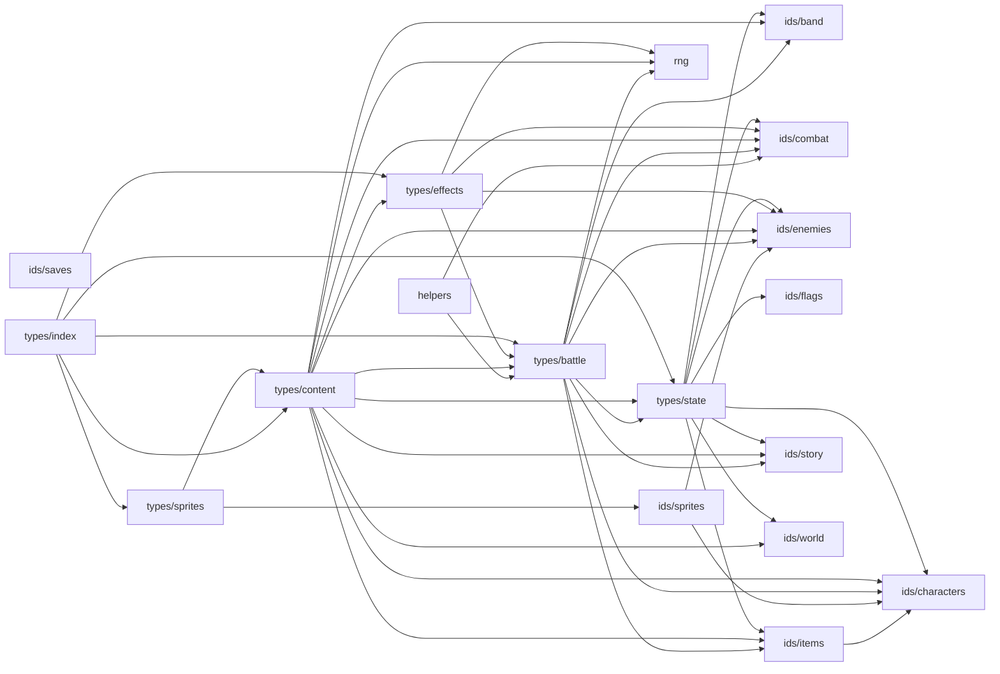

<!-- Generated by tools/codemap.ts. Do not edit by hand: run `npm run docs:codemap`. -->

# Code map: src/core

The floor layer: every id list, the shared types (GameState, Battle, Actor, content defs, effects), the seeded Rng and pure helpers. It imports nothing else from the project.

Generated reference. Start with the [guide](../../architecture/code-map.md) for the flows, and the [index](README.md) for how to read these entries.

## Imports inside this area

## Files

| File | Purpose |
|---|---|
| [src/core/helpers.ts](#src-core-helpers-ts) | Pure helpers over battle objects that need no content tables. |
| [src/core/ids/band.ts](#src-core-ids-band-ts) | Ids for the people who march with you. |
| [src/core/ids/characters.ts](#src-core-ids-characters-ts) | Ids for character creation: instrument classes and roots. |
| [src/core/ids/combat.ts](#src-core-ids-combat-ts) | Ids for combat content: tones, statuses, timing grades, skills. |
| [src/core/ids/enemies.ts](#src-core-ids-enemies-ts) | Ids for opponents and the Blue Notes they guard. |
| [src/core/ids/flags.ts](#src-core-ids-flags-ts) | — |
| [src/core/ids/items.ts](#src-core-ids-items-ts) | Ids for things the player carries: items, gear, sheet music. |
| [src/core/ids/saves.ts](#src-core-ids-saves-ts) | Ids for save slots. |
| [src/core/ids/sprites.ts](#src-core-ids-sprites-ts) | Ids for character art: who has a sprite, and the colours sprites may use. |
| [src/core/ids/story.ts](#src-core-ids-story-ts) | — |
| [src/core/ids/world.ts](#src-core-ids-world-ts) | Ids for the map: districts, places, NPCs, quests. |
| [src/core/rng.ts](#src-core-rng-ts) | Seeded randomness for everything that affects game state. |
| [src/core/types/battle.ts](#src-core-types-battle-ts) | Runtime combat state: actors, the battle object, and the event stream the UI animates. |
| [src/core/types/content.ts](#src-core-types-content-ts) | The shapes of every content table row. |
| [src/core/types/effects.ts](#src-core-types-effects-ts) | Effects: the building blocks of every skill, boss move, assist and consumable. |
| [src/core/types/index.ts](#src-core-types-index-ts) | — |
| [src/core/types/sprites.ts](#src-core-types-sprites-ts) | The shape of a sprite row. |
| [src/core/types/state.ts](#src-core-types-state-ts) | GameState: everything that persists between sessions. |

## Details

### src/core/helpers.ts

Pure helpers over battle objects that need no content tables. Content (boss AI, custom effects) and the engine both use them, which is why they live in core.

- Source: [src/core/helpers.ts](../../../src/core/helpers.ts)
- Imports: core: [ids/combat](#src-core-ids-combat-ts), [types/battle](#src-core-types-battle-ts)
- Imported by: content: [bosses/rougarou](content.md#src-content-bosses-rougarou-ts) · engine: [combat/battle](engine.md#src-engine-combat-battle-ts), [combat/legal](engine.md#src-engine-combat-legal-ts), [combat/player](engine.md#src-engine-combat-player-ts), [combat/resolve](engine.md#src-engine-combat-resolve-ts), [combat/statuses](engine.md#src-engine-combat-statuses-ts), [combat/timing](engine.md#src-engine-combat-timing-ts), [combat/turns](engine.md#src-engine-combat-turns-ts), [stats](engine.md#src-engine-stats-ts) · app: [sceneContext](app.md#src-app-scenecontext-ts), [testing/scriptedPresenter](app.md#src-app-testing-scriptedpresenter-ts) · tools: [sim](tools.md#tools-sim-ts)
- Tested by: [combat.test](tests.md#src-engine-combat-combat-test-ts), [coverage.test](tests.md#src-engine-combat-coverage-test-ts)
- Types used: **[core/ids/combat](#src-core-ids-combat-ts)** [StatusId](#src-core-ids-combat-ts--statusid) · **[core/types/battle](#src-core-types-battle-ts)** [Actor](#src-core-types-battle-ts--actor), [Battle](#src-core-types-battle-ts--battle), [StatusInstance](#src-core-types-battle-ts--statusinstance)

Declarations:

- **clamp** · *function* `(v: number, lo: number, hi: number): number` — Clamp `v` into [lo, hi].
  - used by: **[app/sceneContext](app.md#src-app-scenecontext-ts)** [createSceneContext](app.md#src-app-scenecontext-ts--createscenecontext) · **[engine/combat/battle](engine.md#src-engine-combat-battle-ts)** [createBattle](engine.md#src-engine-combat-battle-ts--createbattle) · **[engine/combat/player](engine.md#src-engine-combat-player-ts)** [playerAction](engine.md#src-engine-combat-player-ts--playeraction) · **[engine/combat/resolve](engine.md#src-engine-combat-resolve-ts)** [dealHit](engine.md#src-engine-combat-resolve-ts--dealhit), [dodgeChance](engine.md#src-engine-combat-resolve-ts--dodgechance), [resolveSkill](engine.md#src-engine-combat-resolve-ts--resolveskill) · **[engine/combat/timing](engine.md#src-engine-combat-timing-ts)** [scoreBlues](engine.md#src-engine-combat-timing-ts--scoreblues) · **[engine/stats](engine.md#src-engine-stats-ts)** [clampVitals](engine.md#src-engine-stats-ts--clampvitals)
- **hasStatus** · *function* `(a: Actor, id: StatusId): boolean` — Does the actor currently have this status?
  - used by: **[content/bosses/rougarou](content.md#src-content-bosses-rougarou-ts)** [rougarou](content.md#src-content-bosses-rougarou-ts--rougarou) · **[engine/combat/legal](engine.md#src-engine-combat-legal-ts)** [legalActions](engine.md#src-engine-combat-legal-ts--legalactions) · **[engine/combat/player](engine.md#src-engine-combat-player-ts)** [playTheBlues](engine.md#src-engine-combat-player-ts--playtheblues), [playerAction](engine.md#src-engine-combat-player-ts--playeraction), [playerCanSolo](engine.md#src-engine-combat-player-ts--playercansolo) · **[engine/combat/resolve](engine.md#src-engine-combat-resolve-ts)** [critChance](engine.md#src-engine-combat-resolve-ts--critchance), [dealHit](engine.md#src-engine-combat-resolve-ts--dealhit), [makeOps](engine.md#src-engine-combat-resolve-ts--makeops) · **[engine/combat/timing](engine.md#src-engine-combat-timing-ts)** [playerTimingSpec](engine.md#src-engine-combat-timing-ts--playertimingspec) · **[engine/combat/turns](engine.md#src-engine-combat-turns-ts)** [beginTurn](engine.md#src-engine-combat-turns-ts--beginturn), [endTurn](engine.md#src-engine-combat-turns-ts--endturn) · **[tools/sim](tools.md#tools-sim-ts)** [chooseAction](tools.md#tools-sim-ts--chooseaction), [runClick](tools.md#tools-sim-ts--runclick) · tests: [combat.test](tests.md#src-engine-combat-combat-test-ts)
- **getStatus** · *function* `(a: Actor, id: StatusId): StatusInstance | undefined` — The actor's instance of a status, if any.
  - used by: **[engine/combat/statuses](engine.md#src-engine-combat-statuses-ts)** [applyStatusRaw](engine.md#src-engine-combat-statuses-ts--applystatusraw)
- **livingEnemies** · *function* `(b: Battle): Actor[]` — Enemies still standing, in battle order.
  - used by: **[app/testing/scriptedPresenter](app.md#src-app-testing-scriptedpresenter-ts)** [defaultIntent](app.md#src-app-testing-scriptedpresenter-ts--defaultintent) · **[engine/combat/legal](engine.md#src-engine-combat-legal-ts)** [legalActions](engine.md#src-engine-combat-legal-ts--legalactions) · **[engine/combat/player](engine.md#src-engine-combat-player-ts)** [playerAction](engine.md#src-engine-combat-player-ts--playeraction) · **[engine/combat/resolve](engine.md#src-engine-combat-resolve-ts)** [checkDeath](engine.md#src-engine-combat-resolve-ts--checkdeath), [makeOps](engine.md#src-engine-combat-resolve-ts--makeops), [pickTargets](engine.md#src-engine-combat-resolve-ts--picktargets) · **[engine/combat/timing](engine.md#src-engine-combat-timing-ts)** [timingSpec](engine.md#src-engine-combat-timing-ts--timingspec) · **[engine/combat/turns](engine.md#src-engine-combat-turns-ts)** [startRound](engine.md#src-engine-combat-turns-ts--startround) · **[tools/sim](tools.md#tools-sim-ts)** [chooseAction](tools.md#tools-sim-ts--chooseaction) · tests: [coverage.test](tests.md#src-engine-combat-coverage-test-ts)

### src/core/ids/band.ts

Ids for the people who march with you.

- Source: [src/core/ids/band.ts](../../../src/core/ids/band.ts)
- Imported by: core: [types/battle](#src-core-types-battle-ts), [types/content](#src-core-types-content-ts), [types/state](#src-core-types-state-ts) · narrative: [types](narrative.md#src-narrative-types-ts) · content: [band/bandmates](content.md#src-content-band-bandmates-ts) · engine: [band](engine.md#src-engine-band-ts), [stats](engine.md#src-engine-stats-ts) · app: [game](app.md#src-app-game-ts), [save/format](app.md#src-app-save-format-ts) · tools: [parity/tsAdapter](tools.md#tools-parity-tsadapter-ts) · tests: [integration/support/crawl](tests.md#tests-integration-support-crawl-ts)
- Tested by: [coverage.test](tests.md#src-engine-combat-coverage-test-ts), [transcripts.test](tests.md#tools-parity-transcripts-test-ts), [validate-content.test](tests.md#tools-validate-content-test-ts)

Declarations:

- **BANDMATE_IDS** · *const* `= [ … ] as const (4 entries)` — Recruitable bandmates (two can be active at a time).
  - used by: here [BandmateId](#src-core-ids-band-ts--bandmateid) · **[app/game](app.md#src-app-game-ts)** [GameApp.dev](app.md#src-app-game-ts--gameapp-dev) · **[app/save/format](app.md#src-app-save-format-ts)** [gameStateSchema](app.md#src-app-save-format-ts--gamestateschema) · **[engine/stats](engine.md#src-engine-stats-ts)** [activePassives](engine.md#src-engine-stats-ts--activepassives) · **[tests/integration/support/crawl](tests.md#tests-integration-support-crawl-ts)** [buildState](tests.md#tests-integration-support-crawl-ts--buildstate) · tests: [coverage.test](tests.md#src-engine-combat-coverage-test-ts), [validate-content.test](tests.md#tools-validate-content-test-ts)
- **BandmateId** · *type* `= (typeof BANDMATE_IDS)[number]` — A bandmate.
  - used by: **[app/game](app.md#src-app-game-ts)** [GameApp.toggleBandmate](app.md#src-app-game-ts--gameapp-togglebandmate) · **[content/band/bandmates](content.md#src-content-band-bandmates-ts)** [BANDMATES](content.md#src-content-band-bandmates-ts--bandmates) · **[core/types/battle](#src-core-types-battle-ts)** [BattleEvent](#src-core-types-battle-ts--battleevent) · **[core/types/content](#src-core-types-content-ts)** [BandmateDef](#src-core-types-content-ts--bandmatedef) · **[core/types/state](#src-core-types-state-ts)** [GameState](#src-core-types-state-ts--gamestate) · **[engine/band](engine.md#src-engine-band-ts)** [toggleBandmate](engine.md#src-engine-band-ts--togglebandmate) · **[narrative/types](narrative.md#src-narrative-types-ts)** [SceneContext](narrative.md#src-narrative-types-ts--scenecontext) · **[tools/parity/tsAdapter](tools.md#tools-parity-tsadapter-ts)** [tsAdapter](tools.md#tools-parity-tsadapter-ts--tsadapter) · tests: [transcripts.test](tests.md#tools-parity-transcripts-test-ts)
- **SECOND_LINE_IDS** · *const* `= [ … ] as const (15 entries)` — Everyone who can join the second line on the Tower, in marching order.
  - used by: here [SecondLineId](#src-core-ids-band-ts--secondlineid) · **[app/save/format](app.md#src-app-save-format-ts)** [gameStateSchema](app.md#src-app-save-format-ts--gamestateschema) · tests: [validate-content.test](tests.md#tools-validate-content-test-ts)
- **SecondLineId** · *type* `= (typeof SECOND_LINE_IDS)[number]` — A second-line marcher.
  - used by: **[core/types/content](#src-core-types-content-ts)** [SecondLineMemberDef](#src-core-types-content-ts--secondlinememberdef)

### src/core/ids/characters.ts

Ids for character creation: instrument classes and roots.

- Source: [src/core/ids/characters.ts](../../../src/core/ids/characters.ts)
- Imported by: core: [ids/items](#src-core-ids-items-ts), [ids/sprites](#src-core-ids-sprites-ts), [types/battle](#src-core-types-battle-ts), [types/content](#src-core-types-content-ts), [types/state](#src-core-types-state-ts) · content: [classes/index](content.md#src-content-classes-index-ts), [gear/instruments](content.md#src-content-gear-instruments-ts), [roots](content.md#src-content-roots-ts), [sprites/refs](content.md#src-content-sprites-refs-ts), [sprites/table](content.md#src-content-sprites-table-ts) · engine: [state](engine.md#src-engine-state-ts) · app: [game](app.md#src-app-game-ts), [save/format](app.md#src-app-save-format-ts), [save/protocol](app.md#src-app-save-protocol-ts), [session](app.md#src-app-session-ts), [view](app.md#src-app-view-ts) · ui: [screens/Create](ui.md#src-ui-screens-create-tsx), [screens/Story](ui.md#src-ui-screens-story-tsx) · tools: [parity/tsAdapter](tools.md#tools-parity-tsadapter-ts), [sim](tools.md#tools-sim-ts), [sprites](tools.md#tools-sprites-ts), [trace](tools.md#tools-trace-ts), [validate-content](tools.md#tools-validate-content-ts) · tests: [integration/support/crawl](tests.md#tests-integration-support-crawl-ts)
- Tested by: [combat.test](tests.md#src-engine-combat-combat-test-ts), [coverage.test](tests.md#src-engine-combat-coverage-test-ts), [explore.test](tests.md#tests-integration-explore-test-ts), [transcripts.test](tests.md#tools-parity-transcripts-test-ts), [validate-content.test](tests.md#tools-validate-content-test-ts)

Declarations:

- **CLASS_IDS** · *const* `= [ … ] as const (7 entries)` — The seven brass-band instrument classes.
  - used by: here [ClassId](#src-core-ids-characters-ts--classid) · **[app/save/format](app.md#src-app-save-format-ts)** [gameStateSchema](app.md#src-app-save-format-ts--gamestateschema), [instrumentIds](app.md#src-app-save-format-ts--instrumentids) · **[app/save/protocol](app.md#src-app-save-protocol-ts)** [saveSummarySchema](app.md#src-app-save-protocol-ts--savesummaryschema) · **[content/gear/instruments](content.md#src-content-gear-instruments-ts)** [makeInstruments](content.md#src-content-gear-instruments-ts--makeinstruments) · **[content/sprites/table](content.md#src-content-sprites-table-ts)** [CLONE_ART](content.md#src-content-sprites-table-ts--clone-art) · **[core/ids/sprites](#src-core-ids-sprites-ts)** [CLONE_SPRITE_IDS](#src-core-ids-sprites-ts--clone-sprite-ids), [HERO_SPRITE_IDS](#src-core-ids-sprites-ts--hero-sprite-ids) · **[ui/screens/Create](ui.md#src-ui-screens-create-tsx)** [CreateScreen](ui.md#src-ui-screens-create-tsx--createscreen) · **[tests/integration/support/crawl](tests.md#tests-integration-support-crawl-ts)** [buildState](tests.md#tests-integration-support-crawl-ts--buildstate) · **[tools/sim](tools.md#tools-sim-ts)** [runSim](tools.md#tools-sim-ts--runsim) · **[tools/sprites](tools.md#tools-sprites-ts)** [nameOf](tools.md#tools-sprites-ts--nameof) · **[tools/trace](tools.md#tools-trace-ts)** [(top level)](tools.md#tools-trace-ts--top-level) · **[tools/validate-content](tools.md#tools-validate-content-ts)** [validateContent](tools.md#tools-validate-content-ts--validatecontent) · tests: [coverage.test](tests.md#src-engine-combat-coverage-test-ts), [explore.test](tests.md#tests-integration-explore-test-ts), [validate-content.test](tests.md#tools-validate-content-test-ts)
- **ClassId** · *type* `= (typeof CLASS_IDS)[number]` — A playable instrument class.
  - used by: **[app/game](app.md#src-app-game-ts)** [GameApp.createCharacter](app.md#src-app-game-ts--gameapp-createcharacter) · **[app/save/format](app.md#src-app-save-format-ts)** [SaveSummary](app.md#src-app-save-format-ts--savesummary) · **[app/session](app.md#src-app-session-ts)** [Session.newGame](app.md#src-app-session-ts--session-newgame) · **[app/view](app.md#src-app-view-ts)** [ActorView](app.md#src-app-view-ts--actorview), [ViewState](app.md#src-app-view-ts--viewstate) · **[content/classes/index](content.md#src-content-classes-index-ts)** [CLASSES](content.md#src-content-classes-index-ts--classes) · **[content/sprites/refs](content.md#src-content-sprites-refs-ts)** [actorSprite](content.md#src-content-sprites-refs-ts--actorsprite), [cloneSprite](content.md#src-content-sprites-refs-ts--clonesprite), [heroSprite](content.md#src-content-sprites-refs-ts--herosprite), [npcSprite](content.md#src-content-sprites-refs-ts--npcsprite), [opponentSprite](content.md#src-content-sprites-refs-ts--opponentsprite) · **[core/ids/items](#src-core-ids-items-ts)** [InstrumentId](#src-core-ids-items-ts--instrumentid) · **[core/ids/sprites](#src-core-ids-sprites-ts)** [CloneSpriteId](#src-core-ids-sprites-ts--clonespriteid), [HeroSpriteId](#src-core-ids-sprites-ts--herospriteid) · **[core/types/battle](#src-core-types-battle-ts)** [Actor](#src-core-types-battle-ts--actor) · **[core/types/content](#src-core-types-content-ts)** [ClassDef](#src-core-types-content-ts--classdef) · … +8 more · tests: [combat.test](tests.md#src-engine-combat-combat-test-ts), [coverage.test](tests.md#src-engine-combat-coverage-test-ts), [transcripts.test](tests.md#tools-parity-transcripts-test-ts)
- **ROOTS_IDS** · *const* `= [ … ] as const (3 entries)` — Where the character is from.
  - used by: here [RootsId](#src-core-ids-characters-ts--rootsid) · **[app/save/format](app.md#src-app-save-format-ts)** [gameStateSchema](app.md#src-app-save-format-ts--gamestateschema) · **[ui/screens/Create](ui.md#src-ui-screens-create-tsx)** [CreateScreen](ui.md#src-ui-screens-create-tsx--createscreen) · **[tests/integration/support/crawl](tests.md#tests-integration-support-crawl-ts)** [buildState](tests.md#tests-integration-support-crawl-ts--buildstate) · tests: [explore.test](tests.md#tests-integration-explore-test-ts), [validate-content.test](tests.md#tools-validate-content-test-ts)
- **RootsId** · *type* `= (typeof ROOTS_IDS)[number]` — A character's roots.
  - used by: **[app/game](app.md#src-app-game-ts)** [GameApp.createCharacter](app.md#src-app-game-ts--gameapp-createcharacter) · **[app/session](app.md#src-app-session-ts)** [Session.newGame](app.md#src-app-session-ts--session-newgame) · **[app/view](app.md#src-app-view-ts)** [ViewState](app.md#src-app-view-ts--viewstate) · **[content/roots](content.md#src-content-roots-ts)** [ROOTS](content.md#src-content-roots-ts--roots) · **[core/types/content](#src-core-types-content-ts)** [RootsDef](#src-core-types-content-ts--rootsdef) · **[core/types/state](#src-core-types-state-ts)** [GameState](#src-core-types-state-ts--gamestate) · **[engine/state](engine.md#src-engine-state-ts)** [newGame](engine.md#src-engine-state-ts--newgame) · **[tools/parity/tsAdapter](tools.md#tools-parity-tsadapter-ts)** [tsAdapter](tools.md#tools-parity-tsadapter-ts--tsadapter) · tests: [transcripts.test](tests.md#tools-parity-transcripts-test-ts)

### src/core/ids/combat.ts

Ids for combat content: tones, statuses, timing grades, skills. Each list is the canonical order; the union type is derived from it. Adding an id here without a table row (or the reverse) is a compile error.

- Source: [src/core/ids/combat.ts](../../../src/core/ids/combat.ts)
- Imported by: core: [helpers](#src-core-helpers-ts), [types/battle](#src-core-types-battle-ts), [types/content](#src-core-types-content-ts), [types/effects](#src-core-types-effects-ts), [types/state](#src-core-types-state-ts) · narrative: [types](narrative.md#src-narrative-types-ts) · content: [classes/bassdrum](content.md#src-content-classes-bassdrum-ts), [classes/clarinet](content.md#src-content-classes-clarinet-ts), [classes/saxophone](content.md#src-content-classes-saxophone-ts), [classes/snare](content.md#src-content-classes-snare-ts), [classes/sousaphone](content.md#src-content-classes-sousaphone-ts), [classes/trombone](content.md#src-content-classes-trombone-ts), [classes/trumpet](content.md#src-content-classes-trumpet-ts), [combat/assistSkills](content.md#src-content-combat-assistskills-ts), [combat/bossSkills](content.md#src-content-combat-bossskills-ts), [combat/enemySkills](content.md#src-content-combat-enemyskills-ts), [combat/skills](content.md#src-content-combat-skills-ts), [combat/statuses](content.md#src-content-combat-statuses-ts), [combat/timing](content.md#src-content-combat-timing-ts), [combat/tones](content.md#src-content-combat-tones-ts), [rules](content.md#src-content-rules-ts), [stats](content.md#src-content-stats-ts) · engine: [combat/actors](engine.md#src-engine-combat-actors-ts), [combat/legal](engine.md#src-engine-combat-legal-ts), [combat/resolve](engine.md#src-engine-combat-resolve-ts), [combat/statuses](engine.md#src-engine-combat-statuses-ts), [combat/turns](engine.md#src-engine-combat-turns-ts), [progression](engine.md#src-engine-progression-ts), [stats](engine.md#src-engine-stats-ts) · app: [game](app.md#src-app-game-ts), [save/format](app.md#src-app-save-format-ts), [sceneContext](app.md#src-app-scenecontext-ts), [view](app.md#src-app-view-ts) · ui: [components/Chips](ui.md#src-ui-components-chips-tsx), [components/StatGrid](ui.md#src-ui-components-statgrid-tsx), [components/Tone](ui.md#src-ui-components-tone-tsx), [sheets/MenuSheets](ui.md#src-ui-sheets-menusheets-tsx) · tools: [validate-content](tools.md#tools-validate-content-ts)
- Tested by: [coverage.test](tests.md#src-engine-combat-coverage-test-ts), [content.test](tests.md#tools-parity-content-test-ts), [validate-content.test](tests.md#tools-validate-content-test-ts)

Declarations:

- **TONE_IDS** · *const* `= [ … ] as const (5 entries)` — The five musical damage types.
  - used by: here [ToneId](#src-core-ids-combat-ts--toneid)
- **ToneId** · *type* `= (typeof TONE_IDS)[number]` — A musical damage type.
  - used by: **[app/view](app.md#src-app-view-ts)** [ActorView](app.md#src-app-view-ts--actorview) · **[content/combat/tones](content.md#src-content-combat-tones-ts)** [TONES](content.md#src-content-combat-tones-ts--tones) · **[core/types/battle](#src-core-types-battle-ts)** [Actor](#src-core-types-battle-ts--actor), [BattleEvent](#src-core-types-battle-ts--battleevent) · **[core/types/content](#src-core-types-content-ts)** [BossDef](#src-core-types-content-ts--bossdef), [ClassDef](#src-core-types-content-ts--classdef), [EnemyDef](#src-core-types-content-ts--enemydef), [GearDef](#src-core-types-content-ts--geardef), [SkillDef](#src-core-types-content-ts--skilldef), [ToneDef](#src-core-types-content-ts--tonedef) · **[core/types/effects](#src-core-types-effects-ts)** [DamageEffect](#src-core-types-effects-ts--damageeffect) · **[engine/stats](engine.md#src-engine-stats-ts)** [DerivedStats](engine.md#src-engine-stats-ts--derivedstats) · **[ui/components/Tone](ui.md#src-ui-components-tone-tsx)** [Tone](ui.md#src-ui-components-tone-tsx--tone)
- **STATUS_IDS** · *const* `= [ … ] as const (17 entries)` — Every status effect, in table order.
  - used by: here [StatusId](#src-core-ids-combat-ts--statusid) · **[app/save/format](app.md#src-app-save-format-ts)** [gameStateSchema](app.md#src-app-save-format-ts--gamestateschema) · tests: [coverage.test](tests.md#src-engine-combat-coverage-test-ts)
- **StatusId** · *type* `= (typeof STATUS_IDS)[number]` — A status effect.
  - used by: **[app/game](app.md#src-app-game-ts)** [GameApp.showStatus](app.md#src-app-game-ts--gameapp-showstatus) · **[app/view](app.md#src-app-view-ts)** [ActorView](app.md#src-app-view-ts--actorview), [Popup](app.md#src-app-view-ts--popup) · **[content/combat/statuses](content.md#src-content-combat-statuses-ts)** [STATUSES](content.md#src-content-combat-statuses-ts--statuses) · **[core/helpers](#src-core-helpers-ts)** [getStatus](#src-core-helpers-ts--getstatus), [hasStatus](#src-core-helpers-ts--hasstatus) · **[core/types/battle](#src-core-types-battle-ts)** [BattleEvent](#src-core-types-battle-ts--battleevent), [StatusInstance](#src-core-types-battle-ts--statusinstance) · **[core/types/content](#src-core-types-content-ts)** [ItemDef](#src-core-types-content-ts--itemdef), [StatusDef](#src-core-types-content-ts--statusdef) · **[core/types/effects](#src-core-types-effects-ts)** [CleanseEffect](#src-core-types-effects-ts--cleanseeffect), [EffectOps](#src-core-types-effects-ts--effectops), [StatusEffect](#src-core-types-effects-ts--statuseffect), [StatusRider](#src-core-types-effects-ts--statusrider) · **[core/types/state](#src-core-types-state-ts)** [NextFightMods](#src-core-types-state-ts--nextfightmods) · **[engine/combat/resolve](engine.md#src-engine-combat-resolve-ts)** [MECHANIC_STATUSES](engine.md#src-engine-combat-resolve-ts--mechanic-statuses) · … +5 more
- **TIMING_IDS** · *const* `= [ … ] as const (4 entries)` — On the One timing grades, best to worst.
  - used by: here [TimingId](#src-core-ids-combat-ts--timingid)
- **TimingId** · *type* `= (typeof TIMING_IDS)[number]` — An On the One timing grade.
  - used by: **[app/view](app.md#src-app-view-ts)** [ViewState](app.md#src-app-view-ts--viewstate) · **[content/combat/timing](content.md#src-content-combat-timing-ts)** [TIMING](content.md#src-content-combat-timing-ts--timing) · **[core/types/battle](#src-core-types-battle-ts)** [TimingResult](#src-core-types-battle-ts--timingresult) · **[core/types/content](#src-core-types-content-ts)** [TimingGradeDef](#src-core-types-content-ts--timinggradedef)
- **CLASS_SKILL_IDS** · *const* `= [ … ] as const (56 entries)` — Player class skills: riff, six unlockable skills and a solo per class.
  - used by: here [SkillId](#src-core-ids-combat-ts--skillid) · **[tools/validate-content](tools.md#tools-validate-content-ts)** [validateContent](tools.md#tools-validate-content-ts--validatecontent) · tests: [validate-content.test](tests.md#tools-validate-content-test-ts)
- **ENEMY_SKILL_IDS** · *const* `= [ … ] as const (39 entries)` — Normal-enemy moves (en_*).
  - used by: here [SkillId](#src-core-ids-combat-ts--skillid) · **[tools/validate-content](tools.md#tools-validate-content-ts)** [validateContent](tools.md#tools-validate-content-ts--validatecontent) · tests: [coverage.test](tests.md#src-engine-combat-coverage-test-ts), [validate-content.test](tests.md#tools-validate-content-test-ts)
- **BOSS_SKILL_IDS** · *const* `= [ … ] as const (27 entries)` — Boss moves (b_*).
  - used by: here [SkillId](#src-core-ids-combat-ts--skillid) · tests: [coverage.test](tests.md#src-engine-combat-coverage-test-ts), [validate-content.test](tests.md#tools-validate-content-test-ts)
- **ASSIST_SKILL_IDS** · *const* `= [ … ] as const (4 entries)` — Bandmate assist moves (as_*).
  - used by: here [SkillId](#src-core-ids-combat-ts--skillid) · **[tools/validate-content](tools.md#tools-validate-content-ts)** [validateContent](tools.md#tools-validate-content-ts--validatecontent) · tests: [validate-content.test](tests.md#tools-validate-content-test-ts)
- **SkillId** · *type* `= union of 4` — Any skill: player, enemy, boss or assist.
  - used by: **[content/classes/bassdrum](content.md#src-content-classes-bassdrum-ts)** [bassdrumSkills](content.md#src-content-classes-bassdrum-ts--bassdrumskills) · **[content/classes/clarinet](content.md#src-content-classes-clarinet-ts)** [clarinetSkills](content.md#src-content-classes-clarinet-ts--clarinetskills) · **[content/classes/saxophone](content.md#src-content-classes-saxophone-ts)** [saxophoneSkills](content.md#src-content-classes-saxophone-ts--saxophoneskills) · **[content/classes/snare](content.md#src-content-classes-snare-ts)** [snareSkills](content.md#src-content-classes-snare-ts--snareskills) · **[content/classes/sousaphone](content.md#src-content-classes-sousaphone-ts)** [sousaphoneSkills](content.md#src-content-classes-sousaphone-ts--sousaphoneskills) · **[content/classes/trombone](content.md#src-content-classes-trombone-ts)** [tromboneSkills](content.md#src-content-classes-trombone-ts--tromboneskills) · **[content/classes/trumpet](content.md#src-content-classes-trumpet-ts)** [trumpetSkills](content.md#src-content-classes-trumpet-ts--trumpetskills) · **[content/combat/assistSkills](content.md#src-content-combat-assistskills-ts)** [ASSIST_SKILLS](content.md#src-content-combat-assistskills-ts--assist-skills) · **[content/combat/bossSkills](content.md#src-content-combat-bossskills-ts)** [BOSS_SKILLS](content.md#src-content-combat-bossskills-ts--boss-skills) · **[content/combat/enemySkills](content.md#src-content-combat-enemyskills-ts)** [ENEMY_SKILLS](content.md#src-content-combat-enemyskills-ts--enemy-skills) · **[content/combat/skills](content.md#src-content-combat-skills-ts)** [SKILLS](content.md#src-content-combat-skills-ts--skills) · **[content/rules](content.md#src-content-rules-ts)** [BASIC_ATTACK](content.md#src-content-rules-ts--basic-attack) · **[core/types/battle](#src-core-types-battle-ts)** [Actor](#src-core-types-battle-ts--actor), [Battle](#src-core-types-battle-ts--battle), [LevelUp](#src-core-types-battle-ts--levelup), [PlayerIntent](#src-core-types-battle-ts--playerintent) · … +12 more · tests: [coverage.test](tests.md#src-engine-combat-coverage-test-ts)
- **STAT_KEYS** · *const* `= [ … ] as const (6 entries)` — The six character stats.
  - used by: here [StatKey](#src-core-ids-combat-ts--statkey) · **[engine/progression](engine.md#src-engine-progression-ts)** [gainXp](engine.md#src-engine-progression-ts--gainxp) · **[engine/stats](engine.md#src-engine-stats-ts)** [classBase](engine.md#src-engine-stats-ts--classbase), [derivedStats](engine.md#src-engine-stats-ts--derivedstats) · **[ui/components/StatGrid](ui.md#src-ui-components-statgrid-tsx)** [StatGrid](ui.md#src-ui-components-statgrid-tsx--statgrid) · tests: [content.test](tests.md#tools-parity-content-test-ts)
- **StatKey** · *type* `= (typeof STAT_KEYS)[number]` — A character stat.
  - used by: **[app/sceneContext](app.md#src-app-scenecontext-ts)** [createSceneContext](app.md#src-app-scenecontext-ts--createscenecontext) · **[content/stats](content.md#src-content-stats-ts)** [STAT_NAMES](content.md#src-content-stats-ts--stat-names) · **[core/types/content](#src-core-types-content-ts)** [StatBlock](#src-core-types-content-ts--statblock) · **[core/types/state](#src-core-types-state-ts)** [GameState](#src-core-types-state-ts--gamestate) · **[engine/progression](engine.md#src-engine-progression-ts)** [gainXp](engine.md#src-engine-progression-ts--gainxp) · **[engine/stats](engine.md#src-engine-stats-ts)** [classBase](engine.md#src-engine-stats-ts--classbase), [derivedStats](engine.md#src-engine-stats-ts--derivedstats), [displayStats](engine.md#src-engine-stats-ts--displaystats) · **[narrative/types](narrative.md#src-narrative-types-ts)** [SceneContext](narrative.md#src-narrative-types-ts--scenecontext) · **[ui/components/StatGrid](ui.md#src-ui-components-statgrid-tsx)** [StatGrid](ui.md#src-ui-components-statgrid-tsx--statgrid)
- **CombatStatKey** · *type* `= 'chops' | 'grit' | 'tempo' | 'mojo'` — The four stats an actor carries into battle (heart and funk become hp/fp pools).
  - used by: **[core/types/battle](#src-core-types-battle-ts)** [CombatStats](#src-core-types-battle-ts--combatstats) · **[core/types/effects](#src-core-types-effects-ts)** [EffectOps](#src-core-types-effects-ts--effectops) · **[engine/combat/statuses](engine.md#src-engine-combat-statuses-ts)** [effStat](engine.md#src-engine-combat-statuses-ts--effstat) · tests: [coverage.test](tests.md#src-engine-combat-coverage-test-ts)

### src/core/ids/enemies.ts

Ids for opponents and the Blue Notes they guard.

- Source: [src/core/ids/enemies.ts](../../../src/core/ids/enemies.ts)
- Imported by: core: [ids/sprites](#src-core-ids-sprites-ts), [types/battle](#src-core-types-battle-ts), [types/content](#src-core-types-content-ts), [types/effects](#src-core-types-effects-ts), [types/state](#src-core-types-state-ts) · narrative: [types](narrative.md#src-narrative-types-ts) · content: [bosses/index](content.md#src-content-bosses-index-ts), [districts/bayou/enemies](content.md#src-content-districts-bayou-enemies-ts), [districts/cemetery/enemies](content.md#src-content-districts-cemetery-enemies-ts), [districts/garden/enemies](content.md#src-content-districts-garden-enemies-ts), [districts/quarter/cutting.scene](content.md#src-content-districts-quarter-cutting-scene-ts), [districts/quarter/enemies](content.md#src-content-districts-quarter-enemies-ts), [districts/storyville/enemies](content.md#src-content-districts-storyville-enemies-ts), [districts/tower/enemies](content.md#src-content-districts-tower-enemies-ts), [districts/treme/enemies](content.md#src-content-districts-treme-enemies-ts), [enemies/index](content.md#src-content-enemies-index-ts), [enemies/rivals](content.md#src-content-enemies-rivals-ts), [enemies/summons](content.md#src-content-enemies-summons-ts), [index](content.md#src-content-index-ts), [notes](content.md#src-content-notes-ts), [sprites/refs](content.md#src-content-sprites-refs-ts), [world/shared.scene](content.md#src-content-world-shared-scene-ts) · engine: [aftermath](engine.md#src-engine-aftermath-ts), [combat/actors](engine.md#src-engine-combat-actors-ts), [combat/events](engine.md#src-engine-combat-events-ts), [combat/legal](engine.md#src-engine-combat-legal-ts), [combat/player](engine.md#src-engine-combat-player-ts), [combat/resolve](engine.md#src-engine-combat-resolve-ts), [combat/timing](engine.md#src-engine-combat-timing-ts), [combat/turns](engine.md#src-engine-combat-turns-ts), [encounters](engine.md#src-engine-encounters-ts) · app: [battleController](app.md#src-app-battlecontroller-ts), [devStates](app.md#src-app-devstates-ts), [game](app.md#src-app-game-ts), [reactPresenter](app.md#src-app-reactpresenter-ts), [save/format](app.md#src-app-save-format-ts), [sceneContext](app.md#src-app-scenecontext-ts), [session](app.md#src-app-session-ts), [sessionPort](app.md#src-app-sessionport-ts), [view](app.md#src-app-view-ts) · ui: [combat/TimingOverlay](ui.md#src-ui-combat-timingoverlay-tsx), [components/Notes](ui.md#src-ui-components-notes-tsx) · tools: [completeness](tools.md#tools-completeness-ts), [parity/tsAdapter](tools.md#tools-parity-tsadapter-ts), [sim](tools.md#tools-sim-ts), [sprites](tools.md#tools-sprites-ts), [trace](tools.md#tools-trace-ts), [validate-content](tools.md#tools-validate-content-ts) · tests: [integration/support/crawl](tests.md#tests-integration-support-crawl-ts)
- Tested by: [combat.test](tests.md#src-engine-combat-combat-test-ts), [coverage.test](tests.md#src-engine-combat-coverage-test-ts), [playthrough.test](tests.md#tests-integration-playthrough-test-ts), [content.test](tests.md#tools-parity-content-test-ts), [rules.test](tests.md#tools-parity-rules-test-ts), [transcripts.test](tests.md#tools-parity-transcripts-test-ts), [validate-content.test](tests.md#tools-validate-content-test-ts)

Declarations:

- **ENEMY_IDS** · *const* `= [ … ] as const (42 entries)` — Every non-boss enemy (district enemies, elites, summons, Cutting Contest rivals).
  - used by: here [EnemyId](#src-core-ids-enemies-ts--enemyid) · **[app/save/format](app.md#src-app-save-format-ts)** [opponentId](app.md#src-app-save-format-ts--opponentid) · **[core/ids/sprites](#src-core-ids-sprites-ts)** [SPRITE_IDS](#src-core-ids-sprites-ts--sprite-ids) · **[tools/trace](tools.md#tools-trace-ts)** [(top level)](tools.md#tools-trace-ts--top-level) · **[tools/validate-content](tools.md#tools-validate-content-ts)** [validateContent](tools.md#tools-validate-content-ts--validatecontent), [validateSprites](tools.md#tools-validate-content-ts--validatesprites) · tests: [coverage.test](tests.md#src-engine-combat-coverage-test-ts), [validate-content.test](tests.md#tools-validate-content-test-ts)
- **EnemyId** · *type* `= (typeof ENEMY_IDS)[number]` — A non-boss enemy.
  - used by: here [OpponentId](#src-core-ids-enemies-ts--opponentid) · **[app/reactPresenter](app.md#src-app-reactpresenter-ts)** [actorView](app.md#src-app-reactpresenter-ts--actorview) · **[content/districts/bayou/enemies](content.md#src-content-districts-bayou-enemies-ts)** [bayouEnemies](content.md#src-content-districts-bayou-enemies-ts--bayouenemies) · **[content/districts/cemetery/enemies](content.md#src-content-districts-cemetery-enemies-ts)** [cemeteryEnemies](content.md#src-content-districts-cemetery-enemies-ts--cemeteryenemies) · **[content/districts/garden/enemies](content.md#src-content-districts-garden-enemies-ts)** [gardenEnemies](content.md#src-content-districts-garden-enemies-ts--gardenenemies) · **[content/districts/quarter/cutting.scene](content.md#src-content-districts-quarter-cutting-scene-ts)** [RIVALS](content.md#src-content-districts-quarter-cutting-scene-ts--rivals) · **[content/districts/quarter/enemies](content.md#src-content-districts-quarter-enemies-ts)** [quarterEnemies](content.md#src-content-districts-quarter-enemies-ts--quarterenemies) · **[content/districts/storyville/enemies](content.md#src-content-districts-storyville-enemies-ts)** [storyvilleEnemies](content.md#src-content-districts-storyville-enemies-ts--storyvilleenemies) · **[content/districts/tower/enemies](content.md#src-content-districts-tower-enemies-ts)** [towerEnemies](content.md#src-content-districts-tower-enemies-ts--towerenemies) · **[content/districts/treme/enemies](content.md#src-content-districts-treme-enemies-ts)** [tremeEnemies](content.md#src-content-districts-treme-enemies-ts--tremeenemies) · **[content/enemies/index](content.md#src-content-enemies-index-ts)** [ENEMIES](content.md#src-content-enemies-index-ts--enemies) · **[content/enemies/rivals](content.md#src-content-enemies-rivals-ts)** [RIVALS](content.md#src-content-enemies-rivals-ts--rivals) · **[content/enemies/summons](content.md#src-content-enemies-summons-ts)** [SUMMONS](content.md#src-content-enemies-summons-ts--summons) · **[core/ids/sprites](#src-core-ids-sprites-ts)** [SPRITE_IDS](#src-core-ids-sprites-ts--sprite-ids) · **[core/types/content](#src-core-types-content-ts)** [DistrictDef](#src-core-types-content-ts--districtdef), [EncounterRig](#src-core-types-content-ts--encounterrig) · … +11 more · tests: [rules.test](tests.md#tools-parity-rules-test-ts)
- **BOSS_IDS** · *const* `= [ … ] as const (8 entries)` — Every boss, in story order.
  - used by: here [BossId](#src-core-ids-enemies-ts--bossid) · **[app/game](app.md#src-app-game-ts)** [GameApp.dev](app.md#src-app-game-ts--gameapp-dev) · **[app/save/format](app.md#src-app-save-format-ts)** [gameStateSchema](app.md#src-app-save-format-ts--gamestateschema), [opponentId](app.md#src-app-save-format-ts--opponentid) · **[core/ids/sprites](#src-core-ids-sprites-ts)** [SPRITE_IDS](#src-core-ids-sprites-ts--sprite-ids) · **[tests/integration/support/crawl](tests.md#tests-integration-support-crawl-ts)** [buildState](tests.md#tests-integration-support-crawl-ts--buildstate) · **[tools/completeness](tools.md#tools-completeness-ts)** [checkCompleteness](tools.md#tools-completeness-ts--checkcompleteness) · **[tools/sprites](tools.md#tools-sprites-ts)** [groups](tools.md#tools-sprites-ts--groups) · **[tools/trace](tools.md#tools-trace-ts)** [(top level)](tools.md#tools-trace-ts--top-level) · **[tools/validate-content](tools.md#tools-validate-content-ts)** [validateContent](tools.md#tools-validate-content-ts--validatecontent), [validateSprites](tools.md#tools-validate-content-ts--validatesprites) · tests: [coverage.test](tests.md#src-engine-combat-coverage-test-ts), [playthrough.test](tests.md#tests-integration-playthrough-test-ts), [validate-content.test](tests.md#tools-validate-content-test-ts)
- **BossId** · *type* `= (typeof BOSS_IDS)[number]` — A boss.
  - used by: here [OpponentId](#src-core-ids-enemies-ts--opponentid) · **[app/battleController](app.md#src-app-battlecontroller-ts)** [runBattle](app.md#src-app-battlecontroller-ts--runbattle) · **[app/devStates](app.md#src-app-devstates-ts)** [bossStep](app.md#src-app-devstates-ts--bossstep) · **[app/game](app.md#src-app-game-ts)** [GameApp.dev](app.md#src-app-game-ts--gameapp-dev) · **[app/reactPresenter](app.md#src-app-reactpresenter-ts)** [actorView](app.md#src-app-reactpresenter-ts--actorview) · **[app/sceneContext](app.md#src-app-scenecontext-ts)** [createSceneContext](app.md#src-app-scenecontext-ts--createscenecontext) · **[app/session](app.md#src-app-session-ts)** [SessionDeps](app.md#src-app-session-ts--sessiondeps) · **[app/sessionPort](app.md#src-app-sessionport-ts)** [SessionPort](app.md#src-app-sessionport-ts--sessionport) · **[content/bosses/index](content.md#src-content-bosses-index-ts)** [BOSSES](content.md#src-content-bosses-index-ts--bosses) · **[content/index](content.md#src-content-index-ts)** [BOSS_SCENES](content.md#src-content-index-ts--boss-scenes) · **[content/world/shared.scene](content.md#src-content-world-shared-scene-ts)** [BOSS_RUMORS](content.md#src-content-world-shared-scene-ts--boss-rumors), [rumor](content.md#src-content-world-shared-scene-ts--rumor) · **[core/types/battle](#src-core-types-battle-ts)** [Battle](#src-core-types-battle-ts--battle), [BattleOptions](#src-core-types-battle-ts--battleoptions) · **[core/types/content](#src-core-types-content-ts)** [BossDef](#src-core-types-content-ts--bossdef), [DistrictDef](#src-core-types-content-ts--districtdef) · … +12 more · tests: [playthrough.test](tests.md#tests-integration-playthrough-test-ts), [transcripts.test](tests.md#tools-parity-transcripts-test-ts)
- **OpponentId** · *type* `= EnemyId | BossId` — Anything the player can fight; also the key of the Blue Book (bestiary).
  - used by: **[app/view](app.md#src-app-view-ts)** [ActorView](app.md#src-app-view-ts--actorview) · **[content/sprites/refs](content.md#src-content-sprites-refs-ts)** [actorSprite](content.md#src-content-sprites-refs-ts--actorsprite), [opponentSprite](content.md#src-content-sprites-refs-ts--opponentsprite) · **[core/ids/sprites](#src-core-ids-sprites-ts)** [ArtOpponentId](#src-core-ids-sprites-ts--artopponentid), [PersonIdsAreNotOpponentIds](#src-core-ids-sprites-ts--personidsarenotopponentids) · **[core/types/battle](#src-core-types-battle-ts)** [Actor](#src-core-types-battle-ts--actor), [Battle](#src-core-types-battle-ts--battle) · **[core/types/state](#src-core-types-state-ts)** [GameState](#src-core-types-state-ts--gamestate) · **[engine/combat/actors](engine.md#src-engine-combat-actors-ts)** [isBossId](engine.md#src-engine-combat-actors-ts--isbossid), [makeEnemy](engine.md#src-engine-combat-actors-ts--makeenemy) · **[engine/combat/events](engine.md#src-engine-combat-events-ts)** [recordSeen](engine.md#src-engine-combat-events-ts--recordseen) · **[narrative/types](narrative.md#src-narrative-types-ts)** [SceneContext](narrative.md#src-narrative-types-ts--scenecontext) · **[tools/parity/tsAdapter](tools.md#tools-parity-tsadapter-ts)** [tsAdapter](tools.md#tools-parity-tsadapter-ts--tsadapter) · **[tools/sim](tools.md#tools-sim-ts)** [FightOpts](tools.md#tools-sim-ts--fightopts), [runFight](tools.md#tools-sim-ts--runfight) · **[tools/trace](tools.md#tools-trace-ts)** [(top level)](tools.md#tools-trace-ts--top-level) · … +2 more · tests: [combat.test](tests.md#src-engine-combat-combat-test-ts), [coverage.test](tests.md#src-engine-combat-coverage-test-ts)
- **NOTE_IDS** · *const* `= [ … ] as const (6 entries)` — The six Blue Notes of the blues scale, in scale order.
  - used by: here [NoteId](#src-core-ids-enemies-ts--noteid) · **[app/game](app.md#src-app-game-ts)** [GameApp.dev](app.md#src-app-game-ts--gameapp-dev) · **[app/save/format](app.md#src-app-save-format-ts)** [gameStateSchema](app.md#src-app-save-format-ts--gamestateschema) · **[engine/combat/timing](engine.md#src-engine-combat-timing-ts)** [scoreBlues](engine.md#src-engine-combat-timing-ts--scoreblues) · **[ui/combat/TimingOverlay](ui.md#src-ui-combat-timingoverlay-tsx)** [BluesPads](ui.md#src-ui-combat-timingoverlay-tsx--bluespads) · **[ui/components/Notes](ui.md#src-ui-components-notes-tsx)** [Notes](ui.md#src-ui-components-notes-tsx--notes) · **[tools/validate-content](tools.md#tools-validate-content-ts)** [validateContent](tools.md#tools-validate-content-ts--validatecontent) · tests: [content.test](tests.md#tools-parity-content-test-ts)
- **NoteId** · *type* `= (typeof NOTE_IDS)[number]` — A Blue Note.
  - used by: **[content/notes](content.md#src-content-notes-ts)** [NOTES](content.md#src-content-notes-ts--notes) · **[core/types/content](#src-core-types-content-ts)** [BossDef](#src-core-types-content-ts--bossdef), [NoteDef](#src-core-types-content-ts--notedef) · **[core/types/state](#src-core-types-state-ts)** [GameState](#src-core-types-state-ts--gamestate) · **[narrative/types](narrative.md#src-narrative-types-ts)** [SceneContext](narrative.md#src-narrative-types-ts--scenecontext) · **[ui/components/Notes](ui.md#src-ui-components-notes-tsx)** [Notes](ui.md#src-ui-components-notes-tsx--notes) · tests: [transcripts.test](tests.md#tools-parity-transcripts-test-ts)

### src/core/ids/flags.ts

- Source: [src/core/ids/flags.ts](../../../src/core/ids/flags.ts)
- Imported by: core: [types/state](#src-core-types-state-ts) · narrative: [types](narrative.md#src-narrative-types-ts) · app: [save/format](app.md#src-app-save-format-ts) · tools: [parity/tsAdapter](tools.md#tools-parity-tsadapter-ts) · tests: [integration/support/crawl](tests.md#tests-integration-support-crawl-ts)
- Tested by: [transcripts.test](tests.md#tools-parity-transcripts-test-ts)

Declarations:

- **FLAG_IDS** · *const* `= [ … ] as const (14 entries)` — Story flags and choices.
  - used by: here [FlagId](#src-core-ids-flags-ts--flagid) · **[app/save/format](app.md#src-app-save-format-ts)** [gameStateSchema](app.md#src-app-save-format-ts--gamestateschema) · **[tests/integration/support/crawl](tests.md#tests-integration-support-crawl-ts)** [buildState](tests.md#tests-integration-support-crawl-ts--buildstate)
- **FlagId** · *type* `= (typeof FLAG_IDS)[number]` — A one-time story beat.
  - used by: **[core/types/state](#src-core-types-state-ts)** [GameState](#src-core-types-state-ts--gamestate) · **[narrative/types](narrative.md#src-narrative-types-ts)** [SceneContext](narrative.md#src-narrative-types-ts--scenecontext) · tests: [transcripts.test](tests.md#tools-parity-transcripts-test-ts)
- **StoryChoices** · *interface* — The three branching boss decisions and what the player chose.
  - used by: **[core/types/state](#src-core-types-state-ts)** [GameState](#src-core-types-state-ts--gamestate) · **[narrative/types](narrative.md#src-narrative-types-ts)** [SceneContext](narrative.md#src-narrative-types-ts--scenecontext) · **[tests/integration/support/crawl](tests.md#tests-integration-support-crawl-ts)** [choicesFor](tests.md#tests-integration-support-crawl-ts--choicesfor) · **[tools/parity/tsAdapter](tools.md#tools-parity-tsadapter-ts)** [tsAdapter](tools.md#tools-parity-tsadapter-ts--tsadapter) · tests: [transcripts.test](tests.md#tools-parity-transcripts-test-ts)

### src/core/ids/items.ts

Ids for things the player carries: items, gear, sheet music.

- Source: [src/core/ids/items.ts](../../../src/core/ids/items.ts)
- Imports: core: [ids/characters](#src-core-ids-characters-ts)
- Imported by: core: [types/battle](#src-core-types-battle-ts), [types/content](#src-core-types-content-ts), [types/state](#src-core-types-state-ts) · narrative: [types](narrative.md#src-narrative-types-ts) · content: [gear/charms](content.md#src-content-gear-charms-ts), [gear/index](content.md#src-content-gear-index-ts), [gear/instruments](content.md#src-content-gear-instruments-ts), [gear/mods](content.md#src-content-gear-mods-ts), [gear/threads](content.md#src-content-gear-threads-ts), [items](content.md#src-content-items-ts), [sheetMusic](content.md#src-content-sheetmusic-ts), [world/shared.scene](content.md#src-content-world-shared-scene-ts) · engine: [band](engine.md#src-engine-band-ts), [combat/actors](engine.md#src-engine-combat-actors-ts), [combat/rewards](engine.md#src-engine-combat-rewards-ts), [inventory](engine.md#src-engine-inventory-ts), [items](engine.md#src-engine-items-ts), [stats](engine.md#src-engine-stats-ts), [story](engine.md#src-engine-story-ts) · app: [game](app.md#src-app-game-ts), [save/format](app.md#src-app-save-format-ts), [view](app.md#src-app-view-ts) · ui: [sheets/MenuSheets](ui.md#src-ui-sheets-menusheets-tsx), [sheets/ShopSheet](ui.md#src-ui-sheets-shopsheet-tsx) · tools: [parity/tsAdapter](tools.md#tools-parity-tsadapter-ts) · tests: [integration/support/crawl](tests.md#tests-integration-support-crawl-ts)
- Tested by: [coverage.test](tests.md#src-engine-combat-coverage-test-ts), [explore.test](tests.md#tests-integration-explore-test-ts), [rules.test](tests.md#tools-parity-rules-test-ts), [transcripts.test](tests.md#tools-parity-transcripts-test-ts), [validate-content.test](tests.md#tools-validate-content-test-ts)
- Types used: **[core/ids/characters](#src-core-ids-characters-ts)** [ClassId](#src-core-ids-characters-ts--classid)

Declarations:

- **ITEM_IDS** · *const* `= [ … ] as const (29 entries)` — Consumables and key items.
  - used by: here [ItemId](#src-core-ids-items-ts--itemid) · **[app/save/format](app.md#src-app-save-format-ts)** [itemId](app.md#src-app-save-format-ts--itemid) · **[engine/combat/actors](engine.md#src-engine-combat-actors-ts)** [carriedRevive](engine.md#src-engine-combat-actors-ts--carriedrevive) · **[tests/integration/support/crawl](tests.md#tests-integration-support-crawl-ts)** [buildState](tests.md#tests-integration-support-crawl-ts--buildstate) · tests: [coverage.test](tests.md#src-engine-combat-coverage-test-ts), [explore.test](tests.md#tests-integration-explore-test-ts), [rules.test](tests.md#tools-parity-rules-test-ts), [validate-content.test](tests.md#tools-validate-content-test-ts)
- **ItemId** · *type* `= (typeof ITEM_IDS)[number]` — An item in the bag.
  - used by: here [ShopItemId](#src-core-ids-items-ts--shopitemid) · **[app/game](app.md#src-app-game-ts)** [GameApp.sell](app.md#src-app-game-ts--gameapp-sell), [GameApp.useItem](app.md#src-app-game-ts--gameapp-useitem) · **[content/items](content.md#src-content-items-ts)** [ITEMS](content.md#src-content-items-ts--items) · **[core/types/battle](#src-core-types-battle-ts)** [Actor](#src-core-types-battle-ts--actor), [BattleRewards](#src-core-types-battle-ts--battlerewards), [PlayerIntent](#src-core-types-battle-ts--playerintent) · **[core/types/content](#src-core-types-content-ts)** [ItemDef](#src-core-types-content-ts--itemdef), [LootTable](#src-core-types-content-ts--loottable), [QuestDropRule](#src-core-types-content-ts--questdroprule), [RootsDef](#src-core-types-content-ts--rootsdef), [StepProgress](#src-core-types-content-ts--stepprogress) · **[core/types/state](#src-core-types-state-ts)** [GameState](#src-core-types-state-ts--gamestate) · **[engine/combat/rewards](engine.md#src-engine-combat-rewards-ts)** [battleRewards](engine.md#src-engine-combat-rewards-ts--battlerewards) · **[engine/inventory](engine.md#src-engine-inventory-ts)** [addItem](engine.md#src-engine-inventory-ts--additem), [countItem](engine.md#src-engine-inventory-ts--countitem) · … +14 more · tests: [rules.test](tests.md#tools-parity-rules-test-ts), [transcripts.test](tests.md#tools-parity-transcripts-test-ts)
- **INSTRUMENT_TIER_IDS** · *const* `= [ … ] as const (5 entries)` — Instrument quality tiers.
  - used by: here [InstrumentTierId](#src-core-ids-items-ts--instrumenttierid) · **[app/save/format](app.md#src-app-save-format-ts)** [instrumentIds](app.md#src-app-save-format-ts--instrumentids) · **[content/gear/instruments](content.md#src-content-gear-instruments-ts)** [makeInstruments](content.md#src-content-gear-instruments-ts--makeinstruments) · tests: [explore.test](tests.md#tests-integration-explore-test-ts)
- **InstrumentTierId** · *type* `= (typeof INSTRUMENT_TIER_IDS)[number]` — An instrument quality tier.
  - used by: here [InstrumentId](#src-core-ids-items-ts--instrumentid) · **[content/gear/instruments](content.md#src-content-gear-instruments-ts)** [INSTRUMENT_TIERS](content.md#src-content-gear-instruments-ts--instrument-tiers) · **[content/world/shared.scene](content.md#src-content-world-shared-scene-ts)** [instrumentStock](content.md#src-content-world-shared-scene-ts--instrumentstock) · **[core/types/content](#src-core-types-content-ts)** [GearDef](#src-core-types-content-ts--geardef), [InstrumentTierDef](#src-core-types-content-ts--instrumenttierdef)
- **THREADS_IDS** · *const* `= [ … ] as const (5 entries)` — Threads (body slot).
  - used by: here [ThreadsId](#src-core-ids-items-ts--threadsid) · **[app/save/format](app.md#src-app-save-format-ts)** [gearId](app.md#src-app-save-format-ts--gearid) · tests: [explore.test](tests.md#tests-integration-explore-test-ts), [validate-content.test](tests.md#tools-validate-content-test-ts)
- **CHARM_IDS** · *const* `= [ … ] as const (10 entries)` — Charms.
  - used by: here [CharmId](#src-core-ids-items-ts--charmid) · **[app/save/format](app.md#src-app-save-format-ts)** [gearId](app.md#src-app-save-format-ts--gearid) · tests: [explore.test](tests.md#tests-integration-explore-test-ts), [validate-content.test](tests.md#tools-validate-content-test-ts)
- **MOD_IDS** · *const* `= [ … ] as const (9 entries)` — Cyber mods.
  - used by: here [ModId](#src-core-ids-items-ts--modid) · **[app/save/format](app.md#src-app-save-format-ts)** [gearId](app.md#src-app-save-format-ts--gearid) · tests: [explore.test](tests.md#tests-integration-explore-test-ts), [validate-content.test](tests.md#tools-validate-content-test-ts)
- **ThreadsId** · *type* `= (typeof THREADS_IDS)[number]` — Threads id.
  - used by: here [GearId](#src-core-ids-items-ts--gearid) · **[content/gear/threads](content.md#src-content-gear-threads-ts)** [THREADS](content.md#src-content-gear-threads-ts--threads)
- **CharmId** · *type* `= (typeof CHARM_IDS)[number]` — Charm id.
  - used by: here [GearId](#src-core-ids-items-ts--gearid) · **[content/gear/charms](content.md#src-content-gear-charms-ts)** [CHARMS](content.md#src-content-gear-charms-ts--charms)
- **ModId** · *type* `= (typeof MOD_IDS)[number]` — Mod id.
  - used by: here [GearId](#src-core-ids-items-ts--gearid) · **[content/gear/mods](content.md#src-content-gear-mods-ts)** [MODS](content.md#src-content-gear-mods-ts--mods)
- **InstrumentId** · *type* `= 'inst_${ClassId}_${InstrumentTierId}'` — An instrument id: one per class per tier, generated in content/gear/instruments.ts.
  - used by: here [GearId](#src-core-ids-items-ts--gearid) · **[content/gear/instruments](content.md#src-content-gear-instruments-ts)** [makeInstruments](content.md#src-content-gear-instruments-ts--makeinstruments)
- **GearId** · *type* `= InstrumentId | ThreadsId | CharmId | ModId` — Any gear.
  - used by: here [ShopItemId](#src-core-ids-items-ts--shopitemid) · **[app/game](app.md#src-app-game-ts)** [GameApp.dev](app.md#src-app-game-ts--gameapp-dev), [GameApp.equip](app.md#src-app-game-ts--gameapp-equip), [GameApp.gearName](app.md#src-app-game-ts--gameapp-gearname), [GameApp.sell](app.md#src-app-game-ts--gameapp-sell) · **[app/save/format](app.md#src-app-save-format-ts)** [gearId](app.md#src-app-save-format-ts--gearid) · **[content/gear/index](content.md#src-content-gear-index-ts)** [GEAR](content.md#src-content-gear-index-ts--gear) · **[core/types/content](#src-core-types-content-ts)** [GearDef](#src-core-types-content-ts--geardef), [RootsDef](#src-core-types-content-ts--rootsdef) · **[core/types/state](#src-core-types-state-ts)** [EquippedGear](#src-core-types-state-ts--equippedgear), [GameState](#src-core-types-state-ts--gamestate) · **[engine/band](engine.md#src-engine-band-ts)** [equip](engine.md#src-engine-band-ts--equip), [gearForSlot](engine.md#src-engine-band-ts--gearforslot) · **[engine/items](engine.md#src-engine-items-ts)** [SellRow](engine.md#src-engine-items-ts--sellrow), [buy](engine.md#src-engine-items-ts--buy), [sell](engine.md#src-engine-items-ts--sell) · … +3 more · tests: [coverage.test](tests.md#src-engine-combat-coverage-test-ts)
- **GEAR_SLOTS** · *const* `= [ … ] as const (4 entries)` — Gear slots, in display order.
  - used by: here [GearSlot](#src-core-ids-items-ts--gearslot) · **[ui/sheets/MenuSheets](ui.md#src-ui-sheets-menusheets-tsx)** [GearSheet](ui.md#src-ui-sheets-menusheets-tsx--gearsheet)
- **GearSlot** · *type* `= (typeof GEAR_SLOTS)[number]` — A gear slot.
  - used by: **[app/game](app.md#src-app-game-ts)** [GameApp.unequip](app.md#src-app-game-ts--gameapp-unequip) · **[app/view](app.md#src-app-view-ts)** [SheetView](app.md#src-app-view-ts--sheetview) · **[core/types/content](#src-core-types-content-ts)** [GearDef](#src-core-types-content-ts--geardef) · **[engine/band](engine.md#src-engine-band-ts)** [gearForSlot](engine.md#src-engine-band-ts--gearforslot), [unequip](engine.md#src-engine-band-ts--unequip) · **[ui/sheets/MenuSheets](ui.md#src-ui-sheets-menusheets-tsx)** [SLOT_NAMES](ui.md#src-ui-sheets-menusheets-tsx--slot-names), [SlotSheet](ui.md#src-ui-sheets-menusheets-tsx--slotsheet)
- **SHEET_MUSIC_IDS** · *const* `= [ … ] as const (5 entries)` — Sheet music: permanent passive techniques.
  - used by: here [SheetMusicId](#src-core-ids-items-ts--sheetmusicid) · **[app/save/format](app.md#src-app-save-format-ts)** [gameStateSchema](app.md#src-app-save-format-ts--gamestateschema) · **[engine/stats](engine.md#src-engine-stats-ts)** [activePassives](engine.md#src-engine-stats-ts--activepassives) · tests: [coverage.test](tests.md#src-engine-combat-coverage-test-ts), [explore.test](tests.md#tests-integration-explore-test-ts), [validate-content.test](tests.md#tools-validate-content-test-ts)
- **SheetMusicId** · *type* `= (typeof SHEET_MUSIC_IDS)[number]` — A sheet music technique.
  - used by: here [ShopItemId](#src-core-ids-items-ts--shopitemid) · **[content/sheetMusic](content.md#src-content-sheetmusic-ts)** [SHEET_MUSIC](content.md#src-content-sheetmusic-ts--sheet-music) · **[core/types/content](#src-core-types-content-ts)** [SheetMusicDef](#src-core-types-content-ts--sheetmusicdef) · **[core/types/state](#src-core-types-state-ts)** [GameState](#src-core-types-state-ts--gamestate) · **[engine/items](engine.md#src-engine-items-ts)** [buy](engine.md#src-engine-items-ts--buy), [shopRow](engine.md#src-engine-items-ts--shoprow) · **[ui/sheets/ShopSheet](ui.md#src-ui-sheets-shopsheet-tsx)** [ShopSheet](ui.md#src-ui-sheets-shopsheet-tsx--shopsheet) · **[tools/parity/tsAdapter](tools.md#tools-parity-tsadapter-ts)** [tsAdapter](tools.md#tools-parity-tsadapter-ts--tsadapter) · tests: [transcripts.test](tests.md#tools-parity-transcripts-test-ts)
- **ShopItemId** · *type* `= ItemId | GearId | SheetMusicId` — Anything a shop can sell.
  - used by: **[app/game](app.md#src-app-game-ts)** [GameApp.buy](app.md#src-app-game-ts--gameapp-buy) · **[engine/items](engine.md#src-engine-items-ts)** [ShopEntry](engine.md#src-engine-items-ts--shopentry), [ShopRow](engine.md#src-engine-items-ts--shoprow), [buy](engine.md#src-engine-items-ts--buy), [shopKind](engine.md#src-engine-items-ts--shopkind) · **[narrative/types](narrative.md#src-narrative-types-ts)** [ShopStock](narrative.md#src-narrative-types-ts--shopstock)

### src/core/ids/saves.ts

Ids for save slots.

- Source: [src/core/ids/saves.ts](../../../src/core/ids/saves.ts)
- Imported by: app: [game](app.md#src-app-game-ts), [save/cloud](app.md#src-app-save-cloud-ts), [save/protocol](app.md#src-app-save-protocol-ts), [save/slots](app.md#src-app-save-slots-ts), [save/sync](app.md#src-app-save-sync-ts), [view](app.md#src-app-view-ts) · ui: [sheets/HistorySheet](ui.md#src-ui-sheets-historysheet-tsx) · server: [repo/saves](server.md#server-repo-saves-ts)
- Tested by: [sync.test](tests.md#src-app-save-sync-test-ts)

Declarations:

- **SAVE_SLOT_IDS** · *const* `= [ … ] as const (3 entries)` — The save slots a player can keep (title screen → Continue / New Game).
  - used by: here [SaveSlotId](#src-core-ids-saves-ts--saveslotid), [isSaveSlot](#src-core-ids-saves-ts--issaveslot) · **[app/game](app.md#src-app-game-ts)** [GameApp.refreshCloud](app.md#src-app-game-ts--gameapp-refreshcloud) · **[app/save/slots](app.md#src-app-save-slots-ts)** [SaveSlots.all](app.md#src-app-save-slots-ts--saveslots-all), [SaveSlots.forgetRevisions](app.md#src-app-save-slots-ts--saveslots-forgetrevisions) · **[app/save/sync](app.md#src-app-save-sync-ts)** [CloudSync.flush](app.md#src-app-save-sync-ts--cloudsync-flush), [CloudSync.pending](app.md#src-app-save-sync-ts--cloudsync-pending), [CloudSync.pull](app.md#src-app-save-sync-ts--cloudsync-pull) · **[app/view](app.md#src-app-view-ts)** [createView](app.md#src-app-view-ts--createview)
- **SaveSlotId** · *type* `= (typeof SAVE_SLOT_IDS)[number]` — A save slot.
  - used by: here [isSaveSlot](#src-core-ids-saves-ts--issaveslot) · **[server/repo/saves](server.md#server-repo-saves-ts)** [deleteSlot](server.md#server-repo-saves-ts--deleteslot), [getSlot](server.md#server-repo-saves-ts--getslot), [putSlot](server.md#server-repo-saves-ts--putslot), [remote](server.md#server-repo-saves-ts--remote), [restoreCheckpoint](server.md#server-repo-saves-ts--restorecheckpoint), [slotHistory](server.md#server-repo-saves-ts--slothistory), [trimHistory](server.md#server-repo-saves-ts--trimhistory) · **[app/game](app.md#src-app-game-ts)** [GameApp.confirmDeleteSlot](app.md#src-app-game-ts--gameapp-confirmdeleteslot), [GameApp.confirmRestore](app.md#src-app-game-ts--gameapp-confirmrestore), [GameApp.loadInto](app.md#src-app-game-ts--gameapp-loadinto), [GameApp.openHistory](app.md#src-app-game-ts--gameapp-openhistory), [GameApp.pickSlot](app.md#src-app-game-ts--gameapp-pickslot), [GameApp.refreshSlot](app.md#src-app-game-ts--gameapp-refreshslot), [GameApp.settleConflicts](app.md#src-app-game-ts--gameapp-settleconflicts) · **[app/save/cloud](app.md#src-app-save-cloud-ts)** [CloudApi.deleteSlot](app.md#src-app-save-cloud-ts--cloudapi-deleteslot) · … +34 more · tests: [sync.test](tests.md#src-app-save-sync-test-ts)
- **isSaveSlot** · *function* `(n: unknown): n is SaveSlotId` — Is this a save slot number?
  - uses: here [SAVE_SLOT_IDS](#src-core-ids-saves-ts--save-slot-ids)
  - used by: **[app/save/protocol](app.md#src-app-save-protocol-ts)** [slotIdSchema](app.md#src-app-save-protocol-ts--slotidschema)

### src/core/ids/sprites.ts

Ids for character art: who has a sprite, and the colours sprites may use. The design spec for every sprite is docs/vision/character-design.md.

- Source: [src/core/ids/sprites.ts](../../../src/core/ids/sprites.ts)
- Imports: core: [ids/characters](#src-core-ids-characters-ts), [ids/enemies](#src-core-ids-enemies-ts)
- Imported by: core: [types/sprites](#src-core-types-sprites-ts) · narrative: [types](narrative.md#src-narrative-types-ts) · content: [sprites/compile](content.md#src-content-sprites-compile-ts), [sprites/index](content.md#src-content-sprites-index-ts), [sprites/palette](content.md#src-content-sprites-palette-ts), [sprites/refs](content.md#src-content-sprites-refs-ts), [sprites/table](content.md#src-content-sprites-table-ts) · app: [view](app.md#src-app-view-ts) · ui: [components/Sprite](ui.md#src-ui-components-sprite-tsx), [screens/Story](ui.md#src-ui-screens-story-tsx), [sheets/ShopSheet](ui.md#src-ui-sheets-shopsheet-tsx), [sheets/SpritesSheet](ui.md#src-ui-sheets-spritessheet-tsx) · tools: [sprites](tools.md#tools-sprites-ts), [validate-content](tools.md#tools-validate-content-ts)
- Tested by: [compile.test](tests.md#src-content-sprites-compile-test-ts), [sprites.spec](tests.md#tests-e2e-sprites-spec-ts)
- Types used: **[core/ids/characters](#src-core-ids-characters-ts)** [ClassId](#src-core-ids-characters-ts--classid) · **[core/ids/enemies](#src-core-ids-enemies-ts)** [EnemyId](#src-core-ids-enemies-ts--enemyid), [OpponentId](#src-core-ids-enemies-ts--opponentid)

Declarations:

- **PERSON_SPRITE_IDS** · *const* `= [ … ] as const (27 entries)` — People with their own art: speakers not drawn with opponent art, and shopkeepers in places P3 still has to port (they have no NpcId yet).
  - used by: here [PersonSpriteId](#src-core-ids-sprites-ts--personspriteid), [SPRITE_IDS](#src-core-ids-sprites-ts--sprite-ids) · **[ui/sheets/SpritesSheet](ui.md#src-ui-sheets-spritessheet-tsx)** [groups](ui.md#src-ui-sheets-spritessheet-tsx--groups) · **[tools/sprites](tools.md#tools-sprites-ts)** [groups](tools.md#tools-sprites-ts--groups) · **[tools/validate-content](tools.md#tools-validate-content-ts)** [validateSprites](tools.md#tools-validate-content-ts--validatesprites)
- **PersonSpriteId** · *type* `= (typeof PERSON_SPRITE_IDS)[number]` — A person with their own art.
  - used by: here [PersonIdsAreNotOpponentIds](#src-core-ids-sprites-ts--personidsarenotopponentids), [SpriteId](#src-core-ids-sprites-ts--spriteid) · **[content/sprites/refs](content.md#src-content-sprites-refs-ts)** [SHOPKEEPERS](content.md#src-content-sprites-refs-ts--shopkeepers) · **[tools/sprites](tools.md#tools-sprites-ts)** [SHOPKEEPER_NAMES](tools.md#tools-sprites-ts--shopkeeper-names), [nameOf](tools.md#tools-sprites-ts--nameof)
- **HeroSpriteId** · *type* `= 'hero_${ClassId}'` — A class hero: the player's sprite.
  - used by: here [HERO_SPRITE_IDS](#src-core-ids-sprites-ts--hero-sprite-ids), [SpriteId](#src-core-ids-sprites-ts--spriteid) · **[content/sprites/refs](content.md#src-content-sprites-refs-ts)** [heroSprite](content.md#src-content-sprites-refs-ts--herosprite)
- **CloneSpriteId** · *type* `= 'clone_${ClassId}'` — A Session Clone of a class: the hero recoloured in corporate chrome.
  - used by: here [CLONE_SPRITE_IDS](#src-core-ids-sprites-ts--clone-sprite-ids), [SpriteId](#src-core-ids-sprites-ts--spriteid) · **[content/sprites/refs](content.md#src-content-sprites-refs-ts)** [cloneSprite](content.md#src-content-sprites-refs-ts--clonesprite) · **[content/sprites/table](content.md#src-content-sprites-table-ts)** [CLONE_ART](content.md#src-content-sprites-table-ts--clone-art)
- **ArtOpponentId** · *type* `= Exclude<OpponentId, 'session_clone'>` — Opponents with art of their own.
  - used by: here [SpriteId](#src-core-ids-sprites-ts--spriteid)
- **SpriteId** · *type* `= ArtOpponentId | HeroSpriteId | CloneSpriteId | PersonSpriteId` — Any sprite.
  - used by: here [SPRITE_IDS](#src-core-ids-sprites-ts--sprite-ids) · **[app/view](app.md#src-app-view-ts)** [SheetView](app.md#src-app-view-ts--sheetview), [StoryLine](app.md#src-app-view-ts--storyline) · **[content/sprites/compile](content.md#src-content-sprites-compile-ts)** [CompiledSprite](content.md#src-content-sprites-compile-ts--compiledsprite), [ResolvedSprite](content.md#src-content-sprites-compile-ts--resolvedsprite), [colorOf](content.md#src-content-sprites-compile-ts--colorof), [compileSprite](content.md#src-content-sprites-compile-ts--compilesprite), [resolve](content.md#src-content-sprites-compile-ts--resolve), [resolveSprite](content.md#src-content-sprites-compile-ts--resolvesprite) · **[content/sprites/index](content.md#src-content-sprites-index-ts)** [cache](content.md#src-content-sprites-index-ts--cache), [compiled](content.md#src-content-sprites-index-ts--compiled) · **[content/sprites/refs](content.md#src-content-sprites-refs-ts)** [NPC_SPRITE](content.md#src-content-sprites-refs-ts--npc-sprite), [actorSprite](content.md#src-content-sprites-refs-ts--actorsprite), [npcSprite](content.md#src-content-sprites-refs-ts--npcsprite), [opponentSprite](content.md#src-content-sprites-refs-ts--opponentsprite) · **[core/types/sprites](#src-core-types-sprites-ts)** [GridSpriteDef](#src-core-types-sprites-ts--gridspritedef) · … +13 more
- **HERO_SPRITE_IDS** · *const* `: readonly HeroSpriteId[]` — The seven class heroes, in class order.
  - uses: **[core/ids/characters](#src-core-ids-characters-ts)** [CLASS_IDS](#src-core-ids-characters-ts--class-ids)
  - used by: here [SPRITE_IDS](#src-core-ids-sprites-ts--sprite-ids) · **[ui/sheets/SpritesSheet](ui.md#src-ui-sheets-spritessheet-tsx)** [groups](ui.md#src-ui-sheets-spritessheet-tsx--groups) · **[tools/sprites](tools.md#tools-sprites-ts)** [groups](tools.md#tools-sprites-ts--groups)
- **CLONE_SPRITE_IDS** · *const* `: readonly CloneSpriteId[]` — The seven Session Clone looks, in class order.
  - uses: **[core/ids/characters](#src-core-ids-characters-ts)** [CLASS_IDS](#src-core-ids-characters-ts--class-ids)
  - used by: here [SPRITE_IDS](#src-core-ids-sprites-ts--sprite-ids) · **[ui/sheets/SpritesSheet](ui.md#src-ui-sheets-spritessheet-tsx)** [groups](ui.md#src-ui-sheets-spritessheet-tsx--groups) · **[tools/sprites](tools.md#tools-sprites-ts)** [groups](tools.md#tools-sprites-ts--groups)
- **SPRITE_IDS** · *const* `: readonly SpriteId[]` — Every sprite: opponents, heroes, clones, people.
  - uses: here [CLONE_SPRITE_IDS](#src-core-ids-sprites-ts--clone-sprite-ids), [HERO_SPRITE_IDS](#src-core-ids-sprites-ts--hero-sprite-ids), [PERSON_SPRITE_IDS](#src-core-ids-sprites-ts--person-sprite-ids) · **[core/ids/enemies](#src-core-ids-enemies-ts)** [BOSS_IDS](#src-core-ids-enemies-ts--boss-ids), [ENEMY_IDS](#src-core-ids-enemies-ts--enemy-ids)
  - used by: **[ui/sheets/SpritesSheet](ui.md#src-ui-sheets-spritessheet-tsx)** [SpritesSheet](ui.md#src-ui-sheets-spritessheet-tsx--spritessheet), [groups](ui.md#src-ui-sheets-spritessheet-tsx--groups) · **[tools/sprites](tools.md#tools-sprites-ts)** [generateSpriteGallery](tools.md#tools-sprites-ts--generatespritegallery), [groups](tools.md#tools-sprites-ts--groups) · **[tools/validate-content](tools.md#tools-validate-content-ts)** [validateSprites](tools.md#tools-validate-content-ts--validatesprites) · tests: [compile.test](tests.md#src-content-sprites-compile-test-ts), [sprites.spec](tests.md#tests-e2e-sprites-spec-ts)
- **Assert** · *type, internal* `= T`
  - used by: here [PersonIdsAreNotOpponentIds](#src-core-ids-sprites-ts--personidsarenotopponentids)
- **PersonIdsAreNotOpponentIds** · *type* `= Assert< [Extract<PersonSpriteId, OpponentId>] extends [never] ? true : false >` — Compile-time guard: a person sprite id must never also be an opponent id, or the two would silently share one row of the sprite table (the `valet` trap).
  - *no references found*
- **PALETTE_IDS** · *const* `= [ … ] as const (80 entries)` — The master palette's colour names (hex values in content/sprites/palette.ts).
  - used by: here [PaletteId](#src-core-ids-sprites-ts--paletteid) · **[tools/sprites](tools.md#tools-sprites-ts)** [generateSpriteGallery](tools.md#tools-sprites-ts--generatespritegallery), [paletteSvg](tools.md#tools-sprites-ts--palettesvg) · **[tools/validate-content](tools.md#tools-validate-content-ts)** [validateSprites](tools.md#tools-validate-content-ts--validatesprites)
- **PaletteId** · *type* `= (typeof PALETTE_IDS)[number]` — A master palette colour.
  - used by: **[content/sprites/compile](content.md#src-content-sprites-compile-ts)** [Palette](content.md#src-content-sprites-compile-ts--palette), [ResolvedSprite](content.md#src-content-sprites-compile-ts--resolvedsprite), [colorOf](content.md#src-content-sprites-compile-ts--colorof), [compileSprite](content.md#src-content-sprites-compile-ts--compilesprite), [resolve](content.md#src-content-sprites-compile-ts--resolve) · **[content/sprites/palette](content.md#src-content-sprites-palette-ts)** [PALETTE](content.md#src-content-sprites-palette-ts--palette) · **[content/sprites/refs](content.md#src-content-sprites-refs-ts)** [CLONE_RECOLOR](content.md#src-content-sprites-refs-ts--clone-recolor) · **[core/types/sprites](#src-core-types-sprites-ts)** [GridSpriteDef](#src-core-types-sprites-ts--gridspritedef), [PixelKeys](#src-core-types-sprites-ts--pixelkeys), [VariantSpriteDef](#src-core-types-sprites-ts--variantspritedef)

### src/core/ids/story.ts

- Source: [src/core/ids/story.ts](../../../src/core/ids/story.ts)
- Imported by: core: [types/battle](#src-core-types-battle-ts), [types/content](#src-core-types-content-ts), [types/state](#src-core-types-state-ts) · narrative: [define](narrative.md#src-narrative-define-ts), [types](narrative.md#src-narrative-types-ts) · content: [pending](content.md#src-content-pending-ts), [rules](content.md#src-content-rules-ts), [story/acts](content.md#src-content-story-acts-ts), [world/shared.scene](content.md#src-content-world-shared-scene-ts) · engine: [aftermath](engine.md#src-engine-aftermath-ts), [story](engine.md#src-engine-story-ts) · app: [devStates](app.md#src-app-devstates-ts), [game](app.md#src-app-game-ts), [save/format](app.md#src-app-save-format-ts), [save/protocol](app.md#src-app-save-protocol-ts), [sceneContext](app.md#src-app-scenecontext-ts) · tools: [completeness](tools.md#tools-completeness-ts), [parity/tsAdapter](tools.md#tools-parity-tsadapter-ts), [validate-content](tools.md#tools-validate-content-ts) · tests: [integration/support/crawl](tests.md#tests-integration-support-crawl-ts)
- Tested by: [explore.test](tests.md#tests-integration-explore-test-ts), [content.test](tests.md#tools-parity-content-test-ts), [transcripts.test](tests.md#tools-parity-transcripts-test-ts)

Declarations:

- **ACT_STEPS** · *const* `= { … } (8 keys)` — The main quest as named steps.
  - used by: here [ActId](#src-core-ids-story-ts--actid), [StepOf](#src-core-ids-story-ts--stepof) · **[app/devStates](app.md#src-app-devstates-ts)** [bossStep](app.md#src-app-devstates-ts--bossstep), [setupAct](app.md#src-app-devstates-ts--setupact) · **[app/save/format](app.md#src-app-save-format-ts)** [story](app.md#src-app-save-format-ts--story) · **[app/sceneContext](app.md#src-app-scenecontext-ts)** [createSceneContext](app.md#src-app-scenecontext-ts--createscenecontext) · **[engine/aftermath](engine.md#src-engine-aftermath-ts)** [advanceStep](engine.md#src-engine-aftermath-ts--advancestep) · **[engine/story](engine.md#src-engine-story-ts)** [stepIndex](engine.md#src-engine-story-ts--stepindex), [storyFromIndex](engine.md#src-engine-story-ts--storyfromindex) · **[tests/integration/support/crawl](tests.md#tests-integration-support-crawl-ts)** [districtStates](tests.md#tests-integration-support-crawl-ts--districtstates) · **[tools/completeness](tools.md#tools-completeness-ts)** [checkCompleteness](tools.md#tools-completeness-ts--checkcompleteness) · **[tools/validate-content](tools.md#tools-validate-content-ts)** [validateContent](tools.md#tools-validate-content-ts--validatecontent) · tests: [explore.test](tests.md#tests-integration-explore-test-ts), [content.test](tests.md#tools-parity-content-test-ts)
- **ActId** · *type* `= keyof typeof ACT_STEPS` — An act of the main quest.
  - used by: here [ACT_ORDER](#src-core-ids-story-ts--act-order), [StepOf](#src-core-ids-story-ts--stepof), [StoryPosition](#src-core-ids-story-ts--storyposition) · **[app/devStates](app.md#src-app-devstates-ts)** [bossStep](app.md#src-app-devstates-ts--bossstep), [setupAct](app.md#src-app-devstates-ts--setupact) · **[app/game](app.md#src-app-game-ts)** [GameApp.dev](app.md#src-app-game-ts--gameapp-dev) · **[app/save/format](app.md#src-app-save-format-ts)** [SaveSummary](app.md#src-app-save-format-ts--savesummary), [story](app.md#src-app-save-format-ts--story) · **[app/save/protocol](app.md#src-app-save-protocol-ts)** [saveSummarySchema](app.md#src-app-save-protocol-ts--savesummaryschema) · **[content/pending](content.md#src-content-pending-ts)** [isPendingAct](content.md#src-content-pending-ts--ispendingact) · **[content/story/acts](content.md#src-content-story-acts-ts)** [ACTS](content.md#src-content-story-acts-ts--acts) · **[core/types/content](#src-core-types-content-ts)** [BossDef](#src-core-types-content-ts--bossdef) · **[engine/story](engine.md#src-engine-story-ts)** [storyFromIndex](engine.md#src-engine-story-ts--storyfromindex) · **[tests/integration/support/crawl](tests.md#tests-integration-support-crawl-ts)** [buildState](tests.md#tests-integration-support-crawl-ts--buildstate), [districtStates](tests.md#tests-integration-support-crawl-ts--districtstates), [nextAct](tests.md#tests-integration-support-crawl-ts--nextact) · … +1 more · tests: [transcripts.test](tests.md#tools-parity-transcripts-test-ts)
- **ACT_ORDER** · *const* `: readonly ActId[]` — The acts in story order.
  - used by: **[app/devStates](app.md#src-app-devstates-ts)** [setupAct](app.md#src-app-devstates-ts--setupact) · **[app/game](app.md#src-app-game-ts)** [GameApp.dev](app.md#src-app-game-ts--gameapp-dev) · **[app/save/format](app.md#src-app-save-format-ts)** [story](app.md#src-app-save-format-ts--story) · **[app/save/protocol](app.md#src-app-save-protocol-ts)** [saveSummarySchema](app.md#src-app-save-protocol-ts--savesummaryschema) · **[content/world/shared.scene](content.md#src-content-world-shared-scene-ts)** [rumor](content.md#src-content-world-shared-scene-ts--rumor) · **[engine/story](engine.md#src-engine-story-ts)** [storyReached](engine.md#src-engine-story-ts--storyreached) · **[tests/integration/support/crawl](tests.md#tests-integration-support-crawl-ts)** [nextAct](tests.md#tests-integration-support-crawl-ts--nextact) · **[tools/completeness](tools.md#tools-completeness-ts)** [checkCompleteness](tools.md#tools-completeness-ts--checkcompleteness) · **[tools/validate-content](tools.md#tools-validate-content-ts)** [validateContent](tools.md#tools-validate-content-ts--validatecontent) · tests: [explore.test](tests.md#tests-integration-explore-test-ts), [content.test](tests.md#tools-parity-content-test-ts), [transcripts.test](tests.md#tools-parity-transcripts-test-ts)
- **StepOf** · *type* `= (typeof ACT_STEPS)[A][number]` — A step name within act `A`.
  - used by: here [StoryPosition](#src-core-ids-story-ts--storyposition) · **[content/story/acts](content.md#src-content-story-acts-ts)** [ACTS](content.md#src-content-story-acts-ts--acts)
- **StoryPosition** · *type* `= { [A in ActId]: { act: A; step: StepOf<A> } }[ActId]` — The player's position in the main quest: an act plus one of that act's steps.
  - used by: **[app/devStates](app.md#src-app-devstates-ts)** [bossStep](app.md#src-app-devstates-ts--bossstep), [setupAct](app.md#src-app-devstates-ts--setupact) · **[app/save/format](app.md#src-app-save-format-ts)** [story](app.md#src-app-save-format-ts--story) · **[app/sceneContext](app.md#src-app-scenecontext-ts)** [createSceneContext](app.md#src-app-scenecontext-ts--createscenecontext) · **[content/rules](content.md#src-content-rules-ts)** [NEW_GAME](content.md#src-content-rules-ts--new-game) · **[core/types/battle](#src-core-types-battle-ts)** [VictorySummary](#src-core-types-battle-ts--victorysummary) · **[core/types/content](#src-core-types-content-ts)** [EncounterRig](#src-core-types-content-ts--encounterrig), [QuestDropRule](#src-core-types-content-ts--questdroprule) · **[core/types/state](#src-core-types-state-ts)** [GameState](#src-core-types-state-ts--gamestate) · **[engine/aftermath](engine.md#src-engine-aftermath-ts)** [advanceStep](engine.md#src-engine-aftermath-ts--advancestep), [resolveVictory](engine.md#src-engine-aftermath-ts--resolvevictory) · **[engine/story](engine.md#src-engine-story-ts)** [stepIndex](engine.md#src-engine-story-ts--stepindex), [storyFromIndex](engine.md#src-engine-story-ts--storyfromindex), [storyIs](engine.md#src-engine-story-ts--storyis), [storyReached](engine.md#src-engine-story-ts--storyreached) · **[narrative/define](narrative.md#src-narrative-define-ts)** [PlaceHelpers](narrative.md#src-narrative-define-ts--placehelpers) · … +3 more

### src/core/ids/world.ts

Ids for the map: districts, places, NPCs, quests.

- Source: [src/core/ids/world.ts](../../../src/core/ids/world.ts)
- Imported by: core: [types/content](#src-core-types-content-ts), [types/state](#src-core-types-state-ts) · narrative: [define](narrative.md#src-narrative-define-ts), [types](narrative.md#src-narrative-types-ts) · content: [districts/index](content.md#src-content-districts-index-ts), [glossary](content.md#src-content-glossary-ts), [index](content.md#src-content-index-ts), [npcs](content.md#src-content-npcs-ts), [pending](content.md#src-content-pending-ts), [places](content.md#src-content-places-ts), [quests](content.md#src-content-quests-ts), [rules](content.md#src-content-rules-ts), [sprites/refs](content.md#src-content-sprites-refs-ts), [world/arrivals.scene](content.md#src-content-world-arrivals-scene-ts), [world/shared.scene](content.md#src-content-world-shared-scene-ts), [world/streets.scene](content.md#src-content-world-streets-scene-ts) · engine: [economy](engine.md#src-engine-economy-ts), [encounters](engine.md#src-engine-encounters-ts), [items](engine.md#src-engine-items-ts) · app: [devStates](app.md#src-app-devstates-ts), [game](app.md#src-app-game-ts), [lexicon](app.md#src-app-lexicon-ts), [save/format](app.md#src-app-save-format-ts), [save/protocol](app.md#src-app-save-protocol-ts), [session](app.md#src-app-session-ts), [testing/scriptedPresenter](app.md#src-app-testing-scriptedpresenter-ts), [view](app.md#src-app-view-ts) · ui: [screens/District](ui.md#src-ui-screens-district-tsx), [screens/Place](ui.md#src-ui-screens-place-tsx), [sheets/ShopSheet](ui.md#src-ui-sheets-shopsheet-tsx), [sheets/SpritesSheet](ui.md#src-ui-sheets-spritessheet-tsx) · tools: [completeness](tools.md#tools-completeness-ts), [parity/tsAdapter](tools.md#tools-parity-tsadapter-ts), [sprites](tools.md#tools-sprites-ts), [validate-content](tools.md#tools-validate-content-ts) · tests: [integration/support/crawl](tests.md#tests-integration-support-crawl-ts)
- Tested by: [world.spec](tests.md#tests-e2e-world-spec-ts), [explore.test](tests.md#tests-integration-explore-test-ts), [playthrough.test](tests.md#tests-integration-playthrough-test-ts), [content.test](tests.md#tools-parity-content-test-ts), [rules.test](tests.md#tools-parity-rules-test-ts), [transcripts.test](tests.md#tools-parity-transcripts-test-ts), [validate-content.test](tests.md#tools-validate-content-test-ts)

Declarations:

- **DISTRICT_IDS** · *const* `= [ … ] as const (7 entries)` — Districts in travel and story order.
  - used by: here [DistrictId](#src-core-ids-world-ts--districtid) · **[app/save/format](app.md#src-app-save-format-ts)** [districtId](app.md#src-app-save-format-ts--districtid) · **[app/save/protocol](app.md#src-app-save-protocol-ts)** [saveSummarySchema](app.md#src-app-save-protocol-ts--savesummaryschema) · **[ui/sheets/SpritesSheet](ui.md#src-ui-sheets-spritessheet-tsx)** [groups](ui.md#src-ui-sheets-spritessheet-tsx--groups) · **[tools/completeness](tools.md#tools-completeness-ts)** [checkCompleteness](tools.md#tools-completeness-ts--checkcompleteness) · **[tools/sprites](tools.md#tools-sprites-ts)** [groups](tools.md#tools-sprites-ts--groups) · **[tools/validate-content](tools.md#tools-validate-content-ts)** [validateContent](tools.md#tools-validate-content-ts--validatecontent) · tests: [world.spec](tests.md#tests-e2e-world-spec-ts), [explore.test](tests.md#tests-integration-explore-test-ts), [validate-content.test](tests.md#tools-validate-content-test-ts)
- **DistrictId** · *type* `= (typeof DISTRICT_IDS)[number]` — A district.
  - used by: **[app/devStates](app.md#src-app-devstates-ts)** [setupAct](app.md#src-app-devstates-ts--setupact) · **[app/game](app.md#src-app-game-ts)** [GameApp.dev](app.md#src-app-game-ts--gameapp-dev), [GameApp.nextAmbient](app.md#src-app-game-ts--gameapp-nextambient), [GameApp.takeBounty](app.md#src-app-game-ts--gameapp-takebounty), [GameApp.travel](app.md#src-app-game-ts--gameapp-travel) · **[app/save/format](app.md#src-app-save-format-ts)** [SaveSummary](app.md#src-app-save-format-ts--savesummary) · **[app/session](app.md#src-app-session-ts)** [Session.travel](app.md#src-app-session-ts--session-travel) · **[app/view](app.md#src-app-view-ts)** [ViewState](app.md#src-app-view-ts--viewstate) · **[content/districts/index](content.md#src-content-districts-index-ts)** [DISTRICTS](content.md#src-content-districts-index-ts--districts) · **[content/pending](content.md#src-content-pending-ts)** [PENDING_DISTRICTS](content.md#src-content-pending-ts--pending-districts), [isPendingDistrict](content.md#src-content-pending-ts--ispendingdistrict) · **[content/rules](content.md#src-content-rules-ts)** [NEW_GAME](content.md#src-content-rules-ts--new-game) · **[content/world/arrivals.scene](content.md#src-content-world-arrivals-scene-ts)** [ARRIVALS](content.md#src-content-world-arrivals-scene-ts--arrivals) · **[content/world/shared.scene](content.md#src-content-world-shared-scene-ts)** [rumor](content.md#src-content-world-shared-scene-ts--rumor) · **[content/world/streets.scene](content.md#src-content-world-streets-scene-ts)** [travel](content.md#src-content-world-streets-scene-ts--travel) · **[core/types/content](#src-core-types-content-ts)** [BossDef](#src-core-types-content-ts--bossdef) · … +20 more · tests: [explore.test](tests.md#tests-integration-explore-test-ts), [playthrough.test](tests.md#tests-integration-playthrough-test-ts), [rules.test](tests.md#tools-parity-rules-test-ts), [transcripts.test](tests.md#tools-parity-transcripts-test-ts)
- **PLACE_IDS** · *const* `= [ … ] as const (23 entries)` — Places you can enter inside a district.
  - used by: here [PlaceId](#src-core-ids-world-ts--placeid) · **[tools/completeness](tools.md#tools-completeness-ts)** [checkCompleteness](tools.md#tools-completeness-ts--checkcompleteness) · tests: [explore.test](tests.md#tests-integration-explore-test-ts), [content.test](tests.md#tools-parity-content-test-ts), [validate-content.test](tests.md#tools-validate-content-test-ts)
- **PlaceId** · *type* `= (typeof PLACE_IDS)[number]` — A place.
  - used by: **[app/game](app.md#src-app-game-ts)** [GameApp.chooseOption](app.md#src-app-game-ts--gameapp-chooseoption), [GameApp.enterPlace](app.md#src-app-game-ts--gameapp-enterplace), [GameApp.hintPlace](app.md#src-app-game-ts--gameapp-hintplace) · **[app/session](app.md#src-app-session-ts)** [Session.chooseOption](app.md#src-app-session-ts--session-chooseoption), [Session.enterPlace](app.md#src-app-session-ts--session-enterplace), [Session.placeIntro](app.md#src-app-session-ts--session-placeintro), [Session.placeOptions](app.md#src-app-session-ts--session-placeoptions) · **[content/index](content.md#src-content-index-ts)** [PLACE_SCENES](content.md#src-content-index-ts--place-scenes) · **[content/places](content.md#src-content-places-ts)** [PLACES](content.md#src-content-places-ts--places) · **[content/sprites/refs](content.md#src-content-sprites-refs-ts)** [SHOPKEEPERS](content.md#src-content-sprites-refs-ts--shopkeepers) · **[core/types/content](#src-core-types-content-ts)** [DistrictDef](#src-core-types-content-ts--districtdef), [PlaceDef](#src-core-types-content-ts--placedef), [StepDef](#src-core-types-content-ts--stepdef) · **[narrative/define](narrative.md#src-narrative-define-ts)** [definePlace](narrative.md#src-narrative-define-ts--defineplace) · **[narrative/types](narrative.md#src-narrative-types-ts)** [Route](narrative.md#src-narrative-types-ts--route) · **[ui/screens/District](ui.md#src-ui-screens-district-tsx)** [DistrictScreen](ui.md#src-ui-screens-district-tsx--districtscreen) · … +5 more · tests: [playthrough.test](tests.md#tests-integration-playthrough-test-ts), [transcripts.test](tests.md#tools-parity-transcripts-test-ts)
- **NPC_IDS** · *const* `= [ … ] as const (29 entries)` — Speakers in dialogue.
  - used by: here [NpcId](#src-core-ids-world-ts--npcid) · **[tools/sprites](tools.md#tools-sprites-ts)** [nameOf](tools.md#tools-sprites-ts--nameof) · tests: [content.test](tests.md#tools-parity-content-test-ts), [validate-content.test](tests.md#tools-validate-content-test-ts)
- **NpcId** · *type* `= (typeof NPC_IDS)[number]` — A speaker.
  - used by: **[app/testing/scriptedPresenter](app.md#src-app-testing-scriptedpresenter-ts)** [TranscriptEntry](app.md#src-app-testing-scriptedpresenter-ts--transcriptentry) · **[app/view](app.md#src-app-view-ts)** [StoryLine](app.md#src-app-view-ts--storyline) · **[content/npcs](content.md#src-content-npcs-ts)** [NPCS](content.md#src-content-npcs-ts--npcs) · **[content/sprites/refs](content.md#src-content-sprites-refs-ts)** [NPC_SPRITE](content.md#src-content-sprites-refs-ts--npc-sprite), [npcSprite](content.md#src-content-sprites-refs-ts--npcsprite) · **[core/types/content](#src-core-types-content-ts)** [NpcDef](#src-core-types-content-ts--npcdef) · **[narrative/types](narrative.md#src-narrative-types-ts)** [SceneContext](narrative.md#src-narrative-types-ts--scenecontext), [StoryLineSpec](narrative.md#src-narrative-types-ts--storylinespec)
- **QUEST_IDS** · *const* `= [ … ] as const (9 entries)` — Side quests.
  - used by: here [QuestId](#src-core-ids-world-ts--questid) · **[app/save/format](app.md#src-app-save-format-ts)** [gameStateSchema](app.md#src-app-save-format-ts--gamestateschema) · **[tests/integration/support/crawl](tests.md#tests-integration-support-crawl-ts)** [buildState](tests.md#tests-integration-support-crawl-ts--buildstate) · tests: [explore.test](tests.md#tests-integration-explore-test-ts), [content.test](tests.md#tools-parity-content-test-ts), [validate-content.test](tests.md#tools-validate-content-test-ts)
- **QuestId** · *type* `= (typeof QUEST_IDS)[number]` — A side quest.
  - used by: **[content/quests](content.md#src-content-quests-ts)** [QUESTS](content.md#src-content-quests-ts--quests) · **[core/types/content](#src-core-types-content-ts)** [QuestDef](#src-core-types-content-ts--questdef), [QuestKillCounter](#src-core-types-content-ts--questkillcounter) · **[core/types/state](#src-core-types-state-ts)** [GameState](#src-core-types-state-ts--gamestate) · **[narrative/types](narrative.md#src-narrative-types-ts)** [SceneContext](narrative.md#src-narrative-types-ts--scenecontext) · **[tools/parity/tsAdapter](tools.md#tools-parity-tsadapter-ts)** [tsAdapter](tools.md#tools-parity-tsadapter-ts--tsadapter) · tests: [transcripts.test](tests.md#tools-parity-transcripts-test-ts)
- **GLOSSARY_IDS** · *const* `= [ … ] as const (62 entries)` — Lexicon terms (lowercase; the key is what text matches).
  - used by: here [GlossaryId](#src-core-ids-world-ts--glossaryid) · **[app/save/format](app.md#src-app-save-format-ts)** [gameStateSchema](app.md#src-app-save-format-ts--gamestateschema)
- **GlossaryId** · *type* `= (typeof GLOSSARY_IDS)[number]` — A lexicon term.
  - used by: **[app/game](app.md#src-app-game-ts)** [GameApp.sawTerms](app.md#src-app-game-ts--gameapp-sawterms), [GameApp.showTerm](app.md#src-app-game-ts--gameapp-showterm) · **[app/lexicon](app.md#src-app-lexicon-ts)** [LexPart](app.md#src-app-lexicon-ts--lexpart), [auto](app.md#src-app-lexicon-ts--auto), [autoRegex](app.md#src-app-lexicon-ts--autoregex), [parseLex](app.md#src-app-lexicon-ts--parselex) · **[app/view](app.md#src-app-view-ts)** [Popup](app.md#src-app-view-ts--popup) · **[content/glossary](content.md#src-content-glossary-ts)** [GLOSSARY](content.md#src-content-glossary-ts--glossary) · **[core/types/content](#src-core-types-content-ts)** [GlossaryDef](#src-core-types-content-ts--glossarydef) · **[core/types/state](#src-core-types-state-ts)** [GameState](#src-core-types-state-ts--gamestate)

### src/core/rng.ts

Seeded randomness for everything that affects game state.

- Source: [src/core/rng.ts](../../../src/core/rng.ts)
- Imported by: core: [types/battle](#src-core-types-battle-ts), [types/content](#src-core-types-content-ts), [types/effects](#src-core-types-effects-ts) · narrative: [types](narrative.md#src-narrative-types-ts) · engine: [combat/actors](engine.md#src-engine-combat-actors-ts), [combat/battle](engine.md#src-engine-combat-battle-ts), [combat/resolve](engine.md#src-engine-combat-resolve-ts), [encounters](engine.md#src-engine-encounters-ts), [items](engine.md#src-engine-items-ts) · app: [save/format](app.md#src-app-save-format-ts), [session](app.md#src-app-session-ts), [sessionPort](app.md#src-app-sessionport-ts), [testing/rng](app.md#src-app-testing-rng-ts) · tools: [parity/driver](tools.md#tools-parity-driver-ts), [parity/legacy](tools.md#tools-parity-legacy-ts), [parity/legacySim](tools.md#tools-parity-legacysim-ts), [parity/tsAdapter](tools.md#tools-parity-tsadapter-ts), [sim](tools.md#tools-sim-ts), [trace](tools.md#tools-trace-ts)
- Tested by: [app.test](tests.md#server-app-test-ts), [sync.test](tests.md#server-sync-test-ts), [format.test](tests.md#src-app-save-format-test-ts), [slots.test](tests.md#src-app-save-slots-test-ts), [sync.test](tests.md#src-app-save-sync-test-ts), [rng.test](tests.md#src-core-rng-test-ts), [combat.test](tests.md#src-engine-combat-combat-test-ts), [coverage.test](tests.md#src-engine-combat-coverage-test-ts), [rules.test](tests.md#src-engine-rules-test-ts), [cloud.spec](tests.md#tests-e2e-stack-cloud-spec-ts), [properties.test](tests.md#tools-parity-properties-test-ts), [rules.test](tests.md#tools-parity-rules-test-ts)

Declarations:

- **RngState** · *interface* — Serializable generator state, stored in the save so a reload continues the same stream.
  - used by: here [Rng](#src-core-rng-ts--rng), [SeededRng.constructor](#src-core-rng-ts--seededrng-constructor), [SeededRng.save](#src-core-rng-ts--seededrng-save), [restoreRng](#src-core-rng-ts--restorerng) · **[app/save/format](app.md#src-app-save-format-ts)** [LoadedSave](app.md#src-app-save-format-ts--loadedsave), [encodeSave](app.md#src-app-save-format-ts--encodesave)
- **Rng** · *interface, capability* — A seeded uniform random source with the game's standard helpers.
  - used by: here [SeededRng](#src-core-rng-ts--seededrng), [SeededRng.fork](#src-core-rng-ts--seededrng-fork), [createRng](#src-core-rng-ts--createrng), [restoreRng](#src-core-rng-ts--restorerng) · **[app/session](app.md#src-app-session-ts)** [Session.cosmetic](app.md#src-app-session-ts--session-cosmetic), [Session.rng](app.md#src-app-session-ts--session-rng) · **[app/sessionPort](app.md#src-app-sessionport-ts)** [SessionPort](app.md#src-app-sessionport-ts--sessionport) · **[app/testing/rng](app.md#src-app-testing-rng-ts)** [constantRng](app.md#src-app-testing-rng-ts--constantrng), [scriptedRng](app.md#src-app-testing-rng-ts--scriptedrng) · **[core/types/battle](#src-core-types-battle-ts)** [Battle](#src-core-types-battle-ts--battle) · **[core/types/content](#src-core-types-content-ts)** [BossCtx](#src-core-types-content-ts--bossctx) · **[core/types/effects](#src-core-types-effects-ts)** [EffectCtx](#src-core-types-effects-ts--effectctx) · **[engine/combat/actors](engine.md#src-engine-combat-actors-ts)** [makeEnemy](engine.md#src-engine-combat-actors-ts--makeenemy) · **[engine/combat/battle](engine.md#src-engine-combat-battle-ts)** [createBattle](engine.md#src-engine-combat-battle-ts--createbattle) · **[engine/combat/resolve](engine.md#src-engine-combat-resolve-ts)** [rollAutoTiming](engine.md#src-engine-combat-resolve-ts--rollautotiming) · **[engine/encounters](engine.md#src-engine-encounters-ts)** [buildEnemies](engine.md#src-engine-encounters-ts--buildenemies) · … +12 more · tests: [coverage.test](tests.md#src-engine-combat-coverage-test-ts), [rules.test](tests.md#tools-parity-rules-test-ts)
  - **next** · *interface member* `(): number` — Uniform float in [0, 1).
    - implemented by: here [SeededRng.next](#src-core-rng-ts--seededrng-next) · **[app/testing/rng](app.md#src-app-testing-rng-ts)** [constantRng](app.md#src-app-testing-rng-ts--constantrng), [scriptedRng](app.md#src-app-testing-rng-ts--scriptedrng)
    - called from: here [seededRandom](#src-core-rng-ts--seededrandom) · **[app/battleController](app.md#src-app-battlecontroller-ts)** [runBattle](app.md#src-app-battlecontroller-ts--runbattle) · **[app/sceneContext](app.md#src-app-scenecontext-ts)** [createSceneContext](app.md#src-app-scenecontext-ts--createscenecontext) · **[content/bosses/captain_hush](content.md#src-content-bosses-captain-hush-ts)** [captainHush](content.md#src-content-bosses-captain-hush-ts--captainhush) · **[content/bosses/rougarou](content.md#src-content-bosses-rougarou-ts)** [rougarou](content.md#src-content-bosses-rougarou-ts--rougarou) · **[content/districts/quarter/places.scene](content.md#src-content-districts-quarter-places-scene-ts)** [zinniaTarot](content.md#src-content-districts-quarter-places-scene-ts--zinniatarot) · **[content/items](content.md#src-content-items-ts)** [ITEMS](content.md#src-content-items-ts--items) · **[content/world/streetEvents.scene](content.md#src-content-world-streetevents-scene-ts)** [STREET_EVENTS](content.md#src-content-world-streetevents-scene-ts--street-events) · **[content/world/streets.scene](content.md#src-content-world-streets-scene-ts)** [hitTheStreets](content.md#src-content-world-streets-scene-ts--hitthestreets) · **[engine/combat/resolve](engine.md#src-engine-combat-resolve-ts)** [rollAutoTiming](engine.md#src-engine-combat-resolve-ts--rollautotiming) · **[engine/combat/turns](engine.md#src-engine-combat-turns-ts)** [startRound](engine.md#src-engine-combat-turns-ts--startround) · **[engine/items](engine.md#src-engine-items-ts)** [useFieldItem](engine.md#src-engine-items-ts--usefielditem) · **[tools/parity/driver](tools.md#tools-parity-driver-ts)** [chooseIntent](tools.md#tools-parity-driver-ts--chooseintent), [generateCorpus](tools.md#tools-parity-driver-ts--generatecorpus), [randomState](tools.md#tools-parity-driver-ts--randomstate), [subset](tools.md#tools-parity-driver-ts--subset) · … +4 more · tests: [format.test](tests.md#src-app-save-format-test-ts), [rng.test](tests.md#src-core-rng-test-ts), [properties.test](tests.md#tools-parity-properties-test-ts), [rules.test](tests.md#tools-parity-rules-test-ts)
  - **float** · *interface member* `(a: number, b: number): number` — Uniform float in [a, b).
    - implemented by: here [SeededRng.float](#src-core-rng-ts--seededrng-float) · **[app/testing/rng](app.md#src-app-testing-rng-ts)** [constantRng](app.md#src-app-testing-rng-ts--constantrng), [scriptedRng](app.md#src-app-testing-rng-ts--scriptedrng)
    - called from: **[engine/combat/resolve](engine.md#src-engine-combat-resolve-ts)** [dealHit](engine.md#src-engine-combat-resolve-ts--dealhit) · **[engine/combat/rewards](engine.md#src-engine-combat-rewards-ts)** [battleRewards](engine.md#src-engine-combat-rewards-ts--battlerewards) · tests: [rng.test](tests.md#src-core-rng-test-ts)
  - **int** · *interface member* `(a: number, b: number): number` — Uniform integer in [a, b], inclusive.
    - implemented by: here [SeededRng.int](#src-core-rng-ts--seededrng-int) · **[app/testing/rng](app.md#src-app-testing-rng-ts)** [constantRng](app.md#src-app-testing-rng-ts--constantrng), [scriptedRng](app.md#src-app-testing-rng-ts--scriptedrng)
    - called from: **[content/world/streets.scene](content.md#src-content-world-streets-scene-ts)** [hitTheStreets](content.md#src-content-world-streets-scene-ts--hitthestreets) · **[engine/combat/actors](engine.md#src-engine-combat-actors-ts)** [makeEnemy](engine.md#src-engine-combat-actors-ts--makeenemy) · **[engine/combat/resolve](engine.md#src-engine-combat-resolve-ts)** [makeOps](engine.md#src-engine-combat-resolve-ts--makeops), [resolveSkill](engine.md#src-engine-combat-resolve-ts--resolveskill) · **[engine/encounters](engine.md#src-engine-encounters-ts)** [buildEnemies](engine.md#src-engine-encounters-ts--buildenemies), [randomStreetGroup](engine.md#src-engine-encounters-ts--randomstreetgroup) · **[tools/parity/driver](tools.md#tools-parity-driver-ts)** [generateCorpus](tools.md#tools-parity-driver-ts--generatecorpus), [randomState](tools.md#tools-parity-driver-ts--randomstate), [runMisc](tools.md#tools-parity-driver-ts--runmisc) · tests: [rng.test](tests.md#src-core-rng-test-ts), [rules.test](tests.md#tools-parity-rules-test-ts)
  - **pick** · *interface member* `<T>(items: readonly T[]): T` — Uniform element of a non-empty array.
    - implemented by: here [SeededRng.pick](#src-core-rng-ts--seededrng-pick) · **[app/testing/rng](app.md#src-app-testing-rng-ts)** [constantRng](app.md#src-app-testing-rng-ts--constantrng), [scriptedRng](app.md#src-app-testing-rng-ts--scriptedrng)
    - called from: **[app/game](app.md#src-app-game-ts)** [GameApp.createNext](app.md#src-app-game-ts--gameapp-createnext) · **[content/districts/quarter/places.scene](content.md#src-content-districts-quarter-places-scene-ts)** [market](content.md#src-content-districts-quarter-places-scene-ts--market), [odetteTalk](content.md#src-content-districts-quarter-places-scene-ts--odettetalk) · **[content/districts/treme/places.scene](content.md#src-content-districts-treme-places-scene-ts)** [club](content.md#src-content-districts-treme-places-scene-ts--club), [mamaRouxTalk](content.md#src-content-districts-treme-places-scene-ts--mamarouxtalk), [pawn](content.md#src-content-districts-treme-places-scene-ts--pawn), [spar](content.md#src-content-districts-treme-places-scene-ts--spar) · **[content/world/shared.scene](content.md#src-content-world-shared-scene-ts)** [rumor](content.md#src-content-world-shared-scene-ts--rumor) · **[content/world/streetEvents.scene](content.md#src-content-world-streetevents-scene-ts)** [STREET_EVENTS](content.md#src-content-world-streetevents-scene-ts--street-events) · **[content/world/streets.scene](content.md#src-content-world-streets-scene-ts)** [hitTheStreets](content.md#src-content-world-streets-scene-ts--hitthestreets), [pralineLady](content.md#src-content-world-streets-scene-ts--pralinelady), [runEvent](content.md#src-content-world-streets-scene-ts--runevent), [trackBounty](content.md#src-content-world-streets-scene-ts--trackbounty), [travel](content.md#src-content-world-streets-scene-ts--travel), [wakeUpAtClub](content.md#src-content-world-streets-scene-ts--wakeupatclub) · **[engine/combat/actors](engine.md#src-engine-combat-actors-ts)** [makeEnemy](engine.md#src-engine-combat-actors-ts--makeenemy) · … +11 more · tests: [rng.test](tests.md#src-core-rng-test-ts), [coverage.test](tests.md#src-engine-combat-coverage-test-ts), [rules.test](tests.md#tools-parity-rules-test-ts)
  - **chance** · *interface member* `(p: number): boolean` — True with probability p.
    - implemented by: here [SeededRng.chance](#src-core-rng-ts--seededrng-chance) · **[app/testing/rng](app.md#src-app-testing-rng-ts)** [constantRng](app.md#src-app-testing-rng-ts--constantrng), [scriptedRng](app.md#src-app-testing-rng-ts--scriptedrng)
    - called from: **[app/sceneContext](app.md#src-app-scenecontext-ts)** [createSceneContext](app.md#src-app-scenecontext-ts--createscenecontext) · **[content/districts/quarter/places.scene](content.md#src-content-districts-quarter-places-scene-ts)** [crawfishRaces](content.md#src-content-districts-quarter-places-scene-ts--crawfishraces) · **[content/world/streets.scene](content.md#src-content-world-streets-scene-ts)** [hitTheStreets](content.md#src-content-world-streets-scene-ts--hitthestreets) · **[engine/combat/player](engine.md#src-engine-combat-player-ts)** [playerAction](engine.md#src-engine-combat-player-ts--playeraction) · **[engine/combat/resolve](engine.md#src-engine-combat-resolve-ts)** [dealHit](engine.md#src-engine-combat-resolve-ts--dealhit) · **[engine/combat/rewards](engine.md#src-engine-combat-rewards-ts)** [battleRewards](engine.md#src-engine-combat-rewards-ts--battlerewards) · **[engine/combat/statuses](engine.md#src-engine-combat-statuses-ts)** [applyStatus](engine.md#src-engine-combat-statuses-ts--applystatus) · **[engine/combat/turns](engine.md#src-engine-combat-turns-ts)** [beginTurn](engine.md#src-engine-combat-turns-ts--beginturn), [enemyAct](engine.md#src-engine-combat-turns-ts--enemyact) · **[tools/parity/driver](tools.md#tools-parity-driver-ts)** [chooseIntent](tools.md#tools-parity-driver-ts--chooseintent), [generateCorpus](tools.md#tools-parity-driver-ts--generatecorpus), [randomState](tools.md#tools-parity-driver-ts--randomstate), [runFight](tools.md#tools-parity-driver-ts--runfight) · tests: [rng.test](tests.md#src-core-rng-test-ts), [coverage.test](tests.md#src-engine-combat-coverage-test-ts), [rules.test](tests.md#tools-parity-rules-test-ts)
  - **fork** · *interface member* `(label: string): Rng` — A stream for a sub-system (a battle, a scene).
    - implemented by: here [SeededRng.fork](#src-core-rng-ts--seededrng-fork) · **[app/testing/rng](app.md#src-app-testing-rng-ts)** [constantRng](app.md#src-app-testing-rng-ts--constantrng), [scriptedRng](app.md#src-app-testing-rng-ts--scriptedrng)
  - **save** · *interface member* `(): RngState` — Snapshot for saving.
    - implemented by: here [SeededRng.save](#src-core-rng-ts--seededrng-save) · **[app/testing/rng](app.md#src-app-testing-rng-ts)** [constantRng](app.md#src-app-testing-rng-ts--constantrng), [scriptedRng](app.md#src-app-testing-rng-ts--scriptedrng)
    - called from: **[app/session](app.md#src-app-session-ts)** [Session.serialize](app.md#src-app-session-ts--session-serialize) · tests: [app.test](tests.md#server-app-test-ts), [sync.test](tests.md#server-sync-test-ts), [format.test](tests.md#src-app-save-format-test-ts), [slots.test](tests.md#src-app-save-slots-test-ts), [sync.test](tests.md#src-app-save-sync-test-ts), [rng.test](tests.md#src-core-rng-test-ts), [cloud.spec](tests.md#tests-e2e-stack-cloud-spec-ts)
- **mulberry32Step** · *function, internal* `(state: number): [next: number, value: number]` — mulberry32: small, fast, good enough for games, and trivially serializable.
  - used by: here [SeededRng.next](#src-core-rng-ts--seededrng-next)
- **SeededRng** · *class, internal* `implements Rng`
  - used by: here [createRng](#src-core-rng-ts--createrng), [restoreRng](#src-core-rng-ts--restorerng)
  - **s** · *property, private* `: number`
  - **n** · *property, private* `: number`
  - **constructor** · *constructor* `(state: RngState)`
  - **draws** · *getter* `: number` — Number of `next()` calls so far.
  - **next** · *method* `(): number` — Uniform float in [0, 1).
    - uses: here [mulberry32Step](#src-core-rng-ts--mulberry32step)
    - used by: here [SeededRng.chance](#src-core-rng-ts--seededrng-chance), [SeededRng.float](#src-core-rng-ts--seededrng-float), [SeededRng.pick](#src-core-rng-ts--seededrng-pick)
  - **float** · *method* `(a: number, b: number): number` — Uniform float in [a, b).
    - uses: here [SeededRng.next](#src-core-rng-ts--seededrng-next)
    - used by: here [SeededRng.int](#src-core-rng-ts--seededrng-int)
  - **int** · *method* `(a: number, b: number): number` — Uniform integer in [a, b], inclusive.
    - uses: here [SeededRng.float](#src-core-rng-ts--seededrng-float)
  - **pick** · *method* `<T>(items: readonly T[]): T` — Uniform element of a non-empty array.
    - uses: here [SeededRng.next](#src-core-rng-ts--seededrng-next)
  - **chance** · *method* `(p: number): boolean` — True with probability p.
    - uses: here [SeededRng.next](#src-core-rng-ts--seededrng-next)
  - **fork** · *method* `(_label: string): Rng` — A stream for a sub-system (a battle, a scene).
  - **save** · *method* `(): RngState` — Snapshot for saving.
- **createRng** · *function* `(seed: number): Rng` — A new stream from an integer seed.
  - uses: here [SeededRng](#src-core-rng-ts--seededrng)
  - used by: here [seededRandom](#src-core-rng-ts--seededrandom) · **[app/session](app.md#src-app-session-ts)** [Session.constructor](app.md#src-app-session-ts--session-constructor), [Session.newGame](app.md#src-app-session-ts--session-newgame), [Session.rng](app.md#src-app-session-ts--session-rng) · **[tools/parity/driver](tools.md#tools-parity-driver-ts)** [generateCorpus](tools.md#tools-parity-driver-ts--generatecorpus), [runFight](tools.md#tools-parity-driver-ts--runfight), [runMisc](tools.md#tools-parity-driver-ts--runmisc) · **[tools/parity/legacy](tools.md#tools-parity-legacy-ts)** [loadLegacy](tools.md#tools-parity-legacy-ts--loadlegacy) · **[tools/parity/legacySim](tools.md#tools-parity-legacysim-ts)** [runLegacySim](tools.md#tools-parity-legacysim-ts--runlegacysim) · **[tools/parity/tsAdapter](tools.md#tools-parity-tsadapter-ts)** [tsAdapter](tools.md#tools-parity-tsadapter-ts--tsadapter) · **[tools/sim](tools.md#tools-sim-ts)** [runSim](tools.md#tools-sim-ts--runsim) · **[tools/trace](tools.md#tools-trace-ts)** [rng](tools.md#tools-trace-ts--rng) · tests: [app.test](tests.md#server-app-test-ts), [sync.test](tests.md#server-sync-test-ts), [format.test](tests.md#src-app-save-format-test-ts), [slots.test](tests.md#src-app-save-slots-test-ts), [sync.test](tests.md#src-app-save-sync-test-ts), [rng.test](tests.md#src-core-rng-test-ts), [combat.test](tests.md#src-engine-combat-combat-test-ts), [coverage.test](tests.md#src-engine-combat-coverage-test-ts), [rules.test](tests.md#src-engine-rules-test-ts), [cloud.spec](tests.md#tests-e2e-stack-cloud-spec-ts), [properties.test](tests.md#tools-parity-properties-test-ts), [rules.test](tests.md#tools-parity-rules-test-ts)
- **restoreRng** · *function* `(state: RngState): Rng` — Resume a stream from a saved snapshot.
  - uses: here [SeededRng](#src-core-rng-ts--seededrng)
  - used by: **[app/session](app.md#src-app-session-ts)** [Session.load](app.md#src-app-session-ts--session-load) · tests: [rng.test](tests.md#src-core-rng-test-ts)
- **seededRandom** · *function* `(seed: number): { random: () => number; draws: () => number }` — A bare `() => number` view of a seeded stream, for code that expects `Math.random`'s shape (the parity tools inject it into the legacy engine as its `Math.random`).
  - uses: here [Rng.next](#src-core-rng-ts--rng-next), [createRng](#src-core-rng-ts--createrng)
  - *no references found*

### src/core/types/battle.ts

Runtime combat state: actors, the battle object, and the event stream the UI animates.

- Source: [src/core/types/battle.ts](../../../src/core/types/battle.ts)
- Imports: core: [ids/band](#src-core-ids-band-ts), [ids/characters](#src-core-ids-characters-ts), [ids/combat](#src-core-ids-combat-ts), [ids/enemies](#src-core-ids-enemies-ts), [ids/items](#src-core-ids-items-ts), [ids/story](#src-core-ids-story-ts), [rng](#src-core-rng-ts), [types/state](#src-core-types-state-ts)
- Imported by: core: [helpers](#src-core-helpers-ts), [types/content](#src-core-types-content-ts), [types/effects](#src-core-types-effects-ts), [types/index](#src-core-types-index-ts)
- Tested by: [combat.test](tests.md#src-engine-combat-combat-test-ts), [coverage.test](tests.md#src-engine-combat-coverage-test-ts), [properties.test](tests.md#tools-parity-properties-test-ts), [rules.test](tests.md#tools-parity-rules-test-ts)
- Types used: **[core/ids/band](#src-core-ids-band-ts)** [BandmateId](#src-core-ids-band-ts--bandmateid) · **[core/ids/characters](#src-core-ids-characters-ts)** [ClassId](#src-core-ids-characters-ts--classid) · **[core/ids/combat](#src-core-ids-combat-ts)** [CombatStatKey](#src-core-ids-combat-ts--combatstatkey), [SkillId](#src-core-ids-combat-ts--skillid), [StatusId](#src-core-ids-combat-ts--statusid), [TimingId](#src-core-ids-combat-ts--timingid), [ToneId](#src-core-ids-combat-ts--toneid) · **[core/ids/enemies](#src-core-ids-enemies-ts)** [BossId](#src-core-ids-enemies-ts--bossid), [OpponentId](#src-core-ids-enemies-ts--opponentid) · **[core/ids/items](#src-core-ids-items-ts)** [ItemId](#src-core-ids-items-ts--itemid) · **[core/ids/story](#src-core-ids-story-ts)** [StoryPosition](#src-core-ids-story-ts--storyposition) · **[core/rng](#src-core-rng-ts)** [Rng](#src-core-rng-ts--rng) · **[core/types/state](#src-core-types-state-ts)** [GameState](#src-core-types-state-ts--gamestate)

Declarations:

- **CombatStats** · *type* `= Record<CombatStatKey, number>` — The four stats an actor fights with.
  - used by: here [Actor](#src-core-types-battle-ts--actor)
- **StatusInstance** · *interface* — One status on an actor.
  - used by: here [Actor](#src-core-types-battle-ts--actor) · **[core/helpers](#src-core-helpers-ts)** [getStatus](#src-core-helpers-ts--getstatus)
- **Guard** · *interface* — A Bell Wall or VAMP brace, cleared at the start of the owner's next turn.
  - used by: here [Actor](#src-core-types-battle-ts--actor)
- **ActorFlags** · *interface* — Per-actor scratch state used by specific skills and boss AI.
  - used by: here [Actor](#src-core-types-battle-ts--actor)
- **Side** · *type* `= 'player' | 'enemy'` — Which team an actor fights for.
  - used by: here [Actor](#src-core-types-battle-ts--actor)
- **Actor** · *interface* — Anyone in a fight: the player, an enemy, a boss, or a bandmate's momentary assist helper.
  - used by: here [Battle](#src-core-types-battle-ts--battle) · **[core/helpers](#src-core-helpers-ts)** [getStatus](#src-core-helpers-ts--getstatus), [hasStatus](#src-core-helpers-ts--hasstatus), [livingEnemies](#src-core-helpers-ts--livingenemies) · **[core/types/content](#src-core-types-content-ts)** [BossCtx](#src-core-types-content-ts--bossctx) · **[core/types/effects](#src-core-types-effects-ts)** [EffectCtx](#src-core-types-effects-ts--effectctx), [EffectOps](#src-core-types-effects-ts--effectops) · **[engine/combat/actors](engine.md#src-engine-combat-actors-ts)** [carriedRevive](engine.md#src-engine-combat-actors-ts--carriedrevive), [makeActor](engine.md#src-engine-combat-actors-ts--makeactor), [makeEnemy](engine.md#src-engine-combat-actors-ts--makeenemy), [makePlayerActor](engine.md#src-engine-combat-actors-ts--makeplayeractor) · **[engine/combat/battle](engine.md#src-engine-combat-battle-ts)** [createBattle](engine.md#src-engine-combat-battle-ts--createbattle) · **[engine/combat/events](engine.md#src-engine-combat-events-ts)** [actorById](engine.md#src-engine-combat-events-ts--actorbyid) · **[engine/combat/resolve](engine.md#src-engine-combat-resolve-ts)** [bossCtx](engine.md#src-engine-combat-resolve-ts--bossctx), [bossHpHooks](engine.md#src-engine-combat-resolve-ts--bosshphooks), [checkDeath](engine.md#src-engine-combat-resolve-ts--checkdeath) · … +20 more · tests: [rules.test](tests.md#tools-parity-rules-test-ts)
- **BattleContext** · *type* `= 'street' | 'boss' | 'tutorial' | 'quest' | 'tower' | 'bounty' | 'cutting' | 'spar'` — Where a battle happens; decides rewards, defeat handling and UI framing.
  - used by: here [Battle](#src-core-types-battle-ts--battle), [BattleOptions](#src-core-types-battle-ts--battleoptions) · **[narrative/types](narrative.md#src-narrative-types-ts)** [FightSpec](narrative.md#src-narrative-types-ts--fightspec)
- **BattleOptions** · *interface* — Options when starting a battle.
  - used by: **[engine/combat/battle](engine.md#src-engine-combat-battle-ts)** [createBattle](engine.md#src-engine-combat-battle-ts--createbattle) · tests: [combat.test](tests.md#src-engine-combat-combat-test-ts), [coverage.test](tests.md#src-engine-combat-coverage-test-ts)
- **LogClass** · *type* `= '' | 'boss' | 'telegraph' | 'good' | 'bad' | 'heal' | 'crit' | 'you' | 'solo' | 'assist' | 'narr'` — Styling class of a battle log line.
  - used by: here [BattleEvent](#src-core-types-battle-ts--battleevent) · **[app/view](app.md#src-app-view-ts)** [BattleView](app.md#src-app-view-ts--battleview) · **[core/types/effects](#src-core-types-effects-ts)** [EffectOps](#src-core-types-effects-ts--effectops) · **[engine/combat/events](engine.md#src-engine-combat-events-ts)** [logLine](engine.md#src-engine-combat-events-ts--logline)
- **BattleResult** · *type* `= 'win' | 'lose' | 'fled'` — The final outcome of a battle.
  - used by: here [Battle](#src-core-types-battle-ts--battle), [BattleEvent](#src-core-types-battle-ts--battleevent) · **[engine/combat/events](engine.md#src-engine-combat-events-ts)** [endBattle](engine.md#src-engine-combat-events-ts--endbattle)
- **BattleEvent** · *type* `= union of 14` — Something that happened, in order.
  - used by: here [Battle](#src-core-types-battle-ts--battle) · **[app/battleController](app.md#src-app-battlecontroller-ts)** [drain](app.md#src-app-battlecontroller-ts--drain) · **[app/reactPresenter](app.md#src-app-reactpresenter-ts)** [ReactPresenter.applyEvent](app.md#src-app-reactpresenter-ts--reactpresenter-applyevent) · **[narrative/types](narrative.md#src-narrative-types-ts)** [BattlePresenter](narrative.md#src-narrative-types-ts--battlepresenter) · **[tools/parity/tsAdapter](tools.md#tools-parity-tsadapter-ts)** [legacyShape](tools.md#tools-parity-tsadapter-ts--legacyshape) · tests: [combat.test](tests.md#src-engine-combat-combat-test-ts)
- **Battle** · *interface* — A battle in progress.
  - used by: **[app/battleController](app.md#src-app-battlecontroller-ts)** [drain](app.md#src-app-battlecontroller-ts--drain) · **[app/reactPresenter](app.md#src-app-reactpresenter-ts)** [ReactPresenter.applyEvent](app.md#src-app-reactpresenter-ts--reactpresenter-applyevent), [actorView](app.md#src-app-reactpresenter-ts--actorview), [syncActors](app.md#src-app-reactpresenter-ts--syncactors) · **[app/testing/scriptedPresenter](app.md#src-app-testing-scriptedpresenter-ts)** [ScriptPolicy](app.md#src-app-testing-scriptedpresenter-ts--scriptpolicy), [ScriptedPresenter.battle](app.md#src-app-testing-scriptedpresenter-ts--scriptedpresenter-battle), [defaultIntent](app.md#src-app-testing-scriptedpresenter-ts--defaultintent) · **[core/helpers](#src-core-helpers-ts)** [livingEnemies](#src-core-helpers-ts--livingenemies) · **[core/types/content](#src-core-types-content-ts)** [BossCtx](#src-core-types-content-ts--bossctx) · **[core/types/effects](#src-core-types-effects-ts)** [EffectCtx](#src-core-types-effects-ts--effectctx) · **[engine/aftermath](engine.md#src-engine-aftermath-ts)** [resolveVictory](engine.md#src-engine-aftermath-ts--resolvevictory) · **[engine/combat/battle](engine.md#src-engine-combat-battle-ts)** [createBattle](engine.md#src-engine-combat-battle-ts--createbattle) · **[engine/combat/events](engine.md#src-engine-combat-events-ts)** [actorById](engine.md#src-engine-combat-events-ts--actorbyid), [endBattle](engine.md#src-engine-combat-events-ts--endbattle), [logLine](engine.md#src-engine-combat-events-ts--logline) · **[engine/combat/legal](engine.md#src-engine-combat-legal-ts)** [legalActions](engine.md#src-engine-combat-legal-ts--legalactions) · … +33 more · tests: [combat.test](tests.md#src-engine-combat-combat-test-ts), [coverage.test](tests.md#src-engine-combat-coverage-test-ts), [properties.test](tests.md#tools-parity-properties-test-ts)
- **PlayerIntent** · *type* `= union of 7` — A player's chosen action.
  - used by: **[app/game](app.md#src-app-game-ts)** [GameApp.chooseIntent](app.md#src-app-game-ts--gameapp-chooseintent) · **[app/reactPresenter](app.md#src-app-reactpresenter-ts)** [ReactPresenter.battle](app.md#src-app-reactpresenter-ts--reactpresenter-battle), [ReactPresenter.chooseIntent](app.md#src-app-reactpresenter-ts--reactpresenter-chooseintent) · **[app/testing/scriptedPresenter](app.md#src-app-testing-scriptedpresenter-ts)** [ScriptPolicy](app.md#src-app-testing-scriptedpresenter-ts--scriptpolicy), [ScriptedPresenter.battle](app.md#src-app-testing-scriptedpresenter-ts--scriptedpresenter-battle), [defaultIntent](app.md#src-app-testing-scriptedpresenter-ts--defaultintent) · **[engine/combat/player](engine.md#src-engine-combat-player-ts)** [playerAction](engine.md#src-engine-combat-player-ts--playeraction) · **[engine/combat/timing](engine.md#src-engine-combat-timing-ts)** [needsTiming](engine.md#src-engine-combat-timing-ts--needstiming) · **[narrative/types](narrative.md#src-narrative-types-ts)** [BattlePresenter](narrative.md#src-narrative-types-ts--battlepresenter) · **[ui/combat/targeting](ui.md#src-ui-combat-targeting-ts)** [MakeIntent](ui.md#src-ui-combat-targeting-ts--makeintent) · **[tools/parity/tsAdapter](tools.md#tools-parity-tsadapter-ts)** [tsAdapter](tools.md#tools-parity-tsadapter-ts--tsadapter) · **[tools/sim](tools.md#tools-sim-ts)** [chooseAction](tools.md#tools-sim-ts--chooseaction), [needsTiming](tools.md#tools-sim-ts--needstiming), [runClick](tools.md#tools-sim-ts--runclick) · tests: [coverage.test](tests.md#src-engine-combat-coverage-test-ts)
- **TimingResult** · *interface* — The timing grade passed with an action.
  - used by: **[engine/combat/player](engine.md#src-engine-combat-player-ts)** [playerAction](engine.md#src-engine-combat-player-ts--playeraction) · **[engine/combat/resolve](engine.md#src-engine-combat-resolve-ts)** [dealHit](engine.md#src-engine-combat-resolve-ts--dealhit), [resolveSkill](engine.md#src-engine-combat-resolve-ts--resolveskill) · **[engine/combat/turns](engine.md#src-engine-combat-turns-ts)** [enemyAct](engine.md#src-engine-combat-turns-ts--enemyact) · **[tools/sim](tools.md#tools-sim-ts)** [timingRoll](tools.md#tools-sim-ts--timingroll) · tests: [coverage.test](tests.md#src-engine-combat-coverage-test-ts)
- **LevelUp** · *interface* — One level gained.
  - used by: **[app/reactPresenter](app.md#src-app-reactpresenter-ts)** [ReactPresenter.levelUps](app.md#src-app-reactpresenter-ts--reactpresenter-levelups) · **[app/testing/scriptedPresenter](app.md#src-app-testing-scriptedpresenter-ts)** [ScriptedPresenter.levelUps](app.md#src-app-testing-scriptedpresenter-ts--scriptedpresenter-levelups) · **[app/view](app.md#src-app-view-ts)** [Popup](app.md#src-app-view-ts--popup) · **[engine/progression](engine.md#src-engine-progression-ts)** [gainXp](engine.md#src-engine-progression-ts--gainxp) · **[narrative/types](narrative.md#src-narrative-types-ts)** [Presenter](narrative.md#src-narrative-types-ts--presenter)
- **TimingSpec** · *interface* — The On the One bar for one action.
  - used by: **[app/reactPresenter](app.md#src-app-reactpresenter-ts)** [ReactPresenter.battle](app.md#src-app-reactpresenter-ts--reactpresenter-battle) · **[app/testing/scriptedPresenter](app.md#src-app-testing-scriptedpresenter-ts)** [ScriptPolicy](app.md#src-app-testing-scriptedpresenter-ts--scriptpolicy), [ScriptedPresenter.battle](app.md#src-app-testing-scriptedpresenter-ts--scriptedpresenter-battle) · **[app/view](app.md#src-app-view-ts)** [TimingView](app.md#src-app-view-ts--timingview) · **[engine/combat/timing](engine.md#src-engine-combat-timing-ts)** [gradeTiming](engine.md#src-engine-combat-timing-ts--gradetiming), [playerTimingSpec](engine.md#src-engine-combat-timing-ts--playertimingspec), [timingSpec](engine.md#src-engine-combat-timing-ts--timingspec) · **[narrative/types](narrative.md#src-narrative-types-ts)** [BattlePresenter](narrative.md#src-narrative-types-ts--battlepresenter)
- **BattleRewards** · *interface* — XP, Doubloons and item drops for a won battle.
  - used by: here [VictorySummary](#src-core-types-battle-ts--victorysummary) · **[engine/combat/rewards](engine.md#src-engine-combat-rewards-ts)** [battleRewards](engine.md#src-engine-combat-rewards-ts--battlerewards)
- **VictorySummary** · *interface* — What the victory screen shows.
  - used by: **[app/reactPresenter](app.md#src-app-reactpresenter-ts)** [ReactPresenter.battle](app.md#src-app-reactpresenter-ts--reactpresenter-battle) · **[app/testing/scriptedPresenter](app.md#src-app-testing-scriptedpresenter-ts)** [ScriptedPresenter.battle](app.md#src-app-testing-scriptedpresenter-ts--scriptedpresenter-battle) · **[engine/aftermath](engine.md#src-engine-aftermath-ts)** [resolveVictory](engine.md#src-engine-aftermath-ts--resolvevictory) · **[narrative/types](narrative.md#src-narrative-types-ts)** [BattlePresenter](narrative.md#src-narrative-types-ts--battlepresenter)

### src/core/types/content.ts

The shapes of every content table row. Hover a field in a data file to read its doc here.

- Source: [src/core/types/content.ts](../../../src/core/types/content.ts)
- Imports: core: [ids/band](#src-core-ids-band-ts), [ids/characters](#src-core-ids-characters-ts), [ids/combat](#src-core-ids-combat-ts), [ids/enemies](#src-core-ids-enemies-ts), [ids/items](#src-core-ids-items-ts), [ids/story](#src-core-ids-story-ts), [ids/world](#src-core-ids-world-ts), [rng](#src-core-rng-ts), [types/battle](#src-core-types-battle-ts), [types/effects](#src-core-types-effects-ts), [types/state](#src-core-types-state-ts)
- Imported by: core: [types/index](#src-core-types-index-ts), [types/sprites](#src-core-types-sprites-ts)
- Tested by: [coverage.test](tests.md#src-engine-combat-coverage-test-ts), [explore.test](tests.md#tests-integration-explore-test-ts), [playthrough.test](tests.md#tests-integration-playthrough-test-ts)
- Types used: **[core/ids/band](#src-core-ids-band-ts)** [BandmateId](#src-core-ids-band-ts--bandmateid), [SecondLineId](#src-core-ids-band-ts--secondlineid) · **[core/ids/characters](#src-core-ids-characters-ts)** [ClassId](#src-core-ids-characters-ts--classid), [RootsId](#src-core-ids-characters-ts--rootsid) · **[core/ids/combat](#src-core-ids-combat-ts)** [SkillId](#src-core-ids-combat-ts--skillid), [StatKey](#src-core-ids-combat-ts--statkey), [StatusId](#src-core-ids-combat-ts--statusid), [TimingId](#src-core-ids-combat-ts--timingid), [ToneId](#src-core-ids-combat-ts--toneid) · **[core/ids/enemies](#src-core-ids-enemies-ts)** [BossId](#src-core-ids-enemies-ts--bossid), [EnemyId](#src-core-ids-enemies-ts--enemyid), [NoteId](#src-core-ids-enemies-ts--noteid) · **[core/ids/items](#src-core-ids-items-ts)** [GearId](#src-core-ids-items-ts--gearid), [GearSlot](#src-core-ids-items-ts--gearslot), [InstrumentTierId](#src-core-ids-items-ts--instrumenttierid), [ItemId](#src-core-ids-items-ts--itemid), [SheetMusicId](#src-core-ids-items-ts--sheetmusicid) · **[core/ids/story](#src-core-ids-story-ts)** [ActId](#src-core-ids-story-ts--actid), [StoryPosition](#src-core-ids-story-ts--storyposition) · **[core/ids/world](#src-core-ids-world-ts)** [DistrictId](#src-core-ids-world-ts--districtid), [GlossaryId](#src-core-ids-world-ts--glossaryid), [NpcId](#src-core-ids-world-ts--npcid), [PlaceId](#src-core-ids-world-ts--placeid), [QuestId](#src-core-ids-world-ts--questid) · … +6 more

Declarations:

- **Table** · *type* `= { readonly [K in Id]: Def & { id: K } }` — A complete content table: one row per id, and each row's `id` equals its key.
  - used by: **[content/band/bandmates](content.md#src-content-band-bandmates-ts)** [BANDMATES](content.md#src-content-band-bandmates-ts--bandmates) · **[content/bosses/index](content.md#src-content-bosses-index-ts)** [BOSSES](content.md#src-content-bosses-index-ts--bosses) · **[content/classes/bassdrum](content.md#src-content-classes-bassdrum-ts)** [bassdrumSkills](content.md#src-content-classes-bassdrum-ts--bassdrumskills) · **[content/classes/clarinet](content.md#src-content-classes-clarinet-ts)** [clarinetSkills](content.md#src-content-classes-clarinet-ts--clarinetskills) · **[content/classes/index](content.md#src-content-classes-index-ts)** [CLASSES](content.md#src-content-classes-index-ts--classes) · **[content/classes/saxophone](content.md#src-content-classes-saxophone-ts)** [saxophoneSkills](content.md#src-content-classes-saxophone-ts--saxophoneskills) · **[content/classes/snare](content.md#src-content-classes-snare-ts)** [snareSkills](content.md#src-content-classes-snare-ts--snareskills) · **[content/classes/sousaphone](content.md#src-content-classes-sousaphone-ts)** [sousaphoneSkills](content.md#src-content-classes-sousaphone-ts--sousaphoneskills) · **[content/classes/trombone](content.md#src-content-classes-trombone-ts)** [tromboneSkills](content.md#src-content-classes-trombone-ts--tromboneskills) · **[content/classes/trumpet](content.md#src-content-classes-trumpet-ts)** [trumpetSkills](content.md#src-content-classes-trumpet-ts--trumpetskills) · **[content/combat/assistSkills](content.md#src-content-combat-assistskills-ts)** [ASSIST_SKILLS](content.md#src-content-combat-assistskills-ts--assist-skills) · **[content/combat/bossSkills](content.md#src-content-combat-bossskills-ts)** [BOSS_SKILLS](content.md#src-content-combat-bossskills-ts--boss-skills) · **[content/combat/enemySkills](content.md#src-content-combat-enemyskills-ts)** [ENEMY_SKILLS](content.md#src-content-combat-enemyskills-ts--enemy-skills) · **[content/combat/skills](content.md#src-content-combat-skills-ts)** [SKILLS](content.md#src-content-combat-skills-ts--skills) · **[content/combat/statuses](content.md#src-content-combat-statuses-ts)** [STATUSES](content.md#src-content-combat-statuses-ts--statuses) · **[content/combat/timing](content.md#src-content-combat-timing-ts)** [TIMING](content.md#src-content-combat-timing-ts--timing) · … +27 more
- **StatBlock** · *type* `= Partial<Record<StatKey, number>>` — Stat bonuses keyed by stat.
  - used by: here [GearDef](#src-core-types-content-ts--geardef), [RootsDef](#src-core-types-content-ts--rootsdef)
- **ToneDef** · *interface* — A musical damage type.
  - used by: **[content/combat/tones](content.md#src-content-combat-tones-ts)** [TONES](content.md#src-content-combat-tones-ts--tones)
- **StatusDef** · *interface* — A status effect.
  - used by: **[content/combat/statuses](content.md#src-content-combat-statuses-ts)** [STATUSES](content.md#src-content-combat-statuses-ts--statuses)
- **TimingGradeDef** · *interface* — An On the One timing grade.
  - used by: **[app/battleController](app.md#src-app-battlecontroller-ts)** [runBattle](app.md#src-app-battlecontroller-ts--runbattle) · **[app/reactPresenter](app.md#src-app-reactpresenter-ts)** [ReactPresenter.battle](app.md#src-app-reactpresenter-ts--reactpresenter-battle) · **[app/testing/scriptedPresenter](app.md#src-app-testing-scriptedpresenter-ts)** [ScriptedPresenter.battle](app.md#src-app-testing-scriptedpresenter-ts--scriptedpresenter-battle) · **[app/view](app.md#src-app-view-ts)** [TimingView](app.md#src-app-view-ts--timingview) · **[content/combat/timing](content.md#src-content-combat-timing-ts)** [TIMING](content.md#src-content-combat-timing-ts--timing) · **[engine/combat/resolve](engine.md#src-engine-combat-resolve-ts)** [rollAutoTiming](engine.md#src-engine-combat-resolve-ts--rollautotiming) · **[engine/combat/timing](engine.md#src-engine-combat-timing-ts)** [announceTiming](engine.md#src-engine-combat-timing-ts--announcetiming), [gradeTiming](engine.md#src-engine-combat-timing-ts--gradetiming) · **[narrative/types](narrative.md#src-narrative-types-ts)** [BattlePresenter](narrative.md#src-narrative-types-ts--battlepresenter), [SceneContext](narrative.md#src-narrative-types-ts--scenecontext)
- **Castable** · *interface* — Anything castable: a skill, or an item used in battle.
  - used by: here [SkillDef](#src-core-types-content-ts--skilldef) · **[engine/combat/resolve](engine.md#src-engine-combat-resolve-ts)** [resolveSkill](engine.md#src-engine-combat-resolve-ts--resolveskill)
- **SkillDef** · *interface* `extends Castable` — A skill: player skill, enemy special, boss move, or bandmate assist.
  - used by: **[content/classes/bassdrum](content.md#src-content-classes-bassdrum-ts)** [bassdrumSkills](content.md#src-content-classes-bassdrum-ts--bassdrumskills) · **[content/classes/clarinet](content.md#src-content-classes-clarinet-ts)** [clarinetSkills](content.md#src-content-classes-clarinet-ts--clarinetskills) · **[content/classes/saxophone](content.md#src-content-classes-saxophone-ts)** [saxophoneSkills](content.md#src-content-classes-saxophone-ts--saxophoneskills) · **[content/classes/snare](content.md#src-content-classes-snare-ts)** [snareSkills](content.md#src-content-classes-snare-ts--snareskills) · **[content/classes/sousaphone](content.md#src-content-classes-sousaphone-ts)** [sousaphoneSkills](content.md#src-content-classes-sousaphone-ts--sousaphoneskills) · **[content/classes/trombone](content.md#src-content-classes-trombone-ts)** [tromboneSkills](content.md#src-content-classes-trombone-ts--tromboneskills) · **[content/classes/trumpet](content.md#src-content-classes-trumpet-ts)** [trumpetSkills](content.md#src-content-classes-trumpet-ts--trumpetskills) · **[content/combat/assistSkills](content.md#src-content-combat-assistskills-ts)** [ASSIST_SKILLS](content.md#src-content-combat-assistskills-ts--assist-skills) · **[content/combat/bossSkills](content.md#src-content-combat-bossskills-ts)** [BOSS_SKILLS](content.md#src-content-combat-bossskills-ts--boss-skills) · **[content/combat/enemySkills](content.md#src-content-combat-enemyskills-ts)** [ENEMY_SKILLS](content.md#src-content-combat-enemyskills-ts--enemy-skills) · **[content/combat/skills](content.md#src-content-combat-skills-ts)** [SKILLS](content.md#src-content-combat-skills-ts--skills) · **[tools/sim](tools.md#tools-sim-ts)** [chooseAction](tools.md#tools-sim-ts--chooseaction)
- **StatLine** · *type* `= readonly [number, number, number, number, number, number]` — A six-number stat line in STAT_KEYS order: heart, funk, chops, grit, tempo, mojo.
  - used by: here [ClassDef](#src-core-types-content-ts--classdef)
- **ClassDef** · *interface* — A playable instrument class.
  - used by: **[content/classes/bassdrum](content.md#src-content-classes-bassdrum-ts)** [bassdrum](content.md#src-content-classes-bassdrum-ts--bassdrum) · **[content/classes/clarinet](content.md#src-content-classes-clarinet-ts)** [clarinet](content.md#src-content-classes-clarinet-ts--clarinet) · **[content/classes/index](content.md#src-content-classes-index-ts)** [CLASSES](content.md#src-content-classes-index-ts--classes) · **[content/classes/saxophone](content.md#src-content-classes-saxophone-ts)** [saxophone](content.md#src-content-classes-saxophone-ts--saxophone) · **[content/classes/snare](content.md#src-content-classes-snare-ts)** [snare](content.md#src-content-classes-snare-ts--snare) · **[content/classes/sousaphone](content.md#src-content-classes-sousaphone-ts)** [sousaphone](content.md#src-content-classes-sousaphone-ts--sousaphone) · **[content/classes/trombone](content.md#src-content-classes-trombone-ts)** [trombone](content.md#src-content-classes-trombone-ts--trombone) · **[content/classes/trumpet](content.md#src-content-classes-trumpet-ts)** [trumpet](content.md#src-content-classes-trumpet-ts--trumpet)
- **RootsDef** · *interface* — Where the character grew up.
  - used by: **[content/roots](content.md#src-content-roots-ts)** [ROOTS](content.md#src-content-roots-ts--roots)
- **EnemyDef** · *interface* — A non-boss enemy.
  - used by: **[content/districts/bayou/enemies](content.md#src-content-districts-bayou-enemies-ts)** [bayouEnemies](content.md#src-content-districts-bayou-enemies-ts--bayouenemies) · **[content/districts/cemetery/enemies](content.md#src-content-districts-cemetery-enemies-ts)** [cemeteryEnemies](content.md#src-content-districts-cemetery-enemies-ts--cemeteryenemies) · **[content/districts/garden/enemies](content.md#src-content-districts-garden-enemies-ts)** [gardenEnemies](content.md#src-content-districts-garden-enemies-ts--gardenenemies) · **[content/districts/quarter/enemies](content.md#src-content-districts-quarter-enemies-ts)** [quarterEnemies](content.md#src-content-districts-quarter-enemies-ts--quarterenemies) · **[content/districts/storyville/enemies](content.md#src-content-districts-storyville-enemies-ts)** [storyvilleEnemies](content.md#src-content-districts-storyville-enemies-ts--storyvilleenemies) · **[content/districts/tower/enemies](content.md#src-content-districts-tower-enemies-ts)** [towerEnemies](content.md#src-content-districts-tower-enemies-ts--towerenemies) · **[content/districts/treme/enemies](content.md#src-content-districts-treme-enemies-ts)** [tremeEnemies](content.md#src-content-districts-treme-enemies-ts--tremeenemies) · **[content/enemies/index](content.md#src-content-enemies-index-ts)** [ENEMIES](content.md#src-content-enemies-index-ts--enemies) · **[content/enemies/rivals](content.md#src-content-enemies-rivals-ts)** [RIVALS](content.md#src-content-enemies-rivals-ts--rivals) · **[content/enemies/summons](content.md#src-content-enemies-summons-ts)** [SUMMONS](content.md#src-content-enemies-summons-ts--summons) · **[engine/combat/actors](engine.md#src-engine-combat-actors-ts)** [OpponentRow](engine.md#src-engine-combat-actors-ts--opponentrow)
- **BossMove** · *interface* — What a boss does on its turn.
  - used by: here [BossDef](#src-core-types-content-ts--bossdef)
- **BossCtx** · *interface* — What boss AI hooks receive.
  - used by: here [BossDef](#src-core-types-content-ts--bossdef) · **[engine/combat/resolve](engine.md#src-engine-combat-resolve-ts)** [bossCtx](engine.md#src-engine-combat-resolve-ts--bossctx)
- **BossDef** · *interface, capability* — A boss.
  - used by: **[content/bosses/archivist](content.md#src-content-bosses-archivist-ts)** [archivist](content.md#src-content-bosses-archivist-ts--archivist) · **[content/bosses/captain_hush](content.md#src-content-bosses-captain-hush-ts)** [captainHush](content.md#src-content-bosses-captain-hush-ts--captainhush) · **[content/bosses/conductor](content.md#src-content-bosses-conductor-ts)** [conductor](content.md#src-content-bosses-conductor-ts--conductor) · **[content/bosses/index](content.md#src-content-bosses-index-ts)** [BOSSES](content.md#src-content-bosses-index-ts--bosses) · **[content/bosses/isolde](content.md#src-content-bosses-isolde-ts)** [isolde](content.md#src-content-bosses-isolde-ts--isolde) · **[content/bosses/mr_ledger](content.md#src-content-bosses-mr-ledger-ts)** [mrLedger](content.md#src-content-bosses-mr-ledger-ts--mrledger) · **[content/bosses/rougarou](content.md#src-content-bosses-rougarou-ts)** [rougarou](content.md#src-content-bosses-rougarou-ts--rougarou) · **[content/bosses/the_click](content.md#src-content-bosses-the-click-ts)** [theClick](content.md#src-content-bosses-the-click-ts--theclick) · **[content/bosses/vox_perfecta](content.md#src-content-bosses-vox-perfecta-ts)** [voxPerfecta](content.md#src-content-bosses-vox-perfecta-ts--voxperfecta) · **[engine/combat/actors](engine.md#src-engine-combat-actors-ts)** [OpponentRow](engine.md#src-engine-combat-actors-ts--opponentrow)
  - **ai** · *interface member* `(c: BossCtx): BossMove` — Choose this turn's move.
    - implemented by: **[content/bosses/archivist](content.md#src-content-bosses-archivist-ts)** [archivist](content.md#src-content-bosses-archivist-ts--archivist) · **[content/bosses/captain_hush](content.md#src-content-bosses-captain-hush-ts)** [captainHush](content.md#src-content-bosses-captain-hush-ts--captainhush) · **[content/bosses/conductor](content.md#src-content-bosses-conductor-ts)** [conductor](content.md#src-content-bosses-conductor-ts--conductor) · **[content/bosses/isolde](content.md#src-content-bosses-isolde-ts)** [isolde](content.md#src-content-bosses-isolde-ts--isolde) · **[content/bosses/mr_ledger](content.md#src-content-bosses-mr-ledger-ts)** [mrLedger](content.md#src-content-bosses-mr-ledger-ts--mrledger) · **[content/bosses/rougarou](content.md#src-content-bosses-rougarou-ts)** [rougarou](content.md#src-content-bosses-rougarou-ts--rougarou) · **[content/bosses/the_click](content.md#src-content-bosses-the-click-ts)** [theClick](content.md#src-content-bosses-the-click-ts--theclick) · **[content/bosses/vox_perfecta](content.md#src-content-bosses-vox-perfecta-ts)** [voxPerfecta](content.md#src-content-bosses-vox-perfecta-ts--voxperfecta)
    - called from: **[engine/combat/turns](engine.md#src-engine-combat-turns-ts)** [enemyAct](engine.md#src-engine-combat-turns-ts--enemyact) · tests: [coverage.test](tests.md#src-engine-combat-coverage-test-ts)
  - **onHalf** · *interface member* `(c: BossCtx): void` — Fires once when the boss drops to half Heart.
    - implemented by: **[content/bosses/captain_hush](content.md#src-content-bosses-captain-hush-ts)** [captainHush](content.md#src-content-bosses-captain-hush-ts--captainhush) · **[content/bosses/rougarou](content.md#src-content-bosses-rougarou-ts)** [rougarou](content.md#src-content-bosses-rougarou-ts--rougarou) · **[content/bosses/the_click](content.md#src-content-bosses-the-click-ts)** [theClick](content.md#src-content-bosses-the-click-ts--theclick) · **[content/bosses/vox_perfecta](content.md#src-content-bosses-vox-perfecta-ts)** [voxPerfecta](content.md#src-content-bosses-vox-perfecta-ts--voxperfecta)
    - called from: **[engine/combat/resolve](engine.md#src-engine-combat-resolve-ts)** [bossHpHooks](engine.md#src-engine-combat-resolve-ts--bosshphooks)
  - **onTurnStart** · *interface member* `(c: BossCtx): void` — Fires at the start of each boss turn.
    - implemented by: **[content/bosses/mr_ledger](content.md#src-content-bosses-mr-ledger-ts)** [mrLedger](content.md#src-content-bosses-mr-ledger-ts--mrledger)
    - called from: **[engine/combat/turns](engine.md#src-engine-combat-turns-ts)** [beginTurn](engine.md#src-engine-combat-turns-ts--beginturn)
  - **onHp** · *interface member* `(c: BossCtx): void` — Fires after every hit the boss survives.
    - implemented by: **[content/bosses/mr_ledger](content.md#src-content-bosses-mr-ledger-ts)** [mrLedger](content.md#src-content-bosses-mr-ledger-ts--mrledger)
    - called from: **[engine/combat/resolve](engine.md#src-engine-combat-resolve-ts)** [bossHpHooks](engine.md#src-engine-combat-resolve-ts--bosshphooks)
- **NoteDef** · *interface* — A Blue Note: one of the six notes of the blues scale the player recovers.
  - used by: **[content/notes](content.md#src-content-notes-ts)** [NOTES](content.md#src-content-notes-ts--notes)
- **ItemDef** · *interface* — A consumable or key item.
  - used by: **[content/items](content.md#src-content-items-ts)** [ITEMS](content.md#src-content-items-ts--items)
- **InstrumentTierDef** · *interface* — An instrument quality tier (every class has one instrument per tier).
  - used by: **[content/gear/instruments](content.md#src-content-gear-instruments-ts)** [INSTRUMENT_TIERS](content.md#src-content-gear-instruments-ts--instrument-tiers), [makeInstruments](content.md#src-content-gear-instruments-ts--makeinstruments)
- **GearDef** · *interface* — Equipment for one of the four gear slots.
  - used by: **[content/gear/charms](content.md#src-content-gear-charms-ts)** [CHARMS](content.md#src-content-gear-charms-ts--charms) · **[content/gear/index](content.md#src-content-gear-index-ts)** [GEAR](content.md#src-content-gear-index-ts--gear) · **[content/gear/instruments](content.md#src-content-gear-instruments-ts)** [makeInstruments](content.md#src-content-gear-instruments-ts--makeinstruments) · **[content/gear/mods](content.md#src-content-gear-mods-ts)** [MODS](content.md#src-content-gear-mods-ts--mods) · **[content/gear/threads](content.md#src-content-gear-threads-ts)** [THREADS](content.md#src-content-gear-threads-ts--threads) · **[engine/stats](engine.md#src-engine-stats-ts)** [gearList](engine.md#src-engine-stats-ts--gearlist) · **[ui/sheets/format](ui.md#src-ui-sheets-format-ts)** [gearStats](ui.md#src-ui-sheets-format-ts--gearstats)
- **PassiveMods** · *interface* — Passive bonuses from a sheet music technique or an active bandmate.
  - used by: here [BandmateDef](#src-core-types-content-ts--bandmatedef), [SheetMusicDef](#src-core-types-content-ts--sheetmusicdef) · **[engine/stats](engine.md#src-engine-stats-ts)** [activePassives](engine.md#src-engine-stats-ts--activepassives)
- **SheetMusicDef** · *interface* — A sheet music technique: bought once, always on.
  - used by: **[content/sheetMusic](content.md#src-content-sheetmusic-ts)** [SHEET_MUSIC](content.md#src-content-sheetmusic-ts--sheet-music)
- **BandmateDef** · *interface* — A recruitable bandmate.
  - used by: **[content/band/bandmates](content.md#src-content-band-bandmates-ts)** [BANDMATES](content.md#src-content-band-bandmates-ts--bandmates)
- **SecondLineMemberDef** · *interface, capability* — Someone who can join the second line on the march to the Tower.
  - used by: **[content/band/secondLine](content.md#src-content-band-secondline-ts)** [SECOND_LINE](content.md#src-content-band-secondline-ts--second-line)
  - **when** · *interface member* `(s: Readonly<GameState>) => boolean` — Joins if this holds when the second line forms.
    - implemented by: **[content/band/secondLine](content.md#src-content-band-secondline-ts)** [SECOND_LINE](content.md#src-content-band-secondline-ts--second-line)
    - called from: **[tools/parity/tsAdapter](tools.md#tools-parity-tsadapter-ts)** [tsAdapter](tools.md#tools-parity-tsadapter-ts--tsadapter)
- **DistrictDef** · *interface* — A district of Neon Orleans.
  - used by: **[content/districts/bayou/district](content.md#src-content-districts-bayou-district-ts)** [bayou](content.md#src-content-districts-bayou-district-ts--bayou) · **[content/districts/cemetery/district](content.md#src-content-districts-cemetery-district-ts)** [cemetery](content.md#src-content-districts-cemetery-district-ts--cemetery) · **[content/districts/garden/district](content.md#src-content-districts-garden-district-ts)** [garden](content.md#src-content-districts-garden-district-ts--garden) · **[content/districts/index](content.md#src-content-districts-index-ts)** [DISTRICTS](content.md#src-content-districts-index-ts--districts) · **[content/districts/quarter/district](content.md#src-content-districts-quarter-district-ts)** [quarter](content.md#src-content-districts-quarter-district-ts--quarter) · **[content/districts/storyville/district](content.md#src-content-districts-storyville-district-ts)** [storyville](content.md#src-content-districts-storyville-district-ts--storyville) · **[content/districts/tower/district](content.md#src-content-districts-tower-district-ts)** [tower](content.md#src-content-districts-tower-district-ts--tower) · **[content/districts/treme/district](content.md#src-content-districts-treme-district-ts)** [treme](content.md#src-content-districts-treme-district-ts--treme)
- **QuestDropRule** · *interface* — A quest item that can drop from specific enemies while the story is at a specific step.
  - used by: **[content/rules](content.md#src-content-rules-ts)** [QUEST_DROPS](content.md#src-content-rules-ts--quest-drops)
- **LootTable** · *interface* — Random loot from defeated non-boss enemies.
  - used by: **[content/rules](content.md#src-content-rules-ts)** [LOOT](content.md#src-content-rules-ts--loot)
- **StepProgress** · *type* `= union of 3` — How a main-quest step completes on its own, checked after every won battle.
  - used by: here [StepDef](#src-core-types-content-ts--stepdef)
- **StepDef** · *interface* — One step of the main quest, as the journal shows it.
  - used by: **[app/battleController](app.md#src-app-battlecontroller-ts)** [runBattle](app.md#src-app-battlecontroller-ts--runbattle) · **[app/devStates](app.md#src-app-devstates-ts)** [bossStep](app.md#src-app-devstates-ts--bossstep) · **[content/story/acts](content.md#src-content-story-acts-ts)** [ACTS](content.md#src-content-story-acts-ts--acts) · **[engine/aftermath](engine.md#src-engine-aftermath-ts)** [resolveVictory](engine.md#src-engine-aftermath-ts--resolvevictory) · **[engine/story](engine.md#src-engine-story-ts)** [currentStep](engine.md#src-engine-story-ts--currentstep) · **[tools/completeness](tools.md#tools-completeness-ts)** [checkCompleteness](tools.md#tools-completeness-ts--checkcompleteness) · **[tools/validate-content](tools.md#tools-validate-content-ts)** [validateContent](tools.md#tools-validate-content-ts--validatecontent) · tests: [explore.test](tests.md#tests-integration-explore-test-ts), [playthrough.test](tests.md#tests-integration-playthrough-test-ts)
- **QuestKillCounter** · *interface* — A counter that side quests bump when specific enemies are defeated while the quest is active.
  - used by: **[content/rules](content.md#src-content-rules-ts)** [QUEST_KILL_COUNTERS](content.md#src-content-rules-ts--quest-kill-counters)
- **EncounterRig** · *interface* — Street-encounter rigging: while the story is at `at`, every random group includes one of these.
  - used by: **[content/rules](content.md#src-content-rules-ts)** [ENCOUNTER_RIGS](content.md#src-content-rules-ts--encounter-rigs)
- **PlaceDef** · *interface* — A place inside a district.
  - used by: **[content/places](content.md#src-content-places-ts)** [PLACES](content.md#src-content-places-ts--places)
- **NpcDef** · *interface* — Someone who speaks in scenes.
  - used by: **[content/npcs](content.md#src-content-npcs-ts)** [NPCS](content.md#src-content-npcs-ts--npcs)
- **QuestDef** · *interface* — A side quest, as the journal shows it.
  - used by: **[content/quests](content.md#src-content-quests-ts)** [QUESTS](content.md#src-content-quests-ts--quests) · **[engine/story](engine.md#src-engine-story-ts)** [questProgress](engine.md#src-engine-story-ts--questprogress)
- **GlossaryDef** · *interface* — A lexicon entry.
  - used by: **[content/glossary](content.md#src-content-glossary-ts)** [GLOSSARY](content.md#src-content-glossary-ts--glossary) · **[ui/sheets/MenuSheets](ui.md#src-ui-sheets-menusheets-tsx)** [LexiconSheet](ui.md#src-ui-sheets-menusheets-tsx--lexiconsheet)

### src/core/types/effects.ts

Effects: the building blocks of every skill, boss move, assist and consumable.

- Source: [src/core/types/effects.ts](../../../src/core/types/effects.ts)
- Imports: core: [ids/combat](#src-core-ids-combat-ts), [ids/enemies](#src-core-ids-enemies-ts), [rng](#src-core-rng-ts), [types/battle](#src-core-types-battle-ts)
- Imported by: core: [types/content](#src-core-types-content-ts), [types/index](#src-core-types-index-ts)
- Types used: **[core/ids/combat](#src-core-ids-combat-ts)** [CombatStatKey](#src-core-ids-combat-ts--combatstatkey), [SkillId](#src-core-ids-combat-ts--skillid), [StatusId](#src-core-ids-combat-ts--statusid), [ToneId](#src-core-ids-combat-ts--toneid) · **[core/ids/enemies](#src-core-ids-enemies-ts)** [EnemyId](#src-core-ids-enemies-ts--enemyid) · **[core/rng](#src-core-rng-ts)** [Rng](#src-core-rng-ts--rng) · **[core/types/battle](#src-core-types-battle-ts)** [Actor](#src-core-types-battle-ts--actor), [Battle](#src-core-types-battle-ts--battle), [LogClass](#src-core-types-battle-ts--logclass)

Declarations:

- **TargetMode** · *type* `= 'one' | 'all' | 'rand' | 'self' | 'player' | 'ally' | 'allies'` — Who an effect hits, relative to the actor using it.
  - used by: here [CleanseEffect](#src-core-types-effects-ts--cleanseeffect), [DamageEffect](#src-core-types-effects-ts--damageeffect), [FunkEffect](#src-core-types-effects-ts--funkeffect), [GrooveEffect](#src-core-types-effects-ts--grooveeffect), [HealEffect](#src-core-types-effects-ts--healeffect), [StatusEffect](#src-core-types-effects-ts--statuseffect), [StripEffect](#src-core-types-effects-ts--stripeffect) · **[engine/combat/resolve](engine.md#src-engine-combat-resolve-ts)** [pickTargets](engine.md#src-engine-combat-resolve-ts--picktargets)
- **StatusRider** · *interface* — A status that a damaging hit may inflict when it lands.
  - used by: here [DamageEffect](#src-core-types-effects-ts--damageeffect)
- **EffectBase** · *interface, capability* — Fields every effect may carry.
  - used by: here [CleanseEffect](#src-core-types-effects-ts--cleanseeffect), [CustomEffect](#src-core-types-effects-ts--customeffect), [DamageEffect](#src-core-types-effects-ts--damageeffect), [FunkEffect](#src-core-types-effects-ts--funkeffect), [GrooveEffect](#src-core-types-effects-ts--grooveeffect), [GuardEffect](#src-core-types-effects-ts--guardeffect), [HealEffect](#src-core-types-effects-ts--healeffect), [StatusEffect](#src-core-types-effects-ts--statuseffect), [StripEffect](#src-core-types-effects-ts--stripeffect)
  - **cond** · *interface member* `(c: EffectCtx) => boolean` — Skip this effect unless the predicate holds at resolve time.
    - implemented by: **[content/classes/trombone](content.md#src-content-classes-trombone-ts)** [tromboneSkills](content.md#src-content-classes-trombone-ts--tromboneskills)
    - called from: **[engine/combat/resolve](engine.md#src-engine-combat-resolve-ts)** [resolveSkill](engine.md#src-engine-combat-resolve-ts--resolveskill)
- **DamageEffect** · *interface, capability* `extends EffectBase` — Deal damage: chops × mult × tone, timing and crit multipliers, reduced by the target's grit.
  - used by: here [Effect](#src-core-types-effects-ts--effect) · **[engine/combat/actors](engine.md#src-engine-combat-actors-ts)** [riffTone](engine.md#src-engine-combat-actors-ts--rifftone) · **[engine/combat/resolve](engine.md#src-engine-combat-resolve-ts)** [HitSpec](engine.md#src-engine-combat-resolve-ts--hitspec) · **[ui/combat/BattleActions](ui.md#src-ui-combat-battleactions-tsx)** [BattleActions](ui.md#src-ui-combat-battleactions-tsx--battleactions)
  - **mult** · *interface member* `number | ((c: EffectCtx) => number)` — Damage multiplier, or a function of the moment (e.g.
    - implemented by: **[content/classes/trombone](content.md#src-content-classes-trombone-ts)** [tromboneSkills](content.md#src-content-classes-trombone-ts--tromboneskills)
    - called from: **[engine/combat/resolve](engine.md#src-engine-combat-resolve-ts)** [dealHit](engine.md#src-engine-combat-resolve-ts--dealhit) · **[tools/sim](tools.md#tools-sim-ts)** [chooseAction](tools.md#tools-sim-ts--chooseaction)
- **StatusEffect** · *interface* `extends EffectBase` — Apply a status to targets.
  - used by: here [Effect](#src-core-types-effects-ts--effect)
- **HealEffect** · *interface* `extends EffectBase` — Restore Heart.
  - used by: here [Effect](#src-core-types-effects-ts--effect)
- **FunkEffect** · *interface* `extends EffectBase` — Restore Funk (the skill resource).
  - used by: here [Effect](#src-core-types-effects-ts--effect)
- **CleanseEffect** · *interface* `extends EffectBase` — Remove negative statuses.
  - used by: here [Effect](#src-core-types-effects-ts--effect)
- **StripEffect** · *interface* `extends EffectBase` — Remove positive statuses (buffs).
  - used by: here [Effect](#src-core-types-effects-ts--effect)
- **GuardEffect** · *interface* `extends EffectBase` — Brace: take a fraction of damage until the actor's next turn, optionally reflecting some back.
  - used by: here [Effect](#src-core-types-effects-ts--effect)
- **GrooveEffect** · *interface* `extends EffectBase` — Change the player's Groove (the SOLO meter).
  - used by: here [Effect](#src-core-types-effects-ts--effect)
- **CustomEffect** · *interface, capability* `extends EffectBase` — Escape hatch for one-off mechanics.
  - used by: here [Effect](#src-core-types-effects-ts--effect)
  - **run** · *interface member* `(c: EffectCtx) => void` — The mechanic.
    - implemented by: **[content/classes/bassdrum](content.md#src-content-classes-bassdrum-ts)** [bassdrumSkills](content.md#src-content-classes-bassdrum-ts--bassdrumskills) · **[content/classes/trombone](content.md#src-content-classes-trombone-ts)** [tromboneSkills](content.md#src-content-classes-trombone-ts--tromboneskills) · **[content/combat/bossSkills](content.md#src-content-combat-bossskills-ts)** [BOSS_SKILLS](content.md#src-content-combat-bossskills-ts--boss-skills) · **[content/combat/enemySkills](content.md#src-content-combat-enemyskills-ts)** [ENEMY_SKILLS](content.md#src-content-combat-enemyskills-ts--enemy-skills) · **[content/items](content.md#src-content-items-ts)** [ITEMS](content.md#src-content-items-ts--items)
    - called from: **[engine/combat/resolve](engine.md#src-engine-combat-resolve-ts)** [resolveSkill](engine.md#src-engine-combat-resolve-ts--resolveskill)
- **Effect** · *type* `= union of 9` — Any effect.
  - used by: here [EffectKind](#src-core-types-effects-ts--effectkind) · **[core/types/content](#src-core-types-content-ts)** [Castable](#src-core-types-content-ts--castable), [ItemDef](#src-core-types-content-ts--itemdef)
- **EffectKind** · *type* `= Effect['kind']` — The kinds of effect the resolver understands.
  - *no references found*
- **EffectCtx** · *interface* — What a content function receives while an effect resolves.
  - used by: here [CustomEffect](#src-core-types-effects-ts--customeffect), [DamageEffect](#src-core-types-effects-ts--damageeffect), [EffectBase](#src-core-types-effects-ts--effectbase) · **[engine/combat/resolve](engine.md#src-engine-combat-resolve-ts)** [effectCtx](engine.md#src-engine-combat-resolve-ts--effectctx)
- **EffectOps** · *interface, capability* — Engine capabilities available to content functions (custom effects, boss AI hooks).
  - used by: here [EffectCtx](#src-core-types-effects-ts--effectctx) · **[core/types/content](#src-core-types-content-ts)** [BossCtx](#src-core-types-content-ts--bossctx) · **[engine/combat/resolve](engine.md#src-engine-combat-resolve-ts)** [makeOps](engine.md#src-engine-combat-resolve-ts--makeops)
  - **log** · *interface member* `(text: string, cls?: LogClass): void` — Write a line to the battle log.
    - implemented by: **[engine/combat/resolve](engine.md#src-engine-combat-resolve-ts)** [makeOps](engine.md#src-engine-combat-resolve-ts--makeops)
    - called from: **[content/bosses/mr_ledger](content.md#src-content-bosses-mr-ledger-ts)** [mrLedger](content.md#src-content-bosses-mr-ledger-ts--mrledger) · **[content/bosses/rougarou](content.md#src-content-bosses-rougarou-ts)** [rougarou](content.md#src-content-bosses-rougarou-ts--rougarou) · **[content/bosses/the_click](content.md#src-content-bosses-the-click-ts)** [theClick](content.md#src-content-bosses-the-click-ts--theclick) · **[content/items](content.md#src-content-items-ts)** [ITEMS](content.md#src-content-items-ts--items)
  - **applyStatus** · *interface member* `(target: Actor, id: StatusId, turns?: number): boolean` — Apply a status to an actor (respects charm resistance and boss immunities).
    - implemented by: **[engine/combat/resolve](engine.md#src-engine-combat-resolve-ts)** [makeOps](engine.md#src-engine-combat-resolve-ts--makeops)
    - called from: **[content/bosses/rougarou](content.md#src-content-bosses-rougarou-ts)** [rougarou](content.md#src-content-bosses-rougarou-ts--rougarou) · **[content/bosses/the_click](content.md#src-content-bosses-the-click-ts)** [theClick](content.md#src-content-bosses-the-click-ts--theclick) · **[content/bosses/vox_perfecta](content.md#src-content-bosses-vox-perfecta-ts)** [voxPerfecta](content.md#src-content-bosses-vox-perfecta-ts--voxperfecta)
  - **steal** · *interface member* `(lo: number, hi: number): void` — Steal between `lo` and `hi` Doubloons from the player; returned if the player wins.
    - implemented by: **[engine/combat/resolve](engine.md#src-engine-combat-resolve-ts)** [makeOps](engine.md#src-engine-combat-resolve-ts--makeops)
    - called from: **[content/combat/enemySkills](content.md#src-content-combat-enemyskills-ts)** [ENEMY_SKILLS](content.md#src-content-combat-enemyskills-ts--enemy-skills)
  - **stealFunk** · *interface member* `(n: number): void` — Drain up to `n` Funk from the player.
    - implemented by: **[engine/combat/resolve](engine.md#src-engine-combat-resolve-ts)** [makeOps](engine.md#src-engine-combat-resolve-ts--makeops)
    - called from: **[content/combat/enemySkills](content.md#src-content-combat-enemyskills-ts)** [ENEMY_SKILLS](content.md#src-content-combat-enemyskills-ts--enemy-skills)
  - **copyBuff** · *interface member* `(): void` — Copy one of the player's buffs onto the actor.
    - implemented by: **[engine/combat/resolve](engine.md#src-engine-combat-resolve-ts)** [makeOps](engine.md#src-engine-combat-resolve-ts--makeops)
    - called from: **[content/combat/enemySkills](content.md#src-content-combat-enemyskills-ts)** [ENEMY_SKILLS](content.md#src-content-combat-enemyskills-ts--enemy-skills)
  - **charge** · *interface member* `(release: SkillId, line: string): void` — Spend this turn winding up; next turn, release `release`.
    - implemented by: **[engine/combat/resolve](engine.md#src-engine-combat-resolve-ts)** [makeOps](engine.md#src-engine-combat-resolve-ts--makeops)
    - called from: **[content/combat/bossSkills](content.md#src-content-combat-bossskills-ts)** [BOSS_SKILLS](content.md#src-content-combat-bossskills-ts--boss-skills) · **[content/combat/enemySkills](content.md#src-content-combat-enemyskills-ts)** [ENEMY_SKILLS](content.md#src-content-combat-enemyskills-ts--enemy-skills)
  - **summon** · *interface member* `(id: EnemyId, level: number, line: string): void` — Bring a new enemy into the fight (max six summons per battle).
    - implemented by: **[engine/combat/resolve](engine.md#src-engine-combat-resolve-ts)** [makeOps](engine.md#src-engine-combat-resolve-ts--makeops)
    - called from: **[content/bosses/captain_hush](content.md#src-content-bosses-captain-hush-ts)** [captainHush](content.md#src-content-bosses-captain-hush-ts--captainhush) · **[content/bosses/mr_ledger](content.md#src-content-bosses-mr-ledger-ts)** [mrLedger](content.md#src-content-bosses-mr-ledger-ts--mrledger) · **[content/combat/bossSkills](content.md#src-content-combat-bossskills-ts)** [BOSS_SKILLS](content.md#src-content-combat-bossskills-ts--boss-skills)
  - **sample** · *interface member* `(): void` — Replay the player's last skill back at them at 70% (Vox Perfecta).
    - implemented by: **[engine/combat/resolve](engine.md#src-engine-combat-resolve-ts)** [makeOps](engine.md#src-engine-combat-resolve-ts--makeops)
    - called from: **[content/combat/bossSkills](content.md#src-content-combat-bossskills-ts)** [BOSS_SKILLS](content.md#src-content-combat-bossskills-ts--boss-skills)
  - **pitchShield** · *interface member* `(): void` — Raise a Perfect Pitch Shield on the actor (Isolde).
    - implemented by: **[engine/combat/resolve](engine.md#src-engine-combat-resolve-ts)** [makeOps](engine.md#src-engine-combat-resolve-ts--makeops)
    - called from: **[content/combat/bossSkills](content.md#src-content-combat-bossskills-ts)** [BOSS_SKILLS](content.md#src-content-combat-bossskills-ts--boss-skills)
  - **fermata** · *interface member* `(): void` — The player loses their next turn.
    - implemented by: **[engine/combat/resolve](engine.md#src-engine-combat-resolve-ts)** [makeOps](engine.md#src-engine-combat-resolve-ts--makeops)
    - called from: **[content/combat/bossSkills](content.md#src-content-combat-bossskills-ts)** [BOSS_SKILLS](content.md#src-content-combat-bossskills-ts--boss-skills)
  - **permStat** · *interface member* `(stat: CombatStatKey, n: number): void` — Permanently raise one of the player's stats (King Cake baby).
    - implemented by: **[engine/combat/resolve](engine.md#src-engine-combat-resolve-ts)** [makeOps](engine.md#src-engine-combat-resolve-ts--makeops)
    - called from: **[content/items](content.md#src-content-items-ts)** [ITEMS](content.md#src-content-items-ts--items)
  - **cutLooseReady** · *interface member* `(): boolean` — True if the actor used Dirge last turn or any enemy has The Blues (Cut the Body Loose).
    - implemented by: **[engine/combat/resolve](engine.md#src-engine-combat-resolve-ts)** [makeOps](engine.md#src-engine-combat-resolve-ts--makeops)
    - called from: **[content/classes/trombone](content.md#src-content-classes-trombone-ts)** [tromboneSkills](content.md#src-content-classes-trombone-ts--tromboneskills)
  - **flee** · *interface member* `(): void` — End the battle as an escape after this action (Second Line Smoke).
    - implemented by: **[engine/combat/resolve](engine.md#src-engine-combat-resolve-ts)** [makeOps](engine.md#src-engine-combat-resolve-ts--makeops)
    - called from: **[content/items](content.md#src-content-items-ts)** [ITEMS](content.md#src-content-items-ts--items)

### src/core/types/index.ts

- Source: [src/core/types/index.ts](../../../src/core/types/index.ts)
- Imports: core: [types/battle](#src-core-types-battle-ts), [types/content](#src-core-types-content-ts), [types/effects](#src-core-types-effects-ts), [types/sprites](#src-core-types-sprites-ts), [types/state](#src-core-types-state-ts)
- Re-exports: `type * from './battle'`, `type * from './content'`, `type * from './effects'`, `type * from './state'`, `type * from './sprites'`
- Imported by: narrative: [define](narrative.md#src-narrative-define-ts), [types](narrative.md#src-narrative-types-ts) · content: [band/bandmates](content.md#src-content-band-bandmates-ts), [band/secondLine](content.md#src-content-band-secondline-ts), [bosses/archivist](content.md#src-content-bosses-archivist-ts), [bosses/captain_hush](content.md#src-content-bosses-captain-hush-ts), [bosses/conductor](content.md#src-content-bosses-conductor-ts), [bosses/index](content.md#src-content-bosses-index-ts), [bosses/isolde](content.md#src-content-bosses-isolde-ts), [bosses/mr_ledger](content.md#src-content-bosses-mr-ledger-ts), [bosses/rougarou](content.md#src-content-bosses-rougarou-ts), [bosses/the_click](content.md#src-content-bosses-the-click-ts), [bosses/vox_perfecta](content.md#src-content-bosses-vox-perfecta-ts), [classes/bassdrum](content.md#src-content-classes-bassdrum-ts), [classes/clarinet](content.md#src-content-classes-clarinet-ts), [classes/index](content.md#src-content-classes-index-ts), [classes/saxophone](content.md#src-content-classes-saxophone-ts), [classes/snare](content.md#src-content-classes-snare-ts), [classes/sousaphone](content.md#src-content-classes-sousaphone-ts), [classes/trombone](content.md#src-content-classes-trombone-ts), [classes/trumpet](content.md#src-content-classes-trumpet-ts), [combat/assistSkills](content.md#src-content-combat-assistskills-ts), [combat/bossSkills](content.md#src-content-combat-bossskills-ts), [combat/enemySkills](content.md#src-content-combat-enemyskills-ts), [combat/skills](content.md#src-content-combat-skills-ts), [combat/statuses](content.md#src-content-combat-statuses-ts), [combat/timing](content.md#src-content-combat-timing-ts), [combat/tones](content.md#src-content-combat-tones-ts), [districts/bayou/district](content.md#src-content-districts-bayou-district-ts), [districts/bayou/enemies](content.md#src-content-districts-bayou-enemies-ts), [districts/cemetery/district](content.md#src-content-districts-cemetery-district-ts), [districts/cemetery/enemies](content.md#src-content-districts-cemetery-enemies-ts), [districts/garden/district](content.md#src-content-districts-garden-district-ts), [districts/garden/enemies](content.md#src-content-districts-garden-enemies-ts), [districts/index](content.md#src-content-districts-index-ts), [districts/quarter/district](content.md#src-content-districts-quarter-district-ts), [districts/quarter/enemies](content.md#src-content-districts-quarter-enemies-ts), [districts/storyville/district](content.md#src-content-districts-storyville-district-ts), [districts/storyville/enemies](content.md#src-content-districts-storyville-enemies-ts), [districts/tower/district](content.md#src-content-districts-tower-district-ts), [districts/tower/enemies](content.md#src-content-districts-tower-enemies-ts), [districts/treme/district](content.md#src-content-districts-treme-district-ts), [districts/treme/enemies](content.md#src-content-districts-treme-enemies-ts), [enemies/index](content.md#src-content-enemies-index-ts), [enemies/rivals](content.md#src-content-enemies-rivals-ts), [enemies/summons](content.md#src-content-enemies-summons-ts), [gear/charms](content.md#src-content-gear-charms-ts), [gear/index](content.md#src-content-gear-index-ts), [gear/instruments](content.md#src-content-gear-instruments-ts), [gear/mods](content.md#src-content-gear-mods-ts), [gear/threads](content.md#src-content-gear-threads-ts), [glossary](content.md#src-content-glossary-ts), [items](content.md#src-content-items-ts), [notes](content.md#src-content-notes-ts), [npcs](content.md#src-content-npcs-ts), [places](content.md#src-content-places-ts), [quests](content.md#src-content-quests-ts), [roots](content.md#src-content-roots-ts), [rules](content.md#src-content-rules-ts), [sheetMusic](content.md#src-content-sheetmusic-ts), [sprites/art/bayou](content.md#src-content-sprites-art-bayou-ts), [sprites/art/cemetery](content.md#src-content-sprites-art-cemetery-ts), [sprites/art/garden](content.md#src-content-sprites-art-garden-ts), [sprites/art/heroes](content.md#src-content-sprites-art-heroes-ts), [sprites/art/people](content.md#src-content-sprites-art-people-ts), [sprites/art/quarter](content.md#src-content-sprites-art-quarter-ts), [sprites/art/rivals](content.md#src-content-sprites-art-rivals-ts), [sprites/art/shopkeepers](content.md#src-content-sprites-art-shopkeepers-ts), [sprites/art/storyville](content.md#src-content-sprites-art-storyville-ts), [sprites/art/tower](content.md#src-content-sprites-art-tower-ts), [sprites/art/treme](content.md#src-content-sprites-art-treme-ts), [sprites/compile](content.md#src-content-sprites-compile-ts), [sprites/table](content.md#src-content-sprites-table-ts), [story/acts](content.md#src-content-story-acts-ts) · engine: [aftermath](engine.md#src-engine-aftermath-ts), [balance](engine.md#src-engine-balance-ts), [band](engine.md#src-engine-band-ts), [combat/actors](engine.md#src-engine-combat-actors-ts), [combat/battle](engine.md#src-engine-combat-battle-ts), [combat/events](engine.md#src-engine-combat-events-ts), [combat/legal](engine.md#src-engine-combat-legal-ts), [combat/player](engine.md#src-engine-combat-player-ts), [combat/resolve](engine.md#src-engine-combat-resolve-ts), [combat/rewards](engine.md#src-engine-combat-rewards-ts), [combat/statuses](engine.md#src-engine-combat-statuses-ts), [combat/timing](engine.md#src-engine-combat-timing-ts), [combat/turns](engine.md#src-engine-combat-turns-ts), [economy](engine.md#src-engine-economy-ts), [encounters](engine.md#src-engine-encounters-ts), [inventory](engine.md#src-engine-inventory-ts), [items](engine.md#src-engine-items-ts), [progression](engine.md#src-engine-progression-ts), [state](engine.md#src-engine-state-ts), [stats](engine.md#src-engine-stats-ts), [story](engine.md#src-engine-story-ts) · app: [battleController](app.md#src-app-battlecontroller-ts), [devStates](app.md#src-app-devstates-ts), [game](app.md#src-app-game-ts), [reactPresenter](app.md#src-app-reactpresenter-ts), [save/format](app.md#src-app-save-format-ts), [session](app.md#src-app-session-ts), [sessionPort](app.md#src-app-sessionport-ts), [testing/scriptedPresenter](app.md#src-app-testing-scriptedpresenter-ts), [view](app.md#src-app-view-ts) · ui: [GameContext](ui.md#src-ui-gamecontext-tsx), [combat/BattleActions](ui.md#src-ui-combat-battleactions-tsx), [combat/targeting](ui.md#src-ui-combat-targeting-ts), [sheets/MenuSheets](ui.md#src-ui-sheets-menusheets-tsx), [sheets/SettingsSheet](ui.md#src-ui-sheets-settingssheet-tsx), [sheets/format](ui.md#src-ui-sheets-format-ts) · tools: [completeness](tools.md#tools-completeness-ts), [parity/tsAdapter](tools.md#tools-parity-tsadapter-ts), [sim](tools.md#tools-sim-ts), [validate-content](tools.md#tools-validate-content-ts) · tests: [integration/support/crawl](tests.md#tests-integration-support-crawl-ts)
- Tested by: [compile.test](tests.md#src-content-sprites-compile-test-ts), [combat.test](tests.md#src-engine-combat-combat-test-ts), [coverage.test](tests.md#src-engine-combat-coverage-test-ts), [explore.test](tests.md#tests-integration-explore-test-ts), [playthrough.test](tests.md#tests-integration-playthrough-test-ts), [properties.test](tests.md#tools-parity-properties-test-ts), [rules.test](tests.md#tools-parity-rules-test-ts), [transcripts.test](tests.md#tools-parity-transcripts-test-ts)

### src/core/types/sprites.ts

The shape of a sprite row. A sprite is either drawn as its own grid of pixels, or made from another sprite's pixels (recoloured, painted over, or both). Rules for drawing them, and the spec for every character: docs/vision/character-design.md.

- Source: [src/core/types/sprites.ts](../../../src/core/types/sprites.ts)
- Imports: core: [ids/sprites](#src-core-ids-sprites-ts), [types/content](#src-core-types-content-ts)
- Imported by: core: [types/index](#src-core-types-index-ts)
- Tested by: [compile.test](tests.md#src-content-sprites-compile-test-ts)
- Types used: **[core/ids/sprites](#src-core-ids-sprites-ts)** [PaletteId](#src-core-ids-sprites-ts--paletteid), [SpriteId](#src-core-ids-sprites-ts--spriteid) · **[core/types/content](#src-core-types-content-ts)** [Table](#src-core-types-content-ts--table)

Declarations:

- **SpriteFx** · *type* `= 'ghost' | 'holo' | 'glitch'` — A CSS effect on a sprite.
  - used by: here [GridSpriteDef](#src-core-types-sprites-ts--gridspritedef), [VariantSpriteDef](#src-core-types-sprites-ts--variantspritedef) · **[content/sprites/compile](content.md#src-content-sprites-compile-ts)** [CompiledSprite](content.md#src-content-sprites-compile-ts--compiledsprite), [ResolvedSprite](content.md#src-content-sprites-compile-ts--resolvedsprite)
- **PixelRows** · *type* `= readonly string[]` — Pixel rows, top to bottom, one character per pixel.
  - used by: here [GridSpriteDef](#src-core-types-sprites-ts--gridspritedef), [VariantSpriteDef](#src-core-types-sprites-ts--variantspritedef)
- **PixelKeys** · *type* `= Readonly<Record<string, PaletteId>>` — The palette colour each grid character paints.
  - used by: here [GridSpriteDef](#src-core-types-sprites-ts--gridspritedef), [VariantSpriteDef](#src-core-types-sprites-ts--variantspritedef)
- **GridSpriteDef** · *interface* — A sprite drawn as its own grid.
  - used by: here [SpriteDef](#src-core-types-sprites-ts--spritedef)
- **VariantSpriteDef** · *interface* — A sprite made from another sprite's pixels.
  - used by: here [SpriteDef](#src-core-types-sprites-ts--spritedef) · **[content/sprites/table](content.md#src-content-sprites-table-ts)** [CLONE_ART](content.md#src-content-sprites-table-ts--clone-art)
- **SpriteDef** · *type* `= GridSpriteDef | VariantSpriteDef` — A sprite row: drawn, or made from another sprite.
  - used by: here [SpriteTable](#src-core-types-sprites-ts--spritetable) · **[tools/validate-content](tools.md#tools-validate-content-ts)** [validateSprites](tools.md#tools-validate-content-ts--validatesprites)
- **SpriteTable** · *type* `= Table<SpriteId, SpriteDef>` — Every sprite, one row per SpriteId.
  - used by: **[content/sprites/art/bayou](content.md#src-content-sprites-art-bayou-ts)** [BAYOU_ART](content.md#src-content-sprites-art-bayou-ts--bayou-art) · **[content/sprites/art/cemetery](content.md#src-content-sprites-art-cemetery-ts)** [CEMETERY_ART](content.md#src-content-sprites-art-cemetery-ts--cemetery-art) · **[content/sprites/art/garden](content.md#src-content-sprites-art-garden-ts)** [GARDEN_ART](content.md#src-content-sprites-art-garden-ts--garden-art) · **[content/sprites/art/heroes](content.md#src-content-sprites-art-heroes-ts)** [HERO_ART](content.md#src-content-sprites-art-heroes-ts--hero-art) · **[content/sprites/art/people](content.md#src-content-sprites-art-people-ts)** [PEOPLE_ART](content.md#src-content-sprites-art-people-ts--people-art) · **[content/sprites/art/quarter](content.md#src-content-sprites-art-quarter-ts)** [QUARTER_ART](content.md#src-content-sprites-art-quarter-ts--quarter-art) · **[content/sprites/art/rivals](content.md#src-content-sprites-art-rivals-ts)** [RIVAL_ART](content.md#src-content-sprites-art-rivals-ts--rival-art) · **[content/sprites/art/shopkeepers](content.md#src-content-sprites-art-shopkeepers-ts)** [SHOPKEEPER_ART](content.md#src-content-sprites-art-shopkeepers-ts--shopkeeper-art) · **[content/sprites/art/storyville](content.md#src-content-sprites-art-storyville-ts)** [STORYVILLE_ART](content.md#src-content-sprites-art-storyville-ts--storyville-art) · **[content/sprites/art/tower](content.md#src-content-sprites-art-tower-ts)** [TOWER_ART](content.md#src-content-sprites-art-tower-ts--tower-art) · **[content/sprites/art/treme](content.md#src-content-sprites-art-treme-ts)** [TREME_ART](content.md#src-content-sprites-art-treme-ts--treme-art) · **[content/sprites/compile](content.md#src-content-sprites-compile-ts)** [compileSprite](content.md#src-content-sprites-compile-ts--compilesprite), [resolve](content.md#src-content-sprites-compile-ts--resolve), [resolveSprite](content.md#src-content-sprites-compile-ts--resolvesprite) · **[content/sprites/table](content.md#src-content-sprites-table-ts)** [SPRITES](content.md#src-content-sprites-table-ts--sprites) · tests: [compile.test](tests.md#src-content-sprites-compile-test-ts)

### src/core/types/state.ts

GameState: everything that persists between sessions. This is the save format (version 2).

- Source: [src/core/types/state.ts](../../../src/core/types/state.ts)
- Imports: core: [ids/band](#src-core-ids-band-ts), [ids/characters](#src-core-ids-characters-ts), [ids/combat](#src-core-ids-combat-ts), [ids/enemies](#src-core-ids-enemies-ts), [ids/flags](#src-core-ids-flags-ts), [ids/items](#src-core-ids-items-ts), [ids/story](#src-core-ids-story-ts), [ids/world](#src-core-ids-world-ts)
- Imported by: core: [types/battle](#src-core-types-battle-ts), [types/content](#src-core-types-content-ts), [types/index](#src-core-types-index-ts)
- Tested by: [combat.test](tests.md#src-engine-combat-combat-test-ts), [coverage.test](tests.md#src-engine-combat-coverage-test-ts), [explore.test](tests.md#tests-integration-explore-test-ts), [rules.test](tests.md#tools-parity-rules-test-ts), [transcripts.test](tests.md#tools-parity-transcripts-test-ts)
- Types used: **[core/ids/band](#src-core-ids-band-ts)** [BandmateId](#src-core-ids-band-ts--bandmateid) · **[core/ids/characters](#src-core-ids-characters-ts)** [ClassId](#src-core-ids-characters-ts--classid), [RootsId](#src-core-ids-characters-ts--rootsid) · **[core/ids/combat](#src-core-ids-combat-ts)** [StatKey](#src-core-ids-combat-ts--statkey), [StatusId](#src-core-ids-combat-ts--statusid) · **[core/ids/enemies](#src-core-ids-enemies-ts)** [BossId](#src-core-ids-enemies-ts--bossid), [NoteId](#src-core-ids-enemies-ts--noteid), [OpponentId](#src-core-ids-enemies-ts--opponentid) · **[core/ids/flags](#src-core-ids-flags-ts)** [FlagId](#src-core-ids-flags-ts--flagid), [StoryChoices](#src-core-ids-flags-ts--storychoices) · **[core/ids/items](#src-core-ids-items-ts)** [GearId](#src-core-ids-items-ts--gearid), [ItemId](#src-core-ids-items-ts--itemid), [SheetMusicId](#src-core-ids-items-ts--sheetmusicid) · **[core/ids/story](#src-core-ids-story-ts)** [StoryPosition](#src-core-ids-story-ts--storyposition) · **[core/ids/world](#src-core-ids-world-ts)** [DistrictId](#src-core-ids-world-ts--districtid), [GlossaryId](#src-core-ids-world-ts--glossaryid), [QuestId](#src-core-ids-world-ts--questid)

Declarations:

- **Settings** · *interface* — Player-adjustable settings.
  - used by: here [GameState](#src-core-types-state-ts--gamestate) · **[app/game](app.md#src-app-game-ts)** [GameApp.defaults](app.md#src-app-game-ts--gameapp-defaults), [GameApp.setSetting](app.md#src-app-game-ts--gameapp-setsetting), [GameApp.settings](app.md#src-app-game-ts--gameapp-settings) · **[app/reactPresenter](app.md#src-app-reactpresenter-ts)** [ReactPresenterOptions](app.md#src-app-reactpresenter-ts--reactpresenteroptions) · **[app/session](app.md#src-app-session-ts)** [Session.newGame](app.md#src-app-session-ts--session-newgame) · **[app/view](app.md#src-app-view-ts)** [ViewState](app.md#src-app-view-ts--viewstate) · **[engine/state](engine.md#src-engine-state-ts)** [defaultSettings](engine.md#src-engine-state-ts--defaultsettings), [newGame](engine.md#src-engine-state-ts--newgame) · **[ui/sheets/SettingsSheet](ui.md#src-ui-sheets-settingssheet-tsx)** [Row](ui.md#src-ui-sheets-settingssheet-tsx--row), [Rows](ui.md#src-ui-sheets-settingssheet-tsx--rows), [SettingsSheet](ui.md#src-ui-sheets-settingssheet-tsx--settingssheet)
- **EquippedGear** · *interface* — Equipped gear.
  - used by: here [GameState](#src-core-types-state-ts--gamestate)
- **BookEntry** · *interface* — A Blue Book (bestiary) entry.
  - used by: here [GameState](#src-core-types-state-ts--gamestate)
- **MealBuff** · *interface* — A sit-down meal: +Chops/+Grit for a number of fights.
  - used by: here [GameState](#src-core-types-state-ts--gamestate)
- **DreamBuff** · *interface* — A dream at the Velvet Lantern: +10% Chops/Grit, +20% Mojo for a number of fights.
  - used by: here [GameState](#src-core-types-state-ts--gamestate)
- **NextFightMods** · *interface* — One-shot bonuses for the next battle (drinks, tarot, place flavor).
  - used by: here [GameState](#src-core-types-state-ts--gamestate) · **[narrative/types](narrative.md#src-narrative-types-ts)** [SceneContext](narrative.md#src-narrative-types-ts--scenecontext)
- **SecondLineEntry** · *interface* — A marcher in the formed second line.
  - used by: here [GameState](#src-core-types-state-ts--gamestate)
- **QuestStatus** · *type* `= 'active' | 'done'` — Side-quest progress.
  - used by: here [GameState](#src-core-types-state-ts--gamestate) · **[narrative/types](narrative.md#src-narrative-types-ts)** [SceneContext](narrative.md#src-narrative-types-ts--scenecontext)
- **ResumePoint** · *type* `= union of 2` — Where to pick up after a reload, when the player quit at a moment that can't simply restart from the district screen.
  - used by: here [GameState](#src-core-types-state-ts--gamestate)
- **GameState** · *interface* — Everything that persists.
  - used by: **[app/devStates](app.md#src-app-devstates-ts)** [setupAct](app.md#src-app-devstates-ts--setupact) · **[app/reactPresenter](app.md#src-app-reactpresenter-ts)** [ReactPresenterOptions](app.md#src-app-reactpresenter-ts--reactpresenteroptions) · **[app/save/format](app.md#src-app-save-format-ts)** [LoadedSave](app.md#src-app-save-format-ts--loadedsave), [_schemaCoversState](app.md#src-app-save-format-ts--schemacoversstate), [decodeSave](app.md#src-app-save-format-ts--decodesave), [encodeSave](app.md#src-app-save-format-ts--encodesave), [summarize](app.md#src-app-save-format-ts--summarize) · **[app/session](app.md#src-app-session-ts)** [Session.game](app.md#src-app-session-ts--session-game), [Session.store](app.md#src-app-session-ts--session-store) · **[app/sessionPort](app.md#src-app-sessionport-ts)** [SessionPort](app.md#src-app-sessionport-ts--sessionport) · **[core/types/battle](#src-core-types-battle-ts)** [Battle](#src-core-types-battle-ts--battle) · **[core/types/content](#src-core-types-content-ts)** [SecondLineMemberDef](#src-core-types-content-ts--secondlinememberdef) · **[engine/aftermath](engine.md#src-engine-aftermath-ts)** [DefeatSnapshot](engine.md#src-engine-aftermath-ts--defeatsnapshot), [advanceStep](engine.md#src-engine-aftermath-ts--advancestep), [applyStreetDefeat](engine.md#src-engine-aftermath-ts--applystreetdefeat), [restoreSnapshot](engine.md#src-engine-aftermath-ts--restoresnapshot) · … +54 more · tests: [combat.test](tests.md#src-engine-combat-combat-test-ts), [coverage.test](tests.md#src-engine-combat-coverage-test-ts), [explore.test](tests.md#tests-integration-explore-test-ts), [rules.test](tests.md#tools-parity-rules-test-ts), [transcripts.test](tests.md#tools-parity-transcripts-test-ts)
