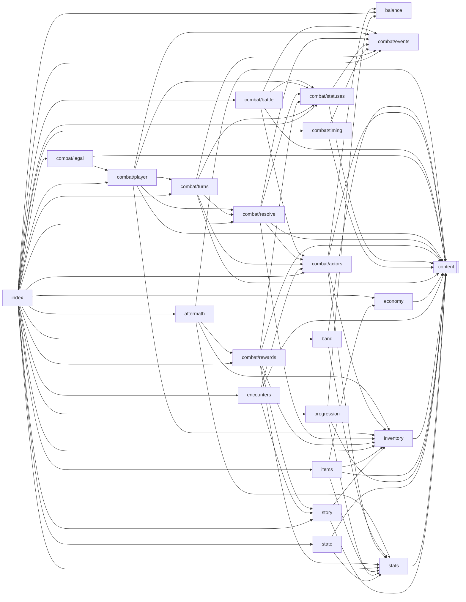

<!-- Generated by tools/codemap.ts. Do not edit by hand: run `npm run docs:codemap`. -->

# Code map: src/engine

The game rules as plain functions over GameState and Battle: stats, progression, inventory, shops, encounters, aftermath, and the combat loop. It mutates in place, draws randomness only from the Rng it is given, and never waits on the UI.

Generated reference. Start with the [guide](../../architecture/code-map.md) for the flows, and the [index](README.md) for how to read these entries.

## Imports inside this area

*Imports of src/core are left out: nearly every file has them. Double-bordered boxes are other areas.*

## Files

| File | Purpose |
|---|---|
| [src/engine/aftermath.ts](#src-engine-aftermath-ts) | What happens to the save after a battle: rewards, story and quest progress, bounties, and the cost of losing. |
| [src/engine/balance.ts](#src-engine-balance-ts) | Balance knobs: enemy scaling, difficulty and the XP curve. |
| [src/engine/band.ts](#src-engine-band-ts) | Bandmates and gear: the loadout rules the menus enforce. |
| [src/engine/combat/actors.ts](#src-engine-combat-actors-ts) | Building actors: the player from the save, enemies and bosses from content. |
| [src/engine/combat/battle.ts](#src-engine-combat-battle-ts) | Starting a battle. |
| [src/engine/combat/events.ts](#src-engine-combat-events-ts) | The tiny shared vocabulary of the combat modules: logging, ending a battle, finding actors. |
| [src/engine/combat/legal.ts](#src-engine-combat-legal-ts) | What the player may do right now. |
| [src/engine/combat/player.ts](#src-engine-combat-player-ts) | The player's side of the pull loop: apply the chosen action, then end the player's turn. |
| [src/engine/combat/resolve.ts](#src-engine-combat-resolve-ts) | The effect resolver and everything it recurses through: targeting, damage, healing, death, boss hit hooks, and the EffectOps that content functions call. |
| [src/engine/combat/rewards.ts](#src-engine-combat-rewards-ts) | What a battle pays out, and writing the battle's results back to the save. |
| [src/engine/combat/statuses.ts](#src-engine-combat-statuses-ts) | Status effects on actors: effective stats, applying, removing, cleansing, stripping. |
| [src/engine/combat/timing.ts](#src-engine-combat-timing-ts) | On the One and Play the Blues: the minigame *rules*. |
| [src/engine/combat/turns.ts](#src-engine-combat-turns-ts) | The turn machinery: rounds, turn order, assists, per-turn status ticks, enemy turns, and the pull loop the presentation layer drives. |
| [src/engine/economy.ts](#src-engine-economy-ts) | Prices. |
| [src/engine/encounters.ts](#src-engine-encounters-ts) | Who you fight on the streets. |
| [src/engine/index.ts](#src-engine-index-ts) | — |
| [src/engine/inventory.ts](#src-engine-inventory-ts) | The bag: counted items with optional carry limits. |
| [src/engine/items.ts](#src-engine-items-ts) | Using items outside battle, and the shop. |
| [src/engine/progression.ts](#src-engine-progression-ts) | XP and levelling. |
| [src/engine/state.ts](#src-engine-state-ts) | Creating a new game. |
| [src/engine/stats.ts](#src-engine-stats-ts) | Character stats: class base + growth, roots, permanent bonuses, gear, buffs, sheet music and bandmate passives. |
| [src/engine/story.ts](#src-engine-story-ts) | Main-quest position helpers. |

## Details

### src/engine/aftermath.ts

What happens to the save after a battle: rewards, story and quest progress, bounties, and the cost of losing. (Moved from v1's UI: legacy/src/07_ui_combat.js runBattle / victoryScreen.)

- Source: [src/engine/aftermath.ts](../../../src/engine/aftermath.ts)
- Imports: core: [ids/enemies](core.md#src-core-ids-enemies-ts), [ids/story](core.md#src-core-ids-story-ts), [types/index](core.md#src-core-types-index-ts) · content: [data](content.md#src-content-data-ts) · engine: [combat/rewards](#src-engine-combat-rewards-ts), [inventory](#src-engine-inventory-ts), [stats](#src-engine-stats-ts)
- Imported by: engine: [index](#src-engine-index-ts)
- Tested by: [rules.test](tests.md#tools-parity-rules-test-ts)
- Types used: **[core/ids/enemies](core.md#src-core-ids-enemies-ts)** [BossId](core.md#src-core-ids-enemies-ts--bossid), [EnemyId](core.md#src-core-ids-enemies-ts--enemyid) · **[core/ids/story](core.md#src-core-ids-story-ts)** [StoryPosition](core.md#src-core-ids-story-ts--storyposition) · **[core/types/battle](core.md#src-core-types-battle-ts)** [Battle](core.md#src-core-types-battle-ts--battle), [VictorySummary](core.md#src-core-types-battle-ts--victorysummary) · **[core/types/content](core.md#src-core-types-content-ts)** [StepDef](core.md#src-core-types-content-ts--stepdef) · **[core/types/state](core.md#src-core-types-state-ts)** [GameState](core.md#src-core-types-state-ts--gamestate)

Declarations:

- **advanceStep** · *function* `(s: GameState): void` — Move the main quest to the next step of the current act.
  - uses: **[core/ids/story](core.md#src-core-ids-story-ts)** [ACT_STEPS](core.md#src-core-ids-story-ts--act-steps)
  - used by: here [resolveVictory](#src-engine-aftermath-ts--resolvevictory)
- **resolveVictory** · *function* `(b: Battle): VictorySummary` — Apply a won battle to the save: Doubloons and drops, then story-step progress (street wins, kills, items), side-quest kill counters, and the bounty.
  - uses: here [advanceStep](#src-engine-aftermath-ts--advancestep) · **[content/bosses/index](content.md#src-content-bosses-index-ts)** [BOSSES](content.md#src-content-bosses-index-ts--bosses) · **[content/districts/index](content.md#src-content-districts-index-ts)** [DISTRICTS](content.md#src-content-districts-index-ts--districts) · **[content/enemies/index](content.md#src-content-enemies-index-ts)** [ENEMIES](content.md#src-content-enemies-index-ts--enemies) · **[content/rules](content.md#src-content-rules-ts)** [QUEST_KILL_COUNTERS](content.md#src-content-rules-ts--quest-kill-counters) · **[content/story/acts](content.md#src-content-story-acts-ts)** [ACTS](content.md#src-content-story-acts-ts--acts) · **[engine/combat/rewards](#src-engine-combat-rewards-ts)** [battleRewards](#src-engine-combat-rewards-ts--battlerewards) · **[engine/inventory](#src-engine-inventory-ts)** [addItem](#src-engine-inventory-ts--additem), [countItem](#src-engine-inventory-ts--countitem)
  - used by: **[app/battleController](app.md#src-app-battlecontroller-ts)** [runBattle](app.md#src-app-battlecontroller-ts--runbattle) · tests: [rules.test](tests.md#tools-parity-rules-test-ts)
- **DefeatSnapshot** · *interface* — The parts of the save a lost boss fight puts back (a boss loss costs nothing; you retry).
  - used by: here [restoreSnapshot](#src-engine-aftermath-ts--restoresnapshot), [takeSnapshot](#src-engine-aftermath-ts--takesnapshot)
- **takeSnapshot** · *function* `(s: GameState): DefeatSnapshot` — Snapshot before a boss fight.
  - used by: **[app/battleController](app.md#src-app-battlecontroller-ts)** [runBattle](app.md#src-app-battlecontroller-ts--runbattle)
- **restoreSnapshot** · *function* `(s: GameState, snap: DefeatSnapshot): void` — Undo a lost boss fight.
  - used by: **[app/battleController](app.md#src-app-battlecontroller-ts)** [runBattle](app.md#src-app-battlecontroller-ts--runbattle)
- **applyStreetDefeat** · *function* `(s: GameState): void` — Losing on the streets: wake up at the club with full Heart, 20% fewer Doubloons, buffs gone.
  - uses: **[content/rules](content.md#src-content-rules-ts)** [STREET_DEFEAT_DOUBLOON_LOSS](content.md#src-content-rules-ts--street-defeat-doubloon-loss) · **[engine/stats](#src-engine-stats-ts)** [derivedStats](#src-engine-stats-ts--derivedstats)
  - used by: **[app/battleController](app.md#src-app-battlecontroller-ts)** [runBattle](app.md#src-app-battlecontroller-ts--runbattle)

### src/engine/balance.ts

Balance knobs: enemy scaling, difficulty and the XP curve. Change these with the sim open (`npm run sim`) and paste the diff into the PR. Per-content numbers (skill multipliers, boss patterns, prices) live with the content; per-hit combat formulas live in combat/resolve.ts.

- Source: [src/engine/balance.ts](../../../src/engine/balance.ts)
- Imports: core: [types/index](core.md#src-core-types-index-ts)
- Imported by: engine: [combat/actors](#src-engine-combat-actors-ts), [index](#src-engine-index-ts), [progression](#src-engine-progression-ts)
- Tested by: [rules.test](tests.md#src-engine-rules-test-ts)
- Types used: **[core/types/state](core.md#src-core-types-state-ts)** [GameState](core.md#src-core-types-state-ts--gamestate)

Declarations:

- **BALANCE** · *const* `= { … } (9 keys)` — Enemy stat scaling.
  - used by: here [enemyBaseStats](#src-engine-balance-ts--enemybasestats) · **[engine/combat/actors](#src-engine-combat-actors-ts)** [makeEnemy](#src-engine-combat-actors-ts--makeenemy)
- **enemyBaseStats** · *function* `(L: number): { hp: number; chops: number; grit: number; tempo: number; mojo: number; }` — An enemy's stats at level L before boss, elite and per-enemy multipliers.
  - uses: here [BALANCE](#src-engine-balance-ts--balance)
  - used by: **[engine/combat/actors](#src-engine-combat-actors-ts)** [makeEnemy](#src-engine-combat-actors-ts--makeenemy)
- **difficultyMods** · *function* `(s: GameState): { dmg: number; hp: number }` — Difficulty setting → enemy damage and Heart multipliers.
  - used by: **[engine/combat/actors](#src-engine-combat-actors-ts)** [makeEnemy](#src-engine-combat-actors-ts--makeenemy)
- **xpToNext** · *function* `(L: number): number` — XP needed to go from level L to L + 1.
  - used by: **[engine/progression](#src-engine-progression-ts)** [gainXp](#src-engine-progression-ts--gainxp) · **[ui/sheets/MenuSheets](ui.md#src-ui-sheets-menusheets-tsx)** [StatusSheet](ui.md#src-ui-sheets-menusheets-tsx--statussheet) · **[tools/parity/tsAdapter](tools.md#tools-parity-tsadapter-ts)** [tsAdapter](tools.md#tools-parity-tsadapter-ts--tsadapter) · tests: [rules.test](tests.md#src-engine-rules-test-ts)

### src/engine/band.ts

Bandmates and gear: the loadout rules the menus enforce.

- Source: [src/engine/band.ts](../../../src/engine/band.ts)
- Imports: core: [ids/band](core.md#src-core-ids-band-ts), [ids/items](core.md#src-core-ids-items-ts), [types/index](core.md#src-core-types-index-ts) · content: [data](content.md#src-content-data-ts) · engine: [stats](#src-engine-stats-ts)
- Imported by: engine: [index](#src-engine-index-ts)
- Tested by: [coverage.test](tests.md#src-engine-combat-coverage-test-ts)
- Types used: **[core/ids/band](core.md#src-core-ids-band-ts)** [BandmateId](core.md#src-core-ids-band-ts--bandmateid) · **[core/ids/items](core.md#src-core-ids-items-ts)** [GearId](core.md#src-core-ids-items-ts--gearid), [GearSlot](core.md#src-core-ids-items-ts--gearslot) · **[core/types/state](core.md#src-core-types-state-ts)** [GameState](core.md#src-core-types-state-ts--gamestate)

Declarations:

- **toggleBandmate** · *function* `(s: GameState, id: BandmateId): { ok: boolean; message?: string }` — Bring or bench a bandmate.
  - uses: **[content/rules](content.md#src-content-rules-ts)** [ACTIVE_BAND_SIZE](content.md#src-content-rules-ts--active-band-size) · **[engine/stats](#src-engine-stats-ts)** [clampVitals](#src-engine-stats-ts--clampvitals)
  - used by: **[app/game](app.md#src-app-game-ts)** [GameApp.toggleBandmate](app.md#src-app-game-ts--gameapp-togglebandmate)
- **gearForSlot** · *function* `(s: GameState, slot: GearSlot): GearId[]` — Owned gear that fits a slot (instruments only for your class).
  - uses: **[content/gear/index](content.md#src-content-gear-index-ts)** [GEAR](content.md#src-content-gear-index-ts--gear)
  - used by: **[ui/sheets/MenuSheets](ui.md#src-ui-sheets-menusheets-tsx)** [SlotSheet](ui.md#src-ui-sheets-menusheets-tsx--slotsheet)
- **equip** · *function* `(s: GameState, id: GearId): void` — Equip a piece of owned gear in its slot.
  - uses: **[content/gear/index](content.md#src-content-gear-index-ts)** [GEAR](content.md#src-content-gear-index-ts--gear) · **[engine/stats](#src-engine-stats-ts)** [clampVitals](#src-engine-stats-ts--clampvitals)
  - used by: **[app/game](app.md#src-app-game-ts)** [GameApp.dev](app.md#src-app-game-ts--gameapp-dev), [GameApp.equip](app.md#src-app-game-ts--gameapp-equip) · tests: [coverage.test](tests.md#src-engine-combat-coverage-test-ts)
- **unequip** · *function* `(s: GameState, slot: Exclude<GearSlot, 'instrument'>): void` — Empty a slot (instruments can't be unequipped).
  - uses: **[engine/stats](#src-engine-stats-ts)** [clampVitals](#src-engine-stats-ts--clampvitals)
  - used by: **[app/game](app.md#src-app-game-ts)** [GameApp.unequip](app.md#src-app-game-ts--gameapp-unequip)

### src/engine/combat/actors.ts

Building actors: the player from the save, enemies and bosses from content.

- Source: [src/engine/combat/actors.ts](../../../src/engine/combat/actors.ts)
- Imports: core: [ids/combat](core.md#src-core-ids-combat-ts), [ids/enemies](core.md#src-core-ids-enemies-ts), [ids/items](core.md#src-core-ids-items-ts), [rng](core.md#src-core-rng-ts), [types/index](core.md#src-core-types-index-ts) · content: [data](content.md#src-content-data-ts) · engine: [balance](#src-engine-balance-ts), [inventory](#src-engine-inventory-ts), [stats](#src-engine-stats-ts)
- Imported by: engine: [combat/battle](#src-engine-combat-battle-ts), [combat/resolve](#src-engine-combat-resolve-ts), [combat/turns](#src-engine-combat-turns-ts), [encounters](#src-engine-encounters-ts), [index](#src-engine-index-ts)
- Tested by: [combat.test](tests.md#src-engine-combat-combat-test-ts), [coverage.test](tests.md#src-engine-combat-coverage-test-ts), [rules.test](tests.md#src-engine-rules-test-ts), [rules.test](tests.md#tools-parity-rules-test-ts)
- Types used: **[core/ids/combat](core.md#src-core-ids-combat-ts)** [SkillId](core.md#src-core-ids-combat-ts--skillid) · **[core/ids/enemies](core.md#src-core-ids-enemies-ts)** [BossId](core.md#src-core-ids-enemies-ts--bossid), [EnemyId](core.md#src-core-ids-enemies-ts--enemyid), [OpponentId](core.md#src-core-ids-enemies-ts--opponentid) · **[core/rng](core.md#src-core-rng-ts)** [Rng](core.md#src-core-rng-ts--rng) · **[core/types/battle](core.md#src-core-types-battle-ts)** [Actor](core.md#src-core-types-battle-ts--actor) · **[core/types/content](core.md#src-core-types-content-ts)** [BossDef](core.md#src-core-types-content-ts--bossdef), [EnemyDef](core.md#src-core-types-content-ts--enemydef) · **[core/types/effects](core.md#src-core-types-effects-ts)** [DamageEffect](core.md#src-core-types-effects-ts--damageeffect) · **[core/types/state](core.md#src-core-types-state-ts)** [GameState](core.md#src-core-types-state-ts--gamestate)

Declarations:

- **actorSeq** · *let, internal* — Process-wide actor counter.
  - used by: here [makeActor](#src-engine-combat-actors-ts--makeactor)
- **makeActor** · *function* `(base: Partial<Actor> & Pick<Actor, 'side' | 'name' | 'level' | 'stats'>): Actor` — Fill in every per-battle field with its starting value.
  - uses: here [actorSeq](#src-engine-combat-actors-ts--actorseq)
  - used by: here [makeEnemy](#src-engine-combat-actors-ts--makeenemy), [makePlayerActor](#src-engine-combat-actors-ts--makeplayeractor) · **[engine/combat/turns](#src-engine-combat-turns-ts)** [runAssists](#src-engine-combat-turns-ts--runassists)
- **riffTone** · *function* `(skill: SkillId): "HOT" | "LOW" | "BLUE" | "FUNK" | "SWEET"` — The tone of a class's riff (its first effect).
  - uses: **[content/combat/skills](content.md#src-content-combat-skills-ts)** [SKILLS](content.md#src-content-combat-skills-ts--skills)
  - used by: here [makeEnemy](#src-engine-combat-actors-ts--makeenemy), [makePlayerActor](#src-engine-combat-actors-ts--makeplayeractor)
- **OpponentRow** · *type, internal* — A boss or enemy row, viewed through the fields both share (the rest are optional).
  - used by: here [makeEnemy](#src-engine-combat-actors-ts--makeenemy)
- **isBossId** · *function* `(id: OpponentId): id is BossId` — Is this opponent id a boss?
  - uses: **[content/bosses/index](content.md#src-content-bosses-index-ts)** [BOSSES](content.md#src-content-bosses-index-ts--bosses)
  - used by: here [makeEnemy](#src-engine-combat-actors-ts--makeenemy)
- **makeEnemy** · *function* `(rng: Rng, s: GameState, defId: OpponentId, level?: number, opts?: { summoned?: boolean }): Actor` — Build an enemy or boss actor.
  - uses: here [isBossId](#src-engine-combat-actors-ts--isbossid), [makeActor](#src-engine-combat-actors-ts--makeactor), [riffTone](#src-engine-combat-actors-ts--rifftone) · **[content/bosses/index](content.md#src-content-bosses-index-ts)** [BOSSES](content.md#src-content-bosses-index-ts--bosses) · **[content/classes/index](content.md#src-content-classes-index-ts)** [CLASSES](content.md#src-content-classes-index-ts--classes) · **[content/combat/skills](content.md#src-content-combat-skills-ts)** [SKILLS](content.md#src-content-combat-skills-ts--skills) · **[content/enemies/index](content.md#src-content-enemies-index-ts)** [ENEMIES](content.md#src-content-enemies-index-ts--enemies) · **[content/rules](content.md#src-content-rules-ts)** [SKILL_LEVELS](content.md#src-content-rules-ts--skill-levels) · **[core/rng](core.md#src-core-rng-ts)** [Rng.int](core.md#src-core-rng-ts--rng-int), [Rng.pick](core.md#src-core-rng-ts--rng-pick) · **[engine/balance](#src-engine-balance-ts)** [BALANCE](#src-engine-balance-ts--balance), [difficultyMods](#src-engine-balance-ts--difficultymods), [enemyBaseStats](#src-engine-balance-ts--enemybasestats)
  - used by: **[app/battleController](app.md#src-app-battlecontroller-ts)** [runBattle](app.md#src-app-battlecontroller-ts--runbattle) · **[engine/combat/resolve](#src-engine-combat-resolve-ts)** [makeOps](#src-engine-combat-resolve-ts--makeops) · **[engine/encounters](#src-engine-encounters-ts)** [buildEnemies](#src-engine-encounters-ts--buildenemies) · **[tools/parity/tsAdapter](tools.md#tools-parity-tsadapter-ts)** [tsAdapter](tools.md#tools-parity-tsadapter-ts--tsadapter) · **[tools/sim](tools.md#tools-sim-ts)** [runClick](tools.md#tools-sim-ts--runclick), [runFight](tools.md#tools-sim-ts--runfight) · **[tools/trace](tools.md#tools-trace-ts)** [b](tools.md#tools-trace-ts--b) · tests: [combat.test](tests.md#src-engine-combat-combat-test-ts), [coverage.test](tests.md#src-engine-combat-coverage-test-ts), [rules.test](tests.md#src-engine-rules-test-ts), [rules.test](tests.md#tools-parity-rules-test-ts)
- **carriedRevive** · *function, internal* `(s: GameState): Actor['revive']` — The first carried item that revives (Gris-Gris), if any.
  - uses: **[content/items](content.md#src-content-items-ts)** [ITEMS](content.md#src-content-items-ts--items) · **[core/ids/items](core.md#src-core-ids-items-ts)** [ITEM_IDS](core.md#src-core-ids-items-ts--item-ids) · **[engine/inventory](#src-engine-inventory-ts)** [countItem](#src-engine-inventory-ts--countitem)
  - used by: here [makePlayerActor](#src-engine-combat-actors-ts--makeplayeractor)
- **makePlayerActor** · *function* `(s: GameState): Actor` — Build the player's actor from the save: derived stats, unlocked skills and passives.
  - uses: here [carriedRevive](#src-engine-combat-actors-ts--carriedrevive), [makeActor](#src-engine-combat-actors-ts--makeactor), [riffTone](#src-engine-combat-actors-ts--rifftone) · **[content/classes/index](content.md#src-content-classes-index-ts)** [CLASSES](content.md#src-content-classes-index-ts--classes) · **[engine/stats](#src-engine-stats-ts)** [activePassives](#src-engine-stats-ts--activepassives), [derivedStats](#src-engine-stats-ts--derivedstats), [unlockedSkills](#src-engine-stats-ts--unlockedskills)
  - used by: **[app/sceneContext](app.md#src-app-scenecontext-ts)** [createSceneContext](app.md#src-app-scenecontext-ts--createscenecontext) · **[engine/combat/battle](#src-engine-combat-battle-ts)** [createBattle](#src-engine-combat-battle-ts--createbattle) · tests: [coverage.test](tests.md#src-engine-combat-coverage-test-ts)

### src/engine/combat/battle.ts

Starting a battle.

- Source: [src/engine/combat/battle.ts](../../../src/engine/combat/battle.ts)
- Imports: core: [helpers](core.md#src-core-helpers-ts), [rng](core.md#src-core-rng-ts), [types/index](core.md#src-core-types-index-ts) · content: [data](content.md#src-content-data-ts) · engine: [combat/actors](#src-engine-combat-actors-ts), [combat/events](#src-engine-combat-events-ts), [combat/statuses](#src-engine-combat-statuses-ts)
- Imported by: engine: [index](#src-engine-index-ts)
- Tested by: [combat.test](tests.md#src-engine-combat-combat-test-ts), [coverage.test](tests.md#src-engine-combat-coverage-test-ts), [rules.test](tests.md#src-engine-rules-test-ts), [rules.test](tests.md#tools-parity-rules-test-ts)
- Types used: **[core/rng](core.md#src-core-rng-ts)** [Rng](core.md#src-core-rng-ts--rng) · **[core/types/battle](core.md#src-core-types-battle-ts)** [Actor](core.md#src-core-types-battle-ts--actor), [Battle](core.md#src-core-types-battle-ts--battle), [BattleOptions](core.md#src-core-types-battle-ts--battleoptions) · **[core/types/state](core.md#src-core-types-state-ts)** [GameState](core.md#src-core-types-state-ts--gamestate)

Declarations:

- **createBattle** · *function* `(rng: Rng, s: GameState, enemyActors: Actor[], opts?: BattleOptions): Battle` — Create a battle against already-built enemy actors.
  - uses: **[content/bosses/index](content.md#src-content-bosses-index-ts)** [BOSSES](content.md#src-content-bosses-index-ts--bosses) · **[core/helpers](core.md#src-core-helpers-ts)** [clamp](core.md#src-core-helpers-ts--clamp) · **[engine/combat/actors](#src-engine-combat-actors-ts)** [makePlayerActor](#src-engine-combat-actors-ts--makeplayeractor) · **[engine/combat/events](#src-engine-combat-events-ts)** [logLine](#src-engine-combat-events-ts--logline), [recordSeen](#src-engine-combat-events-ts--recordseen) · **[engine/combat/statuses](#src-engine-combat-statuses-ts)** [applyStatusRaw](#src-engine-combat-statuses-ts--applystatusraw)
  - used by: **[app/battleController](app.md#src-app-battlecontroller-ts)** [runBattle](app.md#src-app-battlecontroller-ts--runbattle) · **[tools/parity/tsAdapter](tools.md#tools-parity-tsadapter-ts)** [tsAdapter](tools.md#tools-parity-tsadapter-ts--tsadapter) · **[tools/sim](tools.md#tools-sim-ts)** [runClick](tools.md#tools-sim-ts--runclick), [runFight](tools.md#tools-sim-ts--runfight) · **[tools/trace](tools.md#tools-trace-ts)** [b](tools.md#tools-trace-ts--b) · tests: [combat.test](tests.md#src-engine-combat-combat-test-ts), [coverage.test](tests.md#src-engine-combat-coverage-test-ts), [rules.test](tests.md#src-engine-rules-test-ts), [rules.test](tests.md#tools-parity-rules-test-ts)

### src/engine/combat/events.ts

The tiny shared vocabulary of the combat modules: logging, ending a battle, finding actors. Kept dependency-free so every other combat module can import it without cycles.

- Source: [src/engine/combat/events.ts](../../../src/engine/combat/events.ts)
- Imports: core: [ids/enemies](core.md#src-core-ids-enemies-ts), [types/index](core.md#src-core-types-index-ts)
- Imported by: engine: [combat/battle](#src-engine-combat-battle-ts), [combat/player](#src-engine-combat-player-ts), [combat/resolve](#src-engine-combat-resolve-ts), [combat/statuses](#src-engine-combat-statuses-ts), [combat/timing](#src-engine-combat-timing-ts), [combat/turns](#src-engine-combat-turns-ts), [index](#src-engine-index-ts)
- Types used: **[core/ids/enemies](core.md#src-core-ids-enemies-ts)** [OpponentId](core.md#src-core-ids-enemies-ts--opponentid) · **[core/types/battle](core.md#src-core-types-battle-ts)** [Actor](core.md#src-core-types-battle-ts--actor), [Battle](core.md#src-core-types-battle-ts--battle), [BattleResult](core.md#src-core-types-battle-ts--battleresult), [LogClass](core.md#src-core-types-battle-ts--logclass) · **[core/types/state](core.md#src-core-types-state-ts)** [GameState](core.md#src-core-types-state-ts--gamestate)

Declarations:

- **logLine** · *function* `(b: Battle, text: string, cls?: LogClass): void` — Append a battle-log line.
  - used by: **[app/battleController](app.md#src-app-battlecontroller-ts)** [runBattle](app.md#src-app-battlecontroller-ts--runbattle) · **[engine/combat/battle](#src-engine-combat-battle-ts)** [createBattle](#src-engine-combat-battle-ts--createbattle) · **[engine/combat/player](#src-engine-combat-player-ts)** [playTheBlues](#src-engine-combat-player-ts--playtheblues), [playerAction](#src-engine-combat-player-ts--playeraction) · **[engine/combat/resolve](#src-engine-combat-resolve-ts)** [bossHpHooks](#src-engine-combat-resolve-ts--bosshphooks), [checkDeath](#src-engine-combat-resolve-ts--checkdeath), [dealHit](#src-engine-combat-resolve-ts--dealhit), [healActor](#src-engine-combat-resolve-ts--healactor), [makeOps](#src-engine-combat-resolve-ts--makeops), [resolveSkill](#src-engine-combat-resolve-ts--resolveskill) · **[engine/combat/statuses](#src-engine-combat-statuses-ts)** [applyStatus](#src-engine-combat-statuses-ts--applystatus), [stripBuffs](#src-engine-combat-statuses-ts--stripbuffs) · **[engine/combat/timing](#src-engine-combat-timing-ts)** [announceTiming](#src-engine-combat-timing-ts--announcetiming) · **[engine/combat/turns](#src-engine-combat-turns-ts)** [beginTurn](#src-engine-combat-turns-ts--beginturn), [enemyAct](#src-engine-combat-turns-ts--enemyact), [runAssists](#src-engine-combat-turns-ts--runassists)
- **endBattle** · *function* `(b: Battle, result: BattleResult): void` — End the battle (first result wins; later calls are ignored).
  - used by: **[engine/combat/player](#src-engine-combat-player-ts)** [playerAction](#src-engine-combat-player-ts--playeraction) · **[engine/combat/resolve](#src-engine-combat-resolve-ts)** [checkDeath](#src-engine-combat-resolve-ts--checkdeath)
- **recordSeen** · *function* `(s: GameState, defId: OpponentId): void` — Mark an opponent as seen in the Blue Book.
  - used by: **[engine/combat/battle](#src-engine-combat-battle-ts)** [createBattle](#src-engine-combat-battle-ts--createbattle) · **[engine/combat/resolve](#src-engine-combat-resolve-ts)** [makeOps](#src-engine-combat-resolve-ts--makeops)
- **actorById** · *function* `(b: Battle, id: string | undefined): Actor | undefined` — The player or enemy with this id.
  - used by: **[engine/combat/player](#src-engine-combat-player-ts)** [playerAction](#src-engine-combat-player-ts--playeraction) · **[engine/combat/resolve](#src-engine-combat-resolve-ts)** [targetOf](#src-engine-combat-resolve-ts--targetof) · **[engine/combat/turns](#src-engine-combat-turns-ts)** [runUntilPlayer](#src-engine-combat-turns-ts--rununtilplayer)

### src/engine/combat/legal.ts

What the player may do right now. The UI offers exactly these, so it never re-implements rules (v1 duplicated these checks in its UI layer).

- Source: [src/engine/combat/legal.ts](../../../src/engine/combat/legal.ts)
- Imports: core: [helpers](core.md#src-core-helpers-ts), [ids/combat](core.md#src-core-ids-combat-ts), [ids/enemies](core.md#src-core-ids-enemies-ts), [types/index](core.md#src-core-types-index-ts) · content: [data](content.md#src-content-data-ts) · engine: [combat/player](#src-engine-combat-player-ts)
- Imported by: engine: [index](#src-engine-index-ts)
- Tested by: [coverage.test](tests.md#src-engine-combat-coverage-test-ts)
- Types used: **[core/ids/combat](core.md#src-core-ids-combat-ts)** [SkillId](core.md#src-core-ids-combat-ts--skillid) · **[core/ids/enemies](core.md#src-core-ids-enemies-ts)** [BossId](core.md#src-core-ids-enemies-ts--bossid) · **[core/types/battle](core.md#src-core-types-battle-ts)** [Battle](core.md#src-core-types-battle-ts--battle)

Declarations:

- **SkillChoice** · *interface* — A skill as the skill picker shows it.
  - used by: here [LegalActions](#src-engine-combat-legal-ts--legalactions)
- **LegalActions** · *interface* — The actions on offer this turn.
  - used by: here [legalActions](#src-engine-combat-legal-ts--legalactions) · **[app/view](app.md#src-app-view-ts)** [BattleView](app.md#src-app-view-ts--battleview)
- **skillNeedsTarget** · *function* `(id: SkillId): boolean` — Does this skill hit one chosen enemy (so the UI must ask which)?
  - uses: **[content/combat/skills](content.md#src-content-combat-skills-ts)** [SKILLS](content.md#src-content-combat-skills-ts--skills)
  - used by: here [legalActions](#src-engine-combat-legal-ts--legalactions)
- **legalActions** · *function* `(b: Battle): LegalActions` — Everything the action bar needs to know.
  - uses: here [skillNeedsTarget](#src-engine-combat-legal-ts--skillneedstarget) · **[content/bosses/index](content.md#src-content-bosses-index-ts)** [BOSSES](content.md#src-content-bosses-index-ts--bosses) · **[content/combat/skills](content.md#src-content-combat-skills-ts)** [SKILLS](content.md#src-content-combat-skills-ts--skills) · **[core/helpers](core.md#src-core-helpers-ts)** [hasStatus](core.md#src-core-helpers-ts--hasstatus), [livingEnemies](core.md#src-core-helpers-ts--livingenemies) · **[engine/combat/player](#src-engine-combat-player-ts)** [playerCanSolo](#src-engine-combat-player-ts--playercansolo)
  - used by: **[app/reactPresenter](app.md#src-app-reactpresenter-ts)** [ReactPresenter.battle](app.md#src-app-reactpresenter-ts--reactpresenter-battle) · **[app/testing/scriptedPresenter](app.md#src-app-testing-scriptedpresenter-ts)** [defaultIntent](app.md#src-app-testing-scriptedpresenter-ts--defaultintent) · tests: [coverage.test](tests.md#src-engine-combat-coverage-test-ts)

### src/engine/combat/player.ts

The player's side of the pull loop: apply the chosen action, then end the player's turn. Illegal actions (Muted PLAY, not enough Funk, a once-per-battle skill reused…) log why and still use up the turn, as in v1. The UI should offer only legal actions (see legal.ts).

- Source: [src/engine/combat/player.ts](../../../src/engine/combat/player.ts)
- Imports: core: [helpers](core.md#src-core-helpers-ts), [ids/enemies](core.md#src-core-ids-enemies-ts), [types/index](core.md#src-core-types-index-ts) · content: [data](content.md#src-content-data-ts) · engine: [combat/events](#src-engine-combat-events-ts), [combat/resolve](#src-engine-combat-resolve-ts), [combat/statuses](#src-engine-combat-statuses-ts), [combat/turns](#src-engine-combat-turns-ts), [inventory](#src-engine-inventory-ts)
- Imported by: engine: [combat/legal](#src-engine-combat-legal-ts), [index](#src-engine-index-ts)
- Tested by: [combat.test](tests.md#src-engine-combat-combat-test-ts), [coverage.test](tests.md#src-engine-combat-coverage-test-ts)
- Types used: **[core/ids/enemies](core.md#src-core-ids-enemies-ts)** [BossId](core.md#src-core-ids-enemies-ts--bossid) · **[core/types/battle](core.md#src-core-types-battle-ts)** [Battle](core.md#src-core-types-battle-ts--battle), [PlayerIntent](core.md#src-core-types-battle-ts--playerintent), [TimingResult](core.md#src-core-types-battle-ts--timingresult)

Declarations:

- **playerCanSolo** · *function* `(b: Battle): boolean` — SOLO needs 100 Groove and not being Muted.
  - uses: **[core/helpers](core.md#src-core-helpers-ts)** [hasStatus](core.md#src-core-helpers-ts--hasstatus)
  - used by: here [playerAction](#src-engine-combat-player-ts--playeraction) · **[engine/combat/legal](#src-engine-combat-legal-ts)** [legalActions](#src-engine-combat-legal-ts--legalactions) · **[tools/sim](tools.md#tools-sim-ts)** [chooseAction](tools.md#tools-sim-ts--chooseaction)
- **playerAction** · *function* `(b: Battle, action: PlayerIntent, timing: TimingResult | null): void` — Apply the player's action.
  - uses: here [finishPlayerTurn](#src-engine-combat-player-ts--finishplayerturn), [playTheBlues](#src-engine-combat-player-ts--playtheblues), [playerCanSolo](#src-engine-combat-player-ts--playercansolo) · **[content/combat/skills](content.md#src-content-combat-skills-ts)** [SKILLS](content.md#src-content-combat-skills-ts--skills) · **[content/items](content.md#src-content-items-ts)** [ITEMS](content.md#src-content-items-ts--items) · **[core/helpers](core.md#src-core-helpers-ts)** [clamp](core.md#src-core-helpers-ts--clamp), [hasStatus](core.md#src-core-helpers-ts--hasstatus), [livingEnemies](core.md#src-core-helpers-ts--livingenemies) · **[core/rng](core.md#src-core-rng-ts)** [Rng.chance](core.md#src-core-rng-ts--rng-chance) · **[engine/combat/events](#src-engine-combat-events-ts)** [actorById](#src-engine-combat-events-ts--actorbyid), [endBattle](#src-engine-combat-events-ts--endbattle), [logLine](#src-engine-combat-events-ts--logline) · **[engine/combat/resolve](#src-engine-combat-resolve-ts)** [resolveSkill](#src-engine-combat-resolve-ts--resolveskill) · **[engine/combat/statuses](#src-engine-combat-statuses-ts)** [effStat](#src-engine-combat-statuses-ts--effstat) · **[engine/inventory](#src-engine-inventory-ts)** [countItem](#src-engine-inventory-ts--countitem), [removeItem](#src-engine-inventory-ts--removeitem)
  - used by: **[app/battleController](app.md#src-app-battlecontroller-ts)** [runBattle](app.md#src-app-battlecontroller-ts--runbattle) · **[tools/parity/tsAdapter](tools.md#tools-parity-tsadapter-ts)** [tsAdapter](tools.md#tools-parity-tsadapter-ts--tsadapter) · **[tools/sim](tools.md#tools-sim-ts)** [runClick](tools.md#tools-sim-ts--runclick), [runFight](tools.md#tools-sim-ts--runfight) · **[tools/trace](tools.md#tools-trace-ts)** [(top level)](tools.md#tools-trace-ts--top-level) · tests: [combat.test](tests.md#src-engine-combat-combat-test-ts), [coverage.test](tests.md#src-engine-combat-coverage-test-ts)
- **finishPlayerTurn** · *function* `(b: Battle, acted: boolean): void` — Advance the Big Four beat (if the player acted) and end the player's turn.
  - uses: **[engine/combat/turns](#src-engine-combat-turns-ts)** [endTurn](#src-engine-combat-turns-ts--endturn)
  - used by: here [playTheBlues](#src-engine-combat-player-ts--playtheblues), [playerAction](#src-engine-combat-player-ts--playeraction)
- **playTheBlues** · *function* `(b: Battle, accuracy: number): void` — The finale's signature move.
  - uses: here [finishPlayerTurn](#src-engine-combat-player-ts--finishplayerturn) · **[content/bosses/index](content.md#src-content-bosses-index-ts)** [BOSSES](content.md#src-content-bosses-index-ts--bosses) · **[content/combat/timing](content.md#src-content-combat-timing-ts)** [TIMING](content.md#src-content-combat-timing-ts--timing) · **[core/helpers](core.md#src-core-helpers-ts)** [hasStatus](core.md#src-core-helpers-ts--hasstatus) · **[engine/combat/events](#src-engine-combat-events-ts)** [logLine](#src-engine-combat-events-ts--logline) · **[engine/combat/resolve](#src-engine-combat-resolve-ts)** [bossHpHooks](#src-engine-combat-resolve-ts--bosshphooks), [checkDeath](#src-engine-combat-resolve-ts--checkdeath), [dealHit](#src-engine-combat-resolve-ts--dealhit) · **[engine/combat/statuses](#src-engine-combat-statuses-ts)** [removeStatus](#src-engine-combat-statuses-ts--removestatus)
  - used by: here [playerAction](#src-engine-combat-player-ts--playeraction)

### src/engine/combat/resolve.ts

The effect resolver and everything it recurses through: targeting, damage, healing, death, boss hit hooks, and the EffectOps that content functions call.

- Source: [src/engine/combat/resolve.ts](../../../src/engine/combat/resolve.ts)
- Imports: core: [helpers](core.md#src-core-helpers-ts), [ids/combat](core.md#src-core-ids-combat-ts), [ids/enemies](core.md#src-core-ids-enemies-ts), [rng](core.md#src-core-rng-ts), [types/index](core.md#src-core-types-index-ts) · content: [data](content.md#src-content-data-ts) · engine: [combat/actors](#src-engine-combat-actors-ts), [combat/events](#src-engine-combat-events-ts), [combat/statuses](#src-engine-combat-statuses-ts), [inventory](#src-engine-inventory-ts)
- Imported by: engine: [combat/player](#src-engine-combat-player-ts), [combat/turns](#src-engine-combat-turns-ts), [index](#src-engine-index-ts) · tools: [validate-content](tools.md#tools-validate-content-ts)
- Tested by: [coverage.test](tests.md#src-engine-combat-coverage-test-ts)
- Types used: **[core/ids/combat](core.md#src-core-ids-combat-ts)** [StatusId](core.md#src-core-ids-combat-ts--statusid) · **[core/ids/enemies](core.md#src-core-ids-enemies-ts)** [BossId](core.md#src-core-ids-enemies-ts--bossid) · **[core/rng](core.md#src-core-rng-ts)** [Rng](core.md#src-core-rng-ts--rng) · **[core/types/battle](core.md#src-core-types-battle-ts)** [Actor](core.md#src-core-types-battle-ts--actor), [Battle](core.md#src-core-types-battle-ts--battle), [TimingResult](core.md#src-core-types-battle-ts--timingresult) · **[core/types/content](core.md#src-core-types-content-ts)** [BossCtx](core.md#src-core-types-content-ts--bossctx), [Castable](core.md#src-core-types-content-ts--castable), [TimingGradeDef](core.md#src-core-types-content-ts--timinggradedef) · **[core/types/effects](core.md#src-core-types-effects-ts)** [DamageEffect](core.md#src-core-types-effects-ts--damageeffect), [EffectCtx](core.md#src-core-types-effects-ts--effectctx), [EffectOps](core.md#src-core-types-effects-ts--effectops), [TargetMode](core.md#src-core-types-effects-ts--targetmode)

Declarations:

- **ResolveCtx** · *interface* — Per-action context threaded through the resolver.
  - used by: here [dealHit](#src-engine-combat-resolve-ts--dealhit), [resolveSkill](#src-engine-combat-resolve-ts--resolveskill)
- **HitSpec** · *type* `= Partial<Omit<DamageEffect, 'kind' | 'cond'>>` — The fields of a damage effect dealHit reads.
  - used by: here [critChance](#src-engine-combat-resolve-ts--critchance), [dealHit](#src-engine-combat-resolve-ts--dealhit), [dodgeChance](#src-engine-combat-resolve-ts--dodgechance)
- **HitResult** · *interface* — The outcome of one hit.
  - used by: here [dealHit](#src-engine-combat-resolve-ts--dealhit)
- **makeOps** · *function* `(b: Battle, actor: Actor): EffectOps` — EffectOps bound to an actor: what custom effects and boss hooks may do to the battle.
  - uses: here [resolveSkill](#src-engine-combat-resolve-ts--resolveskill), [rollAutoTiming](#src-engine-combat-resolve-ts--rollautotiming) · **[content/combat/skills](content.md#src-content-combat-skills-ts)** [SKILLS](content.md#src-content-combat-skills-ts--skills) · **[content/combat/statuses](content.md#src-content-combat-statuses-ts)** [STATUSES](content.md#src-content-combat-statuses-ts--statuses) · **[content/rules](content.md#src-content-rules-ts)** [BASIC_ATTACK](content.md#src-content-rules-ts--basic-attack) · **[core/helpers](core.md#src-core-helpers-ts)** [hasStatus](core.md#src-core-helpers-ts--hasstatus), [livingEnemies](core.md#src-core-helpers-ts--livingenemies) · **[core/rng](core.md#src-core-rng-ts)** [Rng.int](core.md#src-core-rng-ts--rng-int), [Rng.pick](core.md#src-core-rng-ts--rng-pick) · **[engine/combat/actors](#src-engine-combat-actors-ts)** [makeEnemy](#src-engine-combat-actors-ts--makeenemy) · **[engine/combat/events](#src-engine-combat-events-ts)** [logLine](#src-engine-combat-events-ts--logline), [recordSeen](#src-engine-combat-events-ts--recordseen) · **[engine/combat/statuses](#src-engine-combat-statuses-ts)** [applyStatus](#src-engine-combat-statuses-ts--applystatus), [applyStatusRaw](#src-engine-combat-statuses-ts--applystatusraw)
  - used by: here [bossCtx](#src-engine-combat-resolve-ts--bossctx), [effectCtx](#src-engine-combat-resolve-ts--effectctx)
- **effectCtx** · *function, internal* `(b: Battle, actor: Actor, target: Actor | null | undefined): EffectCtx` — The context a content function receives while acting as `actor`.
  - uses: here [makeOps](#src-engine-combat-resolve-ts--makeops)
  - used by: here [dealHit](#src-engine-combat-resolve-ts--dealhit), [resolveSkill](#src-engine-combat-resolve-ts--resolveskill)
- **bossCtx** · *function* `(b: Battle, self: Actor): BossCtx` — The context boss hooks receive.
  - uses: here [makeOps](#src-engine-combat-resolve-ts--makeops)
  - used by: here [bossHpHooks](#src-engine-combat-resolve-ts--bosshphooks) · **[engine/combat/turns](#src-engine-combat-turns-ts)** [beginTurn](#src-engine-combat-turns-ts--beginturn), [enemyAct](#src-engine-combat-turns-ts--enemyact)
- **rollAutoTiming** · *function* `(rng: Rng): TimingGradeDef` — Auto-rhythm timing: 20% ONE, 50% pocket, 25% loose, 5% clams.
  - uses: **[content/combat/timing](content.md#src-content-combat-timing-ts)** [TIMING](content.md#src-content-combat-timing-ts--timing) · **[core/rng](core.md#src-core-rng-ts)** [Rng.next](core.md#src-core-rng-ts--rng-next)
  - used by: here [makeOps](#src-engine-combat-resolve-ts--makeops) · **[app/battleController](app.md#src-app-battlecontroller-ts)** [runBattle](app.md#src-app-battlecontroller-ts--runbattle) · **[app/sceneContext](app.md#src-app-scenecontext-ts)** [createSceneContext](app.md#src-app-scenecontext-ts--createscenecontext) · **[engine/combat/turns](#src-engine-combat-turns-ts)** [enemyAct](#src-engine-combat-turns-ts--enemyact) · tests: [coverage.test](tests.md#src-engine-combat-coverage-test-ts)
- **critChance** · *function* `(a: Actor, fx: HitSpec): number` — Crit chance: 5% + 0.4% per Mojo (max 35%), plus gear and skill bonuses, +25% In the Pocket.
  - uses: **[core/helpers](core.md#src-core-helpers-ts)** [hasStatus](core.md#src-core-helpers-ts--hasstatus) · **[engine/combat/statuses](#src-engine-combat-statuses-ts)** [effStat](#src-engine-combat-statuses-ts--effstat)
  - used by: here [dealHit](#src-engine-combat-resolve-ts--dealhit)
- **dodgeChance** · *function* `(att: Actor, def: Actor, fx: HitSpec): number` — Dodge chance: 5% ± 1% per Tempo difference (0–25%), plus dodge bonuses (max 50%).
  - uses: **[core/helpers](core.md#src-core-helpers-ts)** [clamp](core.md#src-core-helpers-ts--clamp) · **[engine/combat/statuses](#src-engine-combat-statuses-ts)** [effStat](#src-engine-combat-statuses-ts--effstat)
  - used by: here [dealHit](#src-engine-combat-resolve-ts--dealhit)
- **dealHit** · *function* `(b: Battle, att: Actor, def: Actor, fx: HitSpec, timing: TimingResult | null, ctx?: ResolveCtx): HitResult | null` — One hit from `att` on `def`.
  - uses: here [bossHpHooks](#src-engine-combat-resolve-ts--bosshphooks), [checkDeath](#src-engine-combat-resolve-ts--checkdeath), [critChance](#src-engine-combat-resolve-ts--critchance), [dodgeChance](#src-engine-combat-resolve-ts--dodgechance), [effectCtx](#src-engine-combat-resolve-ts--effectctx), [healActor](#src-engine-combat-resolve-ts--healactor) · **[core/helpers](core.md#src-core-helpers-ts)** [clamp](core.md#src-core-helpers-ts--clamp), [hasStatus](core.md#src-core-helpers-ts--hasstatus) · **[core/rng](core.md#src-core-rng-ts)** [Rng.chance](core.md#src-core-rng-ts--rng-chance), [Rng.float](core.md#src-core-rng-ts--rng-float) · **[core/types/effects](core.md#src-core-types-effects-ts)** [DamageEffect.mult](core.md#src-core-types-effects-ts--damageeffect-mult) · **[engine/combat/events](#src-engine-combat-events-ts)** [logLine](#src-engine-combat-events-ts--logline) · **[engine/combat/statuses](#src-engine-combat-statuses-ts)** [effStat](#src-engine-combat-statuses-ts--effstat), [removeStatus](#src-engine-combat-statuses-ts--removestatus)
  - used by: here [resolveSkill](#src-engine-combat-resolve-ts--resolveskill) · **[engine/combat/player](#src-engine-combat-player-ts)** [playTheBlues](#src-engine-combat-player-ts--playtheblues)
- **healActor** · *function* `(b: Battle, a: Actor, amount: number): number` — Heal an actor (Sugar's bonus applies to the player).
  - uses: **[engine/combat/events](#src-engine-combat-events-ts)** [logLine](#src-engine-combat-events-ts--logline)
  - used by: here [dealHit](#src-engine-combat-resolve-ts--dealhit), [resolveSkill](#src-engine-combat-resolve-ts--resolveskill) · **[engine/combat/turns](#src-engine-combat-turns-ts)** [beginTurn](#src-engine-combat-turns-ts--beginturn)
- **checkDeath** · *function* `(b: Battle, a: Actor): void` — Handle an actor at 0 Heart.
  - uses: **[content/bosses/index](content.md#src-content-bosses-index-ts)** [BOSSES](content.md#src-content-bosses-index-ts--bosses) · **[core/helpers](core.md#src-core-helpers-ts)** [livingEnemies](core.md#src-core-helpers-ts--livingenemies) · **[engine/combat/events](#src-engine-combat-events-ts)** [endBattle](#src-engine-combat-events-ts--endbattle), [logLine](#src-engine-combat-events-ts--logline) · **[engine/inventory](#src-engine-inventory-ts)** [removeItem](#src-engine-inventory-ts--removeitem)
  - used by: here [dealHit](#src-engine-combat-resolve-ts--dealhit) · **[engine/combat/player](#src-engine-combat-player-ts)** [playTheBlues](#src-engine-combat-player-ts--playtheblues) · **[engine/combat/turns](#src-engine-combat-turns-ts)** [beginTurn](#src-engine-combat-turns-ts--beginturn)
- **bossHpHooks** · *function* `(b: Battle, a: Actor): void` — The boss's half-Heart line and hook, and its per-hit hook.
  - uses: here [bossCtx](#src-engine-combat-resolve-ts--bossctx) · **[content/bosses/index](content.md#src-content-bosses-index-ts)** [BOSSES](content.md#src-content-bosses-index-ts--bosses) · **[core/types/content](core.md#src-core-types-content-ts)** [BossDef.onHalf](core.md#src-core-types-content-ts--bossdef-onhalf), [BossDef.onHp](core.md#src-core-types-content-ts--bossdef-onhp) · **[engine/combat/events](#src-engine-combat-events-ts)** [logLine](#src-engine-combat-events-ts--logline)
  - used by: here [dealHit](#src-engine-combat-resolve-ts--dealhit) · **[engine/combat/player](#src-engine-combat-player-ts)** [playTheBlues](#src-engine-combat-player-ts--playtheblues)
- **pickTargets** · *function* `(b: Battle, actor: Actor, fx: { target?: TargetMode }, chosen: Actor | null | undefined): Actor[]` — Who an effect hits.
  - uses: **[core/helpers](core.md#src-core-helpers-ts)** [livingEnemies](core.md#src-core-helpers-ts--livingenemies) · **[core/rng](core.md#src-core-rng-ts)** [Rng.pick](core.md#src-core-rng-ts--rng-pick)
  - used by: here [resolveSkill](#src-engine-combat-resolve-ts--resolveskill)
- **resolveSkill** · *function* `(b: Battle, actor: Actor, skill: Castable, chosen: Actor | null | undefined, timing: TimingResult | null, ctx?: ResolveCtx): void` — Resolve a skill, move, assist or item: run its effects in order for `actor`, aimed at `chosen`.
  - uses: here [dealHit](#src-engine-combat-resolve-ts--dealhit), [effectCtx](#src-engine-combat-resolve-ts--effectctx), [healActor](#src-engine-combat-resolve-ts--healactor), [pickTargets](#src-engine-combat-resolve-ts--picktargets) · **[core/helpers](core.md#src-core-helpers-ts)** [clamp](core.md#src-core-helpers-ts--clamp) · **[core/rng](core.md#src-core-rng-ts)** [Rng.int](core.md#src-core-rng-ts--rng-int) · **[core/types/effects](core.md#src-core-types-effects-ts)** [CustomEffect.run](core.md#src-core-types-effects-ts--customeffect-run), [EffectBase.cond](core.md#src-core-types-effects-ts--effectbase-cond) · **[engine/combat/events](#src-engine-combat-events-ts)** [logLine](#src-engine-combat-events-ts--logline) · **[engine/combat/statuses](#src-engine-combat-statuses-ts)** [applyStatus](#src-engine-combat-statuses-ts--applystatus), [cleanse](#src-engine-combat-statuses-ts--cleanse), [stripBuffs](#src-engine-combat-statuses-ts--stripbuffs)
  - used by: here [makeOps](#src-engine-combat-resolve-ts--makeops) · **[engine/combat/player](#src-engine-combat-player-ts)** [playerAction](#src-engine-combat-player-ts--playeraction) · **[engine/combat/turns](#src-engine-combat-turns-ts)** [enemyAct](#src-engine-combat-turns-ts--enemyact), [runAssists](#src-engine-combat-turns-ts--runassists) · tests: [coverage.test](tests.md#src-engine-combat-coverage-test-ts)
- **targetOf** · *function* `(b: Battle, id: string | undefined): Actor | undefined` — Resolve by actor id (for player intents).
  - uses: **[engine/combat/events](#src-engine-combat-events-ts)** [actorById](#src-engine-combat-events-ts--actorbyid)
  - *no references found*
- **MECHANIC_STATUSES** · *const* `: readonly StatusId[]` — Status ids with engine-implemented mechanics.
  - used by: **[tools/validate-content](tools.md#tools-validate-content-ts)** [validateContent](tools.md#tools-validate-content-ts--validatecontent)

### src/engine/combat/rewards.ts

What a battle pays out, and writing the battle's results back to the save.

- Source: [src/engine/combat/rewards.ts](../../../src/engine/combat/rewards.ts)
- Imports: core: [ids/items](core.md#src-core-ids-items-ts), [types/index](core.md#src-core-types-index-ts) · content: [data](content.md#src-content-data-ts) · engine: [combat/statuses](#src-engine-combat-statuses-ts), [inventory](#src-engine-inventory-ts), [stats](#src-engine-stats-ts), [story](#src-engine-story-ts)
- Imported by: engine: [aftermath](#src-engine-aftermath-ts), [index](#src-engine-index-ts)
- Types used: **[core/ids/items](core.md#src-core-ids-items-ts)** [ItemId](core.md#src-core-ids-items-ts--itemid) · **[core/types/battle](core.md#src-core-types-battle-ts)** [Battle](core.md#src-core-types-battle-ts--battle), [BattleRewards](core.md#src-core-types-battle-ts--battlerewards)

Declarations:

- **battleRewards** · *function* `(b: Battle): BattleRewards` — Per enemy: XP 5 + 4L and Doubloons (3 + 3L) × 0.75–1.25, ×10 for bosses, ×2.5/×3 for elites, half for summons.
  - uses: **[content/rules](content.md#src-content-rules-ts)** [LOOT](content.md#src-content-rules-ts--loot), [QUEST_DROPS](content.md#src-content-rules-ts--quest-drops) · **[core/rng](core.md#src-core-rng-ts)** [Rng.chance](core.md#src-core-rng-ts--rng-chance), [Rng.float](core.md#src-core-rng-ts--rng-float), [Rng.pick](core.md#src-core-rng-ts--rng-pick) · **[engine/combat/statuses](#src-engine-combat-statuses-ts)** [effStat](#src-engine-combat-statuses-ts--effstat) · **[engine/inventory](#src-engine-inventory-ts)** [countItem](#src-engine-inventory-ts--countitem) · **[engine/stats](#src-engine-stats-ts)** [derivedStats](#src-engine-stats-ts--derivedstats) · **[engine/story](#src-engine-story-ts)** [storyIs](#src-engine-story-ts--storyis)
  - used by: **[engine/aftermath](#src-engine-aftermath-ts)** [resolveVictory](#src-engine-aftermath-ts--resolvevictory) · **[tools/parity/tsAdapter](tools.md#tools-parity-tsadapter-ts)** [tsAdapter](tools.md#tools-parity-tsadapter-ts--tsadapter)
- **applyBattleResult** · *function* `(b: Battle): void` — Write Heart and Funk back to the save (never below 1 Heart), count down meal and dream buffs, and on a win recover 10% Heart and 20% Funk.
  - uses: **[engine/stats](#src-engine-stats-ts)** [clampVitals](#src-engine-stats-ts--clampvitals), [funkPct](#src-engine-stats-ts--funkpct), [healPct](#src-engine-stats-ts--healpct)
  - used by: **[app/battleController](app.md#src-app-battlecontroller-ts)** [runBattle](app.md#src-app-battlecontroller-ts--runbattle) · **[tools/parity/tsAdapter](tools.md#tools-parity-tsadapter-ts)** [tsAdapter](tools.md#tools-parity-tsadapter-ts--tsadapter) · **[tools/sim](tools.md#tools-sim-ts)** [runFight](tools.md#tools-sim-ts--runfight) · **[tools/trace](tools.md#tools-trace-ts)** [(top level)](tools.md#tools-trace-ts--top-level)

### src/engine/combat/statuses.ts

Status effects on actors: effective stats, applying, removing, cleansing, stripping. Turn-by-turn ticking lives in turns.ts (beginTurn/endTurn).

- Source: [src/engine/combat/statuses.ts](../../../src/engine/combat/statuses.ts)
- Imports: core: [helpers](core.md#src-core-helpers-ts), [ids/combat](core.md#src-core-ids-combat-ts), [types/index](core.md#src-core-types-index-ts) · content: [data](content.md#src-content-data-ts) · engine: [combat/events](#src-engine-combat-events-ts)
- Imported by: engine: [combat/battle](#src-engine-combat-battle-ts), [combat/player](#src-engine-combat-player-ts), [combat/resolve](#src-engine-combat-resolve-ts), [combat/rewards](#src-engine-combat-rewards-ts), [combat/turns](#src-engine-combat-turns-ts), [index](#src-engine-index-ts)
- Tested by: [combat.test](tests.md#src-engine-combat-combat-test-ts), [coverage.test](tests.md#src-engine-combat-coverage-test-ts)
- Types used: **[core/ids/combat](core.md#src-core-ids-combat-ts)** [CombatStatKey](core.md#src-core-ids-combat-ts--combatstatkey), [StatusId](core.md#src-core-ids-combat-ts--statusid) · **[core/types/battle](core.md#src-core-types-battle-ts)** [Actor](core.md#src-core-types-battle-ts--actor), [Battle](core.md#src-core-types-battle-ts--battle)

Declarations:

- **effStat** · *function* `(a: Actor, k: CombatStatKey): number` — A stat after status modifiers (and Mr.
  - uses: **[content/combat/statuses](content.md#src-content-combat-statuses-ts)** [STATUSES](content.md#src-content-combat-statuses-ts--statuses)
  - used by: **[engine/combat/player](#src-engine-combat-player-ts)** [playerAction](#src-engine-combat-player-ts--playeraction) · **[engine/combat/resolve](#src-engine-combat-resolve-ts)** [critChance](#src-engine-combat-resolve-ts--critchance), [dealHit](#src-engine-combat-resolve-ts--dealhit), [dodgeChance](#src-engine-combat-resolve-ts--dodgechance) · **[engine/combat/rewards](#src-engine-combat-rewards-ts)** [battleRewards](#src-engine-combat-rewards-ts--battlerewards) · **[engine/combat/turns](#src-engine-combat-turns-ts)** [startRound](#src-engine-combat-turns-ts--startround) · tests: [coverage.test](tests.md#src-engine-combat-coverage-test-ts)
- **removeStatus** · *function* `(b: Battle, a: Actor, id: StatusId): void` — Remove a status (with an event).
  - used by: **[engine/combat/player](#src-engine-combat-player-ts)** [playTheBlues](#src-engine-combat-player-ts--playtheblues) · **[engine/combat/resolve](#src-engine-combat-resolve-ts)** [dealHit](#src-engine-combat-resolve-ts--dealhit) · **[engine/combat/turns](#src-engine-combat-turns-ts)** [beginTurn](#src-engine-combat-turns-ts--beginturn), [endTurn](#src-engine-combat-turns-ts--endturn), [enemyAct](#src-engine-combat-turns-ts--enemyact)
- **applyStatusRaw** · *function* `(b: Battle, target: Actor, id: StatusId, turns?: number): boolean` — Put a status on an actor with no roll, resistance or log.
  - uses: **[content/combat/statuses](content.md#src-content-combat-statuses-ts)** [STATUSES](content.md#src-content-combat-statuses-ts--statuses) · **[core/helpers](core.md#src-core-helpers-ts)** [getStatus](core.md#src-core-helpers-ts--getstatus)
  - used by: here [applyStatus](#src-engine-combat-statuses-ts--applystatus) · **[engine/combat/battle](#src-engine-combat-battle-ts)** [createBattle](#src-engine-combat-battle-ts--createbattle) · **[engine/combat/resolve](#src-engine-combat-resolve-ts)** [makeOps](#src-engine-combat-resolve-ts--makeops) · tests: [combat.test](tests.md#src-engine-combat-combat-test-ts), [coverage.test](tests.md#src-engine-combat-coverage-test-ts)
- **applyStatus** · *function* `(b: Battle, target: Actor, id: StatusId, turns?: number, chanceVal?: number, bossAlt?: StatusId): boolean` — Apply a status the way skills do: optional chance roll, boss Swooned immunity (or `bossAlt`), the player's charm resistance, then a log line.
  - uses: here [applyStatusRaw](#src-engine-combat-statuses-ts--applystatusraw) · **[content/combat/statuses](content.md#src-content-combat-statuses-ts)** [STATUSES](content.md#src-content-combat-statuses-ts--statuses) · **[core/rng](core.md#src-core-rng-ts)** [Rng.chance](core.md#src-core-rng-ts--rng-chance) · **[engine/combat/events](#src-engine-combat-events-ts)** [logLine](#src-engine-combat-events-ts--logline)
  - used by: **[engine/combat/resolve](#src-engine-combat-resolve-ts)** [makeOps](#src-engine-combat-resolve-ts--makeops), [resolveSkill](#src-engine-combat-resolve-ts--resolveskill)
- **cleanse** · *function* `(b: Battle, a: Actor, kind: 'good' | 'bad', only?: StatusId): number` — Remove statuses of a kind (or only one id).
  - uses: **[content/combat/statuses](content.md#src-content-combat-statuses-ts)** [STATUSES](content.md#src-content-combat-statuses-ts--statuses)
  - used by: **[engine/combat/resolve](#src-engine-combat-resolve-ts)** [resolveSkill](#src-engine-combat-resolve-ts--resolveskill)
- **stripBuffs** · *function* `(b: Battle, a: Actor, count?: number): number` — Remove buffs (all, or the most recent `count`).
  - uses: **[content/combat/statuses](content.md#src-content-combat-statuses-ts)** [STATUSES](content.md#src-content-combat-statuses-ts--statuses) · **[engine/combat/events](#src-engine-combat-events-ts)** [logLine](#src-engine-combat-events-ts--logline)
  - used by: **[engine/combat/resolve](#src-engine-combat-resolve-ts)** [resolveSkill](#src-engine-combat-resolve-ts--resolveskill)

### src/engine/combat/timing.ts

On the One and Play the Blues: the minigame *rules*. The UI only animates and measures taps; zone geometry, grading and scoring live here so the sim, tests and UI agree. (Moved from v1's legacy/src/07_ui_combat.js runTimingBar / runBluesSequence.)

- Source: [src/engine/combat/timing.ts](../../../src/engine/combat/timing.ts)
- Imports: core: [helpers](core.md#src-core-helpers-ts), [ids/enemies](core.md#src-core-ids-enemies-ts), [types/index](core.md#src-core-types-index-ts) · content: [data](content.md#src-content-data-ts) · engine: [combat/events](#src-engine-combat-events-ts)
- Imported by: engine: [index](#src-engine-index-ts)
- Tested by: [coverage.test](tests.md#src-engine-combat-coverage-test-ts), [rules.test](tests.md#src-engine-rules-test-ts)
- Types used: **[core/types/battle](core.md#src-core-types-battle-ts)** [Actor](core.md#src-core-types-battle-ts--actor), [Battle](core.md#src-core-types-battle-ts--battle), [PlayerIntent](core.md#src-core-types-battle-ts--playerintent), [TimingSpec](core.md#src-core-types-battle-ts--timingspec) · **[core/types/content](core.md#src-core-types-content-ts)** [TimingGradeDef](core.md#src-core-types-content-ts--timinggradedef)

Declarations:

- **TIMING_LEAD_MS** · *const* — Delay before the marker starts moving.
  - used by: **[ui/combat/TimingOverlay](ui.md#src-ui-combat-timingoverlay-tsx)** [TimingBar](ui.md#src-ui-combat-timingoverlay-tsx--timingbar)
- **needsTiming** · *function* `(intent: PlayerIntent): boolean` — Does this action get an On the One timing roll?
  - uses: **[content/combat/skills](content.md#src-content-combat-skills-ts)** [SKILLS](content.md#src-content-combat-skills-ts--skills)
  - used by: **[app/battleController](app.md#src-app-battlecontroller-ts)** [runBattle](app.md#src-app-battlecontroller-ts--runbattle) · tests: [coverage.test](tests.md#src-engine-combat-coverage-test-ts)
- **timingSpec** · *function* `(b: Battle, center: number): TimingSpec` — Zone geometry for the player's next action.
  - uses: here [playerTimingSpec](#src-engine-combat-timing-ts--playertimingspec) · **[core/helpers](core.md#src-core-helpers-ts)** [livingEnemies](core.md#src-core-helpers-ts--livingenemies)
  - used by: **[app/battleController](app.md#src-app-battlecontroller-ts)** [runBattle](app.md#src-app-battlecontroller-ts--runbattle) · tests: [rules.test](tests.md#src-engine-rules-test-ts)
- **playerTimingSpec** · *function* `(p: Actor, maxLvl: number, center: number): TimingSpec` — The same geometry for any player actor: the marker crosses faster against stronger enemies (`maxLvl` is the highest enemy level; 1 outside battle, as v1's sit-in passes no enemies).
  - uses: **[core/helpers](core.md#src-core-helpers-ts)** [hasStatus](core.md#src-core-helpers-ts--hasstatus)
  - used by: here [timingSpec](#src-engine-combat-timing-ts--timingspec) · **[app/sceneContext](app.md#src-app-scenecontext-ts)** [createSceneContext](app.md#src-app-scenecontext-ts--createscenecontext)
- **gradeTiming** · *function* `(spec: TimingSpec, phase: number | null): TimingGradeDef` — Grade a tap at `phase` (0–1 along the track).
  - uses: **[content/combat/timing](content.md#src-content-combat-timing-ts)** [TIMING](content.md#src-content-combat-timing-ts--timing)
  - used by: **[app/battleController](app.md#src-app-battlecontroller-ts)** [runBattle](app.md#src-app-battlecontroller-ts--runbattle) · **[app/sceneContext](app.md#src-app-scenecontext-ts)** [createSceneContext](app.md#src-app-scenecontext-ts--createscenecontext) · tests: [rules.test](tests.md#src-engine-rules-test-ts)
- **announceTiming** · *function* `(b: Battle, t: TimingGradeDef): void` — Log the grade when it earns Groove (ON THE ONE!).
  - uses: **[engine/combat/events](#src-engine-combat-events-ts)** [logLine](#src-engine-combat-events-ts--logline)
  - used by: **[app/battleController](app.md#src-app-battlecontroller-ts)** [runBattle](app.md#src-app-battlecontroller-ts--runbattle)
- **BLUES_STEP_MS** · *const* — Play the Blues: one pad per Blue Note, lit in scale order.
  - used by: here [scoreBlues](#src-engine-combat-timing-ts--scoreblues) · **[app/testing/scriptedPresenter](app.md#src-app-testing-scriptedpresenter-ts)** [ScriptedPresenter.battle](app.md#src-app-testing-scriptedpresenter-ts--scriptedpresenter-battle) · **[ui/combat/TimingOverlay](ui.md#src-ui-combat-timingoverlay-tsx)** [BluesPads](ui.md#src-ui-combat-timingoverlay-tsx--bluespads) · tests: [rules.test](tests.md#src-engine-rules-test-ts)
- **BLUES_LEAD_MS** · *const* — Delay before the first pad lights.
  - used by: **[ui/combat/TimingOverlay](ui.md#src-ui-combat-timingoverlay-tsx)** [BluesPads](ui.md#src-ui-combat-timingoverlay-tsx--bluespads)
- **scoreBlues** · *function* `(tapsMs: readonly number[]): { scores: number[]; accuracy: number }` — Score Play the Blues from tap times (ms after the first pad was due).
  - uses: here [BLUES_STEP_MS](#src-engine-combat-timing-ts--blues-step-ms) · **[core/helpers](core.md#src-core-helpers-ts)** [clamp](core.md#src-core-helpers-ts--clamp) · **[core/ids/enemies](core.md#src-core-ids-enemies-ts)** [NOTE_IDS](core.md#src-core-ids-enemies-ts--note-ids)
  - used by: **[app/battleController](app.md#src-app-battlecontroller-ts)** [runBattle](app.md#src-app-battlecontroller-ts--runbattle) · **[ui/combat/TimingOverlay](ui.md#src-ui-combat-timingoverlay-tsx)** [BluesPads](ui.md#src-ui-combat-timingoverlay-tsx--bluespads) · tests: [rules.test](tests.md#src-engine-rules-test-ts)
- **bluesLabel** · *function* `(accuracy: number): string` — What the player sees after Play the Blues.
  - used by: **[ui/combat/TimingOverlay](ui.md#src-ui-combat-timingoverlay-tsx)** [BluesPads](ui.md#src-ui-combat-timingoverlay-tsx--bluespads) · tests: [rules.test](tests.md#src-engine-rules-test-ts)

### src/engine/combat/turns.ts

The turn machinery: rounds, turn order, assists, per-turn status ticks, enemy turns, and the pull loop the presentation layer drives.

- Source: [src/engine/combat/turns.ts](../../../src/engine/combat/turns.ts)
- Imports: core: [helpers](core.md#src-core-helpers-ts), [ids/combat](core.md#src-core-ids-combat-ts), [ids/enemies](core.md#src-core-ids-enemies-ts), [types/index](core.md#src-core-types-index-ts) · content: [data](content.md#src-content-data-ts) · engine: [combat/actors](#src-engine-combat-actors-ts), [combat/events](#src-engine-combat-events-ts), [combat/resolve](#src-engine-combat-resolve-ts), [combat/statuses](#src-engine-combat-statuses-ts)
- Imported by: engine: [combat/player](#src-engine-combat-player-ts), [index](#src-engine-index-ts)
- Tested by: [combat.test](tests.md#src-engine-combat-combat-test-ts), [coverage.test](tests.md#src-engine-combat-coverage-test-ts)
- Types used: **[core/ids/combat](core.md#src-core-ids-combat-ts)** [SkillId](core.md#src-core-ids-combat-ts--skillid) · **[core/ids/enemies](core.md#src-core-ids-enemies-ts)** [BossId](core.md#src-core-ids-enemies-ts--bossid) · **[core/types/battle](core.md#src-core-types-battle-ts)** [Actor](core.md#src-core-types-battle-ts--actor), [Battle](core.md#src-core-types-battle-ts--battle), [TimingResult](core.md#src-core-types-battle-ts--timingresult)

Declarations:

- **startRound** · *function* `(b: Battle): void` — Start a new round: turn order by Tempo (with tiny jitter), ambush, extra actions, assists.
  - uses: here [runAssists](#src-engine-combat-turns-ts--runassists) · **[core/helpers](core.md#src-core-helpers-ts)** [livingEnemies](core.md#src-core-helpers-ts--livingenemies) · **[core/rng](core.md#src-core-rng-ts)** [Rng.next](core.md#src-core-rng-ts--rng-next) · **[engine/combat/statuses](#src-engine-combat-statuses-ts)** [effStat](#src-engine-combat-statuses-ts--effstat)
  - used by: here [runUntilPlayer](#src-engine-combat-turns-ts--rununtilplayer)
- **runAssists** · *function* `(b: Battle): void` — Every third round, each active bandmate steps in with their assist move.
  - uses: **[content/band/bandmates](content.md#src-content-band-bandmates-ts)** [BANDMATES](content.md#src-content-band-bandmates-ts--bandmates) · **[content/combat/skills](content.md#src-content-combat-skills-ts)** [SKILLS](content.md#src-content-combat-skills-ts--skills) · **[content/combat/timing](content.md#src-content-combat-timing-ts)** [TIMING](content.md#src-content-combat-timing-ts--timing) · **[engine/combat/actors](#src-engine-combat-actors-ts)** [makeActor](#src-engine-combat-actors-ts--makeactor) · **[engine/combat/events](#src-engine-combat-events-ts)** [logLine](#src-engine-combat-events-ts--logline) · **[engine/combat/resolve](#src-engine-combat-resolve-ts)** [resolveSkill](#src-engine-combat-resolve-ts--resolveskill)
  - used by: here [startRound](#src-engine-combat-turns-ts--startround) · tests: [coverage.test](tests.md#src-engine-combat-coverage-test-ts)
- **beginTurn** · *function* `(b: Battle, a: Actor): boolean` — Start-of-turn ticks: clear guard, Scorched burn, Encore heal, Funk regen, boss hooks, then whether the actor can act (charged moves always release; Fermata, Swooned, Off-Beat skip).
  - uses: **[content/bosses/index](content.md#src-content-bosses-index-ts)** [BOSSES](content.md#src-content-bosses-index-ts--bosses) · **[core/helpers](core.md#src-core-helpers-ts)** [hasStatus](core.md#src-core-helpers-ts--hasstatus) · **[core/rng](core.md#src-core-rng-ts)** [Rng.chance](core.md#src-core-rng-ts--rng-chance) · **[core/types/content](core.md#src-core-types-content-ts)** [BossDef.onTurnStart](core.md#src-core-types-content-ts--bossdef-onturnstart) · **[engine/combat/events](#src-engine-combat-events-ts)** [logLine](#src-engine-combat-events-ts--logline) · **[engine/combat/resolve](#src-engine-combat-resolve-ts)** [bossCtx](#src-engine-combat-resolve-ts--bossctx), [checkDeath](#src-engine-combat-resolve-ts--checkdeath), [healActor](#src-engine-combat-resolve-ts--healactor) · **[engine/combat/statuses](#src-engine-combat-statuses-ts)** [removeStatus](#src-engine-combat-statuses-ts--removestatus)
  - used by: here [runUntilPlayer](#src-engine-combat-turns-ts--rununtilplayer)
- **endTurn** · *function* `(b: Battle, a: Actor): void` — End-of-turn: statuses count down (fresh ones skip a beat; until-triggered ones stay).
  - uses: **[content/combat/statuses](content.md#src-content-combat-statuses-ts)** [STATUSES](content.md#src-content-combat-statuses-ts--statuses) · **[core/helpers](core.md#src-core-helpers-ts)** [hasStatus](core.md#src-core-helpers-ts--hasstatus) · **[engine/combat/statuses](#src-engine-combat-statuses-ts)** [removeStatus](#src-engine-combat-statuses-ts--removestatus)
  - used by: here [runUntilPlayer](#src-engine-combat-turns-ts--rununtilplayer) · **[engine/combat/player](#src-engine-combat-player-ts)** [finishPlayerTurn](#src-engine-combat-player-ts--finishplayerturn) · tests: [combat.test](tests.md#src-engine-combat-combat-test-ts), [coverage.test](tests.md#src-engine-combat-coverage-test-ts)
- **enemyAct** · *function* `(b: Battle, a: Actor): void` — An enemy's turn: release a charged move, or pick one (boss AI, rival/clone, signature, basic).
  - uses: **[content/bosses/index](content.md#src-content-bosses-index-ts)** [BOSSES](content.md#src-content-bosses-index-ts--bosses) · **[content/combat/skills](content.md#src-content-combat-skills-ts)** [SKILLS](content.md#src-content-combat-skills-ts--skills) · **[content/rules](content.md#src-content-rules-ts)** [BASIC_ATTACK](content.md#src-content-rules-ts--basic-attack) · **[core/rng](core.md#src-core-rng-ts)** [Rng.chance](core.md#src-core-rng-ts--rng-chance), [Rng.pick](core.md#src-core-rng-ts--rng-pick) · **[core/types/content](core.md#src-core-types-content-ts)** [BossDef.ai](core.md#src-core-types-content-ts--bossdef-ai) · **[engine/combat/events](#src-engine-combat-events-ts)** [logLine](#src-engine-combat-events-ts--logline) · **[engine/combat/resolve](#src-engine-combat-resolve-ts)** [bossCtx](#src-engine-combat-resolve-ts--bossctx), [resolveSkill](#src-engine-combat-resolve-ts--resolveskill), [rollAutoTiming](#src-engine-combat-resolve-ts--rollautotiming) · **[engine/combat/statuses](#src-engine-combat-statuses-ts)** [removeStatus](#src-engine-combat-statuses-ts--removestatus)
  - used by: here [runUntilPlayer](#src-engine-combat-turns-ts--rununtilplayer)
- **runUntilPlayer** · *function* `(b: Battle): boolean` — Advance until the player must act (returns true) or the battle ends (returns false).
  - uses: here [beginTurn](#src-engine-combat-turns-ts--beginturn), [endTurn](#src-engine-combat-turns-ts--endturn), [enemyAct](#src-engine-combat-turns-ts--enemyact), [startRound](#src-engine-combat-turns-ts--startround) · **[engine/combat/events](#src-engine-combat-events-ts)** [actorById](#src-engine-combat-events-ts--actorbyid)
  - used by: **[app/battleController](app.md#src-app-battlecontroller-ts)** [runBattle](app.md#src-app-battlecontroller-ts--runbattle) · **[tools/parity/tsAdapter](tools.md#tools-parity-tsadapter-ts)** [tsAdapter](tools.md#tools-parity-tsadapter-ts--tsadapter) · **[tools/sim](tools.md#tools-sim-ts)** [runClick](tools.md#tools-sim-ts--runclick), [runFight](tools.md#tools-sim-ts--runfight) · **[tools/trace](tools.md#tools-trace-ts)** [(top level)](tools.md#tools-trace-ts--top-level) · tests: [combat.test](tests.md#src-engine-combat-combat-test-ts), [coverage.test](tests.md#src-engine-combat-coverage-test-ts)

### src/engine/economy.ts

Prices. Shops call priceFor for every listed price so roots discounts apply everywhere.

- Source: [src/engine/economy.ts](../../../src/engine/economy.ts)
- Imports: core: [ids/world](core.md#src-core-ids-world-ts), [types/index](core.md#src-core-types-index-ts) · content: [data](content.md#src-content-data-ts)
- Imported by: engine: [index](#src-engine-index-ts), [items](#src-engine-items-ts)
- Tested by: [rules.test](tests.md#src-engine-rules-test-ts), [explore.test](tests.md#tests-integration-explore-test-ts)
- Types used: **[core/ids/world](core.md#src-core-ids-world-ts)** [DistrictId](core.md#src-core-ids-world-ts--districtid) · **[core/types/state](core.md#src-core-types-state-ts)** [GameState](core.md#src-core-types-state-ts--gamestate)

Declarations:

- **priceFor** · *function* `(s: Readonly<GameState>, basePrice: number, district: DistrictId): number` — A base price after the player's home-district discount, rounded.
  - uses: **[content/roots](content.md#src-content-roots-ts)** [ROOTS](content.md#src-content-roots-ts--roots)
  - used by: **[app/session](app.md#src-app-session-ts)** [Session.placeHelpers](app.md#src-app-session-ts--session-placehelpers) · **[engine/items](#src-engine-items-ts)** [shopRow](#src-engine-items-ts--shoprow) · **[tools/parity/tsAdapter](tools.md#tools-parity-tsadapter-ts)** [tsAdapter](tools.md#tools-parity-tsadapter-ts--tsadapter) · tests: [rules.test](tests.md#src-engine-rules-test-ts), [explore.test](tests.md#tests-integration-explore-test-ts)

### src/engine/encounters.ts

Who you fight on the streets. (Moved from v1's UI: legacy/src/07_ui_combat.js buildEnemies.)

- Source: [src/engine/encounters.ts](../../../src/engine/encounters.ts)
- Imports: core: [ids/enemies](core.md#src-core-ids-enemies-ts), [ids/world](core.md#src-core-ids-world-ts), [rng](core.md#src-core-rng-ts), [types/index](core.md#src-core-types-index-ts) · content: [data](content.md#src-content-data-ts) · engine: [combat/actors](#src-engine-combat-actors-ts), [story](#src-engine-story-ts)
- Imported by: engine: [index](#src-engine-index-ts)
- Tested by: [rules.test](tests.md#tools-parity-rules-test-ts)
- Types used: **[core/ids/enemies](core.md#src-core-ids-enemies-ts)** [EnemyId](core.md#src-core-ids-enemies-ts--enemyid) · **[core/ids/world](core.md#src-core-ids-world-ts)** [DistrictId](core.md#src-core-ids-world-ts--districtid) · **[core/rng](core.md#src-core-rng-ts)** [Rng](core.md#src-core-rng-ts--rng) · **[core/types/battle](core.md#src-core-types-battle-ts)** [Actor](core.md#src-core-types-battle-ts--actor) · **[core/types/state](core.md#src-core-types-state-ts)** [GameState](core.md#src-core-types-state-ts--gamestate)

Declarations:

- **randomStreetGroup** · *function* `(rng: Rng, s: GameState, district: DistrictId): EnemyId[]` — A random street group for a district: group size, pack enemies, then story rigging.
  - uses: **[content/districts/index](content.md#src-content-districts-index-ts)** [DISTRICTS](content.md#src-content-districts-index-ts--districts) · **[content/enemies/index](content.md#src-content-enemies-index-ts)** [ENEMIES](content.md#src-content-enemies-index-ts--enemies) · **[content/rules](content.md#src-content-rules-ts)** [ENCOUNTER_RIGS](content.md#src-content-rules-ts--encounter-rigs) · **[core/rng](core.md#src-core-rng-ts)** [Rng.int](core.md#src-core-rng-ts--rng-int), [Rng.pick](core.md#src-core-rng-ts--rng-pick) · **[engine/story](#src-engine-story-ts)** [storyIs](#src-engine-story-ts--storyis)
  - used by: here [buildEnemies](#src-engine-encounters-ts--buildenemies)
- **buildEnemies** · *function* `(rng: Rng, s: GameState, ids: readonly EnemyId[] | 'random', opts?: { district?: DistrictId; level?: number }): Actor[]` — Build enemy actors.
  - uses: here [randomStreetGroup](#src-engine-encounters-ts--randomstreetgroup) · **[content/districts/index](content.md#src-content-districts-index-ts)** [DISTRICTS](content.md#src-content-districts-index-ts--districts) · **[content/enemies/index](content.md#src-content-enemies-index-ts)** [ENEMIES](content.md#src-content-enemies-index-ts--enemies) · **[core/rng](core.md#src-core-rng-ts)** [Rng.int](core.md#src-core-rng-ts--rng-int) · **[engine/combat/actors](#src-engine-combat-actors-ts)** [makeEnemy](#src-engine-combat-actors-ts--makeenemy)
  - used by: **[app/battleController](app.md#src-app-battlecontroller-ts)** [runBattle](app.md#src-app-battlecontroller-ts--runbattle) · tests: [rules.test](tests.md#tools-parity-rules-test-ts)

### src/engine/index.ts

- Source: [src/engine/index.ts](../../../src/engine/index.ts)
- Imports: engine: [aftermath](#src-engine-aftermath-ts), [balance](#src-engine-balance-ts), [band](#src-engine-band-ts), [combat/actors](#src-engine-combat-actors-ts), [combat/battle](#src-engine-combat-battle-ts), [combat/events](#src-engine-combat-events-ts), [combat/legal](#src-engine-combat-legal-ts), [combat/player](#src-engine-combat-player-ts), [combat/resolve](#src-engine-combat-resolve-ts), [combat/rewards](#src-engine-combat-rewards-ts), [combat/statuses](#src-engine-combat-statuses-ts), [combat/timing](#src-engine-combat-timing-ts), [combat/turns](#src-engine-combat-turns-ts), [economy](#src-engine-economy-ts), [encounters](#src-engine-encounters-ts), [inventory](#src-engine-inventory-ts), [items](#src-engine-items-ts), [progression](#src-engine-progression-ts), [state](#src-engine-state-ts), [stats](#src-engine-stats-ts), [story](#src-engine-story-ts)
- Re-exports: `* from './balance'`, `* from './economy'`, `* from './inventory'`, `* from './progression'`, `* from './state'`, `* from './stats'`, `* from './story'`, `{ makeActor, makeEnemy, makePlayerActor, isBossId } from './combat/actors'`, `{ createBattle } from './combat/battle'`, `{ actorById, endBattle, logLine } from './combat/events'`, `{ playerAction, playerCanSolo, playTheBlues } from './combat/player'`, `{ critChance, dealHit, dodgeChance, pickTargets, resolveSkill, rollAutoTiming } from './combat/resolve'`, `{ applyBattleResult, battleRewards, type BattleRewards } from './combat/rewards'`, `{ applyStatus, applyStatusRaw, effStat } from './combat/statuses'`, `{ runUntilPlayer } from './combat/turns'`, `* from './aftermath'`, `* from './band'`, `* from './encounters'`, `* from './items'`, `* from './combat/timing'`, `{ legalActions, skillNeedsTarget, type LegalActions, type SkillChoice } from './combat/legal'`
- Imported by: app: [battleController](app.md#src-app-battlecontroller-ts), [devStates](app.md#src-app-devstates-ts), [game](app.md#src-app-game-ts), [reactPresenter](app.md#src-app-reactpresenter-ts), [sceneContext](app.md#src-app-scenecontext-ts), [session](app.md#src-app-session-ts), [testing/scriptedPresenter](app.md#src-app-testing-scriptedpresenter-ts), [view](app.md#src-app-view-ts) · ui: [combat/TimingOverlay](ui.md#src-ui-combat-timingoverlay-tsx), [layers/Topbar](ui.md#src-ui-layers-topbar-tsx), [screens/District](ui.md#src-ui-screens-district-tsx), [sheets/MenuSheets](ui.md#src-ui-sheets-menusheets-tsx), [sheets/ShopSheet](ui.md#src-ui-sheets-shopsheet-tsx) · tools: [parity/tsAdapter](tools.md#tools-parity-tsadapter-ts), [sim](tools.md#tools-sim-ts), [trace](tools.md#tools-trace-ts) · tests: [integration/support/crawl](tests.md#tests-integration-support-crawl-ts)
- Tested by: [app.test](tests.md#server-app-test-ts), [sync.test](tests.md#server-sync-test-ts), [reactPresenter.test](tests.md#src-app-reactpresenter-test-ts), [format.test](tests.md#src-app-save-format-test-ts), [slots.test](tests.md#src-app-save-slots-test-ts), [sync.test](tests.md#src-app-save-sync-test-ts), [combat.test](tests.md#src-engine-combat-combat-test-ts), [coverage.test](tests.md#src-engine-combat-coverage-test-ts), [rules.test](tests.md#src-engine-rules-test-ts), [cloud.spec](tests.md#tests-e2e-stack-cloud-spec-ts), [explore.test](tests.md#tests-integration-explore-test-ts), [playthrough.test](tests.md#tests-integration-playthrough-test-ts), [slice.test](tests.md#tests-integration-slice-test-ts), [rules.test](tests.md#tools-parity-rules-test-ts), [transcripts.test](tests.md#tools-parity-transcripts-test-ts)

### src/engine/inventory.ts

The bag: counted items with optional carry limits.

- Source: [src/engine/inventory.ts](../../../src/engine/inventory.ts)
- Imports: core: [ids/items](core.md#src-core-ids-items-ts), [types/index](core.md#src-core-types-index-ts) · content: [data](content.md#src-content-data-ts)
- Imported by: engine: [aftermath](#src-engine-aftermath-ts), [combat/actors](#src-engine-combat-actors-ts), [combat/player](#src-engine-combat-player-ts), [combat/resolve](#src-engine-combat-resolve-ts), [combat/rewards](#src-engine-combat-rewards-ts), [index](#src-engine-index-ts), [items](#src-engine-items-ts), [story](#src-engine-story-ts)
- Tested by: [combat.test](tests.md#src-engine-combat-combat-test-ts), [coverage.test](tests.md#src-engine-combat-coverage-test-ts)
- Types used: **[core/ids/items](core.md#src-core-ids-items-ts)** [ItemId](core.md#src-core-ids-items-ts--itemid) · **[core/types/state](core.md#src-core-types-state-ts)** [GameState](core.md#src-core-types-state-ts--gamestate)

Declarations:

- **addItem** · *function* `(s: GameState, id: ItemId, n?: number): void` — Add `n` (default 1), respecting the item's carry limit.
  - uses: **[content/items](content.md#src-content-items-ts)** [ITEMS](content.md#src-content-items-ts--items)
  - used by: **[app/game](app.md#src-app-game-ts)** [GameApp.dev](app.md#src-app-game-ts--gameapp-dev) · **[app/sceneContext](app.md#src-app-scenecontext-ts)** [createSceneContext](app.md#src-app-scenecontext-ts--createscenecontext) · **[engine/aftermath](#src-engine-aftermath-ts)** [resolveVictory](#src-engine-aftermath-ts--resolvevictory) · **[engine/items](#src-engine-items-ts)** [buy](#src-engine-items-ts--buy) · **[tests/integration/support/crawl](tests.md#tests-integration-support-crawl-ts)** [buildState](tests.md#tests-integration-support-crawl-ts--buildstate) · **[tools/parity/tsAdapter](tools.md#tools-parity-tsadapter-ts)** [tsAdapter](tools.md#tools-parity-tsadapter-ts--tsadapter) · **[tools/sim](tools.md#tools-sim-ts)** [runSim](tools.md#tools-sim-ts--runsim) · **[tools/trace](tools.md#tools-trace-ts)** [(top level)](tools.md#tools-trace-ts--top-level) · tests: [combat.test](tests.md#src-engine-combat-combat-test-ts), [coverage.test](tests.md#src-engine-combat-coverage-test-ts)
- **removeItem** · *function* `(s: GameState, id: ItemId, n?: number): boolean` — Remove `n` (default 1).
  - used by: **[app/sceneContext](app.md#src-app-scenecontext-ts)** [createSceneContext](app.md#src-app-scenecontext-ts--createscenecontext) · **[engine/combat/player](#src-engine-combat-player-ts)** [playerAction](#src-engine-combat-player-ts--playeraction) · **[engine/combat/resolve](#src-engine-combat-resolve-ts)** [checkDeath](#src-engine-combat-resolve-ts--checkdeath) · **[engine/items](#src-engine-items-ts)** [sell](#src-engine-items-ts--sell), [useFieldItem](#src-engine-items-ts--usefielditem) · **[tools/parity/tsAdapter](tools.md#tools-parity-tsadapter-ts)** [tsAdapter](tools.md#tools-parity-tsadapter-ts--tsadapter)
- **countItem** · *function* `(s: Readonly<GameState>, id: ItemId): number` — How many the player carries.
  - used by: **[app/sceneContext](app.md#src-app-scenecontext-ts)** [createSceneContext](app.md#src-app-scenecontext-ts--createscenecontext) · **[engine/aftermath](#src-engine-aftermath-ts)** [resolveVictory](#src-engine-aftermath-ts--resolvevictory) · **[engine/combat/actors](#src-engine-combat-actors-ts)** [carriedRevive](#src-engine-combat-actors-ts--carriedrevive) · **[engine/combat/player](#src-engine-combat-player-ts)** [playerAction](#src-engine-combat-player-ts--playeraction) · **[engine/combat/rewards](#src-engine-combat-rewards-ts)** [battleRewards](#src-engine-combat-rewards-ts--battlerewards) · **[engine/items](#src-engine-items-ts)** [buy](#src-engine-items-ts--buy), [shopRow](#src-engine-items-ts--shoprow), [useFieldItem](#src-engine-items-ts--usefielditem) · **[engine/story](#src-engine-story-ts)** [currentStep](#src-engine-story-ts--currentstep), [questProgress](#src-engine-story-ts--questprogress) · **[tools/sim](tools.md#tools-sim-ts)** [chooseAction](tools.md#tools-sim-ts--chooseaction), [runClick](tools.md#tools-sim-ts--runclick) · tests: [coverage.test](tests.md#src-engine-combat-coverage-test-ts)

### src/engine/items.ts

Using items outside battle, and the shop. (Moved from v1's UI: legacy/src/06_ui_core.js useFieldItem and legacy/src/08_world.js openShop.) The UI shows the results; it decides nothing.

- Source: [src/engine/items.ts](../../../src/engine/items.ts)
- Imports: core: [ids/items](core.md#src-core-ids-items-ts), [ids/world](core.md#src-core-ids-world-ts), [rng](core.md#src-core-rng-ts), [types/index](core.md#src-core-types-index-ts) · content: [data](content.md#src-content-data-ts) · engine: [economy](#src-engine-economy-ts), [inventory](#src-engine-inventory-ts), [stats](#src-engine-stats-ts)
- Imported by: engine: [index](#src-engine-index-ts)
- Tested by: [coverage.test](tests.md#src-engine-combat-coverage-test-ts), [rules.test](tests.md#tools-parity-rules-test-ts)
- Types used: **[core/ids/items](core.md#src-core-ids-items-ts)** [GearId](core.md#src-core-ids-items-ts--gearid), [ItemId](core.md#src-core-ids-items-ts--itemid), [SheetMusicId](core.md#src-core-ids-items-ts--sheetmusicid), [ShopItemId](core.md#src-core-ids-items-ts--shopitemid) · **[core/ids/world](core.md#src-core-ids-world-ts)** [DistrictId](core.md#src-core-ids-world-ts--districtid) · **[core/rng](core.md#src-core-rng-ts)** [Rng](core.md#src-core-rng-ts--rng) · **[core/types/state](core.md#src-core-types-state-ts)** [GameState](core.md#src-core-types-state-ts--gamestate)

Declarations:

- **FieldUse** · *interface* — The outcome of using an item from the menu, for the toast.
  - used by: here [useFieldItem](#src-engine-items-ts--usefielditem)
- **useFieldItem** · *function* `(rng: Rng, s: GameState, id: ItemId): FieldUse` — Use an item outside battle.
  - uses: **[content/combat/statuses](content.md#src-content-combat-statuses-ts)** [STATUSES](content.md#src-content-combat-statuses-ts--statuses) · **[content/items](content.md#src-content-items-ts)** [ITEMS](content.md#src-content-items-ts--items) · **[core/rng](core.md#src-core-rng-ts)** [Rng.next](core.md#src-core-rng-ts--rng-next) · **[engine/inventory](#src-engine-inventory-ts)** [countItem](#src-engine-inventory-ts--countitem), [removeItem](#src-engine-inventory-ts--removeitem) · **[engine/stats](#src-engine-stats-ts)** [clampVitals](#src-engine-stats-ts--clampvitals), [derivedStats](#src-engine-stats-ts--derivedstats)
  - used by: **[app/game](app.md#src-app-game-ts)** [GameApp.useItem](app.md#src-app-game-ts--gameapp-useitem) · tests: [coverage.test](tests.md#src-engine-combat-coverage-test-ts), [rules.test](tests.md#tools-parity-rules-test-ts)
- **ShopEntry** · *interface* — One line of stock in a shop.
  - used by: here [shopRow](#src-engine-items-ts--shoprow)
- **ShopRow** · *interface* — A shop row as the player sees it.
  - used by: here [shopKind](#src-engine-items-ts--shopkind), [shopRow](#src-engine-items-ts--shoprow)
- **shopKind** · *function* `(id: ShopItemId): ShopRow['kind']` — What kind of shop entry an id is.
  - uses: **[content/gear/index](content.md#src-content-gear-index-ts)** [GEAR](content.md#src-content-gear-index-ts--gear) · **[content/sheetMusic](content.md#src-content-sheetmusic-ts)** [SHEET_MUSIC](content.md#src-content-sheetmusic-ts--sheet-music)
  - used by: here [buy](#src-engine-items-ts--buy), [shopRow](#src-engine-items-ts--shoprow)
- **shopRow** · *function* `(s: GameState, e: ShopEntry, district: DistrictId): ShopRow` — The row for one entry: price with discounts, ownership, locks.
  - uses: here [shopKind](#src-engine-items-ts--shopkind) · **[content/gear/index](content.md#src-content-gear-index-ts)** [GEAR](content.md#src-content-gear-index-ts--gear) · **[content/items](content.md#src-content-items-ts)** [ITEMS](content.md#src-content-items-ts--items) · **[content/sheetMusic](content.md#src-content-sheetmusic-ts)** [SHEET_MUSIC](content.md#src-content-sheetmusic-ts--sheet-music) · **[engine/economy](#src-engine-economy-ts)** [priceFor](#src-engine-economy-ts--pricefor) · **[engine/inventory](#src-engine-inventory-ts)** [countItem](#src-engine-inventory-ts--countitem)
  - used by: **[ui/sheets/ShopSheet](ui.md#src-ui-sheets-shopsheet-tsx)** [ShopSheet](ui.md#src-ui-sheets-shopsheet-tsx--shopsheet) · **[tests/integration/support/crawl](tests.md#tests-integration-support-crawl-ts)** [runOnce](tests.md#tests-integration-support-crawl-ts--runonce) · tests: [rules.test](tests.md#tools-parity-rules-test-ts)
- **BuyResult** · *interface* — The outcome of a purchase, for toasts.
  - used by: here [buy](#src-engine-items-ts--buy)
- **buy** · *function* `(s: GameState, id: ShopItemId, price: number): BuyResult` — Buy at `price` (as shown).
  - uses: here [shopKind](#src-engine-items-ts--shopkind) · **[content/gear/index](content.md#src-content-gear-index-ts)** [GEAR](content.md#src-content-gear-index-ts--gear) · **[content/items](content.md#src-content-items-ts)** [ITEMS](content.md#src-content-items-ts--items) · **[content/sheetMusic](content.md#src-content-sheetmusic-ts)** [SHEET_MUSIC](content.md#src-content-sheetmusic-ts--sheet-music) · **[engine/inventory](#src-engine-inventory-ts)** [addItem](#src-engine-inventory-ts--additem), [countItem](#src-engine-inventory-ts--countitem) · **[engine/stats](#src-engine-stats-ts)** [clampVitals](#src-engine-stats-ts--clampvitals)
  - used by: **[app/game](app.md#src-app-game-ts)** [GameApp.buy](app.md#src-app-game-ts--gameapp-buy) · **[tests/integration/support/crawl](tests.md#tests-integration-support-crawl-ts)** [runOnce](tests.md#tests-integration-support-crawl-ts--runonce) · tests: [rules.test](tests.md#tools-parity-rules-test-ts)
- **SellRow** · *interface* — Something the player can sell.
  - used by: here [sellables](#src-engine-items-ts--sellables)
- **sellPrice** · *function* `(base: number): number` — Sell price: 40% of base, at least Ð1.
  - uses: **[content/rules](content.md#src-content-rules-ts)** [SELL_RATE](content.md#src-content-rules-ts--sell-rate)
  - used by: here [sell](#src-engine-items-ts--sell), [sellables](#src-engine-items-ts--sellables)
- **sellables** · *function* `(s: GameState): SellRow[]` — Everything sellable: bag items that aren't key or rare, then unequipped non-story gear.
  - uses: here [sellPrice](#src-engine-items-ts--sellprice) · **[content/gear/index](content.md#src-content-gear-index-ts)** [GEAR](content.md#src-content-gear-index-ts--gear) · **[content/items](content.md#src-content-items-ts)** [ITEMS](content.md#src-content-items-ts--items)
  - used by: **[ui/sheets/ShopSheet](ui.md#src-ui-sheets-shopsheet-tsx)** [SellList](ui.md#src-ui-sheets-shopsheet-tsx--selllist) · **[tests/integration/support/crawl](tests.md#tests-integration-support-crawl-ts)** [runOnce](tests.md#tests-integration-support-crawl-ts--runonce) · tests: [rules.test](tests.md#tools-parity-rules-test-ts)
- **sell** · *function* `(s: GameState, id: ItemId | GearId): void` — Sell one.
  - uses: here [sellPrice](#src-engine-items-ts--sellprice) · **[content/gear/index](content.md#src-content-gear-index-ts)** [GEAR](content.md#src-content-gear-index-ts--gear) · **[content/items](content.md#src-content-items-ts)** [ITEMS](content.md#src-content-items-ts--items) · **[engine/inventory](#src-engine-inventory-ts)** [removeItem](#src-engine-inventory-ts--removeitem)
  - used by: **[app/game](app.md#src-app-game-ts)** [GameApp.sell](app.md#src-app-game-ts--gameapp-sell) · **[tests/integration/support/crawl](tests.md#tests-integration-support-crawl-ts)** [runOnce](tests.md#tests-integration-support-crawl-ts--runonce) · tests: [rules.test](tests.md#tools-parity-rules-test-ts)

### src/engine/progression.ts

XP and levelling.

- Source: [src/engine/progression.ts](../../../src/engine/progression.ts)
- Imports: core: [ids/combat](core.md#src-core-ids-combat-ts), [types/index](core.md#src-core-types-index-ts) · content: [data](content.md#src-content-data-ts) · engine: [balance](#src-engine-balance-ts), [stats](#src-engine-stats-ts)
- Imported by: engine: [index](#src-engine-index-ts)
- Tested by: [rules.test](tests.md#src-engine-rules-test-ts), [rules.test](tests.md#tools-parity-rules-test-ts)
- Types used: **[core/ids/combat](core.md#src-core-ids-combat-ts)** [StatKey](core.md#src-core-ids-combat-ts--statkey) · **[core/types/battle](core.md#src-core-types-battle-ts)** [LevelUp](core.md#src-core-types-battle-ts--levelup) · **[core/types/state](core.md#src-core-types-state-ts)** [GameState](core.md#src-core-types-state-ts--gamestate)

Declarations:

- **gainXp** · *function* `(s: GameState, n: number): LevelUp[]` — Add XP and apply every level-up it pays for.
  - uses: **[content/classes/index](content.md#src-content-classes-index-ts)** [CLASSES](content.md#src-content-classes-index-ts--classes) · **[content/rules](content.md#src-content-rules-ts)** [LEVEL_CAP](content.md#src-content-rules-ts--level-cap), [SKILL_LEVELS](content.md#src-content-rules-ts--skill-levels) · **[core/ids/combat](core.md#src-core-ids-combat-ts)** [STAT_KEYS](core.md#src-core-ids-combat-ts--stat-keys) · **[engine/balance](#src-engine-balance-ts)** [xpToNext](#src-engine-balance-ts--xptonext) · **[engine/stats](#src-engine-stats-ts)** [displayStats](#src-engine-stats-ts--displaystats), [funkPct](#src-engine-stats-ts--funkpct), [healPct](#src-engine-stats-ts--healpct)
  - used by: **[app/battleController](app.md#src-app-battlecontroller-ts)** [runBattle](app.md#src-app-battlecontroller-ts--runbattle) · **[app/game](app.md#src-app-game-ts)** [GameApp.dev](app.md#src-app-game-ts--gameapp-dev) · **[app/sceneContext](app.md#src-app-scenecontext-ts)** [createSceneContext](app.md#src-app-scenecontext-ts--createscenecontext) · **[tools/parity/tsAdapter](tools.md#tools-parity-tsadapter-ts)** [tsAdapter](tools.md#tools-parity-tsadapter-ts--tsadapter) · tests: [rules.test](tests.md#src-engine-rules-test-ts), [rules.test](tests.md#tools-parity-rules-test-ts)

### src/engine/state.ts

Creating a new game.

- Source: [src/engine/state.ts](../../../src/engine/state.ts)
- Imports: core: [ids/characters](core.md#src-core-ids-characters-ts), [types/index](core.md#src-core-types-index-ts) · content: [data](content.md#src-content-data-ts) · engine: [stats](#src-engine-stats-ts)
- Imported by: engine: [index](#src-engine-index-ts)
- Tested by: [app.test](tests.md#server-app-test-ts), [sync.test](tests.md#server-sync-test-ts), [reactPresenter.test](tests.md#src-app-reactpresenter-test-ts), [format.test](tests.md#src-app-save-format-test-ts), [slots.test](tests.md#src-app-save-slots-test-ts), [sync.test](tests.md#src-app-save-sync-test-ts), [combat.test](tests.md#src-engine-combat-combat-test-ts), [coverage.test](tests.md#src-engine-combat-coverage-test-ts), [rules.test](tests.md#src-engine-rules-test-ts), [cloud.spec](tests.md#tests-e2e-stack-cloud-spec-ts), [explore.test](tests.md#tests-integration-explore-test-ts), [playthrough.test](tests.md#tests-integration-playthrough-test-ts), [slice.test](tests.md#tests-integration-slice-test-ts), [transcripts.test](tests.md#tools-parity-transcripts-test-ts)
- Types used: **[core/ids/characters](core.md#src-core-ids-characters-ts)** [ClassId](core.md#src-core-ids-characters-ts--classid), [RootsId](core.md#src-core-ids-characters-ts--rootsid) · **[core/types/state](core.md#src-core-types-state-ts)** [GameState](core.md#src-core-types-state-ts--gamestate), [Settings](core.md#src-core-types-state-ts--settings)

Declarations:

- **defaultSettings** · *function* `(): Settings` — Settings for a brand-new player.
  - used by: here [newGame](#src-engine-state-ts--newgame) · **[app/game](app.md#src-app-game-ts)** [GameApp.defaults](app.md#src-app-game-ts--gameapp-defaults) · **[app/view](app.md#src-app-view-ts)** [createView](app.md#src-app-view-ts--createview) · **[tests/integration/support/crawl](tests.md#tests-integration-support-crawl-ts)** [SETTINGS](tests.md#tests-integration-support-crawl-ts--settings) · **[tools/parity/tsAdapter](tools.md#tools-parity-tsadapter-ts)** [tsAdapter](tools.md#tools-parity-tsadapter-ts--tsadapter) · tests: [reactPresenter.test](tests.md#src-app-reactpresenter-test-ts), [playthrough.test](tests.md#tests-integration-playthrough-test-ts), [slice.test](tests.md#tests-integration-slice-test-ts), [transcripts.test](tests.md#tools-parity-transcripts-test-ts)
- **newGame** · *function* `(name: string, roots: RootsId, cls: ClassId, settings?: Settings, ngPlus?: number): GameState` — A fresh save: level 1, the roots' starting kit and Doubloons, a pawnshop instrument, full Heart and Funk, at the start of the main quest (content/rules.ts NEW_GAME).
  - uses: here [defaultSettings](#src-engine-state-ts--defaultsettings) · **[content/gear/index](content.md#src-content-gear-index-ts)** [GEAR](content.md#src-content-gear-index-ts--gear) · **[content/roots](content.md#src-content-roots-ts)** [ROOTS](content.md#src-content-roots-ts--roots) · **[content/rules](content.md#src-content-rules-ts)** [NEW_GAME](content.md#src-content-rules-ts--new-game) · **[engine/stats](#src-engine-stats-ts)** [derivedStats](#src-engine-stats-ts--derivedstats)
  - used by: **[app/session](app.md#src-app-session-ts)** [Session.newGame](app.md#src-app-session-ts--session-newgame) · **[tests/integration/support/crawl](tests.md#tests-integration-support-crawl-ts)** [buildState](tests.md#tests-integration-support-crawl-ts--buildstate) · **[tools/parity/tsAdapter](tools.md#tools-parity-tsadapter-ts)** [tsAdapter](tools.md#tools-parity-tsadapter-ts--tsadapter) · **[tools/sim](tools.md#tools-sim-ts)** [runSim](tools.md#tools-sim-ts--runsim) · **[tools/trace](tools.md#tools-trace-ts)** [s](tools.md#tools-trace-ts--s) · tests: [app.test](tests.md#server-app-test-ts), [sync.test](tests.md#server-sync-test-ts), [format.test](tests.md#src-app-save-format-test-ts), [slots.test](tests.md#src-app-save-slots-test-ts), [sync.test](tests.md#src-app-save-sync-test-ts), [combat.test](tests.md#src-engine-combat-combat-test-ts), [coverage.test](tests.md#src-engine-combat-coverage-test-ts), [rules.test](tests.md#src-engine-rules-test-ts), [cloud.spec](tests.md#tests-e2e-stack-cloud-spec-ts), [explore.test](tests.md#tests-integration-explore-test-ts)

### src/engine/stats.ts

Character stats: class base + growth, roots, permanent bonuses, gear, buffs, sheet music and bandmate passives. `derivedStats` is the single source of truth for the player's numbers.

- Source: [src/engine/stats.ts](../../../src/engine/stats.ts)
- Imports: core: [helpers](core.md#src-core-helpers-ts), [ids/band](core.md#src-core-ids-band-ts), [ids/combat](core.md#src-core-ids-combat-ts), [ids/items](core.md#src-core-ids-items-ts), [types/index](core.md#src-core-types-index-ts) · content: [data](content.md#src-content-data-ts)
- Imported by: engine: [aftermath](#src-engine-aftermath-ts), [band](#src-engine-band-ts), [combat/actors](#src-engine-combat-actors-ts), [combat/rewards](#src-engine-combat-rewards-ts), [index](#src-engine-index-ts), [items](#src-engine-items-ts), [progression](#src-engine-progression-ts), [state](#src-engine-state-ts)
- Tested by: [combat.test](tests.md#src-engine-combat-combat-test-ts), [coverage.test](tests.md#src-engine-combat-coverage-test-ts), [rules.test](tests.md#src-engine-rules-test-ts)
- Types used: **[core/ids/combat](core.md#src-core-ids-combat-ts)** [SkillId](core.md#src-core-ids-combat-ts--skillid), [StatKey](core.md#src-core-ids-combat-ts--statkey), [ToneId](core.md#src-core-ids-combat-ts--toneid) · **[core/types/content](core.md#src-core-types-content-ts)** [GearDef](core.md#src-core-types-content-ts--geardef), [PassiveMods](core.md#src-core-types-content-ts--passivemods) · **[core/types/state](core.md#src-core-types-state-ts)** [GameState](core.md#src-core-types-state-ts--gamestate)

Declarations:

- **DerivedStats** · *interface* — The player's stats after every modifier.
  - used by: here [derivedStats](#src-engine-stats-ts--derivedstats)
- **classBase** · *function* `(s: GameState): Record<StatKey, number>` — Class stats at the current level, before any bonuses.
  - uses: **[content/classes/index](content.md#src-content-classes-index-ts)** [CLASSES](content.md#src-content-classes-index-ts--classes) · **[core/ids/combat](core.md#src-core-ids-combat-ts)** [STAT_KEYS](core.md#src-core-ids-combat-ts--stat-keys)
  - used by: here [derivedStats](#src-engine-stats-ts--derivedstats)
- **gearList** · *function* `(s: GameState): GearDef[]` — Equipped gear, in slot order.
  - uses: **[content/gear/index](content.md#src-content-gear-index-ts)** [GEAR](content.md#src-content-gear-index-ts--gear)
  - used by: here [derivedStats](#src-engine-stats-ts--derivedstats)
- **secondLineSize** · *function* `(s: GameState): number` — Number of marchers in the formed second line.
  - used by: here [derivedStats](#src-engine-stats-ts--derivedstats)
- **activePassives** · *function* `(s: GameState): PassiveMods[]` — Passives from learned sheet music, then active bandmates, in table order.
  - uses: **[content/band/bandmates](content.md#src-content-band-bandmates-ts)** [BANDMATES](content.md#src-content-band-bandmates-ts--bandmates) · **[content/sheetMusic](content.md#src-content-sheetmusic-ts)** [SHEET_MUSIC](content.md#src-content-sheetmusic-ts--sheet-music) · **[core/ids/band](core.md#src-core-ids-band-ts)** [BANDMATE_IDS](core.md#src-core-ids-band-ts--bandmate-ids) · **[core/ids/items](core.md#src-core-ids-items-ts)** [SHEET_MUSIC_IDS](core.md#src-core-ids-items-ts--sheet-music-ids)
  - used by: here [derivedStats](#src-engine-stats-ts--derivedstats) · **[engine/combat/actors](#src-engine-combat-actors-ts)** [makePlayerActor](#src-engine-combat-actors-ts--makeplayeractor) · tests: [coverage.test](tests.md#src-engine-combat-coverage-test-ts)
- **derivedStats** · *function* `(s: GameState): DerivedStats`
  - uses: here [activePassives](#src-engine-stats-ts--activepassives), [classBase](#src-engine-stats-ts--classbase), [gearList](#src-engine-stats-ts--gearlist), [secondLineSize](#src-engine-stats-ts--secondlinesize) · **[content/roots](content.md#src-content-roots-ts)** [ROOTS](content.md#src-content-roots-ts--roots) · **[core/ids/combat](core.md#src-core-ids-combat-ts)** [STAT_KEYS](core.md#src-core-ids-combat-ts--stat-keys)
  - used by: here [clampVitals](#src-engine-stats-ts--clampvitals), [displayStats](#src-engine-stats-ts--displaystats), [fullRest](#src-engine-stats-ts--fullrest), [funkPct](#src-engine-stats-ts--funkpct), [healPct](#src-engine-stats-ts--healpct) · **[app/sceneContext](app.md#src-app-scenecontext-ts)** [createSceneContext](app.md#src-app-scenecontext-ts--createscenecontext) · **[engine/aftermath](#src-engine-aftermath-ts)** [applyStreetDefeat](#src-engine-aftermath-ts--applystreetdefeat) · **[engine/combat/actors](#src-engine-combat-actors-ts)** [makePlayerActor](#src-engine-combat-actors-ts--makeplayeractor) · **[engine/combat/rewards](#src-engine-combat-rewards-ts)** [battleRewards](#src-engine-combat-rewards-ts--battlerewards) · **[engine/items](#src-engine-items-ts)** [useFieldItem](#src-engine-items-ts--usefielditem) · **[engine/state](#src-engine-state-ts)** [newGame](#src-engine-state-ts--newgame) · **[ui/layers/Topbar](ui.md#src-ui-layers-topbar-tsx)** [Topbar](ui.md#src-ui-layers-topbar-tsx--topbar) · **[tools/parity/tsAdapter](tools.md#tools-parity-tsadapter-ts)** [tsAdapter](tools.md#tools-parity-tsadapter-ts--tsadapter) · tests: [coverage.test](tests.md#src-engine-combat-coverage-test-ts), [rules.test](tests.md#src-engine-rules-test-ts)
- **displayStats** · *function* `(s: GameState): Record<StatKey, number>` — Rounded stats for menus and level-up gains.
  - uses: here [derivedStats](#src-engine-stats-ts--derivedstats)
  - used by: **[engine/progression](#src-engine-progression-ts)** [gainXp](#src-engine-progression-ts--gainxp) · **[ui/sheets/MenuSheets](ui.md#src-ui-sheets-menusheets-tsx)** [GearSheet](ui.md#src-ui-sheets-menusheets-tsx--gearsheet), [StatusSheet](ui.md#src-ui-sheets-menusheets-tsx--statussheet) · **[tools/parity/tsAdapter](tools.md#tools-parity-tsadapter-ts)** [tsAdapter](tools.md#tools-parity-tsadapter-ts--tsadapter)
- **clampVitals** · *function* `(s: GameState): void` — Round Heart and Funk and keep them within their maximums.
  - uses: here [derivedStats](#src-engine-stats-ts--derivedstats) · **[core/helpers](core.md#src-core-helpers-ts)** [clamp](core.md#src-core-helpers-ts--clamp)
  - used by: **[app/sceneContext](app.md#src-app-scenecontext-ts)** [createSceneContext](app.md#src-app-scenecontext-ts--createscenecontext) · **[app/session](app.md#src-app-session-ts)** [Session.afterCut](app.md#src-app-session-ts--session-aftercut) · **[engine/band](#src-engine-band-ts)** [equip](#src-engine-band-ts--equip), [toggleBandmate](#src-engine-band-ts--togglebandmate), [unequip](#src-engine-band-ts--unequip) · **[engine/combat/rewards](#src-engine-combat-rewards-ts)** [applyBattleResult](#src-engine-combat-rewards-ts--applybattleresult) · **[engine/items](#src-engine-items-ts)** [buy](#src-engine-items-ts--buy), [useFieldItem](#src-engine-items-ts--usefielditem)
- **healPct** · *function* `(s: GameState, p: number): void` — Heal a fraction of max Heart.
  - uses: here [derivedStats](#src-engine-stats-ts--derivedstats)
  - used by: **[app/sceneContext](app.md#src-app-scenecontext-ts)** [createSceneContext](app.md#src-app-scenecontext-ts--createscenecontext) · **[engine/combat/rewards](#src-engine-combat-rewards-ts)** [applyBattleResult](#src-engine-combat-rewards-ts--applybattleresult) · **[engine/progression](#src-engine-progression-ts)** [gainXp](#src-engine-progression-ts--gainxp)
- **funkPct** · *function* `(s: GameState, p: number): void` — Restore a fraction of max Funk.
  - uses: here [derivedStats](#src-engine-stats-ts--derivedstats)
  - used by: **[app/sceneContext](app.md#src-app-scenecontext-ts)** [createSceneContext](app.md#src-app-scenecontext-ts--createscenecontext) · **[engine/combat/rewards](#src-engine-combat-rewards-ts)** [applyBattleResult](#src-engine-combat-rewards-ts--applybattleresult) · **[engine/progression](#src-engine-progression-ts)** [gainXp](#src-engine-progression-ts--gainxp)
- **fullRest** · *function* `(s: GameState): void` — Full Heart and Funk.
  - uses: here [derivedStats](#src-engine-stats-ts--derivedstats)
  - used by: **[app/devStates](app.md#src-app-devstates-ts)** [setupAct](app.md#src-app-devstates-ts--setupact) · **[app/game](app.md#src-app-game-ts)** [GameApp.dev](app.md#src-app-game-ts--gameapp-dev) · **[app/sceneContext](app.md#src-app-scenecontext-ts)** [createSceneContext](app.md#src-app-scenecontext-ts--createscenecontext) · **[tools/parity/tsAdapter](tools.md#tools-parity-tsadapter-ts)** [tsAdapter](tools.md#tools-parity-tsadapter-ts--tsadapter) · **[tools/sim](tools.md#tools-sim-ts)** [loadout](tools.md#tools-sim-ts--loadout) · tests: [combat.test](tests.md#src-engine-combat-combat-test-ts), [coverage.test](tests.md#src-engine-combat-coverage-test-ts)
- **unlockedSkills** · *function* `(s: GameState): SkillId[]` — Class skills unlocked at the current level.
  - uses: **[content/classes/index](content.md#src-content-classes-index-ts)** [CLASSES](content.md#src-content-classes-index-ts--classes) · **[content/rules](content.md#src-content-rules-ts)** [SKILL_LEVELS](content.md#src-content-rules-ts--skill-levels)
  - used by: **[engine/combat/actors](#src-engine-combat-actors-ts)** [makePlayerActor](#src-engine-combat-actors-ts--makeplayeractor) · **[tools/parity/tsAdapter](tools.md#tools-parity-tsadapter-ts)** [tsAdapter](tools.md#tools-parity-tsadapter-ts--tsadapter)

### src/engine/story.ts

Main-quest position helpers. Steps are compared by name and by their order within the act (core/ids/story.ts), never by raw index in game code.

- Source: [src/engine/story.ts](../../../src/engine/story.ts)
- Imports: core: [ids/items](core.md#src-core-ids-items-ts), [ids/story](core.md#src-core-ids-story-ts), [types/index](core.md#src-core-types-index-ts) · content: [data](content.md#src-content-data-ts) · engine: [inventory](#src-engine-inventory-ts)
- Imported by: engine: [combat/rewards](#src-engine-combat-rewards-ts), [encounters](#src-engine-encounters-ts), [index](#src-engine-index-ts)
- Tested by: [rules.test](tests.md#src-engine-rules-test-ts), [explore.test](tests.md#tests-integration-explore-test-ts), [playthrough.test](tests.md#tests-integration-playthrough-test-ts), [rules.test](tests.md#tools-parity-rules-test-ts), [transcripts.test](tests.md#tools-parity-transcripts-test-ts)
- Types used: **[core/ids/items](core.md#src-core-ids-items-ts)** [ItemId](core.md#src-core-ids-items-ts--itemid) · **[core/ids/story](core.md#src-core-ids-story-ts)** [ActId](core.md#src-core-ids-story-ts--actid), [StoryPosition](core.md#src-core-ids-story-ts--storyposition) · **[core/types/content](core.md#src-core-types-content-ts)** [QuestDef](core.md#src-core-types-content-ts--questdef), [StepDef](core.md#src-core-types-content-ts--stepdef) · **[core/types/state](core.md#src-core-types-state-ts)** [GameState](core.md#src-core-types-state-ts--gamestate)

Declarations:

- **stepIndex** · *function* `(p: StoryPosition): number` — The step's position within its act.
  - uses: **[core/ids/story](core.md#src-core-ids-story-ts)** [ACT_STEPS](core.md#src-core-ids-story-ts--act-steps)
  - used by: here [storyReached](#src-engine-story-ts--storyreached)
- **storyIs** · *function* `(s: Readonly<GameState>, p: StoryPosition): boolean` — Is the player exactly at this act and step?
  - used by: **[app/sceneContext](app.md#src-app-scenecontext-ts)** [createSceneContext](app.md#src-app-scenecontext-ts--createscenecontext) · **[app/session](app.md#src-app-session-ts)** [Session.placeHelpers](app.md#src-app-session-ts--session-placehelpers), [Session.resume](app.md#src-app-session-ts--session-resume) · **[engine/combat/rewards](#src-engine-combat-rewards-ts)** [battleRewards](#src-engine-combat-rewards-ts--battlerewards) · **[engine/encounters](#src-engine-encounters-ts)** [randomStreetGroup](#src-engine-encounters-ts--randomstreetgroup) · tests: [explore.test](tests.md#tests-integration-explore-test-ts), [playthrough.test](tests.md#tests-integration-playthrough-test-ts)
- **storyReached** · *function* `(s: Readonly<GameState>, p: StoryPosition): boolean` — Has the player reached (or passed) this act and step?
  - uses: here [stepIndex](#src-engine-story-ts--stepindex) · **[core/ids/story](core.md#src-core-ids-story-ts)** [ACT_ORDER](core.md#src-core-ids-story-ts--act-order)
  - used by: **[app/sceneContext](app.md#src-app-scenecontext-ts)** [createSceneContext](app.md#src-app-scenecontext-ts--createscenecontext) · **[app/session](app.md#src-app-session-ts)** [Session.placeHelpers](app.md#src-app-session-ts--session-placehelpers) · tests: [rules.test](tests.md#src-engine-rules-test-ts), [explore.test](tests.md#tests-integration-explore-test-ts)
- **storyFromIndex** · *function* `(act: ActId, index: number): StoryPosition` — The story position for a legacy `{act, step: index}` pair.
  - uses: **[core/ids/story](core.md#src-core-ids-story-ts)** [ACT_STEPS](core.md#src-core-ids-story-ts--act-steps)
  - used by: **[tools/parity/tsAdapter](tools.md#tools-parity-tsadapter-ts)** [tsAdapter](tools.md#tools-parity-tsadapter-ts--tsadapter) · tests: [rules.test](tests.md#tools-parity-rules-test-ts), [transcripts.test](tests.md#tools-parity-transcripts-test-ts)
- **currentStep** · *function* `(s: Readonly<GameState>): { def: StepDef; text: string }` — The current main-quest step as the journal shows it: its definition plus a "(n/goal)" suffix.
  - uses: **[content/story/acts](content.md#src-content-story-acts-ts)** [ACTS](content.md#src-content-story-acts-ts--acts) · **[engine/inventory](#src-engine-inventory-ts)** [countItem](#src-engine-inventory-ts--countitem)
  - used by: **[app/game](app.md#src-app-game-ts)** [GameApp.hintPlace](app.md#src-app-game-ts--gameapp-hintplace) · **[ui/screens/District](ui.md#src-ui-screens-district-tsx)** [DistrictScreen](ui.md#src-ui-screens-district-tsx--districtscreen) · **[ui/sheets/MenuSheets](ui.md#src-ui-sheets-menusheets-tsx)** [JournalSheet](ui.md#src-ui-sheets-menusheets-tsx--journalsheet)
- **questProgress** · *function* `(s: Readonly<GameState>, q: QuestDef): string` — A side quest's "(n/goal)" suffix while active ('' otherwise).
  - uses: **[engine/inventory](#src-engine-inventory-ts)** [countItem](#src-engine-inventory-ts--countitem)
  - used by: **[ui/sheets/MenuSheets](ui.md#src-ui-sheets-menusheets-tsx)** [JournalSheet](ui.md#src-ui-sheets-menusheets-tsx--journalsheet)
