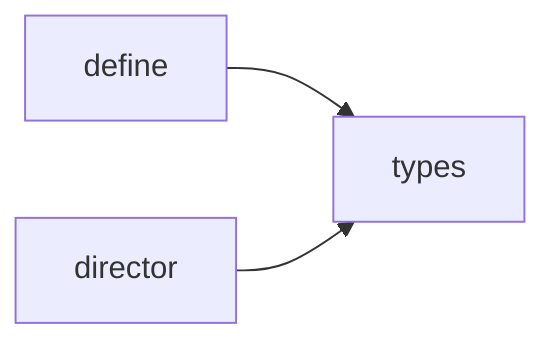

<!-- Generated by tools/codemap.ts. Do not edit by hand: run `npm run docs:codemap`. -->

# Code map: src/narrative

The scene API that story content is written against (Scene, SceneContext, Presenter), the Director that runs one scene at a time, and the place/event authoring helpers.

Generated reference. Start with the [guide](../../architecture/code-map.md) for the flows, and the [index](README.md) for how to read these entries.

## Imports inside this area

*Imports of src/core are left out: nearly every file has them.*

## Files

| File | Purpose |
|---|---|
| [src/narrative/define.ts](#src-narrative-define-ts) | Authoring helpers for the two most common shapes of story content: places and street events. |
| [src/narrative/director.ts](#src-narrative-director-ts) | The Director runs scenes, one at a time. |
| [src/narrative/types.ts](#src-narrative-types-ts) | The scene API: what story code can do, and what the presentation layer must provide. |

## Details

### src/narrative/define.ts

Authoring helpers for the two most common shapes of story content: places and street events. They add no behavior; they give each shape a name, a type and a place for docs.

- Source: [src/narrative/define.ts](../../../src/narrative/define.ts)
- Imports: core: [ids/story](core.md#src-core-ids-story-ts), [ids/world](core.md#src-core-ids-world-ts), [types/index](core.md#src-core-types-index-ts) · narrative: [types](#src-narrative-types-ts)
- Imported by: content: [districts/quarter/places.scene](content.md#src-content-districts-quarter-places-scene-ts), [districts/treme/places.scene](content.md#src-content-districts-treme-places-scene-ts), [index](content.md#src-content-index-ts), [world/streetEvents.scene](content.md#src-content-world-streetevents-scene-ts) · app: [session](app.md#src-app-session-ts)
- Tested by: [explore.test](tests.md#tests-integration-explore-test-ts)
- Types used: **[core/ids/story](core.md#src-core-ids-story-ts)** [StoryPosition](core.md#src-core-ids-story-ts--storyposition) · **[core/ids/world](core.md#src-core-ids-world-ts)** [DistrictId](core.md#src-core-ids-world-ts--districtid), [PlaceId](core.md#src-core-ids-world-ts--placeid) · **[core/types/state](core.md#src-core-types-state-ts)** [GameState](core.md#src-core-types-state-ts--gamestate) · **[narrative/types](#src-narrative-types-ts)** [Scene](#src-narrative-types-ts--scene)

Declarations:

- **PlaceOption** · *interface* — One thing to do at a place.
  - used by: here [PlaceScenes](#src-narrative-define-ts--placescenes) · **[app/session](app.md#src-app-session-ts)** [Session.placeOptions](app.md#src-app-session-ts--session-placeoptions)
- **PlaceIntro** · *interface* — What a place shows above its options.
  - used by: here [PlaceScenes](#src-narrative-define-ts--placescenes) · **[app/session](app.md#src-app-session-ts)** [Session.placeIntro](app.md#src-app-session-ts--session-placeintro)
- **PlaceHelpers** · *interface, capability* — Read-only rules a place needs to build its options (content can't import the engine).
  - used by: here [PlaceScenes](#src-narrative-define-ts--placescenes) · **[app/session](app.md#src-app-session-ts)** [Session.placeHelpers](app.md#src-app-session-ts--session-placehelpers) · tests: [explore.test](tests.md#tests-integration-explore-test-ts)
  - **price** · *interface member* `(base: number, district?: DistrictId): number` — A price after the player's discounts in a district (default: the current one).
    - implemented by: **[app/session](app.md#src-app-session-ts)** [Session.placeHelpers](app.md#src-app-session-ts--session-placehelpers) · **[tests/integration/explore.test](tests.md#tests-integration-explore-test-ts)**
    - called from: **[content/districts/treme/places.scene](content.md#src-content-districts-treme-places-scene-ts)** [kitchen](content.md#src-content-districts-treme-places-scene-ts--kitchen)
  - **is** · *interface member* `(p: StoryPosition): boolean` — Is the main quest exactly at this step?
    - implemented by: **[app/session](app.md#src-app-session-ts)** [Session.placeHelpers](app.md#src-app-session-ts--session-placehelpers) · **[tests/integration/explore.test](tests.md#tests-integration-explore-test-ts)**
    - called from: **[content/districts/quarter/places.scene](content.md#src-content-districts-quarter-places-scene-ts)** [feufollet](content.md#src-content-districts-quarter-places-scene-ts--feufollet), [jackson](content.md#src-content-districts-quarter-places-scene-ts--jackson), [strip](content.md#src-content-districts-quarter-places-scene-ts--strip) · **[content/districts/treme/places.scene](content.md#src-content-districts-treme-places-scene-ts)** [congo](content.md#src-content-districts-treme-places-scene-ts--congo)
  - **reached** · *interface member* `(p: StoryPosition): boolean` — Has the main quest reached this step?
    - implemented by: **[app/session](app.md#src-app-session-ts)** [Session.placeHelpers](app.md#src-app-session-ts--session-placehelpers) · **[tests/integration/explore.test](tests.md#tests-integration-explore-test-ts)**
- **PlaceScenes** · *interface, capability* — A place's behavior: computed from the game state every time the place is shown.
  - used by: here [definePlace](#src-narrative-define-ts--defineplace) · **[content/index](content.md#src-content-index-ts)** [PLACE_SCENES](content.md#src-content-index-ts--place-scenes)
  - **intro** · *interface member* `(g: Readonly<GameState>, h: PlaceHelpers): PlaceIntro | null` — Extra text above the options.
    - implemented by: **[content/districts/quarter/places.scene](content.md#src-content-districts-quarter-places-scene-ts)** [strip](content.md#src-content-districts-quarter-places-scene-ts--strip) · **[content/districts/treme/places.scene](content.md#src-content-districts-treme-places-scene-ts)** [club](content.md#src-content-districts-treme-places-scene-ts--club), [congo](content.md#src-content-districts-treme-places-scene-ts--congo)
    - called from: **[app/session](app.md#src-app-session-ts)** [Session.placeIntro](app.md#src-app-session-ts--session-placeintro) · tests: [explore.test](tests.md#tests-integration-explore-test-ts)
  - **options** · *interface member* `(g: Readonly<GameState>, h: PlaceHelpers): PlaceOption[]` — The options available right now, in display order.
    - implemented by: **[content/districts/quarter/places.scene](content.md#src-content-districts-quarter-places-scene-ts)** [feufollet](content.md#src-content-districts-quarter-places-scene-ts--feufollet), [jackson](content.md#src-content-districts-quarter-places-scene-ts--jackson), [market](content.md#src-content-districts-quarter-places-scene-ts--market), [pelican](content.md#src-content-districts-quarter-places-scene-ts--pelican), [strip](content.md#src-content-districts-quarter-places-scene-ts--strip) · **[content/districts/treme/places.scene](content.md#src-content-districts-treme-places-scene-ts)** [club](content.md#src-content-districts-treme-places-scene-ts--club), [congo](content.md#src-content-districts-treme-places-scene-ts--congo), [kitchen](content.md#src-content-districts-treme-places-scene-ts--kitchen), [pawn](content.md#src-content-districts-treme-places-scene-ts--pawn)
    - called from: **[app/session](app.md#src-app-session-ts)** [Session.placeOptions](app.md#src-app-session-ts--session-placeoptions) · tests: [explore.test](tests.md#tests-integration-explore-test-ts)
- **definePlace** · *function* `(id: PlaceId, spec: PlaceScenes): PlaceScenes & { id: PlaceId }` — Declare a place's scenes.
  - used by: **[content/districts/quarter/places.scene](content.md#src-content-districts-quarter-places-scene-ts)** [feufollet](content.md#src-content-districts-quarter-places-scene-ts--feufollet), [jackson](content.md#src-content-districts-quarter-places-scene-ts--jackson), [market](content.md#src-content-districts-quarter-places-scene-ts--market), [pelican](content.md#src-content-districts-quarter-places-scene-ts--pelican), [strip](content.md#src-content-districts-quarter-places-scene-ts--strip) · **[content/districts/treme/places.scene](content.md#src-content-districts-treme-places-scene-ts)** [club](content.md#src-content-districts-treme-places-scene-ts--club), [congo](content.md#src-content-districts-treme-places-scene-ts--congo), [kitchen](content.md#src-content-districts-treme-places-scene-ts--kitchen), [pawn](content.md#src-content-districts-treme-places-scene-ts--pawn)
- **EventOption** · *interface, capability* — One choice in a street event.
  - used by: here [StreetEventDef](#src-narrative-define-ts--streeteventdef)
  - **when** · *interface member* `(g: Readonly<GameState>): boolean` — Only offered when this holds.
    - implemented by: **[content/world/streetEvents.scene](content.md#src-content-world-streetevents-scene-ts)** [STREET_EVENTS](content.md#src-content-world-streetevents-scene-ts--street-events)
    - called from: **[content/world/streets.scene](content.md#src-content-world-streets-scene-ts)** [runEvent](content.md#src-content-world-streets-scene-ts--runevent)
- **StreetEventDef** · *interface* — A random encounter on the streets that isn't a fight (though it may become one).
  - used by: here [defineEvent](#src-narrative-define-ts--defineevent) · **[content/world/streetEvents.scene](content.md#src-content-world-streetevents-scene-ts)** [STREET_EVENTS](content.md#src-content-world-streetevents-scene-ts--street-events)
- **defineEvent** · *function* `(spec: StreetEventDef): StreetEventDef` — Declare a street event.
  - used by: **[content/world/streetEvents.scene](content.md#src-content-world-streetevents-scene-ts)** [STREET_EVENTS](content.md#src-content-world-streetevents-scene-ts--street-events)

### src/narrative/director.ts

The Director runs scenes, one at a time.

- Source: [src/narrative/director.ts](../../../src/narrative/director.ts)
- Imports: narrative: [types](#src-narrative-types-ts)
- Imported by: app: [session](app.md#src-app-session-ts)
- Tested by: [director.test](tests.md#src-narrative-director-test-ts)
- Types used: **[narrative/types](#src-narrative-types-ts)** [RunResult](#src-narrative-types-ts--runresult), [Scene](#src-narrative-types-ts--scene), [SceneContext](#src-narrative-types-ts--scenecontext), [SceneInterrupt](#src-narrative-types-ts--sceneinterrupt)

Declarations:

- **DirectorConfig** · *interface, capability* — How the Director talks to the rest of the app.
  - used by: here [Director.constructor](#src-narrative-director-ts--director-constructor)
  - **makeContext** · *interface member* `(signal: AbortSignal): SceneContext` — Build a fresh scene context bound to this run's abort signal.
    - implemented by: **[app/session](app.md#src-app-session-ts)** [Session.constructor](app.md#src-app-session-ts--session-constructor) · **[narrative/director.test](tests.md#src-narrative-director-test-ts)**
    - called from: here [Director.fly](#src-narrative-director-ts--director-fly), [Director.recover](#src-narrative-director-ts--director-recover)
  - **onError** · *interface member* `(error: unknown): Scene | null` — Called with an unexpected error; may return a recovery scene to run.
    - implemented by: **[app/session](app.md#src-app-session-ts)** [Session.constructor](app.md#src-app-session-ts--session-constructor) · **[narrative/director.test](tests.md#src-narrative-director-test-ts)**
    - called from: here [Director.recover](#src-narrative-director-ts--director-recover)
  - **onSettled** · *interface member* `(result: RunResult): void` — Called when a flight ends (finished, interrupted, failed or aborted).
    - implemented by: **[app/session](app.md#src-app-session-ts)** [Session.constructor](app.md#src-app-session-ts--session-constructor) · **[narrative/director.test](tests.md#src-narrative-director-test-ts)**
    - called from: here [Director.run](#src-narrative-director-ts--director-run)
  - **onBusy** · *interface member* `(busy: boolean): void` — Called when a flight starts and ends (for a busy indicator).
    - implemented by: **[app/session](app.md#src-app-session-ts)** [Session.constructor](app.md#src-app-session-ts--session-constructor)
    - called from: here [Director.run](#src-narrative-director-ts--director-run)
- **isAbort** · *function* `(e: unknown): boolean` — True for errors caused by aborting (DOMException AbortError or our own abort reason).
  - used by: here [Director.fly](#src-narrative-director-ts--director-fly)
- **abortError** · *function* `(reason: string): Error` — An abort reason that reads well in logs.
  - used by: here [Director.abort](#src-narrative-director-ts--director-abort)
- **Director** · *class* — Runs scenes one at a time.
  - used by: **[app/session](app.md#src-app-session-ts)** [Session.constructor](app.md#src-app-session-ts--session-constructor), [Session.director](app.md#src-app-session-ts--session-director) · tests: [director.test](tests.md#src-narrative-director-test-ts)
  - **flight** · *property, private* `: { name: string; ctrl: AbortController; done: Promise<RunResult> } | null`
  - **constructor** · *constructor* `(private readonly cfg: DirectorConfig)` — Create a Director with its wiring.
  - **busy** · *getter* `: boolean` — A scene is running.
    - used by: **[app/session](app.md#src-app-session-ts)** [Session.enterPlace](app.md#src-app-session-ts--session-enterplace), [Session.leavePlace](app.md#src-app-session-ts--session-leaveplace) · tests: [director.test](tests.md#src-narrative-director-test-ts)
  - **current** · *getter* `: string | null` — Name of the running scene (for debugging).
    - *no references found*
  - **run** · *method* `(scene: Scene, meta: { name: string }): Promise<RunResult>` — Run a scene unless one is already running.
    - uses: here [Director.fly](#src-narrative-director-ts--director-fly), [DirectorConfig.onBusy](#src-narrative-director-ts--directorconfig-onbusy), [DirectorConfig.onSettled](#src-narrative-director-ts--directorconfig-onsettled)
    - used by: **[app/session](app.md#src-app-session-ts)** [Session.run](app.md#src-app-session-ts--session-run) · tests: [director.test](tests.md#src-narrative-director-test-ts)
  - **abort** · *method* `(reason: string): Promise<void>` — Abort the running scene (if any) and wait for it to unwind.
    - uses: here [abortError](#src-narrative-director-ts--aborterror)
    - used by: **[app/game](app.md#src-app-game-ts)** [GameApp.loadInto](app.md#src-app-game-ts--gameapp-loadinto), [GameApp.settleConflicts](app.md#src-app-game-ts--gameapp-settleconflicts) · **[app/session](app.md#src-app-session-ts)** [Session.quit](app.md#src-app-session-ts--session-quit) · tests: [director.test](tests.md#src-narrative-director-test-ts)
  - **fly** · *method, private* `(scene: Scene, ctrl: AbortController): Promise<RunResult>`
    - uses: here [Director.recover](#src-narrative-director-ts--director-recover), [DirectorConfig.makeContext](#src-narrative-director-ts--directorconfig-makecontext), [isAbort](#src-narrative-director-ts--isabort) · **[narrative/types](#src-narrative-types-ts)** [SceneInterrupt](#src-narrative-types-ts--sceneinterrupt), [SceneInterrupt.kind](#src-narrative-types-ts--sceneinterrupt-kind)
    - used by: here [Director.run](#src-narrative-director-ts--director-run)
  - **recover** · *method, private* `(error: unknown, ctrl: AbortController): Promise<RunResult>`
    - uses: here [DirectorConfig.makeContext](#src-narrative-director-ts--directorconfig-makecontext), [DirectorConfig.onError](#src-narrative-director-ts--directorconfig-onerror)
    - used by: here [Director.fly](#src-narrative-director-ts--director-fly)

### src/narrative/types.ts

The scene API: what story code can do, and what the presentation layer must provide.

- Source: [src/narrative/types.ts](../../../src/narrative/types.ts)
- Imports: core: [ids/band](core.md#src-core-ids-band-ts), [ids/combat](core.md#src-core-ids-combat-ts), [ids/enemies](core.md#src-core-ids-enemies-ts), [ids/flags](core.md#src-core-ids-flags-ts), [ids/items](core.md#src-core-ids-items-ts), [ids/sprites](core.md#src-core-ids-sprites-ts), [ids/story](core.md#src-core-ids-story-ts), [ids/world](core.md#src-core-ids-world-ts), [rng](core.md#src-core-rng-ts), [types/index](core.md#src-core-types-index-ts)
- Imported by: narrative: [define](#src-narrative-define-ts), [director](#src-narrative-director-ts) · content: [bosses/captain_hush.scene](content.md#src-content-bosses-captain-hush-scene-ts), [bosses/vox_perfecta.scene](content.md#src-content-bosses-vox-perfecta-scene-ts), [districts/quarter/cutting.scene](content.md#src-content-districts-quarter-cutting-scene-ts), [districts/quarter/places.scene](content.md#src-content-districts-quarter-places-scene-ts), [districts/treme/places.scene](content.md#src-content-districts-treme-places-scene-ts), [index](content.md#src-content-index-ts), [story/prologue.scene](content.md#src-content-story-prologue-scene-ts), [world/arrivals.scene](content.md#src-content-world-arrivals-scene-ts), [world/shared.scene](content.md#src-content-world-shared-scene-ts), [world/streets.scene](content.md#src-content-world-streets-scene-ts) · app: [battleController](app.md#src-app-battlecontroller-ts), [reactPresenter](app.md#src-app-reactpresenter-ts), [sceneContext](app.md#src-app-scenecontext-ts), [session](app.md#src-app-session-ts), [sessionPort](app.md#src-app-sessionport-ts), [testing/scriptedPresenter](app.md#src-app-testing-scriptedpresenter-ts), [view](app.md#src-app-view-ts) · ui: [sheets/ShopSheet](ui.md#src-ui-sheets-shopsheet-tsx) · tests: [integration/support/crawl](tests.md#tests-integration-support-crawl-ts)
- Tested by: [director.test](tests.md#src-narrative-director-test-ts), [playthrough.test](tests.md#tests-integration-playthrough-test-ts), [slice.test](tests.md#tests-integration-slice-test-ts), [transcripts.test](tests.md#tools-parity-transcripts-test-ts)
- Types used: **[core/ids/band](core.md#src-core-ids-band-ts)** [BandmateId](core.md#src-core-ids-band-ts--bandmateid) · **[core/ids/combat](core.md#src-core-ids-combat-ts)** [StatKey](core.md#src-core-ids-combat-ts--statkey) · **[core/ids/enemies](core.md#src-core-ids-enemies-ts)** [BossId](core.md#src-core-ids-enemies-ts--bossid), [EnemyId](core.md#src-core-ids-enemies-ts--enemyid), [NoteId](core.md#src-core-ids-enemies-ts--noteid), [OpponentId](core.md#src-core-ids-enemies-ts--opponentid) · **[core/ids/flags](core.md#src-core-ids-flags-ts)** [FlagId](core.md#src-core-ids-flags-ts--flagid), [StoryChoices](core.md#src-core-ids-flags-ts--storychoices) · **[core/ids/items](core.md#src-core-ids-items-ts)** [GearId](core.md#src-core-ids-items-ts--gearid), [ItemId](core.md#src-core-ids-items-ts--itemid), [ShopItemId](core.md#src-core-ids-items-ts--shopitemid) · **[core/ids/sprites](core.md#src-core-ids-sprites-ts)** [SpriteId](core.md#src-core-ids-sprites-ts--spriteid) · **[core/ids/story](core.md#src-core-ids-story-ts)** [StoryPosition](core.md#src-core-ids-story-ts--storyposition) · **[core/ids/world](core.md#src-core-ids-world-ts)** [DistrictId](core.md#src-core-ids-world-ts--districtid), [NpcId](core.md#src-core-ids-world-ts--npcid), [PlaceId](core.md#src-core-ids-world-ts--placeid), [QuestId](core.md#src-core-ids-world-ts--questid) · **[core/rng](core.md#src-core-rng-ts)** [Rng](core.md#src-core-rng-ts--rng) · **[core/types/battle](core.md#src-core-types-battle-ts)** [Battle](core.md#src-core-types-battle-ts--battle), [BattleContext](core.md#src-core-types-battle-ts--battlecontext), [BattleEvent](core.md#src-core-types-battle-ts--battleevent), [LevelUp](core.md#src-core-types-battle-ts--levelup), [PlayerIntent](core.md#src-core-types-battle-ts--playerintent), [TimingSpec](core.md#src-core-types-battle-ts--timingspec) · … +5 more

Declarations:

- **Scene** · *type* `= (s: SceneContext) => Promise<void>` — A piece of story: everything a place option, NPC talk, event or boss scene does.
  - used by: **[app/session](app.md#src-app-session-ts)** [Session.run](app.md#src-app-session-ts--session-run) · **[content/bosses/captain_hush.scene](content.md#src-content-bosses-captain-hush-scene-ts)** [post](content.md#src-content-bosses-captain-hush-scene-ts--post), [pre](content.md#src-content-bosses-captain-hush-scene-ts--pre) · **[content/bosses/vox_perfecta.scene](content.md#src-content-bosses-vox-perfecta-scene-ts)** [post](content.md#src-content-bosses-vox-perfecta-scene-ts--post), [pre](content.md#src-content-bosses-vox-perfecta-scene-ts--pre) · **[content/districts/quarter/cutting.scene](content.md#src-content-districts-quarter-cutting-scene-ts)** [cuttingContest](content.md#src-content-districts-quarter-cutting-scene-ts--cuttingcontest) · **[content/districts/quarter/places.scene](content.md#src-content-districts-quarter-places-scene-ts)** [broadcasterScene](content.md#src-content-districts-quarter-places-scene-ts--broadcasterscene), [crawfishRaces](content.md#src-content-districts-quarter-places-scene-ts--crawfishraces), [hornQuest](content.md#src-content-districts-quarter-places-scene-ts--hornquest), [lostEyeQuest](content.md#src-content-districts-quarter-places-scene-ts--losteyequest), [odetteTalk](content.md#src-content-districts-quarter-places-scene-ts--odettetalk), [sitIn](content.md#src-content-districts-quarter-places-scene-ts--sitin), [zinniaTarot](content.md#src-content-districts-quarter-places-scene-ts--zinniatarot) · **[content/districts/treme/places.scene](content.md#src-content-districts-treme-places-scene-ts)** [mamaRouxTalk](content.md#src-content-districts-treme-places-scene-ts--mamarouxtalk), [spar](content.md#src-content-districts-treme-places-scene-ts--spar) · **[content/index](content.md#src-content-index-ts)** [BOSS_SCENES](content.md#src-content-index-ts--boss-scenes) · … +15 more
- **ChoiceOptions** · *type* `= { readonly [P in K]: string | ChoiceOption }` — Choice options keyed by what the code branches on; the value is the label (or a label with options).
  - used by: here [SceneContext](#src-narrative-types-ts--scenecontext)
- **ChoiceOption** · *interface* — A choice option with extras.
  - used by: here [ChoiceOptions](#src-narrative-types-ts--choiceoptions) · **[app/sceneContext](app.md#src-app-scenecontext-ts)** [createSceneContext](app.md#src-app-scenecontext-ts--createscenecontext)
- **ShopStock** · *interface* — One line of stock in a shop.
  - used by: here [SheetRequest](#src-narrative-types-ts--sheetrequest) · **[app/view](app.md#src-app-view-ts)** [SheetView](app.md#src-app-view-ts--sheetview) · **[content/world/shared.scene](content.md#src-content-world-shared-scene-ts)** [instrumentStock](content.md#src-content-world-shared-scene-ts--instrumentstock) · **[ui/sheets/ShopSheet](ui.md#src-ui-sheets-shopsheet-tsx)** [Props](ui.md#src-ui-sheets-shopsheet-tsx--props)
- **SheetRequest** · *type* `= union of 4` — A sheet (bottom panel) a scene can open and wait on until the player closes it.
  - used by: here [Presenter](#src-narrative-types-ts--presenter), [SceneContext](#src-narrative-types-ts--scenecontext) · **[app/reactPresenter](app.md#src-app-reactpresenter-ts)** [ReactPresenter.sheet](app.md#src-app-reactpresenter-ts--reactpresenter-sheet), [ReactPresenter.sheetFor](app.md#src-app-reactpresenter-ts--reactpresenter-sheetfor) · **[app/testing/scriptedPresenter](app.md#src-app-testing-scriptedpresenter-ts)** [ScriptPolicy](app.md#src-app-testing-scriptedpresenter-ts--scriptpolicy), [ScriptedPresenter.sheet](app.md#src-app-testing-scriptedpresenter-ts--scriptedpresenter-sheet), [TranscriptEntry](app.md#src-app-testing-scriptedpresenter-ts--transcriptentry) · **[tests/integration/support/crawl](tests.md#tests-integration-support-crawl-ts)** [ShopSeen](tests.md#tests-integration-support-crawl-ts--shopseen)
- **Route** · *type* `= union of 2` — Where the player is when no scene is running.
  - used by: here [Presenter](#src-narrative-types-ts--presenter), [SceneContext](#src-narrative-types-ts--scenecontext) · **[app/reactPresenter](app.md#src-app-reactpresenter-ts)** [ReactPresenter.route](app.md#src-app-reactpresenter-ts--reactpresenter-route), [ReactPresenterOptions](app.md#src-app-reactpresenter-ts--reactpresenteroptions) · **[app/session](app.md#src-app-session-ts)** [Session.route](app.md#src-app-session-ts--session-route) · **[app/sessionPort](app.md#src-app-sessionport-ts)** [SessionPort](app.md#src-app-sessionport-ts--sessionport) · **[app/testing/scriptedPresenter](app.md#src-app-testing-scriptedpresenter-ts)** [ScriptedPresenter.route](app.md#src-app-testing-scriptedpresenter-ts--scriptedpresenter-route), [TranscriptEntry](app.md#src-app-testing-scriptedpresenter-ts--transcriptentry) · **[app/view](app.md#src-app-view-ts)** [ViewState](app.md#src-app-view-ts--viewstate)
- **FightSpec** · *interface* — How a fight is set up.
  - used by: here [SceneContext](#src-narrative-types-ts--scenecontext) · **[app/battleController](app.md#src-app-battlecontroller-ts)** [runBattle](app.md#src-app-battlecontroller-ts--runbattle) · **[app/session](app.md#src-app-session-ts)** [SessionDeps](app.md#src-app-session-ts--sessiondeps) · **[app/sessionPort](app.md#src-app-sessionport-ts)** [SessionPort](app.md#src-app-sessionport-ts--sessionport)
- **FightOutcome** · *type* `= 'win' | 'fled'` — How a fight ended for the scene.
  - used by: here [SceneContext](#src-narrative-types-ts--scenecontext)
- **SceneContext** · *interface, capability* — Everything a scene can do.
  - used by: here [Scene](#src-narrative-types-ts--scene) · **[app/sceneContext](app.md#src-app-scenecontext-ts)** [createSceneContext](app.md#src-app-scenecontext-ts--createscenecontext) · **[content/districts/quarter/places.scene](content.md#src-content-districts-quarter-places-scene-ts)** [feufollet](content.md#src-content-districts-quarter-places-scene-ts--feufollet), [jackson](content.md#src-content-districts-quarter-places-scene-ts--jackson) · **[content/districts/treme/places.scene](content.md#src-content-districts-treme-places-scene-ts)** [club](content.md#src-content-districts-treme-places-scene-ts--club), [kitchen](content.md#src-content-districts-treme-places-scene-ts--kitchen), [pawn](content.md#src-content-districts-treme-places-scene-ts--pawn) · **[content/story/prologue.scene](content.md#src-content-story-prologue-scene-ts)** [prologueEnd](content.md#src-content-story-prologue-scene-ts--prologueend), [tutorialFight](content.md#src-content-story-prologue-scene-ts--tutorialfight) · **[content/world/shared.scene](content.md#src-content-world-shared-scene-ts)** [getInvitation](content.md#src-content-world-shared-scene-ts--getinvitation) · **[content/world/streets.scene](content.md#src-content-world-streets-scene-ts)** [runEvent](content.md#src-content-world-streets-scene-ts--runevent) · **[narrative/director](#src-narrative-director-ts)** [DirectorConfig](#src-narrative-director-ts--directorconfig) · tests: [director.test](tests.md#src-narrative-director-test-ts)
  - **title** · *interface member* `(text?: string | null): void` — Clear the story view and show a title (a new screen of story).
    - implemented by: **[app/sceneContext](app.md#src-app-scenecontext-ts)** [createSceneContext](app.md#src-app-scenecontext-ts--createscenecontext)
    - called from: **[content/districts/quarter/cutting.scene](content.md#src-content-districts-quarter-cutting-scene-ts)** [cuttingContest](content.md#src-content-districts-quarter-cutting-scene-ts--cuttingcontest) · **[content/districts/quarter/places.scene](content.md#src-content-districts-quarter-places-scene-ts)** [broadcasterScene](content.md#src-content-districts-quarter-places-scene-ts--broadcasterscene), [crawfishRaces](content.md#src-content-districts-quarter-places-scene-ts--crawfishraces), [feufollet](content.md#src-content-districts-quarter-places-scene-ts--feufollet), [hornQuest](content.md#src-content-districts-quarter-places-scene-ts--hornquest), [jackson](content.md#src-content-districts-quarter-places-scene-ts--jackson), [lostEyeQuest](content.md#src-content-districts-quarter-places-scene-ts--losteyequest), [market](content.md#src-content-districts-quarter-places-scene-ts--market), [pelican](content.md#src-content-districts-quarter-places-scene-ts--pelican), [sitIn](content.md#src-content-districts-quarter-places-scene-ts--sitin), [strip](content.md#src-content-districts-quarter-places-scene-ts--strip), [zinniaTarot](content.md#src-content-districts-quarter-places-scene-ts--zinniatarot) · **[content/districts/treme/places.scene](content.md#src-content-districts-treme-places-scene-ts)** [club](content.md#src-content-districts-treme-places-scene-ts--club), [congo](content.md#src-content-districts-treme-places-scene-ts--congo), [kitchen](content.md#src-content-districts-treme-places-scene-ts--kitchen), [pawn](content.md#src-content-districts-treme-places-scene-ts--pawn) · … +10 more
  - **narrate** · *interface member* `(text: string): Promise<void>` — Narration: typed out, then the player taps Continue.
    - implemented by: **[app/sceneContext](app.md#src-app-scenecontext-ts)** [createSceneContext](app.md#src-app-scenecontext-ts--createscenecontext)
    - called from: **[app/sceneContext](app.md#src-app-scenecontext-ts)** [createSceneContext](app.md#src-app-scenecontext-ts--createscenecontext) · **[content/bosses/captain_hush.scene](content.md#src-content-bosses-captain-hush-scene-ts)** [post](content.md#src-content-bosses-captain-hush-scene-ts--post), [pre](content.md#src-content-bosses-captain-hush-scene-ts--pre) · **[content/bosses/vox_perfecta.scene](content.md#src-content-bosses-vox-perfecta-scene-ts)** [post](content.md#src-content-bosses-vox-perfecta-scene-ts--post), [pre](content.md#src-content-bosses-vox-perfecta-scene-ts--pre) · **[content/districts/quarter/cutting.scene](content.md#src-content-districts-quarter-cutting-scene-ts)** [cuttingContest](content.md#src-content-districts-quarter-cutting-scene-ts--cuttingcontest) · **[content/districts/quarter/places.scene](content.md#src-content-districts-quarter-places-scene-ts)** [broadcasterScene](content.md#src-content-districts-quarter-places-scene-ts--broadcasterscene), [crawfishRaces](content.md#src-content-districts-quarter-places-scene-ts--crawfishraces), [jackson](content.md#src-content-districts-quarter-places-scene-ts--jackson), [lostEyeQuest](content.md#src-content-districts-quarter-places-scene-ts--losteyequest), [market](content.md#src-content-districts-quarter-places-scene-ts--market), [sitIn](content.md#src-content-districts-quarter-places-scene-ts--sitin), [strip](content.md#src-content-districts-quarter-places-scene-ts--strip) · **[content/districts/treme/places.scene](content.md#src-content-districts-treme-places-scene-ts)** [congo](content.md#src-content-districts-treme-places-scene-ts--congo), [pawn](content.md#src-content-districts-treme-places-scene-ts--pawn), [spar](content.md#src-content-districts-treme-places-scene-ts--spar) · … +11 more
  - **say** · *interface member* `(who: NpcId, text: string): Promise<void>` — A character speaks.
    - implemented by: **[app/sceneContext](app.md#src-app-scenecontext-ts)** [createSceneContext](app.md#src-app-scenecontext-ts--createscenecontext)
    - called from: **[content/bosses/captain_hush.scene](content.md#src-content-bosses-captain-hush-scene-ts)** [post](content.md#src-content-bosses-captain-hush-scene-ts--post), [pre](content.md#src-content-bosses-captain-hush-scene-ts--pre) · **[content/bosses/vox_perfecta.scene](content.md#src-content-bosses-vox-perfecta-scene-ts)** [post](content.md#src-content-bosses-vox-perfecta-scene-ts--post), [pre](content.md#src-content-bosses-vox-perfecta-scene-ts--pre) · **[content/districts/quarter/cutting.scene](content.md#src-content-districts-quarter-cutting-scene-ts)** [cuttingContest](content.md#src-content-districts-quarter-cutting-scene-ts--cuttingcontest) · **[content/districts/quarter/places.scene](content.md#src-content-districts-quarter-places-scene-ts)** [hornQuest](content.md#src-content-districts-quarter-places-scene-ts--hornquest), [lostEyeQuest](content.md#src-content-districts-quarter-places-scene-ts--losteyequest), [odetteTalk](content.md#src-content-districts-quarter-places-scene-ts--odettetalk), [sitIn](content.md#src-content-districts-quarter-places-scene-ts--sitin), [zinniaTarot](content.md#src-content-districts-quarter-places-scene-ts--zinniatarot) · **[content/districts/treme/places.scene](content.md#src-content-districts-treme-places-scene-ts)** [club](content.md#src-content-districts-treme-places-scene-ts--club), [kitchen](content.md#src-content-districts-treme-places-scene-ts--kitchen), [mamaRouxTalk](content.md#src-content-districts-treme-places-scene-ts--mamarouxtalk), [pawn](content.md#src-content-districts-treme-places-scene-ts--pawn) · **[content/story/prologue.scene](content.md#src-content-story-prologue-scene-ts)** [prologue](content.md#src-content-story-prologue-scene-ts--prologue), [prologueEnd](content.md#src-content-story-prologue-scene-ts--prologueend) · … +3 more
  - **speak** · *interface member* `(name: string, color: string, text: string, sprite?: SpriteId): Promise<void>` — Someone outside the NPC table speaks, with an explicit name color and, optionally, a portrait (for example the Restless Haints ghosts, drawn as `'haint'`).
    - implemented by: **[app/sceneContext](app.md#src-app-scenecontext-ts)** [createSceneContext](app.md#src-app-scenecontext-ts--createscenecontext)
  - **choose** · *interface member* `<K extends string>(options: ChoiceOptions<K>, prompt?: string): Promise<K>` — Offer choices; resolves with the chosen key.
    - implemented by: **[app/sceneContext](app.md#src-app-scenecontext-ts)** [createSceneContext](app.md#src-app-scenecontext-ts--createscenecontext)
    - called from: **[content/bosses/vox_perfecta.scene](content.md#src-content-bosses-vox-perfecta-scene-ts)** [post](content.md#src-content-bosses-vox-perfecta-scene-ts--post) · **[content/districts/quarter/cutting.scene](content.md#src-content-districts-quarter-cutting-scene-ts)** [cuttingContest](content.md#src-content-districts-quarter-cutting-scene-ts--cuttingcontest) · **[content/districts/quarter/places.scene](content.md#src-content-districts-quarter-places-scene-ts)** [broadcasterScene](content.md#src-content-districts-quarter-places-scene-ts--broadcasterscene), [crawfishRaces](content.md#src-content-districts-quarter-places-scene-ts--crawfishraces) · **[content/districts/treme/places.scene](content.md#src-content-districts-treme-places-scene-ts)** [mamaRouxTalk](content.md#src-content-districts-treme-places-scene-ts--mamarouxtalk) · **[content/world/streets.scene](content.md#src-content-world-streets-scene-ts)** [runEvent](content.md#src-content-world-streets-scene-ts--runevent)
  - **confirm** · *interface member* `(title: string, body: string, yes?: string, no?: string): Promise<boolean>` — A yes/no dialog.
    - implemented by: **[app/sceneContext](app.md#src-app-scenecontext-ts)** [createSceneContext](app.md#src-app-scenecontext-ts--createscenecontext)
  - **toast** · *interface member* `(text: string): void` — A brief message that fades.
    - implemented by: **[app/sceneContext](app.md#src-app-scenecontext-ts)** [createSceneContext](app.md#src-app-scenecontext-ts--createscenecontext)
    - called from: **[app/session](app.md#src-app-session-ts)** [Session.constructor](app.md#src-app-session-ts--session-constructor), [Session.resume](app.md#src-app-session-ts--session-resume) · **[content/districts/quarter/places.scene](content.md#src-content-districts-quarter-places-scene-ts)** [feufollet](content.md#src-content-districts-quarter-places-scene-ts--feufollet) · **[content/districts/treme/places.scene](content.md#src-content-districts-treme-places-scene-ts)** [club](content.md#src-content-districts-treme-places-scene-ts--club), [kitchen](content.md#src-content-districts-treme-places-scene-ts--kitchen), [pawn](content.md#src-content-districts-treme-places-scene-ts--pawn) · **[content/world/shared.scene](content.md#src-content-world-shared-scene-ts)** [getInvitation](content.md#src-content-world-shared-scene-ts--getinvitation)
  - **sheet** · *interface member* `(req: SheetRequest): Promise<void>` — Open a sheet and wait for the player to close it.
    - implemented by: **[app/sceneContext](app.md#src-app-scenecontext-ts)** [createSceneContext](app.md#src-app-scenecontext-ts--createscenecontext)
    - called from: **[content/districts/quarter/places.scene](content.md#src-content-districts-quarter-places-scene-ts)** [jackson](content.md#src-content-districts-quarter-places-scene-ts--jackson), [market](content.md#src-content-districts-quarter-places-scene-ts--market), [pelican](content.md#src-content-districts-quarter-places-scene-ts--pelican) · **[content/districts/treme/places.scene](content.md#src-content-districts-treme-places-scene-ts)** [club](content.md#src-content-districts-treme-places-scene-ts--club), [kitchen](content.md#src-content-districts-treme-places-scene-ts--kitchen), [pawn](content.md#src-content-districts-treme-places-scene-ts--pawn) · **[content/world/streets.scene](content.md#src-content-world-streets-scene-ts)** [pralineLady](content.md#src-content-world-streets-scene-ts--pralinelady)
  - **wait** · *interface member* `(ms: number): Promise<void>` — Pause.
    - implemented by: **[app/sceneContext](app.md#src-app-scenecontext-ts)** [createSceneContext](app.md#src-app-scenecontext-ts--createscenecontext)
    - called from: **[content/districts/quarter/places.scene](content.md#src-content-districts-quarter-places-scene-ts)** [crawfishRaces](content.md#src-content-districts-quarter-places-scene-ts--crawfishraces)
  - **timing** · *interface member* `(): Promise<TimingGradeDef>` — One On the One timing bar outside battle (the Feu Follet sit-in): the player taps it, or with auto rhythm it rolls.
    - implemented by: **[app/sceneContext](app.md#src-app-scenecontext-ts)** [createSceneContext](app.md#src-app-scenecontext-ts--createscenecontext)
    - called from: **[content/districts/quarter/places.scene](content.md#src-content-districts-quarter-places-scene-ts)** [sitIn](content.md#src-content-districts-quarter-places-scene-ts--sitin)
  - **board** · *interface member* `(text: string): void` — A block of fixed-width text in the story that redraws in place each call (the crawfish race's track).
    - implemented by: **[app/sceneContext](app.md#src-app-scenecontext-ts)** [createSceneContext](app.md#src-app-scenecontext-ts--createscenecontext)
    - called from: **[content/districts/quarter/places.scene](content.md#src-content-districts-quarter-places-scene-ts)** [crawfishRaces](content.md#src-content-districts-quarter-places-scene-ts--crawfishraces)
  - **goto** · *interface member* `(district: DistrictId): Promise<void>` — Travel to a district: autosave, then its first-visit narration, then the district screen.
    - implemented by: **[app/sceneContext](app.md#src-app-scenecontext-ts)** [createSceneContext](app.md#src-app-scenecontext-ts--createscenecontext)
    - called from: **[app/game](app.md#src-app-game-ts)** [GameApp.dev](app.md#src-app-game-ts--gameapp-dev) · **[app/session](app.md#src-app-session-ts)** [Session.resume](app.md#src-app-session-ts--session-resume) · **[content/story/prologue.scene](content.md#src-content-story-prologue-scene-ts)** [prologueEnd](content.md#src-content-story-prologue-scene-ts--prologueend) · **[content/world/streets.scene](content.md#src-content-world-streets-scene-ts)** [travel](content.md#src-content-world-streets-scene-ts--travel)
  - **returnTo** · *interface member* `(route: Route): void` — Where the player returns when this scene ends (defaults to wherever the scene started).
    - implemented by: **[app/sceneContext](app.md#src-app-scenecontext-ts)** [createSceneContext](app.md#src-app-scenecontext-ts--createscenecontext)
  - **give** · *interface member* `(id: ItemId, n?: number, opts?: { silent?: boolean }): void` — Add items (toast "Got X." unless silent).
    - implemented by: **[app/sceneContext](app.md#src-app-scenecontext-ts)** [createSceneContext](app.md#src-app-scenecontext-ts--createscenecontext)
    - called from: **[content/districts/treme/places.scene](content.md#src-content-districts-treme-places-scene-ts)** [pawn](content.md#src-content-districts-treme-places-scene-ts--pawn) · **[content/world/streetEvents.scene](content.md#src-content-world-streetevents-scene-ts)** [STREET_EVENTS](content.md#src-content-world-streetevents-scene-ts--street-events) · **[content/world/streets.scene](content.md#src-content-world-streets-scene-ts)** [hitTheStreets](content.md#src-content-world-streets-scene-ts--hitthestreets)
  - **take** · *interface member* `(id: ItemId, n?: number): boolean` — Remove items.
    - implemented by: **[app/sceneContext](app.md#src-app-scenecontext-ts)** [createSceneContext](app.md#src-app-scenecontext-ts--createscenecontext)
    - called from: **[content/districts/treme/places.scene](content.md#src-content-districts-treme-places-scene-ts)** [kitchen](content.md#src-content-districts-treme-places-scene-ts--kitchen)
  - **count** · *interface member* `(id: ItemId): number` — How many the player carries.
    - implemented by: **[app/sceneContext](app.md#src-app-scenecontext-ts)** [createSceneContext](app.md#src-app-scenecontext-ts--createscenecontext)
    - called from: **[content/world/streetEvents.scene](content.md#src-content-world-streetevents-scene-ts)** [STREET_EVENTS](content.md#src-content-world-streetevents-scene-ts--street-events)
  - **gold** · *interface member* `(delta: number): boolean` — Change Doubloons (a gain toasts).
    - implemented by: **[app/sceneContext](app.md#src-app-scenecontext-ts)** [createSceneContext](app.md#src-app-scenecontext-ts--createscenecontext)
    - called from: **[content/districts/quarter/cutting.scene](content.md#src-content-districts-quarter-cutting-scene-ts)** [cuttingContest](content.md#src-content-districts-quarter-cutting-scene-ts--cuttingcontest) · **[content/districts/quarter/places.scene](content.md#src-content-districts-quarter-places-scene-ts)** [hornQuest](content.md#src-content-districts-quarter-places-scene-ts--hornquest), [lostEyeQuest](content.md#src-content-districts-quarter-places-scene-ts--losteyequest) · **[content/districts/treme/places.scene](content.md#src-content-districts-treme-places-scene-ts)** [kitchen](content.md#src-content-districts-treme-places-scene-ts--kitchen) · **[content/world/streetEvents.scene](content.md#src-content-world-streetevents-scene-ts)** [STREET_EVENTS](content.md#src-content-world-streetevents-scene-ts--street-events)
  - **xp** · *interface member* `(n: number): Promise<void>` — Grant XP: toast, then level-up popups (awaited).
    - implemented by: **[app/sceneContext](app.md#src-app-scenecontext-ts)** [createSceneContext](app.md#src-app-scenecontext-ts--createscenecontext)
    - called from: **[content/districts/quarter/cutting.scene](content.md#src-content-districts-quarter-cutting-scene-ts)** [cuttingContest](content.md#src-content-districts-quarter-cutting-scene-ts--cuttingcontest) · **[content/districts/quarter/places.scene](content.md#src-content-districts-quarter-places-scene-ts)** [broadcasterScene](content.md#src-content-districts-quarter-places-scene-ts--broadcasterscene), [hornQuest](content.md#src-content-districts-quarter-places-scene-ts--hornquest), [lostEyeQuest](content.md#src-content-districts-quarter-places-scene-ts--losteyequest), [sitIn](content.md#src-content-districts-quarter-places-scene-ts--sitin) · **[content/districts/treme/places.scene](content.md#src-content-districts-treme-places-scene-ts)** [kitchen](content.md#src-content-districts-treme-places-scene-ts--kitchen) · **[content/world/streetEvents.scene](content.md#src-content-world-streetevents-scene-ts)** [STREET_EVENTS](content.md#src-content-world-streetevents-scene-ts--street-events)
  - **heal** · *interface member* `(pct: number): void` — Heal a fraction of max Heart.
    - implemented by: **[app/sceneContext](app.md#src-app-scenecontext-ts)** [createSceneContext](app.md#src-app-scenecontext-ts--createscenecontext)
    - called from: **[content/districts/quarter/cutting.scene](content.md#src-content-districts-quarter-cutting-scene-ts)** [cuttingContest](content.md#src-content-districts-quarter-cutting-scene-ts--cuttingcontest) · **[content/world/streetEvents.scene](content.md#src-content-world-streetevents-scene-ts)** [STREET_EVENTS](content.md#src-content-world-streetevents-scene-ts--street-events)
  - **funk** · *interface member* `(pct: number): void` — Restore a fraction of max Funk.
    - implemented by: **[app/sceneContext](app.md#src-app-scenecontext-ts)** [createSceneContext](app.md#src-app-scenecontext-ts--createscenecontext)
    - called from: **[content/districts/quarter/cutting.scene](content.md#src-content-districts-quarter-cutting-scene-ts)** [cuttingContest](content.md#src-content-districts-quarter-cutting-scene-ts--cuttingcontest) · **[content/world/streetEvents.scene](content.md#src-content-world-streetevents-scene-ts)** [STREET_EVENTS](content.md#src-content-world-streetevents-scene-ts--street-events)
  - **rest** · *interface member* `(): void` — Full Heart and Funk.
    - implemented by: **[app/sceneContext](app.md#src-app-scenecontext-ts)** [createSceneContext](app.md#src-app-scenecontext-ts--createscenecontext)
    - called from: **[content/districts/treme/places.scene](content.md#src-content-districts-treme-places-scene-ts)** [club](content.md#src-content-districts-treme-places-scene-ts--club), [kitchen](content.md#src-content-districts-treme-places-scene-ts--kitchen) · tests: [playthrough.test](tests.md#tests-integration-playthrough-test-ts)
  - **check** · *interface member* `(stat: StatKey, base: number, yatBonus?: boolean): boolean` — A stat check: base + 1.5% per point of the stat (+15% for Yat roots if `yatBonus`), 10–95%.
    - implemented by: **[app/sceneContext](app.md#src-app-scenecontext-ts)** [createSceneContext](app.md#src-app-scenecontext-ts--createscenecontext)
    - called from: **[content/world/streetEvents.scene](content.md#src-content-world-streetevents-scene-ts)** [STREET_EVENTS](content.md#src-content-world-streetevents-scene-ts--street-events)
  - **scaleXp** · *interface member* `(base: number): number` — Scale a base XP reward by level (+35% per level).
    - implemented by: **[app/sceneContext](app.md#src-app-scenecontext-ts)** [createSceneContext](app.md#src-app-scenecontext-ts--createscenecontext)
    - called from: **[content/world/streetEvents.scene](content.md#src-content-world-streetevents-scene-ts)** [STREET_EVENTS](content.md#src-content-world-streetevents-scene-ts--street-events)
  - **scaleGold** · *interface member* `(base: number): number` — Scale a base Doubloon reward by level (+30% per level).
    - implemented by: **[app/sceneContext](app.md#src-app-scenecontext-ts)** [createSceneContext](app.md#src-app-scenecontext-ts--createscenecontext)
    - called from: **[content/districts/quarter/cutting.scene](content.md#src-content-districts-quarter-cutting-scene-ts)** [cuttingContest](content.md#src-content-districts-quarter-cutting-scene-ts--cuttingcontest) · **[content/world/streetEvents.scene](content.md#src-content-world-streetevents-scene-ts)** [STREET_EVENTS](content.md#src-content-world-streetevents-scene-ts--street-events) · **[content/world/streets.scene](content.md#src-content-world-streets-scene-ts)** [hitTheStreets](content.md#src-content-world-streets-scene-ts--hitthestreets)
  - **nextFight** · *interface member* `(mods: NextFightMods): void` — Bonuses for the next battle (merged with any already queued).
    - implemented by: **[app/sceneContext](app.md#src-app-scenecontext-ts)** [createSceneContext](app.md#src-app-scenecontext-ts--createscenecontext)
    - called from: **[content/districts/quarter/places.scene](content.md#src-content-districts-quarter-places-scene-ts)** [broadcasterScene](content.md#src-content-districts-quarter-places-scene-ts--broadcasterscene), [strip](content.md#src-content-districts-quarter-places-scene-ts--strip), [zinniaTarot](content.md#src-content-districts-quarter-places-scene-ts--zinniatarot) · **[content/districts/treme/places.scene](content.md#src-content-districts-treme-places-scene-ts)** [congo](content.md#src-content-districts-treme-places-scene-ts--congo) · **[content/world/streetEvents.scene](content.md#src-content-world-streetevents-scene-ts)** [STREET_EVENTS](content.md#src-content-world-streetevents-scene-ts--street-events)
  - **bookHint** · *interface member* `(id: OpponentId): void` — Note a tip about an opponent in the Blue Book (shows its weakness early).
    - implemented by: **[app/sceneContext](app.md#src-app-scenecontext-ts)** [createSceneContext](app.md#src-app-scenecontext-ts--createscenecontext)
    - called from: **[content/districts/quarter/places.scene](content.md#src-content-districts-quarter-places-scene-ts)** [odetteTalk](content.md#src-content-districts-quarter-places-scene-ts--odettetalk) · **[content/districts/treme/places.scene](content.md#src-content-districts-treme-places-scene-ts)** [pawn](content.md#src-content-districts-treme-places-scene-ts--pawn) · **[content/world/shared.scene](content.md#src-content-world-shared-scene-ts)** [rumor](content.md#src-content-world-shared-scene-ts--rumor) · **[content/world/streetEvents.scene](content.md#src-content-world-streetevents-scene-ts)** [STREET_EVENTS](content.md#src-content-world-streetevents-scene-ts--street-events)
  - **permStat** · *interface member* `(stat: StatKey, n: number): void` — Permanently raise a stat (blessings, the traiteur's herbs, King Cake).
    - implemented by: **[app/sceneContext](app.md#src-app-scenecontext-ts)** [createSceneContext](app.md#src-app-scenecontext-ts--createscenecontext)
  - **quest** · *interface member* `(id: QuestId): QuestStatus | undefined` — A side quest's status (undefined = never offered).
    - implemented by: **[app/sceneContext](app.md#src-app-scenecontext-ts)** [createSceneContext](app.md#src-app-scenecontext-ts--createscenecontext)
    - called from: **[content/districts/quarter/cutting.scene](content.md#src-content-districts-quarter-cutting-scene-ts)** [cuttingContest](content.md#src-content-districts-quarter-cutting-scene-ts--cuttingcontest) · **[content/districts/quarter/places.scene](content.md#src-content-districts-quarter-places-scene-ts)** [hornQuest](content.md#src-content-districts-quarter-places-scene-ts--hornquest), [lostEyeQuest](content.md#src-content-districts-quarter-places-scene-ts--losteyequest), [odetteTalk](content.md#src-content-districts-quarter-places-scene-ts--odettetalk) · **[content/districts/treme/places.scene](content.md#src-content-districts-treme-places-scene-ts)** [mamaRouxTalk](content.md#src-content-districts-treme-places-scene-ts--mamarouxtalk) · **[content/world/streetEvents.scene](content.md#src-content-world-streetevents-scene-ts)** [STREET_EVENTS](content.md#src-content-world-streetevents-scene-ts--street-events)
  - **setQuest** · *interface member* `(id: QuestId, status: QuestStatus): void` — Set a side quest's status.
    - implemented by: **[app/sceneContext](app.md#src-app-scenecontext-ts)** [createSceneContext](app.md#src-app-scenecontext-ts--createscenecontext)
    - called from: **[content/districts/quarter/cutting.scene](content.md#src-content-districts-quarter-cutting-scene-ts)** [cuttingContest](content.md#src-content-districts-quarter-cutting-scene-ts--cuttingcontest) · **[content/districts/quarter/places.scene](content.md#src-content-districts-quarter-places-scene-ts)** [hornQuest](content.md#src-content-districts-quarter-places-scene-ts--hornquest), [lostEyeQuest](content.md#src-content-districts-quarter-places-scene-ts--losteyequest), [odetteTalk](content.md#src-content-districts-quarter-places-scene-ts--odettetalk) · **[content/districts/treme/places.scene](content.md#src-content-districts-treme-places-scene-ts)** [kitchen](content.md#src-content-districts-treme-places-scene-ts--kitchen), [mamaRouxTalk](content.md#src-content-districts-treme-places-scene-ts--mamarouxtalk)
  - **counter** · *interface member* `(name: string): number` — Read a progress counter.
    - implemented by: **[app/sceneContext](app.md#src-app-scenecontext-ts)** [createSceneContext](app.md#src-app-scenecontext-ts--createscenecontext)
    - called from: **[content/districts/quarter/places.scene](content.md#src-content-districts-quarter-places-scene-ts)** [hornQuest](content.md#src-content-districts-quarter-places-scene-ts--hornquest)
  - **choice** · *interface member* `<K extends keyof StoryChoices>(key: K, value: NonNullable<StoryChoices[K]>): void` — Record one of the three big boss decisions.
    - implemented by: **[app/sceneContext](app.md#src-app-scenecontext-ts)** [createSceneContext](app.md#src-app-scenecontext-ts--createscenecontext)
    - called from: **[content/bosses/vox_perfecta.scene](content.md#src-content-bosses-vox-perfecta-scene-ts)** [post](content.md#src-content-bosses-vox-perfecta-scene-ts--post)
  - **keyItem** · *interface member* `(id: ItemId): void` — Add a key item to the status screen.
    - implemented by: **[app/sceneContext](app.md#src-app-scenecontext-ts)** [createSceneContext](app.md#src-app-scenecontext-ts--createscenecontext)
    - called from: **[content/story/prologue.scene](content.md#src-content-story-prologue-scene-ts)** [prologueEnd](content.md#src-content-story-prologue-scene-ts--prologueend) · **[content/world/shared.scene](content.md#src-content-world-shared-scene-ts)** [getInvitation](content.md#src-content-world-shared-scene-ts--getinvitation)
  - **gainGear** · *interface member* `(id: GearId, opts?: { equip?: boolean }): void` — Add gear to the gear bag (optionally equip it).
    - implemented by: **[app/sceneContext](app.md#src-app-scenecontext-ts)** [createSceneContext](app.md#src-app-scenecontext-ts--createscenecontext)
    - called from: **[content/bosses/vox_perfecta.scene](content.md#src-content-bosses-vox-perfecta-scene-ts)** [post](content.md#src-content-bosses-vox-perfecta-scene-ts--post) · **[content/districts/quarter/places.scene](content.md#src-content-districts-quarter-places-scene-ts)** [hornQuest](content.md#src-content-districts-quarter-places-scene-ts--hornquest), [lostEyeQuest](content.md#src-content-districts-quarter-places-scene-ts--losteyequest) · **[content/districts/treme/places.scene](content.md#src-content-districts-treme-places-scene-ts)** [pawn](content.md#src-content-districts-treme-places-scene-ts--pawn)
  - **recruit** · *interface member* `(id: BandmateId): void` — A bandmate joins (and is brought along if there's room).
    - implemented by: **[app/sceneContext](app.md#src-app-scenecontext-ts)** [createSceneContext](app.md#src-app-scenecontext-ts--createscenecontext)
    - called from: **[content/districts/quarter/cutting.scene](content.md#src-content-districts-quarter-cutting-scene-ts)** [cuttingContest](content.md#src-content-districts-quarter-cutting-scene-ts--cuttingcontest)
  - **giveNote** · *interface member* `(id: NoteId): Promise<void>` — Recover a Blue Note: the chime, the quote, the count.
    - implemented by: **[app/sceneContext](app.md#src-app-scenecontext-ts)** [createSceneContext](app.md#src-app-scenecontext-ts--createscenecontext)
    - called from: **[content/bosses/captain_hush.scene](content.md#src-content-bosses-captain-hush-scene-ts)** [post](content.md#src-content-bosses-captain-hush-scene-ts--post) · **[content/bosses/vox_perfecta.scene](content.md#src-content-bosses-vox-perfecta-scene-ts)** [post](content.md#src-content-bosses-vox-perfecta-scene-ts--post)
  - **save** · *interface member* `(manual?: boolean): boolean` — Autosave now.
    - implemented by: **[app/sceneContext](app.md#src-app-scenecontext-ts)** [createSceneContext](app.md#src-app-scenecontext-ts--createscenecontext)
    - called from: **[content/districts/treme/places.scene](content.md#src-content-districts-treme-places-scene-ts)** [club](content.md#src-content-districts-treme-places-scene-ts--club) · **[content/story/prologue.scene](content.md#src-content-story-prologue-scene-ts)** [prologueEnd](content.md#src-content-story-prologue-scene-ts--prologueend), [tutorialFight](content.md#src-content-story-prologue-scene-ts--tutorialfight)
  - **fight** · *interface member* `(spec: FightSpec): Promise<FightOutcome>` — Fight.
    - implemented by: **[app/sceneContext](app.md#src-app-scenecontext-ts)** [createSceneContext](app.md#src-app-scenecontext-ts--createscenecontext)
    - called from: **[content/districts/quarter/cutting.scene](content.md#src-content-districts-quarter-cutting-scene-ts)** [cuttingContest](content.md#src-content-districts-quarter-cutting-scene-ts--cuttingcontest) · **[content/districts/quarter/places.scene](content.md#src-content-districts-quarter-places-scene-ts)** [broadcasterScene](content.md#src-content-districts-quarter-places-scene-ts--broadcasterscene), [lostEyeQuest](content.md#src-content-districts-quarter-places-scene-ts--losteyequest) · **[content/districts/treme/places.scene](content.md#src-content-districts-treme-places-scene-ts)** [spar](content.md#src-content-districts-treme-places-scene-ts--spar) · **[content/story/prologue.scene](content.md#src-content-story-prologue-scene-ts)** [tutorialFight](content.md#src-content-story-prologue-scene-ts--tutorialfight) · **[content/world/streetEvents.scene](content.md#src-content-world-streetevents-scene-ts)** [STREET_EVENTS](content.md#src-content-world-streetevents-scene-ts--street-events) · **[content/world/streets.scene](content.md#src-content-world-streets-scene-ts)** [hitTheStreets](content.md#src-content-world-streets-scene-ts--hitthestreets), [trackBounty](content.md#src-content-world-streets-scene-ts--trackbounty) · tests: [slice.test](tests.md#tests-integration-slice-test-ts)
  - **boss** · *interface member* `(id: BossId): Promise<'win' | 'lose'>` — The full boss sequence: pre-scene (first time), the fight (retry on loss), post-scene, next act.
    - implemented by: **[app/sceneContext](app.md#src-app-scenecontext-ts)** [createSceneContext](app.md#src-app-scenecontext-ts--createscenecontext)
    - called from: **[app/game](app.md#src-app-game-ts)** [GameApp.dev](app.md#src-app-game-ts--gameapp-dev) · **[content/districts/quarter/places.scene](content.md#src-content-districts-quarter-places-scene-ts)** [strip](content.md#src-content-districts-quarter-places-scene-ts--strip) · **[content/districts/treme/places.scene](content.md#src-content-districts-treme-places-scene-ts)** [congo](content.md#src-content-districts-treme-places-scene-ts--congo) · tests: [slice.test](tests.md#tests-integration-slice-test-ts), [transcripts.test](tests.md#tools-parity-transcripts-test-ts)
- **SceneInterrupt** · *class* `extends Error` — Thrown by a scene to stop it and hand control to the Director's interrupt handler.
  - used by: here [RunResult](#src-narrative-types-ts--runresult) · **[app/battleController](app.md#src-app-battlecontroller-ts)** [runBattle](app.md#src-app-battlecontroller-ts--runbattle) · **[narrative/director](#src-narrative-director-ts)** [Director.fly](#src-narrative-director-ts--director-fly), [DirectorConfig](#src-narrative-director-ts--directorconfig) · **[tests/integration/support/crawl](tests.md#tests-integration-support-crawl-ts)** [runOnce](tests.md#tests-integration-support-crawl-ts--runonce) · tests: [director.test](tests.md#src-narrative-director-test-ts)
  - **kind** · *property* `: 'cut'` — `cut`: lost a street fight (wake up at the club).
    - used by: **[narrative/director](#src-narrative-director-ts)** [Director.fly](#src-narrative-director-ts--director-fly)
  - **constructor** · *constructor* `(kind: 'cut')` — Create an interrupt of a kind.
- **StoryLineSpec** · *interface* — A typed-out story line.
  - used by: here [Presenter](#src-narrative-types-ts--presenter) · **[app/reactPresenter](app.md#src-app-reactpresenter-ts)** [ReactPresenter.line](app.md#src-app-reactpresenter-ts--reactpresenter-line) · **[app/testing/scriptedPresenter](app.md#src-app-testing-scriptedpresenter-ts)** [ScriptedPresenter.line](app.md#src-app-testing-scriptedpresenter-ts--scriptedpresenter-line)
- **ChoiceView** · *interface* — A choice as the presenter shows it.
  - used by: here [Presenter](#src-narrative-types-ts--presenter) · **[app/reactPresenter](app.md#src-app-reactpresenter-ts)** [ReactPresenter.choose](app.md#src-app-reactpresenter-ts--reactpresenter-choose) · **[app/testing/scriptedPresenter](app.md#src-app-testing-scriptedpresenter-ts)** [ScriptPolicy](app.md#src-app-testing-scriptedpresenter-ts--scriptpolicy), [ScriptedPresenter.choose](app.md#src-app-testing-scriptedpresenter-ts--scriptedpresenter-choose) · **[app/view](app.md#src-app-view-ts)** [Prompt](app.md#src-app-view-ts--prompt)
- **Presenter** · *interface, capability* — What the presentation layer must do for scenes and battles.
  - used by: **[app/reactPresenter](app.md#src-app-reactpresenter-ts)** [ReactPresenter](app.md#src-app-reactpresenter-ts--reactpresenter) · **[app/session](app.md#src-app-session-ts)** [SessionDeps](app.md#src-app-session-ts--sessiondeps) · **[app/sessionPort](app.md#src-app-sessionport-ts)** [SessionPort](app.md#src-app-sessionport-ts--sessionport) · **[app/testing/scriptedPresenter](app.md#src-app-testing-scriptedpresenter-ts)** [ScriptedPresenter](app.md#src-app-testing-scriptedpresenter-ts--scriptedpresenter)
  - **story** · *interface member* `(title: string | null): void` — Start a new story screen.
    - implemented by: **[app/reactPresenter](app.md#src-app-reactpresenter-ts)** [ReactPresenter.story](app.md#src-app-reactpresenter-ts--reactpresenter-story) · **[app/testing/scriptedPresenter](app.md#src-app-testing-scriptedpresenter-ts)** [ScriptedPresenter.story](app.md#src-app-testing-scriptedpresenter-ts--scriptedpresenter-story)
    - called from: **[app/battleController](app.md#src-app-battlecontroller-ts)** [runBattle](app.md#src-app-battlecontroller-ts--runbattle) · **[app/sceneContext](app.md#src-app-scenecontext-ts)** [createSceneContext](app.md#src-app-scenecontext-ts--createscenecontext)
  - **line** · *interface member* `(l: StoryLineSpec, signal: AbortSignal): Promise<void>` — Type a line, then wait for Continue.
    - implemented by: **[app/reactPresenter](app.md#src-app-reactpresenter-ts)** [ReactPresenter.line](app.md#src-app-reactpresenter-ts--reactpresenter-line) · **[app/testing/scriptedPresenter](app.md#src-app-testing-scriptedpresenter-ts)** [ScriptedPresenter.line](app.md#src-app-testing-scriptedpresenter-ts--scriptedpresenter-line)
    - called from: **[app/battleController](app.md#src-app-battlecontroller-ts)** [runBattle](app.md#src-app-battlecontroller-ts--runbattle) · **[app/sceneContext](app.md#src-app-scenecontext-ts)** [createSceneContext](app.md#src-app-scenecontext-ts--createscenecontext)
  - **promptLine** · *interface member* `(text: string): void` — Show a prompt line above choices (not typed, no Continue).
    - implemented by: **[app/reactPresenter](app.md#src-app-reactpresenter-ts)** [ReactPresenter.promptLine](app.md#src-app-reactpresenter-ts--reactpresenter-promptline) · **[app/testing/scriptedPresenter](app.md#src-app-testing-scriptedpresenter-ts)** [ScriptedPresenter.promptLine](app.md#src-app-testing-scriptedpresenter-ts--scriptedpresenter-promptline)
    - called from: **[app/sceneContext](app.md#src-app-scenecontext-ts)** [createSceneContext](app.md#src-app-scenecontext-ts--createscenecontext)
  - **echo** · *interface member* `(text: string): void` — Echo the player's choice as their line.
    - implemented by: **[app/reactPresenter](app.md#src-app-reactpresenter-ts)** [ReactPresenter.echo](app.md#src-app-reactpresenter-ts--reactpresenter-echo) · **[app/testing/scriptedPresenter](app.md#src-app-testing-scriptedpresenter-ts)** [ScriptedPresenter.echo](app.md#src-app-testing-scriptedpresenter-ts--scriptedpresenter-echo)
    - called from: **[app/sceneContext](app.md#src-app-scenecontext-ts)** [createSceneContext](app.md#src-app-scenecontext-ts--createscenecontext)
  - **choose** · *interface member* `(options: readonly ChoiceView[], signal: AbortSignal): Promise<string>` — Wait for a choice; resolves with its key.
    - implemented by: **[app/reactPresenter](app.md#src-app-reactpresenter-ts)** [ReactPresenter.choose](app.md#src-app-reactpresenter-ts--reactpresenter-choose) · **[app/testing/scriptedPresenter](app.md#src-app-testing-scriptedpresenter-ts)** [ScriptedPresenter.choose](app.md#src-app-testing-scriptedpresenter-ts--scriptedpresenter-choose)
    - called from: **[app/sceneContext](app.md#src-app-scenecontext-ts)** [createSceneContext](app.md#src-app-scenecontext-ts--createscenecontext)
  - **confirm** · *interface member* `(title: string, body: string, yes: string, no: string, signal: AbortSignal): Promise<boolean>` — A yes/no dialog.
    - implemented by: **[app/reactPresenter](app.md#src-app-reactpresenter-ts)** [ReactPresenter.confirm](app.md#src-app-reactpresenter-ts--reactpresenter-confirm) · **[app/testing/scriptedPresenter](app.md#src-app-testing-scriptedpresenter-ts)** [ScriptedPresenter.confirm](app.md#src-app-testing-scriptedpresenter-ts--scriptedpresenter-confirm)
    - called from: **[app/sceneContext](app.md#src-app-scenecontext-ts)** [createSceneContext](app.md#src-app-scenecontext-ts--createscenecontext)
  - **sheet** · *interface member* `(req: SheetRequest, signal: AbortSignal): Promise<void>` — Open a sheet and wait until it's closed.
    - implemented by: **[app/reactPresenter](app.md#src-app-reactpresenter-ts)** [ReactPresenter.sheet](app.md#src-app-reactpresenter-ts--reactpresenter-sheet) · **[app/testing/scriptedPresenter](app.md#src-app-testing-scriptedpresenter-ts)** [ScriptedPresenter.sheet](app.md#src-app-testing-scriptedpresenter-ts--scriptedpresenter-sheet)
    - called from: **[app/sceneContext](app.md#src-app-scenecontext-ts)** [createSceneContext](app.md#src-app-scenecontext-ts--createscenecontext)
  - **levelUps** · *interface member* `(ups: readonly LevelUp[], signal: AbortSignal): Promise<void>` — Show level-up popups one by one.
    - implemented by: **[app/reactPresenter](app.md#src-app-reactpresenter-ts)** [ReactPresenter.levelUps](app.md#src-app-reactpresenter-ts--reactpresenter-levelups) · **[app/testing/scriptedPresenter](app.md#src-app-testing-scriptedpresenter-ts)** [ScriptedPresenter.levelUps](app.md#src-app-testing-scriptedpresenter-ts--scriptedpresenter-levelups)
    - called from: **[app/battleController](app.md#src-app-battlecontroller-ts)** [runBattle](app.md#src-app-battlecontroller-ts--runbattle) · **[app/sceneContext](app.md#src-app-scenecontext-ts)** [createSceneContext](app.md#src-app-scenecontext-ts--createscenecontext)
  - **toast** · *interface member* `(text: string): void` — A brief message.
    - implemented by: **[app/reactPresenter](app.md#src-app-reactpresenter-ts)** [ReactPresenter.toast](app.md#src-app-reactpresenter-ts--reactpresenter-toast) · **[app/testing/scriptedPresenter](app.md#src-app-testing-scriptedpresenter-ts)** [ScriptedPresenter.toast](app.md#src-app-testing-scriptedpresenter-ts--scriptedpresenter-toast)
    - called from: **[app/battleController](app.md#src-app-battlecontroller-ts)** [runBattle](app.md#src-app-battlecontroller-ts--runbattle) · **[app/sceneContext](app.md#src-app-scenecontext-ts)** [createSceneContext](app.md#src-app-scenecontext-ts--createscenecontext) · **[app/session](app.md#src-app-session-ts)** [Session.save](app.md#src-app-session-ts--session-save)
  - **sound** · *interface member* `(cue: SoundCue): void` — Play a sound cue.
    - implemented by: **[app/reactPresenter](app.md#src-app-reactpresenter-ts)** [ReactPresenter.sound](app.md#src-app-reactpresenter-ts--reactpresenter-sound) · **[app/testing/scriptedPresenter](app.md#src-app-testing-scriptedpresenter-ts)** [ScriptedPresenter.sound](app.md#src-app-testing-scriptedpresenter-ts--scriptedpresenter-sound)
    - called from: **[app/battleController](app.md#src-app-battlecontroller-ts)** [runBattle](app.md#src-app-battlecontroller-ts--runbattle) · **[app/sceneContext](app.md#src-app-scenecontext-ts)** [createSceneContext](app.md#src-app-scenecontext-ts--createscenecontext)
  - **wait** · *interface member* `(ms: number, signal: AbortSignal): Promise<void>` — Pause (honoring speed settings and the signal).
    - implemented by: **[app/reactPresenter](app.md#src-app-reactpresenter-ts)** [ReactPresenter.wait](app.md#src-app-reactpresenter-ts--reactpresenter-wait) · **[app/testing/scriptedPresenter](app.md#src-app-testing-scriptedpresenter-ts)** [ScriptedPresenter.wait](app.md#src-app-testing-scriptedpresenter-ts--scriptedpresenter-wait)
    - called from: **[app/sceneContext](app.md#src-app-scenecontext-ts)** [createSceneContext](app.md#src-app-scenecontext-ts--createscenecontext)
  - **board** · *interface member* `(text: string): void` — Show or redraw the fixed-width board in the story (see SceneContext.board).
    - implemented by: **[app/reactPresenter](app.md#src-app-reactpresenter-ts)** [ReactPresenter.board](app.md#src-app-reactpresenter-ts--reactpresenter-board) · **[app/testing/scriptedPresenter](app.md#src-app-testing-scriptedpresenter-ts)** [ScriptedPresenter.board](app.md#src-app-testing-scriptedpresenter-ts--scriptedpresenter-board)
    - called from: **[app/sceneContext](app.md#src-app-scenecontext-ts)** [createSceneContext](app.md#src-app-scenecontext-ts--createscenecontext)
  - **route** · *interface member* `(r: Route): void` — Show a route (district or place screen).
    - implemented by: **[app/reactPresenter](app.md#src-app-reactpresenter-ts)** [ReactPresenter.route](app.md#src-app-reactpresenter-ts--reactpresenter-route) · **[app/testing/scriptedPresenter](app.md#src-app-testing-scriptedpresenter-ts)** [ScriptedPresenter.route](app.md#src-app-testing-scriptedpresenter-ts--scriptedpresenter-route)
    - called from: **[app/session](app.md#src-app-session-ts)** [Session.showRoute](app.md#src-app-session-ts--session-showroute)
- **SoundCue** · *type* `= union of 3` — Sounds the game asks for.
  - used by: here [Presenter](#src-narrative-types-ts--presenter) · **[app/reactPresenter](app.md#src-app-reactpresenter-ts)** [ReactPresenter.sound](app.md#src-app-reactpresenter-ts--reactpresenter-sound) · **[app/testing/scriptedPresenter](app.md#src-app-testing-scriptedpresenter-ts)** [ScriptedPresenter.sound](app.md#src-app-testing-scriptedpresenter-ts--scriptedpresenter-sound)
- **BattlePresenter** · *interface, capability* — Battle presentation.
  - used by: here [Presenter](#src-narrative-types-ts--presenter) · **[app/reactPresenter](app.md#src-app-reactpresenter-ts)** [ReactPresenter.battle](app.md#src-app-reactpresenter-ts--reactpresenter-battle)
  - **open** · *interface member* `(b: Battle): void` — Show the battle screen.
    - implemented by: **[app/reactPresenter](app.md#src-app-reactpresenter-ts)** [ReactPresenter.battle](app.md#src-app-reactpresenter-ts--reactpresenter-battle)
    - called from: **[app/battleController](app.md#src-app-battlecontroller-ts)** [runBattle](app.md#src-app-battlecontroller-ts--runbattle)
  - **play** · *interface member* `(events: readonly BattleEvent[], b: Battle, signal: AbortSignal): Promise<void>` — Animate events in order; resolves when done.
    - implemented by: **[app/reactPresenter](app.md#src-app-reactpresenter-ts)** [ReactPresenter.battle](app.md#src-app-reactpresenter-ts--reactpresenter-battle)
    - called from: **[app/battleController](app.md#src-app-battlecontroller-ts)** [runBattle](app.md#src-app-battlecontroller-ts--runbattle)
  - **intent** · *interface member* `(b: Battle, signal: AbortSignal): Promise<PlayerIntent>` — Ask the player for an action.
    - implemented by: **[app/reactPresenter](app.md#src-app-reactpresenter-ts)** [ReactPresenter.battle](app.md#src-app-reactpresenter-ts--reactpresenter-battle)
    - called from: **[app/battleController](app.md#src-app-battlecontroller-ts)** [runBattle](app.md#src-app-battlecontroller-ts--runbattle)
  - **timing** · *interface member* `(spec: TimingSpec, signal: AbortSignal): Promise<number | null>` — Run the timing bar; resolves with the tap phase (0–1) or null for no tap.
    - implemented by: **[app/reactPresenter](app.md#src-app-reactpresenter-ts)** [ReactPresenter.battle](app.md#src-app-reactpresenter-ts--reactpresenter-battle)
    - called from: **[app/battleController](app.md#src-app-battlecontroller-ts)** [runBattle](app.md#src-app-battlecontroller-ts--runbattle) · **[app/sceneContext](app.md#src-app-scenecontext-ts)** [createSceneContext](app.md#src-app-scenecontext-ts--createscenecontext)
  - **autoTiming** · *interface member* `(grade: TimingGradeDef, signal: AbortSignal): Promise<void>` — Show an auto-rhythm result briefly.
    - implemented by: **[app/reactPresenter](app.md#src-app-reactpresenter-ts)** [ReactPresenter.battle](app.md#src-app-reactpresenter-ts--reactpresenter-battle)
    - called from: **[app/battleController](app.md#src-app-battlecontroller-ts)** [runBattle](app.md#src-app-battlecontroller-ts--runbattle) · **[app/sceneContext](app.md#src-app-scenecontext-ts)** [createSceneContext](app.md#src-app-scenecontext-ts--createscenecontext)
  - **timingResult** · *interface member* `(grade: TimingGradeDef, signal: AbortSignal): Promise<void>` — Show a grade after a manual tap briefly.
    - implemented by: **[app/reactPresenter](app.md#src-app-reactpresenter-ts)** [ReactPresenter.battle](app.md#src-app-reactpresenter-ts--reactpresenter-battle)
    - called from: **[app/battleController](app.md#src-app-battlecontroller-ts)** [runBattle](app.md#src-app-battlecontroller-ts--runbattle) · **[app/sceneContext](app.md#src-app-scenecontext-ts)** [createSceneContext](app.md#src-app-scenecontext-ts--createscenecontext)
  - **blues** · *interface member* `(signal: AbortSignal): Promise<number[]>` — Run Play the Blues; resolves with tap times (ms after the first pad was due).
    - implemented by: **[app/reactPresenter](app.md#src-app-reactpresenter-ts)** [ReactPresenter.battle](app.md#src-app-reactpresenter-ts--reactpresenter-battle)
    - called from: **[app/battleController](app.md#src-app-battlecontroller-ts)** [runBattle](app.md#src-app-battlecontroller-ts--runbattle)
  - **victory** · *interface member* `(v: VictorySummary, boss: boolean, signal: AbortSignal): Promise<void>` — The victory screen; resolves on Continue.
    - implemented by: **[app/reactPresenter](app.md#src-app-reactpresenter-ts)** [ReactPresenter.battle](app.md#src-app-reactpresenter-ts--reactpresenter-battle)
    - called from: **[app/battleController](app.md#src-app-battlecontroller-ts)** [runBattle](app.md#src-app-battlecontroller-ts--runbattle)
  - **defeat** · *interface member* `(boss: boolean, signal: AbortSignal): Promise<'retry' | 'leave'>` — The defeat screen.
    - implemented by: **[app/reactPresenter](app.md#src-app-reactpresenter-ts)** [ReactPresenter.battle](app.md#src-app-reactpresenter-ts--reactpresenter-battle)
    - called from: **[app/battleController](app.md#src-app-battlecontroller-ts)** [runBattle](app.md#src-app-battlecontroller-ts--runbattle)
  - **close** · *interface member* `(): void` — Leave the battle screen.
    - implemented by: **[app/reactPresenter](app.md#src-app-reactpresenter-ts)** [ReactPresenter.battle](app.md#src-app-reactpresenter-ts--reactpresenter-battle)
    - called from: **[app/battleController](app.md#src-app-battlecontroller-ts)** [runBattle](app.md#src-app-battlecontroller-ts--runbattle)
- **RunResult** · *type* `= union of 3` — The result of running a scene.
  - used by: **[app/session](app.md#src-app-session-ts)** [Session.chooseOption](app.md#src-app-session-ts--session-chooseoption), [Session.hitTheStreets](app.md#src-app-session-ts--session-hitthestreets), [Session.resume](app.md#src-app-session-ts--session-resume), [Session.run](app.md#src-app-session-ts--session-run), [Session.startPrologue](app.md#src-app-session-ts--session-startprologue), [Session.trackBounty](app.md#src-app-session-ts--session-trackbounty), [Session.travel](app.md#src-app-session-ts--session-travel) · **[narrative/director](#src-narrative-director-ts)** [Director.flight](#src-narrative-director-ts--director-flight), [Director.fly](#src-narrative-director-ts--director-fly), [Director.recover](#src-narrative-director-ts--director-recover), [Director.run](#src-narrative-director-ts--director-run), [DirectorConfig](#src-narrative-director-ts--directorconfig) · **[tests/integration/support/crawl](tests.md#tests-integration-support-crawl-ts)** [RunOutcome](tests.md#tests-integration-support-crawl-ts--runoutcome) · tests: [director.test](tests.md#src-narrative-director-test-ts)
