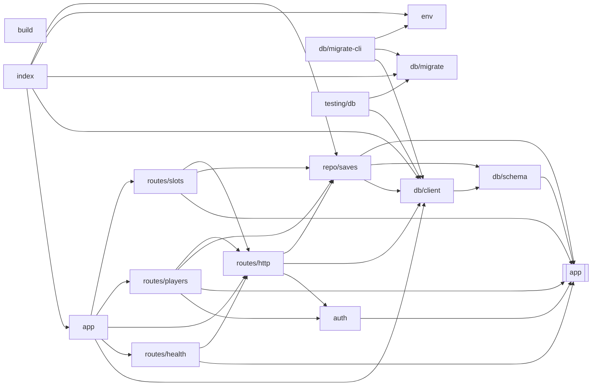

<!-- Generated by tools/codemap.ts. Do not edit by hand: run `npm run docs:codemap`. -->

# Code map: server

The cloud-save API: the Fastify app, its routes, the PostgreSQL repository and Drizzle schema, migrations and player-code auth. It may import only src/core and the save format/protocol.

Generated reference. Start with the [guide](../../architecture/code-map.md) for the flows, and the [index](README.md) for how to read these entries.

## Imports inside this area

*Imports of src/core are left out: nearly every file has them. Double-bordered boxes are other areas.*

## Files

| File | Purpose |
|---|---|
| [server/app.ts](#server-app-ts) | The HTTP server: the cloud-save API under /api, and (in the production image) the built game. |
| [server/auth.ts](#server-auth-ts) | Anonymous player credentials. |
| [server/build.ts](#server-build-ts) | `npm run build:server`: bundle the server and its dependencies into one file, dist-server/index.mjs, so the runtime image needs no node_modules. |
| [server/db/client.ts](#server-db-client-ts) | The connection pool and the typed Drizzle handle every repository function takes. |
| [server/db/migrate-cli.ts](#server-db-migrate-cli-ts) | `npm run db:migrate`: apply pending migrations to DATABASE_URL and exit. |
| [server/db/migrate.ts](#server-db-migrate-ts) | Apply pending migrations. |
| [server/db/schema.ts](#server-db-schema-ts) | The database tables (Drizzle). |
| [server/env.ts](#server-env-ts) | Server configuration, read once from the environment and validated, so a typo in compose.yaml fails at startup with a clear message instead of at the first req… |
| [server/index.ts](#server-index-ts) | Server entry point: read the config, migrate the database, listen. |
| [server/repo/saves.ts](#server-repo-saves-ts) | Players, slots and checkpoints in Postgres. |
| [server/routes/health.ts](#server-routes-health-ts) | GET /api/health: the compose healthcheck and the client's "is cloud saving available?" probe. |
| [server/routes/http.ts](#server-routes-http-ts) | Small helpers the route modules share: body parsing with the protocol schemas, and auth. |
| [server/routes/players.ts](#server-routes-players-ts) | Anonymous players: create one (the device's first sync), or check who a secret belongs to. |
| [server/routes/slots.ts](#server-routes-slots-ts) | Save slots: list, read, write, delete, history and restore. |
| [server/testing/db.ts](#server-testing-db-ts) | The real Postgres the server tests run against: DATABASE_URL_TEST, or the dev stack's test database on localhost. |

## Details

### server/app.ts

The HTTP server: the cloud-save API under /api, and (in the production image) the built game. `buildApp` takes its dependencies so tests can drive it with `app.inject` against a test database.

- Source: [server/app.ts](../../../server/app.ts)
- Imports: server: [db/client](#server-db-client-ts), [routes/health](#server-routes-health-ts), [routes/http](#server-routes-http-ts), [routes/players](#server-routes-players-ts), [routes/slots](#server-routes-slots-ts)
- Packages: `@fastify/rate-limit`, `@fastify/static`, `fastify`, `node:path`
- Imported by: server: [index](#server-index-ts)
- Tested by: [app.test](tests.md#server-app-test-ts), [sync.test](tests.md#server-sync-test-ts)
- Types used: **[server/db/client](#server-db-client-ts)** [Db](#server-db-client-ts--db) · **[server/routes/http](#server-routes-http-ts)** [RouteDeps](#server-routes-http-ts--routedeps)

Declarations:

- **AppOptions** · *interface* — Options for building the server.
  - used by: here [buildApp](#server-app-ts--buildapp)
- **BODY_LIMIT** · *const, internal* — Largest request body: a save is a few kilobytes, so this is generous.
  - used by: here [buildApp](#server-app-ts--buildapp)
- **CSP** · *const, internal* — Same-origin only.
  - used by: here [buildApp](#server-app-ts--buildapp)
- **buildApp** · *function* `(opts: AppOptions): Promise<FastifyInstance>` — Build the server (not listening yet).
  - uses: here [BODY_LIMIT](#server-app-ts--body-limit), [CSP](#server-app-ts--csp) · **[server/routes/health](#server-routes-health-ts)** [healthRoutes](#server-routes-health-ts--healthroutes) · **[server/routes/players](#server-routes-players-ts)** [playerRoutes](#server-routes-players-ts--playerroutes) · **[server/routes/slots](#server-routes-slots-ts)** [slotRoutes](#server-routes-slots-ts--slotroutes)
  - used by: **[server/index](#server-index-ts)** [app](#server-index-ts--app) · tests: [app.test](tests.md#server-app-test-ts), [sync.test](tests.md#server-sync-test-ts)

### server/auth.ts

Anonymous player credentials. A secret is 120 random bits; the database keeps only its SHA-256, so a leaked database can't be used to load anyone's saves. A slow hash (scrypt) isn't needed because the secret is random, not a password a person chose.

- Source: [server/auth.ts](../../../server/auth.ts)
- Imports: app: [save/protocol](app.md#src-app-save-protocol-ts)
- Packages: `node:crypto`
- Imported by: server: [routes/http](#server-routes-http-ts), [routes/players](#server-routes-players-ts)

Declarations:

- **newSecret** · *function* `(): string` — A new player secret.
  - uses: **[app/save/protocol](app.md#src-app-save-protocol-ts)** [SECRET_BYTES](app.md#src-app-save-protocol-ts--secret-bytes), [encodeSecret](app.md#src-app-save-protocol-ts--encodesecret)
  - used by: **[server/routes/players](#server-routes-players-ts)** [playerRoutes](#server-routes-players-ts--playerroutes)
- **hashSecret** · *function* `(secret: string): string` — What the database stores for a secret.
  - used by: **[server/routes/http](#server-routes-http-ts)** [authed](#server-routes-http-ts--authed) · **[server/routes/players](#server-routes-players-ts)** [playerRoutes](#server-routes-players-ts--playerroutes)
- **bearerSecret** · *function* `(header: string | undefined): string | null` — The secret in an `Authorization: Bearer …` header (a raw secret or a player code), or null.
  - uses: **[app/save/protocol](app.md#src-app-save-protocol-ts)** [parsePlayerCode](app.md#src-app-save-protocol-ts--parseplayercode)
  - used by: **[server/routes/http](#server-routes-http-ts)** [authed](#server-routes-http-ts--authed)

### server/build.ts

`npm run build:server`: bundle the server and its dependencies into one file, dist-server/index.mjs, so the runtime image needs no node_modules.

- Source: [server/build.ts](../../../server/build.ts)
- Packages: `esbuild`

Declarations:

- **(top level)** · *module* — Statements that run when the module loads.

### server/db/client.ts

The connection pool and the typed Drizzle handle every repository function takes.

- Source: [server/db/client.ts](../../../server/db/client.ts)
- Imports: server: [db/schema](#server-db-schema-ts)
- Packages: `drizzle-orm`, `pg`
- Imported by: server: [app](#server-app-ts), [db/migrate-cli](#server-db-migrate-cli-ts), [index](#server-index-ts), [repo/saves](#server-repo-saves-ts), [routes/http](#server-routes-http-ts), [testing/db](#server-testing-db-ts)

Declarations:

- **Db** · *type* `= ReturnType<typeof connect>['db']` — A database handle.
  - used by: **[server/app](#server-app-ts)** [AppOptions](#server-app-ts--appoptions) · **[server/repo/saves](#server-repo-saves-ts)** [createPlayer](#server-repo-saves-ts--createplayer), [deleteSlot](#server-repo-saves-ts--deleteslot), [findPlayer](#server-repo-saves-ts--findplayer), [getSlot](#server-repo-saves-ts--getslot), [listSlots](#server-repo-saves-ts--listslots), [pruneIdlePlayers](#server-repo-saves-ts--pruneidleplayers), [putSlot](#server-repo-saves-ts--putslot), [restoreCheckpoint](#server-repo-saves-ts--restorecheckpoint), [slotHistory](#server-repo-saves-ts--slothistory), [trimHistory](#server-repo-saves-ts--trimhistory) · **[server/routes/http](#server-routes-http-ts)** [RouteDeps](#server-routes-http-ts--routedeps), [authed](#server-routes-http-ts--authed)
- **connect** · *function* `(url: string): { db: NodePgDatabase<typeof schema> & { $client: Pool; }; pool: Pool; }` — Open a pool.
  - used by: here [Db](#server-db-client-ts--db) · **[server/db/migrate-cli](#server-db-migrate-cli-ts)** [(top level)](#server-db-migrate-cli-ts--top-level) · **[server/index](#server-index-ts)** [(top level)](#server-index-ts--top-level) · **[server/testing/db](#server-testing-db-ts)** [testDb](#server-testing-db-ts--testdb)

### server/db/migrate-cli.ts

`npm run db:migrate`: apply pending migrations to DATABASE_URL and exit.

- Source: [server/db/migrate-cli.ts](../../../server/db/migrate-cli.ts)
- Imports: server: [db/client](#server-db-client-ts), [db/migrate](#server-db-migrate-ts), [env](#server-env-ts)

Declarations:

- **env** · *const, internal*
  - uses: **[server/env](#server-env-ts)** [readEnv](#server-env-ts--readenv)
  - used by: here [(top level)](#server-db-migrate-cli-ts--top-level)
- **(top level)** · *module* — Statements that run when the module loads.
  - uses: here [env](#server-db-migrate-cli-ts--env) · **[server/db/client](#server-db-client-ts)** [connect](#server-db-client-ts--connect) · **[server/db/migrate](#server-db-migrate-ts)** [runMigrations](#server-db-migrate-ts--runmigrations)

### server/db/migrate.ts

Apply pending migrations. The server runs this at startup; `npm run db:migrate` (migrate-cli.ts) runs it by hand. An advisory lock makes concurrent starts (two replicas, or a restart loop) take turns.

- Source: [server/db/migrate.ts](../../../server/db/migrate.ts)
- Packages: `drizzle-orm`, `pg`
- Imported by: server: [db/migrate-cli](#server-db-migrate-cli-ts), [index](#server-index-ts), [testing/db](#server-testing-db-ts)

Declarations:

- **LOCK** · *const, internal* — pg_advisory_lock key for migrations ("cfmg").
  - used by: here [runMigrations](#server-db-migrate-ts--runmigrations)
- **runMigrations** · *function* `(pool: pg.Pool, folder: string): Promise<void>` — Run every migration in `folder` that this database hasn't seen.
  - uses: here [LOCK](#server-db-migrate-ts--lock)
  - used by: **[server/db/migrate-cli](#server-db-migrate-cli-ts)** [(top level)](#server-db-migrate-cli-ts--top-level) · **[server/index](#server-index-ts)** [(top level)](#server-index-ts--top-level) · **[server/testing/db](#server-testing-db-ts)** [testDb](#server-testing-db-ts--testdb)

### server/db/schema.ts

The database tables (Drizzle). Change a table here, then run `npm run db:generate` to write the SQL migration into server/db/migrations, and commit both. Never edit a migration that has shipped.

- Source: [server/db/schema.ts](../../../server/db/schema.ts)
- Imports: app: [save/format](app.md#src-app-save-format-ts)
- Packages: `drizzle-orm`
- Imported by: server: [db/client](#server-db-client-ts), [repo/saves](#server-repo-saves-ts)
- Tested by: [app.test](tests.md#server-app-test-ts)
- Types used: **[app/save/format](app.md#src-app-save-format-ts)** [SaveSummary](app.md#src-app-save-format-ts--savesummary)

Declarations:

- **at** · *function, internal* `(name: string): PgTimestampBuilderInitial<string>`
  - used by: here [players](#server-db-schema-ts--players), [saveHistory](#server-db-schema-ts--savehistory), [saves](#server-db-schema-ts--saves)
- **players** · *const* — Anonymous players.
  - uses: here [at](#server-db-schema-ts--at)
  - used by: here [saveHistory](#server-db-schema-ts--savehistory), [saves](#server-db-schema-ts--saves) · **[server/repo/saves](#server-repo-saves-ts)** [createPlayer](#server-repo-saves-ts--createplayer), [findPlayer](#server-repo-saves-ts--findplayer), [pruneIdlePlayers](#server-repo-saves-ts--pruneidleplayers) · tests: [app.test](tests.md#server-app-test-ts)
- **saves** · *const* — The head of each slot.
  - uses: here [at](#server-db-schema-ts--at), [players](#server-db-schema-ts--players)
  - used by: **[server/repo/saves](#server-repo-saves-ts)** [SaveRow](#server-repo-saves-ts--saverow), [deleteSlot](#server-repo-saves-ts--deleteslot), [getSlot](#server-repo-saves-ts--getslot), [listSlots](#server-repo-saves-ts--listslots), [pruneIdlePlayers](#server-repo-saves-ts--pruneidleplayers), [putSlot](#server-repo-saves-ts--putslot), [restoreCheckpoint](#server-repo-saves-ts--restorecheckpoint)
- **saveHistory** · *const* — Recent checkpoints per slot (the newest HISTORY_LIMIT are kept), for rolling a slot back.
  - uses: here [at](#server-db-schema-ts--at), [players](#server-db-schema-ts--players)
  - used by: **[server/repo/saves](#server-repo-saves-ts)** [putSlot](#server-repo-saves-ts--putslot), [restoreCheckpoint](#server-repo-saves-ts--restorecheckpoint), [slotHistory](#server-repo-saves-ts--slothistory), [trimHistory](#server-repo-saves-ts--trimhistory)

### server/env.ts

Server configuration, read once from the environment and validated, so a typo in compose.yaml fails at startup with a clear message instead of at the first request.

- Source: [server/env.ts](../../../server/env.ts)
- Packages: `zod`
- Imported by: server: [db/migrate-cli](#server-db-migrate-cli-ts), [index](#server-index-ts)

Declarations:

- **schema** · *const, internal*
  - used by: here [Env](#server-env-ts--env), [readEnv](#server-env-ts--readenv)
- **Env** · *type* `= z.infer<typeof schema>` — Validated server configuration.
  - used by: here [readEnv](#server-env-ts--readenv)
- **readEnv** · *function* `(source: NodeJS.ProcessEnv = process.env): Env` — Read and validate the environment; throws listing every problem.
  - uses: here [schema](#server-env-ts--schema)
  - used by: **[server/db/migrate-cli](#server-db-migrate-cli-ts)** [env](#server-db-migrate-cli-ts--env) · **[server/index](#server-index-ts)** [env](#server-index-ts--env)

### server/index.ts

Server entry point: read the config, migrate the database, listen. In the Docker image this is bundled to dist-server/index.mjs; in development `npm run dev:server` runs it with tsx watch.

- Source: [server/index.ts](../../../server/index.ts)
- Imports: server: [app](#server-app-ts), [db/client](#server-db-client-ts), [db/migrate](#server-db-migrate-ts), [env](#server-env-ts), [repo/saves](#server-repo-saves-ts)

Declarations:

- **env** · *const, internal*
  - uses: **[server/env](#server-env-ts)** [readEnv](#server-env-ts--readenv)
  - used by: here [(top level)](#server-index-ts--top-level), [app](#server-index-ts--app)
- **(top level)** · *module* — Statements that run when the module loads.
  - uses: here [app](#server-index-ts--app), [env](#server-index-ts--env), [prune](#server-index-ts--prune), [shutdown](#server-index-ts--shutdown) · **[server/db/client](#server-db-client-ts)** [connect](#server-db-client-ts--connect) · **[server/db/migrate](#server-db-migrate-ts)** [runMigrations](#server-db-migrate-ts--runmigrations)
- **app** · *const, internal*
  - uses: here [env](#server-index-ts--env) · **[server/app](#server-app-ts)** [buildApp](#server-app-ts--buildapp)
  - used by: here [(top level)](#server-index-ts--top-level), [prune](#server-index-ts--prune), [shutdown](#server-index-ts--shutdown)
- **prune** · *const, internal*
  - uses: here [app](#server-index-ts--app) · **[server/repo/saves](#server-repo-saves-ts)** [pruneIdlePlayers](#server-repo-saves-ts--pruneidleplayers)
  - used by: here [(top level)](#server-index-ts--top-level), [shutdown](#server-index-ts--shutdown)
- **shutdown** · *function, internal* `(signal: string): Promise<void>`
  - uses: here [app](#server-index-ts--app), [prune](#server-index-ts--prune)
  - used by: here [(top level)](#server-index-ts--top-level)

### server/repo/saves.ts

Players, slots and checkpoints in Postgres. Every write to a slot runs in one transaction that locks the slot's row, so two devices saving at once can't both win: the second gets a conflict.

- Source: [server/repo/saves.ts](../../../server/repo/saves.ts)
- Imports: core: [ids/saves](core.md#src-core-ids-saves-ts) · app: [save/format](app.md#src-app-save-format-ts), [save/protocol](app.md#src-app-save-protocol-ts) · server: [db/client](#server-db-client-ts), [db/schema](#server-db-schema-ts)
- Packages: `drizzle-orm`
- Imported by: server: [index](#server-index-ts), [routes/http](#server-routes-http-ts), [routes/players](#server-routes-players-ts), [routes/slots](#server-routes-slots-ts)
- Tested by: [app.test](tests.md#server-app-test-ts)
- Types used: **[server/db/client](#server-db-client-ts)** [Db](#server-db-client-ts--db) · **[server/db/schema](#server-db-schema-ts)** [saves](#server-db-schema-ts--saves) · **[app/save/format](app.md#src-app-save-format-ts)** [SaveSummary](app.md#src-app-save-format-ts--savesummary) · **[app/save/protocol](app.md#src-app-save-protocol-ts)** [RemoteSlot](app.md#src-app-save-protocol-ts--remoteslot) · **[core/ids/saves](core.md#src-core-ids-saves-ts)** [SaveSlotId](core.md#src-core-ids-saves-ts--saveslotid)

Declarations:

- **IncomingSave** · *interface* — A save to store: the envelope text plus what the server read out of it.
  - used by: here [liveColumns](#server-repo-saves-ts--livecolumns), [putSlot](#server-repo-saves-ts--putslot)
- **WriteResult** · *type* `= union of 3` — The outcome of a write.
  - used by: here [deleteSlot](#server-repo-saves-ts--deleteslot), [putSlot](#server-repo-saves-ts--putslot), [restoreCheckpoint](#server-repo-saves-ts--restorecheckpoint) · **[server/routes/slots](#server-routes-slots-ts)** [sendWrite](#server-routes-slots-ts--sendwrite)
- **SaveRow** · *type, internal* `= typeof saves.$inferSelect`
  - used by: here [remote](#server-repo-saves-ts--remote)
- **remote** · *function, internal* `(row: SaveRow): RemoteSlot` — A slot row as the API reports it.
  - used by: here [deleteSlot](#server-repo-saves-ts--deleteslot), [listSlots](#server-repo-saves-ts--listslots), [putSlot](#server-repo-saves-ts--putslot)
- **liveColumns** · *function, internal* `(save: IncomingSave): { updatedAt: Date; name: string; cls: ClassId; level: number; act: ActId; step: string; district: DistrictId; ngPlus: number; formatVersion: number…` — The columns a live save writes.
  - used by: here [putSlot](#server-repo-saves-ts--putslot)
- **createPlayer** · *function* `(db: Db, secretHash: string): Promise<{ id: string }>` — Create a player.
  - uses: **[server/db/schema](#server-db-schema-ts)** [players](#server-db-schema-ts--players)
  - used by: **[server/routes/players](#server-routes-players-ts)** [playerRoutes](#server-routes-players-ts--playerroutes)
- **findPlayer** · *function* `(db: Db, secretHash: string): Promise<{ id: string; createdAt: Date } | null>` — The player with this secret hash (and note that they were seen).
  - uses: **[server/db/schema](#server-db-schema-ts)** [players](#server-db-schema-ts--players)
  - used by: **[server/routes/http](#server-routes-http-ts)** [authed](#server-routes-http-ts--authed)
- **listSlots** · *function* `(db: Db, playerId: string): Promise<RemoteSlot[]>` — Every slot the player has used, deleted ones included.
  - uses: here [remote](#server-repo-saves-ts--remote) · **[server/db/schema](#server-db-schema-ts)** [saves](#server-db-schema-ts--saves)
  - used by: **[server/routes/slots](#server-routes-slots-ts)** [slotRoutes](#server-routes-slots-ts--slotroutes)
- **getSlot** · *function* `(db: Db, playerId: string, slot: SaveSlotId): Promise<{ revision: number; savedAt: string; raw: string | null } | null>` — One slot's head, with the save text.
  - uses: **[server/db/schema](#server-db-schema-ts)** [saves](#server-db-schema-ts--saves)
  - used by: **[server/routes/slots](#server-routes-slots-ts)** [slotRoutes](#server-routes-slots-ts--slotroutes)
- **putSlot** · *function* `(db: Db, playerId: string, slot: SaveSlotId, save: IncomingSave, baseRevision: number | null): Promise<WriteResult>` — Store a save in a slot if `baseRevision` is still current (see the rules at the top).
  - uses: here [liveColumns](#server-repo-saves-ts--livecolumns), [remote](#server-repo-saves-ts--remote), [trimHistory](#server-repo-saves-ts--trimhistory) · **[server/db/schema](#server-db-schema-ts)** [saveHistory](#server-db-schema-ts--savehistory), [saves](#server-db-schema-ts--saves)
  - used by: here [restoreCheckpoint](#server-repo-saves-ts--restorecheckpoint) · **[server/routes/slots](#server-routes-slots-ts)** [slotRoutes](#server-routes-slots-ts--slotroutes)
- **deleteSlot** · *function* `(db: Db, playerId: string, slot: SaveSlotId, baseRevision: number): Promise<WriteResult>` — Delete a slot (leaving a tombstone) if `baseRevision` is still current.
  - uses: here [remote](#server-repo-saves-ts--remote) · **[server/db/schema](#server-db-schema-ts)** [saves](#server-db-schema-ts--saves)
  - used by: **[server/routes/slots](#server-routes-slots-ts)** [slotRoutes](#server-routes-slots-ts--slotroutes)
- **slotHistory** · *function* `(db: Db, playerId: string, slot: SaveSlotId): Promise<{ revision: number; savedAt: string; summary: SaveSummary }[]>` — A slot's recent checkpoints, newest first.
  - uses: **[server/db/schema](#server-db-schema-ts)** [saveHistory](#server-db-schema-ts--savehistory) · **[app/save/protocol](app.md#src-app-save-protocol-ts)** [HISTORY_LIMIT](app.md#src-app-save-protocol-ts--history-limit)
  - used by: **[server/routes/slots](#server-routes-slots-ts)** [slotRoutes](#server-routes-slots-ts--slotroutes)
- **restoreCheckpoint** · *function* `(db: Db, playerId: string, slot: SaveSlotId, revision: number): Promise<WriteResult>` — Make an old checkpoint the slot's newest revision (itself a new checkpoint).
  - uses: here [putSlot](#server-repo-saves-ts--putslot) · **[server/db/schema](#server-db-schema-ts)** [saveHistory](#server-db-schema-ts--savehistory), [saves](#server-db-schema-ts--saves)
  - used by: **[server/routes/slots](#server-routes-slots-ts)** [slotRoutes](#server-routes-slots-ts--slotroutes)
- **trimHistory** · *function, internal* `(tx: Pick<Db, 'execute'>, playerId: string, slot: SaveSlotId): Promise<void>` — Keep the newest HISTORY_LIMIT checkpoints of a slot.
  - uses: **[server/db/schema](#server-db-schema-ts)** [saveHistory](#server-db-schema-ts--savehistory) · **[app/save/protocol](app.md#src-app-save-protocol-ts)** [HISTORY_LIMIT](app.md#src-app-save-protocol-ts--history-limit)
  - used by: here [putSlot](#server-repo-saves-ts--putslot)
- **pruneIdlePlayers** · *function* `(db: Db, olderThanDays = 30): Promise<number>` — Forget players who never kept a save, a while after they were created.
  - uses: **[server/db/schema](#server-db-schema-ts)** [players](#server-db-schema-ts--players), [saves](#server-db-schema-ts--saves)
  - used by: **[server/index](#server-index-ts)** [prune](#server-index-ts--prune) · tests: [app.test](tests.md#server-app-test-ts)

### server/routes/health.ts

GET /api/health: the compose healthcheck and the client's "is cloud saving available?" probe.

- Source: [server/routes/health.ts](../../../server/routes/health.ts)
- Imports: app: [save/protocol](app.md#src-app-save-protocol-ts) · server: [routes/http](#server-routes-http-ts)
- Packages: `drizzle-orm`, `fastify`, `zod`
- Imported by: server: [app](#server-app-ts)
- Types used: **[server/routes/http](#server-routes-http-ts)** [RouteDeps](#server-routes-http-ts--routedeps) · **[app/save/protocol](app.md#src-app-save-protocol-ts)** [healthResponse](app.md#src-app-save-protocol-ts--healthresponse)

Declarations:

- **healthRoutes** · *function* `(app: FastifyInstance, deps: RouteDeps): void`
  - used by: **[server/app](#server-app-ts)** [buildApp](#server-app-ts--buildapp)

### server/routes/http.ts

Small helpers the route modules share: body parsing with the protocol schemas, and auth.

- Source: [server/routes/http.ts](../../../server/routes/http.ts)
- Imports: server: [auth](#server-auth-ts), [db/client](#server-db-client-ts), [repo/saves](#server-repo-saves-ts)
- Packages: `fastify`, `zod`
- Imported by: server: [app](#server-app-ts), [routes/health](#server-routes-health-ts), [routes/players](#server-routes-players-ts), [routes/slots](#server-routes-slots-ts)
- Types used: **[server/db/client](#server-db-client-ts)** [Db](#server-db-client-ts--db)

Declarations:

- **RouteDeps** · *interface* — What the route modules need.
  - used by: **[server/app](#server-app-ts)** [AppOptions](#server-app-ts--appoptions), [buildApp](#server-app-ts--buildapp) · **[server/routes/health](#server-routes-health-ts)** [healthRoutes](#server-routes-health-ts--healthroutes) · **[server/routes/players](#server-routes-players-ts)** [playerRoutes](#server-routes-players-ts--playerroutes) · **[server/routes/slots](#server-routes-slots-ts)** [slotRoutes](#server-routes-slots-ts--slotroutes)
- **parse** · *function* `<S extends z.ZodType>(schema: S, value: unknown, reply: FastifyReply): z.output<S> | null` — Parse with a protocol schema; on failure, answer 400 and return null.
  - used by: **[server/routes/slots](#server-routes-slots-ts)** [slotRoutes](#server-routes-slots-ts--slotroutes)
- **authed** · *function* `(db: Db, req: FastifyRequest, reply: FastifyReply): Promise<{ id: string; createdAt: Date } | null>` — The calling player; on a missing or unknown secret, answer 401 and return null.
  - uses: **[server/auth](#server-auth-ts)** [bearerSecret](#server-auth-ts--bearersecret), [hashSecret](#server-auth-ts--hashsecret) · **[server/repo/saves](#server-repo-saves-ts)** [findPlayer](#server-repo-saves-ts--findplayer)
  - used by: **[server/routes/players](#server-routes-players-ts)** [playerRoutes](#server-routes-players-ts--playerroutes) · **[server/routes/slots](#server-routes-slots-ts)** [slotRoutes](#server-routes-slots-ts--slotroutes)

### server/routes/players.ts

Anonymous players: create one (the device's first sync), or check who a secret belongs to.

- Source: [server/routes/players.ts](../../../server/routes/players.ts)
- Imports: app: [save/protocol](app.md#src-app-save-protocol-ts) · server: [auth](#server-auth-ts), [repo/saves](#server-repo-saves-ts), [routes/http](#server-routes-http-ts)
- Packages: `fastify`, `zod`
- Imported by: server: [app](#server-app-ts)
- Types used: **[server/routes/http](#server-routes-http-ts)** [RouteDeps](#server-routes-http-ts--routedeps) · **[app/save/protocol](app.md#src-app-save-protocol-ts)** [createPlayerResponse](app.md#src-app-save-protocol-ts--createplayerresponse), [meResponse](app.md#src-app-save-protocol-ts--meresponse)

Declarations:

- **playerRoutes** · *function* `(app: FastifyInstance, deps: RouteDeps): void`
  - uses: **[server/auth](#server-auth-ts)** [hashSecret](#server-auth-ts--hashsecret), [newSecret](#server-auth-ts--newsecret) · **[server/repo/saves](#server-repo-saves-ts)** [createPlayer](#server-repo-saves-ts--createplayer) · **[server/routes/http](#server-routes-http-ts)** [authed](#server-routes-http-ts--authed)
  - used by: **[server/app](#server-app-ts)** [buildApp](#server-app-ts--buildapp)

### server/routes/slots.ts

Save slots: list, read, write, delete, history and restore. Every upload is decoded with the game's own `decodeSave`, so the database only ever holds saves the game can load.

- Source: [server/routes/slots.ts](../../../server/routes/slots.ts)
- Imports: app: [save/format](app.md#src-app-save-format-ts), [save/protocol](app.md#src-app-save-protocol-ts) · server: [repo/saves](#server-repo-saves-ts), [routes/http](#server-routes-http-ts)
- Packages: `fastify`, `zod`
- Imported by: server: [app](#server-app-ts)
- Types used: **[server/repo/saves](#server-repo-saves-ts)** [WriteResult](#server-repo-saves-ts--writeresult) · **[server/routes/http](#server-routes-http-ts)** [RouteDeps](#server-routes-http-ts--routedeps) · **[app/save/protocol](app.md#src-app-save-protocol-ts)** [conflictResponse](app.md#src-app-save-protocol-ts--conflictresponse), [getSlotResponse](app.md#src-app-save-protocol-ts--getslotresponse), [historyResponse](app.md#src-app-save-protocol-ts--historyresponse), [listSlotsResponse](app.md#src-app-save-protocol-ts--listslotsresponse), [rejectedResponse](app.md#src-app-save-protocol-ts--rejectedresponse), [writeOkResponse](app.md#src-app-save-protocol-ts--writeokresponse)

Declarations:

- **sendWrite** · *function, internal* `(reply: FastifyReply, r: WriteResult): FastifyReply<RouteGenericInterface, RawServerDefault, IncomingMessage, ServerResponse<IncomingMessage>, unknown, FastifySchema, Fa…` — Answer a write: 200 with the new head, 409 with what the slot holds now, or 404.
  - used by: here [slotRoutes](#server-routes-slots-ts--slotroutes)
- **slotRoutes** · *function* `(app: FastifyInstance, deps: RouteDeps): void`
  - uses: here [sendWrite](#server-routes-slots-ts--sendwrite) · **[server/repo/saves](#server-repo-saves-ts)** [deleteSlot](#server-repo-saves-ts--deleteslot), [getSlot](#server-repo-saves-ts--getslot), [listSlots](#server-repo-saves-ts--listslots), [putSlot](#server-repo-saves-ts--putslot), [restoreCheckpoint](#server-repo-saves-ts--restorecheckpoint), [slotHistory](#server-repo-saves-ts--slothistory) · **[server/routes/http](#server-routes-http-ts)** [authed](#server-routes-http-ts--authed), [parse](#server-routes-http-ts--parse) · **[app/save/format](app.md#src-app-save-format-ts)** [decodeSave](app.md#src-app-save-format-ts--decodesave), [summarize](app.md#src-app-save-format-ts--summarize) · **[app/save/protocol](app.md#src-app-save-protocol-ts)** [deleteSlotQuery](app.md#src-app-save-protocol-ts--deleteslotquery), [putSlotRequest](app.md#src-app-save-protocol-ts--putslotrequest), [restoreRequest](app.md#src-app-save-protocol-ts--restorerequest), [slotParamSchema](app.md#src-app-save-protocol-ts--slotparamschema)
  - used by: **[server/app](#server-app-ts)** [buildApp](#server-app-ts--buildapp)

### server/testing/db.ts

The real Postgres the server tests run against: DATABASE_URL_TEST, or the dev stack's test database on localhost. Start it with `docker compose -f compose.dev.yaml up -d db`.

- Source: [server/testing/db.ts](../../../server/testing/db.ts)
- Imports: server: [db/client](#server-db-client-ts), [db/migrate](#server-db-migrate-ts)
- Packages: `drizzle-orm`
- Tested by: [app.test](tests.md#server-app-test-ts), [sync.test](tests.md#server-sync-test-ts)

Declarations:

- **DEFAULT_URL** · *const, internal* — The dev stack's test database (compose.dev.yaml creates it).
  - used by: here [testDb](#server-testing-db-ts--testdb)
- **testDb** · *function* `(): Promise<{ db: NodePgDatabase<typeof import("../db/schema")> & { $client: Pool; }; pool: Pool; reset: () => PgRaw<QueryResult<Record<string, unknown>>>; }>` — Connect, migrate, and hand back a way to empty every table between tests.
  - uses: here [DEFAULT_URL](#server-testing-db-ts--default-url) · **[server/db/client](#server-db-client-ts)** [connect](#server-db-client-ts--connect) · **[server/db/migrate](#server-db-migrate-ts)** [runMigrations](#server-db-migrate-ts--runmigrations)
  - used by: tests: [app.test](tests.md#server-app-test-ts), [sync.test](tests.md#server-sync-test-ts)
