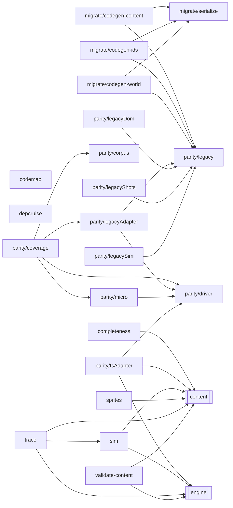

<!-- Generated by tools/codemap.ts. Do not edit by hand: run `npm run docs:codemap`. -->

# Code map: tools

Node scripts: the parity oracles against v1, the balance sim and fight trace, the content validator, the layer check, the one-time migration codegen, and this generator.

Generated reference. Start with the [guide](../../architecture/code-map.md) for the flows, and the [index](README.md) for how to read these entries.

## Imports inside this area

*Imports of src/core are left out: nearly every file has them. Double-bordered boxes are other areas.*

## Files

| File | Purpose |
|---|---|
| [tools/codemap.ts](#tools-codemap-ts) | Generates the code map reference in docs/reference/code-map/: every source file, its declarations and class members, and who uses what, read from the TypeScrip… |
| [tools/completeness.ts](#tools-completeness-ts) | Is the game whole? |
| [tools/depcruise.ts](#tools-depcruise-ts) | Enforces the layer rules in .dependency-cruiser.cjs (see docs/adr/0002-layering.md). |
| [tools/migrate/codegen-content.ts](#tools-migrate-codegen-content-ts) | One-time migration: writes the combat/data content files under src/content from the legacy tables, preserving every value and the legacy key order. |
| [tools/migrate/codegen-ids.ts](#tools-migrate-codegen-ids-ts) | One-time migration: writes src/core/ids/*.ts from the legacy tables, preserving legacy key order (which the engine relies on for iteration). |
| [tools/migrate/codegen-world.ts](#tools-migrate-codegen-world-ts) | One-time migration: writes the world data tables (places, NPCs, quests, glossary) from legacy. |
| [tools/migrate/serialize.ts](#tools-migrate-serialize-ts) | Turns legacy table values into TypeScript source text. |
| [tools/parity/corpus.ts](#tools-parity-corpus-ts) | — |
| [tools/parity/coverage.ts](#tools-parity-coverage-ts) | Runs the parity corpus against the legacy engine only. |
| [tools/parity/driver.ts](#tools-parity-driver-ts) | The shared parity driver. |
| [tools/parity/legacy.ts](#tools-parity-legacy-ts) | Loads the legacy engine (legacy/src/01–05) into a Node vm context with a seeded Math.random, so the parity oracles can replay any fight draw-for-draw against t… |
| [tools/parity/legacyAdapter.ts](#tools-parity-legacyadapter-ts) | EngineAdapter over the legacy vm engine, plus the ContentFacts the corpus generator needs. |
| [tools/parity/legacyDom.ts](#tools-parity-legacydom-ts) | Loads the full legacy game (legacy/dist/cyberfunk.html) into jsdom with a controllable Math.random, for the two oracles that need code living in the legacy UI… |
| [tools/parity/legacyShots.ts](#tools-parity-legacyshots-ts) | Captures reference screenshots of the legacy game at 360×740 (a TypeScript port of legacy/test/shots.py), for side-by-side review while the React UI is rebuilt. |
| [tools/parity/legacySim.ts](#tools-parity-legacysim-ts) | Runs legacy/sim/sim.js with a seeded Math.random and returns its stdout. |
| [tools/parity/micro.ts](#tools-parity-micro-ts) | Hand-written fight setups for engine branches the random corpus rarely reaches. |
| [tools/parity/tsAdapter.ts](#tools-parity-tsadapter-ts) | EngineAdapter over the TypeScript engine, mirroring legacyAdapter.ts field for field so the shared driver can compare traces. |
| [tools/sim.ts](#tools-sim-ts) | Headless balance sim: every class against every district's streets and every boss, played by a simple scripted player. |
| [tools/sprites.ts](#tools-sprites-ts) | The sprite gallery. |
| [tools/trace.ts](#tools-trace-ts) | Print one fight, turn by turn, as the sim's scripted player plays it. |
| [tools/validate-content.ts](#tools-validate-content-ts) | Content checks the type system can't express. |

## Details

### tools/codemap.ts

Generates the code map reference in docs/reference/code-map/: every source file, its declarations and class members, and who uses what, read from the TypeScript program itself. The hand-written tour of the flows is docs/architecture/code-map.md.

- Source: [tools/codemap.ts](../../../tools/codemap.ts)
- Packages: `node:fs`, `node:module`, `node:path`, `node:url`, `typescript`
- Tested by: [codemap.test](tests.md#tools-codemap-test-ts)

Declarations:

- **ROOT** · *const, internal*
  - used by: here [buildModel](#tools-codemap-ts--buildmodel), [staleCodeMapPages](#tools-codemap-ts--stalecodemappages), [writeCodeMap](#tools-codemap-ts--writecodemap)
- **OUT_DIR** · *const* — Where the pages go, relative to the repo root.
  - used by: here [(top level)](#tools-codemap-ts--top-level), [staleCodeMapPages](#tools-codemap-ts--stalecodemappages), [writeCodeMap](#tools-codemap-ts--writecodemap)
- **SRC_LINK** · *const, internal*
  - used by: here [renderFile](#tools-codemap-ts--renderfile), [renderIndex](#tools-codemap-ts--renderindex)
- **GUIDE_LINK** · *const, internal*
  - used by: here [renderArea](#tools-codemap-ts--renderarea), [renderIndex](#tools-codemap-ts--renderindex)
- **REF_CAP** · *const, internal* — How many names a "uses" / "used by" line shows before "+N more".
  - used by: here [refList](#tools-codemap-ts--reflist)
- **GRAPH_FILE_LIMIT** · *const, internal* — Areas with more source files than this get a folder-level diagram instead of a file-level one.
  - used by: here [areaGraph](#tools-codemap-ts--areagraph)
- **Area** · *interface, internal*
  - used by: here [AREAS](#tools-codemap-ts--areas), [areaGraph](#tools-codemap-ts--areagraph), [renderArea](#tools-codemap-ts--renderarea)
- **AREAS** · *const, internal* `: Area[]`
  - used by: here [areaOf](#tools-codemap-ts--areaof), [fileLinks](#tools-codemap-ts--filelinks), [generateCodeMap](#tools-codemap-ts--generatecodemap), [renderIndex](#tools-codemap-ts--renderindex)
- **isTestFile** · *function, internal* `(f: string): boolean`
  - used by: here [areaOf](#tools-codemap-ts--areaof), [buildModel](#tools-codemap-ts--buildmodel)
- **inScope** · *function, internal* `(f: string): boolean`
  - used by: here [buildModel](#tools-codemap-ts--buildmodel)
- **areaOf** · *function, internal* `(f: string): string`
  - uses: here [AREAS](#tools-codemap-ts--areas), [isTestFile](#tools-codemap-ts--istestfile)
  - used by: here [areaGraph](#tools-codemap-ts--areagraph), [buildModel](#tools-codemap-ts--buildmodel), [fileLinks](#tools-codemap-ts--filelinks), [pageOf](#tools-codemap-ts--pageof), [renderIndex](#tools-codemap-ts--renderindex)
- **cmp** · *function, internal* `(a: string, b: string): 1 | 0 | -1`
  - used by: here [buildModel](#tools-codemap-ts--buildmodel), [refList](#tools-codemap-ts--reflist), [renderIndex](#tools-codemap-ts--renderindex), [sorted](#tools-codemap-ts--sorted), [staleCodeMapPages](#tools-codemap-ts--stalecodemappages)
- **sorted** · *function, internal* `(xs: Iterable<string>): string[]`
  - uses: here [cmp](#tools-codemap-ts--cmp)
  - used by: here [areaGraph](#tools-codemap-ts--areagraph), [fileLinks](#tools-codemap-ts--filelinks), [refList](#tools-codemap-ts--reflist), [renderArea](#tools-codemap-ts--renderarea), [renderFile](#tools-codemap-ts--renderfile), [renderIndex](#tools-codemap-ts--renderindex), [testList](#tools-codemap-ts--testlist)
- **Kind** · *type, internal* `= union of 14`
  - used by: here [CodeNode](#tools-codemap-ts--codenode), [buildModel](#tools-codemap-ts--buildmodel)
- **CodeNode** · *interface, internal*
  - used by: here [Model](#tools-codemap-ts--model), [buildModel](#tools-codemap-ts--buildmodel), [isTypeKind](#tools-codemap-ts--istypekind), [isUnreferenced](#tools-codemap-ts--isunreferenced), [localName](#tools-codemap-ts--localname), [nodeAnchor](#tools-codemap-ts--nodeanchor), [renderNode](#tools-codemap-ts--rendernode)
- **FileEntry** · *interface, internal*
  - used by: here [Model](#tools-codemap-ts--model), [buildModel](#tools-codemap-ts--buildmodel), [renderFile](#tools-codemap-ts--renderfile)
- **Model** · *interface, internal*
  - used by: here [areaGraph](#tools-codemap-ts--areagraph), [buildModel](#tools-codemap-ts--buildmodel), [refList](#tools-codemap-ts--reflist), [renderArea](#tools-codemap-ts--renderarea), [renderFile](#tools-codemap-ts--renderfile), [renderIndex](#tools-codemap-ts--renderindex), [renderNode](#tools-codemap-ts--rendernode)
- **isTypeKind** · *function, internal* `(n: CodeNode): boolean`
  - used by: here [buildModel](#tools-codemap-ts--buildmodel)
- **collapse** · *function, internal* `(s: string): string`
  - used by: here [buildModel](#tools-codemap-ts--buildmodel), [filePurpose](#tools-codemap-ts--filepurpose), [firstSentence](#tools-codemap-ts--firstsentence)
- **truncate** · *function, internal* `(s: string, max: number): string`
  - used by: here [buildModel](#tools-codemap-ts--buildmodel), [filePurpose](#tools-codemap-ts--filepurpose), [firstSentence](#tools-codemap-ts--firstsentence)
- **firstSentence** · *function, internal* `(text: string, max = 220): string` — First sentence of a comment, for one-line summaries.
  - uses: here [collapse](#tools-codemap-ts--collapse), [truncate](#tools-codemap-ts--truncate)
  - used by: here [buildModel](#tools-codemap-ts--buildmodel), [renderArea](#tools-codemap-ts--renderarea), [renderIndex](#tools-codemap-ts--renderindex)
- **filePurpose** · *function, internal* `(sf: ts.SourceFile): string` — The file's header comment: the leading block comment, unless it is glued to the first declaration.
  - uses: here [collapse](#tools-codemap-ts--collapse), [truncate](#tools-codemap-ts--truncate)
  - used by: here [buildModel](#tools-codemap-ts--buildmodel)
- **DECL_NAME_KINDS** · *const, internal* `= new Set(…)`
  - used by: here [isDeclarationName](#tools-codemap-ts--isdeclarationname)
- **isDeclarationName** · *function, internal* `(id: ts.Identifier): boolean` — True when `id` names the thing being declared rather than referring to something.
  - uses: here [DECL_NAME_KINDS](#tools-codemap-ts--decl-name-kinds)
  - used by: here [buildModel](#tools-codemap-ts--buildmodel)
- **hasFunctionType** · *function, internal* `(t: ts.TypeNode): boolean`
  - used by: here [isMethodLike](#tools-codemap-ts--ismethodlike)
- **isMethodLike** · *function, internal* `(m: ts.TypeElement): m is ts.MethodSignature | ts.PropertySignature`
  - uses: here [hasFunctionType](#tools-codemap-ts--hasfunctiontype)
  - used by: here [buildModel](#tools-codemap-ts--buildmodel)
- **memberName** · *function, internal* `(name: ts.PropertyName | ts.PrivateIdentifier | undefined): string | null`
  - used by: here [buildModel](#tools-codemap-ts--buildmodel)
- **unwrap** · *function, internal* `(e: ts.Expression | undefined): ts.Expression | undefined`
  - used by: here [buildModel](#tools-codemap-ts--buildmodel)
- **packageName** · *function, internal* `(spec: string): string` — Packages are reported by name: `react`, `@fastify/static`, `node:fs`.
  - used by: here [buildModel](#tools-codemap-ts--buildmodel)
- **buildModel** · *function* `(): Model`
  - uses: here [ROOT](#tools-codemap-ts--root), [areaOf](#tools-codemap-ts--areaof), [cmp](#tools-codemap-ts--cmp), [collapse](#tools-codemap-ts--collapse), [filePurpose](#tools-codemap-ts--filepurpose), [firstSentence](#tools-codemap-ts--firstsentence), [inScope](#tools-codemap-ts--inscope), [isDeclarationName](#tools-codemap-ts--isdeclarationname), [isMethodLike](#tools-codemap-ts--ismethodlike), [isTestFile](#tools-codemap-ts--istestfile), [isTypeKind](#tools-codemap-ts--istypekind), [memberName](#tools-codemap-ts--membername), [packageName](#tools-codemap-ts--packagename), [suiteTitles](#tools-codemap-ts--suitetitles), [truncate](#tools-codemap-ts--truncate), [unwrap](#tools-codemap-ts--unwrap)
  - used by: here [generateCodeMap](#tools-codemap-ts--generatecodemap)
- **suiteTitles** · *function, internal* `(sf: ts.SourceFile): string[]` — `describe('…')` titles in a test file (string literals only), for the tests page.
  - used by: here [buildModel](#tools-codemap-ts--buildmodel)
- **slug** · *function, internal* `(s: string): string`
  - used by: here [fileAnchor](#tools-codemap-ts--fileanchor), [nodeAnchor](#tools-codemap-ts--nodeanchor)
- **fileAnchor** · *function, internal* `(file: string): string`
  - uses: here [slug](#tools-codemap-ts--slug)
  - used by: here [fileLinks](#tools-codemap-ts--filelinks), [refList](#tools-codemap-ts--reflist), [renderArea](#tools-codemap-ts--renderarea), [renderFile](#tools-codemap-ts--renderfile), [renderIndex](#tools-codemap-ts--renderindex), [testList](#tools-codemap-ts--testlist)
- **nodeAnchor** · *function, internal* `(n: CodeNode): string`
  - uses: here [slug](#tools-codemap-ts--slug)
  - used by: here [refList](#tools-codemap-ts--reflist), [renderIndex](#tools-codemap-ts--renderindex), [renderNode](#tools-codemap-ts--rendernode)
- **pageOf** · *function, internal* `(file: string): string`
  - uses: here [areaOf](#tools-codemap-ts--areaof)
  - used by: here [fileLinks](#tools-codemap-ts--filelinks), [href](#tools-codemap-ts--href), [refList](#tools-codemap-ts--reflist), [renderIndex](#tools-codemap-ts--renderindex), [testList](#tools-codemap-ts--testlist)
- **shortFile** · *function, internal* `(file: string): string`
  - used by: here [refList](#tools-codemap-ts--reflist), [renderIndex](#tools-codemap-ts--renderindex), [testList](#tools-codemap-ts--testlist)
- **esc** · *function, internal* `(s: string): string`
  - used by: here [renderArea](#tools-codemap-ts--renderarea), [renderFile](#tools-codemap-ts--renderfile), [renderIndex](#tools-codemap-ts--renderindex), [renderNode](#tools-codemap-ts--rendernode)
- **code** · *function, internal* `(s: string): string`
  - used by: here [renderFile](#tools-codemap-ts--renderfile), [renderIndex](#tools-codemap-ts--renderindex), [renderNode](#tools-codemap-ts--rendernode)
- **href** · *function, internal* `(fromPage: string, file: string, anchor: string): string`
  - uses: here [pageOf](#tools-codemap-ts--pageof)
  - used by: here [fileLinks](#tools-codemap-ts--filelinks), [refList](#tools-codemap-ts--reflist), [testList](#tools-codemap-ts--testlist)
- **localName** · *function, internal* `(n: CodeNode): string` — Display name of a node inside its file: `enterPlace` for `GameApp.enterPlace`.
  - used by: here [renderNode](#tools-codemap-ts--rendernode)
- **refList** · *function, internal* `(model: Model, refs: Iterable<string>, fromFile: string, cap = REF_CAP): string`
  - uses: here [REF_CAP](#tools-codemap-ts--ref-cap), [cmp](#tools-codemap-ts--cmp), [fileAnchor](#tools-codemap-ts--fileanchor), [href](#tools-codemap-ts--href), [nodeAnchor](#tools-codemap-ts--nodeanchor), [pageOf](#tools-codemap-ts--pageof), [shortFile](#tools-codemap-ts--shortfile), [sorted](#tools-codemap-ts--sorted)
  - used by: here [renderFile](#tools-codemap-ts--renderfile), [renderNode](#tools-codemap-ts--rendernode)
- **testList** · *function, internal* `(tests: Iterable<string>, fromFile: string): string`
  - uses: here [fileAnchor](#tools-codemap-ts--fileanchor), [href](#tools-codemap-ts--href), [pageOf](#tools-codemap-ts--pageof), [shortFile](#tools-codemap-ts--shortfile), [sorted](#tools-codemap-ts--sorted)
  - used by: here [renderFile](#tools-codemap-ts--renderfile), [renderNode](#tools-codemap-ts--rendernode)
- **fileLinks** · *function, internal* `(fromFile: string, targets: Iterable<string>): string`
  - uses: here [AREAS](#tools-codemap-ts--areas), [areaOf](#tools-codemap-ts--areaof), [fileAnchor](#tools-codemap-ts--fileanchor), [href](#tools-codemap-ts--href), [pageOf](#tools-codemap-ts--pageof), [sorted](#tools-codemap-ts--sorted)
  - used by: here [renderFile](#tools-codemap-ts--renderfile)
- **isUnreferenced** · *function, internal* `(n: CodeNode): boolean`
  - used by: here [renderNode](#tools-codemap-ts--rendernode)
- **renderNode** · *function, internal* `(model: Model, n: CodeNode, depth: number): string[]`
  - uses: here [code](#tools-codemap-ts--code), [esc](#tools-codemap-ts--esc), [isUnreferenced](#tools-codemap-ts--isunreferenced), [localName](#tools-codemap-ts--localname), [nodeAnchor](#tools-codemap-ts--nodeanchor), [refList](#tools-codemap-ts--reflist), [testList](#tools-codemap-ts--testlist)
  - used by: here [renderFile](#tools-codemap-ts--renderfile)
- **renderFile** · *function, internal* `(model: Model, f: FileEntry): string[]`
  - uses: here [SRC_LINK](#tools-codemap-ts--src-link), [code](#tools-codemap-ts--code), [esc](#tools-codemap-ts--esc), [fileAnchor](#tools-codemap-ts--fileanchor), [fileLinks](#tools-codemap-ts--filelinks), [refList](#tools-codemap-ts--reflist), [renderNode](#tools-codemap-ts--rendernode), [sorted](#tools-codemap-ts--sorted), [testList](#tools-codemap-ts--testlist)
  - used by: here [renderArea](#tools-codemap-ts--renderarea)
- **mermaidId** · *function, internal* `(s: string): string`
  - used by: here [areaGraph](#tools-codemap-ts--areagraph)
- **areaGraph** · *function, internal* `(model: Model, area: Area): string[]` — File-level (or folder-level, for big areas) import graph of one area.
  - uses: here [GRAPH_FILE_LIMIT](#tools-codemap-ts--graph-file-limit), [areaOf](#tools-codemap-ts--areaof), [mermaidId](#tools-codemap-ts--mermaidid), [sorted](#tools-codemap-ts--sorted)
  - used by: here [renderArea](#tools-codemap-ts--renderarea)
- **header** · *function, internal* `(title: string): string[]`
  - used by: here [renderArea](#tools-codemap-ts--renderarea), [renderIndex](#tools-codemap-ts--renderindex)
- **renderArea** · *function, internal* `(model: Model, area: Area): string`
  - uses: here [GUIDE_LINK](#tools-codemap-ts--guide-link), [areaGraph](#tools-codemap-ts--areagraph), [esc](#tools-codemap-ts--esc), [fileAnchor](#tools-codemap-ts--fileanchor), [firstSentence](#tools-codemap-ts--firstsentence), [header](#tools-codemap-ts--header), [renderFile](#tools-codemap-ts--renderfile), [sorted](#tools-codemap-ts--sorted)
  - used by: here [generateCodeMap](#tools-codemap-ts--generatecodemap)
- **Rule** · *interface, internal*
  - used by: here [renderIndex](#tools-codemap-ts--renderindex)
- **renderIndex** · *function, internal* `(model: Model): string`
  - uses: here [AREAS](#tools-codemap-ts--areas), [GUIDE_LINK](#tools-codemap-ts--guide-link), [SRC_LINK](#tools-codemap-ts--src-link), [areaOf](#tools-codemap-ts--areaof), [cmp](#tools-codemap-ts--cmp), [code](#tools-codemap-ts--code), [esc](#tools-codemap-ts--esc), [fileAnchor](#tools-codemap-ts--fileanchor), [firstSentence](#tools-codemap-ts--firstsentence), [header](#tools-codemap-ts--header), [nodeAnchor](#tools-codemap-ts--nodeanchor), [pageOf](#tools-codemap-ts--pageof), [shortFile](#tools-codemap-ts--shortfile), [sorted](#tools-codemap-ts--sorted)
  - used by: here [generateCodeMap](#tools-codemap-ts--generatecodemap)
- **generateCodeMap** · *function* `(): Map<string, string>` — Every page, keyed by file name inside OUT_DIR.
  - uses: here [AREAS](#tools-codemap-ts--areas), [buildModel](#tools-codemap-ts--buildmodel), [renderArea](#tools-codemap-ts--renderarea), [renderIndex](#tools-codemap-ts--renderindex)
  - used by: here [(top level)](#tools-codemap-ts--top-level) · tests: [codemap.test](tests.md#tools-codemap-test-ts)
- **staleCodeMapPages** · *function* `(pages: Map<string, string>): string[]` — Pages whose committed copy differs from `pages`, plus stray pages that are no longer generated.
  - uses: here [OUT_DIR](#tools-codemap-ts--out-dir), [ROOT](#tools-codemap-ts--root), [cmp](#tools-codemap-ts--cmp)
  - used by: here [(top level)](#tools-codemap-ts--top-level) · tests: [codemap.test](tests.md#tools-codemap-test-ts)
- **writeCodeMap** · *function* `(pages: Map<string, string>): void`
  - uses: here [OUT_DIR](#tools-codemap-ts--out-dir), [ROOT](#tools-codemap-ts--root)
  - used by: here [(top level)](#tools-codemap-ts--top-level)
- **isMain** · *const, internal*
  - used by: here [(top level)](#tools-codemap-ts--top-level)
- **(top level)** · *module* — Statements that run when the module loads.
  - uses: here [OUT_DIR](#tools-codemap-ts--out-dir), [generateCodeMap](#tools-codemap-ts--generatecodemap), [isMain](#tools-codemap-ts--ismain), [staleCodeMapPages](#tools-codemap-ts--stalecodemappages), [writeCodeMap](#tools-codemap-ts--writecodemap)

### tools/completeness.ts

Is the game whole? Checks that every place has something to do, every boss has its scenes, every story step points somewhere real and every [[lexicon]] link resolves, for every district that has been ported (src/content/pending.ts lists the ones that haven't). Runs in CI as a test (completeness.test.ts) and on demand:

- Source: [tools/completeness.ts](../../../tools/completeness.ts)
- Imports: core: [ids/enemies](core.md#src-core-ids-enemies-ts), [ids/story](core.md#src-core-ids-story-ts), [ids/world](core.md#src-core-ids-world-ts), [types/index](core.md#src-core-types-index-ts) · content: [index](content.md#src-content-index-ts), [pending](content.md#src-content-pending-ts)
- Packages: `node:fs`, `node:path`, `node:url`
- Imported by: tests: [integration/support/crawl](tests.md#tests-integration-support-crawl-ts)
- Tested by: [completeness.test](tests.md#tools-completeness-test-ts)
- Types used: **[core/ids/world](core.md#src-core-ids-world-ts)** [PlaceId](core.md#src-core-ids-world-ts--placeid) · **[core/types/content](core.md#src-core-types-content-ts)** [StepDef](core.md#src-core-types-content-ts--stepdef)

Declarations:

- **ALLOWED_UNLINKED** · *const* `: Record<string, string>` — [[links]] that knowingly name no glossary entry.
  - used by: here [checkLexiconLinks](#tools-completeness-ts--checklexiconlinks) · **[tests/integration/support/crawl](tests.md#tests-integration-support-crawl-ts)** [textProblem](tests.md#tests-integration-support-crawl-ts--textproblem)
- **checkCompleteness** · *function* `(): string[]` — Every problem found, as a sentence a writer can act on.
  - uses: here [checkLexiconLinks](#tools-completeness-ts--checklexiconlinks) · **[content/bosses/index](content.md#src-content-bosses-index-ts)** [BOSSES](content.md#src-content-bosses-index-ts--bosses) · **[content/districts/index](content.md#src-content-districts-index-ts)** [DISTRICTS](content.md#src-content-districts-index-ts--districts) · **[content/index](content.md#src-content-index-ts)** [BOSS_SCENES](content.md#src-content-index-ts--boss-scenes), [PLACE_SCENES](content.md#src-content-index-ts--place-scenes) · **[content/pending](content.md#src-content-pending-ts)** [PENDING_DISTRICTS](content.md#src-content-pending-ts--pending-districts), [isPendingAct](content.md#src-content-pending-ts--ispendingact), [isPendingDistrict](content.md#src-content-pending-ts--ispendingdistrict) · **[content/places](content.md#src-content-places-ts)** [PLACES](content.md#src-content-places-ts--places) · **[content/story/acts](content.md#src-content-story-acts-ts)** [ACTS](content.md#src-content-story-acts-ts--acts) · **[core/ids/enemies](core.md#src-core-ids-enemies-ts)** [BOSS_IDS](core.md#src-core-ids-enemies-ts--boss-ids) · **[core/ids/story](core.md#src-core-ids-story-ts)** [ACT_ORDER](core.md#src-core-ids-story-ts--act-order), [ACT_STEPS](core.md#src-core-ids-story-ts--act-steps) · **[core/ids/world](core.md#src-core-ids-world-ts)** [DISTRICT_IDS](core.md#src-core-ids-world-ts--district-ids), [PLACE_IDS](core.md#src-core-ids-world-ts--place-ids)
  - used by: here [(top level)](#tools-completeness-ts--top-level) · tests: [completeness.test](tests.md#tools-completeness-test-ts)
- **LINK** · *const, internal* — The [[key]] / [[key|display]] markup the lexicon links (src/app/lexicon.ts).
  - used by: here [checkLexiconLinks](#tools-completeness-ts--checklexiconlinks)
- **checkLexiconLinks** · *function, internal* `(fail: (msg: string) => void): void` — Every explicit [[link]] in content source resolves to a glossary entry (else it renders as plain text).
  - uses: here [ALLOWED_UNLINKED](#tools-completeness-ts--allowed-unlinked), [LINK](#tools-completeness-ts--link), [stripComments](#tools-completeness-ts--stripcomments) · **[content/glossary](content.md#src-content-glossary-ts)** [GLOSSARY](content.md#src-content-glossary-ts--glossary)
  - used by: here [checkCompleteness](#tools-completeness-ts--checkcompleteness)
- **stripComments** · *function, internal* `(src: string): string` — Source with comments blanked out (kept line-for-line so line numbers stay right).
  - used by: here [checkLexiconLinks](#tools-completeness-ts--checklexiconlinks)
- **isMain** · *const, internal*
  - used by: here [(top level)](#tools-completeness-ts--top-level)
- **(top level)** · *module* — Statements that run when the module loads.
  - uses: here [checkCompleteness](#tools-completeness-ts--checkcompleteness), [isMain](#tools-completeness-ts--ismain)

### tools/depcruise.ts

Enforces the layer rules in .dependency-cruiser.cjs (see docs/adr/0002-layering.md).

- Source: [tools/depcruise.ts](../../../tools/depcruise.ts)
- Packages: `dependency-cruiser`, `node:module`

Declarations:

- **require** · *const, internal*
  - used by: here [config](#tools-depcruise-ts--config)
- **config** · *const, internal*
  - uses: here [require](#tools-depcruise-ts--require)
  - used by: here [options](#tools-depcruise-ts--options)
- **options** · *const, internal* `: ICruiseOptions`
  - uses: here [config](#tools-depcruise-ts--config)
  - used by: here [result](#tools-depcruise-ts--result)
- **tsConfig** · *const, internal*
  - used by: here [result](#tools-depcruise-ts--result)
- **result** · *const, internal*
  - uses: here [options](#tools-depcruise-ts--options), [tsConfig](#tools-depcruise-ts--tsconfig)
  - used by: here [(top level)](#tools-depcruise-ts--top-level), [output](#tools-depcruise-ts--output)
- **output** · *const, internal*
  - uses: here [result](#tools-depcruise-ts--result)
  - used by: here [(top level)](#tools-depcruise-ts--top-level)
- **(top level)** · *module* — Statements that run when the module loads.
  - uses: here [output](#tools-depcruise-ts--output), [result](#tools-depcruise-ts--result)

### tools/migrate/codegen-content.ts

One-time migration: writes the combat/data content files under src/content from the legacy tables, preserving every value and the legacy key order. Function fields are carried over as legacy source with mechanical rewrites (helpers → ops, Math.random → rng) and then reviewed by hand. After generation these files are hand-owned; this script is kept for reference and deleted at cutover.

- Source: [tools/migrate/codegen-content.ts](../../../tools/migrate/codegen-content.ts)
- Imports: tools: [migrate/serialize](#tools-migrate-serialize-ts), [parity/legacy](#tools-parity-legacy-ts)
- Packages: `node:fs`, `node:path`
- Types used: **[tools/migrate/serialize](#tools-migrate-serialize-ts)** [SerializeOptions](#tools-migrate-serialize-ts--serializeoptions)

Declarations:

- **(top level)** · *module* — Statements that run when the module loads.
  - uses: here [band](#tools-migrate-codegen-content-ts--band), [bandPassive](#tools-migrate-codegen-content-ts--bandpassive), [bossIds](#tools-migrate-codegen-content-ts--bossids), [camel](#tools-migrate-codegen-content-ts--camel), [classIds](#tools-migrate-codegen-content-ts--classids), [condSrc](#tools-migrate-codegen-content-ts--condsrc), [districtIds](#tools-migrate-codegen-content-ts--districtids), [enemies](#tools-migrate-codegen-content-ts--enemies), [enemyOpts](#tools-migrate-codegen-content-ts--enemyopts), [gearRows](#tools-migrate-codegen-content-ts--gearrows), [itemOpts](#tools-migrate-codegen-content-ts--itemopts), [items](#tools-migrate-codegen-content-ts--items), [itemsWithFns](#tools-migrate-codegen-content-ts--itemswithfns), [notes](#tools-migrate-codegen-content-ts--notes), [restoreFns](#tools-migrate-codegen-content-ts--restorefns), [roots](#tools-migrate-codegen-content-ts--roots) · … +10 more
- **ROOT** · *const, internal*
  - used by: here [write](#tools-migrate-codegen-content-ts--write)
- **write** · *function, internal* `(rel: string, body: string): void`
  - uses: here [ROOT](#tools-migrate-codegen-content-ts--root)
  - used by: here [(top level)](#tools-migrate-codegen-content-ts--top-level)
- **portFn** · *function, internal* `(src: string): string` — Mechanical rewrites of legacy function source (reviewed by hand afterwards).
  - used by: here [effectOpts](#tools-migrate-codegen-content-ts--effectopts), [restoreFns](#tools-migrate-codegen-content-ts--restorefns)
- **effectOpts** · *function, internal* `(extra: Partial<SerializeOptions> = {}): SerializeOptions`
  - uses: here [portFn](#tools-migrate-codegen-content-ts--portfn)
  - used by: here [itemOpts](#tools-migrate-codegen-content-ts--itemopts), [skillOpts](#tools-migrate-codegen-content-ts--skillopts)
- **rows** · *function, internal* `(table: Record<string, any>, ids: string[], opts: SerializeOptions, addId = false): string`
  - uses: **[tools/migrate/serialize](#tools-migrate-serialize-ts)** [serialize](#tools-migrate-serialize-ts--serialize)
  - used by: here [(top level)](#tools-migrate-codegen-content-ts--top-level), [skillTable](#tools-migrate-codegen-content-ts--skilltable)
- **skillOpts** · *const, internal*
  - uses: here [effectOpts](#tools-migrate-codegen-content-ts--effectopts)
  - used by: here [(top level)](#tools-migrate-codegen-content-ts--top-level), [skillTable](#tools-migrate-codegen-content-ts--skilltable)
- **skillIds** · *const, internal*
  - used by: here [(top level)](#tools-migrate-codegen-content-ts--top-level)
- **skillTable** · *function, internal* `(name: string, doc: string, ids: string[]): string`
  - uses: here [rows](#tools-migrate-codegen-content-ts--rows), [skillOpts](#tools-migrate-codegen-content-ts--skillopts)
  - used by: here [(top level)](#tools-migrate-codegen-content-ts--top-level)
- **classIds** · *const, internal*
  - used by: here [(top level)](#tools-migrate-codegen-content-ts--top-level)
- **roots** · *const, internal*
  - used by: here [(top level)](#tools-migrate-codegen-content-ts--top-level)
- **enemyOpts** · *const, internal* `: SerializeOptions`
  - used by: here [(top level)](#tools-migrate-codegen-content-ts--top-level)
- **enemies** · *const, internal*
  - used by: here [(top level)](#tools-migrate-codegen-content-ts--top-level)
- **districtIds** · *const, internal*
  - used by: here [(top level)](#tools-migrate-codegen-content-ts--top-level)
- **camel** · *function, internal* `(s: string): string`
  - used by: here [(top level)](#tools-migrate-codegen-content-ts--top-level)
- **bossIds** · *const, internal*
  - used by: here [(top level)](#tools-migrate-codegen-content-ts--top-level)
- **notes** · *const, internal* `: any`
  - used by: here [(top level)](#tools-migrate-codegen-content-ts--top-level)
- **items** · *const, internal*
  - used by: here [(top level)](#tools-migrate-codegen-content-ts--top-level), [itemsWithFns](#tools-migrate-codegen-content-ts--itemswithfns)
- **unfn** · *function, internal* `(o: any): any`
  - used by: here [itemsWithFns](#tools-migrate-codegen-content-ts--itemswithfns)
- **itemsWithFns** · *const, internal*
  - uses: here [items](#tools-migrate-codegen-content-ts--items), [unfn](#tools-migrate-codegen-content-ts--unfn)
  - used by: here [(top level)](#tools-migrate-codegen-content-ts--top-level)
- **itemOpts** · *const, internal*
  - uses: here [effectOpts](#tools-migrate-codegen-content-ts--effectopts)
  - used by: here [(top level)](#tools-migrate-codegen-content-ts--top-level)
- **restoreFns** · *function, internal* `(src: string): string`
  - uses: here [portFn](#tools-migrate-codegen-content-ts--portfn)
  - used by: here [(top level)](#tools-migrate-codegen-content-ts--top-level)
- **tiers** · *const, internal*
  - used by: here [(top level)](#tools-migrate-codegen-content-ts--top-level)
- **gearRows** · *function, internal* `(slot: string): any[]`
  - used by: here [(top level)](#tools-migrate-codegen-content-ts--top-level)
- **sheetPassive** · *const, internal* `: Record<string, object>`
  - used by: here [(top level)](#tools-migrate-codegen-content-ts--top-level)
- **sheet** · *const, internal* `: any`
  - used by: here [(top level)](#tools-migrate-codegen-content-ts--top-level)
- **bandPassive** · *const, internal* `: Record<string, object>`
  - used by: here [(top level)](#tools-migrate-codegen-content-ts--top-level)
- **band** · *const, internal* `: any`
  - used by: here [(top level)](#tools-migrate-codegen-content-ts--top-level)
- **condSrc** · *function, internal* `(f: any): any`
  - used by: here [(top level)](#tools-migrate-codegen-content-ts--top-level)

### tools/migrate/codegen-ids.ts

One-time migration: writes src/core/ids/*.ts from the legacy tables, preserving legacy key order (which the engine relies on for iteration). After generation these files are hand-owned.

- Source: [tools/migrate/codegen-ids.ts](../../../tools/migrate/codegen-ids.ts)
- Imports: tools: [migrate/serialize](#tools-migrate-serialize-ts), [parity/legacy](#tools-parity-legacy-ts)
- Packages: `node:fs`, `node:path`

Declarations:

- **(top level)** · *module* — Statements that run when the module loads.
  - uses: here [assistSkills](#tools-migrate-codegen-ids-ts--assistskills), [bossSkills](#tools-migrate-codegen-ids-ts--bossskills), [classSkills](#tools-migrate-codegen-ids-ts--classskills), [enemySkills](#tools-migrate-codegen-ids-ts--enemyskills), [gearOf](#tools-migrate-codegen-ids-ts--gearof), [keys](#tools-migrate-codegen-ids-ts--keys), [skills](#tools-migrate-codegen-ids-ts--skills), [write](#tools-migrate-codegen-ids-ts--write) · **[tools/migrate/serialize](#tools-migrate-serialize-ts)** [idList](#tools-migrate-serialize-ts--idlist) · **[tools/parity/legacy](#tools-parity-legacy-ts)** [loadLegacy](#tools-parity-legacy-ts--loadlegacy)
- **OUT** · *const, internal*
  - used by: here [write](#tools-migrate-codegen-ids-ts--write)
- **keys** · *function, internal* `(t: object): string[]`
  - used by: here [(top level)](#tools-migrate-codegen-ids-ts--top-level), [skills](#tools-migrate-codegen-ids-ts--skills)
- **write** · *function, internal* `(file: string, body: string): void`
  - uses: here [OUT](#tools-migrate-codegen-ids-ts--out)
  - used by: here [(top level)](#tools-migrate-codegen-ids-ts--top-level)
- **skills** · *const, internal*
  - uses: here [keys](#tools-migrate-codegen-ids-ts--keys)
  - used by: here [(top level)](#tools-migrate-codegen-ids-ts--top-level), [assistSkills](#tools-migrate-codegen-ids-ts--assistskills), [bossSkills](#tools-migrate-codegen-ids-ts--bossskills), [classSkills](#tools-migrate-codegen-ids-ts--classskills), [enemySkills](#tools-migrate-codegen-ids-ts--enemyskills)
- **classSkills** · *const, internal*
  - uses: here [skills](#tools-migrate-codegen-ids-ts--skills)
  - used by: here [(top level)](#tools-migrate-codegen-ids-ts--top-level)
- **enemySkills** · *const, internal*
  - uses: here [skills](#tools-migrate-codegen-ids-ts--skills)
  - used by: here [(top level)](#tools-migrate-codegen-ids-ts--top-level)
- **bossSkills** · *const, internal*
  - uses: here [skills](#tools-migrate-codegen-ids-ts--skills)
  - used by: here [(top level)](#tools-migrate-codegen-ids-ts--top-level)
- **assistSkills** · *const, internal*
  - uses: here [skills](#tools-migrate-codegen-ids-ts--skills)
  - used by: here [(top level)](#tools-migrate-codegen-ids-ts--top-level)
- **gearOf** · *function, internal* `(slot: string): string[]`
  - used by: here [(top level)](#tools-migrate-codegen-ids-ts--top-level)

### tools/migrate/codegen-world.ts

One-time migration: writes the world data tables (places, NPCs, quests, glossary) from legacy.

- Source: [tools/migrate/codegen-world.ts](../../../tools/migrate/codegen-world.ts)
- Imports: tools: [migrate/serialize](#tools-migrate-serialize-ts), [parity/legacy](#tools-parity-legacy-ts)
- Packages: `node:fs`, `node:path`

Declarations:

- **(top level)** · *module* — Statements that run when the module loads.
  - uses: here [rows](#tools-migrate-codegen-world-ts--rows), [write](#tools-migrate-codegen-world-ts--write) · **[tools/parity/legacy](#tools-parity-legacy-ts)** [loadLegacy](#tools-parity-legacy-ts--loadlegacy)
- **ROOT** · *const, internal*
  - used by: here [write](#tools-migrate-codegen-world-ts--write)
- **write** · *function, internal* `(rel: string, body: string): void`
  - uses: here [ROOT](#tools-migrate-codegen-world-ts--root)
  - used by: here [(top level)](#tools-migrate-codegen-world-ts--top-level)
- **key** · *function, internal* `(k: string): string`
  - used by: here [rows](#tools-migrate-codegen-world-ts--rows)
- **rows** · *function, internal* `(table: Record<string, any>, map: (v: any, k: string) => any = v => v): string`
  - uses: here [key](#tools-migrate-codegen-world-ts--key) · **[tools/migrate/serialize](#tools-migrate-serialize-ts)** [serialize](#tools-migrate-serialize-ts--serialize)
  - used by: here [(top level)](#tools-migrate-codegen-world-ts--top-level)

### tools/migrate/serialize.ts

Turns legacy table values into TypeScript source text. One-time migration tooling (tools/migrate), deleted at cutover. The output is formatted afterwards by Prettier.

- Source: [tools/migrate/serialize.ts](../../../tools/migrate/serialize.ts)
- Imported by: tools: [migrate/codegen-content](#tools-migrate-codegen-content-ts), [migrate/codegen-ids](#tools-migrate-codegen-ids-ts), [migrate/codegen-world](#tools-migrate-codegen-world-ts)

Declarations:

- **KEY_RENAMES** · *const* `: Record<string, string>` — Key renames applied while serializing (legacy name → 2.0 name).
  - *no references found*
- **IDENT** · *const, internal*
  - used by: here [serialize](#tools-migrate-serialize-ts--serialize)
- **SerializeOptions** · *interface, capability*
  - used by: here [serialize](#tools-migrate-serialize-ts--serialize) · **[tools/migrate/codegen-content](#tools-migrate-codegen-content-ts)** [effectOpts](#tools-migrate-codegen-content-ts--effectopts), [enemyOpts](#tools-migrate-codegen-content-ts--enemyopts), [rows](#tools-migrate-codegen-content-ts--rows)
  - **fn** · *interface member* `(f: (...args: unknown[]) => unknown, path: string[]) => string` — Called for function values; returns replacement source text.
    - implemented by: **[tools/migrate/codegen-content](#tools-migrate-codegen-content-ts)** [effectOpts](#tools-migrate-codegen-content-ts--effectopts)
    - called from: here [serialize](#tools-migrate-serialize-ts--serialize)
  - **rewrite** · *interface member* `(key: string, value: unknown, path: string[]) => unknown` — Value rewrites by key, e.g.
    - implemented by: **[tools/migrate/codegen-content](#tools-migrate-codegen-content-ts)** [effectOpts](#tools-migrate-codegen-content-ts--effectopts)
    - called from: here [serialize](#tools-migrate-serialize-ts--serialize)
  - **drop** · *interface member* `(key: string, path: string[]) => boolean` — Keys to drop entirely.
    - called from: here [serialize](#tools-migrate-serialize-ts--serialize)
- **serialize** · *function* `(value: unknown, opts: SerializeOptions = {}, path: string[] = []): string`
  - uses: here [IDENT](#tools-migrate-serialize-ts--ident), [SerializeOptions.drop](#tools-migrate-serialize-ts--serializeoptions-drop), [SerializeOptions.fn](#tools-migrate-serialize-ts--serializeoptions-fn), [SerializeOptions.rewrite](#tools-migrate-serialize-ts--serializeoptions-rewrite)
  - used by: **[tools/migrate/codegen-content](#tools-migrate-codegen-content-ts)** [(top level)](#tools-migrate-codegen-content-ts--top-level), [rows](#tools-migrate-codegen-content-ts--rows) · **[tools/migrate/codegen-world](#tools-migrate-codegen-world-ts)** [rows](#tools-migrate-codegen-world-ts--rows)
- **idList** · *function* `(ids: string[]): string` — `[ 'a', 'b' ] as const` source for an id list.
  - used by: **[tools/migrate/codegen-ids](#tools-migrate-codegen-ids-ts)** [(top level)](#tools-migrate-codegen-ids-ts--top-level)

### tools/parity/corpus.ts

- Source: [tools/parity/corpus.ts](../../../tools/parity/corpus.ts)
- Imported by: tools: [parity/coverage](#tools-parity-coverage-ts)
- Tested by: [engine.test](tests.md#tools-parity-engine-test-ts), [properties.test](tests.md#tools-parity-properties-test-ts)

Declarations:

- **CORPUS_SEED** · *const* — Corpus sizes and seeds shared by the coverage run and the parity tests.
  - used by: **[tools/parity/coverage](#tools-parity-coverage-ts)** [(top level)](#tools-parity-coverage-ts--top-level) · tests: [engine.test](tests.md#tools-parity-engine-test-ts), [properties.test](tests.md#tools-parity-properties-test-ts)
- **CORPUS_SIZE** · *const*
  - used by: **[tools/parity/coverage](#tools-parity-coverage-ts)** [(top level)](#tools-parity-coverage-ts--top-level) · tests: [engine.test](tests.md#tools-parity-engine-test-ts)
- **MISC_SEED** · *const*
  - used by: **[tools/parity/coverage](#tools-parity-coverage-ts)** [(top level)](#tools-parity-coverage-ts--top-level) · tests: [engine.test](tests.md#tools-parity-engine-test-ts)
- **MISC_SIZE** · *const*
  - used by: **[tools/parity/coverage](#tools-parity-coverage-ts)** [(top level)](#tools-parity-coverage-ts--top-level) · tests: [engine.test](tests.md#tools-parity-engine-test-ts)

### tools/parity/coverage.ts

Runs the parity corpus against the legacy engine only. Run under c8 to measure how much of the legacy engine (05) and the content functions (01–03) the corpus exercises:

- Source: [tools/parity/coverage.ts](../../../tools/parity/coverage.ts)
- Imports: tools: [parity/corpus](#tools-parity-corpus-ts), [parity/driver](#tools-parity-driver-ts), [parity/legacyAdapter](#tools-parity-legacyadapter-ts), [parity/micro](#tools-parity-micro-ts)

Declarations:

- **a** · *const, internal*
  - uses: **[tools/parity/legacyAdapter](#tools-parity-legacyadapter-ts)** [legacyAdapter](#tools-parity-legacyadapter-ts--legacyadapter)
  - used by: here [(top level)](#tools-parity-coverage-ts--top-level), [facts](#tools-parity-coverage-ts--facts)
- **facts** · *const, internal*
  - uses: here [a](#tools-parity-coverage-ts--a) · **[tools/parity/legacyAdapter](#tools-parity-legacyadapter-ts)** [legacyFacts](#tools-parity-legacyadapter-ts--legacyfacts)
  - used by: here [(top level)](#tools-parity-coverage-ts--top-level)
- **events** · *let, internal*
  - used by: here [(top level)](#tools-parity-coverage-ts--top-level)
- **(top level)** · *module* — Statements that run when the module loads.
  - uses: here [a](#tools-parity-coverage-ts--a), [events](#tools-parity-coverage-ts--events), [facts](#tools-parity-coverage-ts--facts) · **[tools/parity/corpus](#tools-parity-corpus-ts)** [CORPUS_SEED](#tools-parity-corpus-ts--corpus-seed), [CORPUS_SIZE](#tools-parity-corpus-ts--corpus-size), [MISC_SEED](#tools-parity-corpus-ts--misc-seed), [MISC_SIZE](#tools-parity-corpus-ts--misc-size) · **[tools/parity/driver](#tools-parity-driver-ts)** [generateCorpus](#tools-parity-driver-ts--generatecorpus), [runFight](#tools-parity-driver-ts--runfight), [runMisc](#tools-parity-driver-ts--runmisc) · **[tools/parity/micro](#tools-parity-micro-ts)** [micro](#tools-parity-micro-ts--micro)

### tools/parity/driver.ts

The shared parity driver. It generates a seeded corpus of fights and plays each one against an EngineAdapter (legacy vm or TypeScript), recording a trace that the parity test compares exactly.

- Source: [tools/parity/driver.ts](../../../tools/parity/driver.ts)
- Imports: core: [rng](core.md#src-core-rng-ts)
- Imported by: tools: [parity/coverage](#tools-parity-coverage-ts), [parity/legacyAdapter](#tools-parity-legacyadapter-ts), [parity/micro](#tools-parity-micro-ts), [parity/tsAdapter](#tools-parity-tsadapter-ts)
- Tested by: [content.test](tests.md#tools-parity-content-test-ts), [engine.test](tests.md#tools-parity-engine-test-ts), [properties.test](tests.md#tools-parity-properties-test-ts), [rules.test](tests.md#tools-parity-rules-test-ts), [transcripts.test](tests.md#tools-parity-transcripts-test-ts)
- Types used: **[core/rng](core.md#src-core-rng-ts)** [Rng](core.md#src-core-rng-ts--rng)

Declarations:

- **TimingId** · *type* `= 'one' | 'pocket' | 'loose' | 'clams'`
  - used by: here [EngineAdapter](#tools-parity-driver-ts--engineadapter), [TIMINGS](#tools-parity-driver-ts--timings)
- **StateSpec** · *interface*
  - used by: here [EngineAdapter](#tools-parity-driver-ts--engineadapter), [FightSpec](#tools-parity-driver-ts--fightspec), [randomState](#tools-parity-driver-ts--randomstate) · **[tools/parity/legacyAdapter](#tools-parity-legacyadapter-ts)** [legacyAdapter](#tools-parity-legacyadapter-ts--legacyadapter) · **[tools/parity/micro](#tools-parity-micro-ts)** [baseState](#tools-parity-micro-ts--basestate) · **[tools/parity/tsAdapter](#tools-parity-tsadapter-ts)** [tsAdapter](#tools-parity-tsadapter-ts--tsadapter) · tests: [rules.test](tests.md#tools-parity-rules-test-ts)
- **EnemySpec** · *interface*
  - used by: here [EngineAdapter](#tools-parity-driver-ts--engineadapter), [FightSpec](#tools-parity-driver-ts--fightspec), [generateCorpus](#tools-parity-driver-ts--generatecorpus)
- **FightSpec** · *interface*
  - used by: here [EngineAdapter](#tools-parity-driver-ts--engineadapter), [generateCorpus](#tools-parity-driver-ts--generatecorpus), [runFight](#tools-parity-driver-ts--runfight) · **[tools/parity/micro](#tools-parity-micro-ts)** [micro](#tools-parity-micro-ts--micro)
- **ContentFacts** · *interface* — Content facts the corpus generator needs.
  - used by: here [generateCorpus](#tools-parity-driver-ts--generatecorpus), [randomState](#tools-parity-driver-ts--randomstate), [runMisc](#tools-parity-driver-ts--runmisc) · **[tools/parity/legacyAdapter](#tools-parity-legacyadapter-ts)** [legacyFacts](#tools-parity-legacyadapter-ts--legacyfacts) · **[tools/parity/micro](#tools-parity-micro-ts)** [micro](#tools-parity-micro-ts--micro)
- **Intent** · *interface* — A player intent in the legacy action shape (both engines accept it).
  - used by: here [EngineAdapter](#tools-parity-driver-ts--engineadapter), [chooseIntent](#tools-parity-driver-ts--chooseintent), [needsTiming](#tools-parity-driver-ts--needstiming)
- **Opaque** · *type, internal* `= any` — Battle objects are engine-specific; the driver reads them only through the adapter.
  - used by: here [EngineAdapter](#tools-parity-driver-ts--engineadapter), [checkpoint](#tools-parity-driver-ts--checkpoint)
- **EngineAdapter** · *interface, capability*
  - used by: here [checkpoint](#tools-parity-driver-ts--checkpoint), [chooseIntent](#tools-parity-driver-ts--chooseintent), [needsTiming](#tools-parity-driver-ts--needstiming), [runFight](#tools-parity-driver-ts--runfight), [runMisc](#tools-parity-driver-ts--runmisc) · **[tools/parity/legacyAdapter](#tools-parity-legacyadapter-ts)** [legacyAdapter](#tools-parity-legacyadapter-ts--legacyadapter) · **[tools/parity/tsAdapter](#tools-parity-tsadapter-ts)** [tsAdapter](#tools-parity-tsadapter-ts--tsadapter)
  - **seed** · *interface member* `(n: number): void`
    - implemented by: **[tools/parity/legacyAdapter](#tools-parity-legacyadapter-ts)** [legacyAdapter](#tools-parity-legacyadapter-ts--legacyadapter) · **[tools/parity/tsAdapter](#tools-parity-tsadapter-ts)** [tsAdapter](#tools-parity-tsadapter-ts--tsadapter)
    - called from: here [runFight](#tools-parity-driver-ts--runfight)
  - **draws** · *interface member* `(): number`
    - implemented by: **[tools/parity/legacyAdapter](#tools-parity-legacyadapter-ts)** [legacyAdapter](#tools-parity-legacyadapter-ts--legacyadapter) · **[tools/parity/tsAdapter](#tools-parity-tsadapter-ts)** [tsAdapter](#tools-parity-tsadapter-ts--tsadapter)
    - called from: here [runFight](#tools-parity-driver-ts--runfight)
  - **buildState** · *interface member* `(spec: StateSpec): Opaque`
    - implemented by: **[tools/parity/legacyAdapter](#tools-parity-legacyadapter-ts)** [legacyAdapter](#tools-parity-legacyadapter-ts--legacyadapter) · **[tools/parity/tsAdapter](#tools-parity-tsadapter-ts)** [tsAdapter](#tools-parity-tsadapter-ts--tsadapter)
    - called from: here [runFight](#tools-parity-driver-ts--runfight), [runMisc](#tools-parity-driver-ts--runmisc) · tests: [rules.test](tests.md#tools-parity-rules-test-ts)
  - **makeEnemy** · *interface member* `(state: Opaque, e: EnemySpec): Opaque`
    - implemented by: **[tools/parity/legacyAdapter](#tools-parity-legacyadapter-ts)** [legacyAdapter](#tools-parity-legacyadapter-ts--legacyadapter) · **[tools/parity/tsAdapter](#tools-parity-tsadapter-ts)** [tsAdapter](#tools-parity-tsadapter-ts--tsadapter)
    - called from: here [runFight](#tools-parity-driver-ts--runfight)
  - **createBattle** · *interface member* `(state: Opaque, enemies: Opaque[], opts: FightSpec['battle']): Opaque`
    - implemented by: **[tools/parity/legacyAdapter](#tools-parity-legacyadapter-ts)** [legacyAdapter](#tools-parity-legacyadapter-ts--legacyadapter) · **[tools/parity/properties.test](tests.md#tools-parity-properties-test-ts)** · **[tools/parity/tsAdapter](#tools-parity-tsadapter-ts)** [tsAdapter](#tools-parity-tsadapter-ts--tsadapter)
    - called from: here [runFight](#tools-parity-driver-ts--runfight) · tests: [properties.test](tests.md#tools-parity-properties-test-ts)
  - **runUntilPlayer** · *interface member* `(b: Opaque): boolean`
    - implemented by: **[tools/parity/legacyAdapter](#tools-parity-legacyadapter-ts)** [legacyAdapter](#tools-parity-legacyadapter-ts--legacyadapter) · **[tools/parity/properties.test](tests.md#tools-parity-properties-test-ts)** · **[tools/parity/tsAdapter](#tools-parity-tsadapter-ts)** [tsAdapter](#tools-parity-tsadapter-ts--tsadapter)
    - called from: here [runFight](#tools-parity-driver-ts--runfight) · tests: [properties.test](tests.md#tools-parity-properties-test-ts)
  - **playerAction** · *interface member* `(b: Opaque, intent: Intent, timing: TimingId | null): void`
    - implemented by: **[tools/parity/legacyAdapter](#tools-parity-legacyadapter-ts)** [legacyAdapter](#tools-parity-legacyadapter-ts--legacyadapter) · **[tools/parity/properties.test](tests.md#tools-parity-properties-test-ts)** · **[tools/parity/tsAdapter](#tools-parity-tsadapter-ts)** [tsAdapter](#tools-parity-tsadapter-ts--tsadapter)
    - called from: here [runFight](#tools-parity-driver-ts--runfight) · tests: [properties.test](tests.md#tools-parity-properties-test-ts)
  - **battleRewards** · *interface member* `(b: Opaque): unknown`
    - implemented by: **[tools/parity/legacyAdapter](#tools-parity-legacyadapter-ts)** [legacyAdapter](#tools-parity-legacyadapter-ts--legacyadapter) · **[tools/parity/tsAdapter](#tools-parity-tsadapter-ts)** [tsAdapter](#tools-parity-tsadapter-ts--tsadapter)
    - called from: here [runFight](#tools-parity-driver-ts--runfight)
  - **applyBattleResult** · *interface member* `(b: Opaque): void`
    - implemented by: **[tools/parity/legacyAdapter](#tools-parity-legacyadapter-ts)** [legacyAdapter](#tools-parity-legacyadapter-ts--legacyadapter) · **[tools/parity/tsAdapter](#tools-parity-tsadapter-ts)** [tsAdapter](#tools-parity-tsadapter-ts--tsadapter)
    - called from: here [runFight](#tools-parity-driver-ts--runfight)
  - **gainXp** · *interface member* `(state: Opaque, n: number): unknown`
    - implemented by: **[tools/parity/legacyAdapter](#tools-parity-legacyadapter-ts)** [legacyAdapter](#tools-parity-legacyadapter-ts--legacyadapter) · **[tools/parity/tsAdapter](#tools-parity-tsadapter-ts)** [tsAdapter](#tools-parity-tsadapter-ts--tsadapter)
    - called from: here [runFight](#tools-parity-driver-ts--runfight), [runMisc](#tools-parity-driver-ts--runmisc)
  - **events** · *interface member* `(b: Opaque): unknown[]` — The live events array.
    - implemented by: **[tools/parity/legacyAdapter](#tools-parity-legacyadapter-ts)** [legacyAdapter](#tools-parity-legacyadapter-ts--legacyadapter) · **[tools/parity/tsAdapter](#tools-parity-tsadapter-ts)** [tsAdapter](#tools-parity-tsadapter-ts--tsadapter)
    - called from: here [runFight](#tools-parity-driver-ts--runfight)
  - **normalizeEvent** · *interface member* `(e: Opaque, role: (id: string) => string): Record<string, unknown> | null` — Event → comparable record (null skips engine-specific events).
    - implemented by: **[tools/parity/legacyAdapter](#tools-parity-legacyadapter-ts)** [legacyAdapter](#tools-parity-legacyadapter-ts--legacyadapter) · **[tools/parity/tsAdapter](#tools-parity-tsadapter-ts)** [tsAdapter](#tools-parity-tsadapter-ts--tsadapter)
    - called from: here [runFight](#tools-parity-driver-ts--runfight)
  - **view** · *interface member* `(b: Opaque): BattleView`
    - implemented by: **[tools/parity/legacyAdapter](#tools-parity-legacyadapter-ts)** [legacyAdapter](#tools-parity-legacyadapter-ts--legacyadapter) · **[tools/parity/tsAdapter](#tools-parity-tsadapter-ts)** [tsAdapter](#tools-parity-tsadapter-ts--tsadapter)
    - called from: here [checkpoint](#tools-parity-driver-ts--checkpoint), [runFight](#tools-parity-driver-ts--runfight)
  - **projectState** · *interface member* `(state: Opaque): Record<string, unknown>`
    - implemented by: **[tools/parity/legacyAdapter](#tools-parity-legacyadapter-ts)** [legacyAdapter](#tools-parity-legacyadapter-ts--legacyadapter) · **[tools/parity/tsAdapter](#tools-parity-tsadapter-ts)** [tsAdapter](#tools-parity-tsadapter-ts--tsadapter)
    - called from: here [runFight](#tools-parity-driver-ts--runfight), [runMisc](#tools-parity-driver-ts--runmisc)
  - **skill** · *interface member* `(id: string): { fp: number; once: boolean; damaging: boolean }`
    - implemented by: **[tools/parity/legacyAdapter](#tools-parity-legacyadapter-ts)** [legacyAdapter](#tools-parity-legacyadapter-ts--legacyadapter) · **[tools/parity/tsAdapter](#tools-parity-tsadapter-ts)** [tsAdapter](#tools-parity-tsadapter-ts--tsadapter)
    - called from: here [chooseIntent](#tools-parity-driver-ts--chooseintent), [needsTiming](#tools-parity-driver-ts--needstiming)
  - **misc** · *interface member* `(state: Opaque): Record<string, unknown>` — Out-of-battle rules sampled by the misc section.
    - implemented by: **[tools/parity/legacyAdapter](#tools-parity-legacyadapter-ts)** [legacyAdapter](#tools-parity-legacyadapter-ts--legacyadapter) · **[tools/parity/tsAdapter](#tools-parity-tsadapter-ts)** [tsAdapter](#tools-parity-tsadapter-ts--tsadapter)
    - called from: here [runMisc](#tools-parity-driver-ts--runmisc)
  - **priceFor** · *interface member* `(state: Opaque, base: number, district: string): number`
    - implemented by: **[tools/parity/legacyAdapter](#tools-parity-legacyadapter-ts)** [legacyAdapter](#tools-parity-legacyadapter-ts--legacyadapter) · **[tools/parity/tsAdapter](#tools-parity-tsadapter-ts)** [tsAdapter](#tools-parity-tsadapter-ts--tsadapter)
    - called from: here [runMisc](#tools-parity-driver-ts--runmisc)
- **BattleView** · *interface* — The observable parts of a battle (field names follow the legacy battle object).
  - used by: here [EngineAdapter](#tools-parity-driver-ts--engineadapter), [chooseIntent](#tools-parity-driver-ts--chooseintent), [roleMapper](#tools-parity-driver-ts--rolemapper) · **[tools/parity/tsAdapter](#tools-parity-tsadapter-ts)** [tsAdapter](#tools-parity-tsadapter-ts--tsadapter)
- **ActorView** · *interface*
  - used by: here [BattleView](#tools-parity-driver-ts--battleview), [checkpoint](#tools-parity-driver-ts--checkpoint)
- **DIFFICULTIES** · *const, internal* `= [ … ] as const (5 entries)`
  - used by: here [randomState](#tools-parity-driver-ts--randomstate)
- **subset** · *function, internal* `<T>(rng: Rng, items: readonly T[], p: number): T[]`
  - uses: **[core/rng](core.md#src-core-rng-ts)** [Rng.next](core.md#src-core-rng-ts--rng-next)
  - used by: here [randomState](#tools-parity-driver-ts--randomstate)
- **randomState** · *function* `(rng: Rng, f: ContentFacts, cls: string, level: number): StateSpec`
  - uses: here [DIFFICULTIES](#tools-parity-driver-ts--difficulties), [subset](#tools-parity-driver-ts--subset) · **[core/rng](core.md#src-core-rng-ts)** [Rng.chance](core.md#src-core-rng-ts--rng-chance), [Rng.int](core.md#src-core-rng-ts--rng-int), [Rng.next](core.md#src-core-rng-ts--rng-next), [Rng.pick](core.md#src-core-rng-ts--rng-pick)
  - used by: here [generateCorpus](#tools-parity-driver-ts--generatecorpus), [runMisc](#tools-parity-driver-ts--runmisc) · tests: [rules.test](tests.md#tools-parity-rules-test-ts)
- **generateCorpus** · *function* `(f: ContentFacts, seed: number, count: number): FightSpec[]` — Build `count` fight specs from a seed.
  - uses: here [randomState](#tools-parity-driver-ts--randomstate) · **[core/rng](core.md#src-core-rng-ts)** [Rng.chance](core.md#src-core-rng-ts--rng-chance), [Rng.int](core.md#src-core-rng-ts--rng-int), [Rng.next](core.md#src-core-rng-ts--rng-next), [Rng.pick](core.md#src-core-rng-ts--rng-pick), [createRng](core.md#src-core-rng-ts--createrng)
  - used by: **[tools/parity/coverage](#tools-parity-coverage-ts)** [(top level)](#tools-parity-coverage-ts--top-level) · tests: [engine.test](tests.md#tools-parity-engine-test-ts), [properties.test](tests.md#tools-parity-properties-test-ts)
- **TIMINGS** · *const, internal* `: TimingId[]`
  - used by: here [runFight](#tools-parity-driver-ts--runfight)
- **chooseIntent** · *function, internal* `(rng: Rng, a: EngineAdapter, v: BattleView, bag: Record<string, number>): Intent` — A seeded, mostly-random player that also sends illegal intents to exercise every rejection branch.
  - uses: here [EngineAdapter.skill](#tools-parity-driver-ts--engineadapter-skill) · **[core/rng](core.md#src-core-rng-ts)** [Rng.chance](core.md#src-core-rng-ts--rng-chance), [Rng.next](core.md#src-core-rng-ts--rng-next), [Rng.pick](core.md#src-core-rng-ts--rng-pick)
  - used by: here [runFight](#tools-parity-driver-ts--runfight)
- **needsTiming** · *function, internal* `(a: EngineAdapter, intent: Intent): boolean`
  - uses: here [EngineAdapter.skill](#tools-parity-driver-ts--engineadapter-skill)
  - used by: here [runFight](#tools-parity-driver-ts--runfight)
- **FightTrace** · *interface*
  - used by: here [runFight](#tools-parity-driver-ts--runfight) · tests: [engine.test](tests.md#tools-parity-engine-test-ts)
- **roleMapper** · *function, internal* `(v: BattleView): (id: string) => string`
  - used by: here [checkpoint](#tools-parity-driver-ts--checkpoint), [runFight](#tools-parity-driver-ts--runfight)
- **checkpoint** · *function, internal* `(a: EngineAdapter, b: Opaque, draws: number): { draws: number; round: number; idx: number; order: string[]; over: boolean; result: string | null; waiting: boolean; blues…`
  - uses: here [EngineAdapter.view](#tools-parity-driver-ts--engineadapter-view), [roleMapper](#tools-parity-driver-ts--rolemapper)
  - used by: here [runFight](#tools-parity-driver-ts--runfight)
- **runFight** · *function* `(a: EngineAdapter, spec: FightSpec, maxActions = 60): FightTrace` — Play one fight and record its trace.
  - uses: here [EngineAdapter.applyBattleResult](#tools-parity-driver-ts--engineadapter-applybattleresult), [EngineAdapter.battleRewards](#tools-parity-driver-ts--engineadapter-battlerewards), [EngineAdapter.buildState](#tools-parity-driver-ts--engineadapter-buildstate), [EngineAdapter.createBattle](#tools-parity-driver-ts--engineadapter-createbattle), [EngineAdapter.draws](#tools-parity-driver-ts--engineadapter-draws), [EngineAdapter.events](#tools-parity-driver-ts--engineadapter-events), [EngineAdapter.gainXp](#tools-parity-driver-ts--engineadapter-gainxp), [EngineAdapter.makeEnemy](#tools-parity-driver-ts--engineadapter-makeenemy), [EngineAdapter.normalizeEvent](#tools-parity-driver-ts--engineadapter-normalizeevent), [EngineAdapter.playerAction](#tools-parity-driver-ts--engineadapter-playeraction), [EngineAdapter.projectState](#tools-parity-driver-ts--engineadapter-projectstate), [EngineAdapter.runUntilPlayer](#tools-parity-driver-ts--engineadapter-rununtilplayer), [EngineAdapter.seed](#tools-parity-driver-ts--engineadapter-seed), [EngineAdapter.view](#tools-parity-driver-ts--engineadapter-view), [TIMINGS](#tools-parity-driver-ts--timings), [checkpoint](#tools-parity-driver-ts--checkpoint) · … +6 more
  - used by: **[tools/parity/coverage](#tools-parity-coverage-ts)** [(top level)](#tools-parity-coverage-ts--top-level) · tests: [engine.test](tests.md#tools-parity-engine-test-ts), [properties.test](tests.md#tools-parity-properties-test-ts)
- **runMisc** · *function* `(a: EngineAdapter, f: ContentFacts, seed: number, count: number): unknown[]` — Out-of-battle rules (stats, prices, unlocks) on random states.
  - uses: here [EngineAdapter.buildState](#tools-parity-driver-ts--engineadapter-buildstate), [EngineAdapter.gainXp](#tools-parity-driver-ts--engineadapter-gainxp), [EngineAdapter.misc](#tools-parity-driver-ts--engineadapter-misc), [EngineAdapter.priceFor](#tools-parity-driver-ts--engineadapter-pricefor), [EngineAdapter.projectState](#tools-parity-driver-ts--engineadapter-projectstate), [randomState](#tools-parity-driver-ts--randomstate) · **[core/rng](core.md#src-core-rng-ts)** [Rng.int](core.md#src-core-rng-ts--rng-int), [Rng.pick](core.md#src-core-rng-ts--rng-pick), [createRng](core.md#src-core-rng-ts--createrng)
  - used by: **[tools/parity/coverage](#tools-parity-coverage-ts)** [(top level)](#tools-parity-coverage-ts--top-level) · tests: [engine.test](tests.md#tools-parity-engine-test-ts)
- **firstDifference** · *function* `(x: unknown, y: unknown, path = ''): string | null` — First path at which two JSON-like values differ, or null when equal.
  - used by: tests: [content.test](tests.md#tools-parity-content-test-ts), [engine.test](tests.md#tools-parity-engine-test-ts), [properties.test](tests.md#tools-parity-properties-test-ts), [rules.test](tests.md#tools-parity-rules-test-ts), [transcripts.test](tests.md#tools-parity-transcripts-test-ts)

### tools/parity/legacy.ts

Loads the legacy engine (legacy/src/01–05) into a Node vm context with a seeded Math.random, so the parity oracles can replay any fight draw-for-draw against the TypeScript engine.

- Source: [tools/parity/legacy.ts](../../../tools/parity/legacy.ts)
- Imports: core: [rng](core.md#src-core-rng-ts)
- Packages: `node:fs`, `node:path`, `node:url`, `node:vm`
- Imported by: tools: [migrate/codegen-content](#tools-migrate-codegen-content-ts), [migrate/codegen-ids](#tools-migrate-codegen-ids-ts), [migrate/codegen-world](#tools-migrate-codegen-world-ts), [parity/legacyAdapter](#tools-parity-legacyadapter-ts), [parity/legacyDom](#tools-parity-legacydom-ts), [parity/legacyShots](#tools-parity-legacyshots-ts), [parity/legacySim](#tools-parity-legacysim-ts)
- Tested by: [content.test](tests.md#tools-parity-content-test-ts)
- Types used: **[core/rng](core.md#src-core-rng-ts)** [Rng](core.md#src-core-rng-ts--rng)

Declarations:

- **ROOT** · *const, internal*
  - used by: here [LEGACY_SRC](#tools-parity-legacy-ts--legacy-src)
- **LEGACY_SRC** · *const*
  - uses: here [ROOT](#tools-parity-legacy-ts--root)
  - used by: here [loadLegacy](#tools-parity-legacy-ts--loadlegacy) · **[tools/parity/legacyDom](#tools-parity-legacydom-ts)** [HTML](#tools-parity-legacydom-ts--html) · **[tools/parity/legacyShots](#tools-parity-legacyshots-ts)** [ROOT](#tools-parity-legacyshots-ts--root) · **[tools/parity/legacySim](#tools-parity-legacysim-ts)** [SIM](#tools-parity-legacysim-ts--sim)
- **ENGINE_FILES** · *const* `= [ … ] (5 entries)`
  - used by: here [loadLegacy](#tools-parity-legacy-ts--loadlegacy)
- **EXPORTS** · *const, internal* `= [ … ] (64 entries)`
  - used by: here [loadLegacy](#tools-parity-legacy-ts--loadlegacy)
- **LegacyEngine** · *type* `= Record<string, any>` — The legacy engine's globals, untyped (they are plain JS objects from the vm).
  - used by: here [LegacyRuntime](#tools-parity-legacy-ts--legacyruntime), [loadLegacy](#tools-parity-legacy-ts--loadlegacy) · **[tools/parity/legacyAdapter](#tools-parity-legacyadapter-ts)** [legacyAdapter](#tools-parity-legacyadapter-ts--legacyadapter), [legacyFacts](#tools-parity-legacyadapter-ts--legacyfacts)
- **LegacyRuntime** · *interface, capability*
  - used by: here [loadLegacy](#tools-parity-legacy-ts--loadlegacy)
  - **seed** · *interface member* `(seed: number): void` — Restart the injected Math.random stream from a seed.
    - implemented by: here [loadLegacy](#tools-parity-legacy-ts--loadlegacy)
    - called from: **[tools/parity/legacyAdapter](#tools-parity-legacyadapter-ts)** [legacyAdapter](#tools-parity-legacyadapter-ts--legacyadapter)
  - **draws** · *interface member* `(): number` — Draws consumed from the current stream.
    - implemented by: here [loadLegacy](#tools-parity-legacy-ts--loadlegacy)
    - called from: **[tools/parity/legacyAdapter](#tools-parity-legacyadapter-ts)** [legacyAdapter](#tools-parity-legacyadapter-ts--legacyadapter)
- **loadLegacy** · *function* `(seed = 1): LegacyRuntime` — Load a fresh legacy engine.
  - uses: here [ENGINE_FILES](#tools-parity-legacy-ts--engine-files), [EXPORTS](#tools-parity-legacy-ts--exports), [LEGACY_SRC](#tools-parity-legacy-ts--legacy-src) · **[core/rng](core.md#src-core-rng-ts)** [Rng.next](core.md#src-core-rng-ts--rng-next), [createRng](core.md#src-core-rng-ts--createrng)
  - used by: **[tools/migrate/codegen-content](#tools-migrate-codegen-content-ts)** [(top level)](#tools-migrate-codegen-content-ts--top-level) · **[tools/migrate/codegen-ids](#tools-migrate-codegen-ids-ts)** [(top level)](#tools-migrate-codegen-ids-ts--top-level) · **[tools/migrate/codegen-world](#tools-migrate-codegen-world-ts)** [(top level)](#tools-migrate-codegen-world-ts--top-level) · **[tools/parity/legacyAdapter](#tools-parity-legacyadapter-ts)** [legacyAdapter](#tools-parity-legacyadapter-ts--legacyadapter) · tests: [content.test](tests.md#tools-parity-content-test-ts)

### tools/parity/legacyAdapter.ts

EngineAdapter over the legacy vm engine, plus the ContentFacts the corpus generator needs. Deleted at cutover together with legacy/.

- Source: [tools/parity/legacyAdapter.ts](../../../tools/parity/legacyAdapter.ts)
- Imports: tools: [parity/driver](#tools-parity-driver-ts), [parity/legacy](#tools-parity-legacy-ts)
- Imported by: tools: [parity/coverage](#tools-parity-coverage-ts)
- Tested by: [engine.test](tests.md#tools-parity-engine-test-ts), [properties.test](tests.md#tools-parity-properties-test-ts), [rules.test](tests.md#tools-parity-rules-test-ts)
- Types used: **[tools/parity/driver](#tools-parity-driver-ts)** [ContentFacts](#tools-parity-driver-ts--contentfacts), [EngineAdapter](#tools-parity-driver-ts--engineadapter), [StateSpec](#tools-parity-driver-ts--statespec) · **[tools/parity/legacy](#tools-parity-legacy-ts)** [LegacyEngine](#tools-parity-legacy-ts--legacyengine)

Declarations:

- **legacyFacts** · *function* `(E: LegacyEngine): ContentFacts`
  - used by: **[tools/parity/coverage](#tools-parity-coverage-ts)** [facts](#tools-parity-coverage-ts--facts) · tests: [engine.test](tests.md#tools-parity-engine-test-ts), [properties.test](tests.md#tools-parity-properties-test-ts), [rules.test](tests.md#tools-parity-rules-test-ts)
- **legacyAdapter** · *function* `(): EngineAdapter & { E: LegacyEngine }`
  - uses: **[tools/parity/legacy](#tools-parity-legacy-ts)** [LegacyRuntime.draws](#tools-parity-legacy-ts--legacyruntime-draws), [LegacyRuntime.seed](#tools-parity-legacy-ts--legacyruntime-seed), [loadLegacy](#tools-parity-legacy-ts--loadlegacy)
  - used by: **[tools/parity/coverage](#tools-parity-coverage-ts)** [a](#tools-parity-coverage-ts--a) · tests: [engine.test](tests.md#tools-parity-engine-test-ts), [properties.test](tests.md#tools-parity-properties-test-ts), [rules.test](tests.md#tools-parity-rules-test-ts)

### tools/parity/legacyDom.ts

Loads the full legacy game (legacy/dist/cyberfunk.html) into jsdom with a controllable Math.random, for the two oracles that need code living in the legacy UI layer:

- Source: [tools/parity/legacyDom.ts](../../../tools/parity/legacyDom.ts)
- Imports: tools: [parity/legacy](#tools-parity-legacy-ts)
- Packages: `jsdom`, `node:fs`, `node:path`
- Tested by: [rules.test](tests.md#tools-parity-rules-test-ts), [transcripts.test](tests.md#tools-parity-transcripts-test-ts)

Declarations:

- **HTML** · *const, internal*
  - uses: **[tools/parity/legacy](#tools-parity-legacy-ts)** [LEGACY_SRC](#tools-parity-legacy-ts--legacy-src)
  - used by: here [loadLegacyDom](#tools-parity-legacydom-ts--loadlegacydom)
- **LegacyDom** · *interface, capability*
  - used by: here [loadLegacyDom](#tools-parity-legacydom-ts--loadlegacydom)
  - **setRandom** · *interface member* `(fn: () => number): void` — Replace the page's Math.random source.
    - implemented by: here [loadLegacyDom](#tools-parity-legacydom-ts--loadlegacydom)
    - called from: tests: [rules.test](tests.md#tools-parity-rules-test-ts), [transcripts.test](tests.md#tools-parity-transcripts-test-ts)
  - **evaluate** · *interface member* `<T = unknown>(expr: string): T` — Evaluate an expression in the page's global scope (reaches `const` globals like G or S).
    - implemented by: here [loadLegacyDom](#tools-parity-legacydom-ts--loadlegacydom)
    - called from: tests: [transcripts.test](tests.md#tools-parity-transcripts-test-ts)
  - **close** · *interface member* `(): void`
    - implemented by: here [loadLegacyDom](#tools-parity-legacydom-ts--loadlegacydom)
    - called from: tests: [rules.test](tests.md#tools-parity-rules-test-ts), [transcripts.test](tests.md#tools-parity-transcripts-test-ts)
- **loadLegacyDom** · *function* `(): LegacyDom`
  - uses: here [HTML](#tools-parity-legacydom-ts--html)
  - used by: tests: [rules.test](tests.md#tools-parity-rules-test-ts), [transcripts.test](tests.md#tools-parity-transcripts-test-ts)

### tools/parity/legacyShots.ts

Captures reference screenshots of the legacy game at 360×740 (a TypeScript port of legacy/test/shots.py), for side-by-side review while the React UI is rebuilt. Also reports horizontal overflow per screen and any page errors.

- Source: [tools/parity/legacyShots.ts](../../../tools/parity/legacyShots.ts)
- Imports: tools: [parity/legacy](#tools-parity-legacy-ts)
- Packages: `@playwright/test`, `node:fs`, `node:path`

Declarations:

- **ROOT** · *const, internal*
  - uses: **[tools/parity/legacy](#tools-parity-legacy-ts)** [LEGACY_SRC](#tools-parity-legacy-ts--legacy-src)
  - used by: here [OUT](#tools-parity-legacyshots-ts--out), [URL](#tools-parity-legacyshots-ts--url)
- **OUT** · *const, internal*
  - uses: here [ROOT](#tools-parity-legacyshots-ts--root)
  - used by: here [main](#tools-parity-legacyshots-ts--main), [shot](#tools-parity-legacyshots-ts--shot)
- **URL** · *const, internal*
  - uses: here [ROOT](#tools-parity-legacyshots-ts--root)
  - used by: here [main](#tools-parity-legacyshots-ts--main)
- **sleep** · *function, internal* `(ms: number): Promise<unknown>`
  - used by: here [autoplayUntil](#tools-parity-legacyshots-ts--autoplayuntil), [main](#tools-parity-legacyshots-ts--main), [waitContinue](#tools-parity-legacyshots-ts--waitcontinue)
- **errors** · *const, internal* `: string[]`
  - used by: here [main](#tools-parity-legacyshots-ts--main)
- **overflows** · *let, internal*
  - used by: here [main](#tools-parity-legacyshots-ts--main), [shot](#tools-parity-legacyshots-ts--shot)
- **shot** · *function, internal* `(page: Page, name: string): Promise<void>`
  - uses: here [OUT](#tools-parity-legacyshots-ts--out), [overflows](#tools-parity-legacyshots-ts--overflows)
  - used by: here [main](#tools-parity-legacyshots-ts--main)
- **act** · *function, internal* `(page: Page, a: string): Promise<void>`
  - used by: here [autoplayUntil](#tools-parity-legacyshots-ts--autoplayuntil), [main](#tools-parity-legacyshots-ts--main), [waitContinue](#tools-parity-legacyshots-ts--waitcontinue)
- **has** · *function, internal* `(page: Page, sel: string): Promise<boolean>`
  - used by: here [autoplayUntil](#tools-parity-legacyshots-ts--autoplayuntil), [main](#tools-parity-legacyshots-ts--main), [waitContinue](#tools-parity-legacyshots-ts--waitcontinue)
- **waitContinue** · *function, internal* `(page: Page): Promise<void>`
  - uses: here [act](#tools-parity-legacyshots-ts--act), [has](#tools-parity-legacyshots-ts--has), [sleep](#tools-parity-legacyshots-ts--sleep)
  - used by: here [main](#tools-parity-legacyshots-ts--main)
- **autoplayUntil** · *function, internal* `(page: Page, done: string, max: number): Promise<void>`
  - uses: here [act](#tools-parity-legacyshots-ts--act), [has](#tools-parity-legacyshots-ts--has), [sleep](#tools-parity-legacyshots-ts--sleep)
  - used by: here [main](#tools-parity-legacyshots-ts--main)
- **main** · *function, internal* `(): Promise<void>`
  - uses: here [OUT](#tools-parity-legacyshots-ts--out), [URL](#tools-parity-legacyshots-ts--url), [act](#tools-parity-legacyshots-ts--act), [autoplayUntil](#tools-parity-legacyshots-ts--autoplayuntil), [errors](#tools-parity-legacyshots-ts--errors), [has](#tools-parity-legacyshots-ts--has), [overflows](#tools-parity-legacyshots-ts--overflows), [shot](#tools-parity-legacyshots-ts--shot), [sleep](#tools-parity-legacyshots-ts--sleep), [waitContinue](#tools-parity-legacyshots-ts--waitcontinue)
  - used by: here [(top level)](#tools-parity-legacyshots-ts--top-level)
- **(top level)** · *module* — Statements that run when the module loads.
  - uses: here [main](#tools-parity-legacyshots-ts--main)

### tools/parity/legacySim.ts

Runs legacy/sim/sim.js with a seeded Math.random and returns its stdout. The TypeScript sim (tools/sim.ts) must print byte-identical output for the same seed: that proves both the engine port and the sim port preserved every draw.

- Source: [tools/parity/legacySim.ts](../../../tools/parity/legacySim.ts)
- Imports: core: [rng](core.md#src-core-rng-ts) · tools: [parity/legacy](#tools-parity-legacy-ts)
- Packages: `node:module`, `node:path`
- Tested by: [sim.test](tests.md#tools-parity-sim-test-ts)

Declarations:

- **require** · *const, internal*
  - used by: here [runLegacySim](#tools-parity-legacysim-ts--runlegacysim)
- **SIM** · *const, internal*
  - uses: **[tools/parity/legacy](#tools-parity-legacy-ts)** [LEGACY_SRC](#tools-parity-legacy-ts--legacy-src)
  - used by: here [runLegacySim](#tools-parity-legacysim-ts--runlegacysim)
- **runLegacySim** · *function* `(seed: number): string`
  - uses: here [SIM](#tools-parity-legacysim-ts--sim), [require](#tools-parity-legacysim-ts--require) · **[core/rng](core.md#src-core-rng-ts)** [Rng.next](core.md#src-core-rng-ts--rng-next), [createRng](core.md#src-core-rng-ts--createrng)
  - used by: tests: [sim.test](tests.md#tools-parity-sim-test-ts)

### tools/parity/micro.ts

Hand-written fight setups for engine branches the random corpus rarely reaches. Each one is a FightSpec with fixed seeds; add one whenever coverage shows a gap.

- Source: [tools/parity/micro.ts](../../../tools/parity/micro.ts)
- Imports: tools: [parity/driver](#tools-parity-driver-ts)
- Imported by: tools: [parity/coverage](#tools-parity-coverage-ts)
- Tested by: [engine.test](tests.md#tools-parity-engine-test-ts)
- Types used: **[tools/parity/driver](#tools-parity-driver-ts)** [ContentFacts](#tools-parity-driver-ts--contentfacts), [FightSpec](#tools-parity-driver-ts--fightspec), [StateSpec](#tools-parity-driver-ts--statespec)

Declarations:

- **baseState** · *function, internal* `(cls: string, level: number): StateSpec`
  - used by: here [micro](#tools-parity-micro-ts--micro)
- **micro** · *function* `(_f: ContentFacts): FightSpec[]`
  - uses: here [baseState](#tools-parity-micro-ts--basestate)
  - used by: **[tools/parity/coverage](#tools-parity-coverage-ts)** [(top level)](#tools-parity-coverage-ts--top-level) · tests: [engine.test](tests.md#tools-parity-engine-test-ts)

### tools/parity/tsAdapter.ts

EngineAdapter over the TypeScript engine, mirroring legacyAdapter.ts field for field so the shared driver can compare traces. Deleted at cutover.

- Source: [tools/parity/tsAdapter.ts](../../../tools/parity/tsAdapter.ts)
- Imports: core: [ids/band](core.md#src-core-ids-band-ts), [ids/characters](core.md#src-core-ids-characters-ts), [ids/enemies](core.md#src-core-ids-enemies-ts), [ids/flags](core.md#src-core-ids-flags-ts), [ids/items](core.md#src-core-ids-items-ts), [ids/story](core.md#src-core-ids-story-ts), [ids/world](core.md#src-core-ids-world-ts), [rng](core.md#src-core-rng-ts), [types/index](core.md#src-core-types-index-ts) · content: [data](content.md#src-content-data-ts) · engine: [index](engine.md#src-engine-index-ts) · tools: [parity/driver](#tools-parity-driver-ts)
- Tested by: [engine.test](tests.md#tools-parity-engine-test-ts), [properties.test](tests.md#tools-parity-properties-test-ts), [rules.test](tests.md#tools-parity-rules-test-ts)
- Types used: **[content/combat/skills](content.md#src-content-combat-skills-ts)** [SKILLS](content.md#src-content-combat-skills-ts--skills) · **[core/ids/band](core.md#src-core-ids-band-ts)** [BandmateId](core.md#src-core-ids-band-ts--bandmateid) · **[core/ids/characters](core.md#src-core-ids-characters-ts)** [ClassId](core.md#src-core-ids-characters-ts--classid), [RootsId](core.md#src-core-ids-characters-ts--rootsid) · **[core/ids/enemies](core.md#src-core-ids-enemies-ts)** [OpponentId](core.md#src-core-ids-enemies-ts--opponentid) · **[core/ids/flags](core.md#src-core-ids-flags-ts)** [StoryChoices](core.md#src-core-ids-flags-ts--storychoices) · **[core/ids/items](core.md#src-core-ids-items-ts)** [ItemId](core.md#src-core-ids-items-ts--itemid), [SheetMusicId](core.md#src-core-ids-items-ts--sheetmusicid) · **[core/ids/story](core.md#src-core-ids-story-ts)** [ActId](core.md#src-core-ids-story-ts--actid) · **[core/ids/world](core.md#src-core-ids-world-ts)** [DistrictId](core.md#src-core-ids-world-ts--districtid), [QuestId](core.md#src-core-ids-world-ts--questid) · **[core/rng](core.md#src-core-rng-ts)** [Rng](core.md#src-core-rng-ts--rng) · **[core/types/battle](core.md#src-core-types-battle-ts)** [Battle](core.md#src-core-types-battle-ts--battle), [BattleEvent](core.md#src-core-types-battle-ts--battleevent), [PlayerIntent](core.md#src-core-types-battle-ts--playerintent) · **[core/types/state](core.md#src-core-types-state-ts)** [GameState](core.md#src-core-types-state-ts--gamestate) · **[tools/parity/driver](#tools-parity-driver-ts)** [BattleView](#tools-parity-driver-ts--battleview), [EngineAdapter](#tools-parity-driver-ts--engineadapter), [StateSpec](#tools-parity-driver-ts--statespec)

Declarations:

- **legacyShape** · *function* `(e: BattleEvent, role: (id: string) => string): Record<string, unknown> | null` — Rename a TS event back to the legacy event shape (and drop TS-only fields).
  - used by: here [tsAdapter](#tools-parity-tsadapter-ts--tsadapter)
- **tsAdapter** · *function* `(): EngineAdapter`
  - uses: here [legacyShape](#tools-parity-tsadapter-ts--legacyshape) · **[content/band/secondLine](content.md#src-content-band-secondline-ts)** [SECOND_LINE](content.md#src-content-band-secondline-ts--second-line) · **[content/combat/skills](content.md#src-content-combat-skills-ts)** [SKILLS](content.md#src-content-combat-skills-ts--skills) · **[content/combat/timing](content.md#src-content-combat-timing-ts)** [TIMING](content.md#src-content-combat-timing-ts--timing) · **[core/rng](core.md#src-core-rng-ts)** [createRng](core.md#src-core-rng-ts--createrng) · **[core/types/content](core.md#src-core-types-content-ts)** [SecondLineMemberDef.when](core.md#src-core-types-content-ts--secondlinememberdef-when) · **[engine/balance](engine.md#src-engine-balance-ts)** [xpToNext](engine.md#src-engine-balance-ts--xptonext) · **[engine/combat/actors](engine.md#src-engine-combat-actors-ts)** [makeEnemy](engine.md#src-engine-combat-actors-ts--makeenemy) · **[engine/combat/battle](engine.md#src-engine-combat-battle-ts)** [createBattle](engine.md#src-engine-combat-battle-ts--createbattle) · **[engine/combat/player](engine.md#src-engine-combat-player-ts)** [playerAction](engine.md#src-engine-combat-player-ts--playeraction) · **[engine/combat/rewards](engine.md#src-engine-combat-rewards-ts)** [applyBattleResult](engine.md#src-engine-combat-rewards-ts--applybattleresult), [battleRewards](engine.md#src-engine-combat-rewards-ts--battlerewards) · **[engine/combat/turns](engine.md#src-engine-combat-turns-ts)** [runUntilPlayer](engine.md#src-engine-combat-turns-ts--rununtilplayer) · **[engine/economy](engine.md#src-engine-economy-ts)** [priceFor](engine.md#src-engine-economy-ts--pricefor) · **[engine/inventory](engine.md#src-engine-inventory-ts)** [addItem](engine.md#src-engine-inventory-ts--additem), [removeItem](engine.md#src-engine-inventory-ts--removeitem) · … +8 more
  - used by: tests: [engine.test](tests.md#tools-parity-engine-test-ts), [properties.test](tests.md#tools-parity-properties-test-ts), [rules.test](tests.md#tools-parity-rules-test-ts)

### tools/sim.ts

Headless balance sim: every class against every district's streets and every boss, played by a simple scripted player. Deterministic for a seed, so a balance change shows up as an exact diff.

- Source: [tools/sim.ts](../../../tools/sim.ts)
- Imports: core: [helpers](core.md#src-core-helpers-ts), [ids/characters](core.md#src-core-ids-characters-ts), [ids/enemies](core.md#src-core-ids-enemies-ts), [rng](core.md#src-core-rng-ts), [types/index](core.md#src-core-types-index-ts) · content: [data](content.md#src-content-data-ts) · engine: [index](engine.md#src-engine-index-ts)
- Packages: `node:url`
- Imported by: tools: [trace](#tools-trace-ts)
- Tested by: [sim.test](tests.md#tools-parity-sim-test-ts)
- Types used: **[content/bosses/index](content.md#src-content-bosses-index-ts)** [BOSSES](content.md#src-content-bosses-index-ts--bosses) · **[core/ids/characters](core.md#src-core-ids-characters-ts)** [ClassId](core.md#src-core-ids-characters-ts--classid) · **[core/ids/enemies](core.md#src-core-ids-enemies-ts)** [EnemyId](core.md#src-core-ids-enemies-ts--enemyid), [OpponentId](core.md#src-core-ids-enemies-ts--opponentid) · **[core/rng](core.md#src-core-rng-ts)** [Rng](core.md#src-core-rng-ts--rng) · **[core/types/battle](core.md#src-core-types-battle-ts)** [Battle](core.md#src-core-types-battle-ts--battle), [PlayerIntent](core.md#src-core-types-battle-ts--playerintent), [TimingResult](core.md#src-core-types-battle-ts--timingresult) · **[core/types/content](core.md#src-core-types-content-ts)** [SkillDef](core.md#src-core-types-content-ts--skilldef) · **[core/types/state](core.md#src-core-types-state-ts)** [GameState](core.md#src-core-types-state-ts--gamestate)

Declarations:

- **loadout** · *function* `(s: GameState, L: number): void` — Gear a player would reasonably own at level L.
  - uses: **[engine/stats](engine.md#src-engine-stats-ts)** [fullRest](engine.md#src-engine-stats-ts--fullrest)
  - used by: here [runSim](#tools-sim-ts--runsim) · **[tools/trace](#tools-trace-ts)** [(top level)](#tools-trace-ts--top-level)
- **FightOpts** · *interface*
  - used by: here [chooseAction](#tools-sim-ts--chooseaction), [runClick](#tools-sim-ts--runclick), [runFight](#tools-sim-ts--runfight) · **[tools/trace](#tools-trace-ts)** [opts](#tools-trace-ts--opts)
- **TONE_ITEM** · *const, internal* `= { … } (4 keys)`
  - used by: here [chooseAction](#tools-sim-ts--chooseaction)
- **chooseAction** · *function* `(rng: Rng, b: Battle, s: GameState, opts: FightOpts): PlayerIntent` — A decent, simple player: heal when low, brace for telegraphs, exploit weaknesses, solo when ready.
  - uses: here [TONE_ITEM](#tools-sim-ts--tone-item) · **[content/combat/skills](content.md#src-content-combat-skills-ts)** [SKILLS](content.md#src-content-combat-skills-ts--skills) · **[core/helpers](core.md#src-core-helpers-ts)** [hasStatus](core.md#src-core-helpers-ts--hasstatus), [livingEnemies](core.md#src-core-helpers-ts--livingenemies) · **[core/rng](core.md#src-core-rng-ts)** [Rng.next](core.md#src-core-rng-ts--rng-next) · **[core/types/effects](core.md#src-core-types-effects-ts)** [DamageEffect.mult](core.md#src-core-types-effects-ts--damageeffect-mult) · **[engine/combat/player](engine.md#src-engine-combat-player-ts)** [playerCanSolo](engine.md#src-engine-combat-player-ts--playercansolo) · **[engine/inventory](engine.md#src-engine-inventory-ts)** [countItem](engine.md#src-engine-inventory-ts--countitem)
  - used by: here [runClick](#tools-sim-ts--runclick), [runFight](#tools-sim-ts--runfight) · **[tools/trace](#tools-trace-ts)** [(top level)](#tools-trace-ts--top-level)
- **timingRoll** · *function* `(rng: Rng): TimingResult` — A decent human's timing: 35% ONE, 40% pocket, 20% loose, 5% clams.
  - uses: **[content/combat/timing](content.md#src-content-combat-timing-ts)** [TIMING](content.md#src-content-combat-timing-ts--timing) · **[core/rng](core.md#src-core-rng-ts)** [Rng.next](core.md#src-core-rng-ts--rng-next)
  - used by: here [runClick](#tools-sim-ts--runclick), [runFight](#tools-sim-ts--runfight) · **[tools/trace](#tools-trace-ts)** [(top level)](#tools-trace-ts--top-level)
- **needsTiming** · *function* `(act: PlayerIntent): boolean`
  - uses: **[content/combat/skills](content.md#src-content-combat-skills-ts)** [SKILLS](content.md#src-content-combat-skills-ts--skills)
  - used by: here [runClick](#tools-sim-ts--runclick), [runFight](#tools-sim-ts--runfight) · **[tools/trace](#tools-trace-ts)** [(top level)](#tools-trace-ts--top-level)
- **FightResult** · *interface, internal*
  - used by: here [runClick](#tools-sim-ts--runclick), [runFight](#tools-sim-ts--runfight), [runSim](#tools-sim-ts--runsim)
- **runFight** · *function, internal* `(rng: Rng, s: GameState, enemyDefs: { id: OpponentId; level: number }[], partial: Partial<FightOpts> = {}): FightResult`
  - uses: here [chooseAction](#tools-sim-ts--chooseaction), [needsTiming](#tools-sim-ts--needstiming), [timingRoll](#tools-sim-ts--timingroll) · **[content/bosses/index](content.md#src-content-bosses-index-ts)** [BOSSES](content.md#src-content-bosses-index-ts--bosses) · **[engine/combat/actors](engine.md#src-engine-combat-actors-ts)** [makeEnemy](engine.md#src-engine-combat-actors-ts--makeenemy) · **[engine/combat/battle](engine.md#src-engine-combat-battle-ts)** [createBattle](engine.md#src-engine-combat-battle-ts--createbattle) · **[engine/combat/player](engine.md#src-engine-combat-player-ts)** [playerAction](engine.md#src-engine-combat-player-ts--playeraction) · **[engine/combat/rewards](engine.md#src-engine-combat-rewards-ts)** [applyBattleResult](engine.md#src-engine-combat-rewards-ts--applybattleresult) · **[engine/combat/turns](engine.md#src-engine-combat-turns-ts)** [runUntilPlayer](engine.md#src-engine-combat-turns-ts--rununtilplayer)
  - used by: here [runSim](#tools-sim-ts--runsim)
- **runClick** · *function, internal* `(rng: Rng, s: GameState): FightResult` — The finale: break Perfect Silence with the Blues, build Groove behind it, then fight normally.
  - uses: here [chooseAction](#tools-sim-ts--chooseaction), [needsTiming](#tools-sim-ts--needstiming), [timingRoll](#tools-sim-ts--timingroll) · **[core/helpers](core.md#src-core-helpers-ts)** [hasStatus](core.md#src-core-helpers-ts--hasstatus) · **[engine/combat/actors](engine.md#src-engine-combat-actors-ts)** [makeEnemy](engine.md#src-engine-combat-actors-ts--makeenemy) · **[engine/combat/battle](engine.md#src-engine-combat-battle-ts)** [createBattle](engine.md#src-engine-combat-battle-ts--createbattle) · **[engine/combat/player](engine.md#src-engine-combat-player-ts)** [playerAction](engine.md#src-engine-combat-player-ts--playeraction) · **[engine/combat/turns](engine.md#src-engine-combat-turns-ts)** [runUntilPlayer](engine.md#src-engine-combat-turns-ts--rununtilplayer) · **[engine/inventory](engine.md#src-engine-inventory-ts)** [countItem](engine.md#src-engine-inventory-ts--countitem)
  - used by: here [runSim](#tools-sim-ts--runsim)
- **pct** · *function, internal* `(x: number): string`
  - used by: here [runSim](#tools-sim-ts--runsim)
- **avg** · *function, internal* `(a: number[]): number`
  - used by: here [runSim](#tools-sim-ts--runsim)
- **SimRow** · *interface* — One row of results, for --json and tools/compare.ts.
  - used by: here [runSim](#tools-sim-ts--runsim)
- **runSim** · *function* `(seed: number): { text: string; rows: SimRow[] }` — Run the full sim grid.
  - uses: here [avg](#tools-sim-ts--avg), [loadout](#tools-sim-ts--loadout), [pct](#tools-sim-ts--pct), [runClick](#tools-sim-ts--runclick), [runFight](#tools-sim-ts--runfight) · **[content/bosses/index](content.md#src-content-bosses-index-ts)** [BOSSES](content.md#src-content-bosses-index-ts--bosses) · **[content/districts/index](content.md#src-content-districts-index-ts)** [DISTRICTS](content.md#src-content-districts-index-ts--districts) · **[content/enemies/index](content.md#src-content-enemies-index-ts)** [ENEMIES](content.md#src-content-enemies-index-ts--enemies) · **[core/ids/characters](core.md#src-core-ids-characters-ts)** [CLASS_IDS](core.md#src-core-ids-characters-ts--class-ids) · **[core/rng](core.md#src-core-rng-ts)** [Rng.pick](core.md#src-core-rng-ts--rng-pick), [createRng](core.md#src-core-rng-ts--createrng) · **[engine/inventory](engine.md#src-engine-inventory-ts)** [addItem](engine.md#src-engine-inventory-ts--additem) · **[engine/state](engine.md#src-engine-state-ts)** [newGame](engine.md#src-engine-state-ts--newgame)
  - used by: here [(top level)](#tools-sim-ts--top-level) · tests: [sim.test](tests.md#tools-parity-sim-test-ts)
- **isMain** · *const, internal*
  - used by: here [(top level)](#tools-sim-ts--top-level)
- **(top level)** · *module* — Statements that run when the module loads.
  - uses: here [isMain](#tools-sim-ts--ismain), [runSim](#tools-sim-ts--runsim)

### tools/sprites.ts

The sprite gallery. Exports every sprite as an SVG, drawn as the game draws it, into docs/reference/sprites/. Alongside them it writes a palette swatch sheet and a README listing the whole cast. The design doc's cards embed these images. A test (tools/sprites.test.ts) fails when the gallery is stale.

- Source: [tools/sprites.ts](../../../tools/sprites.ts)
- Imports: core: [ids/characters](core.md#src-core-ids-characters-ts), [ids/enemies](core.md#src-core-ids-enemies-ts), [ids/sprites](core.md#src-core-ids-sprites-ts), [ids/world](core.md#src-core-ids-world-ts) · content: [data](content.md#src-content-data-ts), [enemies/rivals](content.md#src-content-enemies-rivals-ts), [enemies/summons](content.md#src-content-enemies-summons-ts), [sprites/index](content.md#src-content-sprites-index-ts)
- Packages: `node:fs`, `node:path`, `node:url`
- Tested by: [sprites.test](tests.md#tools-sprites-test-ts)
- Types used: **[content/bosses/index](content.md#src-content-bosses-index-ts)** [BOSSES](content.md#src-content-bosses-index-ts--bosses) · **[content/enemies/index](content.md#src-content-enemies-index-ts)** [ENEMIES](content.md#src-content-enemies-index-ts--enemies) · **[core/ids/sprites](core.md#src-core-ids-sprites-ts)** [PersonSpriteId](core.md#src-core-ids-sprites-ts--personspriteid), [SpriteId](core.md#src-core-ids-sprites-ts--spriteid)

Declarations:

- **ROOT** · *const, internal*
  - used by: here [staleSpriteGallery](#tools-sprites-ts--stalespritegallery), [writeSpriteGallery](#tools-sprites-ts--writespritegallery)
- **OUT_DIR** · *const, internal*
  - used by: here [(top level)](#tools-sprites-ts--top-level), [staleSpriteGallery](#tools-sprites-ts--stalespritegallery), [writeSpriteGallery](#tools-sprites-ts--writespritegallery)
- **BACKDROP** · *const, internal* — --bg2: the surface sprites sit on in battle cards, dialogue and sheets.
  - used by: here [contactSheet](#tools-sprites-ts--contactsheet), [generateSpriteGallery](#tools-sprites-ts--generatespritegallery), [paletteSvg](#tools-sprites-ts--palettesvg)
- **SCALE** · *const, internal*
  - used by: here [generateSpriteGallery](#tools-sprites-ts--generatespritegallery)
- **SHOPKEEPER_NAMES** · *const, internal* `: Partial<Record<PersonSpriteId, string>>` — Names for people who have no NpcId yet (the shopkeepers P3 will wire up).
  - used by: here [nameOf](#tools-sprites-ts--nameof)
- **nameOf** · *function, internal* `(id: SpriteId): string` — A sprite's display name.
  - uses: here [SHOPKEEPER_NAMES](#tools-sprites-ts--shopkeeper-names) · **[content/bosses/index](content.md#src-content-bosses-index-ts)** [BOSSES](content.md#src-content-bosses-index-ts--bosses) · **[content/classes/index](content.md#src-content-classes-index-ts)** [CLASSES](content.md#src-content-classes-index-ts--classes) · **[content/enemies/index](content.md#src-content-enemies-index-ts)** [ENEMIES](content.md#src-content-enemies-index-ts--enemies) · **[content/npcs](content.md#src-content-npcs-ts)** [NPCS](content.md#src-content-npcs-ts--npcs) · **[content/sprites/refs](content.md#src-content-sprites-refs-ts)** [NPC_SPRITE](content.md#src-content-sprites-refs-ts--npc-sprite) · **[core/ids/characters](core.md#src-core-ids-characters-ts)** [CLASS_IDS](core.md#src-core-ids-characters-ts--class-ids) · **[core/ids/world](core.md#src-core-ids-world-ts)** [NPC_IDS](core.md#src-core-ids-world-ts--npc-ids)
  - used by: here [generateSpriteGallery](#tools-sprites-ts--generatespritegallery)
- **groups** · *function, internal* `(): { title: string; ids: SpriteId[] }[]` — The cast in gallery order, grouped.
  - uses: **[content/districts/index](content.md#src-content-districts-index-ts)** [DISTRICTS](content.md#src-content-districts-index-ts--districts) · **[content/enemies/rivals](content.md#src-content-enemies-rivals-ts)** [RIVALS](content.md#src-content-enemies-rivals-ts--rivals) · **[content/enemies/summons](content.md#src-content-enemies-summons-ts)** [SUMMONS](content.md#src-content-enemies-summons-ts--summons) · **[content/sprites/refs](content.md#src-content-sprites-refs-ts)** [SHOPKEEPERS](content.md#src-content-sprites-refs-ts--shopkeepers) · **[core/ids/enemies](core.md#src-core-ids-enemies-ts)** [BOSS_IDS](core.md#src-core-ids-enemies-ts--boss-ids) · **[core/ids/sprites](core.md#src-core-ids-sprites-ts)** [CLONE_SPRITE_IDS](core.md#src-core-ids-sprites-ts--clone-sprite-ids), [HERO_SPRITE_IDS](core.md#src-core-ids-sprites-ts--hero-sprite-ids), [PERSON_SPRITE_IDS](core.md#src-core-ids-sprites-ts--person-sprite-ids), [SPRITE_IDS](core.md#src-core-ids-sprites-ts--sprite-ids) · **[core/ids/world](core.md#src-core-ids-world-ts)** [DISTRICT_IDS](core.md#src-core-ids-world-ts--district-ids)
  - used by: here [contactSheet](#tools-sprites-ts--contactsheet), [generateSpriteGallery](#tools-sprites-ts--generatespritegallery)
- **paletteSvg** · *function, internal* `(): string` — The palette as one SVG: a labelled swatch per colour.
  - uses: here [BACKDROP](#tools-sprites-ts--backdrop) · **[content/sprites/palette](content.md#src-content-sprites-palette-ts)** [PALETTE](content.md#src-content-sprites-palette-ts--palette) · **[core/ids/sprites](core.md#src-core-ids-sprites-ts)** [PALETTE_IDS](core.md#src-core-ids-sprites-ts--palette-ids)
  - used by: here [generateSpriteGallery](#tools-sprites-ts--generatespritegallery)
- **generateSpriteGallery** · *function* `(): Map<string, string>` — Every gallery file: one SVG per sprite, the palette, and the README.
  - uses: here [BACKDROP](#tools-sprites-ts--backdrop), [SCALE](#tools-sprites-ts--scale), [groups](#tools-sprites-ts--groups), [nameOf](#tools-sprites-ts--nameof), [paletteSvg](#tools-sprites-ts--palettesvg) · **[content/sprites/compile](content.md#src-content-sprites-compile-ts)** [compileSprite](content.md#src-content-sprites-compile-ts--compilesprite), [spriteSvg](content.md#src-content-sprites-compile-ts--spritesvg) · **[content/sprites/palette](content.md#src-content-sprites-palette-ts)** [PALETTE](content.md#src-content-sprites-palette-ts--palette) · **[content/sprites/table](content.md#src-content-sprites-table-ts)** [SPRITES](content.md#src-content-sprites-table-ts--sprites) · **[core/ids/sprites](core.md#src-core-ids-sprites-ts)** [PALETTE_IDS](core.md#src-core-ids-sprites-ts--palette-ids), [SPRITE_IDS](core.md#src-core-ids-sprites-ts--sprite-ids)
  - used by: here [(top level)](#tools-sprites-ts--top-level) · tests: [sprites.test](tests.md#tools-sprites-test-ts)
- **staleSpriteGallery** · *function* `(files: Map<string, string>): string[]` — Files that differ from what's on disk (or shouldn't be there any more).
  - uses: here [OUT_DIR](#tools-sprites-ts--out-dir), [ROOT](#tools-sprites-ts--root)
  - used by: here [(top level)](#tools-sprites-ts--top-level) · tests: [sprites.test](tests.md#tools-sprites-test-ts)
- **writeSpriteGallery** · *function* `(files: Map<string, string>): void`
  - uses: here [OUT_DIR](#tools-sprites-ts--out-dir), [ROOT](#tools-sprites-ts--root)
  - used by: here [(top level)](#tools-sprites-ts--top-level)
- **contactSheet** · *function* `(scale: number): string` — A one-page contact sheet (HTML) of every sprite, for reviewing art in a browser or a screenshot.
  - uses: here [BACKDROP](#tools-sprites-ts--backdrop), [groups](#tools-sprites-ts--groups) · **[content/sprites/compile](content.md#src-content-sprites-compile-ts)** [compileSprite](content.md#src-content-sprites-compile-ts--compilesprite), [spriteSvg](content.md#src-content-sprites-compile-ts--spritesvg) · **[content/sprites/palette](content.md#src-content-sprites-palette-ts)** [PALETTE](content.md#src-content-sprites-palette-ts--palette) · **[content/sprites/table](content.md#src-content-sprites-table-ts)** [SPRITES](content.md#src-content-sprites-table-ts--sprites)
  - used by: here [(top level)](#tools-sprites-ts--top-level)
- **isMain** · *const, internal*
  - used by: here [(top level)](#tools-sprites-ts--top-level)
- **(top level)** · *module* — Statements that run when the module loads.
  - uses: here [OUT_DIR](#tools-sprites-ts--out-dir), [contactSheet](#tools-sprites-ts--contactsheet), [generateSpriteGallery](#tools-sprites-ts--generatespritegallery), [isMain](#tools-sprites-ts--ismain), [staleSpriteGallery](#tools-sprites-ts--stalespritegallery), [writeSpriteGallery](#tools-sprites-ts--writespritegallery)

### tools/trace.ts

Print one fight, turn by turn, as the sim's scripted player plays it. Use it to explain a sim outlier or to check a boss pattern.

- Source: [tools/trace.ts](../../../tools/trace.ts)
- Imports: core: [ids/characters](core.md#src-core-ids-characters-ts), [ids/enemies](core.md#src-core-ids-enemies-ts), [rng](core.md#src-core-rng-ts) · content: [data](content.md#src-content-data-ts) · engine: [index](engine.md#src-engine-index-ts) · tools: [sim](#tools-sim-ts)
- Types used: **[core/ids/characters](core.md#src-core-ids-characters-ts)** [ClassId](core.md#src-core-ids-characters-ts--classid) · **[core/ids/enemies](core.md#src-core-ids-enemies-ts)** [BossId](core.md#src-core-ids-enemies-ts--bossid), [OpponentId](core.md#src-core-ids-enemies-ts--opponentid) · **[tools/sim](#tools-sim-ts)** [FightOpts](#tools-sim-ts--fightopts)

Declarations:

- **(top level)** · *module* — Statements that run when the module loads.
  - uses: here [L](#tools-trace-ts--l), [b](#tools-trace-ts--b), [e](#tools-trace-ts--e), [flush](#tools-trace-ts--flush), [opts](#tools-trace-ts--opts), [p](#tools-trace-ts--p), [rng](#tools-trace-ts--rng), [s](#tools-trace-ts--s), [seed](#tools-trace-ts--seed) · **[core/ids/characters](core.md#src-core-ids-characters-ts)** [CLASS_IDS](core.md#src-core-ids-characters-ts--class-ids) · **[core/ids/enemies](core.md#src-core-ids-enemies-ts)** [BOSS_IDS](core.md#src-core-ids-enemies-ts--boss-ids), [ENEMY_IDS](core.md#src-core-ids-enemies-ts--enemy-ids) · **[engine/combat/player](engine.md#src-engine-combat-player-ts)** [playerAction](engine.md#src-engine-combat-player-ts--playeraction) · **[engine/combat/rewards](engine.md#src-engine-combat-rewards-ts)** [applyBattleResult](engine.md#src-engine-combat-rewards-ts--applybattleresult) · **[engine/combat/turns](engine.md#src-engine-combat-turns-ts)** [runUntilPlayer](engine.md#src-engine-combat-turns-ts--rununtilplayer) · **[engine/inventory](engine.md#src-engine-inventory-ts)** [addItem](engine.md#src-engine-inventory-ts--additem) · … +4 more
- **seedIdx** · *const, internal*
  - used by: here [seed](#tools-trace-ts--seed)
- **seed** · *const, internal*
  - uses: here [seedIdx](#tools-trace-ts--seedidx)
  - used by: here [(top level)](#tools-trace-ts--top-level), [rng](#tools-trace-ts--rng)
- **showEvents** · *const, internal*
  - used by: here [flush](#tools-trace-ts--flush)
- **L** · *const, internal*
  - used by: here [(top level)](#tools-trace-ts--top-level), [b](#tools-trace-ts--b)
- **rng** · *const, internal*
  - uses: here [seed](#tools-trace-ts--seed) · **[core/rng](core.md#src-core-rng-ts)** [createRng](core.md#src-core-rng-ts--createrng)
  - used by: here [(top level)](#tools-trace-ts--top-level), [b](#tools-trace-ts--b)
- **s** · *const, internal*
  - uses: **[engine/state](engine.md#src-engine-state-ts)** [newGame](engine.md#src-engine-state-ts--newgame)
  - used by: here [(top level)](#tools-trace-ts--top-level), [b](#tools-trace-ts--b)
- **isBoss** · *const, internal*
  - uses: **[content/bosses/index](content.md#src-content-bosses-index-ts)** [BOSSES](content.md#src-content-bosses-index-ts--bosses)
  - used by: here [b](#tools-trace-ts--b), [opts](#tools-trace-ts--opts)
- **b** · *const, internal*
  - uses: here [L](#tools-trace-ts--l), [isBoss](#tools-trace-ts--isboss), [rng](#tools-trace-ts--rng), [s](#tools-trace-ts--s) · **[engine/combat/actors](engine.md#src-engine-combat-actors-ts)** [makeEnemy](engine.md#src-engine-combat-actors-ts--makeenemy) · **[engine/combat/battle](engine.md#src-engine-combat-battle-ts)** [createBattle](engine.md#src-engine-combat-battle-ts--createbattle)
  - used by: here [(top level)](#tools-trace-ts--top-level), [e](#tools-trace-ts--e), [flush](#tools-trace-ts--flush), [p](#tools-trace-ts--p)
- **p** · *const, internal*
  - uses: here [b](#tools-trace-ts--b)
  - used by: here [(top level)](#tools-trace-ts--top-level), [flush](#tools-trace-ts--flush)
- **e** · *const, internal*
  - uses: here [b](#tools-trace-ts--b)
  - used by: here [(top level)](#tools-trace-ts--top-level), [flush](#tools-trace-ts--flush)
- **opts** · *const, internal* `: FightOpts`
  - uses: here [isBoss](#tools-trace-ts--isboss)
  - used by: here [(top level)](#tools-trace-ts--top-level)
- **flush** · *function, internal* `(): void`
  - uses: here [b](#tools-trace-ts--b), [e](#tools-trace-ts--e), [p](#tools-trace-ts--p), [showEvents](#tools-trace-ts--showevents)
  - used by: here [(top level)](#tools-trace-ts--top-level)

### tools/validate-content.ts

Content checks the type system can't express. Runs in CI as a test (validate-content.test.ts) and on demand:

- Source: [tools/validate-content.ts](../../../tools/validate-content.ts)
- Imports: core: [ids/characters](core.md#src-core-ids-characters-ts), [ids/combat](core.md#src-core-ids-combat-ts), [ids/enemies](core.md#src-core-ids-enemies-ts), [ids/sprites](core.md#src-core-ids-sprites-ts), [ids/story](core.md#src-core-ids-story-ts), [ids/world](core.md#src-core-ids-world-ts), [types/index](core.md#src-core-types-index-ts) · content: [data](content.md#src-content-data-ts), [enemies/rivals](content.md#src-content-enemies-rivals-ts), [enemies/summons](content.md#src-content-enemies-summons-ts), [sprites/index](content.md#src-content-sprites-index-ts) · engine: [combat/resolve](engine.md#src-engine-combat-resolve-ts)
- Packages: `node:fs`, `node:path`, `node:url`
- Tested by: [validate-content.test](tests.md#tools-validate-content-test-ts)
- Types used: **[content/sprites/compile](content.md#src-content-sprites-compile-ts)** [ResolvedSprite](content.md#src-content-sprites-compile-ts--resolvedsprite) · **[core/ids/sprites](core.md#src-core-ids-sprites-ts)** [SpriteId](core.md#src-core-ids-sprites-ts--spriteid) · **[core/types/content](core.md#src-core-types-content-ts)** [StepDef](core.md#src-core-types-content-ts--stepdef) · **[core/types/sprites](core.md#src-core-types-sprites-ts)** [SpriteDef](core.md#src-core-types-sprites-ts--spritedef)

Declarations:

- **validateContent** · *function* `(): string[]`
  - uses: here [validateSprites](#tools-validate-content-ts--validatesprites) · **[content/band/bandmates](content.md#src-content-band-bandmates-ts)** [BANDMATES](content.md#src-content-band-bandmates-ts--bandmates) · **[content/band/secondLine](content.md#src-content-band-secondline-ts)** [SECOND_LINE](content.md#src-content-band-secondline-ts--second-line) · **[content/bosses/index](content.md#src-content-bosses-index-ts)** [BOSSES](content.md#src-content-bosses-index-ts--bosses) · **[content/classes/index](content.md#src-content-classes-index-ts)** [CLASSES](content.md#src-content-classes-index-ts--classes) · **[content/combat/skills](content.md#src-content-combat-skills-ts)** [SKILLS](content.md#src-content-combat-skills-ts--skills) · **[content/combat/statuses](content.md#src-content-combat-statuses-ts)** [STATUSES](content.md#src-content-combat-statuses-ts--statuses) · **[content/districts/index](content.md#src-content-districts-index-ts)** [DISTRICTS](content.md#src-content-districts-index-ts--districts) · **[content/enemies/index](content.md#src-content-enemies-index-ts)** [ENEMIES](content.md#src-content-enemies-index-ts--enemies) · **[content/enemies/rivals](content.md#src-content-enemies-rivals-ts)** [RIVALS](content.md#src-content-enemies-rivals-ts--rivals) · **[content/enemies/summons](content.md#src-content-enemies-summons-ts)** [SUMMONS](content.md#src-content-enemies-summons-ts--summons) · **[content/items](content.md#src-content-items-ts)** [ITEMS](content.md#src-content-items-ts--items) · **[content/rules](content.md#src-content-rules-ts)** [BASIC_ATTACK](content.md#src-content-rules-ts--basic-attack), [SKILL_LEVELS](content.md#src-content-rules-ts--skill-levels) · **[content/story/acts](content.md#src-content-story-acts-ts)** [ACTS](content.md#src-content-story-acts-ts--acts) · **[core/ids/characters](core.md#src-core-ids-characters-ts)** [CLASS_IDS](core.md#src-core-ids-characters-ts--class-ids) · … +10 more
  - used by: here [(top level)](#tools-validate-content-ts--top-level) · tests: [validate-content.test](tests.md#tools-validate-content-test-ts)
- **SPRITE_ALPHABET** · *const, internal* — Characters a sprite grid may use: letters, digits and a few symbols ('.' and '_' are reserved).
  - used by: here [validateSprites](#tools-validate-content-ts--validatesprites)
- **DESIGN_DOC** · *const, internal* — The character design doc: one card per sprite, and the master palette table.
  - used by: here [validateSprites](#tools-validate-content-ts--validatesprites)
- **validateSprites** · *function, internal* `(fail: (msg: string) => void): void` — Sprite rules from docs/vision/character-design.md that the types can't express.
  - uses: here [DESIGN_DOC](#tools-validate-content-ts--design-doc), [SPRITE_ALPHABET](#tools-validate-content-ts--sprite-alphabet) · **[content/bosses/index](content.md#src-content-bosses-index-ts)** [BOSSES](content.md#src-content-bosses-index-ts--bosses) · **[content/enemies/index](content.md#src-content-enemies-index-ts)** [ENEMIES](content.md#src-content-enemies-index-ts--enemies) · **[content/sprites/compile](content.md#src-content-sprites-compile-ts)** [MAX_VARIANT_DEPTH](content.md#src-content-sprites-compile-ts--max-variant-depth), [resolveSprite](content.md#src-content-sprites-compile-ts--resolvesprite) · **[content/sprites/palette](content.md#src-content-sprites-palette-ts)** [PALETTE](content.md#src-content-sprites-palette-ts--palette) · **[content/sprites/refs](content.md#src-content-sprites-refs-ts)** [NPC_SPRITE](content.md#src-content-sprites-refs-ts--npc-sprite), [SHOPKEEPERS](content.md#src-content-sprites-refs-ts--shopkeepers) · **[content/sprites/table](content.md#src-content-sprites-table-ts)** [SPRITES](content.md#src-content-sprites-table-ts--sprites) · **[core/ids/enemies](core.md#src-core-ids-enemies-ts)** [BOSS_IDS](core.md#src-core-ids-enemies-ts--boss-ids), [ENEMY_IDS](core.md#src-core-ids-enemies-ts--enemy-ids) · **[core/ids/sprites](core.md#src-core-ids-sprites-ts)** [PALETTE_IDS](core.md#src-core-ids-sprites-ts--palette-ids), [PERSON_SPRITE_IDS](core.md#src-core-ids-sprites-ts--person-sprite-ids), [SPRITE_IDS](core.md#src-core-ids-sprites-ts--sprite-ids)
  - used by: here [validateContent](#tools-validate-content-ts--validatecontent)
- **isMain** · *const, internal*
  - used by: here [(top level)](#tools-validate-content-ts--top-level)
- **(top level)** · *module* — Statements that run when the module loads.
  - uses: here [isMain](#tools-validate-content-ts--ismain), [validateContent](#tools-validate-content-ts--validatecontent)
