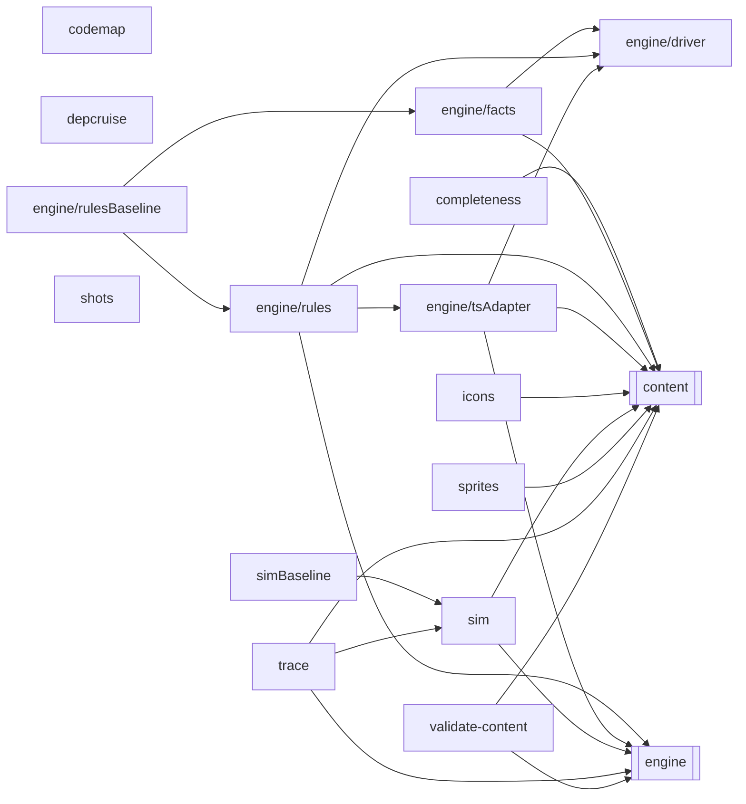

<!-- Generated by tools/codemap.ts. Do not edit by hand: run `npm run docs:codemap`. -->

# Code map: tools

Node scripts: the balance sim and fight trace, the engine baselines and fight driver, the content validator, the layer check, the sprite and icon exporters, screenshots, and this generator.

Generated reference. Start with the [guide](../../architecture/code-map.md) for the flows, and the [index](README.md) for how to read these entries.

## Imports inside this area

*Imports of src/core are left out: nearly every file has them. Double-bordered boxes are other areas.*

## Files

| File | Purpose |
|---|---|
| [tools/codemap.ts](#tools-codemap-ts) | Generates the code map reference in docs/reference/code-map/: every source file, its declarations and class members, and who uses what, read from the TypeScrip… |
| [tools/completeness.ts](#tools-completeness-ts) | Is the game whole? |
| [tools/depcruise.ts](#tools-depcruise-ts) | Enforces the layer rules in .dependency-cruiser.cjs (see docs/adr/0002-layering.md). |
| [tools/engine/driver.ts](#tools-engine-driver-ts) | The fight driver. |
| [tools/engine/facts.ts](#tools-engine-facts-ts) | The content facts the fight-corpus and rules generators need (driver.ts `ContentFacts`), read from the v2 tables. |
| [tools/engine/rules.ts](#tools-engine-rules-ts) | Rules that lived in v1's UI layer (building enemy groups, field items, shops, victory bookkeeping), now engine functions: seeded random cases and what the v2 e… |
| [tools/engine/rulesBaseline.ts](#tools-engine-rulesbaseline-ts) | Write tests/fixtures/rules.json: what the engine does with every rule case (tools/engine/rules.ts). |
| [tools/engine/tsAdapter.ts](#tools-engine-tsadapter-ts) | The EngineAdapter over the engine: builds saves from StateSpecs and plays the driver's fights. |
| [tools/icons.ts](#tools-icons-ts) | The app icons (the PWA manifest's and Apple's touch icon), drawn from the game's own pixel art: Gus Thibodeaux, Grand Marshal, on the night-purple background. |
| [tools/shots.ts](#tools-shots-ts) | Screenshots of the v2 game at 360×740, and side-by-side pairs with v1's reference shots, for reviewing a screen against the original. |
| [tools/sim.ts](#tools-sim-ts) | Headless balance sim: every class against every district's streets and every boss, played by a simple scripted player. |
| [tools/simBaseline.ts](#tools-simbaseline-ts) | The sim baseline: the sim's text output for a few fixed seeds, checked in under tests/fixtures/sim/. |
| [tools/sprites.ts](#tools-sprites-ts) | The sprite gallery. |
| [tools/trace.ts](#tools-trace-ts) | Print one fight, turn by turn, as the sim's scripted player plays it. |
| [tools/validate-content.ts](#tools-validate-content-ts) | Content checks the type system can't express. |

## Details

### tools/codemap.ts

Generates the code map reference in docs/reference/code-map/: every source file, its declarations and class members, and who uses what, read from the TypeScript program itself. The hand-written tour of the flows is docs/architecture/code-map.md.

- Source: [tools/codemap.ts](../../../tools/codemap.ts)
- Packages: `node:fs`, `node:module`, `node:path`, `node:url`, `typescript`
- Tested by: [codemap.test](tests.md#tools-codemap-test-ts)

Declarations:

- **ROOT** · *const, internal*
  - used by: here [buildModel](#tools-codemap-ts--buildmodel), [staleCodeMapPages](#tools-codemap-ts--stalecodemappages), [writeCodeMap](#tools-codemap-ts--writecodemap)
- **OUT_DIR** · *const* — Where the pages go, relative to the repo root.
  - used by: here [(top level)](#tools-codemap-ts--top-level), [staleCodeMapPages](#tools-codemap-ts--stalecodemappages), [writeCodeMap](#tools-codemap-ts--writecodemap)
- **SRC_LINK** · *const, internal*
  - used by: here [renderFile](#tools-codemap-ts--renderfile), [renderIndex](#tools-codemap-ts--renderindex)
- **GUIDE_LINK** · *const, internal*
  - used by: here [renderArea](#tools-codemap-ts--renderarea), [renderIndex](#tools-codemap-ts--renderindex)
- **REF_CAP** · *const, internal* — How many names a "uses" / "used by" line shows before "+N more".
  - used by: here [refList](#tools-codemap-ts--reflist)
- **GRAPH_FILE_LIMIT** · *const, internal* — Areas with more source files than this get a folder-level diagram instead of a file-level one.
  - used by: here [areaGraph](#tools-codemap-ts--areagraph)
- **Area** · *interface, internal*
  - used by: here [AREAS](#tools-codemap-ts--areas), [areaGraph](#tools-codemap-ts--areagraph), [renderArea](#tools-codemap-ts--renderarea)
- **AREAS** · *const, internal* `: Area[]`
  - used by: here [areaOf](#tools-codemap-ts--areaof), [fileLinks](#tools-codemap-ts--filelinks), [generateCodeMap](#tools-codemap-ts--generatecodemap), [renderIndex](#tools-codemap-ts--renderindex)
- **isTestFile** · *function, internal* `(f: string): boolean`
  - used by: here [areaOf](#tools-codemap-ts--areaof), [buildModel](#tools-codemap-ts--buildmodel)
- **inScope** · *function, internal* `(f: string): boolean`
  - used by: here [buildModel](#tools-codemap-ts--buildmodel)
- **areaOf** · *function, internal* `(f: string): string`
  - uses: here [AREAS](#tools-codemap-ts--areas), [isTestFile](#tools-codemap-ts--istestfile)
  - used by: here [areaGraph](#tools-codemap-ts--areagraph), [buildModel](#tools-codemap-ts--buildmodel), [fileLinks](#tools-codemap-ts--filelinks), [pageOf](#tools-codemap-ts--pageof), [renderIndex](#tools-codemap-ts--renderindex)
- **cmp** · *function, internal* `(a: string, b: string): 1 | 0 | -1`
  - used by: here [buildModel](#tools-codemap-ts--buildmodel), [refList](#tools-codemap-ts--reflist), [renderIndex](#tools-codemap-ts--renderindex), [sorted](#tools-codemap-ts--sorted), [staleCodeMapPages](#tools-codemap-ts--stalecodemappages)
- **sorted** · *function, internal* `(xs: Iterable<string>): string[]`
  - uses: here [cmp](#tools-codemap-ts--cmp)
  - used by: here [areaGraph](#tools-codemap-ts--areagraph), [fileLinks](#tools-codemap-ts--filelinks), [refList](#tools-codemap-ts--reflist), [renderArea](#tools-codemap-ts--renderarea), [renderFile](#tools-codemap-ts--renderfile), [renderIndex](#tools-codemap-ts--renderindex), [testList](#tools-codemap-ts--testlist)
- **Kind** · *type, internal* `= union of 14`
  - used by: here [CodeNode](#tools-codemap-ts--codenode), [buildModel](#tools-codemap-ts--buildmodel)
- **CodeNode** · *interface, internal*
  - used by: here [Model](#tools-codemap-ts--model), [buildModel](#tools-codemap-ts--buildmodel), [isTypeKind](#tools-codemap-ts--istypekind), [isUnreferenced](#tools-codemap-ts--isunreferenced), [localName](#tools-codemap-ts--localname), [nodeAnchor](#tools-codemap-ts--nodeanchor), [renderNode](#tools-codemap-ts--rendernode)
- **FileEntry** · *interface, internal*
  - used by: here [Model](#tools-codemap-ts--model), [buildModel](#tools-codemap-ts--buildmodel), [renderFile](#tools-codemap-ts--renderfile)
- **Model** · *interface, internal*
  - used by: here [areaGraph](#tools-codemap-ts--areagraph), [buildModel](#tools-codemap-ts--buildmodel), [refList](#tools-codemap-ts--reflist), [renderArea](#tools-codemap-ts--renderarea), [renderFile](#tools-codemap-ts--renderfile), [renderIndex](#tools-codemap-ts--renderindex), [renderNode](#tools-codemap-ts--rendernode)
- **isTypeKind** · *function, internal* `(n: CodeNode): boolean`
  - used by: here [buildModel](#tools-codemap-ts--buildmodel)
- **collapse** · *function, internal* `(s: string): string`
  - used by: here [buildModel](#tools-codemap-ts--buildmodel), [filePurpose](#tools-codemap-ts--filepurpose), [firstSentence](#tools-codemap-ts--firstsentence)
- **truncate** · *function, internal* `(s: string, max: number): string`
  - used by: here [buildModel](#tools-codemap-ts--buildmodel), [filePurpose](#tools-codemap-ts--filepurpose), [firstSentence](#tools-codemap-ts--firstsentence)
- **firstSentence** · *function, internal* `(text: string, max = 220): string` — First sentence of a comment, for one-line summaries.
  - uses: here [collapse](#tools-codemap-ts--collapse), [truncate](#tools-codemap-ts--truncate)
  - used by: here [buildModel](#tools-codemap-ts--buildmodel), [renderArea](#tools-codemap-ts--renderarea), [renderIndex](#tools-codemap-ts--renderindex)
- **filePurpose** · *function, internal* `(sf: ts.SourceFile): string` — The file's header comment: the leading block comment, unless it is glued to the first declaration.
  - uses: here [collapse](#tools-codemap-ts--collapse), [truncate](#tools-codemap-ts--truncate)
  - used by: here [buildModel](#tools-codemap-ts--buildmodel)
- **DECL_NAME_KINDS** · *const, internal* `= new Set(…)`
  - used by: here [isDeclarationName](#tools-codemap-ts--isdeclarationname)
- **isDeclarationName** · *function, internal* `(id: ts.Identifier): boolean` — True when `id` names the thing being declared rather than referring to something.
  - uses: here [DECL_NAME_KINDS](#tools-codemap-ts--decl-name-kinds)
  - used by: here [buildModel](#tools-codemap-ts--buildmodel)
- **hasFunctionType** · *function, internal* `(t: ts.TypeNode): boolean`
  - used by: here [isMethodLike](#tools-codemap-ts--ismethodlike)
- **isMethodLike** · *function, internal* `(m: ts.TypeElement): m is ts.MethodSignature | ts.PropertySignature`
  - uses: here [hasFunctionType](#tools-codemap-ts--hasfunctiontype)
  - used by: here [buildModel](#tools-codemap-ts--buildmodel)
- **memberName** · *function, internal* `(name: ts.PropertyName | ts.PrivateIdentifier | undefined): string | null`
  - used by: here [buildModel](#tools-codemap-ts--buildmodel)
- **unwrap** · *function, internal* `(e: ts.Expression | undefined): ts.Expression | undefined`
  - used by: here [buildModel](#tools-codemap-ts--buildmodel)
- **packageName** · *function, internal* `(spec: string): string` — Packages are reported by name: `react`, `@fastify/static`, `node:fs`.
  - used by: here [buildModel](#tools-codemap-ts--buildmodel)
- **buildModel** · *function* `(): Model`
  - uses: here [ROOT](#tools-codemap-ts--root), [areaOf](#tools-codemap-ts--areaof), [cmp](#tools-codemap-ts--cmp), [collapse](#tools-codemap-ts--collapse), [filePurpose](#tools-codemap-ts--filepurpose), [firstSentence](#tools-codemap-ts--firstsentence), [inScope](#tools-codemap-ts--inscope), [isDeclarationName](#tools-codemap-ts--isdeclarationname), [isMethodLike](#tools-codemap-ts--ismethodlike), [isTestFile](#tools-codemap-ts--istestfile), [isTypeKind](#tools-codemap-ts--istypekind), [memberName](#tools-codemap-ts--membername), [packageName](#tools-codemap-ts--packagename), [suiteTitles](#tools-codemap-ts--suitetitles), [truncate](#tools-codemap-ts--truncate), [unwrap](#tools-codemap-ts--unwrap)
  - used by: here [generateCodeMap](#tools-codemap-ts--generatecodemap)
- **suiteTitles** · *function, internal* `(sf: ts.SourceFile): string[]` — `describe('…')` titles in a test file (string literals only), for the tests page.
  - used by: here [buildModel](#tools-codemap-ts--buildmodel)
- **slug** · *function, internal* `(s: string): string`
  - used by: here [fileAnchor](#tools-codemap-ts--fileanchor), [nodeAnchor](#tools-codemap-ts--nodeanchor)
- **fileAnchor** · *function, internal* `(file: string): string`
  - uses: here [slug](#tools-codemap-ts--slug)
  - used by: here [fileLinks](#tools-codemap-ts--filelinks), [refList](#tools-codemap-ts--reflist), [renderArea](#tools-codemap-ts--renderarea), [renderFile](#tools-codemap-ts--renderfile), [renderIndex](#tools-codemap-ts--renderindex), [testList](#tools-codemap-ts--testlist)
- **nodeAnchor** · *function, internal* `(n: CodeNode): string`
  - uses: here [slug](#tools-codemap-ts--slug)
  - used by: here [refList](#tools-codemap-ts--reflist), [renderIndex](#tools-codemap-ts--renderindex), [renderNode](#tools-codemap-ts--rendernode)
- **pageOf** · *function, internal* `(file: string): string`
  - uses: here [areaOf](#tools-codemap-ts--areaof)
  - used by: here [fileLinks](#tools-codemap-ts--filelinks), [href](#tools-codemap-ts--href), [refList](#tools-codemap-ts--reflist), [renderIndex](#tools-codemap-ts--renderindex), [testList](#tools-codemap-ts--testlist)
- **shortFile** · *function, internal* `(file: string): string`
  - used by: here [refList](#tools-codemap-ts--reflist), [renderIndex](#tools-codemap-ts--renderindex), [testList](#tools-codemap-ts--testlist)
- **esc** · *function, internal* `(s: string): string`
  - used by: here [renderArea](#tools-codemap-ts--renderarea), [renderFile](#tools-codemap-ts--renderfile), [renderIndex](#tools-codemap-ts--renderindex), [renderNode](#tools-codemap-ts--rendernode)
- **code** · *function, internal* `(s: string): string`
  - used by: here [renderFile](#tools-codemap-ts--renderfile), [renderIndex](#tools-codemap-ts--renderindex), [renderNode](#tools-codemap-ts--rendernode)
- **href** · *function, internal* `(fromPage: string, file: string, anchor: string): string`
  - uses: here [pageOf](#tools-codemap-ts--pageof)
  - used by: here [fileLinks](#tools-codemap-ts--filelinks), [refList](#tools-codemap-ts--reflist), [testList](#tools-codemap-ts--testlist)
- **localName** · *function, internal* `(n: CodeNode): string` — Display name of a node inside its file: `enterPlace` for `GameApp.enterPlace`.
  - used by: here [renderNode](#tools-codemap-ts--rendernode)
- **refList** · *function, internal* `(model: Model, refs: Iterable<string>, fromFile: string, cap = REF_CAP): string`
  - uses: here [REF_CAP](#tools-codemap-ts--ref-cap), [cmp](#tools-codemap-ts--cmp), [fileAnchor](#tools-codemap-ts--fileanchor), [href](#tools-codemap-ts--href), [nodeAnchor](#tools-codemap-ts--nodeanchor), [pageOf](#tools-codemap-ts--pageof), [shortFile](#tools-codemap-ts--shortfile), [sorted](#tools-codemap-ts--sorted)
  - used by: here [renderFile](#tools-codemap-ts--renderfile), [renderNode](#tools-codemap-ts--rendernode)
- **testList** · *function, internal* `(tests: Iterable<string>, fromFile: string): string`
  - uses: here [fileAnchor](#tools-codemap-ts--fileanchor), [href](#tools-codemap-ts--href), [pageOf](#tools-codemap-ts--pageof), [shortFile](#tools-codemap-ts--shortfile), [sorted](#tools-codemap-ts--sorted)
  - used by: here [renderFile](#tools-codemap-ts--renderfile), [renderNode](#tools-codemap-ts--rendernode)
- **fileLinks** · *function, internal* `(fromFile: string, targets: Iterable<string>): string`
  - uses: here [AREAS](#tools-codemap-ts--areas), [areaOf](#tools-codemap-ts--areaof), [fileAnchor](#tools-codemap-ts--fileanchor), [href](#tools-codemap-ts--href), [pageOf](#tools-codemap-ts--pageof), [sorted](#tools-codemap-ts--sorted)
  - used by: here [renderFile](#tools-codemap-ts--renderfile)
- **isUnreferenced** · *function, internal* `(n: CodeNode): boolean`
  - used by: here [renderNode](#tools-codemap-ts--rendernode)
- **renderNode** · *function, internal* `(model: Model, n: CodeNode, depth: number): string[]`
  - uses: here [code](#tools-codemap-ts--code), [esc](#tools-codemap-ts--esc), [isUnreferenced](#tools-codemap-ts--isunreferenced), [localName](#tools-codemap-ts--localname), [nodeAnchor](#tools-codemap-ts--nodeanchor), [refList](#tools-codemap-ts--reflist), [testList](#tools-codemap-ts--testlist)
  - used by: here [renderFile](#tools-codemap-ts--renderfile)
- **renderFile** · *function, internal* `(model: Model, f: FileEntry): string[]`
  - uses: here [SRC_LINK](#tools-codemap-ts--src-link), [code](#tools-codemap-ts--code), [esc](#tools-codemap-ts--esc), [fileAnchor](#tools-codemap-ts--fileanchor), [fileLinks](#tools-codemap-ts--filelinks), [refList](#tools-codemap-ts--reflist), [renderNode](#tools-codemap-ts--rendernode), [sorted](#tools-codemap-ts--sorted), [testList](#tools-codemap-ts--testlist)
  - used by: here [renderArea](#tools-codemap-ts--renderarea)
- **mermaidId** · *function, internal* `(s: string): string`
  - used by: here [areaGraph](#tools-codemap-ts--areagraph)
- **areaGraph** · *function, internal* `(model: Model, area: Area): string[]` — File-level (or folder-level, for big areas) import graph of one area.
  - uses: here [GRAPH_FILE_LIMIT](#tools-codemap-ts--graph-file-limit), [areaOf](#tools-codemap-ts--areaof), [mermaidId](#tools-codemap-ts--mermaidid), [sorted](#tools-codemap-ts--sorted)
  - used by: here [renderArea](#tools-codemap-ts--renderarea)
- **header** · *function, internal* `(title: string): string[]`
  - used by: here [renderArea](#tools-codemap-ts--renderarea), [renderIndex](#tools-codemap-ts--renderindex)
- **renderArea** · *function, internal* `(model: Model, area: Area): string`
  - uses: here [GUIDE_LINK](#tools-codemap-ts--guide-link), [areaGraph](#tools-codemap-ts--areagraph), [esc](#tools-codemap-ts--esc), [fileAnchor](#tools-codemap-ts--fileanchor), [firstSentence](#tools-codemap-ts--firstsentence), [header](#tools-codemap-ts--header), [renderFile](#tools-codemap-ts--renderfile), [sorted](#tools-codemap-ts--sorted)
  - used by: here [generateCodeMap](#tools-codemap-ts--generatecodemap)
- **Rule** · *interface, internal*
  - used by: here [renderIndex](#tools-codemap-ts--renderindex)
- **renderIndex** · *function, internal* `(model: Model): string`
  - uses: here [AREAS](#tools-codemap-ts--areas), [GUIDE_LINK](#tools-codemap-ts--guide-link), [SRC_LINK](#tools-codemap-ts--src-link), [areaOf](#tools-codemap-ts--areaof), [cmp](#tools-codemap-ts--cmp), [code](#tools-codemap-ts--code), [esc](#tools-codemap-ts--esc), [fileAnchor](#tools-codemap-ts--fileanchor), [firstSentence](#tools-codemap-ts--firstsentence), [header](#tools-codemap-ts--header), [nodeAnchor](#tools-codemap-ts--nodeanchor), [pageOf](#tools-codemap-ts--pageof), [shortFile](#tools-codemap-ts--shortfile), [sorted](#tools-codemap-ts--sorted)
  - used by: here [generateCodeMap](#tools-codemap-ts--generatecodemap)
- **generateCodeMap** · *function* `(): Map<string, string>` — Every page, keyed by file name inside OUT_DIR.
  - uses: here [AREAS](#tools-codemap-ts--areas), [buildModel](#tools-codemap-ts--buildmodel), [renderArea](#tools-codemap-ts--renderarea), [renderIndex](#tools-codemap-ts--renderindex)
  - used by: here [(top level)](#tools-codemap-ts--top-level) · tests: [codemap.test](tests.md#tools-codemap-test-ts)
- **staleCodeMapPages** · *function* `(pages: Map<string, string>): string[]` — Pages whose committed copy differs from `pages`, plus stray pages that are no longer generated.
  - uses: here [OUT_DIR](#tools-codemap-ts--out-dir), [ROOT](#tools-codemap-ts--root), [cmp](#tools-codemap-ts--cmp)
  - used by: here [(top level)](#tools-codemap-ts--top-level) · tests: [codemap.test](tests.md#tools-codemap-test-ts)
- **writeCodeMap** · *function* `(pages: Map<string, string>): void`
  - uses: here [OUT_DIR](#tools-codemap-ts--out-dir), [ROOT](#tools-codemap-ts--root)
  - used by: here [(top level)](#tools-codemap-ts--top-level)
- **isMain** · *const, internal*
  - used by: here [(top level)](#tools-codemap-ts--top-level)
- **(top level)** · *module* — Statements that run when the module loads.
  - uses: here [OUT_DIR](#tools-codemap-ts--out-dir), [generateCodeMap](#tools-codemap-ts--generatecodemap), [isMain](#tools-codemap-ts--ismain), [staleCodeMapPages](#tools-codemap-ts--stalecodemappages), [writeCodeMap](#tools-codemap-ts--writecodemap)

### tools/completeness.ts

Is the game whole? Checks that every place has something to do, every boss has its scenes, every story step points somewhere real and every [[lexicon]] link resolves. The registries' types already require every place and boss; this keeps the message friendly and covers the rest. Runs in CI as a test (completeness.test.ts) and on demand:

- Source: [tools/completeness.ts](../../../tools/completeness.ts)
- Imports: core: [ids/enemies](core.md#src-core-ids-enemies-ts), [ids/story](core.md#src-core-ids-story-ts), [ids/world](core.md#src-core-ids-world-ts), [types/index](core.md#src-core-types-index-ts) · content: [index](content.md#src-content-index-ts)
- Packages: `node:fs`, `node:path`, `node:url`
- Imported by: tests: [integration/support/crawl](tests.md#tests-integration-support-crawl-ts)
- Tested by: [completeness.test](tests.md#tools-completeness-test-ts)
- Types used: **[core/ids/world](core.md#src-core-ids-world-ts)** [PlaceId](core.md#src-core-ids-world-ts--placeid) · **[core/types/content](core.md#src-core-types-content-ts)** [StepDef](core.md#src-core-types-content-ts--stepdef)

Declarations:

- **ALLOWED_UNLINKED** · *const* `: Record<string, string>` — [[links]] that knowingly name no glossary entry.
  - used by: here [checkLexiconLinks](#tools-completeness-ts--checklexiconlinks) · **[tests/integration/support/crawl](tests.md#tests-integration-support-crawl-ts)** [textProblem](tests.md#tests-integration-support-crawl-ts--textproblem)
- **checkCompleteness** · *function* `(): string[]` — Every problem found, as a sentence a writer can act on.
  - uses: here [checkLexiconLinks](#tools-completeness-ts--checklexiconlinks) · **[content/bosses/index](content.md#src-content-bosses-index-ts)** [BOSSES](content.md#src-content-bosses-index-ts--bosses) · **[content/districts/index](content.md#src-content-districts-index-ts)** [DISTRICTS](content.md#src-content-districts-index-ts--districts) · **[content/index](content.md#src-content-index-ts)** [BOSS_SCENES](content.md#src-content-index-ts--boss-scenes), [PLACE_SCENES](content.md#src-content-index-ts--place-scenes) · **[content/places](content.md#src-content-places-ts)** [PLACES](content.md#src-content-places-ts--places) · **[content/story/acts](content.md#src-content-story-acts-ts)** [ACTS](content.md#src-content-story-acts-ts--acts) · **[core/ids/enemies](core.md#src-core-ids-enemies-ts)** [BOSS_IDS](core.md#src-core-ids-enemies-ts--boss-ids) · **[core/ids/story](core.md#src-core-ids-story-ts)** [ACT_ORDER](core.md#src-core-ids-story-ts--act-order), [ACT_STEPS](core.md#src-core-ids-story-ts--act-steps) · **[core/ids/world](core.md#src-core-ids-world-ts)** [DISTRICT_IDS](core.md#src-core-ids-world-ts--district-ids), [PLACE_IDS](core.md#src-core-ids-world-ts--place-ids)
  - used by: here [(top level)](#tools-completeness-ts--top-level) · tests: [completeness.test](tests.md#tools-completeness-test-ts)
- **LINK** · *const, internal* — The [[key]] / [[key|display]] markup the lexicon links (src/app/lexicon.ts).
  - used by: here [checkLexiconLinks](#tools-completeness-ts--checklexiconlinks)
- **checkLexiconLinks** · *function, internal* `(fail: (msg: string) => void): void` — Every explicit [[link]] in content source resolves to a glossary entry (else it renders as plain text).
  - uses: here [ALLOWED_UNLINKED](#tools-completeness-ts--allowed-unlinked), [LINK](#tools-completeness-ts--link), [stripComments](#tools-completeness-ts--stripcomments) · **[content/glossary](content.md#src-content-glossary-ts)** [GLOSSARY](content.md#src-content-glossary-ts--glossary)
  - used by: here [checkCompleteness](#tools-completeness-ts--checkcompleteness)
- **stripComments** · *function, internal* `(src: string): string` — Source with comments blanked out (kept line-for-line so line numbers stay right).
  - used by: here [checkLexiconLinks](#tools-completeness-ts--checklexiconlinks)
- **isMain** · *const, internal*
  - used by: here [(top level)](#tools-completeness-ts--top-level)
- **(top level)** · *module* — Statements that run when the module loads.
  - uses: here [checkCompleteness](#tools-completeness-ts--checkcompleteness), [isMain](#tools-completeness-ts--ismain)

### tools/depcruise.ts

Enforces the layer rules in .dependency-cruiser.cjs (see docs/adr/0002-layering.md).

- Source: [tools/depcruise.ts](../../../tools/depcruise.ts)
- Packages: `dependency-cruiser`, `node:module`

Declarations:

- **require** · *const, internal*
  - used by: here [config](#tools-depcruise-ts--config)
- **config** · *const, internal*
  - uses: here [require](#tools-depcruise-ts--require)
  - used by: here [options](#tools-depcruise-ts--options)
- **options** · *const, internal* `: ICruiseOptions`
  - uses: here [config](#tools-depcruise-ts--config)
  - used by: here [result](#tools-depcruise-ts--result)
- **tsConfig** · *const, internal*
  - used by: here [result](#tools-depcruise-ts--result)
- **result** · *const, internal*
  - uses: here [options](#tools-depcruise-ts--options), [tsConfig](#tools-depcruise-ts--tsconfig)
  - used by: here [(top level)](#tools-depcruise-ts--top-level), [output](#tools-depcruise-ts--output)
- **output** · *const, internal*
  - uses: here [result](#tools-depcruise-ts--result)
  - used by: here [(top level)](#tools-depcruise-ts--top-level)
- **(top level)** · *module* — Statements that run when the module loads.
  - uses: here [output](#tools-depcruise-ts--output), [result](#tools-depcruise-ts--result)

### tools/engine/driver.ts

The fight driver. It generates a seeded corpus of fights and plays each one against an EngineAdapter, recording a trace. The engine's property tests (properties.test.ts) replay fights with it. Until cutover the parity oracle also played every fight on v1 and compared the traces exactly, which is why the trace format and the rules below exist.

- Source: [tools/engine/driver.ts](../../../tools/engine/driver.ts)
- Imports: core: [rng](core.md#src-core-rng-ts)
- Imported by: tools: [engine/facts](#tools-engine-facts-ts), [engine/rules](#tools-engine-rules-ts), [engine/tsAdapter](#tools-engine-tsadapter-ts)
- Tested by: [properties.test](tests.md#tools-engine-properties-test-ts), [rules.test](tests.md#tools-engine-rules-test-ts)
- Types used: **[core/rng](core.md#src-core-rng-ts)** [Rng](core.md#src-core-rng-ts--rng)

Declarations:

- **TimingId** · *type* `= 'one' | 'pocket' | 'loose' | 'clams'`
  - used by: here [EngineAdapter](#tools-engine-driver-ts--engineadapter), [TIMINGS](#tools-engine-driver-ts--timings)
- **StateSpec** · *interface*
  - used by: here [EngineAdapter](#tools-engine-driver-ts--engineadapter), [FightSpec](#tools-engine-driver-ts--fightspec), [randomState](#tools-engine-driver-ts--randomstate) · **[tools/engine/rules](#tools-engine-rules-ts)** [EnemyCase](#tools-engine-rules-ts--enemycase), [FieldItemCase](#tools-engine-rules-ts--fielditemcase), [ShopCase](#tools-engine-rules-ts--shopcase), [VictoryCase](#tools-engine-rules-ts--victorycase), [state](#tools-engine-rules-ts--state) · **[tools/engine/tsAdapter](#tools-engine-tsadapter-ts)** [tsAdapter](#tools-engine-tsadapter-ts--tsadapter)
- **EnemySpec** · *interface*
  - used by: here [EngineAdapter](#tools-engine-driver-ts--engineadapter), [FightSpec](#tools-engine-driver-ts--fightspec), [generateCorpus](#tools-engine-driver-ts--generatecorpus)
- **FightSpec** · *interface*
  - used by: here [EngineAdapter](#tools-engine-driver-ts--engineadapter), [generateCorpus](#tools-engine-driver-ts--generatecorpus), [runFight](#tools-engine-driver-ts--runfight)
- **ContentFacts** · *interface* — Content facts the corpus generator needs (facts.ts reads them from the v2 tables).
  - used by: here [generateCorpus](#tools-engine-driver-ts--generatecorpus), [randomState](#tools-engine-driver-ts--randomstate) · **[tools/engine/facts](#tools-engine-facts-ts)** [tsFacts](#tools-engine-facts-ts--tsfacts) · **[tools/engine/rules](#tools-engine-rules-ts)** [ruleCases](#tools-engine-rules-ts--rulecases)
- **Intent** · *interface* — A player intent in v1's action shape (the engine accepts it as is).
  - used by: here [EngineAdapter](#tools-engine-driver-ts--engineadapter), [chooseIntent](#tools-engine-driver-ts--chooseintent), [needsTiming](#tools-engine-driver-ts--needstiming)
- **Opaque** · *type, internal* `= any` — Battle objects are engine-specific; the driver reads them only through the adapter.
  - used by: here [EngineAdapter](#tools-engine-driver-ts--engineadapter), [checkpoint](#tools-engine-driver-ts--checkpoint)
- **EngineAdapter** · *interface, capability*
  - used by: here [checkpoint](#tools-engine-driver-ts--checkpoint), [chooseIntent](#tools-engine-driver-ts--chooseintent), [needsTiming](#tools-engine-driver-ts--needstiming), [runFight](#tools-engine-driver-ts--runfight) · **[tools/engine/tsAdapter](#tools-engine-tsadapter-ts)** [tsAdapter](#tools-engine-tsadapter-ts--tsadapter)
  - **seed** · *interface member* `(n: number): void`
    - implemented by: **[tools/engine/tsAdapter](#tools-engine-tsadapter-ts)** [tsAdapter](#tools-engine-tsadapter-ts--tsadapter)
    - called from: here [runFight](#tools-engine-driver-ts--runfight)
  - **draws** · *interface member* `(): number`
    - implemented by: **[tools/engine/tsAdapter](#tools-engine-tsadapter-ts)** [tsAdapter](#tools-engine-tsadapter-ts--tsadapter)
    - called from: here [runFight](#tools-engine-driver-ts--runfight)
  - **buildState** · *interface member* `(spec: StateSpec): Opaque`
    - implemented by: **[tools/engine/tsAdapter](#tools-engine-tsadapter-ts)** [tsAdapter](#tools-engine-tsadapter-ts--tsadapter)
    - called from: here [runFight](#tools-engine-driver-ts--runfight) · **[tools/engine/rules](#tools-engine-rules-ts)** [state](#tools-engine-rules-ts--state)
  - **makeEnemy** · *interface member* `(state: Opaque, e: EnemySpec): Opaque`
    - implemented by: **[tools/engine/tsAdapter](#tools-engine-tsadapter-ts)** [tsAdapter](#tools-engine-tsadapter-ts--tsadapter)
    - called from: here [runFight](#tools-engine-driver-ts--runfight)
  - **createBattle** · *interface member* `(state: Opaque, enemies: Opaque[], opts: FightSpec['battle']): Opaque`
    - implemented by: **[tools/engine/properties.test](tests.md#tools-engine-properties-test-ts)** · **[tools/engine/tsAdapter](#tools-engine-tsadapter-ts)** [tsAdapter](#tools-engine-tsadapter-ts--tsadapter)
    - called from: here [runFight](#tools-engine-driver-ts--runfight) · tests: [properties.test](tests.md#tools-engine-properties-test-ts)
  - **runUntilPlayer** · *interface member* `(b: Opaque): boolean`
    - implemented by: **[tools/engine/properties.test](tests.md#tools-engine-properties-test-ts)** · **[tools/engine/tsAdapter](#tools-engine-tsadapter-ts)** [tsAdapter](#tools-engine-tsadapter-ts--tsadapter)
    - called from: here [runFight](#tools-engine-driver-ts--runfight) · tests: [properties.test](tests.md#tools-engine-properties-test-ts)
  - **playerAction** · *interface member* `(b: Opaque, intent: Intent, timing: TimingId | null): void`
    - implemented by: **[tools/engine/properties.test](tests.md#tools-engine-properties-test-ts)** · **[tools/engine/tsAdapter](#tools-engine-tsadapter-ts)** [tsAdapter](#tools-engine-tsadapter-ts--tsadapter)
    - called from: here [runFight](#tools-engine-driver-ts--runfight) · tests: [properties.test](tests.md#tools-engine-properties-test-ts)
  - **battleRewards** · *interface member* `(b: Opaque): unknown`
    - implemented by: **[tools/engine/tsAdapter](#tools-engine-tsadapter-ts)** [tsAdapter](#tools-engine-tsadapter-ts--tsadapter)
    - called from: here [runFight](#tools-engine-driver-ts--runfight)
  - **applyBattleResult** · *interface member* `(b: Opaque): void`
    - implemented by: **[tools/engine/tsAdapter](#tools-engine-tsadapter-ts)** [tsAdapter](#tools-engine-tsadapter-ts--tsadapter)
    - called from: here [runFight](#tools-engine-driver-ts--runfight)
  - **gainXp** · *interface member* `(state: Opaque, n: number): unknown`
    - implemented by: **[tools/engine/tsAdapter](#tools-engine-tsadapter-ts)** [tsAdapter](#tools-engine-tsadapter-ts--tsadapter)
    - called from: here [runFight](#tools-engine-driver-ts--runfight)
  - **events** · *interface member* `(b: Opaque): unknown[]` — The live events array.
    - implemented by: **[tools/engine/tsAdapter](#tools-engine-tsadapter-ts)** [tsAdapter](#tools-engine-tsadapter-ts--tsadapter)
    - called from: here [runFight](#tools-engine-driver-ts--runfight)
  - **normalizeEvent** · *interface member* `(e: Opaque, role: (id: string) => string): Record<string, unknown> | null` — Event → comparable record (null skips engine-specific events).
    - implemented by: **[tools/engine/tsAdapter](#tools-engine-tsadapter-ts)** [tsAdapter](#tools-engine-tsadapter-ts--tsadapter)
    - called from: here [runFight](#tools-engine-driver-ts--runfight)
  - **view** · *interface member* `(b: Opaque): BattleView`
    - implemented by: **[tools/engine/tsAdapter](#tools-engine-tsadapter-ts)** [tsAdapter](#tools-engine-tsadapter-ts--tsadapter)
    - called from: here [checkpoint](#tools-engine-driver-ts--checkpoint), [runFight](#tools-engine-driver-ts--runfight)
  - **projectState** · *interface member* `(state: Opaque): Record<string, unknown>`
    - implemented by: **[tools/engine/tsAdapter](#tools-engine-tsadapter-ts)** [tsAdapter](#tools-engine-tsadapter-ts--tsadapter)
    - called from: here [runFight](#tools-engine-driver-ts--runfight)
  - **skill** · *interface member* `(id: string): { fp: number; once: boolean; damaging: boolean }`
    - implemented by: **[tools/engine/tsAdapter](#tools-engine-tsadapter-ts)** [tsAdapter](#tools-engine-tsadapter-ts--tsadapter)
    - called from: here [chooseIntent](#tools-engine-driver-ts--chooseintent), [needsTiming](#tools-engine-driver-ts--needstiming)
- **BattleView** · *interface* — The observable parts of a battle (field names follow v1's battle object).
  - used by: here [EngineAdapter](#tools-engine-driver-ts--engineadapter), [chooseIntent](#tools-engine-driver-ts--chooseintent), [roleMapper](#tools-engine-driver-ts--rolemapper) · **[tools/engine/tsAdapter](#tools-engine-tsadapter-ts)** [tsAdapter](#tools-engine-tsadapter-ts--tsadapter)
- **ActorView** · *interface*
  - used by: here [BattleView](#tools-engine-driver-ts--battleview), [checkpoint](#tools-engine-driver-ts--checkpoint)
- **DIFFICULTIES** · *const, internal* `= [ … ] as const (5 entries)`
  - used by: here [randomState](#tools-engine-driver-ts--randomstate)
- **subset** · *function, internal* `<T>(rng: Rng, items: readonly T[], p: number): T[]`
  - uses: **[core/rng](core.md#src-core-rng-ts)** [Rng.next](core.md#src-core-rng-ts--rng-next)
  - used by: here [randomState](#tools-engine-driver-ts--randomstate)
- **randomState** · *function* `(rng: Rng, f: ContentFacts, cls: string, level: number): StateSpec`
  - uses: here [DIFFICULTIES](#tools-engine-driver-ts--difficulties), [subset](#tools-engine-driver-ts--subset) · **[core/rng](core.md#src-core-rng-ts)** [Rng.chance](core.md#src-core-rng-ts--rng-chance), [Rng.int](core.md#src-core-rng-ts--rng-int), [Rng.next](core.md#src-core-rng-ts--rng-next), [Rng.pick](core.md#src-core-rng-ts--rng-pick)
  - used by: here [generateCorpus](#tools-engine-driver-ts--generatecorpus) · **[tools/engine/rules](#tools-engine-rules-ts)** [ruleCases](#tools-engine-rules-ts--rulecases)
- **generateCorpus** · *function* `(f: ContentFacts, seed: number, count: number): FightSpec[]` — Build `count` fight specs from a seed.
  - uses: here [randomState](#tools-engine-driver-ts--randomstate) · **[core/rng](core.md#src-core-rng-ts)** [Rng.chance](core.md#src-core-rng-ts--rng-chance), [Rng.int](core.md#src-core-rng-ts--rng-int), [Rng.next](core.md#src-core-rng-ts--rng-next), [Rng.pick](core.md#src-core-rng-ts--rng-pick), [createRng](core.md#src-core-rng-ts--createrng)
  - used by: tests: [properties.test](tests.md#tools-engine-properties-test-ts)
- **TIMINGS** · *const, internal* `: TimingId[]`
  - used by: here [runFight](#tools-engine-driver-ts--runfight)
- **chooseIntent** · *function, internal* `(rng: Rng, a: EngineAdapter, v: BattleView, bag: Record<string, number>): Intent` — A seeded, mostly-random player that also sends illegal intents to exercise every rejection branch.
  - uses: here [EngineAdapter.skill](#tools-engine-driver-ts--engineadapter-skill) · **[core/rng](core.md#src-core-rng-ts)** [Rng.chance](core.md#src-core-rng-ts--rng-chance), [Rng.next](core.md#src-core-rng-ts--rng-next), [Rng.pick](core.md#src-core-rng-ts--rng-pick)
  - used by: here [runFight](#tools-engine-driver-ts--runfight)
- **needsTiming** · *function, internal* `(a: EngineAdapter, intent: Intent): boolean`
  - uses: here [EngineAdapter.skill](#tools-engine-driver-ts--engineadapter-skill)
  - used by: here [runFight](#tools-engine-driver-ts--runfight)
- **FightTrace** · *interface*
  - used by: here [runFight](#tools-engine-driver-ts--runfight)
- **roleMapper** · *function, internal* `(v: BattleView): (id: string) => string`
  - used by: here [checkpoint](#tools-engine-driver-ts--checkpoint), [runFight](#tools-engine-driver-ts--runfight)
- **checkpoint** · *function, internal* `(a: EngineAdapter, b: Opaque, draws: number): { draws: number; round: number; idx: number; order: string[]; over: boolean; result: string | null; waiting: boolean; blues…`
  - uses: here [EngineAdapter.view](#tools-engine-driver-ts--engineadapter-view), [roleMapper](#tools-engine-driver-ts--rolemapper)
  - used by: here [runFight](#tools-engine-driver-ts--runfight)
- **runFight** · *function* `(a: EngineAdapter, spec: FightSpec, maxActions = 60): FightTrace` — Play one fight and record its trace.
  - uses: here [EngineAdapter.applyBattleResult](#tools-engine-driver-ts--engineadapter-applybattleresult), [EngineAdapter.battleRewards](#tools-engine-driver-ts--engineadapter-battlerewards), [EngineAdapter.buildState](#tools-engine-driver-ts--engineadapter-buildstate), [EngineAdapter.createBattle](#tools-engine-driver-ts--engineadapter-createbattle), [EngineAdapter.draws](#tools-engine-driver-ts--engineadapter-draws), [EngineAdapter.events](#tools-engine-driver-ts--engineadapter-events), [EngineAdapter.gainXp](#tools-engine-driver-ts--engineadapter-gainxp), [EngineAdapter.makeEnemy](#tools-engine-driver-ts--engineadapter-makeenemy), [EngineAdapter.normalizeEvent](#tools-engine-driver-ts--engineadapter-normalizeevent), [EngineAdapter.playerAction](#tools-engine-driver-ts--engineadapter-playeraction), [EngineAdapter.projectState](#tools-engine-driver-ts--engineadapter-projectstate), [EngineAdapter.runUntilPlayer](#tools-engine-driver-ts--engineadapter-rununtilplayer), [EngineAdapter.seed](#tools-engine-driver-ts--engineadapter-seed), [EngineAdapter.view](#tools-engine-driver-ts--engineadapter-view), [TIMINGS](#tools-engine-driver-ts--timings), [checkpoint](#tools-engine-driver-ts--checkpoint) · … +6 more
  - used by: tests: [properties.test](tests.md#tools-engine-properties-test-ts)
- **firstDifference** · *function* `(x: unknown, y: unknown, path = ''): string | null` — First path at which two JSON-like values differ, or null when equal.
  - used by: tests: [properties.test](tests.md#tools-engine-properties-test-ts), [rules.test](tests.md#tools-engine-rules-test-ts)

### tools/engine/facts.ts

The content facts the fight-corpus and rules generators need (driver.ts `ContentFacts`), read from the v2 tables. Order matters: the generators pick from these lists by index, so the same seed gives the same cases only while the order stays as it is (v1's order, which the parity content test pinned until cutover). Reordering a table moves tests/fixtures/rules.json.

- Source: [tools/engine/facts.ts](../../../tools/engine/facts.ts)
- Imports: core: [ids/story](core.md#src-core-ids-story-ts) · content: [data](content.md#src-content-data-ts) · tools: [engine/driver](#tools-engine-driver-ts)
- Imported by: tools: [engine/rulesBaseline](#tools-engine-rulesbaseline-ts)
- Tested by: [properties.test](tests.md#tools-engine-properties-test-ts), [rules.test](tests.md#tools-engine-rules-test-ts)
- Types used: **[tools/engine/driver](#tools-engine-driver-ts)** [ContentFacts](#tools-engine-driver-ts--contentfacts)

Declarations:

- **tsFacts** · *function* `(): ContentFacts` — ContentFacts from the v2 content tables.
  - uses: **[content/band/bandmates](content.md#src-content-band-bandmates-ts)** [BANDMATES](content.md#src-content-band-bandmates-ts--bandmates) · **[content/bosses/index](content.md#src-content-bosses-index-ts)** [BOSSES](content.md#src-content-bosses-index-ts--bosses) · **[content/classes/index](content.md#src-content-classes-index-ts)** [CLASSES](content.md#src-content-classes-index-ts--classes) · **[content/combat/statuses](content.md#src-content-combat-statuses-ts)** [STATUSES](content.md#src-content-combat-statuses-ts--statuses) · **[content/districts/index](content.md#src-content-districts-index-ts)** [DISTRICTS](content.md#src-content-districts-index-ts--districts) · **[content/enemies/index](content.md#src-content-enemies-index-ts)** [ENEMIES](content.md#src-content-enemies-index-ts--enemies) · **[content/gear/index](content.md#src-content-gear-index-ts)** [GEAR](content.md#src-content-gear-index-ts--gear) · **[content/gear/instruments](content.md#src-content-gear-instruments-ts)** [INSTRUMENT_TIERS](content.md#src-content-gear-instruments-ts--instrument-tiers) · **[content/items](content.md#src-content-items-ts)** [ITEMS](content.md#src-content-items-ts--items) · **[content/roots](content.md#src-content-roots-ts)** [ROOTS](content.md#src-content-roots-ts--roots) · **[content/sheetMusic](content.md#src-content-sheetmusic-ts)** [SHEET_MUSIC](content.md#src-content-sheetmusic-ts--sheet-music) · **[core/ids/story](core.md#src-core-ids-story-ts)** [ACT_ORDER](core.md#src-core-ids-story-ts--act-order), [ACT_STEPS](core.md#src-core-ids-story-ts--act-steps)
  - used by: **[tools/engine/rulesBaseline](#tools-engine-rulesbaseline-ts)** [(top level)](#tools-engine-rulesbaseline-ts--top-level) · tests: [properties.test](tests.md#tools-engine-properties-test-ts), [rules.test](tests.md#tools-engine-rules-test-ts)

### tools/engine/rules.ts

Rules that lived in v1's UI layer (building enemy groups, field items, shops, victory bookkeeping), now engine functions: seeded random cases and what the v2 engine does with them.

- Source: [tools/engine/rules.ts](../../../tools/engine/rules.ts)
- Imports: core: [ids/enemies](core.md#src-core-ids-enemies-ts), [ids/items](core.md#src-core-ids-items-ts), [ids/world](core.md#src-core-ids-world-ts), [rng](core.md#src-core-rng-ts), [types/index](core.md#src-core-types-index-ts) · content: [data](content.md#src-content-data-ts) · engine: [index](engine.md#src-engine-index-ts) · tools: [engine/driver](#tools-engine-driver-ts), [engine/tsAdapter](#tools-engine-tsadapter-ts)
- Imported by: tools: [engine/rulesBaseline](#tools-engine-rulesbaseline-ts)
- Tested by: [rules.test](tests.md#tools-engine-rules-test-ts)
- Types used: **[core/ids/enemies](core.md#src-core-ids-enemies-ts)** [EnemyId](core.md#src-core-ids-enemies-ts--enemyid) · **[core/ids/items](core.md#src-core-ids-items-ts)** [ItemId](core.md#src-core-ids-items-ts--itemid) · **[core/ids/world](core.md#src-core-ids-world-ts)** [DistrictId](core.md#src-core-ids-world-ts--districtid) · **[core/rng](core.md#src-core-rng-ts)** [Rng](core.md#src-core-rng-ts--rng) · **[core/types/battle](core.md#src-core-types-battle-ts)** [Actor](core.md#src-core-types-battle-ts--actor) · **[core/types/state](core.md#src-core-types-state-ts)** [GameState](core.md#src-core-types-state-ts--gamestate) · **[tools/engine/driver](#tools-engine-driver-ts)** [ContentFacts](#tools-engine-driver-ts--contentfacts), [StateSpec](#tools-engine-driver-ts--statespec)

Declarations:

- **EnemyCase** · *interface* — A street or explicit enemy group.
  - used by: here [RuleCases](#tools-engine-rules-ts--rulecases), [ruleCases](#tools-engine-rules-ts--rulecases)
- **FieldItemCase** · *interface* — One field item used on a save.
  - used by: here [RuleCases](#tools-engine-rules-ts--rulecases), [ruleCases](#tools-engine-rules-ts--rulecases)
- **ShopCase** · *interface* — A shop with eight rows: buy every row, then sell everything once.
  - used by: here [RuleCases](#tools-engine-rules-ts--rulecases), [ruleCases](#tools-engine-rules-ts--rulecases)
- **VictoryCase** · *interface* — A won fight's bookkeeping.
  - used by: here [RuleCases](#tools-engine-rules-ts--rulecases), [ruleCases](#tools-engine-rules-ts--rulecases)
- **RuleCases** · *interface* — Every rule case, in the order they're drawn.
  - used by: here [ruleCases](#tools-engine-rules-ts--rulecases), [runRules](#tools-engine-rules-ts--runrules)
- **ruleCases** · *function* `(facts: ContentFacts): RuleCases` — Draw every case from the spec stream (seed 4242), in a fixed order (the rule oracle's, until cutover).
  - uses: **[content/districts/index](content.md#src-content-districts-index-ts)** [DISTRICTS](content.md#src-content-districts-index-ts--districts) · **[content/gear/index](content.md#src-content-gear-index-ts)** [GEAR](content.md#src-content-gear-index-ts--gear) · **[content/items](content.md#src-content-items-ts)** [ITEMS](content.md#src-content-items-ts--items) · **[content/sheetMusic](content.md#src-content-sheetmusic-ts)** [SHEET_MUSIC](content.md#src-content-sheetmusic-ts--sheet-music) · **[core/ids/items](core.md#src-core-ids-items-ts)** [ITEM_IDS](core.md#src-core-ids-items-ts--item-ids) · **[core/rng](core.md#src-core-rng-ts)** [Rng.chance](core.md#src-core-rng-ts--rng-chance), [Rng.int](core.md#src-core-rng-ts--rng-int), [Rng.pick](core.md#src-core-rng-ts--rng-pick), [createRng](core.md#src-core-rng-ts--createrng) · **[tools/engine/driver](#tools-engine-driver-ts)** [randomState](#tools-engine-driver-ts--randomstate)
  - used by: **[tools/engine/rulesBaseline](#tools-engine-rulesbaseline-ts)** [(top level)](#tools-engine-rulesbaseline-ts--top-level) · tests: [rules.test](tests.md#tools-engine-rules-test-ts)
- **actorView** · *function* `(a: Actor): { defId: "player" | OpponentId | undefined; name: string; level: number; hp: number; stats: CombatStats; skills: SkillId[]; boss: boolean | undefined; elite:…` — The parts of an enemy actor the rules decide.
  - used by: here [RuleResults](#tools-engine-rules-ts--ruleresults), [runRules](#tools-engine-rules-ts--runrules)
- **fieldItemView** · *function* `(s: GameState): { hp: number; fp: number; bag: Partial<Record<"beignet" | "boudin" | "pralines" | "cafe" | "poboy" | "muffuletta" | "chicory" | "gumbo" | "yakamein" | "s…` — The save, as a field item leaves it.
  - used by: here [RuleResults](#tools-engine-rules-ts--ruleresults), [runRules](#tools-engine-rules-ts--runrules)
- **shopView** · *function* `(s: GameState): { doubloons: number; bag: Partial<Record<"beignet" | "boudin" | "pralines" | "cafe" | "poboy" | "muffuletta" | "chicory" | "gumbo" | "yakamein" | "snobal…` — The save, as shopping leaves it.
  - used by: here [RuleResults](#tools-engine-rules-ts--ruleresults), [runRules](#tools-engine-rules-ts--runrules)
- **victoryView** · *function* `(s: GameState): { doubloons: number; bag: Partial<Record<"beignet" | "boudin" | "pralines" | "cafe" | "poboy" | "muffuletta" | "chicory" | "gumbo" | "yakamein" | "snobal…` — The save, as a victory leaves it.
  - used by: here [RuleResults](#tools-engine-rules-ts--ruleresults), [runRules](#tools-engine-rules-ts--runrules)
- **RuleResults** · *interface* — What the v2 engine does with every case.
  - used by: here [runRules](#tools-engine-rules-ts--runrules) · tests: [rules.test](tests.md#tools-engine-rules-test-ts)
- **state** · *function, internal* `(spec: StateSpec, district?: DistrictId): GameState` — A v2 save for a case, in its district.
  - uses: **[tools/engine/driver](#tools-engine-driver-ts)** [EngineAdapter.buildState](#tools-engine-driver-ts--engineadapter-buildstate) · **[tools/engine/tsAdapter](#tools-engine-tsadapter-ts)** [tsAdapter](#tools-engine-tsadapter-ts--tsadapter)
  - used by: here [runRules](#tools-engine-rules-ts--runrules)
- **runRules** · *function* `(cases: RuleCases): RuleResults` — Run every case through the v2 engine.
  - uses: here [actorView](#tools-engine-rules-ts--actorview), [fieldItemView](#tools-engine-rules-ts--fielditemview), [shopView](#tools-engine-rules-ts--shopview), [state](#tools-engine-rules-ts--state), [victoryView](#tools-engine-rules-ts--victoryview) · **[core/rng](core.md#src-core-rng-ts)** [createRng](core.md#src-core-rng-ts--createrng) · **[engine/aftermath](engine.md#src-engine-aftermath-ts)** [resolveVictory](engine.md#src-engine-aftermath-ts--resolvevictory) · **[engine/combat/actors](engine.md#src-engine-combat-actors-ts)** [makeEnemy](engine.md#src-engine-combat-actors-ts--makeenemy) · **[engine/combat/battle](engine.md#src-engine-combat-battle-ts)** [createBattle](engine.md#src-engine-combat-battle-ts--createbattle) · **[engine/encounters](engine.md#src-engine-encounters-ts)** [buildEnemies](engine.md#src-engine-encounters-ts--buildenemies) · **[engine/items](engine.md#src-engine-items-ts)** [buy](engine.md#src-engine-items-ts--buy), [sell](engine.md#src-engine-items-ts--sell), [sellables](engine.md#src-engine-items-ts--sellables), [shopRow](engine.md#src-engine-items-ts--shoprow), [useFieldItem](engine.md#src-engine-items-ts--usefielditem) · **[engine/progression](engine.md#src-engine-progression-ts)** [gainXp](engine.md#src-engine-progression-ts--gainxp)
  - used by: **[tools/engine/rulesBaseline](#tools-engine-rulesbaseline-ts)** [(top level)](#tools-engine-rulesbaseline-ts--top-level) · tests: [rules.test](tests.md#tools-engine-rules-test-ts)

### tools/engine/rulesBaseline.ts

Write tests/fixtures/rules.json: what the engine does with every rule case (tools/engine/rules.ts). It was first written while v1's rule oracle passed, so it holds v1's behavior.

- Source: [tools/engine/rulesBaseline.ts](../../../tools/engine/rulesBaseline.ts)
- Imports: tools: [engine/facts](#tools-engine-facts-ts), [engine/rules](#tools-engine-rules-ts)
- Packages: `node:fs`, `node:path`, `node:url`
- Tested by: [rules.test](tests.md#tools-engine-rules-test-ts)

Declarations:

- **RULES_BASELINE** · *const* — The fixture's path.
  - used by: here [(top level)](#tools-engine-rulesbaseline-ts--top-level) · tests: [rules.test](tests.md#tools-engine-rules-test-ts)
- **(top level)** · *module* — Statements that run when the module loads.
  - uses: here [RULES_BASELINE](#tools-engine-rulesbaseline-ts--rules-baseline) · **[tools/engine/facts](#tools-engine-facts-ts)** [tsFacts](#tools-engine-facts-ts--tsfacts) · **[tools/engine/rules](#tools-engine-rules-ts)** [ruleCases](#tools-engine-rules-ts--rulecases), [runRules](#tools-engine-rules-ts--runrules)

### tools/engine/tsAdapter.ts

The EngineAdapter over the engine: builds saves from StateSpecs and plays the driver's fights. The rules baseline (rules.ts) and the engine's property tests use it. Until cutover a v1 adapter sat beside it, and the parity oracle compared the two field for field.

- Source: [tools/engine/tsAdapter.ts](../../../tools/engine/tsAdapter.ts)
- Imports: core: [ids/band](core.md#src-core-ids-band-ts), [ids/characters](core.md#src-core-ids-characters-ts), [ids/enemies](core.md#src-core-ids-enemies-ts), [ids/flags](core.md#src-core-ids-flags-ts), [ids/items](core.md#src-core-ids-items-ts), [ids/story](core.md#src-core-ids-story-ts), [ids/world](core.md#src-core-ids-world-ts), [rng](core.md#src-core-rng-ts), [types/index](core.md#src-core-types-index-ts) · content: [data](content.md#src-content-data-ts) · engine: [index](engine.md#src-engine-index-ts) · tools: [engine/driver](#tools-engine-driver-ts)
- Imported by: tools: [engine/rules](#tools-engine-rules-ts)
- Tested by: [properties.test](tests.md#tools-engine-properties-test-ts)
- Types used: **[content/combat/skills](content.md#src-content-combat-skills-ts)** [SKILLS](content.md#src-content-combat-skills-ts--skills) · **[core/ids/band](core.md#src-core-ids-band-ts)** [BandmateId](core.md#src-core-ids-band-ts--bandmateid) · **[core/ids/characters](core.md#src-core-ids-characters-ts)** [ClassId](core.md#src-core-ids-characters-ts--classid), [RootsId](core.md#src-core-ids-characters-ts--rootsid) · **[core/ids/enemies](core.md#src-core-ids-enemies-ts)** [OpponentId](core.md#src-core-ids-enemies-ts--opponentid) · **[core/ids/flags](core.md#src-core-ids-flags-ts)** [StoryChoices](core.md#src-core-ids-flags-ts--storychoices) · **[core/ids/items](core.md#src-core-ids-items-ts)** [SheetMusicId](core.md#src-core-ids-items-ts--sheetmusicid) · **[core/ids/story](core.md#src-core-ids-story-ts)** [ActId](core.md#src-core-ids-story-ts--actid), [StoryPosition](core.md#src-core-ids-story-ts--storyposition) · **[core/ids/world](core.md#src-core-ids-world-ts)** [QuestId](core.md#src-core-ids-world-ts--questid) · **[core/rng](core.md#src-core-rng-ts)** [Rng](core.md#src-core-rng-ts--rng) · **[core/types/battle](core.md#src-core-types-battle-ts)** [Battle](core.md#src-core-types-battle-ts--battle), [BattleEvent](core.md#src-core-types-battle-ts--battleevent), [PlayerIntent](core.md#src-core-types-battle-ts--playerintent) · **[core/types/state](core.md#src-core-types-state-ts)** [GameState](core.md#src-core-types-state-ts--gamestate) · **[tools/engine/driver](#tools-engine-driver-ts)** [BattleView](#tools-engine-driver-ts--battleview), [EngineAdapter](#tools-engine-driver-ts--engineadapter), [StateSpec](#tools-engine-driver-ts--statespec)

Declarations:

- **storyAt** · *function, internal* `(act: ActId, index: number): StoryPosition` — A spec's story is v1's `{act, step: index}`; this is the position it names.
  - uses: **[core/ids/story](core.md#src-core-ids-story-ts)** [ACT_STEPS](core.md#src-core-ids-story-ts--act-steps)
  - used by: here [tsAdapter](#tools-engine-tsadapter-ts--tsadapter)
- **traceShape** · *function* `(e: BattleEvent, role: (id: string) => string): Record<string, unknown> | null` — An event as the trace records it: v1's event shape, which the traces kept (presentation-only fields dropped).
  - used by: here [tsAdapter](#tools-engine-tsadapter-ts--tsadapter)
- **tsAdapter** · *function* `(): EngineAdapter`
  - uses: here [storyAt](#tools-engine-tsadapter-ts--storyat), [traceShape](#tools-engine-tsadapter-ts--traceshape) · **[content/combat/skills](content.md#src-content-combat-skills-ts)** [SKILLS](content.md#src-content-combat-skills-ts--skills) · **[content/combat/timing](content.md#src-content-combat-timing-ts)** [TIMING](content.md#src-content-combat-timing-ts--timing) · **[core/rng](core.md#src-core-rng-ts)** [createRng](core.md#src-core-rng-ts--createrng) · **[engine/combat/actors](engine.md#src-engine-combat-actors-ts)** [makeEnemy](engine.md#src-engine-combat-actors-ts--makeenemy) · **[engine/combat/battle](engine.md#src-engine-combat-battle-ts)** [createBattle](engine.md#src-engine-combat-battle-ts--createbattle) · **[engine/combat/player](engine.md#src-engine-combat-player-ts)** [playerAction](engine.md#src-engine-combat-player-ts--playeraction) · **[engine/combat/rewards](engine.md#src-engine-combat-rewards-ts)** [applyBattleResult](engine.md#src-engine-combat-rewards-ts--applybattleresult), [battleRewards](engine.md#src-engine-combat-rewards-ts--battlerewards) · **[engine/combat/turns](engine.md#src-engine-combat-turns-ts)** [runUntilPlayer](engine.md#src-engine-combat-turns-ts--rununtilplayer) · **[engine/progression](engine.md#src-engine-progression-ts)** [gainXp](engine.md#src-engine-progression-ts--gainxp) · **[engine/state](engine.md#src-engine-state-ts)** [defaultSettings](engine.md#src-engine-state-ts--defaultsettings), [newGame](engine.md#src-engine-state-ts--newgame) · **[engine/stats](engine.md#src-engine-stats-ts)** [derivedStats](engine.md#src-engine-stats-ts--derivedstats)
  - used by: **[tools/engine/rules](#tools-engine-rules-ts)** [state](#tools-engine-rules-ts--state) · tests: [properties.test](tests.md#tools-engine-properties-test-ts)

### tools/icons.ts

The app icons (the PWA manifest's and Apple's touch icon), drawn from the game's own pixel art: Gus Thibodeaux, Grand Marshal, on the night-purple background. Rendered with Playwright, so no image library is needed.

- Source: [tools/icons.ts](../../../tools/icons.ts)
- Imports: content: [sprites/index](content.md#src-content-sprites-index-ts)
- Packages: `@playwright/test`, `node:fs`, `node:path`

Declarations:

- **OUT** · *const, internal*
  - used by: here [main](#tools-icons-ts--main)
- **BG** · *const, internal*
  - used by: here [main](#tools-icons-ts--main)
- **ICONS** · *const, internal* `= [ … ] as const (4 entries)` — An icon: its file, its size, and how much of it the sprite may fill.
  - used by: here [main](#tools-icons-ts--main)
- **main** · *function, internal* `(): Promise<void>`
  - uses: here [BG](#tools-icons-ts--bg), [ICONS](#tools-icons-ts--icons), [OUT](#tools-icons-ts--out) · **[content/sprites/compile](content.md#src-content-sprites-compile-ts)** [spriteSvg](content.md#src-content-sprites-compile-ts--spritesvg) · **[content/sprites/index](content.md#src-content-sprites-index-ts)** [compiled](content.md#src-content-sprites-index-ts--compiled)
  - used by: here [(top level)](#tools-icons-ts--top-level)
- **(top level)** · *module* — Statements that run when the module loads.
  - uses: here [main](#tools-icons-ts--main)

### tools/shots.ts

Screenshots of the v2 game at 360×740, and side-by-side pairs with v1's reference shots, for reviewing a screen against the original.

- Source: [tools/shots.ts](../../../tools/shots.ts)
- Packages: `@playwright/test`, `node:child_process`, `node:fs`, `node:path`

Declarations:

- **ROOT** · *const, internal*
  - used by: here [OUT](#tools-shots-ts--out), [PAIRS](#tools-shots-ts--pairs), [V1](#tools-shots-ts--v1), [main](#tools-shots-ts--main), [pairs](#tools-shots-ts--pairs)
- **OUT** · *const, internal*
  - uses: here [ROOT](#tools-shots-ts--root)
  - used by: here [main](#tools-shots-ts--main), [pairs](#tools-shots-ts--pairs), [shot](#tools-shots-ts--shot)
- **PAIRS** · *const, internal*
  - uses: here [ROOT](#tools-shots-ts--root)
  - used by: here [pairs](#tools-shots-ts--pairs)
- **V1** · *const, internal*
  - uses: here [ROOT](#tools-shots-ts--root)
  - used by: here [pairs](#tools-shots-ts--pairs)
- **PORT** · *const, internal*
  - used by: here [capture](#tools-shots-ts--capture), [main](#tools-shots-ts--main)
- **sleep** · *function, internal* `(ms: number): Promise<unknown>`
  - used by: here [main](#tools-shots-ts--main), [march](#tools-shots-ts--march), [shot](#tools-shots-ts--shot), [until](#tools-shots-ts--until)
- **tid** · *function, internal* `(id: string): string`
  - used by: here [capture](#tools-shots-ts--capture), [until](#tools-shots-ts--until)
- **has** · *function, internal* `(page: Page, sel: string): Promise<boolean>`
  - used by: here [until](#tools-shots-ts--until)
- **cf** · *function, internal* `(page: Page, fn: string): Promise<unknown>` — Run code against the GameApp in the page (`app` is window.CF).
  - used by: here [capture](#tools-shots-ts--capture), [march](#tools-shots-ts--march)
- **shot** · *function, internal* `(page: Page, name: string): Promise<void>`
  - uses: here [OUT](#tools-shots-ts--out), [sleep](#tools-shots-ts--sleep)
  - used by: here [capture](#tools-shots-ts--capture)
- **until** · *function, internal* `(page: Page, sel: string, max = 400): Promise<void>` — Tap Continue, Play the Blues, RIFF at the first target, outcome buttons, until `sel` shows.
  - uses: here [has](#tools-shots-ts--has), [sleep](#tools-shots-ts--sleep), [tid](#tools-shots-ts--tid)
  - used by: here [capture](#tools-shots-ts--capture)
- **prepare** · *function, internal* `(page: Page, setup: string): Promise<void>` — A level-15 game with instant text, standing at `setup`'s state.
  - used by: here [capture](#tools-shots-ts--capture)
- **TOWER** · *const, internal*
  - used by: here [capture](#tools-shots-ts--capture)
- **march** · *function, internal* `(page: Page): Promise<void>`
  - uses: here [cf](#tools-shots-ts--cf), [sleep](#tools-shots-ts--sleep)
  - used by: here [capture](#tools-shots-ts--capture)
- **capture** · *function, internal* `(page: Page): Promise<void>`
  - uses: here [PORT](#tools-shots-ts--port), [TOWER](#tools-shots-ts--tower), [cf](#tools-shots-ts--cf), [march](#tools-shots-ts--march), [prepare](#tools-shots-ts--prepare), [shot](#tools-shots-ts--shot), [tid](#tools-shots-ts--tid), [until](#tools-shots-ts--until)
  - used by: here [main](#tools-shots-ts--main)
- **pairs** · *function, internal* `(page: Page): Promise<void>` — One image per screen: v1 on the left, v2 on the right.
  - uses: here [OUT](#tools-shots-ts--out), [PAIRS](#tools-shots-ts--pairs), [ROOT](#tools-shots-ts--root), [V1](#tools-shots-ts--v1)
  - used by: here [main](#tools-shots-ts--main)
- **main** · *function, internal* `(): Promise<void>`
  - uses: here [OUT](#tools-shots-ts--out), [PORT](#tools-shots-ts--port), [ROOT](#tools-shots-ts--root), [capture](#tools-shots-ts--capture), [pairs](#tools-shots-ts--pairs), [sleep](#tools-shots-ts--sleep)
  - used by: here [(top level)](#tools-shots-ts--top-level)
- **(top level)** · *module* — Statements that run when the module loads.
  - uses: here [main](#tools-shots-ts--main)

### tools/sim.ts

Headless balance sim: every class against every district's streets and every boss, played by a simple scripted player. Deterministic for a seed, so a balance change shows up as an exact diff.

- Source: [tools/sim.ts](../../../tools/sim.ts)
- Imports: core: [helpers](core.md#src-core-helpers-ts), [ids/characters](core.md#src-core-ids-characters-ts), [ids/enemies](core.md#src-core-ids-enemies-ts), [rng](core.md#src-core-rng-ts), [types/index](core.md#src-core-types-index-ts) · content: [data](content.md#src-content-data-ts) · engine: [index](engine.md#src-engine-index-ts)
- Packages: `node:url`
- Imported by: tools: [simBaseline](#tools-simbaseline-ts), [trace](#tools-trace-ts)
- Tested by: [sim.test](tests.md#tools-sim-test-ts)
- Types used: **[content/bosses/index](content.md#src-content-bosses-index-ts)** [BOSSES](content.md#src-content-bosses-index-ts--bosses) · **[core/ids/characters](core.md#src-core-ids-characters-ts)** [ClassId](core.md#src-core-ids-characters-ts--classid) · **[core/ids/enemies](core.md#src-core-ids-enemies-ts)** [EnemyId](core.md#src-core-ids-enemies-ts--enemyid), [OpponentId](core.md#src-core-ids-enemies-ts--opponentid) · **[core/rng](core.md#src-core-rng-ts)** [Rng](core.md#src-core-rng-ts--rng) · **[core/types/battle](core.md#src-core-types-battle-ts)** [Battle](core.md#src-core-types-battle-ts--battle), [PlayerIntent](core.md#src-core-types-battle-ts--playerintent), [TimingResult](core.md#src-core-types-battle-ts--timingresult) · **[core/types/content](core.md#src-core-types-content-ts)** [SkillDef](core.md#src-core-types-content-ts--skilldef) · **[core/types/state](core.md#src-core-types-state-ts)** [GameState](core.md#src-core-types-state-ts--gamestate)

Declarations:

- **loadout** · *function* `(s: GameState, L: number): void` — Gear a player would reasonably own at level L.
  - uses: **[engine/stats](engine.md#src-engine-stats-ts)** [fullRest](engine.md#src-engine-stats-ts--fullrest)
  - used by: here [runSim](#tools-sim-ts--runsim) · **[tools/trace](#tools-trace-ts)** [(top level)](#tools-trace-ts--top-level)
- **FightOpts** · *interface*
  - used by: here [chooseAction](#tools-sim-ts--chooseaction), [runClick](#tools-sim-ts--runclick), [runFight](#tools-sim-ts--runfight) · **[tools/trace](#tools-trace-ts)** [opts](#tools-trace-ts--opts)
- **TONE_ITEM** · *const, internal* `= { … } (4 keys)`
  - used by: here [chooseAction](#tools-sim-ts--chooseaction)
- **chooseAction** · *function* `(rng: Rng, b: Battle, s: GameState, opts: FightOpts): PlayerIntent` — A decent, simple player: heal when low, brace for telegraphs, exploit weaknesses, solo when ready.
  - uses: here [TONE_ITEM](#tools-sim-ts--tone-item) · **[content/combat/skills](content.md#src-content-combat-skills-ts)** [SKILLS](content.md#src-content-combat-skills-ts--skills) · **[core/helpers](core.md#src-core-helpers-ts)** [hasStatus](core.md#src-core-helpers-ts--hasstatus), [livingEnemies](core.md#src-core-helpers-ts--livingenemies) · **[core/rng](core.md#src-core-rng-ts)** [Rng.next](core.md#src-core-rng-ts--rng-next) · **[core/types/effects](core.md#src-core-types-effects-ts)** [DamageEffect.mult](core.md#src-core-types-effects-ts--damageeffect-mult) · **[engine/combat/player](engine.md#src-engine-combat-player-ts)** [playerCanSolo](engine.md#src-engine-combat-player-ts--playercansolo) · **[engine/inventory](engine.md#src-engine-inventory-ts)** [countItem](engine.md#src-engine-inventory-ts--countitem)
  - used by: here [runClick](#tools-sim-ts--runclick), [runFight](#tools-sim-ts--runfight) · **[tools/trace](#tools-trace-ts)** [(top level)](#tools-trace-ts--top-level)
- **timingRoll** · *function* `(rng: Rng): TimingResult` — A decent human's timing: 35% ONE, 40% pocket, 20% loose, 5% clams.
  - uses: **[content/combat/timing](content.md#src-content-combat-timing-ts)** [TIMING](content.md#src-content-combat-timing-ts--timing) · **[core/rng](core.md#src-core-rng-ts)** [Rng.next](core.md#src-core-rng-ts--rng-next)
  - used by: here [runClick](#tools-sim-ts--runclick), [runFight](#tools-sim-ts--runfight) · **[tools/trace](#tools-trace-ts)** [(top level)](#tools-trace-ts--top-level)
- **needsTiming** · *function* `(act: PlayerIntent): boolean`
  - uses: **[content/combat/skills](content.md#src-content-combat-skills-ts)** [SKILLS](content.md#src-content-combat-skills-ts--skills)
  - used by: here [runClick](#tools-sim-ts--runclick), [runFight](#tools-sim-ts--runfight) · **[tools/trace](#tools-trace-ts)** [(top level)](#tools-trace-ts--top-level)
- **FightResult** · *interface, internal*
  - used by: here [runClick](#tools-sim-ts--runclick), [runFight](#tools-sim-ts--runfight), [runSim](#tools-sim-ts--runsim)
- **runFight** · *function, internal* `(rng: Rng, s: GameState, enemyDefs: { id: OpponentId; level: number }[], partial: Partial<FightOpts> = {}): FightResult`
  - uses: here [chooseAction](#tools-sim-ts--chooseaction), [needsTiming](#tools-sim-ts--needstiming), [timingRoll](#tools-sim-ts--timingroll) · **[content/bosses/index](content.md#src-content-bosses-index-ts)** [BOSSES](content.md#src-content-bosses-index-ts--bosses) · **[engine/combat/actors](engine.md#src-engine-combat-actors-ts)** [makeEnemy](engine.md#src-engine-combat-actors-ts--makeenemy) · **[engine/combat/battle](engine.md#src-engine-combat-battle-ts)** [createBattle](engine.md#src-engine-combat-battle-ts--createbattle) · **[engine/combat/player](engine.md#src-engine-combat-player-ts)** [playerAction](engine.md#src-engine-combat-player-ts--playeraction) · **[engine/combat/rewards](engine.md#src-engine-combat-rewards-ts)** [applyBattleResult](engine.md#src-engine-combat-rewards-ts--applybattleresult) · **[engine/combat/turns](engine.md#src-engine-combat-turns-ts)** [runUntilPlayer](engine.md#src-engine-combat-turns-ts--rununtilplayer)
  - used by: here [runSim](#tools-sim-ts--runsim)
- **runClick** · *function, internal* `(rng: Rng, s: GameState): FightResult` — The finale: break Perfect Silence with the Blues, build Groove behind it, then fight normally.
  - uses: here [chooseAction](#tools-sim-ts--chooseaction), [needsTiming](#tools-sim-ts--needstiming), [timingRoll](#tools-sim-ts--timingroll) · **[core/helpers](core.md#src-core-helpers-ts)** [hasStatus](core.md#src-core-helpers-ts--hasstatus) · **[engine/combat/actors](engine.md#src-engine-combat-actors-ts)** [makeEnemy](engine.md#src-engine-combat-actors-ts--makeenemy) · **[engine/combat/battle](engine.md#src-engine-combat-battle-ts)** [createBattle](engine.md#src-engine-combat-battle-ts--createbattle) · **[engine/combat/player](engine.md#src-engine-combat-player-ts)** [playerAction](engine.md#src-engine-combat-player-ts--playeraction) · **[engine/combat/turns](engine.md#src-engine-combat-turns-ts)** [runUntilPlayer](engine.md#src-engine-combat-turns-ts--rununtilplayer) · **[engine/inventory](engine.md#src-engine-inventory-ts)** [countItem](engine.md#src-engine-inventory-ts--countitem)
  - used by: here [runSim](#tools-sim-ts--runsim)
- **pct** · *function, internal* `(x: number): string`
  - used by: here [runSim](#tools-sim-ts--runsim)
- **avg** · *function, internal* `(a: number[]): number`
  - used by: here [runSim](#tools-sim-ts--runsim)
- **SimRow** · *interface* — One row of results, for --json.
  - used by: here [runSim](#tools-sim-ts--runsim)
- **runSim** · *function* `(seed: number): { text: string; rows: SimRow[] }` — Run the full sim grid.
  - uses: here [avg](#tools-sim-ts--avg), [loadout](#tools-sim-ts--loadout), [pct](#tools-sim-ts--pct), [runClick](#tools-sim-ts--runclick), [runFight](#tools-sim-ts--runfight) · **[content/bosses/index](content.md#src-content-bosses-index-ts)** [BOSSES](content.md#src-content-bosses-index-ts--bosses) · **[content/districts/index](content.md#src-content-districts-index-ts)** [DISTRICTS](content.md#src-content-districts-index-ts--districts) · **[content/enemies/index](content.md#src-content-enemies-index-ts)** [ENEMIES](content.md#src-content-enemies-index-ts--enemies) · **[core/ids/characters](core.md#src-core-ids-characters-ts)** [CLASS_IDS](core.md#src-core-ids-characters-ts--class-ids) · **[core/rng](core.md#src-core-rng-ts)** [Rng.pick](core.md#src-core-rng-ts--rng-pick), [createRng](core.md#src-core-rng-ts--createrng) · **[engine/inventory](engine.md#src-engine-inventory-ts)** [addItem](engine.md#src-engine-inventory-ts--additem) · **[engine/state](engine.md#src-engine-state-ts)** [newGame](engine.md#src-engine-state-ts--newgame)
  - used by: here [(top level)](#tools-sim-ts--top-level) · **[tools/simBaseline](#tools-simbaseline-ts)** [(top level)](#tools-simbaseline-ts--top-level) · tests: [sim.test](tests.md#tools-sim-test-ts)
- **isMain** · *const, internal*
  - used by: here [(top level)](#tools-sim-ts--top-level)
- **(top level)** · *module* — Statements that run when the module loads.
  - uses: here [isMain](#tools-sim-ts--ismain), [runSim](#tools-sim-ts--runsim)

### tools/simBaseline.ts

The sim baseline: the sim's text output for a few fixed seeds, checked in under tests/fixtures/sim/. tools/sim.test.ts fails when the output changes, so every balance change shows up as a reviewable diff of these files.

- Source: [tools/simBaseline.ts](../../../tools/simBaseline.ts)
- Imports: tools: [sim](#tools-sim-ts)
- Packages: `node:fs`, `node:path`, `node:url`
- Tested by: [sim.test](tests.md#tools-sim-test-ts)

Declarations:

- **BASELINE_SEEDS** · *const* `= [ … ] as const (3 entries)` — The seeds the baseline covers (the ones the v1 parity test used).
  - used by: here [(top level)](#tools-simbaseline-ts--top-level) · tests: [sim.test](tests.md#tools-sim-test-ts)
- **baselinePath** · *function* `(seed: number): string` — Where a seed's baseline lives.
  - used by: here [(top level)](#tools-simbaseline-ts--top-level) · tests: [sim.test](tests.md#tools-sim-test-ts)
- **(top level)** · *module* — Statements that run when the module loads.
  - uses: here [BASELINE_SEEDS](#tools-simbaseline-ts--baseline-seeds), [baselinePath](#tools-simbaseline-ts--baselinepath) · **[tools/sim](#tools-sim-ts)** [runSim](#tools-sim-ts--runsim)

### tools/sprites.ts

The sprite gallery. Exports every sprite as an SVG, drawn as the game draws it, into docs/reference/sprites/. Alongside them it writes a palette swatch sheet and a README listing the whole cast. The design doc's cards embed these images. A test (tools/sprites.test.ts) fails when the gallery is stale.

- Source: [tools/sprites.ts](../../../tools/sprites.ts)
- Imports: core: [ids/characters](core.md#src-core-ids-characters-ts), [ids/enemies](core.md#src-core-ids-enemies-ts), [ids/sprites](core.md#src-core-ids-sprites-ts), [ids/world](core.md#src-core-ids-world-ts) · content: [data](content.md#src-content-data-ts), [enemies/rivals](content.md#src-content-enemies-rivals-ts), [enemies/summons](content.md#src-content-enemies-summons-ts), [sprites/index](content.md#src-content-sprites-index-ts)
- Packages: `node:fs`, `node:path`, `node:url`
- Tested by: [sprites.test](tests.md#tools-sprites-test-ts)
- Types used: **[content/bosses/index](content.md#src-content-bosses-index-ts)** [BOSSES](content.md#src-content-bosses-index-ts--bosses) · **[content/enemies/index](content.md#src-content-enemies-index-ts)** [ENEMIES](content.md#src-content-enemies-index-ts--enemies) · **[core/ids/sprites](core.md#src-core-ids-sprites-ts)** [PersonSpriteId](core.md#src-core-ids-sprites-ts--personspriteid), [SpriteId](core.md#src-core-ids-sprites-ts--spriteid)

Declarations:

- **ROOT** · *const, internal*
  - used by: here [staleSpriteGallery](#tools-sprites-ts--stalespritegallery), [writeSpriteGallery](#tools-sprites-ts--writespritegallery)
- **OUT_DIR** · *const, internal*
  - used by: here [(top level)](#tools-sprites-ts--top-level), [staleSpriteGallery](#tools-sprites-ts--stalespritegallery), [writeSpriteGallery](#tools-sprites-ts--writespritegallery)
- **BACKDROP** · *const, internal* — --bg2: the surface sprites sit on in battle cards, dialogue and sheets.
  - used by: here [contactSheet](#tools-sprites-ts--contactsheet), [generateSpriteGallery](#tools-sprites-ts--generatespritegallery), [paletteSvg](#tools-sprites-ts--palettesvg)
- **SCALE** · *const, internal*
  - used by: here [generateSpriteGallery](#tools-sprites-ts--generatespritegallery)
- **SHOPKEEPER_NAMES** · *const, internal* `: Partial<Record<PersonSpriteId, string>>` — Names for people who have no NpcId yet (the shopkeepers P3 will wire up).
  - used by: here [nameOf](#tools-sprites-ts--nameof)
- **nameOf** · *function, internal* `(id: SpriteId): string` — A sprite's display name.
  - uses: here [SHOPKEEPER_NAMES](#tools-sprites-ts--shopkeeper-names) · **[content/bosses/index](content.md#src-content-bosses-index-ts)** [BOSSES](content.md#src-content-bosses-index-ts--bosses) · **[content/classes/index](content.md#src-content-classes-index-ts)** [CLASSES](content.md#src-content-classes-index-ts--classes) · **[content/enemies/index](content.md#src-content-enemies-index-ts)** [ENEMIES](content.md#src-content-enemies-index-ts--enemies) · **[content/npcs](content.md#src-content-npcs-ts)** [NPCS](content.md#src-content-npcs-ts--npcs) · **[content/sprites/refs](content.md#src-content-sprites-refs-ts)** [NPC_SPRITE](content.md#src-content-sprites-refs-ts--npc-sprite) · **[core/ids/characters](core.md#src-core-ids-characters-ts)** [CLASS_IDS](core.md#src-core-ids-characters-ts--class-ids) · **[core/ids/world](core.md#src-core-ids-world-ts)** [NPC_IDS](core.md#src-core-ids-world-ts--npc-ids)
  - used by: here [generateSpriteGallery](#tools-sprites-ts--generatespritegallery)
- **groups** · *function, internal* `(): { title: string; ids: SpriteId[] }[]` — The cast in gallery order, grouped.
  - uses: **[content/districts/index](content.md#src-content-districts-index-ts)** [DISTRICTS](content.md#src-content-districts-index-ts--districts) · **[content/enemies/rivals](content.md#src-content-enemies-rivals-ts)** [RIVALS](content.md#src-content-enemies-rivals-ts--rivals) · **[content/enemies/summons](content.md#src-content-enemies-summons-ts)** [SUMMONS](content.md#src-content-enemies-summons-ts--summons) · **[content/sprites/refs](content.md#src-content-sprites-refs-ts)** [SHOPKEEPERS](content.md#src-content-sprites-refs-ts--shopkeepers) · **[core/ids/enemies](core.md#src-core-ids-enemies-ts)** [BOSS_IDS](core.md#src-core-ids-enemies-ts--boss-ids) · **[core/ids/sprites](core.md#src-core-ids-sprites-ts)** [CLONE_SPRITE_IDS](core.md#src-core-ids-sprites-ts--clone-sprite-ids), [HERO_SPRITE_IDS](core.md#src-core-ids-sprites-ts--hero-sprite-ids), [PERSON_SPRITE_IDS](core.md#src-core-ids-sprites-ts--person-sprite-ids), [SPRITE_IDS](core.md#src-core-ids-sprites-ts--sprite-ids) · **[core/ids/world](core.md#src-core-ids-world-ts)** [DISTRICT_IDS](core.md#src-core-ids-world-ts--district-ids)
  - used by: here [contactSheet](#tools-sprites-ts--contactsheet), [generateSpriteGallery](#tools-sprites-ts--generatespritegallery)
- **paletteSvg** · *function, internal* `(): string` — The palette as one SVG: a labelled swatch per colour.
  - uses: here [BACKDROP](#tools-sprites-ts--backdrop) · **[content/sprites/palette](content.md#src-content-sprites-palette-ts)** [PALETTE](content.md#src-content-sprites-palette-ts--palette) · **[core/ids/sprites](core.md#src-core-ids-sprites-ts)** [PALETTE_IDS](core.md#src-core-ids-sprites-ts--palette-ids)
  - used by: here [generateSpriteGallery](#tools-sprites-ts--generatespritegallery)
- **generateSpriteGallery** · *function* `(): Map<string, string>` — Every gallery file: one SVG per sprite, the palette, and the README.
  - uses: here [BACKDROP](#tools-sprites-ts--backdrop), [SCALE](#tools-sprites-ts--scale), [groups](#tools-sprites-ts--groups), [nameOf](#tools-sprites-ts--nameof), [paletteSvg](#tools-sprites-ts--palettesvg) · **[content/sprites/compile](content.md#src-content-sprites-compile-ts)** [compileSprite](content.md#src-content-sprites-compile-ts--compilesprite), [spriteSvg](content.md#src-content-sprites-compile-ts--spritesvg) · **[content/sprites/palette](content.md#src-content-sprites-palette-ts)** [PALETTE](content.md#src-content-sprites-palette-ts--palette) · **[content/sprites/table](content.md#src-content-sprites-table-ts)** [SPRITES](content.md#src-content-sprites-table-ts--sprites) · **[core/ids/sprites](core.md#src-core-ids-sprites-ts)** [PALETTE_IDS](core.md#src-core-ids-sprites-ts--palette-ids), [SPRITE_IDS](core.md#src-core-ids-sprites-ts--sprite-ids)
  - used by: here [(top level)](#tools-sprites-ts--top-level) · tests: [sprites.test](tests.md#tools-sprites-test-ts)
- **staleSpriteGallery** · *function* `(files: Map<string, string>): string[]` — Files that differ from what's on disk (or shouldn't be there any more).
  - uses: here [OUT_DIR](#tools-sprites-ts--out-dir), [ROOT](#tools-sprites-ts--root)
  - used by: here [(top level)](#tools-sprites-ts--top-level) · tests: [sprites.test](tests.md#tools-sprites-test-ts)
- **writeSpriteGallery** · *function* `(files: Map<string, string>): void`
  - uses: here [OUT_DIR](#tools-sprites-ts--out-dir), [ROOT](#tools-sprites-ts--root)
  - used by: here [(top level)](#tools-sprites-ts--top-level)
- **contactSheet** · *function* `(scale: number): string` — A one-page contact sheet (HTML) of every sprite, for reviewing art in a browser or a screenshot.
  - uses: here [BACKDROP](#tools-sprites-ts--backdrop), [groups](#tools-sprites-ts--groups) · **[content/sprites/compile](content.md#src-content-sprites-compile-ts)** [compileSprite](content.md#src-content-sprites-compile-ts--compilesprite), [spriteSvg](content.md#src-content-sprites-compile-ts--spritesvg) · **[content/sprites/palette](content.md#src-content-sprites-palette-ts)** [PALETTE](content.md#src-content-sprites-palette-ts--palette) · **[content/sprites/table](content.md#src-content-sprites-table-ts)** [SPRITES](content.md#src-content-sprites-table-ts--sprites)
  - used by: here [(top level)](#tools-sprites-ts--top-level)
- **isMain** · *const, internal*
  - used by: here [(top level)](#tools-sprites-ts--top-level)
- **(top level)** · *module* — Statements that run when the module loads.
  - uses: here [OUT_DIR](#tools-sprites-ts--out-dir), [contactSheet](#tools-sprites-ts--contactsheet), [generateSpriteGallery](#tools-sprites-ts--generatespritegallery), [isMain](#tools-sprites-ts--ismain), [staleSpriteGallery](#tools-sprites-ts--stalespritegallery), [writeSpriteGallery](#tools-sprites-ts--writespritegallery)

### tools/trace.ts

Print one fight, turn by turn, as the sim's scripted player plays it. Use it to explain a sim outlier or to check a boss pattern.

- Source: [tools/trace.ts](../../../tools/trace.ts)
- Imports: core: [ids/characters](core.md#src-core-ids-characters-ts), [ids/enemies](core.md#src-core-ids-enemies-ts), [rng](core.md#src-core-rng-ts) · content: [data](content.md#src-content-data-ts) · engine: [index](engine.md#src-engine-index-ts) · tools: [sim](#tools-sim-ts)
- Types used: **[core/ids/characters](core.md#src-core-ids-characters-ts)** [ClassId](core.md#src-core-ids-characters-ts--classid) · **[core/ids/enemies](core.md#src-core-ids-enemies-ts)** [BossId](core.md#src-core-ids-enemies-ts--bossid), [OpponentId](core.md#src-core-ids-enemies-ts--opponentid) · **[tools/sim](#tools-sim-ts)** [FightOpts](#tools-sim-ts--fightopts)

Declarations:

- **(top level)** · *module* — Statements that run when the module loads.
  - uses: here [L](#tools-trace-ts--l), [b](#tools-trace-ts--b), [e](#tools-trace-ts--e), [flush](#tools-trace-ts--flush), [opts](#tools-trace-ts--opts), [p](#tools-trace-ts--p), [rng](#tools-trace-ts--rng), [s](#tools-trace-ts--s), [seed](#tools-trace-ts--seed) · **[core/ids/characters](core.md#src-core-ids-characters-ts)** [CLASS_IDS](core.md#src-core-ids-characters-ts--class-ids) · **[core/ids/enemies](core.md#src-core-ids-enemies-ts)** [BOSS_IDS](core.md#src-core-ids-enemies-ts--boss-ids), [ENEMY_IDS](core.md#src-core-ids-enemies-ts--enemy-ids) · **[engine/combat/player](engine.md#src-engine-combat-player-ts)** [playerAction](engine.md#src-engine-combat-player-ts--playeraction) · **[engine/combat/rewards](engine.md#src-engine-combat-rewards-ts)** [applyBattleResult](engine.md#src-engine-combat-rewards-ts--applybattleresult) · **[engine/combat/turns](engine.md#src-engine-combat-turns-ts)** [runUntilPlayer](engine.md#src-engine-combat-turns-ts--rununtilplayer) · **[engine/inventory](engine.md#src-engine-inventory-ts)** [addItem](engine.md#src-engine-inventory-ts--additem) · … +4 more
- **seedIdx** · *const, internal*
  - used by: here [seed](#tools-trace-ts--seed)
- **seed** · *const, internal*
  - uses: here [seedIdx](#tools-trace-ts--seedidx)
  - used by: here [(top level)](#tools-trace-ts--top-level), [rng](#tools-trace-ts--rng)
- **showEvents** · *const, internal*
  - used by: here [flush](#tools-trace-ts--flush)
- **L** · *const, internal*
  - used by: here [(top level)](#tools-trace-ts--top-level), [b](#tools-trace-ts--b)
- **rng** · *const, internal*
  - uses: here [seed](#tools-trace-ts--seed) · **[core/rng](core.md#src-core-rng-ts)** [createRng](core.md#src-core-rng-ts--createrng)
  - used by: here [(top level)](#tools-trace-ts--top-level), [b](#tools-trace-ts--b)
- **s** · *const, internal*
  - uses: **[engine/state](engine.md#src-engine-state-ts)** [newGame](engine.md#src-engine-state-ts--newgame)
  - used by: here [(top level)](#tools-trace-ts--top-level), [b](#tools-trace-ts--b)
- **isBoss** · *const, internal*
  - uses: **[content/bosses/index](content.md#src-content-bosses-index-ts)** [BOSSES](content.md#src-content-bosses-index-ts--bosses)
  - used by: here [b](#tools-trace-ts--b), [opts](#tools-trace-ts--opts)
- **b** · *const, internal*
  - uses: here [L](#tools-trace-ts--l), [isBoss](#tools-trace-ts--isboss), [rng](#tools-trace-ts--rng), [s](#tools-trace-ts--s) · **[engine/combat/actors](engine.md#src-engine-combat-actors-ts)** [makeEnemy](engine.md#src-engine-combat-actors-ts--makeenemy) · **[engine/combat/battle](engine.md#src-engine-combat-battle-ts)** [createBattle](engine.md#src-engine-combat-battle-ts--createbattle)
  - used by: here [(top level)](#tools-trace-ts--top-level), [e](#tools-trace-ts--e), [flush](#tools-trace-ts--flush), [p](#tools-trace-ts--p)
- **p** · *const, internal*
  - uses: here [b](#tools-trace-ts--b)
  - used by: here [(top level)](#tools-trace-ts--top-level), [flush](#tools-trace-ts--flush)
- **e** · *const, internal*
  - uses: here [b](#tools-trace-ts--b)
  - used by: here [(top level)](#tools-trace-ts--top-level), [flush](#tools-trace-ts--flush)
- **opts** · *const, internal* `: FightOpts`
  - uses: here [isBoss](#tools-trace-ts--isboss)
  - used by: here [(top level)](#tools-trace-ts--top-level)
- **flush** · *function, internal* `(): void`
  - uses: here [b](#tools-trace-ts--b), [e](#tools-trace-ts--e), [p](#tools-trace-ts--p), [showEvents](#tools-trace-ts--showevents)
  - used by: here [(top level)](#tools-trace-ts--top-level)

### tools/validate-content.ts

Content checks the type system can't express. Runs in CI as a test (validate-content.test.ts) and on demand:

- Source: [tools/validate-content.ts](../../../tools/validate-content.ts)
- Imports: core: [ids/characters](core.md#src-core-ids-characters-ts), [ids/combat](core.md#src-core-ids-combat-ts), [ids/enemies](core.md#src-core-ids-enemies-ts), [ids/sprites](core.md#src-core-ids-sprites-ts), [ids/story](core.md#src-core-ids-story-ts), [ids/world](core.md#src-core-ids-world-ts), [types/index](core.md#src-core-types-index-ts) · content: [data](content.md#src-content-data-ts), [enemies/rivals](content.md#src-content-enemies-rivals-ts), [enemies/summons](content.md#src-content-enemies-summons-ts), [sprites/index](content.md#src-content-sprites-index-ts) · engine: [combat/resolve](engine.md#src-engine-combat-resolve-ts)
- Packages: `node:fs`, `node:path`, `node:url`
- Tested by: [validate-content.test](tests.md#tools-validate-content-test-ts)
- Types used: **[content/sprites/compile](content.md#src-content-sprites-compile-ts)** [ResolvedSprite](content.md#src-content-sprites-compile-ts--resolvedsprite) · **[core/ids/sprites](core.md#src-core-ids-sprites-ts)** [SpriteId](core.md#src-core-ids-sprites-ts--spriteid) · **[core/types/content](core.md#src-core-types-content-ts)** [StepDef](core.md#src-core-types-content-ts--stepdef) · **[core/types/sprites](core.md#src-core-types-sprites-ts)** [SpriteDef](core.md#src-core-types-sprites-ts--spritedef)

Declarations:

- **validateContent** · *function* `(): string[]`
  - uses: here [validateSprites](#tools-validate-content-ts--validatesprites) · **[content/band/bandmates](content.md#src-content-band-bandmates-ts)** [BANDMATES](content.md#src-content-band-bandmates-ts--bandmates) · **[content/band/secondLine](content.md#src-content-band-secondline-ts)** [SECOND_LINE](content.md#src-content-band-secondline-ts--second-line) · **[content/bosses/index](content.md#src-content-bosses-index-ts)** [BOSSES](content.md#src-content-bosses-index-ts--bosses) · **[content/classes/index](content.md#src-content-classes-index-ts)** [CLASSES](content.md#src-content-classes-index-ts--classes) · **[content/combat/skills](content.md#src-content-combat-skills-ts)** [SKILLS](content.md#src-content-combat-skills-ts--skills) · **[content/combat/statuses](content.md#src-content-combat-statuses-ts)** [STATUSES](content.md#src-content-combat-statuses-ts--statuses) · **[content/districts/index](content.md#src-content-districts-index-ts)** [DISTRICTS](content.md#src-content-districts-index-ts--districts) · **[content/enemies/index](content.md#src-content-enemies-index-ts)** [ENEMIES](content.md#src-content-enemies-index-ts--enemies) · **[content/enemies/rivals](content.md#src-content-enemies-rivals-ts)** [RIVALS](content.md#src-content-enemies-rivals-ts--rivals) · **[content/enemies/summons](content.md#src-content-enemies-summons-ts)** [SUMMONS](content.md#src-content-enemies-summons-ts--summons) · **[content/items](content.md#src-content-items-ts)** [ITEMS](content.md#src-content-items-ts--items) · **[content/rules](content.md#src-content-rules-ts)** [BASIC_ATTACK](content.md#src-content-rules-ts--basic-attack), [SKILL_LEVELS](content.md#src-content-rules-ts--skill-levels) · **[content/story/acts](content.md#src-content-story-acts-ts)** [ACTS](content.md#src-content-story-acts-ts--acts) · **[core/ids/characters](core.md#src-core-ids-characters-ts)** [CLASS_IDS](core.md#src-core-ids-characters-ts--class-ids) · … +10 more
  - used by: here [(top level)](#tools-validate-content-ts--top-level) · tests: [validate-content.test](tests.md#tools-validate-content-test-ts)
- **SPRITE_ALPHABET** · *const, internal* — Characters a sprite grid may use: letters, digits and a few symbols ('.' and '_' are reserved).
  - used by: here [validateSprites](#tools-validate-content-ts--validatesprites)
- **DESIGN_DOC** · *const, internal* — The character design doc: one card per sprite, and the master palette table.
  - used by: here [validateSprites](#tools-validate-content-ts--validatesprites)
- **validateSprites** · *function, internal* `(fail: (msg: string) => void): void` — Sprite rules from docs/vision/character-design.md that the types can't express.
  - uses: here [DESIGN_DOC](#tools-validate-content-ts--design-doc), [SPRITE_ALPHABET](#tools-validate-content-ts--sprite-alphabet) · **[content/bosses/index](content.md#src-content-bosses-index-ts)** [BOSSES](content.md#src-content-bosses-index-ts--bosses) · **[content/enemies/index](content.md#src-content-enemies-index-ts)** [ENEMIES](content.md#src-content-enemies-index-ts--enemies) · **[content/sprites/compile](content.md#src-content-sprites-compile-ts)** [MAX_VARIANT_DEPTH](content.md#src-content-sprites-compile-ts--max-variant-depth), [resolveSprite](content.md#src-content-sprites-compile-ts--resolvesprite) · **[content/sprites/palette](content.md#src-content-sprites-palette-ts)** [PALETTE](content.md#src-content-sprites-palette-ts--palette) · **[content/sprites/refs](content.md#src-content-sprites-refs-ts)** [NPC_SPRITE](content.md#src-content-sprites-refs-ts--npc-sprite), [SHOPKEEPERS](content.md#src-content-sprites-refs-ts--shopkeepers) · **[content/sprites/table](content.md#src-content-sprites-table-ts)** [SPRITES](content.md#src-content-sprites-table-ts--sprites) · **[core/ids/enemies](core.md#src-core-ids-enemies-ts)** [BOSS_IDS](core.md#src-core-ids-enemies-ts--boss-ids), [ENEMY_IDS](core.md#src-core-ids-enemies-ts--enemy-ids) · **[core/ids/sprites](core.md#src-core-ids-sprites-ts)** [PALETTE_IDS](core.md#src-core-ids-sprites-ts--palette-ids), [PERSON_SPRITE_IDS](core.md#src-core-ids-sprites-ts--person-sprite-ids), [SPRITE_IDS](core.md#src-core-ids-sprites-ts--sprite-ids)
  - used by: here [validateContent](#tools-validate-content-ts--validatecontent)
- **isMain** · *const, internal*
  - used by: here [(top level)](#tools-validate-content-ts--top-level)
- **(top level)** · *module* — Statements that run when the module loads.
  - uses: here [isMain](#tools-validate-content-ts--ismain), [validateContent](#tools-validate-content-ts--validatecontent)
