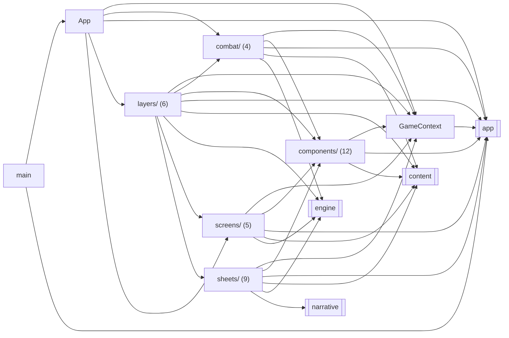

<!-- Generated by tools/codemap.ts. Do not edit by hand: run `npm run docs:codemap`. -->

# Code map: src/ui and src/main.tsx

React components that render the two stores (game and view) and call GameApp commands, plus the browser entry point src/main.tsx.

Generated reference. Start with the [guide](../../architecture/code-map.md) for the flows, and the [index](README.md) for how to read these entries.

## Imports inside this area

*Folders are collapsed into one box (file count in brackets). Imports of src/core are left out: nearly every file has them. Double-bordered boxes are other areas.*

## Files

| File | Purpose |
|---|---|
| [src/main.tsx](#src-main-tsx) | Entry point: create the game, expose a test handle in dev builds, mount React. |
| [src/ui/App.tsx](#src-ui-app-tsx) | The app shell: topbar, the current screen, the action bar, and the overlay layers (timing, sheet, popup, toast). |
| [src/ui/GameContext.tsx](#src-ui-gamecontext-tsx) | React access to the game. |
| [src/ui/combat/BattleActions.tsx](#src-ui-combat-battleactions-tsx) | — |
| [src/ui/combat/BattleScreen.tsx](#src-ui-combat-battlescreen-tsx) | — |
| [src/ui/combat/TimingOverlay.tsx](#src-ui-combat-timingoverlay-tsx) | — |
| [src/ui/combat/targeting.ts](#src-ui-combat-targeting-ts) | Battle-input UI state: which menu is open, and whether we're waiting for a target tap. |
| [src/ui/components/Bar.tsx](#src-ui-components-bar-tsx) | — |
| [src/ui/components/Button.tsx](#src-ui-components-button-tsx) | — |
| [src/ui/components/Chips.tsx](#src-ui-components-chips-tsx) | — |
| [src/ui/components/ItemRow.tsx](#src-ui-components-itemrow-tsx) | — |
| [src/ui/components/LexText.tsx](#src-ui-components-lextext-tsx) | — |
| [src/ui/components/Notes.tsx](#src-ui-components-notes-tsx) | — |
| [src/ui/components/Segmented.tsx](#src-ui-components-segmented-tsx) | — |
| [src/ui/components/Sprite.tsx](#src-ui-components-sprite-tsx) | A character's pixel-art sprite, drawn as inline SVG at a whole-number scale so every pixel stays crisp. |
| [src/ui/components/StatGrid.tsx](#src-ui-components-statgrid-tsx) | — |
| [src/ui/components/Tone.tsx](#src-ui-components-tone-tsx) | — |
| [src/ui/components/Typewriter.tsx](#src-ui-components-typewriter-tsx) | — |
| [src/ui/components/useFocusReturn.ts](#src-ui-components-usefocusreturn-ts) | — |
| [src/ui/layers/ActionBar.tsx](#src-ui-layers-actionbar-tsx) | — |
| [src/ui/layers/Announcer.tsx](#src-ui-layers-announcer-tsx) | — |
| [src/ui/layers/PopupLayer.tsx](#src-ui-layers-popuplayer-tsx) | — |
| [src/ui/layers/SheetLayer.tsx](#src-ui-layers-sheetlayer-tsx) | — |
| [src/ui/layers/Toast.tsx](#src-ui-layers-toast-tsx) | — |
| [src/ui/layers/Topbar.tsx](#src-ui-layers-topbar-tsx) | — |
| [src/ui/screens/Create.tsx](#src-ui-screens-create-tsx) | — |
| [src/ui/screens/District.tsx](#src-ui-screens-district-tsx) | — |
| [src/ui/screens/Place.tsx](#src-ui-screens-place-tsx) | — |
| [src/ui/screens/Story.tsx](#src-ui-screens-story-tsx) | — |
| [src/ui/screens/Title.tsx](#src-ui-screens-title-tsx) | — |
| [src/ui/sheets/HistorySheet.tsx](#src-ui-sheets-historysheet-tsx) | — |
| [src/ui/sheets/MenuSheets.tsx](#src-ui-sheets-menusheets-tsx) | The pause-menu sheets: Menu, Status & Skills, Bag, Gear, Band, Journal, Blue Book, Lexicon. |
| [src/ui/sheets/SavesSheet.tsx](#src-ui-sheets-savessheet-tsx) | — |
| [src/ui/sheets/SettingsSheet.tsx](#src-ui-sheets-settingssheet-tsx) | — |
| [src/ui/sheets/Sheet.tsx](#src-ui-sheets-sheet-tsx) | — |
| [src/ui/sheets/ShopSheet.tsx](#src-ui-sheets-shopsheet-tsx) | — |
| [src/ui/sheets/SpritesSheet.tsx](#src-ui-sheets-spritessheet-tsx) | Dev: the sprite gallery. |
| [src/ui/sheets/WorldSheets.tsx](#src-ui-sheets-worldsheets-tsx) | Travel, the bounty board, How to Play and the dev menu. |
| [src/ui/sheets/format.ts](#src-ui-sheets-format-ts) | Display strings shared by several sheets. |

## Details

### src/main.tsx

Entry point: create the game, expose a test handle in dev builds, mount React.

- Source: [src/main.tsx](../../../src/main.tsx)
- Imports: app: [game](app.md#src-app-game-ts), [save/cloud](app.md#src-app-save-cloud-ts) · ui: [App](#src-ui-app-tsx)
- Packages: `react`, `react-dom`
- Styles: `global.css`

Declarations:

- **app** · *const, internal* `= new GameApp(…)`
  - uses: **[app/game](app.md#src-app-game-ts)** [GameApp](app.md#src-app-game-ts--gameapp) · **[app/save/cloud](app.md#src-app-save-cloud-ts)** [CloudApi](app.md#src-app-save-cloud-ts--cloudapi)
  - used by: here [(top level)](#src-main-tsx--top-level)
- **(top level)** · *module* — Statements that run when the module loads.
  - uses: here [app](#src-main-tsx--app) · **[app/game](app.md#src-app-game-ts)** [GameApp.start](app.md#src-app-game-ts--gameapp-start), [GameApp.view](app.md#src-app-game-ts--gameapp-view) · **[ui/App](#src-ui-app-tsx)** [App](#src-ui-app-tsx--app)

### src/ui/App.tsx

The app shell: topbar, the current screen, the action bar, and the overlay layers (timing, sheet, popup, toast). Display settings (text size, reduce motion) are classes on the root.

- Source: [src/ui/App.tsx](../../../src/ui/App.tsx)
- Imports: app: [game](app.md#src-app-game-ts) · ui: [GameContext](#src-ui-gamecontext-tsx), [combat/BattleScreen](#src-ui-combat-battlescreen-tsx), [combat/TimingOverlay](#src-ui-combat-timingoverlay-tsx), [layers/ActionBar](#src-ui-layers-actionbar-tsx), [layers/Announcer](#src-ui-layers-announcer-tsx), [layers/PopupLayer](#src-ui-layers-popuplayer-tsx), [layers/SheetLayer](#src-ui-layers-sheetlayer-tsx), [layers/Toast](#src-ui-layers-toast-tsx), [layers/Topbar](#src-ui-layers-topbar-tsx), [screens/Create](#src-ui-screens-create-tsx), [screens/District](#src-ui-screens-district-tsx), [screens/Place](#src-ui-screens-place-tsx), [screens/Story](#src-ui-screens-story-tsx), [screens/Title](#src-ui-screens-title-tsx)
- Styles: `App.module.css`
- Imported by: ui: [src/main](#src-main-tsx)
- Types used: **[app/game](app.md#src-app-game-ts)** [GameApp](app.md#src-app-game-ts--gameapp)

Declarations:

- **Screen** · *component, internal* `(): React.JSX.Element`
  - uses: **[ui/GameContext](#src-ui-gamecontext-tsx)** [useView](#src-ui-gamecontext-tsx--useview) · **[ui/combat/BattleScreen](#src-ui-combat-battlescreen-tsx)** [BattleScreen](#src-ui-combat-battlescreen-tsx--battlescreen) · **[ui/screens/Create](#src-ui-screens-create-tsx)** [CreateScreen](#src-ui-screens-create-tsx--createscreen) · **[ui/screens/District](#src-ui-screens-district-tsx)** [DistrictScreen](#src-ui-screens-district-tsx--districtscreen) · **[ui/screens/Place](#src-ui-screens-place-tsx)** [PlaceScreen](#src-ui-screens-place-tsx--placescreen) · **[ui/screens/Story](#src-ui-screens-story-tsx)** [StoryScreen](#src-ui-screens-story-tsx--storyscreen) · **[ui/screens/Title](#src-ui-screens-title-tsx)** [TitleScreen](#src-ui-screens-title-tsx--titlescreen)
  - used by: here [Shell](#src-ui-app-tsx--shell)
- **Shell** · *component, internal* `(): React.JSX.Element`
  - uses: here [Screen](#src-ui-app-tsx--screen) · **[app/audio/sfx](app.md#src-app-audio-sfx-ts)** [Sfx.unlock](app.md#src-app-audio-sfx-ts--sfx-unlock) · **[app/game](app.md#src-app-game-ts)** [GameApp.sfx](app.md#src-app-game-ts--gameapp-sfx) · **[ui/GameContext](#src-ui-gamecontext-tsx)** [useApp](#src-ui-gamecontext-tsx--useapp), [useGame](#src-ui-gamecontext-tsx--usegame), [useView](#src-ui-gamecontext-tsx--useview) · **[ui/combat/TimingOverlay](#src-ui-combat-timingoverlay-tsx)** [TimingOverlay](#src-ui-combat-timingoverlay-tsx--timingoverlay) · **[ui/layers/ActionBar](#src-ui-layers-actionbar-tsx)** [ActionBar](#src-ui-layers-actionbar-tsx--actionbar) · **[ui/layers/Announcer](#src-ui-layers-announcer-tsx)** [Announcer](#src-ui-layers-announcer-tsx--announcer) · **[ui/layers/PopupLayer](#src-ui-layers-popuplayer-tsx)** [PopupLayer](#src-ui-layers-popuplayer-tsx--popuplayer) · **[ui/layers/SheetLayer](#src-ui-layers-sheetlayer-tsx)** [SheetLayer](#src-ui-layers-sheetlayer-tsx--sheetlayer) · **[ui/layers/Toast](#src-ui-layers-toast-tsx)** [Toast](#src-ui-layers-toast-tsx--toast) · **[ui/layers/Topbar](#src-ui-layers-topbar-tsx)** [Topbar](#src-ui-layers-topbar-tsx--topbar)
  - used by: here [App](#src-ui-app-tsx--app)
- **App** · *component* `({ app }: { app: GameApp }): React.JSX.Element` — The root component.
  - uses: here [Shell](#src-ui-app-tsx--shell) · **[ui/GameContext](#src-ui-gamecontext-tsx)** [GameContext](#src-ui-gamecontext-tsx--gamecontext)
  - used by: **[main](#src-main-tsx)** [(top level)](#src-main-tsx--top-level)

### src/ui/GameContext.tsx

React access to the game. Components read snapshots (frozen; writing to them throws in dev) and call commands on the app. They never mutate state directly.

- Source: [src/ui/GameContext.tsx](../../../src/ui/GameContext.tsx)
- Imports: core: [types/index](core.md#src-core-types-index-ts) · app: [game](app.md#src-app-game-ts)
- Packages: `react`, `valtio`
- Imported by: ui: [App](#src-ui-app-tsx), [combat/BattleActions](#src-ui-combat-battleactions-tsx), [combat/BattleScreen](#src-ui-combat-battlescreen-tsx), [combat/TimingOverlay](#src-ui-combat-timingoverlay-tsx), [combat/targeting](#src-ui-combat-targeting-ts), [components/Chips](#src-ui-components-chips-tsx), [components/LexText](#src-ui-components-lextext-tsx), [components/Typewriter](#src-ui-components-typewriter-tsx), [layers/ActionBar](#src-ui-layers-actionbar-tsx), [layers/Announcer](#src-ui-layers-announcer-tsx), [layers/PopupLayer](#src-ui-layers-popuplayer-tsx), [layers/SheetLayer](#src-ui-layers-sheetlayer-tsx), [layers/Toast](#src-ui-layers-toast-tsx), [layers/Topbar](#src-ui-layers-topbar-tsx), [screens/Create](#src-ui-screens-create-tsx), [screens/District](#src-ui-screens-district-tsx), [screens/Place](#src-ui-screens-place-tsx), [screens/Story](#src-ui-screens-story-tsx), [screens/Title](#src-ui-screens-title-tsx), [sheets/HistorySheet](#src-ui-sheets-historysheet-tsx), [sheets/MenuSheets](#src-ui-sheets-menusheets-tsx), [sheets/SavesSheet](#src-ui-sheets-savessheet-tsx), [sheets/SettingsSheet](#src-ui-sheets-settingssheet-tsx), [sheets/Sheet](#src-ui-sheets-sheet-tsx), [sheets/ShopSheet](#src-ui-sheets-shopsheet-tsx), [sheets/WorldSheets](#src-ui-sheets-worldsheets-tsx)
- Types used: **[app/game](app.md#src-app-game-ts)** [GameApp](app.md#src-app-game-ts--gameapp) · **[core/types/state](core.md#src-core-types-state-ts)** [GameState](core.md#src-core-types-state-ts--gamestate)

Declarations:

- **GameContext** · *const*
  - used by: here [useApp](#src-ui-gamecontext-tsx--useapp) · **[ui/App](#src-ui-app-tsx)** [App](#src-ui-app-tsx--app)
- **useApp** · *function* `(): GameApp` — The game app (commands).
  - uses: here [GameContext](#src-ui-gamecontext-tsx--gamecontext)
  - used by: here [useGame](#src-ui-gamecontext-tsx--usegame), [useView](#src-ui-gamecontext-tsx--useview) · **[ui/App](#src-ui-app-tsx)** [Shell](#src-ui-app-tsx--shell) · **[ui/combat/BattleActions](#src-ui-combat-battleactions-tsx)** [BattleActions](#src-ui-combat-battleactions-tsx--battleactions) · **[ui/combat/TimingOverlay](#src-ui-combat-timingoverlay-tsx)** [BluesPads](#src-ui-combat-timingoverlay-tsx--bluespads), [TimingBar](#src-ui-combat-timingoverlay-tsx--timingbar) · **[ui/combat/targeting](#src-ui-combat-targeting-ts)** [useTargeting](#src-ui-combat-targeting-ts--usetargeting) · **[ui/components/Chips](#src-ui-components-chips-tsx)** [StatusChips](#src-ui-components-chips-tsx--statuschips) · **[ui/components/LexText](#src-ui-components-lextext-tsx)** [LexText](#src-ui-components-lextext-tsx--lextext) · **[ui/components/Typewriter](#src-ui-components-typewriter-tsx)** [Typewriter](#src-ui-components-typewriter-tsx--typewriter) · **[ui/layers/PopupLayer](#src-ui-layers-popuplayer-tsx)** [PopupLayer](#src-ui-layers-popuplayer-tsx--popuplayer) · **[ui/layers/Topbar](#src-ui-layers-topbar-tsx)** [Topbar](#src-ui-layers-topbar-tsx--topbar) · **[ui/screens/Create](#src-ui-screens-create-tsx)** [CreateActions](#src-ui-screens-create-tsx--createactions), [CreateScreen](#src-ui-screens-create-tsx--createscreen) · **[ui/screens/District](#src-ui-screens-district-tsx)** [DistrictActions](#src-ui-screens-district-tsx--districtactions), [DistrictScreen](#src-ui-screens-district-tsx--districtscreen) · … +23 more
- **useView** · *function* `(): { readonly screen: Screen; readonly title: string | null; readonly lines: readonly { readonly id: number; readonly kind: "narr" | "spoken" | "you" | "prompt" | "boar…` — A snapshot of the presentation state.
  - uses: here [useApp](#src-ui-gamecontext-tsx--useapp) · **[app/game](app.md#src-app-game-ts)** [GameApp.view](app.md#src-app-game-ts--gameapp-view)
  - used by: **[ui/App](#src-ui-app-tsx)** [Screen](#src-ui-app-tsx--screen), [Shell](#src-ui-app-tsx--shell) · **[ui/combat/BattleActions](#src-ui-combat-battleactions-tsx)** [BattleActions](#src-ui-combat-battleactions-tsx--battleactions) · **[ui/combat/BattleScreen](#src-ui-combat-battlescreen-tsx)** [BattleScreen](#src-ui-combat-battlescreen-tsx--battlescreen), [EnemyCard](#src-ui-combat-battlescreen-tsx--enemycard), [Floats](#src-ui-combat-battlescreen-tsx--floats), [useLastHit](#src-ui-combat-battlescreen-tsx--uselasthit) · **[ui/combat/TimingOverlay](#src-ui-combat-timingoverlay-tsx)** [BluesPads](#src-ui-combat-timingoverlay-tsx--bluespads), [TimingBar](#src-ui-combat-timingoverlay-tsx--timingbar), [TimingOverlay](#src-ui-combat-timingoverlay-tsx--timingoverlay) · **[ui/layers/ActionBar](#src-ui-layers-actionbar-tsx)** [ActionBar](#src-ui-layers-actionbar-tsx--actionbar) · **[ui/layers/Announcer](#src-ui-layers-announcer-tsx)** [Announcer](#src-ui-layers-announcer-tsx--announcer) · **[ui/layers/PopupLayer](#src-ui-layers-popuplayer-tsx)** [PopupLayer](#src-ui-layers-popuplayer-tsx--popuplayer) · **[ui/layers/SheetLayer](#src-ui-layers-sheetlayer-tsx)** [SheetLayer](#src-ui-layers-sheetlayer-tsx--sheetlayer) · **[ui/layers/Toast](#src-ui-layers-toast-tsx)** [Toast](#src-ui-layers-toast-tsx--toast) · **[ui/screens/Create](#src-ui-screens-create-tsx)** [CreateActions](#src-ui-screens-create-tsx--createactions) · … +12 more
- **useGame** · *function* `(): GameState | null` — A snapshot of the save (null on the title screen), typed as GameState so read-only engine queries (derivedStats, legalActions…) accept it.
  - uses: here [useApp](#src-ui-gamecontext-tsx--useapp) · **[app/game](app.md#src-app-game-ts)** [GameApp.store](app.md#src-app-game-ts--gameapp-store)
  - used by: **[ui/App](#src-ui-app-tsx)** [Shell](#src-ui-app-tsx--shell) · **[ui/combat/BattleScreen](#src-ui-combat-battlescreen-tsx)** [BattleScreen](#src-ui-combat-battlescreen-tsx--battlescreen), [EnemyCard](#src-ui-combat-battlescreen-tsx--enemycard), [PlayerPanel](#src-ui-combat-battlescreen-tsx--playerpanel) · **[ui/layers/SheetLayer](#src-ui-layers-sheetlayer-tsx)** [SheetLayer](#src-ui-layers-sheetlayer-tsx--sheetlayer) · **[ui/layers/Topbar](#src-ui-layers-topbar-tsx)** [Topbar](#src-ui-layers-topbar-tsx--topbar) · **[ui/screens/District](#src-ui-screens-district-tsx)** [DistrictActions](#src-ui-screens-district-tsx--districtactions), [DistrictScreen](#src-ui-screens-district-tsx--districtscreen) · **[ui/screens/Place](#src-ui-screens-place-tsx)** [PlaceScreen](#src-ui-screens-place-tsx--placescreen) · **[ui/screens/Story](#src-ui-screens-story-tsx)** [StoryScreen](#src-ui-screens-story-tsx--storyscreen) · **[ui/sheets/MenuSheets](#src-ui-sheets-menusheets-tsx)** [BagSheet](#src-ui-sheets-menusheets-tsx--bagsheet), [BandSheet](#src-ui-sheets-menusheets-tsx--bandsheet), [BookSheet](#src-ui-sheets-menusheets-tsx--booksheet), [GearSheet](#src-ui-sheets-menusheets-tsx--gearsheet), [JournalSheet](#src-ui-sheets-menusheets-tsx--journalsheet), [LexiconSheet](#src-ui-sheets-menusheets-tsx--lexiconsheet) · … +9 more

### src/ui/combat/BattleActions.tsx

- Source: [src/ui/combat/BattleActions.tsx](../../../src/ui/combat/BattleActions.tsx)
- Imports: core: [types/index](core.md#src-core-types-index-ts) · content: [index](content.md#src-content-index-ts) · ui: [GameContext](#src-ui-gamecontext-tsx), [combat/targeting](#src-ui-combat-targeting-ts), [components/Button](#src-ui-components-button-tsx), [components/Tone](#src-ui-components-tone-tsx)
- Packages: `valtio`
- Styles: `BattleActions.module.css`
- Imported by: ui: [layers/ActionBar](#src-ui-layers-actionbar-tsx)
- Types used: **[core/types/effects](core.md#src-core-types-effects-ts)** [DamageEffect](core.md#src-core-types-effects-ts--damageeffect)

Declarations:

- **BattleActions** · *component* `(): React.JSX.Element` — The six battle actions (plus PLAY THE BLUES), the skill picker, and target selection.
  - uses: **[app/game](app.md#src-app-game-ts)** [GameApp.chooseIntent](app.md#src-app-game-ts--gameapp-chooseintent), [GameApp.openSheet](app.md#src-app-game-ts--gameapp-opensheet), [GameApp.presenter](app.md#src-app-game-ts--gameapp-presenter) · **[app/reactPresenter](app.md#src-app-reactpresenter-ts)** [ReactPresenter.toast](app.md#src-app-reactpresenter-ts--reactpresenter-toast) · **[content/combat/skills](content.md#src-content-combat-skills-ts)** [SKILLS](content.md#src-content-combat-skills-ts--skills) · **[ui/GameContext](#src-ui-gamecontext-tsx)** [useApp](#src-ui-gamecontext-tsx--useapp), [useView](#src-ui-gamecontext-tsx--useview) · **[ui/combat/targeting](#src-ui-combat-targeting-ts)** [battleInput](#src-ui-combat-targeting-ts--battleinput), [resetBattleInput](#src-ui-combat-targeting-ts--resetbattleinput), [withTarget](#src-ui-combat-targeting-ts--withtarget) · **[ui/components/Button](#src-ui-components-button-tsx)** [Button](#src-ui-components-button-tsx--button) · **[ui/components/Tone](#src-ui-components-tone-tsx)** [Tone](#src-ui-components-tone-tsx--tone)
  - used by: **[ui/layers/ActionBar](#src-ui-layers-actionbar-tsx)** [ActionBar](#src-ui-layers-actionbar-tsx--actionbar)

### src/ui/combat/BattleScreen.tsx

- Source: [src/ui/combat/BattleScreen.tsx](../../../src/ui/combat/BattleScreen.tsx)
- Imports: content: [index](content.md#src-content-index-ts), [sprites/index](content.md#src-content-sprites-index-ts) · app: [view](app.md#src-app-view-ts) · ui: [GameContext](#src-ui-gamecontext-tsx), [combat/targeting](#src-ui-combat-targeting-ts), [components/Bar](#src-ui-components-bar-tsx), [components/Chips](#src-ui-components-chips-tsx), [components/Sprite](#src-ui-components-sprite-tsx), [components/Tone](#src-ui-components-tone-tsx)
- Packages: `react`, `valtio`
- Styles: `Battle.module.css`
- Imported by: ui: [App](#src-ui-app-tsx)
- Types used: **[app/view](app.md#src-app-view-ts)** [ActorView](app.md#src-app-view-ts--actorview)

Declarations:

- **Floats** · *component, internal* `({ id }: { id: string }): React.JSX.Element` — Damage and heal numbers rising from an actor's sprite.
  - uses: **[ui/GameContext](#src-ui-gamecontext-tsx)** [useView](#src-ui-gamecontext-tsx--useview)
  - used by: here [EnemyCard](#src-ui-combat-battlescreen-tsx--enemycard), [PlayerPanel](#src-ui-combat-battlescreen-tsx--playerpanel)
- **useLastHit** · *function, internal* `(id: string): number | null` — The newest damage number still floating over an actor: its sprite flashes once per new one.
  - uses: **[ui/GameContext](#src-ui-gamecontext-tsx)** [useView](#src-ui-gamecontext-tsx--useview)
  - used by: here [EnemyCard](#src-ui-combat-battlescreen-tsx--enemycard), [PlayerPanel](#src-ui-combat-battlescreen-tsx--playerpanel)
- **bobPhase** · *function, internal* `(id: string): number` — Where in the idle bob an actor starts, from its id, so a group doesn't bob in unison.
  - used by: here [EnemyCard](#src-ui-combat-battlescreen-tsx--enemycard)
- **EnemyCard** · *component, internal* `({ e }: { e: Snapshot<ActorView> }): React.JSX.Element`
  - uses: here [Floats](#src-ui-combat-battlescreen-tsx--floats), [bobPhase](#src-ui-combat-battlescreen-tsx--bobphase), [useLastHit](#src-ui-combat-battlescreen-tsx--uselasthit) · **[content/sprites/refs](content.md#src-content-sprites-refs-ts)** [actorSprite](content.md#src-content-sprites-refs-ts--actorsprite) · **[ui/GameContext](#src-ui-gamecontext-tsx)** [useGame](#src-ui-gamecontext-tsx--usegame), [useView](#src-ui-gamecontext-tsx--useview) · **[ui/combat/targeting](#src-ui-combat-targeting-ts)** [useTargeting](#src-ui-combat-targeting-ts--usetargeting) · **[ui/components/Bar](#src-ui-components-bar-tsx)** [Bar](#src-ui-components-bar-tsx--bar) · **[ui/components/Chips](#src-ui-components-chips-tsx)** [StatusChips](#src-ui-components-chips-tsx--statuschips) · **[ui/components/Sprite](#src-ui-components-sprite-tsx)** [Sprite](#src-ui-components-sprite-tsx--sprite) · **[ui/components/Tone](#src-ui-components-tone-tsx)** [Tone](#src-ui-components-tone-tsx--tone)
  - used by: here [BattleScreen](#src-ui-combat-battlescreen-tsx--battlescreen)
- **PlayerPanel** · *component, internal* `({ p, active }: { p: Snapshot<ActorView>; active: boolean }): React.JSX.Element` — You: your hero, name, level and class, the Big Four beat (Bass Drum), and your three bars.
  - uses: here [Floats](#src-ui-combat-battlescreen-tsx--floats), [useLastHit](#src-ui-combat-battlescreen-tsx--uselasthit) · **[content/classes/index](content.md#src-content-classes-index-ts)** [CLASSES](content.md#src-content-classes-index-ts--classes) · **[content/sprites/refs](content.md#src-content-sprites-refs-ts)** [heroSprite](content.md#src-content-sprites-refs-ts--herosprite) · **[ui/GameContext](#src-ui-gamecontext-tsx)** [useGame](#src-ui-gamecontext-tsx--usegame) · **[ui/components/Bar](#src-ui-components-bar-tsx)** [Bar](#src-ui-components-bar-tsx--bar) · **[ui/components/Chips](#src-ui-components-chips-tsx)** [StatusChips](#src-ui-components-chips-tsx--statuschips) · **[ui/components/Sprite](#src-ui-components-sprite-tsx)** [Sprite](#src-ui-components-sprite-tsx--sprite)
  - used by: here [BattleScreen](#src-ui-combat-battlescreen-tsx--battlescreen)
- **SHAKE** · *const, internal* `: Keyframe[]`
  - used by: here [BattleScreen](#src-ui-combat-battlescreen-tsx--battlescreen)
- **FLASH** · *const, internal* `: Keyframe[]`
  - used by: here [BattleScreen](#src-ui-combat-battlescreen-tsx--battlescreen)
- **useReplay** · *function, internal* `(ref: RefObject<HTMLElement | null>, count: number, frames: Keyframe[], ms: number, calm: boolean): void` — Plays `frames` on the element each time `count` goes up.
  - used by: here [BattleScreen](#src-ui-combat-battlescreen-tsx--battlescreen)
- **BattleScreen** · *component* `(): React.JSX.Element | null` — The battle screen: enemies, the log, and you.
  - uses: here [EnemyCard](#src-ui-combat-battlescreen-tsx--enemycard), [FLASH](#src-ui-combat-battlescreen-tsx--flash), [PlayerPanel](#src-ui-combat-battlescreen-tsx--playerpanel), [SHAKE](#src-ui-combat-battlescreen-tsx--shake), [useReplay](#src-ui-combat-battlescreen-tsx--usereplay) · **[ui/GameContext](#src-ui-gamecontext-tsx)** [useGame](#src-ui-gamecontext-tsx--usegame), [useView](#src-ui-gamecontext-tsx--useview) · **[ui/combat/targeting](#src-ui-combat-targeting-ts)** [resetBattleInput](#src-ui-combat-targeting-ts--resetbattleinput)
  - used by: **[ui/App](#src-ui-app-tsx)** [Screen](#src-ui-app-tsx--screen)

### src/ui/combat/TimingOverlay.tsx

- Source: [src/ui/combat/TimingOverlay.tsx](../../../src/ui/combat/TimingOverlay.tsx)
- Imports: core: [ids/enemies](core.md#src-core-ids-enemies-ts) · content: [index](content.md#src-content-index-ts) · engine: [index](engine.md#src-engine-index-ts) · ui: [GameContext](#src-ui-gamecontext-tsx), [components/useFocusReturn](#src-ui-components-usefocusreturn-ts)
- Packages: `react`
- Styles: `Timing.module.css`
- Imported by: ui: [App](#src-ui-app-tsx)

Declarations:

- **TimingBar** · *component, internal* `(): React.JSX.Element` — On the One: the marker sweeps; tap (or press Space/Enter) as it crosses the gold ONE zone.
  - uses: **[app/game](app.md#src-app-game-ts)** [GameApp.tap](app.md#src-app-game-ts--gameapp-tap) · **[engine/combat/timing](engine.md#src-engine-combat-timing-ts)** [TIMING_LEAD_MS](engine.md#src-engine-combat-timing-ts--timing-lead-ms) · **[ui/GameContext](#src-ui-gamecontext-tsx)** [useApp](#src-ui-gamecontext-tsx--useapp), [useView](#src-ui-gamecontext-tsx--useview)
  - used by: here [TimingOverlay](#src-ui-combat-timingoverlay-tsx--timingoverlay)
- **BluesPads** · *component, internal* `(): React.JSX.Element` — Play the Blues: six pads light in turn; tap each as it lights.
  - uses: **[app/audio/sfx](app.md#src-app-audio-sfx-ts)** [Sfx.note](app.md#src-app-audio-sfx-ts--sfx-note) · **[app/game](app.md#src-app-game-ts)** [GameApp.bluesDone](app.md#src-app-game-ts--gameapp-bluesdone), [GameApp.sfx](app.md#src-app-game-ts--gameapp-sfx) · **[content/notes](content.md#src-content-notes-ts)** [NOTES](content.md#src-content-notes-ts--notes) · **[core/ids/enemies](core.md#src-core-ids-enemies-ts)** [NOTE_IDS](core.md#src-core-ids-enemies-ts--note-ids) · **[engine/combat/timing](engine.md#src-engine-combat-timing-ts)** [BLUES_LEAD_MS](engine.md#src-engine-combat-timing-ts--blues-lead-ms), [BLUES_STEP_MS](engine.md#src-engine-combat-timing-ts--blues-step-ms), [bluesLabel](engine.md#src-engine-combat-timing-ts--blueslabel), [scoreBlues](engine.md#src-engine-combat-timing-ts--scoreblues) · **[ui/GameContext](#src-ui-gamecontext-tsx)** [useApp](#src-ui-gamecontext-tsx--useapp), [useView](#src-ui-gamecontext-tsx--useview)
  - used by: here [TimingOverlay](#src-ui-combat-timingoverlay-tsx--timingoverlay)
- **TimingOverlay** · *component* `(): React.JSX.Element | null` — The timing layer over the battle: the bar, an auto-rhythm result, or the Blues pads.
  - uses: here [BluesPads](#src-ui-combat-timingoverlay-tsx--bluespads), [TimingBar](#src-ui-combat-timingoverlay-tsx--timingbar) · **[ui/GameContext](#src-ui-gamecontext-tsx)** [useView](#src-ui-gamecontext-tsx--useview) · **[ui/components/useFocusReturn](#src-ui-components-usefocusreturn-ts)** [useFocusReturn](#src-ui-components-usefocusreturn-ts--usefocusreturn)
  - used by: **[ui/App](#src-ui-app-tsx)** [Shell](#src-ui-app-tsx--shell)

### src/ui/combat/targeting.ts

Battle-input UI state: which menu is open, and whether we're waiting for a target tap. It's purely presentational, so it lives in a small store here rather than in the game's view state.

- Source: [src/ui/combat/targeting.ts](../../../src/ui/combat/targeting.ts)
- Imports: core: [types/index](core.md#src-core-types-index-ts) · app: [game](app.md#src-app-game-ts) · ui: [GameContext](#src-ui-gamecontext-tsx)
- Packages: `valtio`
- Imported by: ui: [combat/BattleActions](#src-ui-combat-battleactions-tsx), [combat/BattleScreen](#src-ui-combat-battlescreen-tsx)
- Types used: **[app/game](app.md#src-app-game-ts)** [GameApp](app.md#src-app-game-ts--gameapp) · **[core/types/battle](core.md#src-core-types-battle-ts)** [PlayerIntent](core.md#src-core-types-battle-ts--playerintent)

Declarations:

- **MakeIntent** · *type, internal* `= (targetId: string) => PlayerIntent`
  - used by: here [battleInput](#src-ui-combat-targeting-ts--battleinput), [withTarget](#src-ui-combat-targeting-ts--withtarget)
- **battleInput** · *const*
  - used by: here [resetBattleInput](#src-ui-combat-targeting-ts--resetbattleinput), [useTargeting](#src-ui-combat-targeting-ts--usetargeting), [withTarget](#src-ui-combat-targeting-ts--withtarget) · **[ui/combat/BattleActions](#src-ui-combat-battleactions-tsx)** [BattleActions](#src-ui-combat-battleactions-tsx--battleactions)
- **resetBattleInput** · *function* `(): void` — Back to the six actions with nothing pending.
  - uses: here [battleInput](#src-ui-combat-targeting-ts--battleinput)
  - used by: here [useTargeting](#src-ui-combat-targeting-ts--usetargeting), [withTarget](#src-ui-combat-targeting-ts--withtarget) · **[ui/combat/BattleActions](#src-ui-combat-battleactions-tsx)** [BattleActions](#src-ui-combat-battleactions-tsx--battleactions) · **[ui/combat/BattleScreen](#src-ui-combat-battlescreen-tsx)** [BattleScreen](#src-ui-combat-battlescreen-tsx--battlescreen)
- **withTarget** · *function* `(app: GameApp, targets: readonly string[], make: MakeIntent): void` — Act now when only one enemy stands; otherwise wait for a tap on an enemy card.
  - uses: here [battleInput](#src-ui-combat-targeting-ts--battleinput), [resetBattleInput](#src-ui-combat-targeting-ts--resetbattleinput) · **[app/game](app.md#src-app-game-ts)** [GameApp.chooseIntent](app.md#src-app-game-ts--gameapp-chooseintent)
  - used by: **[ui/combat/BattleActions](#src-ui-combat-battleactions-tsx)** [BattleActions](#src-ui-combat-battleactions-tsx--battleactions)
- **useTargeting** · *function* `(): { pending: boolean; pick(id: string): void; }` — Enemy cards use this to know whether they're tappable, and to answer the tap.
  - uses: here [battleInput](#src-ui-combat-targeting-ts--battleinput), [resetBattleInput](#src-ui-combat-targeting-ts--resetbattleinput) · **[app/game](app.md#src-app-game-ts)** [GameApp.chooseIntent](app.md#src-app-game-ts--gameapp-chooseintent) · **[ui/GameContext](#src-ui-gamecontext-tsx)** [useApp](#src-ui-gamecontext-tsx--useapp)
  - used by: **[ui/combat/BattleScreen](#src-ui-combat-battlescreen-tsx)** [EnemyCard](#src-ui-combat-battlescreen-tsx--enemycard)

### src/ui/components/Bar.tsx

- Source: [src/ui/components/Bar.tsx](../../../src/ui/components/Bar.tsx)
- Styles: `Bar.module.css`
- Imported by: ui: [combat/BattleScreen](#src-ui-combat-battlescreen-tsx), [layers/Topbar](#src-ui-layers-topbar-tsx), [sheets/MenuSheets](#src-ui-sheets-menusheets-tsx)

Declarations:

- **Props** · *interface, internal*
  - used by: here [Bar](#src-ui-components-bar-tsx--bar)
- **Bar** · *component* `({ value, max, label, kind, full, compact, name, decorative }: Props): React.JSX.Element` — A meter: Heart, Funk, Groove, enemy Heart or XP.
  - used by: **[ui/combat/BattleScreen](#src-ui-combat-battlescreen-tsx)** [EnemyCard](#src-ui-combat-battlescreen-tsx--enemycard), [PlayerPanel](#src-ui-combat-battlescreen-tsx--playerpanel) · **[ui/layers/Topbar](#src-ui-layers-topbar-tsx)** [Topbar](#src-ui-layers-topbar-tsx--topbar) · **[ui/sheets/MenuSheets](#src-ui-sheets-menusheets-tsx)** [StatusSheet](#src-ui-sheets-menusheets-tsx--statussheet)

### src/ui/components/Button.tsx

- Source: [src/ui/components/Button.tsx](../../../src/ui/components/Button.tsx)
- Packages: `react`
- Styles: `Button.module.css`
- Imported by: ui: [combat/BattleActions](#src-ui-combat-battleactions-tsx), [layers/PopupLayer](#src-ui-layers-popuplayer-tsx), [screens/Create](#src-ui-screens-create-tsx), [screens/District](#src-ui-screens-district-tsx), [screens/Place](#src-ui-screens-place-tsx), [screens/Story](#src-ui-screens-story-tsx), [screens/Title](#src-ui-screens-title-tsx), [sheets/HistorySheet](#src-ui-sheets-historysheet-tsx), [sheets/MenuSheets](#src-ui-sheets-menusheets-tsx), [sheets/SavesSheet](#src-ui-sheets-savessheet-tsx), [sheets/SettingsSheet](#src-ui-sheets-settingssheet-tsx), [sheets/Sheet](#src-ui-sheets-sheet-tsx), [sheets/ShopSheet](#src-ui-sheets-shopsheet-tsx), [sheets/WorldSheets](#src-ui-sheets-worldsheets-tsx)

Declarations:

- **ButtonVariant** · *type* `= 'primary' | 'ghost' | 'danger' | 'gold' | 'hint' | 'sel'` — Visual variants (v1's .btn modifiers).
  - used by: here [Props](#src-ui-components-button-tsx--props)
- **Props** · *interface, internal* `extends Omit<ButtonHTMLAttributes<HTMLButtonElement>, 'disabled'>`
  - used by: here [Button](#src-ui-components-button-tsx--button)
- **Button** · *component* `({ testId, variant, small, wide, center, inactive, className, children, ...rest }: Props): React.JSX.Element` — The one button.
  - used by: **[ui/combat/BattleActions](#src-ui-combat-battleactions-tsx)** [BattleActions](#src-ui-combat-battleactions-tsx--battleactions) · **[ui/layers/PopupLayer](#src-ui-layers-popuplayer-tsx)** [PopupLayer](#src-ui-layers-popuplayer-tsx--popuplayer) · **[ui/screens/Create](#src-ui-screens-create-tsx)** [CreateActions](#src-ui-screens-create-tsx--createactions), [CreateScreen](#src-ui-screens-create-tsx--createscreen) · **[ui/screens/District](#src-ui-screens-district-tsx)** [DistrictActions](#src-ui-screens-district-tsx--districtactions), [DistrictScreen](#src-ui-screens-district-tsx--districtscreen) · **[ui/screens/Place](#src-ui-screens-place-tsx)** [PlaceActions](#src-ui-screens-place-tsx--placeactions), [PlaceScreen](#src-ui-screens-place-tsx--placescreen) · **[ui/screens/Story](#src-ui-screens-story-tsx)** [StoryActions](#src-ui-screens-story-tsx--storyactions) · **[ui/screens/Title](#src-ui-screens-title-tsx)** [TitleActions](#src-ui-screens-title-tsx--titleactions) · **[ui/sheets/HistorySheet](#src-ui-sheets-historysheet-tsx)** [HistorySheet](#src-ui-sheets-historysheet-tsx--historysheet) · **[ui/sheets/MenuSheets](#src-ui-sheets-menusheets-tsx)** [BagSheet](#src-ui-sheets-menusheets-tsx--bagsheet), [BandSheet](#src-ui-sheets-menusheets-tsx--bandsheet), [GearSheet](#src-ui-sheets-menusheets-tsx--gearsheet), [MenuSheet](#src-ui-sheets-menusheets-tsx--menusheet), [SlotSheet](#src-ui-sheets-menusheets-tsx--slotsheet) · … +10 more

### src/ui/components/Chips.tsx

- Source: [src/ui/components/Chips.tsx](../../../src/ui/components/Chips.tsx)
- Imports: core: [ids/combat](core.md#src-core-ids-combat-ts) · content: [index](content.md#src-content-index-ts) · ui: [GameContext](#src-ui-gamecontext-tsx)
- Packages: `react`
- Styles: `Chips.module.css`
- Imported by: ui: [combat/BattleScreen](#src-ui-combat-battlescreen-tsx)
- Types used: **[core/ids/combat](core.md#src-core-ids-combat-ts)** [StatusId](core.md#src-core-ids-combat-ts--statusid)

Declarations:

- **StatusChips** · *component* `({ statuses, guard, }: { statuses: readonly { id: StatusId; turns: number }[]; guard?: boolean; }): React.JSX.Element` — Status chips.
  - uses: **[app/game](app.md#src-app-game-ts)** [GameApp.showStatus](app.md#src-app-game-ts--gameapp-showstatus) · **[content/combat/statuses](content.md#src-content-combat-statuses-ts)** [STATUSES](content.md#src-content-combat-statuses-ts--statuses) · **[ui/GameContext](#src-ui-gamecontext-tsx)** [useApp](#src-ui-gamecontext-tsx--useapp)
  - used by: **[ui/combat/BattleScreen](#src-ui-combat-battlescreen-tsx)** [EnemyCard](#src-ui-combat-battlescreen-tsx--enemycard), [PlayerPanel](#src-ui-combat-battlescreen-tsx--playerpanel)

### src/ui/components/ItemRow.tsx

- Source: [src/ui/components/ItemRow.tsx](../../../src/ui/components/ItemRow.tsx)
- Packages: `react`
- Styles: `ItemRow.module.css`
- Imported by: ui: [sheets/HistorySheet](#src-ui-sheets-historysheet-tsx), [sheets/MenuSheets](#src-ui-sheets-menusheets-tsx), [sheets/ShopSheet](#src-ui-sheets-shopsheet-tsx), [sheets/WorldSheets](#src-ui-sheets-worldsheets-tsx)

Declarations:

- **ItemRow** · *component* `({ children, lead, action, equipped, }: { children: ReactNode; lead?: ReactNode; action?: ReactNode; equipped?: boolean; }): React.JSX.Element` — A list row: an optional lead (a portrait), info, and an action (button or note) on the right.
  - used by: **[ui/sheets/HistorySheet](#src-ui-sheets-historysheet-tsx)** [HistorySheet](#src-ui-sheets-historysheet-tsx--historysheet) · **[ui/sheets/MenuSheets](#src-ui-sheets-menusheets-tsx)** [BagSheet](#src-ui-sheets-menusheets-tsx--bagsheet), [BandSheet](#src-ui-sheets-menusheets-tsx--bandsheet), [BookSheet](#src-ui-sheets-menusheets-tsx--booksheet), [GearSheet](#src-ui-sheets-menusheets-tsx--gearsheet), [JournalSheet](#src-ui-sheets-menusheets-tsx--journalsheet), [SlotSheet](#src-ui-sheets-menusheets-tsx--slotsheet) · **[ui/sheets/ShopSheet](#src-ui-sheets-shopsheet-tsx)** [SellList](#src-ui-sheets-shopsheet-tsx--selllist), [ShopSheet](#src-ui-sheets-shopsheet-tsx--shopsheet) · **[ui/sheets/WorldSheets](#src-ui-sheets-worldsheets-tsx)** [BountySheet](#src-ui-sheets-worldsheets-tsx--bountysheet), [TravelSheet](#src-ui-sheets-worldsheets-tsx--travelsheet)

### src/ui/components/LexText.tsx

- Source: [src/ui/components/LexText.tsx](../../../src/ui/components/LexText.tsx)
- Imports: app: [lexicon](app.md#src-app-lexicon-ts) · ui: [GameContext](#src-ui-gamecontext-tsx)
- Packages: `react`
- Styles: `LexText.module.css`
- Imported by: ui: [components/Typewriter](#src-ui-components-typewriter-tsx), [screens/Story](#src-ui-screens-story-tsx)
- Types used: **[app/lexicon](app.md#src-app-lexicon-ts)** [LexPart](app.md#src-app-lexicon-ts--lexpart)

Declarations:

- **LexText** · *component* `({ text, shown, inert }: { text: string; shown?: number; inert?: boolean }): React.JSX.Element` — Narration with lexicon links.
  - uses: **[app/game](app.md#src-app-game-ts)** [GameApp.showTerm](app.md#src-app-game-ts--gameapp-showterm) · **[app/lexicon](app.md#src-app-lexicon-ts)** [parseLex](app.md#src-app-lexicon-ts--parselex) · **[ui/GameContext](#src-ui-gamecontext-tsx)** [useApp](#src-ui-gamecontext-tsx--useapp)
  - used by: **[ui/components/Typewriter](#src-ui-components-typewriter-tsx)** [Typewriter](#src-ui-components-typewriter-tsx--typewriter) · **[ui/screens/Story](#src-ui-screens-story-tsx)** [StoryScreen](#src-ui-screens-story-tsx--storyscreen)

### src/ui/components/Notes.tsx

- Source: [src/ui/components/Notes.tsx](../../../src/ui/components/Notes.tsx)
- Imports: core: [ids/enemies](core.md#src-core-ids-enemies-ts) · content: [index](content.md#src-content-index-ts)
- Styles: `Notes.module.css`
- Imported by: ui: [screens/Place](#src-ui-screens-place-tsx), [sheets/MenuSheets](#src-ui-sheets-menusheets-tsx)
- Types used: **[core/ids/enemies](core.md#src-core-ids-enemies-ts)** [NoteId](core.md#src-core-ids-enemies-ts--noteid)

Declarations:

- **Notes** · *component* `({ have }: { have: readonly NoteId[] }): React.JSX.Element` — The six Blue Notes, lit when recovered.
  - uses: **[content/notes](content.md#src-content-notes-ts)** [NOTES](content.md#src-content-notes-ts--notes) · **[core/ids/enemies](core.md#src-core-ids-enemies-ts)** [NOTE_IDS](core.md#src-core-ids-enemies-ts--note-ids)
  - used by: **[ui/screens/Place](#src-ui-screens-place-tsx)** [PlaceScreen](#src-ui-screens-place-tsx--placescreen) · **[ui/sheets/MenuSheets](#src-ui-sheets-menusheets-tsx)** [JournalSheet](#src-ui-sheets-menusheets-tsx--journalsheet), [StatusSheet](#src-ui-sheets-menusheets-tsx--statussheet)

### src/ui/components/Segmented.tsx

- Source: [src/ui/components/Segmented.tsx](../../../src/ui/components/Segmented.tsx)
- Styles: `Segmented.module.css`
- Imported by: ui: [sheets/SettingsSheet](#src-ui-sheets-settingssheet-tsx), [sheets/SpritesSheet](#src-ui-sheets-spritessheet-tsx)

Declarations:

- **Props** · *interface, internal*
  - used by: here [Segmented](#src-ui-components-segmented-tsx--segmented)
- **Segmented** · *component* `<V extends string | boolean>({ label, testId, options, value, onChange }: Props<V>): React.JSX.Element` — A labeled row of mutually exclusive options (settings).
  - used by: **[ui/sheets/SettingsSheet](#src-ui-sheets-settingssheet-tsx)** [Row](#src-ui-sheets-settingssheet-tsx--row) · **[ui/sheets/SpritesSheet](#src-ui-sheets-spritessheet-tsx)** [SpritesSheet](#src-ui-sheets-spritessheet-tsx--spritessheet)

### src/ui/components/Sprite.tsx

A character's pixel-art sprite, drawn as inline SVG at a whole-number scale so every pixel stays crisp. Decorative: the character's name is always shown as text beside it, so the art is hidden from screen readers. Only spans and an svg, so it can sit inside a &lt;p> or a &lt;button>. The art and the spec for every character: src/content/sprites/, docs/vision/character-design.md.

- Source: [src/ui/components/Sprite.tsx](../../../src/ui/components/Sprite.tsx)
- Imports: core: [ids/sprites](core.md#src-core-ids-sprites-ts) · content: [sprites/index](content.md#src-content-sprites-index-ts)
- Packages: `react`
- Styles: `Sprite.module.css`
- Imported by: ui: [combat/BattleScreen](#src-ui-combat-battlescreen-tsx), [screens/Create](#src-ui-screens-create-tsx), [screens/Story](#src-ui-screens-story-tsx), [sheets/MenuSheets](#src-ui-sheets-menusheets-tsx), [sheets/ShopSheet](#src-ui-sheets-shopsheet-tsx), [sheets/SpritesSheet](#src-ui-sheets-spritessheet-tsx), [sheets/WorldSheets](#src-ui-sheets-worldsheets-tsx)
- Tested by: [Sprite.test](tests.md#src-ui-components-sprite-test-tsx)
- Types used: **[core/ids/sprites](core.md#src-core-ids-sprites-ts)** [SpriteId](core.md#src-core-ids-sprites-ts--spriteid)

Declarations:

- **BOB_MS** · *const, internal* — Idle bob cycle (ms); `phase` offsets each sprite within it so a group doesn't bob in unison.
  - used by: here [Sprite](#src-ui-components-sprite-tsx--sprite)
- **Sprite** · *component* `({ id, scale, idle, flip, hit, phase = 0, className, }: { /** Which sprite. */ id: SpriteId; /** Pixel size in CSS px: 3 in battle and on the create screen, 2 for portra…`
  - uses: here [BOB_MS](#src-ui-components-sprite-tsx--bob-ms) · **[content/sprites/index](content.md#src-content-sprites-index-ts)** [compiled](content.md#src-content-sprites-index-ts--compiled)
  - used by: **[ui/combat/BattleScreen](#src-ui-combat-battlescreen-tsx)** [EnemyCard](#src-ui-combat-battlescreen-tsx--enemycard), [PlayerPanel](#src-ui-combat-battlescreen-tsx--playerpanel) · **[ui/screens/Create](#src-ui-screens-create-tsx)** [CreateScreen](#src-ui-screens-create-tsx--createscreen) · **[ui/screens/Story](#src-ui-screens-story-tsx)** [StoryScreen](#src-ui-screens-story-tsx--storyscreen) · **[ui/sheets/MenuSheets](#src-ui-sheets-menusheets-tsx)** [BandSheet](#src-ui-sheets-menusheets-tsx--bandsheet), [BookSheet](#src-ui-sheets-menusheets-tsx--booksheet), [StatusSheet](#src-ui-sheets-menusheets-tsx--statussheet) · **[ui/sheets/ShopSheet](#src-ui-sheets-shopsheet-tsx)** [ShopSheet](#src-ui-sheets-shopsheet-tsx--shopsheet) · **[ui/sheets/SpritesSheet](#src-ui-sheets-spritessheet-tsx)** [SpritesSheet](#src-ui-sheets-spritessheet-tsx--spritessheet) · **[ui/sheets/WorldSheets](#src-ui-sheets-worldsheets-tsx)** [BountySheet](#src-ui-sheets-worldsheets-tsx--bountysheet) · tests: [Sprite.test](tests.md#src-ui-components-sprite-test-tsx)

### src/ui/components/StatGrid.tsx

- Source: [src/ui/components/StatGrid.tsx](../../../src/ui/components/StatGrid.tsx)
- Imports: core: [ids/combat](core.md#src-core-ids-combat-ts) · content: [index](content.md#src-content-index-ts)
- Styles: `StatGrid.module.css`
- Imported by: ui: [layers/PopupLayer](#src-ui-layers-popuplayer-tsx), [sheets/MenuSheets](#src-ui-sheets-menusheets-tsx)
- Types used: **[core/ids/combat](core.md#src-core-ids-combat-ts)** [StatKey](core.md#src-core-ids-combat-ts--statkey)

Declarations:

- **StatGrid** · *component* `({ stats, gains }: { stats: Partial<Record<StatKey, number>>; gains?: boolean }): React.JSX.Element` — The six stats (or level-up gains when `gains`).
  - uses: **[content/stats](content.md#src-content-stats-ts)** [STAT_NAMES](content.md#src-content-stats-ts--stat-names) · **[core/ids/combat](core.md#src-core-ids-combat-ts)** [STAT_KEYS](core.md#src-core-ids-combat-ts--stat-keys)
  - used by: **[ui/layers/PopupLayer](#src-ui-layers-popuplayer-tsx)** [PopupLayer](#src-ui-layers-popuplayer-tsx--popuplayer) · **[ui/sheets/MenuSheets](#src-ui-sheets-menusheets-tsx)** [GearSheet](#src-ui-sheets-menusheets-tsx--gearsheet), [StatusSheet](#src-ui-sheets-menusheets-tsx--statussheet)

### src/ui/components/Tone.tsx

- Source: [src/ui/components/Tone.tsx](../../../src/ui/components/Tone.tsx)
- Imports: core: [ids/combat](core.md#src-core-ids-combat-ts)
- Styles: `Tone.module.css`
- Imported by: ui: [combat/BattleActions](#src-ui-combat-battleactions-tsx), [combat/BattleScreen](#src-ui-combat-battlescreen-tsx), [screens/Create](#src-ui-screens-create-tsx), [sheets/MenuSheets](#src-ui-sheets-menusheets-tsx), [sheets/WorldSheets](#src-ui-sheets-worldsheets-tsx)
- Types used: **[core/ids/combat](core.md#src-core-ids-combat-ts)** [ToneId](core.md#src-core-ids-combat-ts--toneid)

Declarations:

- **Tone** · *component* `({ tone }: { tone: ToneId }): React.JSX.Element` — A tone badge: HOT, LOW, BLUE, FUNK, SWEET.
  - used by: **[ui/combat/BattleActions](#src-ui-combat-battleactions-tsx)** [BattleActions](#src-ui-combat-battleactions-tsx--battleactions) · **[ui/combat/BattleScreen](#src-ui-combat-battlescreen-tsx)** [EnemyCard](#src-ui-combat-battlescreen-tsx--enemycard) · **[ui/screens/Create](#src-ui-screens-create-tsx)** [CreateScreen](#src-ui-screens-create-tsx--createscreen) · **[ui/sheets/MenuSheets](#src-ui-sheets-menusheets-tsx)** [BookSheet](#src-ui-sheets-menusheets-tsx--booksheet), [SkillRow](#src-ui-sheets-menusheets-tsx--skillrow), [StatusSheet](#src-ui-sheets-menusheets-tsx--statussheet) · **[ui/sheets/WorldSheets](#src-ui-sheets-worldsheets-tsx)** [HowToSheet](#src-ui-sheets-worldsheets-tsx--howtosheet)

### src/ui/components/Typewriter.tsx

- Source: [src/ui/components/Typewriter.tsx](../../../src/ui/components/Typewriter.tsx)
- Imports: app: [lexicon](app.md#src-app-lexicon-ts) · ui: [GameContext](#src-ui-gamecontext-tsx), [components/LexText](#src-ui-components-lextext-tsx)
- Packages: `react`
- Imported by: ui: [screens/Story](#src-ui-screens-story-tsx)

Declarations:

- **SPEED** · *const, internal* `= { … } (4 keys)` — Milliseconds per character for each text speed.
  - used by: here [Typewriter](#src-ui-components-typewriter-tsx--typewriter)
- **Typewriter** · *component* `({ id, text, typed }: { id: number; text: string; typed: boolean }): React.JSX.Element` — Types a line out character by character, then reports it done.
  - uses: here [SPEED](#src-ui-components-typewriter-tsx--speed) · **[app/game](app.md#src-app-game-ts)** [GameApp.presenter](app.md#src-app-game-ts--gameapp-presenter), [GameApp.sawTerms](app.md#src-app-game-ts--gameapp-sawterms), [GameApp.settings](app.md#src-app-game-ts--gameapp-settings) · **[app/lexicon](app.md#src-app-lexicon-ts)** [parseLex](app.md#src-app-lexicon-ts--parselex), [plainText](app.md#src-app-lexicon-ts--plaintext) · **[app/reactPresenter](app.md#src-app-reactpresenter-ts)** [ReactPresenter.typed](app.md#src-app-reactpresenter-ts--reactpresenter-typed) · **[ui/GameContext](#src-ui-gamecontext-tsx)** [useApp](#src-ui-gamecontext-tsx--useapp) · **[ui/components/LexText](#src-ui-components-lextext-tsx)** [LexText](#src-ui-components-lextext-tsx--lextext)
  - used by: **[ui/screens/Story](#src-ui-screens-story-tsx)** [StoryScreen](#src-ui-screens-story-tsx--storyscreen)

### src/ui/components/useFocusReturn.ts

- Source: [src/ui/components/useFocusReturn.ts](../../../src/ui/components/useFocusReturn.ts)
- Packages: `react`
- Imported by: ui: [combat/TimingOverlay](#src-ui-combat-timingoverlay-tsx), [layers/PopupLayer](#src-ui-layers-popuplayer-tsx), [layers/SheetLayer](#src-ui-layers-sheetlayer-tsx)

Declarations:

- **useFocusReturn** · *function* `(open: boolean): void` — Give focus back to whatever opened a layer (a sheet, a dialog, an overlay) once it closes.
  - used by: **[ui/combat/TimingOverlay](#src-ui-combat-timingoverlay-tsx)** [TimingOverlay](#src-ui-combat-timingoverlay-tsx--timingoverlay) · **[ui/layers/PopupLayer](#src-ui-layers-popuplayer-tsx)** [PopupLayer](#src-ui-layers-popuplayer-tsx--popuplayer) · **[ui/layers/SheetLayer](#src-ui-layers-sheetlayer-tsx)** [SheetLayer](#src-ui-layers-sheetlayer-tsx--sheetlayer)

### src/ui/layers/ActionBar.tsx

- Source: [src/ui/layers/ActionBar.tsx](../../../src/ui/layers/ActionBar.tsx)
- Imports: ui: [GameContext](#src-ui-gamecontext-tsx), [combat/BattleActions](#src-ui-combat-battleactions-tsx), [screens/Create](#src-ui-screens-create-tsx), [screens/District](#src-ui-screens-district-tsx), [screens/Place](#src-ui-screens-place-tsx), [screens/Story](#src-ui-screens-story-tsx), [screens/Title](#src-ui-screens-title-tsx)
- Imported by: ui: [App](#src-ui-app-tsx)

Declarations:

- **ActionBar** · *component* `(): React.JSX.Element | null` — The thumb-reach action area at the bottom: whatever the current screen offers.
  - uses: **[ui/GameContext](#src-ui-gamecontext-tsx)** [useView](#src-ui-gamecontext-tsx--useview) · **[ui/combat/BattleActions](#src-ui-combat-battleactions-tsx)** [BattleActions](#src-ui-combat-battleactions-tsx--battleactions) · **[ui/screens/Create](#src-ui-screens-create-tsx)** [CreateActions](#src-ui-screens-create-tsx--createactions) · **[ui/screens/District](#src-ui-screens-district-tsx)** [DistrictActions](#src-ui-screens-district-tsx--districtactions) · **[ui/screens/Place](#src-ui-screens-place-tsx)** [PlaceActions](#src-ui-screens-place-tsx--placeactions) · **[ui/screens/Story](#src-ui-screens-story-tsx)** [StoryActions](#src-ui-screens-story-tsx--storyactions) · **[ui/screens/Title](#src-ui-screens-title-tsx)** [TitleActions](#src-ui-screens-title-tsx--titleactions)
  - used by: **[ui/App](#src-ui-app-tsx)** [Shell](#src-ui-app-tsx--shell)

### src/ui/layers/Announcer.tsx

- Source: [src/ui/layers/Announcer.tsx](../../../src/ui/layers/Announcer.tsx)
- Imports: app: [lexicon](app.md#src-app-lexicon-ts) · ui: [GameContext](#src-ui-gamecontext-tsx)
- Packages: `react`
- Imported by: ui: [App](#src-ui-app-tsx)

Declarations:

- **KEEP** · *const, internal* — How many announcements stay in the region (older ones are dropped; they were already read).
  - used by: here [Announcer](#src-ui-layers-announcer-tsx--announcer)
- **Announcer** · *component* `(): React.JSX.Element` — What a screen reader hears as the story goes: each new story line once, as it starts (with the speaker's name), a new screen's title, the battle outcome, and timing results.
  - uses: here [KEEP](#src-ui-layers-announcer-tsx--keep) · **[app/lexicon](app.md#src-app-lexicon-ts)** [plainText](app.md#src-app-lexicon-ts--plaintext) · **[ui/GameContext](#src-ui-gamecontext-tsx)** [useView](#src-ui-gamecontext-tsx--useview)
  - used by: **[ui/App](#src-ui-app-tsx)** [Shell](#src-ui-app-tsx--shell)

### src/ui/layers/PopupLayer.tsx

- Source: [src/ui/layers/PopupLayer.tsx](../../../src/ui/layers/PopupLayer.tsx)
- Imports: content: [index](content.md#src-content-index-ts) · ui: [GameContext](#src-ui-gamecontext-tsx), [components/Button](#src-ui-components-button-tsx), [components/StatGrid](#src-ui-components-statgrid-tsx), [components/useFocusReturn](#src-ui-components-usefocusreturn-ts)
- Packages: `react`
- Styles: `Dialog.module.css`
- Imported by: ui: [App](#src-ui-app-tsx)

Declarations:

- **Dialog** · *component, internal* `({ title, desc, onDismiss, children, className, }: { title: string; desc: ReactNode; onDismiss(): void; children: ReactNode; className?: string; }): React.JSX.Element` — A modal dialog: focus moves to its first button when it opens, Escape dismisses it, and the rest of the app is inert behind it.
  - used by: here [PopupLayer](#src-ui-layers-popuplayer-tsx--popuplayer)
- **PopupLayer** · *component* `(): React.JSX.Element | null` — The first queued dialog: confirm, level-up, lexicon term or status.
  - uses: here [Dialog](#src-ui-layers-popuplayer-tsx--dialog) · **[app/game](app.md#src-app-game-ts)** [GameApp.answerPopup](app.md#src-app-game-ts--gameapp-answerpopup) · **[content/combat/skills](content.md#src-content-combat-skills-ts)** [SKILLS](content.md#src-content-combat-skills-ts--skills) · **[content/combat/statuses](content.md#src-content-combat-statuses-ts)** [STATUSES](content.md#src-content-combat-statuses-ts--statuses) · **[content/glossary](content.md#src-content-glossary-ts)** [GLOSSARY](content.md#src-content-glossary-ts--glossary) · **[ui/GameContext](#src-ui-gamecontext-tsx)** [useApp](#src-ui-gamecontext-tsx--useapp), [useView](#src-ui-gamecontext-tsx--useview) · **[ui/components/Button](#src-ui-components-button-tsx)** [Button](#src-ui-components-button-tsx--button) · **[ui/components/StatGrid](#src-ui-components-statgrid-tsx)** [StatGrid](#src-ui-components-statgrid-tsx--statgrid) · **[ui/components/useFocusReturn](#src-ui-components-usefocusreturn-ts)** [useFocusReturn](#src-ui-components-usefocusreturn-ts--usefocusreturn)
  - used by: **[ui/App](#src-ui-app-tsx)** [Shell](#src-ui-app-tsx--shell)

### src/ui/layers/SheetLayer.tsx

- Source: [src/ui/layers/SheetLayer.tsx](../../../src/ui/layers/SheetLayer.tsx)
- Imports: ui: [GameContext](#src-ui-gamecontext-tsx), [components/useFocusReturn](#src-ui-components-usefocusreturn-ts), [sheets/HistorySheet](#src-ui-sheets-historysheet-tsx), [sheets/MenuSheets](#src-ui-sheets-menusheets-tsx), [sheets/SavesSheet](#src-ui-sheets-savessheet-tsx), [sheets/SettingsSheet](#src-ui-sheets-settingssheet-tsx), [sheets/ShopSheet](#src-ui-sheets-shopsheet-tsx), [sheets/SpritesSheet](#src-ui-sheets-spritessheet-tsx), [sheets/WorldSheets](#src-ui-sheets-worldsheets-tsx)
- Imported by: ui: [App](#src-ui-app-tsx)

Declarations:

- **SheetLayer** · *component* `(): React.JSX.Element | null` — The open bottom sheet, if any.
  - uses: **[ui/GameContext](#src-ui-gamecontext-tsx)** [useGame](#src-ui-gamecontext-tsx--usegame), [useView](#src-ui-gamecontext-tsx--useview) · **[ui/components/useFocusReturn](#src-ui-components-usefocusreturn-ts)** [useFocusReturn](#src-ui-components-usefocusreturn-ts--usefocusreturn) · **[ui/sheets/HistorySheet](#src-ui-sheets-historysheet-tsx)** [HistorySheet](#src-ui-sheets-historysheet-tsx--historysheet) · **[ui/sheets/MenuSheets](#src-ui-sheets-menusheets-tsx)** [BagSheet](#src-ui-sheets-menusheets-tsx--bagsheet), [BandSheet](#src-ui-sheets-menusheets-tsx--bandsheet), [BookSheet](#src-ui-sheets-menusheets-tsx--booksheet), [GearSheet](#src-ui-sheets-menusheets-tsx--gearsheet), [JournalSheet](#src-ui-sheets-menusheets-tsx--journalsheet), [LexiconSheet](#src-ui-sheets-menusheets-tsx--lexiconsheet), [MenuSheet](#src-ui-sheets-menusheets-tsx--menusheet), [SlotSheet](#src-ui-sheets-menusheets-tsx--slotsheet), [StatusSheet](#src-ui-sheets-menusheets-tsx--statussheet) · **[ui/sheets/SavesSheet](#src-ui-sheets-savessheet-tsx)** [SavesSheet](#src-ui-sheets-savessheet-tsx--savessheet) · **[ui/sheets/SettingsSheet](#src-ui-sheets-settingssheet-tsx)** [SettingsSheet](#src-ui-sheets-settingssheet-tsx--settingssheet) · **[ui/sheets/ShopSheet](#src-ui-sheets-shopsheet-tsx)** [ShopSheet](#src-ui-sheets-shopsheet-tsx--shopsheet) · … +5 more
  - used by: **[ui/App](#src-ui-app-tsx)** [Shell](#src-ui-app-tsx--shell)

### src/ui/layers/Toast.tsx

- Source: [src/ui/layers/Toast.tsx](../../../src/ui/layers/Toast.tsx)
- Imports: ui: [GameContext](#src-ui-gamecontext-tsx)
- Styles: `Toast.module.css`
- Imported by: ui: [App](#src-ui-app-tsx)

Declarations:

- **Toast** · *component* `(): React.JSX.Element` — The latest short message.
  - uses: **[ui/GameContext](#src-ui-gamecontext-tsx)** [useView](#src-ui-gamecontext-tsx--useview)
  - used by: **[ui/App](#src-ui-app-tsx)** [Shell](#src-ui-app-tsx--shell)

### src/ui/layers/Topbar.tsx

- Source: [src/ui/layers/Topbar.tsx](../../../src/ui/layers/Topbar.tsx)
- Imports: content: [index](content.md#src-content-index-ts) · engine: [index](engine.md#src-engine-index-ts) · ui: [GameContext](#src-ui-gamecontext-tsx), [components/Bar](#src-ui-components-bar-tsx)
- Styles: `Topbar.module.css`
- Imported by: ui: [App](#src-ui-app-tsx)

Declarations:

- **Topbar** · *component* `(): React.JSX.Element | null` — Name, level, Heart, Funk and Doubloons.
  - uses: **[app/game](app.md#src-app-game-ts)** [GameApp.openSheet](app.md#src-app-game-ts--gameapp-opensheet) · **[content/format](content.md#src-content-format-ts)** [fmtDoubloons](content.md#src-content-format-ts--fmtdoubloons) · **[engine/stats](engine.md#src-engine-stats-ts)** [derivedStats](engine.md#src-engine-stats-ts--derivedstats) · **[ui/GameContext](#src-ui-gamecontext-tsx)** [useApp](#src-ui-gamecontext-tsx--useapp), [useGame](#src-ui-gamecontext-tsx--usegame) · **[ui/components/Bar](#src-ui-components-bar-tsx)** [Bar](#src-ui-components-bar-tsx--bar)
  - used by: **[ui/App](#src-ui-app-tsx)** [Shell](#src-ui-app-tsx--shell)

### src/ui/screens/Create.tsx

- Source: [src/ui/screens/Create.tsx](../../../src/ui/screens/Create.tsx)
- Imports: core: [ids/characters](core.md#src-core-ids-characters-ts) · content: [index](content.md#src-content-index-ts), [sprites/index](content.md#src-content-sprites-index-ts) · ui: [GameContext](#src-ui-gamecontext-tsx), [components/Button](#src-ui-components-button-tsx), [components/Sprite](#src-ui-components-sprite-tsx), [components/Tone](#src-ui-components-tone-tsx)
- Packages: `react`
- Styles: `Create.module.css`
- Imported by: ui: [App](#src-ui-app-tsx), [layers/ActionBar](#src-ui-layers-actionbar-tsx)

Declarations:

- **CreateScreen** · *component* `(): React.JSX.Element` — Character creation: name, roots, instrument.
  - uses: **[app/game](app.md#src-app-game-ts)** [GameApp.editCreate](app.md#src-app-game-ts--gameapp-editcreate) · **[content/classes/index](content.md#src-content-classes-index-ts)** [CLASSES](content.md#src-content-classes-index-ts--classes) · **[content/combat/skills](content.md#src-content-combat-skills-ts)** [SKILLS](content.md#src-content-combat-skills-ts--skills) · **[content/roots](content.md#src-content-roots-ts)** [ROOTS](content.md#src-content-roots-ts--roots) · **[content/sprites/refs](content.md#src-content-sprites-refs-ts)** [heroSprite](content.md#src-content-sprites-refs-ts--herosprite) · **[core/ids/characters](core.md#src-core-ids-characters-ts)** [CLASS_IDS](core.md#src-core-ids-characters-ts--class-ids), [ROOTS_IDS](core.md#src-core-ids-characters-ts--roots-ids) · **[ui/GameContext](#src-ui-gamecontext-tsx)** [useApp](#src-ui-gamecontext-tsx--useapp), [useView](#src-ui-gamecontext-tsx--useview) · **[ui/components/Button](#src-ui-components-button-tsx)** [Button](#src-ui-components-button-tsx--button) · **[ui/components/Sprite](#src-ui-components-sprite-tsx)** [Sprite](#src-ui-components-sprite-tsx--sprite) · **[ui/components/Tone](#src-ui-components-tone-tsx)** [Tone](#src-ui-components-tone-tsx--tone)
  - used by: **[ui/App](#src-ui-app-tsx)** [Screen](#src-ui-app-tsx--screen)
- **CreateActions** · *component* `(): React.JSX.Element` — Back / Next for character creation.
  - uses: **[app/game](app.md#src-app-game-ts)** [GameApp.createBack](app.md#src-app-game-ts--gameapp-createback), [GameApp.createNext](app.md#src-app-game-ts--gameapp-createnext) · **[ui/GameContext](#src-ui-gamecontext-tsx)** [useApp](#src-ui-gamecontext-tsx--useapp), [useView](#src-ui-gamecontext-tsx--useview) · **[ui/components/Button](#src-ui-components-button-tsx)** [Button](#src-ui-components-button-tsx--button)
  - used by: **[ui/layers/ActionBar](#src-ui-layers-actionbar-tsx)** [ActionBar](#src-ui-layers-actionbar-tsx--actionbar)

### src/ui/screens/District.tsx

- Source: [src/ui/screens/District.tsx](../../../src/ui/screens/District.tsx)
- Imports: core: [ids/world](core.md#src-core-ids-world-ts) · content: [index](content.md#src-content-index-ts) · engine: [index](engine.md#src-engine-index-ts) · ui: [GameContext](#src-ui-gamecontext-tsx), [components/Button](#src-ui-components-button-tsx)
- Styles: `World.module.css`
- Imported by: ui: [App](#src-ui-app-tsx), [layers/ActionBar](#src-ui-layers-actionbar-tsx)
- Types used: **[core/ids/world](core.md#src-core-ids-world-ts)** [DistrictId](core.md#src-core-ids-world-ts--districtid), [PlaceId](core.md#src-core-ids-world-ts--placeid)

Declarations:

- **DistrictScreen** · *component* `(): React.JSX.Element` — The district hub: ambient line, the next main-quest step, and the places.
  - uses: **[app/game](app.md#src-app-game-ts)** [GameApp.enterPlace](app.md#src-app-game-ts--gameapp-enterplace), [GameApp.hintPlace](app.md#src-app-game-ts--gameapp-hintplace) · **[content/districts/index](content.md#src-content-districts-index-ts)** [DISTRICTS](content.md#src-content-districts-index-ts--districts) · **[content/places](content.md#src-content-places-ts)** [PLACES](content.md#src-content-places-ts--places) · **[engine/story](engine.md#src-engine-story-ts)** [currentStep](engine.md#src-engine-story-ts--currentstep) · **[ui/GameContext](#src-ui-gamecontext-tsx)** [useApp](#src-ui-gamecontext-tsx--useapp), [useGame](#src-ui-gamecontext-tsx--usegame), [useView](#src-ui-gamecontext-tsx--useview) · **[ui/components/Button](#src-ui-components-button-tsx)** [Button](#src-ui-components-button-tsx--button)
  - used by: **[ui/App](#src-ui-app-tsx)** [Screen](#src-ui-app-tsx--screen)
- **DistrictActions** · *component* `(): React.JSX.Element` — Hit the Streets, the bounty (when tracking), Travel, Menu.
  - uses: **[app/game](app.md#src-app-game-ts)** [GameApp.hitTheStreets](app.md#src-app-game-ts--gameapp-hitthestreets), [GameApp.openSheet](app.md#src-app-game-ts--gameapp-opensheet), [GameApp.trackBounty](app.md#src-app-game-ts--gameapp-trackbounty) · **[ui/GameContext](#src-ui-gamecontext-tsx)** [useApp](#src-ui-gamecontext-tsx--useapp), [useGame](#src-ui-gamecontext-tsx--usegame) · **[ui/components/Button](#src-ui-components-button-tsx)** [Button](#src-ui-components-button-tsx--button)
  - used by: **[ui/layers/ActionBar](#src-ui-layers-actionbar-tsx)** [ActionBar](#src-ui-layers-actionbar-tsx--actionbar)

### src/ui/screens/Place.tsx

- Source: [src/ui/screens/Place.tsx](../../../src/ui/screens/Place.tsx)
- Imports: core: [ids/world](core.md#src-core-ids-world-ts) · content: [index](content.md#src-content-index-ts) · ui: [GameContext](#src-ui-gamecontext-tsx), [components/Button](#src-ui-components-button-tsx), [components/Notes](#src-ui-components-notes-tsx)
- Styles: `World.module.css`
- Imported by: ui: [App](#src-ui-app-tsx), [layers/ActionBar](#src-ui-layers-actionbar-tsx)
- Types used: **[core/ids/world](core.md#src-core-ids-world-ts)** [PlaceId](core.md#src-core-ids-world-ts--placeid)

Declarations:

- **PlaceScreen** · *component* `(): React.JSX.Element` — A place: its description, any intro text, and what you can do here.
  - uses: **[app/game](app.md#src-app-game-ts)** [GameApp.chooseOption](app.md#src-app-game-ts--gameapp-chooseoption), [GameApp.session](app.md#src-app-game-ts--gameapp-session) · **[app/session](app.md#src-app-session-ts)** [Session.placeIntro](app.md#src-app-session-ts--session-placeintro), [Session.placeOptions](app.md#src-app-session-ts--session-placeoptions) · **[content/places](content.md#src-content-places-ts)** [PLACES](content.md#src-content-places-ts--places) · **[content/text](content.md#src-content-text-ts)** [TEXT](content.md#src-content-text-ts--text) · **[ui/GameContext](#src-ui-gamecontext-tsx)** [useApp](#src-ui-gamecontext-tsx--useapp), [useGame](#src-ui-gamecontext-tsx--usegame), [useView](#src-ui-gamecontext-tsx--useview) · **[ui/components/Button](#src-ui-components-button-tsx)** [Button](#src-ui-components-button-tsx--button) · **[ui/components/Notes](#src-ui-components-notes-tsx)** [Notes](#src-ui-components-notes-tsx--notes)
  - used by: **[ui/App](#src-ui-app-tsx)** [Screen](#src-ui-app-tsx--screen)
- **PlaceActions** · *component* `(): React.JSX.Element` — Back to the street, Menu.
  - uses: **[app/game](app.md#src-app-game-ts)** [GameApp.leavePlace](app.md#src-app-game-ts--gameapp-leaveplace), [GameApp.openSheet](app.md#src-app-game-ts--gameapp-opensheet) · **[ui/GameContext](#src-ui-gamecontext-tsx)** [useApp](#src-ui-gamecontext-tsx--useapp) · **[ui/components/Button](#src-ui-components-button-tsx)** [Button](#src-ui-components-button-tsx--button)
  - used by: **[ui/layers/ActionBar](#src-ui-layers-actionbar-tsx)** [ActionBar](#src-ui-layers-actionbar-tsx--actionbar)

### src/ui/screens/Story.tsx

- Source: [src/ui/screens/Story.tsx](../../../src/ui/screens/Story.tsx)
- Imports: core: [ids/characters](core.md#src-core-ids-characters-ts), [ids/sprites](core.md#src-core-ids-sprites-ts) · content: [sprites/index](content.md#src-content-sprites-index-ts) · app: [lexicon](app.md#src-app-lexicon-ts), [view](app.md#src-app-view-ts) · ui: [GameContext](#src-ui-gamecontext-tsx), [components/Button](#src-ui-components-button-tsx), [components/LexText](#src-ui-components-lextext-tsx), [components/Sprite](#src-ui-components-sprite-tsx), [components/Typewriter](#src-ui-components-typewriter-tsx)
- Packages: `react`, `valtio`
- Styles: `Story.module.css`
- Imported by: ui: [App](#src-ui-app-tsx), [layers/ActionBar](#src-ui-layers-actionbar-tsx)
- Types used: **[app/view](app.md#src-app-view-ts)** [StoryLine](app.md#src-app-view-ts--storyline) · **[core/ids/characters](core.md#src-core-ids-characters-ts)** [ClassId](core.md#src-core-ids-characters-ts--classid) · **[core/ids/sprites](core.md#src-core-ids-sprites-ts)** [SpriteId](core.md#src-core-ids-sprites-ts--spriteid)

Declarations:

- **portraitOf** · *function, internal* `(l: Snapshot<StoryLine>, cls: ClassId | undefined): SpriteId | null` — Who to draw beside a line: the speaker's sprite, your hero on your own lines, nobody on narration.
  - uses: **[content/sprites/refs](content.md#src-content-sprites-refs-ts)** [heroSprite](content.md#src-content-sprites-refs-ts--herosprite), [npcSprite](content.md#src-content-sprites-refs-ts--npcsprite)
  - used by: here [StoryScreen](#src-ui-screens-story-tsx--storyscreen)
- **StoryScreen** · *component* `(): React.JSX.Element` — The story transcript: narration, dialogue, the player's choices, and battle outcome cards.
  - uses: here [portraitOf](#src-ui-screens-story-tsx--portraitof) · **[app/game](app.md#src-app-game-ts)** [GameApp.advance](app.md#src-app-game-ts--gameapp-advance) · **[ui/GameContext](#src-ui-gamecontext-tsx)** [useApp](#src-ui-gamecontext-tsx--useapp), [useGame](#src-ui-gamecontext-tsx--usegame), [useView](#src-ui-gamecontext-tsx--useview) · **[ui/components/LexText](#src-ui-components-lextext-tsx)** [LexText](#src-ui-components-lextext-tsx--lextext) · **[ui/components/Sprite](#src-ui-components-sprite-tsx)** [Sprite](#src-ui-components-sprite-tsx--sprite) · **[ui/components/Typewriter](#src-ui-components-typewriter-tsx)** [Typewriter](#src-ui-components-typewriter-tsx--typewriter)
  - used by: **[ui/App](#src-ui-app-tsx)** [Screen](#src-ui-app-tsx--screen)
- **StoryActions** · *component* `(): React.JSX.Element | null` — Continue, choices, or the outcome buttons.
  - uses: **[app/game](app.md#src-app-game-ts)** [GameApp.advance](app.md#src-app-game-ts--gameapp-advance), [GameApp.pick](app.md#src-app-game-ts--gameapp-pick), [GameApp.presenter](app.md#src-app-game-ts--gameapp-presenter) · **[app/lexicon](app.md#src-app-lexicon-ts)** [plainText](app.md#src-app-lexicon-ts--plaintext) · **[app/reactPresenter](app.md#src-app-reactpresenter-ts)** [ReactPresenter.pick](app.md#src-app-reactpresenter-ts--reactpresenter-pick) · **[ui/GameContext](#src-ui-gamecontext-tsx)** [useApp](#src-ui-gamecontext-tsx--useapp), [useView](#src-ui-gamecontext-tsx--useview) · **[ui/components/Button](#src-ui-components-button-tsx)** [Button](#src-ui-components-button-tsx--button)
  - used by: **[ui/layers/ActionBar](#src-ui-layers-actionbar-tsx)** [ActionBar](#src-ui-layers-actionbar-tsx--actionbar)

### src/ui/screens/Title.tsx

- Source: [src/ui/screens/Title.tsx](../../../src/ui/screens/Title.tsx)
- Imports: ui: [GameContext](#src-ui-gamecontext-tsx), [components/Button](#src-ui-components-button-tsx)
- Packages: `react`
- Styles: `Title.module.css`
- Imported by: ui: [App](#src-ui-app-tsx), [layers/ActionBar](#src-ui-layers-actionbar-tsx)

Declarations:

- **TitleScreen** · *component* `(): React.JSX.Element` — The title screen.
  - uses: **[app/game](app.md#src-app-game-ts)** [GameApp.openSheet](app.md#src-app-game-ts--gameapp-opensheet) · **[ui/GameContext](#src-ui-gamecontext-tsx)** [useApp](#src-ui-gamecontext-tsx--useapp)
  - used by: **[ui/App](#src-ui-app-tsx)** [Screen](#src-ui-app-tsx--screen)
- **TitleActions** · *component* `(): React.JSX.Element` — Title actions: Continue, New Game, How to Play, Settings.
  - uses: **[app/game](app.md#src-app-game-ts)** [GameApp.continueGame](app.md#src-app-game-ts--gameapp-continuegame), [GameApp.openSheet](app.md#src-app-game-ts--gameapp-opensheet), [GameApp.startNewGame](app.md#src-app-game-ts--gameapp-startnewgame) · **[ui/GameContext](#src-ui-gamecontext-tsx)** [useApp](#src-ui-gamecontext-tsx--useapp), [useView](#src-ui-gamecontext-tsx--useview) · **[ui/components/Button](#src-ui-components-button-tsx)** [Button](#src-ui-components-button-tsx--button)
  - used by: **[ui/layers/ActionBar](#src-ui-layers-actionbar-tsx)** [ActionBar](#src-ui-layers-actionbar-tsx--actionbar)

### src/ui/sheets/HistorySheet.tsx

- Source: [src/ui/sheets/HistorySheet.tsx](../../../src/ui/sheets/HistorySheet.tsx)
- Imports: core: [ids/saves](core.md#src-core-ids-saves-ts) · content: [index](content.md#src-content-index-ts) · ui: [GameContext](#src-ui-gamecontext-tsx), [components/Button](#src-ui-components-button-tsx), [components/ItemRow](#src-ui-components-itemrow-tsx), [sheets/Sheet](#src-ui-sheets-sheet-tsx)
- Imported by: ui: [layers/SheetLayer](#src-ui-layers-sheetlayer-tsx)
- Types used: **[core/ids/saves](core.md#src-core-ids-saves-ts)** [SaveSlotId](core.md#src-core-ids-saves-ts--saveslotid)

Declarations:

- **HistorySheet** · *component* `({ slot }: { slot: SaveSlotId }): React.JSX.Element` — A slot's checkpoints on the server, newest first, each one restorable.
  - uses: **[app/game](app.md#src-app-game-ts)** [GameApp.confirmRestore](app.md#src-app-game-ts--gameapp-confirmrestore) · **[content/classes/index](content.md#src-content-classes-index-ts)** [CLASSES](content.md#src-content-classes-index-ts--classes) · **[content/districts/index](content.md#src-content-districts-index-ts)** [DISTRICTS](content.md#src-content-districts-index-ts--districts) · **[ui/GameContext](#src-ui-gamecontext-tsx)** [useApp](#src-ui-gamecontext-tsx--useapp), [useView](#src-ui-gamecontext-tsx--useview) · **[ui/components/Button](#src-ui-components-button-tsx)** [Button](#src-ui-components-button-tsx--button) · **[ui/components/ItemRow](#src-ui-components-itemrow-tsx)** [ItemRow](#src-ui-components-itemrow-tsx--itemrow) · **[ui/sheets/Sheet](#src-ui-sheets-sheet-tsx)** [Sheet](#src-ui-sheets-sheet-tsx--sheet)
  - used by: **[ui/layers/SheetLayer](#src-ui-layers-sheetlayer-tsx)** [SheetLayer](#src-ui-layers-sheetlayer-tsx--sheetlayer)

### src/ui/sheets/MenuSheets.tsx

The pause-menu sheets: Menu, Status & Skills, Bag, Gear, Band, Journal, Blue Book, Lexicon.

- Source: [src/ui/sheets/MenuSheets.tsx](../../../src/ui/sheets/MenuSheets.tsx)
- Imports: core: [ids/combat](core.md#src-core-ids-combat-ts), [ids/items](core.md#src-core-ids-items-ts), [types/index](core.md#src-core-types-index-ts) · content: [index](content.md#src-content-index-ts), [sprites/index](content.md#src-content-sprites-index-ts) · engine: [index](engine.md#src-engine-index-ts) · ui: [GameContext](#src-ui-gamecontext-tsx), [components/Bar](#src-ui-components-bar-tsx), [components/Button](#src-ui-components-button-tsx), [components/ItemRow](#src-ui-components-itemrow-tsx), [components/Notes](#src-ui-components-notes-tsx), [components/Sprite](#src-ui-components-sprite-tsx), [components/StatGrid](#src-ui-components-statgrid-tsx), [components/Tone](#src-ui-components-tone-tsx), [sheets/Sheet](#src-ui-sheets-sheet-tsx), [sheets/format](#src-ui-sheets-format-ts)
- Styles: `Sheet.module.css`
- Imported by: ui: [layers/SheetLayer](#src-ui-layers-sheetlayer-tsx)
- Types used: **[content/bosses/index](content.md#src-content-bosses-index-ts)** [BOSSES](content.md#src-content-bosses-index-ts--bosses) · **[content/enemies/index](content.md#src-content-enemies-index-ts)** [ENEMIES](content.md#src-content-enemies-index-ts--enemies) · **[core/ids/combat](core.md#src-core-ids-combat-ts)** [SkillId](core.md#src-core-ids-combat-ts--skillid) · **[core/ids/items](core.md#src-core-ids-items-ts)** [GearSlot](core.md#src-core-ids-items-ts--gearslot), [ItemId](core.md#src-core-ids-items-ts--itemid) · **[core/types/content](core.md#src-core-types-content-ts)** [GlossaryDef](core.md#src-core-types-content-ts--glossarydef)

Declarations:

- **MenuSheet** · *component* `(): React.JSX.Element`
  - uses: **[app/game](app.md#src-app-game-ts)** [GameApp.closeSheet](app.md#src-app-game-ts--gameapp-closesheet), [GameApp.confirmToTitle](app.md#src-app-game-ts--gameapp-confirmtotitle), [GameApp.openSheet](app.md#src-app-game-ts--gameapp-opensheet), [GameApp.save](app.md#src-app-game-ts--gameapp-save) · **[ui/GameContext](#src-ui-gamecontext-tsx)** [useApp](#src-ui-gamecontext-tsx--useapp) · **[ui/components/Button](#src-ui-components-button-tsx)** [Button](#src-ui-components-button-tsx--button) · **[ui/sheets/Sheet](#src-ui-sheets-sheet-tsx)** [Sheet](#src-ui-sheets-sheet-tsx--sheet)
  - used by: **[ui/layers/SheetLayer](#src-ui-layers-sheetlayer-tsx)** [SheetLayer](#src-ui-layers-sheetlayer-tsx--sheetlayer)
- **SkillRow** · *component, internal* `({ id, locked }: { id: SkillId; locked?: boolean }): React.JSX.Element`
  - uses: **[content/combat/skills](content.md#src-content-combat-skills-ts)** [SKILLS](content.md#src-content-combat-skills-ts--skills) · **[ui/components/Tone](#src-ui-components-tone-tsx)** [Tone](#src-ui-components-tone-tsx--tone)
  - used by: here [StatusSheet](#src-ui-sheets-menusheets-tsx--statussheet)
- **StatusSheet** · *component* `(): React.JSX.Element`
  - uses: here [SkillRow](#src-ui-sheets-menusheets-tsx--skillrow) · **[content/classes/index](content.md#src-content-classes-index-ts)** [CLASSES](content.md#src-content-classes-index-ts--classes) · **[content/combat/statuses](content.md#src-content-combat-statuses-ts)** [STATUSES](content.md#src-content-combat-statuses-ts--statuses) · **[content/roots](content.md#src-content-roots-ts)** [ROOTS](content.md#src-content-roots-ts--roots) · **[content/rules](content.md#src-content-rules-ts)** [LEVEL_CAP](content.md#src-content-rules-ts--level-cap), [SKILL_LEVELS](content.md#src-content-rules-ts--skill-levels) · **[content/sheetMusic](content.md#src-content-sheetmusic-ts)** [SHEET_MUSIC](content.md#src-content-sheetmusic-ts--sheet-music) · **[content/sprites/refs](content.md#src-content-sprites-refs-ts)** [heroSprite](content.md#src-content-sprites-refs-ts--herosprite) · **[engine/balance](engine.md#src-engine-balance-ts)** [xpToNext](engine.md#src-engine-balance-ts--xptonext) · **[engine/stats](engine.md#src-engine-stats-ts)** [displayStats](engine.md#src-engine-stats-ts--displaystats) · **[ui/GameContext](#src-ui-gamecontext-tsx)** [useGame](#src-ui-gamecontext-tsx--usegame) · **[ui/components/Bar](#src-ui-components-bar-tsx)** [Bar](#src-ui-components-bar-tsx--bar) · **[ui/components/Notes](#src-ui-components-notes-tsx)** [Notes](#src-ui-components-notes-tsx--notes) · **[ui/components/Sprite](#src-ui-components-sprite-tsx)** [Sprite](#src-ui-components-sprite-tsx--sprite) · **[ui/components/StatGrid](#src-ui-components-statgrid-tsx)** [StatGrid](#src-ui-components-statgrid-tsx--statgrid) · **[ui/components/Tone](#src-ui-components-tone-tsx)** [Tone](#src-ui-components-tone-tsx--tone) · … +1 more
  - used by: **[ui/layers/SheetLayer](#src-ui-layers-sheetlayer-tsx)** [SheetLayer](#src-ui-layers-sheetlayer-tsx--sheetlayer)
- **BagSheet** · *component* `({ battle }: { battle: boolean }): React.JSX.Element`
  - uses: **[app/game](app.md#src-app-game-ts)** [GameApp.useItem](app.md#src-app-game-ts--gameapp-useitem) · **[content/items](content.md#src-content-items-ts)** [ITEMS](content.md#src-content-items-ts--items) · **[ui/GameContext](#src-ui-gamecontext-tsx)** [useApp](#src-ui-gamecontext-tsx--useapp), [useGame](#src-ui-gamecontext-tsx--usegame) · **[ui/components/Button](#src-ui-components-button-tsx)** [Button](#src-ui-components-button-tsx--button) · **[ui/components/ItemRow](#src-ui-components-itemrow-tsx)** [ItemRow](#src-ui-components-itemrow-tsx--itemrow) · **[ui/sheets/Sheet](#src-ui-sheets-sheet-tsx)** [Sheet](#src-ui-sheets-sheet-tsx--sheet)
  - used by: **[ui/layers/SheetLayer](#src-ui-layers-sheetlayer-tsx)** [SheetLayer](#src-ui-layers-sheetlayer-tsx--sheetlayer)
- **SLOT_NAMES** · *const, internal* `: Record<GearSlot, string>`
  - used by: here [GearSheet](#src-ui-sheets-menusheets-tsx--gearsheet)
- **GearSheet** · *component* `(): React.JSX.Element`
  - uses: here [SLOT_NAMES](#src-ui-sheets-menusheets-tsx--slot-names) · **[app/game](app.md#src-app-game-ts)** [GameApp.openSheet](app.md#src-app-game-ts--gameapp-opensheet) · **[content/gear/index](content.md#src-content-gear-index-ts)** [GEAR](content.md#src-content-gear-index-ts--gear) · **[core/ids/items](core.md#src-core-ids-items-ts)** [GEAR_SLOTS](core.md#src-core-ids-items-ts--gear-slots) · **[engine/stats](engine.md#src-engine-stats-ts)** [displayStats](engine.md#src-engine-stats-ts--displaystats) · **[ui/GameContext](#src-ui-gamecontext-tsx)** [useApp](#src-ui-gamecontext-tsx--useapp), [useGame](#src-ui-gamecontext-tsx--usegame) · **[ui/components/Button](#src-ui-components-button-tsx)** [Button](#src-ui-components-button-tsx--button) · **[ui/components/ItemRow](#src-ui-components-itemrow-tsx)** [ItemRow](#src-ui-components-itemrow-tsx--itemrow) · **[ui/components/StatGrid](#src-ui-components-statgrid-tsx)** [StatGrid](#src-ui-components-statgrid-tsx--statgrid) · **[ui/sheets/Sheet](#src-ui-sheets-sheet-tsx)** [Sheet](#src-ui-sheets-sheet-tsx--sheet) · **[ui/sheets/format](#src-ui-sheets-format-ts)** [gearStats](#src-ui-sheets-format-ts--gearstats)
  - used by: **[ui/layers/SheetLayer](#src-ui-layers-sheetlayer-tsx)** [SheetLayer](#src-ui-layers-sheetlayer-tsx--sheetlayer)
- **SlotSheet** · *component* `({ slot }: { slot: GearSlot }): React.JSX.Element`
  - uses: **[app/game](app.md#src-app-game-ts)** [GameApp.equip](app.md#src-app-game-ts--gameapp-equip), [GameApp.unequip](app.md#src-app-game-ts--gameapp-unequip) · **[content/gear/index](content.md#src-content-gear-index-ts)** [GEAR](content.md#src-content-gear-index-ts--gear) · **[engine/band](engine.md#src-engine-band-ts)** [gearForSlot](engine.md#src-engine-band-ts--gearforslot) · **[ui/GameContext](#src-ui-gamecontext-tsx)** [useApp](#src-ui-gamecontext-tsx--useapp), [useGame](#src-ui-gamecontext-tsx--usegame) · **[ui/components/Button](#src-ui-components-button-tsx)** [Button](#src-ui-components-button-tsx--button) · **[ui/components/ItemRow](#src-ui-components-itemrow-tsx)** [ItemRow](#src-ui-components-itemrow-tsx--itemrow) · **[ui/sheets/Sheet](#src-ui-sheets-sheet-tsx)** [Sheet](#src-ui-sheets-sheet-tsx--sheet) · **[ui/sheets/format](#src-ui-sheets-format-ts)** [gearStats](#src-ui-sheets-format-ts--gearstats)
  - used by: **[ui/layers/SheetLayer](#src-ui-layers-sheetlayer-tsx)** [SheetLayer](#src-ui-layers-sheetlayer-tsx--sheetlayer)
- **BandSheet** · *component* `(): React.JSX.Element`
  - uses: **[app/game](app.md#src-app-game-ts)** [GameApp.toggleBandmate](app.md#src-app-game-ts--gameapp-togglebandmate) · **[content/band/bandmates](content.md#src-content-band-bandmates-ts)** [BANDMATES](content.md#src-content-band-bandmates-ts--bandmates) · **[content/combat/skills](content.md#src-content-combat-skills-ts)** [SKILLS](content.md#src-content-combat-skills-ts--skills) · **[content/sprites/refs](content.md#src-content-sprites-refs-ts)** [npcSprite](content.md#src-content-sprites-refs-ts--npcsprite) · **[ui/GameContext](#src-ui-gamecontext-tsx)** [useApp](#src-ui-gamecontext-tsx--useapp), [useGame](#src-ui-gamecontext-tsx--usegame), [useView](#src-ui-gamecontext-tsx--useview) · **[ui/components/Button](#src-ui-components-button-tsx)** [Button](#src-ui-components-button-tsx--button) · **[ui/components/ItemRow](#src-ui-components-itemrow-tsx)** [ItemRow](#src-ui-components-itemrow-tsx--itemrow) · **[ui/components/Sprite](#src-ui-components-sprite-tsx)** [Sprite](#src-ui-components-sprite-tsx--sprite) · **[ui/sheets/Sheet](#src-ui-sheets-sheet-tsx)** [Sheet](#src-ui-sheets-sheet-tsx--sheet)
  - used by: **[ui/layers/SheetLayer](#src-ui-layers-sheetlayer-tsx)** [SheetLayer](#src-ui-layers-sheetlayer-tsx--sheetlayer)
- **JournalSheet** · *component* `(): React.JSX.Element`
  - uses: **[content/districts/index](content.md#src-content-districts-index-ts)** [DISTRICTS](content.md#src-content-districts-index-ts--districts) · **[content/enemies/index](content.md#src-content-enemies-index-ts)** [ENEMIES](content.md#src-content-enemies-index-ts--enemies) · **[content/format](content.md#src-content-format-ts)** [fmtDoubloons](content.md#src-content-format-ts--fmtdoubloons) · **[content/quests](content.md#src-content-quests-ts)** [QUESTS](content.md#src-content-quests-ts--quests) · **[engine/story](engine.md#src-engine-story-ts)** [currentStep](engine.md#src-engine-story-ts--currentstep), [questProgress](engine.md#src-engine-story-ts--questprogress) · **[ui/GameContext](#src-ui-gamecontext-tsx)** [useGame](#src-ui-gamecontext-tsx--usegame) · **[ui/components/ItemRow](#src-ui-components-itemrow-tsx)** [ItemRow](#src-ui-components-itemrow-tsx--itemrow) · **[ui/components/Notes](#src-ui-components-notes-tsx)** [Notes](#src-ui-components-notes-tsx--notes) · **[ui/sheets/Sheet](#src-ui-sheets-sheet-tsx)** [Sheet](#src-ui-sheets-sheet-tsx--sheet)
  - used by: **[ui/layers/SheetLayer](#src-ui-layers-sheetlayer-tsx)** [SheetLayer](#src-ui-layers-sheetlayer-tsx--sheetlayer)
- **BookSheet** · *component* `(): React.JSX.Element`
  - uses: **[content/bosses/index](content.md#src-content-bosses-index-ts)** [BOSSES](content.md#src-content-bosses-index-ts--bosses) · **[content/enemies/index](content.md#src-content-enemies-index-ts)** [ENEMIES](content.md#src-content-enemies-index-ts--enemies) · **[content/sprites/refs](content.md#src-content-sprites-refs-ts)** [opponentSprite](content.md#src-content-sprites-refs-ts--opponentsprite) · **[ui/GameContext](#src-ui-gamecontext-tsx)** [useGame](#src-ui-gamecontext-tsx--usegame) · **[ui/components/ItemRow](#src-ui-components-itemrow-tsx)** [ItemRow](#src-ui-components-itemrow-tsx--itemrow) · **[ui/components/Sprite](#src-ui-components-sprite-tsx)** [Sprite](#src-ui-components-sprite-tsx--sprite) · **[ui/components/Tone](#src-ui-components-tone-tsx)** [Tone](#src-ui-components-tone-tsx--tone) · **[ui/sheets/Sheet](#src-ui-sheets-sheet-tsx)** [Sheet](#src-ui-sheets-sheet-tsx--sheet)
  - used by: **[ui/layers/SheetLayer](#src-ui-layers-sheetlayer-tsx)** [SheetLayer](#src-ui-layers-sheetlayer-tsx--sheetlayer)
- **LexiconSheet** · *component* `(): React.JSX.Element`
  - uses: **[content/glossary](content.md#src-content-glossary-ts)** [GLOSSARY](content.md#src-content-glossary-ts--glossary) · **[ui/GameContext](#src-ui-gamecontext-tsx)** [useGame](#src-ui-gamecontext-tsx--usegame) · **[ui/sheets/Sheet](#src-ui-sheets-sheet-tsx)** [Sheet](#src-ui-sheets-sheet-tsx--sheet)
  - used by: **[ui/layers/SheetLayer](#src-ui-layers-sheetlayer-tsx)** [SheetLayer](#src-ui-layers-sheetlayer-tsx--sheetlayer)

### src/ui/sheets/SavesSheet.tsx

- Source: [src/ui/sheets/SavesSheet.tsx](../../../src/ui/sheets/SavesSheet.tsx)
- Imports: content: [index](content.md#src-content-index-ts) · app: [view](app.md#src-app-view-ts) · ui: [GameContext](#src-ui-gamecontext-tsx), [components/Button](#src-ui-components-button-tsx), [sheets/Sheet](#src-ui-sheets-sheet-tsx)
- Packages: `valtio`
- Styles: `SavesSheet.module.css`
- Imported by: ui: [layers/SheetLayer](#src-ui-layers-sheetlayer-tsx)
- Types used: **[app/view](app.md#src-app-view-ts)** [SlotPick](app.md#src-app-view-ts--slotpick), [SlotView](app.md#src-app-view-ts--slotview)

Declarations:

- **TITLES** · *const, internal* `: Record<SlotPick, string>`
  - used by: here [SavesSheet](#src-ui-sheets-savessheet-tsx--savessheet)
- **SYNC_LABEL** · *const, internal* `: Record<SlotView['sync'], string | null>`
  - used by: here [SlotRow](#src-ui-sheets-savessheet-tsx--slotrow)
- **savedAt** · *function, internal* `(iso: string | null): string` — When a slot was saved, short enough for a 360px row.
  - used by: here [SlotRow](#src-ui-sheets-savessheet-tsx--slotrow)
- **SlotRow** · *component, internal* `({ sv, mode, raw }: { sv: Snapshot<SlotView>; mode: SlotPick; raw?: string }): React.JSX.Element`
  - uses: here [SYNC_LABEL](#src-ui-sheets-savessheet-tsx--sync-label), [savedAt](#src-ui-sheets-savessheet-tsx--savedat) · **[app/game](app.md#src-app-game-ts)** [GameApp.confirmDeleteSlot](app.md#src-app-game-ts--gameapp-confirmdeleteslot), [GameApp.openHistory](app.md#src-app-game-ts--gameapp-openhistory), [GameApp.pickSlot](app.md#src-app-game-ts--gameapp-pickslot), [GameApp.slots](app.md#src-app-game-ts--gameapp-slots) · **[app/save/slots](app.md#src-app-save-slots-ts)** [SaveSlots.active](app.md#src-app-save-slots-ts--saveslots-active) · **[content/classes/index](content.md#src-content-classes-index-ts)** [CLASSES](content.md#src-content-classes-index-ts--classes) · **[content/districts/index](content.md#src-content-districts-index-ts)** [DISTRICTS](content.md#src-content-districts-index-ts--districts) · **[ui/GameContext](#src-ui-gamecontext-tsx)** [useApp](#src-ui-gamecontext-tsx--useapp), [useGame](#src-ui-gamecontext-tsx--usegame), [useView](#src-ui-gamecontext-tsx--useview) · **[ui/components/Button](#src-ui-components-button-tsx)** [Button](#src-ui-components-button-tsx--button)
  - used by: here [SavesSheet](#src-ui-sheets-savessheet-tsx--savessheet)
- **SavesSheet** · *component* `({ mode, raw }: { mode: SlotPick; raw?: string }): React.JSX.Element` — The slot picker: Continue, New Game and Import all choose one of three slots here.
  - uses: here [SlotRow](#src-ui-sheets-savessheet-tsx--slotrow), [TITLES](#src-ui-sheets-savessheet-tsx--titles) · **[ui/GameContext](#src-ui-gamecontext-tsx)** [useView](#src-ui-gamecontext-tsx--useview) · **[ui/sheets/Sheet](#src-ui-sheets-sheet-tsx)** [Sheet](#src-ui-sheets-sheet-tsx--sheet)
  - used by: **[ui/layers/SheetLayer](#src-ui-layers-sheetlayer-tsx)** [SheetLayer](#src-ui-layers-sheetlayer-tsx--sheetlayer)

### src/ui/sheets/SettingsSheet.tsx

- Source: [src/ui/sheets/SettingsSheet.tsx](../../../src/ui/sheets/SettingsSheet.tsx)
- Imports: core: [types/index](core.md#src-core-types-index-ts) · ui: [GameContext](#src-ui-gamecontext-tsx), [components/Button](#src-ui-components-button-tsx), [components/Segmented](#src-ui-components-segmented-tsx), [sheets/Sheet](#src-ui-sheets-sheet-tsx)
- Packages: `react`
- Styles: `Sheet.module.css`
- Imported by: ui: [layers/SheetLayer](#src-ui-layers-sheetlayer-tsx)
- Types used: **[core/types/state](core.md#src-core-types-state-ts)** [Settings](core.md#src-core-types-state-ts--settings)

Declarations:

- **Rows** · *type, internal* `= { [K in keyof Settings]: { label: string; options: { value: Settings[K]; label: string }[] } }`
  - used by: here [ROWS](#src-ui-sheets-settingssheet-tsx--rows)
- **ROWS** · *const, internal* `: Rows`
  - used by: here [Row](#src-ui-sheets-settingssheet-tsx--row), [SettingsSheet](#src-ui-sheets-settingssheet-tsx--settingssheet)
- **Row** · *component, internal* `<K extends keyof Settings>({ k, value }: { k: K; value: Settings[K] }): React.JSX.Element`
  - uses: here [ROWS](#src-ui-sheets-settingssheet-tsx--rows) · **[app/game](app.md#src-app-game-ts)** [GameApp.setSetting](app.md#src-app-game-ts--gameapp-setsetting) · **[ui/GameContext](#src-ui-gamecontext-tsx)** [useApp](#src-ui-gamecontext-tsx--useapp) · **[ui/components/Segmented](#src-ui-components-segmented-tsx)** [Segmented](#src-ui-components-segmented-tsx--segmented)
  - used by: here [SettingsSheet](#src-ui-sheets-settingssheet-tsx--settingssheet)
- **SettingsSheet** · *component* `({ fromTitle }: { fromTitle: boolean }): React.JSX.Element`
  - uses: here [CloudSection](#src-ui-sheets-settingssheet-tsx--cloudsection), [ROWS](#src-ui-sheets-settingssheet-tsx--rows), [Row](#src-ui-sheets-settingssheet-tsx--row) · **[app/game](app.md#src-app-game-ts)** [GameApp.confirmReset](app.md#src-app-game-ts--gameapp-confirmreset), [GameApp.exportSave](app.md#src-app-game-ts--gameapp-exportsave), [GameApp.importSave](app.md#src-app-game-ts--gameapp-importsave), [GameApp.presenter](app.md#src-app-game-ts--gameapp-presenter) · **[app/reactPresenter](app.md#src-app-reactpresenter-ts)** [ReactPresenter.toast](app.md#src-app-reactpresenter-ts--reactpresenter-toast) · **[ui/GameContext](#src-ui-gamecontext-tsx)** [useApp](#src-ui-gamecontext-tsx--useapp), [useGame](#src-ui-gamecontext-tsx--usegame), [useView](#src-ui-gamecontext-tsx--useview) · **[ui/components/Button](#src-ui-components-button-tsx)** [Button](#src-ui-components-button-tsx--button) · **[ui/sheets/Sheet](#src-ui-sheets-sheet-tsx)** [Sheet](#src-ui-sheets-sheet-tsx--sheet)
  - used by: **[ui/layers/SheetLayer](#src-ui-layers-sheetlayer-tsx)** [SheetLayer](#src-ui-layers-sheetlayer-tsx--sheetlayer)
- **CLOUD_STATUS** · *const, internal* `= { … } (4 keys)`
  - used by: here [CloudSection](#src-ui-sheets-settingssheet-tsx--cloudsection)
- **CloudSection** · *component, internal* `({ linking, onLinking, onCopy, }: { linking: string | null; onLinking: (text: string | null) => void; onCopy: (code: string) => void; }): React.JSX.Element` — Settings → Cloud saves: status, the player code, linking another device.
  - uses: here [CLOUD_STATUS](#src-ui-sheets-settingssheet-tsx--cloud-status) · **[app/game](app.md#src-app-game-ts)** [GameApp.confirmUnlink](app.md#src-app-game-ts--gameapp-confirmunlink), [GameApp.linkCode](app.md#src-app-game-ts--gameapp-linkcode) · **[ui/GameContext](#src-ui-gamecontext-tsx)** [useApp](#src-ui-gamecontext-tsx--useapp), [useView](#src-ui-gamecontext-tsx--useview) · **[ui/components/Button](#src-ui-components-button-tsx)** [Button](#src-ui-components-button-tsx--button)
  - used by: here [SettingsSheet](#src-ui-sheets-settingssheet-tsx--settingssheet)

### src/ui/sheets/Sheet.tsx

- Source: [src/ui/sheets/Sheet.tsx](../../../src/ui/sheets/Sheet.tsx)
- Imports: ui: [GameContext](#src-ui-gamecontext-tsx), [components/Button](#src-ui-components-button-tsx)
- Packages: `react`
- Styles: `Sheet.module.css`
- Imported by: ui: [sheets/HistorySheet](#src-ui-sheets-historysheet-tsx), [sheets/MenuSheets](#src-ui-sheets-menusheets-tsx), [sheets/SavesSheet](#src-ui-sheets-savessheet-tsx), [sheets/SettingsSheet](#src-ui-sheets-settingssheet-tsx), [sheets/ShopSheet](#src-ui-sheets-shopsheet-tsx), [sheets/SpritesSheet](#src-ui-sheets-spritessheet-tsx), [sheets/WorldSheets](#src-ui-sheets-worldsheets-tsx)

Declarations:

- **Props** · *interface, internal*
  - used by: here [Sheet](#src-ui-sheets-sheet-tsx--sheet)
- **FOCUSABLE** · *const, internal* — What can take focus inside a sheet's body.
  - used by: here [Sheet](#src-ui-sheets-sheet-tsx--sheet)
- **Sheet** · *component* `({ title, lead, back, foot, children }: Props): React.JSX.Element` — The bottom-sheet frame: a modal dialog with a heading, back and close buttons, a scrolling body and an optional footer.
  - uses: here [FOCUSABLE](#src-ui-sheets-sheet-tsx--focusable) · **[app/game](app.md#src-app-game-ts)** [GameApp.closeSheet](app.md#src-app-game-ts--gameapp-closesheet), [GameApp.openSheet](app.md#src-app-game-ts--gameapp-opensheet), [GameApp.view](app.md#src-app-game-ts--gameapp-view) · **[ui/GameContext](#src-ui-gamecontext-tsx)** [useApp](#src-ui-gamecontext-tsx--useapp) · **[ui/components/Button](#src-ui-components-button-tsx)** [Button](#src-ui-components-button-tsx--button)
  - used by: **[ui/sheets/HistorySheet](#src-ui-sheets-historysheet-tsx)** [HistorySheet](#src-ui-sheets-historysheet-tsx--historysheet) · **[ui/sheets/MenuSheets](#src-ui-sheets-menusheets-tsx)** [BagSheet](#src-ui-sheets-menusheets-tsx--bagsheet), [BandSheet](#src-ui-sheets-menusheets-tsx--bandsheet), [BookSheet](#src-ui-sheets-menusheets-tsx--booksheet), [GearSheet](#src-ui-sheets-menusheets-tsx--gearsheet), [JournalSheet](#src-ui-sheets-menusheets-tsx--journalsheet), [LexiconSheet](#src-ui-sheets-menusheets-tsx--lexiconsheet), [MenuSheet](#src-ui-sheets-menusheets-tsx--menusheet), [SlotSheet](#src-ui-sheets-menusheets-tsx--slotsheet), [StatusSheet](#src-ui-sheets-menusheets-tsx--statussheet) · **[ui/sheets/SavesSheet](#src-ui-sheets-savessheet-tsx)** [SavesSheet](#src-ui-sheets-savessheet-tsx--savessheet) · **[ui/sheets/SettingsSheet](#src-ui-sheets-settingssheet-tsx)** [SettingsSheet](#src-ui-sheets-settingssheet-tsx--settingssheet) · **[ui/sheets/ShopSheet](#src-ui-sheets-shopsheet-tsx)** [ShopSheet](#src-ui-sheets-shopsheet-tsx--shopsheet) · **[ui/sheets/SpritesSheet](#src-ui-sheets-spritessheet-tsx)** [SpritesSheet](#src-ui-sheets-spritessheet-tsx--spritessheet) · **[ui/sheets/WorldSheets](#src-ui-sheets-worldsheets-tsx)** [BountySheet](#src-ui-sheets-worldsheets-tsx--bountysheet), [DevSheet](#src-ui-sheets-worldsheets-tsx--devsheet) · … +2 more

### src/ui/sheets/ShopSheet.tsx

- Source: [src/ui/sheets/ShopSheet.tsx](../../../src/ui/sheets/ShopSheet.tsx)
- Imports: core: [ids/items](core.md#src-core-ids-items-ts), [ids/sprites](core.md#src-core-ids-sprites-ts), [ids/world](core.md#src-core-ids-world-ts) · narrative: [types](narrative.md#src-narrative-types-ts) · content: [index](content.md#src-content-index-ts) · engine: [index](engine.md#src-engine-index-ts) · ui: [GameContext](#src-ui-gamecontext-tsx), [components/Button](#src-ui-components-button-tsx), [components/ItemRow](#src-ui-components-itemrow-tsx), [components/Sprite](#src-ui-components-sprite-tsx), [sheets/Sheet](#src-ui-sheets-sheet-tsx), [sheets/format](#src-ui-sheets-format-ts)
- Styles: `Sheet.module.css`
- Imported by: ui: [layers/SheetLayer](#src-ui-layers-sheetlayer-tsx)
- Types used: **[core/ids/items](core.md#src-core-ids-items-ts)** [GearId](core.md#src-core-ids-items-ts--gearid), [ItemId](core.md#src-core-ids-items-ts--itemid), [SheetMusicId](core.md#src-core-ids-items-ts--sheetmusicid) · **[core/ids/sprites](core.md#src-core-ids-sprites-ts)** [SpriteId](core.md#src-core-ids-sprites-ts--spriteid) · **[core/ids/world](core.md#src-core-ids-world-ts)** [DistrictId](core.md#src-core-ids-world-ts--districtid) · **[narrative/types](narrative.md#src-narrative-types-ts)** [ShopStock](narrative.md#src-narrative-types-ts--shopstock)

Declarations:

- **Props** · *interface, internal*
  - used by: here [ShopSheet](#src-ui-sheets-shopsheet-tsx--shopsheet)
- **ShopSheet** · *component* `({ title, stock, noSell, tab, keeper }: Props): React.JSX.Element` — A shop: Buy and (usually) Sell at 40%.
  - uses: here [SellList](#src-ui-sheets-shopsheet-tsx--selllist) · **[app/game](app.md#src-app-game-ts)** [GameApp.buy](app.md#src-app-game-ts--gameapp-buy), [GameApp.shopTab](app.md#src-app-game-ts--gameapp-shoptab) · **[content/format](content.md#src-content-format-ts)** [fmtDoubloons](content.md#src-content-format-ts--fmtdoubloons) · **[content/gear/index](content.md#src-content-gear-index-ts)** [GEAR](content.md#src-content-gear-index-ts--gear) · **[content/items](content.md#src-content-items-ts)** [ITEMS](content.md#src-content-items-ts--items) · **[content/sheetMusic](content.md#src-content-sheetmusic-ts)** [SHEET_MUSIC](content.md#src-content-sheetmusic-ts--sheet-music) · **[engine/items](engine.md#src-engine-items-ts)** [shopRow](engine.md#src-engine-items-ts--shoprow) · **[ui/GameContext](#src-ui-gamecontext-tsx)** [useApp](#src-ui-gamecontext-tsx--useapp), [useGame](#src-ui-gamecontext-tsx--usegame) · **[ui/components/Button](#src-ui-components-button-tsx)** [Button](#src-ui-components-button-tsx--button) · **[ui/components/ItemRow](#src-ui-components-itemrow-tsx)** [ItemRow](#src-ui-components-itemrow-tsx--itemrow) · **[ui/components/Sprite](#src-ui-components-sprite-tsx)** [Sprite](#src-ui-components-sprite-tsx--sprite) · **[ui/sheets/Sheet](#src-ui-sheets-sheet-tsx)** [Sheet](#src-ui-sheets-sheet-tsx--sheet) · **[ui/sheets/format](#src-ui-sheets-format-ts)** [gearStats](#src-ui-sheets-format-ts--gearstats)
  - used by: **[ui/layers/SheetLayer](#src-ui-layers-sheetlayer-tsx)** [SheetLayer](#src-ui-layers-sheetlayer-tsx--sheetlayer)
- **SellList** · *component, internal* `(): React.JSX.Element`
  - uses: **[app/game](app.md#src-app-game-ts)** [GameApp.sell](app.md#src-app-game-ts--gameapp-sell) · **[content/format](content.md#src-content-format-ts)** [fmtDoubloons](content.md#src-content-format-ts--fmtdoubloons) · **[engine/items](engine.md#src-engine-items-ts)** [sellables](engine.md#src-engine-items-ts--sellables) · **[ui/GameContext](#src-ui-gamecontext-tsx)** [useApp](#src-ui-gamecontext-tsx--useapp), [useGame](#src-ui-gamecontext-tsx--usegame) · **[ui/components/Button](#src-ui-components-button-tsx)** [Button](#src-ui-components-button-tsx--button) · **[ui/components/ItemRow](#src-ui-components-itemrow-tsx)** [ItemRow](#src-ui-components-itemrow-tsx--itemrow)
  - used by: here [ShopSheet](#src-ui-sheets-shopsheet-tsx--shopsheet)

### src/ui/sheets/SpritesSheet.tsx

Dev: the sprite gallery. Every sprite at battle size, grouped by who they are and where they live, for checking art on a real phone. Opened from the dev menu; works without a game.

- Source: [src/ui/sheets/SpritesSheet.tsx](../../../src/ui/sheets/SpritesSheet.tsx)
- Imports: core: [ids/sprites](core.md#src-core-ids-sprites-ts), [ids/world](core.md#src-core-ids-world-ts) · content: [index](content.md#src-content-index-ts) · ui: [components/Segmented](#src-ui-components-segmented-tsx), [components/Sprite](#src-ui-components-sprite-tsx), [sheets/Sheet](#src-ui-sheets-sheet-tsx)
- Packages: `react`
- Styles: `SpritesSheet.module.css`
- Imported by: ui: [layers/SheetLayer](#src-ui-layers-sheetlayer-tsx)
- Types used: **[core/ids/sprites](core.md#src-core-ids-sprites-ts)** [SpriteId](core.md#src-core-ids-sprites-ts--spriteid)

Declarations:

- **groups** · *function, internal* `(): { title: string; ids: SpriteId[] }[]` — Every sprite exactly once, grouped.
  - uses: **[content/districts/index](content.md#src-content-districts-index-ts)** [DISTRICTS](content.md#src-content-districts-index-ts--districts) · **[core/ids/sprites](core.md#src-core-ids-sprites-ts)** [CLONE_SPRITE_IDS](core.md#src-core-ids-sprites-ts--clone-sprite-ids), [HERO_SPRITE_IDS](core.md#src-core-ids-sprites-ts--hero-sprite-ids), [PERSON_SPRITE_IDS](core.md#src-core-ids-sprites-ts--person-sprite-ids), [SPRITE_IDS](core.md#src-core-ids-sprites-ts--sprite-ids) · **[core/ids/world](core.md#src-core-ids-world-ts)** [DISTRICT_IDS](core.md#src-core-ids-world-ts--district-ids)
  - used by: here [SpritesSheet](#src-ui-sheets-spritessheet-tsx--spritessheet)
- **SpritesSheet** · *component* `(): React.JSX.Element`
  - uses: here [groups](#src-ui-sheets-spritessheet-tsx--groups) · **[core/ids/sprites](core.md#src-core-ids-sprites-ts)** [SPRITE_IDS](core.md#src-core-ids-sprites-ts--sprite-ids) · **[ui/components/Segmented](#src-ui-components-segmented-tsx)** [Segmented](#src-ui-components-segmented-tsx--segmented) · **[ui/components/Sprite](#src-ui-components-sprite-tsx)** [Sprite](#src-ui-components-sprite-tsx--sprite) · **[ui/sheets/Sheet](#src-ui-sheets-sheet-tsx)** [Sheet](#src-ui-sheets-sheet-tsx--sheet)
  - used by: **[ui/layers/SheetLayer](#src-ui-layers-sheetlayer-tsx)** [SheetLayer](#src-ui-layers-sheetlayer-tsx--sheetlayer)

### src/ui/sheets/WorldSheets.tsx

Travel, the bounty board, How to Play and the dev menu.

- Source: [src/ui/sheets/WorldSheets.tsx](../../../src/ui/sheets/WorldSheets.tsx)
- Imports: content: [index](content.md#src-content-index-ts), [sprites/index](content.md#src-content-sprites-index-ts) · ui: [GameContext](#src-ui-gamecontext-tsx), [components/Button](#src-ui-components-button-tsx), [components/ItemRow](#src-ui-components-itemrow-tsx), [components/Sprite](#src-ui-components-sprite-tsx), [components/Tone](#src-ui-components-tone-tsx), [sheets/Sheet](#src-ui-sheets-sheet-tsx)
- Styles: `Sheet.module.css`
- Imported by: ui: [layers/SheetLayer](#src-ui-layers-sheetlayer-tsx)

Declarations:

- **TravelSheet** · *component* `(): React.JSX.Element`
  - uses: **[app/game](app.md#src-app-game-ts)** [GameApp.travel](app.md#src-app-game-ts--gameapp-travel) · **[content/districts/index](content.md#src-content-districts-index-ts)** [DISTRICTS](content.md#src-content-districts-index-ts--districts) · **[ui/GameContext](#src-ui-gamecontext-tsx)** [useApp](#src-ui-gamecontext-tsx--useapp), [useGame](#src-ui-gamecontext-tsx--usegame) · **[ui/components/Button](#src-ui-components-button-tsx)** [Button](#src-ui-components-button-tsx--button) · **[ui/components/ItemRow](#src-ui-components-itemrow-tsx)** [ItemRow](#src-ui-components-itemrow-tsx--itemrow) · **[ui/sheets/Sheet](#src-ui-sheets-sheet-tsx)** [Sheet](#src-ui-sheets-sheet-tsx--sheet)
  - used by: **[ui/layers/SheetLayer](#src-ui-layers-sheetlayer-tsx)** [SheetLayer](#src-ui-layers-sheetlayer-tsx--sheetlayer)
- **BountySheet** · *component* `(): React.JSX.Element`
  - uses: **[app/game](app.md#src-app-game-ts)** [GameApp.takeBounty](app.md#src-app-game-ts--gameapp-takebounty) · **[content/districts/index](content.md#src-content-districts-index-ts)** [DISTRICTS](content.md#src-content-districts-index-ts--districts) · **[content/enemies/index](content.md#src-content-enemies-index-ts)** [ENEMIES](content.md#src-content-enemies-index-ts--enemies) · **[content/format](content.md#src-content-format-ts)** [fmtDoubloons](content.md#src-content-format-ts--fmtdoubloons) · **[content/sprites/refs](content.md#src-content-sprites-refs-ts)** [opponentSprite](content.md#src-content-sprites-refs-ts--opponentsprite) · **[ui/GameContext](#src-ui-gamecontext-tsx)** [useApp](#src-ui-gamecontext-tsx--useapp), [useGame](#src-ui-gamecontext-tsx--usegame) · **[ui/components/Button](#src-ui-components-button-tsx)** [Button](#src-ui-components-button-tsx--button) · **[ui/components/ItemRow](#src-ui-components-itemrow-tsx)** [ItemRow](#src-ui-components-itemrow-tsx--itemrow) · **[ui/components/Sprite](#src-ui-components-sprite-tsx)** [Sprite](#src-ui-components-sprite-tsx--sprite) · **[ui/sheets/Sheet](#src-ui-sheets-sheet-tsx)** [Sheet](#src-ui-sheets-sheet-tsx--sheet)
  - used by: **[ui/layers/SheetLayer](#src-ui-layers-sheetlayer-tsx)** [SheetLayer](#src-ui-layers-sheetlayer-tsx--sheetlayer)
- **HowToSheet** · *component* `({ start }: { start: boolean }): React.JSX.Element`
  - uses: **[app/game](app.md#src-app-game-ts)** [GameApp.beginPrologue](app.md#src-app-game-ts--gameapp-beginprologue) · **[ui/GameContext](#src-ui-gamecontext-tsx)** [useApp](#src-ui-gamecontext-tsx--useapp) · **[ui/components/Button](#src-ui-components-button-tsx)** [Button](#src-ui-components-button-tsx--button) · **[ui/components/Tone](#src-ui-components-tone-tsx)** [Tone](#src-ui-components-tone-tsx--tone) · **[ui/sheets/Sheet](#src-ui-sheets-sheet-tsx)** [Sheet](#src-ui-sheets-sheet-tsx--sheet)
  - used by: **[ui/layers/SheetLayer](#src-ui-layers-sheetlayer-tsx)** [SheetLayer](#src-ui-layers-sheetlayer-tsx--sheetlayer)
- **DevSheet** · *component* `(): React.JSX.Element`
  - uses: **[app/game](app.md#src-app-game-ts)** [GameApp.dev](app.md#src-app-game-ts--gameapp-dev), [GameApp.openSheet](app.md#src-app-game-ts--gameapp-opensheet) · **[content/bosses/index](content.md#src-content-bosses-index-ts)** [BOSSES](content.md#src-content-bosses-index-ts--bosses) · **[ui/GameContext](#src-ui-gamecontext-tsx)** [useApp](#src-ui-gamecontext-tsx--useapp), [useGame](#src-ui-gamecontext-tsx--usegame) · **[ui/components/Button](#src-ui-components-button-tsx)** [Button](#src-ui-components-button-tsx--button) · **[ui/sheets/Sheet](#src-ui-sheets-sheet-tsx)** [Sheet](#src-ui-sheets-sheet-tsx--sheet)
  - used by: **[ui/layers/SheetLayer](#src-ui-layers-sheetlayer-tsx)** [SheetLayer](#src-ui-layers-sheetlayer-tsx--sheetlayer)

### src/ui/sheets/format.ts

Display strings shared by several sheets.

- Source: [src/ui/sheets/format.ts](../../../src/ui/sheets/format.ts)
- Imports: core: [types/index](core.md#src-core-types-index-ts) · content: [index](content.md#src-content-index-ts)
- Imported by: ui: [sheets/MenuSheets](#src-ui-sheets-menusheets-tsx), [sheets/ShopSheet](#src-ui-sheets-shopsheet-tsx)
- Types used: **[content/stats](content.md#src-content-stats-ts)** [STAT_NAMES](content.md#src-content-stats-ts--stat-names) · **[core/types/content](core.md#src-core-types-content-ts)** [GearDef](core.md#src-core-types-content-ts--geardef)

Declarations:

- **gearStats** · *function* `(g: GearDef): string` — "Chops +3, ONE zone +5%…" for a gear piece.
  - uses: **[content/stats](content.md#src-content-stats-ts)** [STAT_NAMES](content.md#src-content-stats-ts--stat-names)
  - used by: **[ui/sheets/MenuSheets](#src-ui-sheets-menusheets-tsx)** [GearSheet](#src-ui-sheets-menusheets-tsx--gearsheet), [SlotSheet](#src-ui-sheets-menusheets-tsx--slotsheet) · **[ui/sheets/ShopSheet](#src-ui-sheets-shopsheet-tsx)** [ShopSheet](#src-ui-sheets-shopsheet-tsx--shopsheet)
