<!-- Generated by tools/sprites.ts. Do not edit by hand: run `npm run sprites:export`. -->

# Sprites: generated gallery

Every sprite as the game draws it, at 4× on the surface it sits on in battle and dialogue (`--bg2`). Generated from `src/content/sprites/` by [tools/sprites.ts](../../../tools/sprites.ts). **Don't edit these files:** run `npm run sprites:export` after changing art. A test (`tools/sprites.test.ts`) fails when they are out of date. What each character should look like, and why, is in the [character design doc](../../vision/character-design.md).

**90** sprites · **80** palette colours

## Heroes

| | | | |
|---|---|---|---|
| 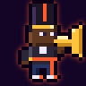 `hero_trumpet` Trumpet |  `hero_trombone` Trombone | 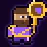 `hero_sousaphone` Sousaphone |  `hero_saxophone` Saxophone |
|  `hero_clarinet` Clarinet |  `hero_snare` Snare Drum |  `hero_bassdrum` Bass Drum |   |

## Session Clones

| | | | |
|---|---|---|---|
|  `clone_trumpet` Session Clone (Trumpet) |  `clone_trombone` Session Clone (Trombone) | 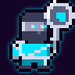 `clone_sousaphone` Session Clone (Sousaphone) |  `clone_saxophone` Session Clone (Saxophone) |
|  `clone_clarinet` Session Clone (Clarinet) | 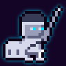 `clone_snare` Session Clone (Snare Drum) |  `clone_bassdrum` Session Clone (Bass Drum) |   |

## People

| | | | |
|---|---|---|---|
|  `mamaroux` Mama Roux |  `tijacques` Ti-Jacques |  `gus` Gus |  `pralinelady` The Praline Lady |
|  `stranger` Stranger | 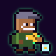 `busker` Busker | 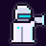 `preacher` Street Preacher |  `odette` Miss Odette |
|  `sugar` Sugar |  `zinnia` Madame Zinnia |  `celeste` Madame Céleste |  `theo` Professor Theo |
|  `static` Static |  `clothilde` Grand-mère Clothilde |  `remy` Remy |  `boudreaux` Boudreaux |
|  `lucien` Lucien |  `rosalie` Mambo Rosalie | 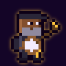 `moses` Brother Moses |  `tuxedo_valet` The Valet |
|  `vendor` Vending Machine |   |   |   |

## Shopkeepers (P3)

| | | | |
|---|---|---|---|
|  `pelican_bartender` Thirsty Pelican bartender |  `faisdodo_bartender` Fais Do-Do bartender |  `market_vendor` French Market vendor | 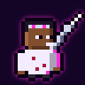 `chop_surgeon` Chop Shop surgeon |
| 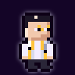 `maison_clerk` Maison Chrome clerk |  `tuxedo_maitre` Silver Tuxedo maître d' |   |   |

## Tremé enemies

| | | | |
|---|---|---|---|
| 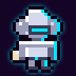 `hush_patrol` Hush Patrolman |  `click_drone` Click-Drone |  `nutria` Mutant Nutria |  `hustler` Corner Hustler |
|  `hush_sergeant` Hush Sergeant |   |   |   |

## French Quarter & Frenchmen enemies

| | | | |
|---|---|---|---|
|  `gocup_golem` Go-Cup Golem |  `neon_mime` Neon Mime |  `busker_bot` Licensed Busker-Bot |  `barker` Bourbon Barker |
|  `hooligan` Hurricane Hooligan |   |   |   |

## Storyville enemies

| | | | |
|---|---|---|---|
|  `enforcer` Contract Enforcer | 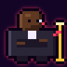 `bouncer` Velvet Rope Bouncer |  `absinthe` Absinthe Phantom |  `repo_drone` Repo Drone |
|  `bagman` The Bagman |   |   |   |

## Manchac Swamp enemies

| | | | |
|---|---|---|---|
|  `chrome_gator` Chrome Gator |  `feu_follet` Feu Follet | 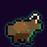 `grunch` Swamp Grunch |  `skeeter` Skeeter Swarm |
|  `rougarou_pup` Rougarou Pup |  `big_grunch` Big Grunch |   |   |

## Cities of the Dead enemies

| | | | |
|---|---|---|---|
| 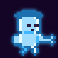 `haint` Wandering Haint |  `data_wraith` Data Wraith | 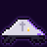 `tomb_crawler` Tomb Crawler |  `archive_drone` Archive Drone |
|  `bone_choir` Bone Choir | 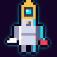 `crypt_keeper` Crypt Keeper Unit | 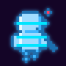 `ghost_track` Ghost Track |   |

## Garden District enemies

| | | | |
|---|---|---|---|
| 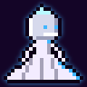 `debutante` Debutante Droid | 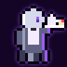 `butler` Butler Unit | 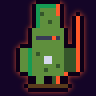 `topiary` Topiary Mech |  `quartet` String Quartet Drone |
| 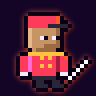 `valet` Valet Assassin |  `beaumont` Security Chief Beaumont |   |   |

## Central Business District enemies

| | | | |
|---|---|---|---|
|  `hush_elite` Hush Elite |  `quantizer` Quantizer |  `sentinel` Click Sentinel |  `warden` Tempo Warden |

## Cutting Contest rivals

| | | | |
|---|---|---|---|
|  `rival_hotrod` "Hot Rod" Broussard |  `rival_bigmae` Big Mae Boudreaux | 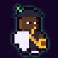 `rival_twotone` Henri "Two-Tone" LeBlanc |   |

## Bosses

| | | | |
|---|---|---|---|
|  `captain_hush` Captain Hush |  `vox_perfecta` Vox Perfecta |  `mr_ledger` Mr. Ledger |  `rougarou` Le Rougarou Chromé |
|  `archivist` The Archivist |  `isolde` Lady Concertmaster Isolde Vane |  `conductor` The Conductor |  `the_click` THE CLICK |

## Palette

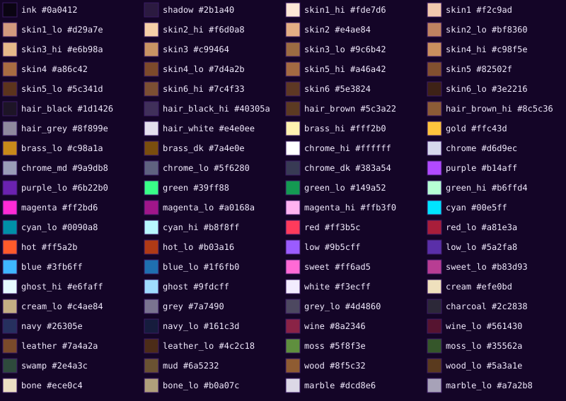
