# Character design

*Who every character in CYBER FUNK is, what they look like, and the rules their pixel art follows.* Each card in this doc is the spec for one sprite in `src/content/sprites/`. If a sprite and its card disagree, fix one of them. The generated gallery of every sprite as drawn is [docs/reference/sprites/](../reference/sprites/README.md).

**Read this when** you add a character, draw or redraw a sprite, or need to know what someone looks like in a scene.

## Adding a character

1. Give them an id.
   - Opponents get one in `core/ids/enemies.ts`, and that id is also their sprite id.
   - Anyone else gets one in `PERSON_SPRITE_IDS` (`core/ids/sprites.ts`).
2. Write a card in this doc under the right group:
   - who they are, and where they appear
   - the lines of game text that describe them
   - silhouette, palette, props, signature detail
   - glow, effect (fx) and size
3. Draw the sprite in the matching `src/content/sprites/art/*.ts` file with the shared palette and pixel alphabet below. If the character speaks, point their NpcId at it in `NPC_SPRITE` (`content/sprites/refs.ts`).
4. Run these:
   - `npm run sprites:export` refreshes the gallery.
   - `npm run validate` checks the grid rules and that this doc has a card for the sprite.
   - `npm run check` runs everything else.

## Art direction

**Neon Orleans, a CRT in a dark bar.** Every sprite sits on near-black violet (`--bg2 #140527`, `--bg3 #1e0a3a`). It has to read at 48px on a phone held at arm's length.

**Music vs. Metronome.** The story is a city of musicians against a company that wants everything in perfect time. Draw that conflict into every silhouette.

| | The people (heroes, NPCs, rivals, street folk) | Metronome (the Hush, drones, the Click, the Conductor) |
|---|---|---|
| Shape | Asymmetric, hand-made, a little off the grid: tilted hats, swinging coats, instruments sticking out | Symmetric, rigid, triangular (the pendulum): visors, plates, perfect edges |
| Material | Brass, fabric, skin, wood, feathers | White chrome, steel, glass, LEDs |
| Colour | Warm bases with one neon accent | Cold whites and greys with cyan or white light |

**One accent per sprite.** Each character has one neon accent colour, used in two places:
- A 1px **rim light** inside the outline on the right-hand edges.
- A soft **glow**: a CSS drop-shadow added by the `Sprite` component, set by the sprite's `glow` field.

The glow keeps a dark outline readable on a dark card. The accent comes from:
- **Speakers:** their name colour in `NPCS`.
- **Heroes:** their class colour.
- **Enemies:** their faction or damage tone.

**Families.** Characters from the same faction share a visual language.
- **The Hush** are Metronome's police.
  - White chrome armour and noise-cancelling helmets with big round ear-cups, with a cyan visor slit.
  - Rank shows on the armour: patrolman plain; sergeant with three gold stripes; elite in gold chrome; Captain Hush with a crest and the dampener on his belt.
- **Metronome machines** are the drones and units. They all carry the pendulum: a triangle body, a swinging arm, a cyan LED. They are click_drone, sentinel, warden, quantizer, the archive, repo and crypt-keeper units, and the Click itself.
- **Ledger & Sons** (Storyville) wear pinstripes over armour, money-green and brass, under Basin Street magenta. Contracts and paper are the props.
- **The tourist Quarter**: hologram magenta and cyan, translucent plastic, the mime's white face, beads.
- **Bayou cryptids**: murky greens and mud, glowing eyes, and Metronome hardware bolted onto animals (tracking tags, chrome teeth, implants).
- **Cities of the Dead**: whitewash and marble, bone, haint-blue spirits, and data glitches from the mausoleum.
- **Garden District**: white gloves, tulle, topiary green, pearl and silver. Old money run by machines.
- **The Tower**: gold-chrome elites, grid geometry, the Conductor's tailcoat and the glowing baton.

**The heroes vary on purpose.** The seven class heroes differ in gender, age, build and skin tone. Skin tone is never tied to roots (Creole, Cajun, Yat are places, not looks) or to a faction. Across the cast, New Orleans looks like New Orleans: every skin ramp shows up among heroes, allies and enemies alike.

## Master palette

Sprites use only these 80 colours. The validator checks that every colour in this table exactly matches `PALETTE` in `src/content/sprites/palette.ts`. Keep the format (one row per colour: name, hex, use). The ten neon colours and `white` are the same values as `src/ui/styles/tokens.css`.

| Name | Hex | Use |
|---|---|---|
| `ink` | `#0a0412` | outer outline, pupils |
| `shadow` | `#2b1a40` | deepest interior shade; hero pupils (the clone recolour turns them cyan) |
| `skin1_hi` | `#fde7d6` | skin, porcelain: light |
| `skin1` | `#f2c9ad` | skin, porcelain |
| `skin1_lo` | `#d29a7e` | skin, porcelain: shade, freckles |
| `skin2_hi` | `#f6d0a8` | skin, peach: light |
| `skin2` | `#e4ae84` | skin, peach |
| `skin2_lo` | `#bf8360` | skin, peach: shade |
| `skin3_hi` | `#e6b98a` | skin, olive: light |
| `skin3` | `#c99464` | skin, olive |
| `skin3_lo` | `#9c6b42` | skin, olive: shade |
| `skin4_hi` | `#c98f5e` | skin, tan-brown: light |
| `skin4` | `#a86c42` | skin, tan-brown |
| `skin4_lo` | `#7d4a2b` | skin, tan-brown: shade |
| `skin5_hi` | `#a46a42` | skin, brown: light |
| `skin5` | `#82502f` | skin, brown |
| `skin5_lo` | `#5c341d` | skin, brown: shade |
| `skin6_hi` | `#7c4f33` | skin, deep: light |
| `skin6` | `#5e3824` | skin, deep |
| `skin6_lo` | `#3e2216` | skin, deep: shade |
| `hair_black` | `#1d1426` | black hair, dark fabric |
| `hair_black_hi` | `#40305a` | black hair: light |
| `hair_brown` | `#5c3a22` | brown hair, beards |
| `hair_brown_hi` | `#8c5c36` | brown hair: light |
| `hair_grey` | `#8f899e` | grey hair |
| `hair_white` | `#e4e0ee` | white and silver hair |
| `brass_hi` | `#fff2b0` | brass: shine |
| `gold` | `#ffc43d` | brass, gold, neon gold (`--gold`) |
| `brass_lo` | `#c98a1a` | brass: shade |
| `brass_dk` | `#7a4e0e` | brass: deepest shade, dents |
| `chrome_hi` | `#ffffff` | chrome shine, pure white light |
| `chrome` | `#d6d9ec` | white chrome |
| `chrome_md` | `#9a9db8` | chrome: mid |
| `chrome_lo` | `#5f6280` | chrome: shade, steel |
| `chrome_dk` | `#383a54` | chrome: deepest shade, gunmetal |
| `purple` | `#b14aff` | neon purple (`--purple`) |
| `purple_lo` | `#6b22b0` | purple: shade |
| `green` | `#39ff88` | neon green (`--green`, `--funk`) |
| `green_lo` | `#149a52` | green: shade |
| `green_hi` | `#b6ffd4` | green: light |
| `magenta` | `#ff2bd6` | neon magenta (`--magenta`) |
| `magenta_lo` | `#a0168a` | magenta: shade |
| `magenta_hi` | `#ffb3f0` | magenta: light |
| `cyan` | `#00e5ff` | neon cyan (`--cyan`), Metronome LEDs |
| `cyan_lo` | `#0090a8` | cyan: shade |
| `cyan_hi` | `#b8f8ff` | cyan: light |
| `red` | `#ff3b5c` | neon red (`--red`), warning lights |
| `red_lo` | `#a81e3a` | red: shade |
| `hot` | `#ff5a2b` | HOT orange (`--hot`), fire |
| `hot_lo` | `#b03a16` | hot: shade |
| `low` | `#9b5cff` | LOW violet (`--low`) |
| `low_lo` | `#5a2fa8` | low: shade |
| `blue` | `#3fb6ff` | BLUE (`--blue`), haint blue |
| `blue_lo` | `#1f6fb0` | blue: shade |
| `sweet` | `#ff6ad5` | SWEET pink (`--sweet`) |
| `sweet_lo` | `#b83d93` | sweet: shade |
| `ghost_hi` | `#e6faff` | spirit light |
| `ghost` | `#9fdcff` | spirit body |
| `white` | `#f3ecff` | white cloth, teeth, eye whites (`--fg`) |
| `cream` | `#efe0bd` | cream cloth, paper |
| `cream_lo` | `#c4ae84` | cream: shade |
| `grey` | `#7a7490` | grey cloth |
| `grey_lo` | `#4d4860` | grey: shade |
| `charcoal` | `#2c2838` | black cloth: suits, tuxedos |
| `navy` | `#26305e` | navy cloth, denim |
| `navy_lo` | `#161c3d` | navy: shade |
| `wine` | `#8a2346` | wine cloth, velvet |
| `wine_lo` | `#561430` | wine: shade |
| `leather` | `#7a4a2a` | leather, fur |
| `leather_lo` | `#4c2c18` | leather: shade |
| `moss` | `#5f8f3e` | moss, hedges, swamp fur |
| `moss_lo` | `#35562a` | moss: shade |
| `swamp` | `#2e4a3c` | swamp water, dark green |
| `mud` | `#6a5232` | mud, rat fur |
| `wood` | `#8f5c32` | wood, banjo, drumsticks |
| `wood_lo` | `#5a3a1e` | wood: shade |
| `bone` | `#ece0c4` | bone, old teeth |
| `bone_lo` | `#b0a07c` | bone: shade |
| `marble` | `#dcd8e6` | marble, whitewash |
| `marble_lo` | `#a7a2b8` | marble: shade |

## Technical spec

- **Grid:**
  - 24×24 pixels for people and enemies.
  - 32×32 for the eight bosses.
  - Every row is the full width. `.` is transparent.
- **Scale:** always a whole number, so pixels stay crisp.

  | Where | Scale | Size |
  |---|---|---|
  | Battle cards | 3× | 72px (bosses 96px) |
  | Dialogue portraits and sheet rows | 2× | 48px |
  | Create screen | 3× | 72px |

  Speakers drawn with boss art appear at 64px in dialogue.
- **View:** front three-quarter, turned toward screen-right, so speakers face their own text. The player's echoed lines show the hero flipped, on the right.
- **Proportions:** chibi.
  - On a 24px figure the head is about 9–10px tall.
  - Feet stand on row 22, the second-to-last row, and the figure is centred.
  - Hovering things (drones, wisps, ghosts) float with their lowest pixel around row 18–21.
- **Outline:** 1px `ink` around the outside. Inside, separate shapes with a darker shade of the local colour, not ink.
- **Light:** from the top left. The rim light is the accent colour on the right-hand edges.
- **Shading:**
  - At most 3 tones per material (light, base, shade).
  - No dithering, no anti-aliasing, no stray single pixels.
- **Colours:** at most 16 per regular sprite and 20 per boss, all from the master palette.
- **Effects** (`fx`, CSS only):
  - `ghost`: translucent, with a slow drift.
  - `holo`: scanlines and a flicker.
  - `glitch`: a stepped jitter with colour split.

  Each has a static look, so it still reads with reduce motion on, when the animation stops.
- **Readability test:** the sprite must be recognisable at 48px on `--bg2`. Within a district, every silhouette must differ from the others.

### Pixel alphabet

Each sprite maps its own characters to palette colours (`keys`). Use these conventions so grids read the same way across files:

| Key | Meaning |
|---|---|
| `.` | transparent (reserved) |
| `_` | erase a base pixel (reserved; variant overlays only) |
| `k` | `ink` outline |
| `x` | deepest shade |
| `1` `2` `3` | skin: light, base, shade |
| `h` `H` | hair: base, light |
| `p` `P` `q` | main material: base, light, shade |
| `c` `C` `d` | second material: base, light, shade |
| `m` `M` `n` | metal (brass or chrome): base, light, shade |
| `a` `A` | accent: base (the rim light), light |
| `e` | eyes and glowing bits |
| `w` | white |
| any other letter or digit | free; declare it in `keys` |

Never use spaces, quotes, backslashes or backticks in a grid.

**Variants** reuse another sprite's pixels and need no grid of their own:
- `recolor` swaps palette colours.
- `overlay` paints new pixels on top: `.` keeps the base pixel, `_` erases it.

The Session Clones and the Hush ranks are variants.

## Cast index

90 sprites: 7 heroes, 7 clones, 21 people, 6 shopkeepers, 41 enemies (session_clone excluded; it draws a clone) and 8 bosses.

| Group | Sprites |
|---|---|
| [Heroes](#heroes) | `hero_trumpet` `hero_trombone` `hero_sousaphone` `hero_saxophone` `hero_clarinet` `hero_snare` `hero_bassdrum` |
| [Session Clones](#session-clones) | `clone_trumpet` `clone_trombone` `clone_sousaphone` `clone_saxophone` `clone_clarinet` `clone_snare` `clone_bassdrum` |
| [People](#people) | `mamaroux` `tijacques` `gus` `pralinelady` `stranger` `busker` `preacher` `odette` `sugar` `zinnia` `celeste` `theo` `static` `clothilde` `remy` `boudreaux` `lucien` `rosalie` `moses` `tuxedo_valet` `vendor` |
| [Shopkeepers](#shopkeepers) | `pelican_bartender` `faisdodo_bartender` `market_vendor` `chop_surgeon` `maison_clerk` `tuxedo_maitre` |
| [Tremé enemies](#tremé) | `hush_patrol` `click_drone` `nutria` `hustler` `hush_sergeant` |
| [French Quarter enemies](#french-quarter) | `gocup_golem` `neon_mime` `busker_bot` `barker` `hooligan` |
| [Storyville enemies](#storyville) | `enforcer` `bouncer` `absinthe` `repo_drone` `bagman` |
| [Manchac Swamp enemies](#manchac-swamp) | `chrome_gator` `feu_follet` `grunch` `skeeter` `rougarou_pup` `big_grunch` |
| [Cities of the Dead enemies](#cities-of-the-dead) | `haint` `data_wraith` `tomb_crawler` `archive_drone` `bone_choir` `crypt_keeper` `ghost_track` |
| [Garden District enemies](#garden-district) | `debutante` `butler` `topiary` `quartet` `valet` `beaumont` |
| [Tower enemies](#central-business-district) | `hush_elite` `quantizer` `sentinel` `warden` |
| [Cutting Contest rivals](#cutting-contest-rivals) | `rival_hotrod` `rival_bigmae` `rival_twotone` |
| [Bosses](#bosses) | `captain_hush` `vox_perfecta` `mr_ledger` `rougarou` `archivist` `isolde` `conductor` `the_click` |

**Speakers who reuse art** (`NPC_SPRITE` in `src/content/sprites/refs.ts`):
- `hush` → `captain_hush`, `vox` → `vox_perfecta`, `ledger` → `mr_ledger`.
- `archivist`, `conductor` and `isolde` use the boss art of the same name.
- `haint` uses the Wandering Haint enemy.
- `valet` → `tuxedo_valet`. This is the Silver Tuxedo valet, not the Valet Assassin.
- `you` → the player's hero. The player's echoed choices show the hero too.

**Card format.** Each card below gives:
- who the character is and where they appear (**v2** = playable in `src/` today; **v1** = only in `legacy/` until P3/P4 ports it)
- the game's own words about them
- the design and the sprite settings

---

## Heroes

The player picks one of seven instrument classes, and each class has one fixed hero. The player names them; the story never gives them a gender, and the text stays second person. They all wear something from the same second line, so they read as one band. Each hero carries their class colour as the accent and holds their instrument so the silhouette alone says which class it is.

### Hero: Trumpet · `hero_trumpet`

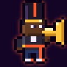

*Lead Horn: burst damage, glass cannon · class colour HOT · 24×24, glow `hot`*

> "High notes that peel paint off the balconies. Hits hardest, bruises easiest."

- **Who:** a lanky young man, all elbows and nerve. He's the loudest horn on the street.
- **Silhouette:** tall and narrow, with a high-top fade. The trumpet is raised to his lips, pointing up and to the right, and the bell sticks out past his body.
- **Palette:**
  - skin `skin6`
  - high-top `hair_black` with a `hot` streak
  - cropped bomber `charcoal` with a `hot`/`gold` flame stripe
  - tee `white`, jeans `navy`, high-tops `white` with `hot` laces
  - horn `gold` and `brass_lo`
- **Details:**
  - mirrorshades pushed up on his forehead (a `cyan_hi` glint)
  - a `brass_hi` shine on the bell

### Hero: Trombone · `hero_trombone`

*Tailgate: drain bruiser, debuffs · class colour BLUE · 24×24, glow `blue`*

> "Smears, growls, and dirges. Wears enemies down and drinks the sorrow back as Heart."

- **Who:** a broad-shouldered woman built for long parades and longer fights.
- **Silhouette:** wide shoulders, with locs piled into a high bun. The slide runs straight out to the right edge of the grid. That long horizontal line is the class's mark.
- **Palette:**
  - skin `skin4`
  - locs `hair_black` with `gold` cuffs
  - work jacket `blue`/`blue_lo` with the sleeves rolled
  - trousers `charcoal`, boots `leather`
  - trombone `gold`/`brass_lo`
- **Details:** a chrome brace on her slide forearm (`chrome`/`chrome_lo`), and a `blue` rim light down her back.

### Hero: Sousaphone · `hero_sousaphone`

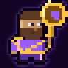

*Low End: tank, armor shred · class colour LOW · 24×24, glow `low`*

> "The bottom of the band. Slow, enormous, and impossible to move."

- **Who:** a big, bearded, gentle man who never steps back.
- **Silhouette:** the widest hero. The sousaphone wraps around his body, and its bell rises over his left shoulder as a big brass circle at the top right of the grid.
- **Palette:**
  - skin `skin3`
  - beard and short hair `hair_brown`/`hair_brown_hi`
  - second-line suit `low`/`low_lo` with a `gold` sash
  - shoes `charcoal`
  - horn `gold`, `brass_lo`, `brass_hi`
- **Details:** the bell's inside is dark (`brass_dk`), with a `low` neon ring on the rim.

### Hero: Saxophone · `hero_saxophone`

*Honker: control and charm · class colour FUNK · 24×24, glow `green`*

> "Honks that knock the grid off-beat and ballads that make the Hush forget to fight."

- **Who:** an androgynous smooth operator: half-lidded eyes and a sideways grin.
- **Silhouette:** a tall pompadour leaning forward, and the curved alto sax held diagonally across the body with the bell low and to the right.
- **Palette:**
  - skin `skin2`
  - pompadour `hair_black`/`hair_black_hi`
  - drape jacket `green`/`green_lo` over a `charcoal` shirt
  - trousers `charcoal`, two-tone shoes `white`/`charcoal`
  - sax `gold`/`brass_lo`
- **Details:** a single `gold` earring, and a `green_hi` glint on the keys.

### Hero: Clarinet · `hero_clarinet`

*Licorice Stick: healer, buffer, agile · class colour SWEET · 24×24, glow `sweet`*

> "Quick, sweet, and hard to pin down. Heals, buffs, and counters with a high trill."

- **Who:** a small, quick young woman, already moving.
- **Silhouette:** the smallest hero. A pink bob, a straight black clarinet held angled down and to the right, and feet mid-step.
- **Palette:**
  - skin `skin1` with `skin1_lo` freckles
  - bob `sweet`/`sweet_lo` with a `cyan` neon clip
  - blouse `white`, vest `sweet`, culottes `navy`
  - striped socks `white`/`sweet`, shoes `charcoal`
  - clarinet `charcoal` with `chrome` keys
- **Details:** her free hand is open as if she's just thrown a heal, with one `sweet` sparkle pixel beside it.

### Hero: Snare · `hero_snare`

*Snare Line: speed, multi-hit, stun · class colour gold · 24×24, glow `gold`*

> "Fastest hands in the parade. Rolls, rimshots, and a street beat that stops the grid cold."

- **Who:** a wiry kid with the fastest hands on the block.
- **Silhouette:** short and skinny, with a snare drum slung at the left hip and one stick raised high in mid-flick. The raised stick and the drum's oval make the shape.
- **Palette:**
  - skin `skin5`
  - short hair `hair_black` under a `gold` headband
  - tank top `white`, track jacket `gold`/`brass_lo` tied at the waist
  - shorts `navy`
  - high-tops `gold` and `white`
  - snare: shell `chrome`, head `white`, hoops `gold`
  - sticks `wood`
- **Details:** one `gold` motion pixel trailing the raised stick.

### Hero: Bass Drum · `hero_bassdrum`

*The Heartbeat: heavy hitter, Big Four counter · class colour purple · 24×24, glow `purple`*

> "Every action counts 1-2-3-4. Land the hit on four and the whole street feels it."

- **Who:** a strong elder woman with silver hair and forty years of parades in her shoulders.
- **Silhouette:** a big round bass drum strapped to her chest fills the middle of the grid. She has a short silver crop, a mallet raised in her right hand, and a small cymbal on top of the drum.
- **Palette:**
  - skin `skin6`
  - hair `hair_white`/`hair_grey`
  - marching jacket `purple`/`purple_lo` with `gold` braid
  - drum head `white` with a neon `purple` "4"
  - drum hoops `gold`, cymbal `gold`/`brass_lo`
  - mallet `wood` with a `white` felt head
- **Details:** the "4" on the drum head is the signature. It must read at 48px (4×5 pixels).

---

## Session Clones

> "A corporate copy of a musician who plays your instrument. It has your licks and none of your heart." (Blue Book)

The Session Clone fights in the Tower and copies the player's class when it spawns ("Session Clone (Trumpet)"). It is drawn as that class's hero with the **corporate chrome** recolour (`CLONE_RECOLOR`), with these swaps:
- skin goes to `chrome`/`chrome_md`/`chrome_lo`
- hair goes to `chrome_dk`
- every warm or neon colour goes to `cyan`/`cyan_lo`
- brass goes to chrome
- cloth goes to greys

The eyes become `cyan` LEDs: hero pupils are drawn in `shadow`, which heroes use for nothing else, and the recolour maps `shadow` to `cyan`. The result is the same pose with no warmth. Glow `cyan`. These sprites are generated variants with no grid of their own. In the Blue Book, the Session Clone entry shows the clone of the player's own class.

### Session Clone (Trumpet) · `clone_trumpet`

Variant of `hero_trumpet` with `CLONE_RECOLOR`.

### Session Clone (Trombone) · `clone_trombone`

Variant of `hero_trombone` with `CLONE_RECOLOR`.

### Session Clone (Sousaphone) · `clone_sousaphone`

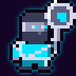

Variant of `hero_sousaphone` with `CLONE_RECOLOR`.

### Session Clone (Saxophone) · `clone_saxophone`

Variant of `hero_saxophone` with `CLONE_RECOLOR`.

### Session Clone (Clarinet) · `clone_clarinet`

Variant of `hero_clarinet` with `CLONE_RECOLOR`.

### Session Clone (Snare) · `clone_snare`

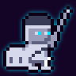

Variant of `hero_snare` with `CLONE_RECOLOR`.

### Session Clone (Bass Drum) · `clone_bassdrum`

Variant of `hero_bassdrum` with `CLONE_RECOLOR`.

---

## People

Everyone who speaks in a scene, runs a shop, gives a quest or marches with the band. The cards are grouped by home district. "v1 only" means their scenes are still in `legacy/`. They are in the v2 data tables and get art now, but they only speak in v2 when P3 ports their district.

### People of Tremé

#### Mama Roux · `mamaroux`

*Tremé guide and mentor, the Kitchen (food and a sit-down meal), Red Beans Monday quest, always in the second line · v2: prologue, Lagniappe club, Kitchen, Congo Square, streets · 24×24, glow `gold`*

> "the best cook in the Sixth Ward" · "Six stools, one pot" · "The band stops. Mama Roux does not." · "Lord. Look at you. Drink this, it's mostly coffee."

- **Who:** the center of gravity of Tremé: cook, keeper of the quest board, the one who patches you up.
- **Silhouette:** short, round and planted. A tall `gold` tignon (head wrap) is knotted on top, and a wooden spoon is raised like a conductor's baton.
- **Palette:**
  - skin `skin6`
  - tignon `gold`/`brass_lo`
  - dress `wine`/`wine_lo`
  - apron `cream`/`cream_lo`
  - spoon `wood`
- **Details:**
  - reading glasses on a chain (`chrome`)
  - a small `gold` neon heart pinned to the apron, a nod to her sign that "buzzes a half-step flat"

#### Ti-Jacques · `tijacques`

*Pawn & Horn (instruments, threads, accessories), builds your legendary instrument, always in the second line · v2: Pawn & Horn · 24×24, glow `green`*

> "Horns in the window, suits in the back, and a man who can fix anything that makes a sound" · "Mais, cher… yeah" · "licensed since 1952. By me." · "Carries a horn in each hand and one in reserve"

- **Who:** an old Cajun repairman who works all night and never charged a kid for a horn.
- **Silhouette:** a wiry, slightly stooped old man with a cornet held up to his eye to inspect it, and a screwdriver tucked behind his ear.
- **Palette:**
  - skin `skin2`
  - bald head with `hair_white` tufts
  - plaid shirt `navy`/`blue_lo`
  - shop apron `green_lo`/`moss_lo`
  - cornet `gold`/`brass_lo`
- **Details:** a jeweller's loupe over one eye, a chrome cyber-loupe with a `green` lens. That glowing eye is the signature.

#### Gus · `gus`

*Auguste "Gus" Thibodeaux, Grand Marshal of the Lagniappe Social Aid & Pleasure Club, your dead mentor · v2: prologue funeral, Lagniappe cassette · v1: ghost in the Data Mausoleum, leads the second line · 24×24, glow `purple`*

> "The man who taught you to play." · "Purple, green, and gold fringe" (his umbrella) · "Gus's sash, his fan, his hat. It still smells like cigar." · "Leads the way, hat tipped, umbrella high"

- **Who:** a tall, dignified old Grand Marshal in full regalia.
- **Silhouette:** a second-line umbrella held high, its fringed canopy filling the top of the grid, over a tall man in a tuxedo with a sash across his chest.
- **Palette:**
  - skin `skin6`
  - mustache `hair_white`
  - tuxedo `charcoal`
  - sash `purple`, `green` and `gold` bands
  - umbrella canopy `purple` with `green`/`gold` fringe
  - hat `charcoal` with a `gold` band
- **Details:** a folded `gold` fan in his free hand. A ghost version for v1's Data Mausoleum scenes would be a recolour plus `fx: 'ghost'` (P3/P4; see the appendix).

#### The Praline Lady · `pralinelady`

*Rare wandering vendor (a cart of lucky things) · v2: streets, any district · 24×24, glow `gold`*

> "a rare cart with lucky things" · "She lifts the cloth"

- **Who:** an older street vendor who turns up when you need her.
- **Silhouette:** a wide straw hat with a flower, and a covered tray held out in front with a cloth over it.
- **Palette:**
  - skin `skin5`
  - hat `cream`/`cream_lo` with a `sweet` flower
  - gingham dress `gold`/`cream`
  - tray `wood`, cloth `white`
  - pralines `hair_brown_hi`
- **Details:** one praline peeks out from under a corner of the cloth.

#### Stranger · `stranger`

*Generic speaker: the old-timer on a stoop, the streetcar joke-teller, the balcony dancer · v2: street events · 24×24, glow `chrome`*

> "hat pushed back, a horn case at his feet" · "She laughs"

- **Who:** anyone. One NpcId covers three different people, so the design stays generic and shows no gender.
- **Silhouette:** a long coat with the collar up, a hat brim low, and a face in shadow. Only two `chrome_hi` eye-glints show.
- **Palette:**
  - coat `charcoal`/`grey_lo`
  - hat `grey`
  - face mostly `shadow`
  - a `chrome` rim light
- **Details:** hands in pockets, nothing in them. It's a figure the player fills in.

#### Busker · `busker`

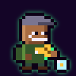

*Generic street horn: the old man at the Tip Jar, the Jackson Square bench busker (The Confiscated Horn) · v2: Tip Jar street event · v1: Jackson Square · 24×24, glow `green`*

> "an old man with a battered cornet" · "Forty years on this bench" · "Silver, worn smooth by forty years of Royal Street"

- **Who:** an old street musician; any of the old men with a horn and a hat.
- **Silhouette:** a flat cap, a patched coat, and a cornet held at the chest. A tip jar sits at his feet.
- **Palette:**
  - skin `skin4`
  - stubble `hair_white`
  - cap `grey`
  - coat `moss_lo` with a `leather` patch
  - cornet `gold` with `brass_dk` dents
  - jar `cyan_hi` glass with a `gold` coin
- **Details:** the dented cornet is the signature: two `brass_dk` pixels on the bell.

#### Street Preacher · `preacher`

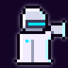

*Metronome street evangelist; narrated only, never speaks · v2: street event · 24×24, glow `chrome`*

> "white robe, white helmet, bullhorn tuned to exactly 440 Hz" · "doesn't have a response coded for that"

- **Who:** a Metronome mouthpiece preaching perfect time on the corner.
- **Silhouette:** a long white robe to the ground and a domed white helmet with a visor. A bullhorn is raised to the mouth, pointing right.
- **Palette:**
  - robe `chrome`/`chrome_md`
  - helmet `chrome_hi`/`chrome` with a `cyan` visor
  - bullhorn `chrome`/`chrome_lo`
  - a `cyan` badge reading "440"
- **Details:** the face is hidden behind the visor; Metronome people never show their faces.

### People of the French Quarter

#### Miss Odette · `odette`

*Miss Odette Fontenot, owner of Club Feu Follet (the last real jazz club), Cutting Contest, the Sit In gig, always in the second line · v2: Cutting Contest (dev menu), Vox aftermath · v1: Club Feu Follet · 24×24, glow `sweet`*

> "The last real jazz club. Miss Odette runs it" · "second one's on Metronome because I'm not paying their license" · "Miss Odette raises her glass"

- **Who:** a sharp, warm club owner in her sixties who has outlasted every license.
- **Silhouette:** a tall silver-streaked updo with a feather, a fitted suit, and a cocktail glass raised in a toast.
- **Palette:**
  - skin `skin4`
  - hair `hair_black` with a `hair_white` streak
  - feather `sweet`
  - suit `sweet`/`sweet_lo`
  - glass `cyan_hi` with a `green` drink
- **Details:** a `green` carnation on the lapel, for the "green light over the door" of Club Feu Follet.

#### Sugar · `sugar`

*Sugar Desmarais, vocals, bandmate (recruited by winning the Cutting Contest), always in the second line · v2: Cutting Contest (dev menu) · v1: Club Feu Follet · 24×24, glow `sweet`*

> "Big voice, bigger laugh, zero patience for licensed jingles" · "I pitched their grid to the river" · sings "over the applause"

- **Who:** an ex-MoodSync backup singer who walked out mid-song.
- **Silhouette:** a big round afro puff with a headband, an old chrome microphone held up, and her mouth open mid-note.
- **Palette:**
  - skin `skin5`
  - hair `hair_black`/`hair_black_hi`
  - headband `sweet`
  - sparkly jumpsuit `sweet`/`sweet_lo` with `gold` sparkle pixels
  - mic `chrome`/`chrome_lo`
- **Details:**
  - big `gold` hoop earrings
  - a `white` musical-note pixel floating from the mic

#### Madame Zinnia · `zinnia`

*Zinnia's Charms (charms; data-tarot for Ð30), The Lost Eye quest, second line if that quest is done · v1: Jackson Square · 24×24, glow `cyan`*

> "cybernetic eye" · "pops the eye back in and it whirs and focuses on you. 'I have a spare.'" · "The cards don't read for free. Neither do I." · "Reads the cards and says the Tower's already lost"

- **Who:** a data-tarot reader at her card table under the cathedral.
- **Silhouette:** a head scarf with hanging coins, a shawl over her shoulders, and one glowing tarot card held up between two fingers.
- **Palette:**
  - skin `skin3`
  - scarf `purple`/`purple_lo` with `gold` coins
  - shawl `cyan_lo`
  - card `cyan`/`cyan_hi`
- **Details:** her right eye is a cybernetic lens, a `cyan` ring with a `chrome_hi` pupil. That eye is the signature, and it's the item from her quest.

### People of Storyville

#### Madame Céleste · `celeste`

*Madame Céleste Arceneaux, keeper of the Velvet Lantern (deluxe rest, paid Whispers about bosses), can get you the ball invitation, second line if you burn the contracts · v1: Velvet Lantern · 24×24, glow `magenta`*

> "Live piano, deluxe rooms, and secrets for a price" · "Bienvenue, chéri" · "I don't judge, chéri. I just remember."

- **Who:** Storyville's hostess, who knows everyone's secrets.
- **Silhouette:** tall magenta victory rolls, a high-collared velvet gown, and a little lit lantern held at the hip.
- **Palette:**
  - skin `skin5`
  - hair `magenta`/`magenta_lo`
  - gown `wine`/`wine_lo` with a `magenta` rim
  - lantern `gold` frame with `brass_hi` light
- **Details:** a `white` cameo choker, and a beauty mark (one `skin5_lo` pixel).

#### Professor Theo · `theo`

*Professor Theo Lavigne, sheet music at the Lantern piano, Missing Rolls quest, second line · v1: Velvet Lantern · 24×24, glow `gold`*

> "taught every piano player in this district" · "Sixty years of my hands, punched in paper" · "Pushes an upright piano down Canal Street on a dolly"

- **Who:** an old piano teacher with gentle hands.
- **Silhouette:** a stooped old man with round spectacles and a white beard, holding a rolled piano roll under one arm.
- **Palette:**
  - skin `skin6`
  - beard and hair `hair_white`
  - glasses `gold` frames
  - bow tie `gold`
  - vest `wine` over a `cream` shirt
  - trousers `charcoal`
  - piano roll `cream` with `ink` punch holes
- **Details:** the punched holes in the paper roll, three `ink` dots, are the signature.

#### Static · `static`

*"Static" Okafor, cassette-deck DJ and hacker, bandmate (Static's Contract) · v2: street events, once recruited · v1: Velvet Lantern booth · 24×24, glow `cyan`*

> "Cassette-deck DJ and hacker" · "built the Click's first test encoder as a Metronome intern" · "Deck on his shoulder" · "scratches two wires together"

- **Who:** a young ex-Metronome intern who now jams their signal.
- **Silhouette:** a boombox cassette deck on his right shoulder, big headphones, and an oversized hoodie.
- **Palette:**
  - skin `skin6`
  - short twists `hair_black` with `cyan` tips
  - headphones `charcoal` with `cyan` cups
  - hoodie `charcoal`/`grey_lo` with a `cyan` circuit line
  - deck `chrome`/`chrome_lo` with `green`/`red` VU lights
- **Details:** two loose wires spark between his fingers (`cyan_hi`).

### People of Manchac Swamp

#### Grand-mère Clothilde · `clothilde`

*Traiteur (free healing), Bayou guide, Traiteur's Herbs quest, second line · v1: Clothilde's Cabin · 24×24, glow `green`*

> "on stilts… herbs hanging from every beam" · "says something soft in French that isn't a spell, exactly" · "on her feet since 1998" · "presses a thumb to your forehead"

- **Who:** a tiny, very old healer who has been on her feet since 1998.
- **Silhouette:** tiny and hunched, with a white bun, round glasses, and a bundle of herbs held out.
- **Palette:**
  - skin `skin2` with `skin2_lo` creases
  - hair `hair_white`
  - scarf `green_lo`
  - shawl `moss`/`moss_lo`
  - dress `cream_lo`
  - herbs `green`/`moss`
- **Details:** a small `gold` medal on a cord at her neck.

#### Remy · `remy`

*Remy Guidry, frottoir (rubboard), bandmate (defend the Fais Do-Do) · v1: Fais Do-Do · 24×24, glow `green`*

> "Rubboard player from Manchac" · "Frottoir strapped on, spoons flying" · "I got spoons for days"

- **Who:** a young Manchac musician whose grand-père played the same dance floor for sixty years.
- **Silhouette:** a corrugated chrome frottoir worn like a vest, with spoons raised in both hands and a cap on backwards.
- **Palette:**
  - skin `skin3`
  - hair `hair_brown`
  - cap `green_lo`
  - plaid shirt `wine` with the sleeves rolled
  - frottoir `chrome`/`chrome_md`/`chrome_lo`, ridged
  - spoons `chrome_hi`
  - white shrimp boots `white`
- **Details:** the ridges on the frottoir, alternating `chrome`/`chrome_lo` rows, are the signature.

#### Boudreaux · `boudreaux`

*Boudreaux's Boudin Shack (food), "the worst jokes in the parish, free with purchase" · v1: Boudin Shack · 24×24, glow `gold`*

> "the worst jokes in the parish, free with purchase" · "laughs harder than you do"

- **Who:** a big, round, red-cheeked cook laughing at his own joke.
- **Silhouette:** big and round, with eyes squeezed shut in laughter, a trucker cap, and a link of boudin held up like a microphone.
- **Palette:**
  - skin `skin2` with `red_lo` cheeks
  - cap `gold`
  - shirt `white`
  - apron `cream` with `leather` stains
  - boudin `hair_brown_hi`
- **Details:** closed laughing eyes (two `ink` arcs) and a wide-open mouth.

#### Lucien · `lucien`

*Alpha of the Chrome Wolves, human form after the Rougarou fight; second line if spared · v1: Pump Station 13, Clothilde's cabin · 24×24, glow `hot`*

> "the boy with the implant" · "the white eyes go brown… a human face and a machine jaw" · "implants dark. He raises a hand"

- **Who:** a lean young man coming back to himself, with the machine still bolted to his face.
- **Silhouette:** shaggy hair, a chrome lower jaw, and a torn jacket. One hand is raised, half a wave and half a surrender.
- **Palette:**
  - skin `skin4`
  - hair `hair_black`
  - jaw `chrome`/`chrome_lo`
  - jacket `leather`/`leather_lo` with a `hot` wolf patch
  - jeans `navy`
  - eyes `hair_brown` (brown, not white)
- **Details:** a dark implant at his temple (`chrome_dk` with one dim `hot_lo` pixel), the "implants dark" of the story.

### People of the Cities of the Dead

#### Mambo Rosalie · `rosalie`

*Vodou priestess, Mambo Rosalie's Altar (gris-gris), paid Blessing, Restless Haints quest, second line · v1: Rosalie's Temple · 24×24, glow `purple`*

> "Candles, a bell, an altar with everyone's photo on it" · "Mind the candles" · "shakes the asson. The candles lean toward you"

- **Who:** a regal Vodou priestess who keeps the dead and the living on speaking terms.
- **Silhouette:** a tall white tignon and a long white dress. She holds an asson (a beaded gourd rattle) raised in one hand and a lit candle in the other.
- **Palette:**
  - skin `skin6`
  - tignon and dress `white`/`marble_lo`
  - sash `purple`/`purple_lo`
  - asson `wood` with `purple`/`gold` beads
  - candle `cream` with a `gold`/`brass_hi` flame
- **Details:** the candle flame is the brightest pixel in the sprite.

#### Brother Moses · `moses`

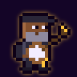

*Brother Moses Valcour, banjo and hymn-leader, bandmate (Restless Haints) · v1: Crypt Rows · 24×24, glow `gold`*

> "Banjo player and hymn-leader" · "lost his whole band to the first Mute raids" · "sets the banjo across his knees"

- **Who:** a grey-bearded hymn-leader who still plays for the band he lost.
- **Silhouette:** a black suit and a flat cap, with a round banjo held across his chest.
- **Palette:**
  - skin `skin5`
  - beard `hair_grey`
  - cap `charcoal`
  - suit `charcoal`/`grey_lo`
  - banjo head `white`, rim `wood`, neck `wood_lo`, tuners `gold`
- **Details:** a small `gold` cross pin on the lapel.

### People of the Garden District

#### The Valet · `tuxedo_valet`

*NpcId `valet`: the Silver Tuxedo valet who sells the ball invitation for Ð300 and tells rumours. Not the Valet Assassin enemy · v1: Silver Tuxedo · 24×24, glow `chrome`*

> "a valet who knows things" · "from his sleeve like a magician who hates his job" · "pretending to polish a glass"

- **Who:** a thin, bored young valet who knows everything.
- **Silhouette:** slicked-back hair, a short silver jacket, and an invitation card held up between two fingers.
- **Palette:**
  - skin `skin1`
  - hair `hair_brown`
  - jacket `chrome`/`chrome_md` with `gold` buttons
  - trousers `charcoal`
  - invitation `white` with a `gold` edge
- **Details:** half-lidded eyes; the boredom is the joke.

### People of the Central Business District

#### Vending Machine · `vendor`

*The busted vending machine inside Metronome Tower · v1: Tower floors · 24×24, glow `cyan`*

> "busted… WORKS IF YOU HIT IT" · "GUS WAS HERE"

- **Who:** not a person: a Metronome vending machine with a dent and a grudge.
- **Silhouette:** a tall box with a flickering screen, a dented corner, and a dispenser slot at the bottom.
- **Palette:**
  - body `chrome`/`chrome_lo`/`chrome_dk`
  - screen `cyan`/`cyan_lo`
  - rows of product `red`, `gold` and `green`
- **Details:** a `purple` "GUS WAS HERE" sticker (three `purple` pixels and a `white` dot), and a dent in the upper right corner.

---

## Enemies

Everything the player can fight, except bosses. All of them are already in the v2 data, and street fights in every district work today. A district's own places and story arrive with P3. Each card gives the Blue Book entry, the enemy's tones, and what kind of being it is. Under "Tones":
- "deals" is the damage tone it attacks with.
- "weak" is what hits it for ×1.5.
- "resists" is what hits it for ×0.5.

Elites get a ★ on their battle card. Draw them as a step up from the district's regulars: bigger, or more ornate.

### Tremé

*Home turf. "Shotgun houses wrapped in neon, iron balconies dripping pink light, and a brass band always practicing somewhere behind a shutter."*

#### Hush Patrolman · `hush_patrol`

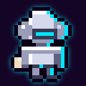

*Regular · L1–2 · deals LOW, weak FUNK, resists BLUE · v2: Tremé streets, the prologue raid, Captain Hush's backup · 24×24, glow `cyan`*

> "White chrome armor, noise-cancelling helmet, and a citation pad. Can't hear a thing, which is the point."

- **Being:** a human in Metronome armour. The face is never seen.
- **Silhouette:** a domed helmet with two big round ear-cups sticking out on both sides, which make a wide "headphones" shape. Below it, square shoulder plates and a citation pad held out in one hand.
- **Palette:**
  - armour `chrome_hi`/`chrome`/`chrome_md`
  - joints `chrome_lo`
  - visor `chrome_dk` with a `cyan` slit
  - citation pad `cream`
  - a `cyan` rim light
- **Details:** the ear-cups are the family mark. Every Hush rank keeps them.
- **Family:** the base sprite for `hush_sergeant` and `hush_elite`.

#### Click-Drone · `click_drone`

*Regular · L1–3 · machine · deals FUNK, weak FUNK, resists LOW · v2: Tremé streets · 24×24, glow `cyan`*

> "A hovering metronome with a taser. Ticks at exactly 120 beats per minute, forever."

- **Being:** a drone.
- **Silhouette:** a classic pyramid metronome body, hovering, with a pendulum arm tilted mid-tick. There's a small rotor on top and two taser prongs underneath.
- **Palette:**
  - body `chrome`/`chrome_md`/`chrome_lo`
  - face panel `chrome_dk`
  - pendulum `gold` weight on a `chrome_lo` arm
  - rotor `chrome_md`
  - taser spark `cyan_hi`/`cyan`
- **Details:**
  - one `cyan` LED eye at the top of the face panel
  - hovers with its lowest pixel at about row 20

#### Mutant Nutria · `nutria`

*Regular · L1–2 · deals HOT, weak HOT · v2: Tremé streets · 24×24, glow `hot`*

> "Swamp rat the size of a Labrador. Orange teeth, glowing eyes, no manners."

- **Being:** a mutant swamp rat.
- **Silhouette:** a low, wide body on all fours, facing right, with a long bare tail curling up at the back. The head is big, with two huge orange front teeth.
- **Palette:**
  - fur `mud`/`leather`/`leather_lo`
  - snout and paws `skin2_lo`
  - teeth `hot`/`gold`
  - eyes `green_hi`, glowing
  - tail `skin2_lo`
- **Details:** the orange teeth are the brightest thing on it, two 1×2 blocks.

#### Corner Hustler · `hustler`

*Regular · L2–3 · deals BLUE, weak BLUE, resists FUNK · v2: Tremé streets · 24×24, glow `blue`*

> "Bet you he knows where you got them shoes. Bet you he's got your wallet too."

- **Being:** a human.
- **Silhouette:** a bucket hat, a loose tracksuit, and one hand held out holding a wallet. It's yours.
- **Palette:**
  - skin `skin4`
  - bucket hat `blue`/`blue_lo`
  - tracksuit `navy`/`navy_lo` with a `blue` stripe
  - chain `gold`
  - sneakers `white`
  - wallet `leather`
- **Details:** sunglasses (`ink` with a `blue` glint), and a sly smile.

#### Hush Sergeant · `hush_sergeant`

*Elite (bounty Ð120) · L3 · deals LOW, weak FUNK, resists BLUE · v2: Tremé streets, the bounty board · 24×24, glow `gold`*

> "Three stripes on the chrome and a riot baton he names. ELITE."

- **Being:** a human in Metronome armour.
- **Design:** a variant of `hush_patrol`. The overlay paints three `gold` chevrons on the shoulder plate and swaps the citation pad for a riot baton (`charcoal` with a `gold` tip).
- **Sprite:** variant (overlay), glow `gold`.

### French Quarter

*"The Vieux Carré under holographic billboards. Wrought iron, go-cups, licensed jingles leaking from every doorway, and the river breathing fog over it all."*

#### Go-Cup Golem · `gocup_golem`

*Regular · L3–4 · deals LOW, weak HOT, resists LOW · v2: Quarter streets · 24×24, glow `low`*

> "Ten thousand plastic go-cups fused by a thousand spilled drinks. Smells like Thursday."

- **Being:** a construct.
- **Silhouette:** a lumpy humanoid built from stacked cups, with uneven shoulders and a straw sticking out of its head like an antenna.
- **Palette:** cups in four colours (`sweet`, `cyan_hi`, `gold`, `green_hi`), with darker rims (`sweet_lo`, `cyan_lo`, `brass_lo`, `green_lo`). Drips are `hot` and `gold`, and the straw is `red`/`white`.
- **Details:** the cup rims make horizontal stripes across the body. Two cups for eyes, each with an `ink` pupil.

#### Neon Mime · `neon_mime`

*Regular · L3–5 · deals BLUE, weak FUNK, resists BLUE · v2: Quarter streets, the Invisible Wall street event · 24×24, glow `magenta`*

> "Metronome's most loyal citizen. Has never made a sound and never will."

- **Being:** a human performer.
- **Silhouette:** a beret, and both palms flat in front of it pressing on an invisible wall.
- **Palette:**
  - face `white`
  - mouth and eyes `ink`
  - beret `charcoal`
  - shirt with `white`/`charcoal` stripes
  - gloves `white`
  - suspenders `magenta`
  - a `magenta` neon outline on the gloves
- **Details:** a single `magenta` teardrop painted under one eye.

#### Licensed Busker-Bot · `busker_bot`

*Regular · L4–5 · machine · deals FUNK, weak BLUE, resists FUNK · v2: Quarter streets · 24×24, glow `green`*

> "Plays the same licensed jingle on loop and bills you for listening."

- **Being:** a robot musician. The text never names its instrument, so it gets a chrome ukulele.
- **Silhouette:** a jukebox-shaped body with a domed top and a speaker-grille chest, stubby legs, and a ukulele held across it.
- **Palette:**
  - body `chrome`/`chrome_lo`
  - jukebox dome `green`/`green_lo` lights
  - grille `chrome_dk`
  - ukulele `chrome_md`
  - coin slot `gold`
- **Details:** a `red` "LICENSED" price-tag light blinking on the dome, and a `cyan` "Ð" on its chest.

#### Bourbon Barker · `barker`

*Regular · L3–5 · hologram · deals HOT, weak LOW, resists HOT · v2: Quarter streets · 24×24, glow `magenta`, fx `holo`*

> "A hologram outside every licensed club. Two-for-one, no cover, come on in, come on in."

- **Being:** a hologram.
- **Silhouette:** a carnival barker in a boater hat and a striped jacket, one arm flung out pointing with a cane.
- **Palette:** entirely light: `magenta`/`magenta_hi` and `cyan`/`cyan_hi`, with `magenta_lo` shading. Skin is drawn in `magenta_hi`.
- **Details:** the `holo` effect adds scanlines and a flicker. Leave every other row slightly darker in the grid itself, so the static look reads as a hologram too.

#### Hurricane Hooligan · `hooligan`

*Elite (bounty Ð180) · L5 · deals HOT, weak LOW, resists HOT · v2: Quarter streets, the bounty board · 24×24, glow `hot`*

> "Three hurricanes deep and spinning. Hits twice because he sees two of you. ELITE."

- **Being:** a very drunk human.
- **Silhouette:** leaning off-balance, a tall hurricane glass held high, with swirl lines around his head.
- **Palette:**
  - skin `skin2` with `red_lo` cheeks
  - tropical shirt `hot`/`hot_lo` with a `gold` pattern
  - shorts `navy`
  - Mardi Gras beads `purple`, `green` and `gold`
  - glass `cyan_hi` with a `hot`/`red` drink and a `sweet` umbrella
- **Details:** two `white` swirl pixels circling his head. His eyes point two different ways.

### Storyville

*"The old red-light district, revived in neon and velvet. Basin Street glows magenta. Every parlor has a piano, a bouncer, and a contract nailed above the bar."*

#### Contract Enforcer · `enforcer`

*Regular · L5–6 · deals LOW, weak BLUE, resists LOW · v2: Storyville streets · 24×24, glow `low`*

> "Pinstripes over armor plating. Carries the fine print in a holster."

- **Being:** a human, a Ledger & Sons heavy.
- **Silhouette:** a fedora and a pinstripe suit with armour plates showing at the shoulders. A rolled contract is drawn from a hip holster like a pistol.
- **Palette:**
  - skin `skin3`
  - fedora `charcoal`
  - suit `navy`/`navy_lo` with `grey` pinstripes
  - armour `chrome_lo`
  - holster `leather`
  - contract `cream` with a `red` wax seal
- **Details:** the pinstripes are vertical `grey` pixels every other column.

#### Velvet Rope Bouncer · `bouncer`

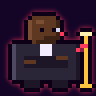

*Regular · L5–7 · deals LOW, weak FUNK, resists LOW · extra armour · v2: Storyville streets · 24×24, glow `red`*

> "Big as a doorway and twice as hard to get past. Resists reason and bass."

- **Being:** a very large human.
- **Silhouette:** fills the grid edge to edge, with shoulders at columns 2–21. A bald head, arms folded, and a brass stanchion with a velvet rope beside him.
- **Palette:**
  - skin `skin6`
  - suit `charcoal`
  - shirt `white`
  - earpiece `chrome` with a `red` light
  - stanchion `gold`/`brass_lo`
  - rope `wine`/`red`
- **Details:** the widest regular sprite. Its silhouette is a doorway.

#### Absinthe Phantom · `absinthe`

*Regular · L6–7 · deals BLUE, weak HOT, resists BLUE · v2: Storyville streets · 24×24, glow `green`, fx `ghost`*

> "A green fog that walks like a gentleman. Burns off in the heat."

- **Being:** a fog spirit.
- **Silhouette:** a top-hatted gentleman in a tailcoat, tipping his hat. Below the waist he dissolves into curling fog.
- **Palette:** `green`/`green_hi`/`green_lo` fog with `moss_lo` shading. The eyes are two `green_hi` sparks.
- **Details:** no outline on the fog tail. It fades to scattered single pixels at the bottom, the one place loose pixels are allowed.

#### Repo Drone · `repo_drone`

*Regular · L5–7 · machine · deals FUNK, weak FUNK, resists HOT · v2: Storyville streets, Mr. Ledger's add · 24×24, glow `cyan`*

> "Takes back what Metronome says you never owned. Including your good mood."

- **Being:** a drone.
- **Silhouette:** a flat hovering shell with twin rotors and a grabber claw hanging below it.
- **Palette:**
  - shell `chrome`/`chrome_md`/`chrome_lo`
  - rotors `chrome_dk`
  - claw `chrome_lo`
  - a `red` repo beacon on top
  - a `cyan` eye strip
- **Details:** the claw grips a small `gold` doubloon.

#### The Bagman · `bagman`

*Elite (bounty Ð260) · L7 · deals LOW, weak BLUE, resists LOW · v2: Storyville streets, the bounty board · 24×24, glow `gold`*

> "Mr. Ledger's collector. The bag is for your Doubloons. The other bag is for you. ELITE."

- **Being:** a human.
- **Silhouette:** a bowler hat and a long coat. A money bag hangs from one hand, and a person-sized burlap sack is slung over the other shoulder.
- **Palette:**
  - skin `skin1`
  - bowler `charcoal`
  - coat `wine_lo`/`charcoal`
  - money bag `green_lo` with a `gold` "Ð"
  - sack `cream_lo`/`mud`
- **Details:** the two bags, one small and one big, balance the silhouette.

### Manchac Swamp

*"Cypress knees in black water, fog thick enough to lean on, jet-turbine airboats screaming past, and Metronome pylons humming a test tone deep in the dark."*

#### Chrome Gator · `chrome_gator`

*Regular · L7–9 · deals LOW, weak HOT, resists LOW · extra armour · v2: Bayou streets · 24×24, glow `low`*

> "Twelve feet of armored reptile with a Metronome tracking tag. Hates heat."

- **Being:** a cyborg alligator.
- **Silhouette:** a long, low body across the whole grid width, facing right, with its jaws slightly open. The back is plated with chrome scutes.
- **Palette:**
  - hide `swamp`/`moss_lo`
  - belly `moss`
  - armour plates `chrome`/`chrome_lo`
  - teeth `chrome_hi`
  - eye `gold`
  - tracking tag `red`
- **Details:** the blinking tracking tag on its neck is the signature, one `red` pixel.

#### Feu Follet · `feu_follet`

*Regular · L7–8 · deals HOT, weak BLUE, resists HOT · extra dodge · v2: Bayou streets · 24×24, strong glow `ghost`*

> "A swamp light that leads travelers astray. Sorrow is the only thing it can't dodge."

- **Being:** a will-o'-wisp.
- **Silhouette:** a teardrop flame floating at about rows 6–20, with two dark eye holes and a few drifting sparks.
- **Palette:** a `ghost_hi`/`ghost` core with a `blue` body and a `hot` outer edge. Eyes are `shadow`.
- **Details:** settles a contradiction in the game text: the prose calls it "bluish", but it deals HOT damage. So it has a blue-white core with an orange edge. No ink outline; the glow does the work.

#### Swamp Grunch · `grunch`

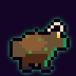

*Regular · L7–9 · deals FUNK, weak LOW, resists FUNK · v2: Bayou streets · 24×24, glow `green`*

> "Half goat, half something else, all headbutt. Lives under the Chef Menteur bridge."

- **Being:** a cryptid.
- **Silhouette:** a hunched, shaggy biped with a goat head and curled horns, head lowered to charge.
- **Palette:**
  - fur `mud`/`moss_lo`/`leather_lo`
  - horns `bone`/`bone_lo`
  - hooves `charcoal`
  - eyes `gold` with horizontal `ink` pupils
- **Details:** algae hangs from its fur (`moss` pixels).

#### Skeeter Swarm · `skeeter`

*Regular · L8–9 · machine · deals HOT, weak HOT, resists BLUE · v2: Bayou streets · 24×24, glow `hot`*

> "Ten thousand mosquito drones that drink Funk. Burn them out."

- **Being:** a drone swarm.
- **Silhouette:** a loose cloud of about 9 tiny mosquito drones, each 3–4 pixels, with needle noses all pointing right.
- **Palette:** bodies `chrome_lo`/`chrome_dk`, wings `cyan_hi`, eyes `hot`, needles `chrome`.
- **Details:** one drone in front is a little bigger, with a `green` drop of stolen Funk on its needle.

#### Rougarou Pup · `rougarou_pup`

*Regular · L8–9 · deals HOT, weak HOT, resists BLUE · v2: Bayou streets · 24×24, glow `hot`*

> "A Chrome Wolf gone feral on the Click's test signal. Still a pup. Still bites."

- **Being:** a young cyborg wolf.
- **Silhouette:** a wolf pup on all fours with its head thrown back mid-howl. The paws are too big for it.
- **Palette:**
  - fur `hair_grey`/`grey`/`grey_lo`
  - chrome patches `chrome`/`chrome_lo` on a shoulder and the jaw
  - eyes `white`
  - implant `hot`
- **Details:** the flickering implant, one `hot` pixel behind the ear, links it to `rougarou`.

#### Big Grunch · `big_grunch`

*Elite (bounty Ð340) · L9 · deals FUNK, weak LOW, resists FUNK · v2: Bayou streets, the bounty board · 24×24, glow `green`*

> "The grunch the other grunches tell stories about. ELITE."

- **Being:** a cryptid.
- **Silhouette:** the grunch, but filling the grid. Horns curl past the frame edges, and the shoulders are hulking. It has its own grid, not a variant.
- **Palette:** as `grunch`, with darker fur (`leather_lo`). Scars are `bone_lo`, and the eyes `red`.
- **Details:** one horn is chipped.

### Cities of the Dead

*"St. Louis Cemetery No. 1. Whitewashed tombs in neat rows, LED votives flickering in the alcoves, and beneath it all a hum: the Data Mausoleum."*

#### Wandering Haint · `haint`

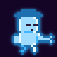

*Regular · L9–10 · deals BLUE, weak BLUE, resists FUNK · v2: the haint street event · also the `haint` speaker · 24×24, glow `blue`, fx `ghost`*

> "A restless spirit drifting between the tombs. Sorrow calls it home." · "A ghost. Haint blue paint on a porch ceiling keeps them out." · "sits on a tomb, swinging its legs" · "cackles and fades"

- **Being:** a ghost of a New Orleans local, once a musician.
- **Silhouette:** a translucent old man in a hat, with legs dangling as if sitting on a tomb's edge. The lower half fades out.
- **Palette:** body `ghost`/`ghost_hi`, shading `blue`/`blue_lo`, hollow eyes `shadow`, hat `blue_lo`.
- **Details:** a faint cornet held loosely in his hand, drawn in `ghost`. The ghost of the music, not the music.

#### Data Wraith · `data_wraith`

*Regular · L9–11 · deals FUNK, weak FUNK, resists HOT · v2: Cemetery streets · 24×24, glow `green`, fx `glitch`*

> "A corrupted file that learned to haunt. Keeps strict time, badly."

- **Being:** a digital ghost.
- **Silhouette:** a hooded wraith with blocky, broken edges. Whole rows are shifted sideways, and some chunks are missing entirely.
- **Palette:**
  - robe `charcoal`/`shadow`
  - glitch slices `green`/`magenta`/`cyan`
  - face `ink` with two `green` square eyes
- **Details:** the `glitch` effect adds jitter. In the grid itself, offset 2–3 rows by one pixel, so the static look is broken too.

#### Tomb Crawler · `tomb_crawler`

*Regular · L10–11 · deals LOW, weak LOW, resists BLUE · v2: Cemetery streets · 24×24, glow `low`*

> "Eight legs and a marble shell. Digs in when it's scared."

- **Being:** a creature, crab-like.
- **Silhouette:** a low, wide domed marble shell shaped like a little tomb roof, with eight thin legs splayed on both sides.
- **Palette:**
  - shell `marble`/`marble_lo`
  - shell cracks `chrome_lo`
  - legs `charcoal`/`shadow`
  - eyes `low`
- **Details:** a faded carved cross and an LED votive (`gold`) set into the shell.

#### Archive Drone · `archive_drone`

*Regular · L9–11 · machine · deals FUNK, weak FUNK, resists LOW · v2: Cemetery streets · 24×24, glow `cyan`*

> "Records everything you do and plays it back wrong. Copies your buffs." · "photographs a tomb inscription, then erases it"

- **Being:** a drone.
- **Silhouette:** a floating box camera with one huge round lens facing right, and two tape reels on top like ears.
- **Palette:**
  - body `chrome`/`chrome_lo`
  - lens `chrome_dk` with a `cyan` iris and a `cyan_hi` glint
  - reels `charcoal` with `chrome_md` spokes
  - a `red` REC light
- **Details:** the REC light is the signature.

#### Bone Choir · `bone_choir`

*Regular · L10–11 · deals BLUE, weak HOT, resists BLUE · v2: Cemetery streets · 24×24, glow `blue`*

> "Four skeletons in perfect four-part harmony. Perfect is the problem."

- **Being:** four skeletons sharing one battle slot.
- **Silhouette:** four small skeletons, two in front and two behind standing a step higher, all with jaws open in song. Each one is about 6 pixels wide.
- **Palette:**
  - bones `bone`/`bone_lo`
  - eye sockets and mouths `ink`
  - a sheet of music `white` held by the front pair
  - a faint `blue` note above them
- **Details:** settles a contradiction in the game text: one ambient line says three skeletons, but the Blue Book says four, and four it is.

#### Crypt Keeper Unit · `crypt_keeper`

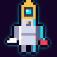

*Elite (bounty Ð420) · L11 · machine · deals LOW, weak FUNK, resists LOW · v2: Cemetery streets, the bounty board · 24×24, glow `cyan`*

> "Metronome's groundskeeper. Seals tombs and mouths. ELITE."

- **Being:** a robot.
- **Silhouette:** a tall, narrow robot with a lantern for a head, a trowel in one hand and a sealing stamp in the other.
- **Palette:**
  - body `chrome`/`chrome_md`/`chrome_lo`
  - lantern head `gold` frame with a `cyan` flame eye
  - faceplate with a `chrome_dk` padlock "mouth"
  - trowel `chrome_hi`
  - stamp `red`
- **Details:** the padlock where its mouth should be, for "seals mouths".

#### Ghost Track · `ghost_track`

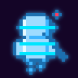

*Summon (only the Archivist calls it) · deals BLUE, weak BLUE, resists FUNK · half Heart · v1: Data Mausoleum, Archivist fight (v2 via dev boss jump) · 24×24, glow `blue`, fx `ghost`*

> "The captured echo of a dead musician, replayed by the Archivist. It wants to rest." · "A Ghost Track flickers into the room, an echo of a dead musician."

- **Being:** a recorded ghost.
- **Silhouette:** a translucent musician playing a clarinet, frozen mid-phrase. Horizontal tape-noise lines cut through the body.
- **Palette:** body `ghost`/`blue`, with a `cyan` scan line every few rows and a `blue_lo` outline.
- **Details:** a little `red` REC dot over its shoulder. The Archivist is still recording it.

### Garden District

*"Oak-lined St. Charles Avenue. Mansions under security domes, topiary trimmed into soldiers, and a streetcar that runs in perfect silence past gates that never open."*

#### Debutante Droid · `debutante`

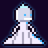

*Regular · L11–12 · deals BLUE, weak FUNK, resists BLUE · v2: Garden streets · 24×24, glow `blue`*

> "White gloves, chrome smile, and a look that could curdle gumbo." · "curtsies to nothing and holds it"

- **Being:** an android.
- **Silhouette:** a wide white ball gown that is a bell shape at the bottom, a tiny tiara, and a frozen curtsy.
- **Palette:**
  - face and arms `chrome`/`chrome_md`
  - gown `white`/`marble_lo` tulle
  - gloves `white`
  - tiara `cyan_hi`
  - eyes `blue`
- **Details:** the chrome smile, a `chrome_hi` line of teeth.

#### Butler Unit · `butler`

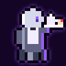

*Regular · L11–13 · machine · deals LOW, weak LOW, resists HOT · v2: Garden streets · 24×24, glow `low`*

> "Serves tea, serves subpoenas, patches up its friends." · sweeps "in 3/4 time"

- **Being:** a robot.
- **Silhouette:** a tailcoat-shaped chrome body with a bow tie and one round eye. It carries a silver tray holding a teapot.
- **Palette:**
  - body `chrome_lo`/`chrome_dk` coat shape
  - shirt front `white`
  - bow tie `charcoal`
  - eye `low`
  - tray `chrome_hi`/`chrome`
  - teapot `white`
- **Details:** a folded subpoena on the tray next to the teapot (`cream` with a `red` seal).

#### Topiary Mech · `topiary`

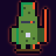

*Regular · L12–13 · machine · deals HOT, weak HOT, resists LOW · v2: Garden streets · 24×24, glow `hot`*

> "A hedge trimmed into a soldier, with a soldier inside. Flammable."

- **Being:** a mech inside a hedge.
- **Silhouette:** a hedge clipped into a toy soldier with a tall shako hat and a rifle shape, standing at attention.
- **Palette:**
  - leaves `moss`/`moss_lo`/`green_lo`
  - a chrome visor slit `chrome`/`chrome_dk` with a `hot` eye
  - feet `wood_lo` planter
- **Details:** one leafy gap in the chest shows the chrome inside.

#### String Quartet Drone · `quartet`

*Regular · L12–13 · machine · deals BLUE, weak FUNK, resists BLUE · low Heart · always fights as four · v2: Garden streets · 24×24, glow `blue`*

> "One of four. Plays licensed chamber music with zero swing. Low Heart, high harmony."

- **Being:** a drone. Four identical ones fill a fight.
- **Silhouette:** a hover ring holding a spherical body. Two thin mechanical arms play a violin held under its "chin".
- **Palette:**
  - body `chrome`/`chrome_md`
  - hover ring `blue`
  - violin `wood`/`wood_lo` with `white` strings
  - bow `chrome_hi`
  - eye `blue`
- **Details:** a little `white` sheet-music stand clipped to its side.

#### Valet Assassin · `valet`

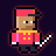

*Regular · L12–13 · deals HOT, weak BLUE, resists FUNK · v2: Garden streets · 24×24, glow `hot`*

> "Parks your car, picks your pocket, pierces your lung. Tips appreciated."

- **Being:** a human. This is **not** the Silver Tuxedo valet (`tuxedo_valet`).
- **Silhouette:** a valet's cap and a short jacket, standing politely, with a knife hidden behind the back. Its blade glints out past the hip.
- **Palette:**
  - skin `skin3`
  - cap and jacket `red`/`red_lo` with `gold` buttons and braid
  - trousers `charcoal`
  - gloves `white`
  - knife `chrome_hi`
- **Details:** a polite smile, and the knife glint is the joke.

#### Security Chief Beaumont · `beaumont`

*Elite (bounty Ð520) · L13 · deals HOT, weak FUNK, resists BLUE · v2: Garden streets, the bounty board · 24×24, glow `hot`*

> "Runs security for the Vane estate. Three shots, never misses twice. ELITE."

- **Being:** a human.
- **Silhouette:** broad, with mirrored sunglasses and a high-collared security coat. A pistol is held low at the side.
- **Palette:**
  - skin `skin5`
  - shades `chrome_hi`/`cyan`
  - coat `charcoal`/`grey_lo`
  - badge `gold`
  - pistol `chrome_lo`
  - earpiece cord `white`
- **Details:** three `hot` tally marks on the coat's shoulder. Three shots.

### Central Business District

*"Glass canyons and a sky the color of a dead CRT. Metronome Tower rises out of the middle of it, a chrome needle with a pendulum in its crown, and the whole city ticks to it."*

#### Hush Elite · `hush_elite`

*Regular (Tower) · L13–14 · deals LOW, weak FUNK, resists BLUE · v2: Tower streets · 24×24, glow `gold`*

> "The Hush's best. Gold chrome, no citation pad. They don't write tickets anymore." · "Hush Elites in gold armor"

- **Being:** a human in Metronome armour.
- **Design:** a variant of `hush_patrol`, recoloured into gold chrome (`chrome_hi`→`brass_hi`, `chrome`→`gold`, `chrome_md`→`brass_lo`, `chrome_lo`→`brass_dk`). The overlay erases the citation pad (`_`) and adds a riot baton.
- **Sprite:** variant (recolour + overlay), glow `gold`.

#### Quantizer · `quantizer`

*Regular · L13–15 · machine · deals FUNK, weak FUNK, resists HOT · v2: Tower streets · 24×24, glow `cyan`*

> "Snaps everything to the grid. Your buffs, your Groove, your pulse."

- **Being:** a machine. The text never describes its shape, so it gets the grid itself.
- **Silhouette:** a floating cube drawn as a wireframe grid, with one eye in the middle. It is perfectly symmetric, the only sprite that is.
- **Palette:**
  - grid lines `cyan`/`cyan_lo`
  - faces `chrome_dk` with `chrome_lo`
  - eye `chrome_hi` with a `cyan` pupil
- **Details:** tiny `cyan` corner brackets float off the cube's corners, snapping into place.

#### Click Sentinel · `sentinel`

*Regular · L14–15 · machine · deals LOW, weak LOW, resists FUNK · v2: Tower streets · 24×24, glow `cyan`*

> "A chrome pendulum with a gun. Winds up, then takes your voice." · "The Click Sentinel winds its mainspring..."

- **Being:** a machine.
- **Silhouette:** a tall, narrow metronome body on short legs. Its pendulum arm swings out to the right and ends in a gun barrel. A wind-up key sticks out of its back.
- **Palette:**
  - body `chrome`/`chrome_md`/`chrome_lo`
  - pendulum `chrome_lo` with a `gold` weight
  - gun barrel `chrome_dk`
  - key `gold`
  - eye `cyan`
- **Details:** tick marks down the face (`chrome_dk`).

#### Tempo Warden · `warden`

*Elite (bounty Ð650) · L15 · machine · deals FUNK, weak FUNK, resists BLUE · v2: Tower streets, the bounty board · 24×24, glow `cyan`*

> "The Conductor's personal enforcer. Keeps the Tower at exactly 120 BPM. ELITE."

- **Being:** a machine.
- **Silhouette:** a heavy armoured biped with a pyramid head, broad shoulders, and a long baton-rod held across the body.
- **Palette:**
  - armour `chrome_hi`/`chrome`/`chrome_lo`
  - trim `gold`
  - head panel `chrome_dk`
  - rod `chrome_hi` with a `cyan` tip
- **Details:** a `cyan` "120" readout on its chest (three digits, 3×3 pixels each), simplified to `1`, `2`, `0` blocks.

### Cutting Contest rivals

*"The back room of Club Feu Follet." These three fight with real class skills. Their scenes are in v2 (dev menu → Cutting Contest) and v1.*

#### "Hot Rod" Broussard · `rival_hotrod`

*Rival · trumpet · L4 · deals HOT, weak LOW, resists HOT · 24×24, glow `hot`*

> "Trumpet. Plays high, plays loud, plays like the bell is on fire. Lost once, in 2081, and won't talk about it." · "trumpet already at his lips" · "lowers his horn and grins"

- **Being:** a human, a cocky trumpet player.
- **Silhouette:** a slick pompadour and a leather jacket, with the trumpet up and flames licking out of the bell.
- **Palette:**
  - skin `skin3`
  - pompadour `hair_black`
  - jacket `charcoal` with `hot`/`gold` flame decals
  - trumpet `gold`
  - flames `hot`/`gold`/`brass_hi`
- **Details:** the flaming bell sets him apart from `hero_trumpet` at a glance.

#### Big Mae Boudreaux · `rival_bigmae`

*Rival · sousaphone · L5 · deals LOW, weak HOT, resists LOW · extra armour · 24×24, glow `low`*

> "Sousaphone. Holds down the low end of three bands and the whole Feu Follet bar when she leans on it." · "settles the sousaphone on her shoulder and the floorboards complain"

- **Being:** a big, powerful woman who has to duck through the door.
- **Silhouette:** as wide as the frame, with a head wrap. A sousaphone bell rises over her shoulder on the opposite side from `hero_sousaphone`.
- **Palette:**
  - skin `skin5`
  - head wrap `low`/`low_lo`
  - dress `wine`
  - sousaphone `gold`/`brass_lo` with a `brass_dk` bell inside
- **Details:** the bell is on her left, mirrored from the hero's. Both are wide, but they never look alike.

#### Henri "Two-Tone" LeBlanc · `rival_twotone`

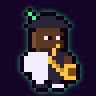

*Rival · saxophone · L5 · deals FUNK, weak HOT, resists FUNK · 24×24, glow `green`*

> "Saxophone. Honks and ballads, one for each shoe. Sweetest player on Frenchmen when he isn't cutting you." · "tips his hat and honks once, filthy"

- **Being:** a human, a sharp-dressed sax man.
- **Silhouette:** a fedora with a feather, a suit split down the middle into two colours, and a tenor sax.
- **Palette:**
  - skin `skin6`
  - fedora `charcoal` with a `green` feather
  - suit split: left half `white`, right half `charcoal`
  - two-tone shoes `white`/`charcoal`
  - sax `gold`
- **Details:** the half-and-half suit makes "Two-Tone" literal.

---

## Bosses

Bosses are 32×32 and appear at 96px in battle. The six who speak in scenes show at 64px in dialogue. Each guards a Blue Note, and each should be the most detailed sprite in its district. Phases show through the battle UI: status chips like Perfect Silence and Pitch Shield, and log lines. The sprite doesn't change between phases.

### Captain Hush · `captain_hush`

*Tremé, Congo Square · L3 · guards Blue Note C · deals LOW, weak FUNK, resists BLUE · speaker `hush` · v2: the prologue raid, the Congo Square boss · 32×32, glow `cyan`*

> "Metronome's man in Tremé. Declared Congo Square a Quiet Zone and found out why the drums never stopped." · "white chrome gleaming, dampener on his belt" · "By order of Metronome, this square is now a Quiet Zone. Unlicensed syncopation detected. Cease all swing."

- **Being:** a human, the top of the Hush family.
- **Silhouette:**
  - the Hush helmet with its big ear-cups, plus a tall chrome crest fin on top
  - wide pauldrons and a short cape
  - a baton in one hand
  - the round dampener on his belt
- **Palette:**
  - armour `chrome_hi`/`chrome`/`chrome_md`/`chrome_lo`
  - visor `chrome_dk` with a `cyan` slit
  - crest `chrome_hi` with a `cyan` edge
  - cape `navy`/`navy_lo`
  - epaulettes `gold`
  - dampener `chrome_dk` with a `cyan` speaker grille
- **Details:** the dampener is the signature. On defeat it "cracks", but the sprite stays whole.

### Vox Perfecta · `vox_perfecta`

*French Quarter, Bourbon Strip main stage · L5 · guards E♭ · hologram · deals HOT, weak BLUE, resists HOT · speaker `vox` · v2: dev boss jump · 32×32, glow `magenta`, fx `holo`*

> "The holographic android diva headlining the Bourbon Strip. Perfect pitch, perfect time, and one note she cannot feel." · "forty feet of hologram folding down into something person-sized and silver" · "Her chassis is open… under the licensing chip"

- **Being:** a silver android wrapped in her own hologram.
- **Silhouette:**
  - a slim silver figure at a vintage mic stand
  - hair and a flowing gown made of light that streams off to one side, wider than the body
- **Palette:**
  - chassis `chrome_hi`/`chrome`/`chrome_md`
  - hologram hair and gown `magenta`/`magenta_hi`/`magenta_lo`, with `cyan_hi` highlights
  - lips `magenta`
  - eyes `cyan`
  - mic stand `chrome_lo`
- **Details:**
  - a small `gold` licensing chip glows on her chest; it's where the player reaches in
  - the `holo` effect flickers only the light parts; draw the chassis solid

### Mr. Ledger · `mr_ledger`

*Storyville, the vault under Basin Street · L7 · guards F · deals LOW, weak FUNK, resists BLUE · speaker `ledger` · v1: Ledger & Sons (v2 via dev boss jump) · 32×32, glow `gold`*

> "Bought every contract in Storyville and keeps them in a vault under Basin Street. His Chops compound every turn. Kill him fast." · "at a brass desk… reading. He closes the book" · "smiling like a closed account"

- **Being:** a human, the owner of Ledger & Sons.
- **Silhouette:** a thin, very upright man in a three-piece pinstripe suit, holding a huge ledger book open against his chest.
- **Palette:**
  - skin `skin1`
  - bald head with `hair_grey` sides
  - green eyeshade `green_lo` with a `green` edge
  - round glasses `gold`
  - suit `navy`/`navy_lo` with `grey` pinstripes
  - waistcoat `wine`
  - ledger `wine_lo` cover with `cream` pages and `gold` corners
  - fountain pen `gold`
- **Details:** the closed-account smile, a thin straight `ink` line, and a `gold` watch chain.

### Le Rougarou Chromé · `rougarou`

*Manchac Swamp, Pump Station 13 · L9 · guards G · deals HOT, weak HOT, resists LOW · after the fight he speaks as `lucien` · v1: Pump Station 13 (v2 via dev boss jump) · 32×32, glow `hot`*

> "Lucien, alpha of the Chrome Wolves, overclocked into a rougarou by the Click's test signal. Weak to heat; the implant runs hot already." · "chrome fur, white eyes, a jaw that's more machine than mouth"

- **Being:** a cyborg werewolf, Lucien transformed.
- **Silhouette:** a towering, hunched wolf-man with claws out, a long muzzle with a chrome machine jaw, and wild fur spiking off the shoulders.
- **Palette:**
  - fur `chrome`/`chrome_md`/`chrome_lo`, as chrome fur
  - darker fur `grey_lo`
  - jaw `chrome_hi`/`chrome_dk` with `chrome_hi` fangs
  - eyes `white`, glowing
  - implant `hot` with a `hot_lo` cable
  - torn jeans `navy`, left over from Lucien
  - claws `chrome_hi`
- **Details:** the hot implant at the temple matches `rougarou_pup` and `lucien`.

### The Archivist · `archivist`

*Cities of the Dead, the Data Mausoleum · L11 · guards B♭ · machine · deals FUNK, weak BLUE, resists FUNK · speaker `archivist` · summons `ghost_track` · v1: Data Mausoleum (v2 via dev boss jump) · 32×32, glow `cyan`*

> "Curator of the Data Mausoleum, where Metronome stores the stolen songs of the dead to train the Click. Grief breaks through its filters." · "a server farm shaped like a chapel" · "a machine for grief"

- **Being:** a machine. The game never says whether it is separate from its racks. Here it is one tall rack-body.
- **Silhouette:**
  - a server rack shaped like a chapel window, with a pointed arch top
  - a CRT face set in the arch
  - two cable arms holding a glowing data reel
- **Palette:**
  - rack `chrome_dk`/`chrome_lo` with blinking `green`/`cyan` drive lights
  - arch trim `marble`
  - CRT face `cyan_lo` screen with `cyan_hi` eyes and a downturned mouth
  - cables `charcoal`
  - reel `cyan`/`ghost`
- **Details:** a single `ghost` tear on the screen, for "grief breaks through its filters".

### Lady Concertmaster Isolde Vane · `isolde`

*Garden District, the Vane Manor ballroom · L13 · guards G♭, the blue note itself · deals BLUE, weak FUNK, resists BLUE · speaker `isolde` · v1: Vane Manor (v2 via dev boss jump) · 32×32, glow `chrome_hi`*

> "Metronome's First Chair, keeper of the Blue Note." · "a violin that is also, somehow, a blade" · "Father never let me be flat."

- **Being:** a human aristocrat and virtuoso.
- **Silhouette:** tall and straight-backed, with a platinum updo and a long white gown. Her violin is at her shoulder, and the bow is a long blade raised like a rapier.
- **Palette:**
  - skin `skin1`
  - hair `hair_white`/`chrome_hi`
  - gown `white`/`marble_lo`/`chrome_md`
  - pearl choker `chrome_hi`
  - violin `wood`/`wood_lo`
  - bow-blade `chrome_hi`/`cyan_hi`
  - eyes `blue`
- **Details:** a single `cyan_hi` glint along the blade's edge. She is the only boss whose glow is pure white.

### The Conductor · `conductor`

*Maestro Aurelius Quant, CEO of Metronome · Tower, the Booth · L15 · deals LOW, weak FUNK, resists BLUE · speaker `conductor` · v1: the Booth (v2 via dev boss jump) · 32×32, glow `chrome_hi`*

> "Maestro Aurelius Quant, CEO of Metronome, conducting from the Booth." · "at the console, baton raised" · "Jazz is just error, repeated until someone mistook it for culture."

- **Being:** a human.
- **Silhouette:** a tall, thin older man in a long-tailed coat, with his baton raised high and the other hand flat (the Fermata).
- **Palette:**
  - skin `skin2`
  - slicked hair `hair_white`/`hair_grey`
  - tailcoat `charcoal`/`shadow`
  - shirt `white`
  - bow tie `chrome_hi`
  - a glass headset with a `cyan` mic
  - baton `chrome_hi` with a `ghost_hi` glow
  - a `gold` metronome lapel pin
- **Details:** the glowing baton is the brightest pixel line in the sprite.

### THE CLICK · `the_click`

*Tower, the Crown · L15 · machine · deals FUNK, weak FUNK, resists BLUE · never speaks · v1: the final battle (v2 via dev boss jump) · 32×32, glow `cyan`*

> "The perfect beat, broadcast from the Tower's crown. Behind Perfect Silence it takes no damage." · "A colossal chrome metronome fills the Tower's crown. It does not speak. It ticks."

- **Being:** a colossal machine, the metronome itself.
- **Silhouette:** a huge pyramid metronome filling the grid, on a stepped base. A long pendulum is frozen mid-swing to the left, with a heavy weight on it.
- **Palette:**
  - body `chrome_hi`/`chrome`/`chrome_md`/`chrome_lo`
  - face panel `chrome_dk` with `cyan` tick marks
  - a single `cyan` eye at the apex with a `cyan_hi` center
  - pendulum `chrome_lo` with a `gold`/`brass_lo` weight
  - base `chrome_dk`
- **Details:** perfectly symmetric except for the pendulum, the one thing out of line.

---

## Shopkeepers

These six run shops and never speak, so none of them has an NpcId. They're listed in `SHOPKEEPERS` with the place whose shop they run, and the scene passes them as `keeper` when it opens that shop. The crawler checks each one appears once its district is ported.

### Thirsty Pelican bartender · `pelican_bartender`

*French Quarter, the Thirsty Pelican (drinks; starts the crawfish races with a whistle) · 24×24, glow `hot`*

- **Silhouette:** a burly bald bartender with a handlebar mustache, a towel over his shoulder, and a whistle on a lanyard.
- **Palette:**
  - skin `skin4`
  - mustache `hair_black`
  - tropical shirt `hot`/`hot_lo` with a `white` pelican print
  - towel `white`
  - whistle `chrome`

### Fais Do-Do bartender · `faisdodo_bartender`

*Manchac Swamp, the Fais Do-Do (drinks) · 24×24, glow `green`*

- **Design:** a variant of `pelican_bartender`, recoloured to `skin2` skin, a `moss`/`moss_lo` shirt and a `hair_brown` mustache. Same pose; a bayou dancehall keeper.

### French Market vendor · `market_vendor`

*French Quarter, the French Market (one of the "old woman selling hot sauce", the praline hawker, the sno-ball man) · 24×24, glow `red`*

- **Silhouette:** an older woman in a bandana and apron, holding up a bottle of hot sauce.
- **Palette:**
  - skin `skin3`
  - bandana `red`/`red_lo`
  - apron `cream`
  - dress `navy`
  - bottle `red` with a `white` label and a `gold` cap

### Chop Shop surgeon · `chop_surgeon`

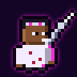

*Storyville, the Basin St Chop Shop (cyberware mods) · 24×24, glow `magenta`*

> "the surgeon… a cigarette and three arms"

- **Silhouette:** a street surgeon in a stained white coat with goggles pushed up. A third chrome arm rises over the shoulder holding a whirring drill, and a cigarette hangs from the lip.
- **Palette:**
  - skin `skin5`
  - goggles `chrome` with `magenta` lenses
  - coat `white` with `red_lo` stains
  - chrome arm `chrome`/`chrome_lo`
  - drill bit `chrome_hi`
  - cigarette `white` with a `hot` ember

### Maison Chrome clerk · `maison_clerk`

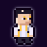

*Garden District, Maison Chrome (luxury threads) · 24×24, glow `chrome`*

- **Silhouette:** a prim, narrow clerk in pince-nez, with a measuring tape draped around the neck and a silver waistcoat.
- **Palette:**
  - skin `skin1`
  - hair `hair_black`, parted
  - pince-nez `gold`
  - waistcoat `chrome`/`chrome_md`
  - shirt `white`
  - tape `gold` with `ink` ticks

### Silver Tuxedo maître d' · `tuxedo_maitre`

*Garden District, the Silver Tuxedo ("pricey buffs") · 24×24, glow `gold`*

- **Design:** a variant of `tuxedo_valet`, recoloured to a `charcoal` jacket with `gold` trim, `skin4` skin and `hair_black` hair. The same bored elegance, one rank up.

---

## Continuity calls

Where the game text contradicts itself or doesn't say, these are the decisions the art follows:

- **Feu Follet's colour:** the prose says "bluish" twice, but it deals HOT damage. It has a blue-white core with an orange edge.
- **Bone Choir:** four skeletons, as in the Blue Book. One ambient line says three.
- **Session Clone:** the player's class hero in a chrome recolour, not a sprite of its own. The battle picks it by the actor's `clone` flag, because rivals also carry a class.
- **The Archivist's body:** one chapel-shaped rack-body with a CRT face.
- **Quantizer's shape:** never described, so it gets a wireframe grid cube, the one perfectly symmetric sprite.
- **Busker-Bot's instrument:** never named, so it gets a chrome ukulele.
- **Ghost Track's instrument:** never named, so it gets a clarinet.
- **NpcId `valet` vs EnemyId `valet`:**
  - They are different people. The speaker is the Silver Tuxedo valet (`tuxedo_valet`); the enemy is the Valet Assassin.
  - A compile-time guard keeps person sprite ids from ever reusing an opponent id.
- **Big Mae Boudreaux vs Boudreaux:** unrelated, as far as the game says. Different builds, different palettes.
- **The streetcar conductor vs The Conductor:** the streetcar conductor gets no sprite (see below).
- **`stranger` and `busker`:** each id covers several people, so their designs are deliberately generic.
- **`hush` in the prologue:** the raid's squad leader speaks as `hush` and shows as Captain Hush, as the text attributes it.

## Appendix: people with no sprite

These people appear in narration but never speak, never fight and never run a shop, so they get no sprite. They are listed here so the cast is complete:

- **Prologue and Tremé:**
  - the brass band carrying Gus's casket
  - the neighbourhood second line ("Umbrellas up. Handkerchiefs out.")
  - "the Grand Marshal who isn't Gus"
  - the Congo Square drummers and sparring partners
  - two kids on a stoop
  - the trombone player at a Rampart Street window
- **Streets and street events:**
  - a float crew on a papier-mâché pelican
  - crawfish-boil hosts
  - a tourist "in a MoodSync visor"
  - bus-stop sleepers
  - a porch trio (trombone, guitar, washboard)
  - caterers
  - the streetcar conductor
  - a photo of a man with a cornet on a tomb
- **The Quarter (v1):**
  - a kid with a cornet on a balcony
  - the sno-ball man and the praline hawker. They are represented by `market_vendor`.
  - the Bourbon Strip crowd, and the off-key whistler
- **Storyville (v1):**
  - armed clerks and a singer at Ledger & Sons
  - a balcony dancer
  - a singer in a window
  - the Basin Street flower seller (mentioned only)
- **Rumour-tellers (v1):**
  - "a man at the bar with a frottoir scar on his chest"
  - "a woman at the end of the bar with three empty go-cups"
- **The Bayou (v1):** a Cajun band on an airboat.
- **The Garden District (v1):**
  - a diner at the Silver Tuxedo
  - a courier
  - the ball droids (a dowager, a host unit, a valet-droid). Draw them as variants of `debutante` and `butler` if P3 gives them lines.
- **The finale (v1):**
  - the crowd on Claiborne
  - "somebody on the line" who hands you a beignet

**Coming with P3 and P4:**

- **The Restless Haints ghosts** (v1 custom speakers):
  - "A haint under the oak" (a cornet player from the Eureka Brass Band)
  - "A haint by the wall" (a woman who sang at the Lantern)
  - "A haint who won't stop singing"

  When P3 ports them, give each `speak()` line the sprite `'haint'` (its optional fourth argument).
- **Gus's ghost** (the Data Mausoleum, the second line, the ending): a `gus` variant with `fx: 'ghost'` and a `ghost`/`blue` recolour. Showing it needs a way to pick it per line, for example `speak()` with a sprite, so add it when P3/P4 ports those scenes.
